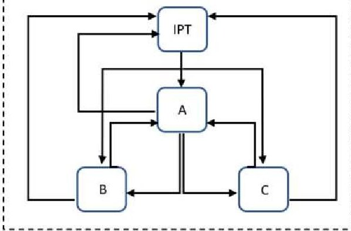
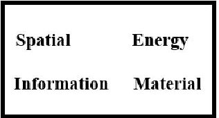

<!-- PDF_PAGE: 1 -->

# Design Structure Matrix For Design Assurance and Management: The Case of CubeSats

Nasim Chitsaz

School of Engineering

University of South Australia

Mawson Lakes, Australia

nasim.chitsaz@unisa.edu.au

Mahmoud Efatmaneshnik

School of Engineering

University of South Australia

Mawson Lakes, Australia

mahmoud.efatmaneshnik@unisa.edu.au

Abstract—Systems engineering is suitably applied to space programming due to the multidisciplinary and complex nature of space missions where systematic design methods are commonly utilized. For designing a spacecraft, knowledge and expertise from different disciplines are required and numerous projects and subprojects need to work simultaneously and in close coordination. The purpose of this article is to analyze the system design process for a CubeSat using a design structure matrix. Considering the characteristics of the design structure matrix method is a powerful design tool that assists in managing the complexity of system design with many parameters. The design structure matrix method offers advantages to address these deficiencies in the design process of a satellite because it considers multiple factors that exist in the design process. The design structure matrix method helps reduce repetitions in the process. This method has been used to show the interdependent relationships between the different components of CubeSat and present the design process at the system level. In this study, 4 main components and their effect on each other have been demonstrated. The process was identified in the form of a matrix. This study aimed to capture the issues, activities, challenges, and opportunities for improving the conception, design, manufacture, testing, launch and operation of small satellite missions and identify lessons learned for process improvements of future missions.

Keywords— Design structure matrix, CubeSat, Complex system, and System design process

## I. INTRODUCTION

In increasing order of complexity and details, the design processes range from conceptual design and actual design to the detailed production drafts of the spacecraft [1]. Due to the interrelationships of parameters involved in the design and production, any change in one parameter can affect other design parameters. The tools used in the design process of a satellite have increased and so have the details regarding the interrelationships of the design parameters. These interrelationships are not usually properly captured and provided to the designer by the design tools [2, 3].

To facilitate the system design of satellites, various tools have been proposed and utilized. Some examples include the system design tool (SDT) developed in 1998 or MusSat in 2000. The SDT was designed for budgeting of different systems by input considerations including mission type but could not provide a proper design view for interrelated parameters and the influence they had on each other. MusSat uses the data from the existing satellites to create the model

and defined the relationship between the design parameters ultimately used for designing of new satellite [4].

A design structure matrix or dependency structure matrix (DSM) is a systems engineering tool that lays out a compact visual representation of a complex system [5, 6] in a simple way in line with the needs for system integration and disintegration [7]. DSMs are increasingly being used across various areas and projects [8, 9], aerospace [10, 11], construction [12, 13], industries [14], organizations, systems, and product design has given their system representation and technical abilities [15]. DSM is divided into two categories, one as static-based which describes existing system components simultaneously and is independent of time and the second is time-based which represents a flow through time. The static-based category includes component-based and team-based, and the clustering algorithm can be employed for their analysis [8]. For instance, the component-based DSM was applied to enhance the quality of the design product at Ford Motor corporation by Pimmler and Eppinger [16]. Component-based DSM was applied in a wide range of development applications such as engine design or laptop development in 1993 [17]. Time-based DSM includes activity-based and parameter-based classes [8]. In time-based DSMs, time flow is in close coordination with the order of the rows and columns and upstream factors come before downstream ones. When interfaces are considered, phrases such as 'feedforward' and 'feedback' are often used. Activity-based DSM has been used in many areas such as aerospace [18, 19], automotive [20], and manufacturing industries [21, 22]. For automotive diagnostic systems, Cesiel (1993) applied a parameter-based DSM to develop a calibration [23]. In another example, Rask and Sunnersjo (1998) utilised a parameter-based approach in process of designing a robotic arm and housing and their relevant node design variables [16, 24].

In the context of CubeSat design, a system of systems (SoS) refers to a collection of individual CubeSats that work together to achieve a common objective. The DSM method is implemented on a CubeSat example that enables the designer to reach an optimized design by considering the impact of CubeSat design parameters on each other. There are some considerations for determining the scope of the DSM for CubeSat SoS problems such as: defining the system boundaries; identify the subsystems; determining the interdependencies; determining the level of detail; and updating the matrix as needed. The specific aim of the current

<!-- PDF_PAGE: 2 -->

research is to explain the disintegration of the system into its smaller components and an analysis of the relationship between different parameters and the interdependency of different tasks. We have utilized the static-based DSM method to address the research objectives which can provide a graphical view of dependency between elements of the design, tasks, and teams and eventually simplify the design process for complex satellite design projects.

## II. PROBLEM STATEMENT

A major challenge in the complex design process of a satellite is the involvement of an often large number of parameters and their interdependency as part of different systems and subsystems [25]. As the size of a project increases, the dependencies and interactions between different components or elements increase exponentially. Accordingly, fewer independent tasks are involved, and most tasks are reliant on the conclusion of other tasks. For a satellite, these components may include but are not limited to the integrated project team, mission type, launcher parameters, cargo type and environmental factors [26]. In the process, it should be decided which components need to be designed first and how each component can affect other components when a design changes a particular parameter or input. Some parameters create a bilateral information connection with other parameters which can potentially cause rework, delays and other issues in designing a satellite. Most models for designing satellites utilize a data bank or repository which cannot provide a comprehensive overview of the interactive nature of teams and their components in response to changes in one or multiple components. The DSM approach is useful for organizing and managing complex systems engineering projects. It is particularly beneficial for CubeSat design, which involves multiple subsystems that must work together seamlessly in a limited space and under strict weight constraints. Therefore, in this article, using a structural tool based on the design structure matrix is proposed to be available to satellite designers to solve this problem. This method has been applied to a CubeSat design example. There are some benefits of using the DSM approach for CubeSat design as it simplifies complex systems; facilitates collaborative design; helps identify risks; enhances project management; and enables iterative design. The DSM approach allows designers to break down the CubeSat subsystems into smaller, more manageable components. This simplifies the design process, making understanding the relationships between subsystems and identifying potential conflicts or dependencies easier. That means the main components at the system level were selected and their structural dependencies with the interactions between components and the interaction qualification scheme were identified. Furthermore, the analysis is performed based on the interactions among the components in order to evaluate the project and also identify whether adequate information or interaction exists between the organization hierarchy. The matrix should include all the subsystems and components that are relevant to the overall goal of the system of systems. The matrix should also include the interfaces and dependencies between the subsystems and components, to ensure that the matrix captures the interactions between the subsystems and components.

## III. SYSTEM STRUCTURE METHODS

A DSM model can include four structures relating to Components, Teams, Activities and Parameters [15].

Component-based models are useful to deal with system architectures considering components and the interaction between them. In a complex systems model, the interaction between elements and the type of interactions are documented and illustrated through a component-based DSM document. Depending on the project nature the type of interactions differs within four categories. Table 1 [27] shows four types of interaction including Spatial, Energy, Information and Material. Team-based DSM is created through the identification of necessary communication flows, showing them as connections among organizational components in the matrix. The flow of information between teams needs to be clearly defined and specified as part of the modelling process. In a matrix organization, teams are responsible to multiple leaders. The communication between teams is facilitated in the matrix design which creates opportunities for innovation and service improvement in companies. When this structure is used, there is no need for constant realigning of the teams for each new project. Activity or task-based DSMs can be particularly useful to demonstrate the effect or dependency of two separate activities together. Therefore, DSM facilitates the identification of activities that are required to be finalized prior to the commencement of another set of activities [16]. The parameter-based DSM procedure is determined by knowing the design process and the sequence of decisions regarding parameter values [28]. Determining the entries in a DSM for CubeSat design involves making a variety of engineering decisions. These decisions are necessary to capture the interdependencies and relationships between the different components and subsystems of the CubeSat. Overall, these engineering decisions related to functional relationships, data flow, power requirements, weight and size constraints, and thermal management. These decisions are critical to ensure the successful operation of the CubeSat.

Table 1: DSM Items [27]

<table border="1"><tr><td>Items based DSM</td><td>Description</td></tr><tr><td>Spatial</td><td>needs for adjacency or orientation between two elements</td></tr><tr><td>Energy</td><td>needs for energy transfer/exchange between two elements</td></tr><tr><td>Information</td><td>needs for data or signal exchange between two elements</td></tr><tr><td>Material</td><td>needs for material exchange between two elements</td></tr></table>

Table 2 shows the quantification scheme in the DSM with the number range of 2,1,0,-1 and -2. A quantification chart makes it easy to weigh interactions against each other [27, 29].

Table 2: Interaction quantification [27]

<table border="1"><tr><td>Items</td><td>score</td></tr><tr><td>Required</td><td>+2</td></tr><tr><td>Desired</td><td>+1</td></tr><tr><td>Indifferent</td><td>0</td></tr><tr><td>Undesired</td><td>-1</td></tr></table>

## IV. EXAMPLE APPLICATION

In this section, the CubeSat is considered as one of the complex systems that included thousands of systems and subsystems with different interactions. For this example, first, the components of the CubeSat were picked out. In this

<!-- PDF_PAGE: 3 -->

design, it is assumed that the baseline mission objective is to deliver the required data products to a number of potential customers. The main identified components at the system level are as follows: An integrated project team (IPT) may be a multidisciplinary group of individuals who are collectively capable of conveying a characterized item. IPTs represent the whole of the aircraft and are utilized in complex advancement programs/projects for audit and decision-making. The main role of the IPT is the coordination of all partners (users, clients, administration, engineers, and temporary workers) in a collaborative setting [30]. The IPT board primarily reviews progress and monitors the timeline and budget. An IPT is a focal point for performing and monitoring project management and systems engineering activities. The IPT in our case meets every 3 weeks with representatives. The IPT needs to interact quite closely with much more complex interactions between the systems engineer teams in order to ensure that systems function properly. Also, the IPT would require interacting closely with other main components such as the bus, Internet of things (IoT) payload and Earth Observation payload (EOP). The identified parameters are shown in Table 3 as IPT, Bus, IoT payload and EO/AI sensor payload. These components are divided into sub-systems and smaller parts. For instance, the bus subsystems include communications (UHF and S/X-band), Command and Data Handling (C&DH), Attitude Determination and Control System (ADCS), Payload Interface Modules and Electronic Power System (EPS). The CubeSat has two payloads, an IoT and an Electro-Optical, Earth Observation payload (EOP) as an off-the-shelf item. The EOP is a multi-purpose earth observation device with VNIR and TIR spectral range, 300 km swath and onboard AI processing. Here four main teams and their relationships are considered as an example.

In the next stage, to make the DSM, first, a square matrix is formed with the number of factors, then the teams are sorted in the first vertical and horizontal rows and the structural dependencies of these components are determined. The identification of the dependence and the relevant relationship between the components is paramount to obtaining the optimal design. Hence, the review of the design process is essential to obtain the association between the identified components.

Table 3: Example of CubeSat elements interactions

<table border="1"><tr><td rowspan="2">Components</td><td rowspan="2">Team</td><td colspan="4"></td></tr><tr><td>IPT</td><td>A</td><td>B</td><td>C</td></tr><tr><td>Whole System</td><td>IPT</td><td></td><td>×</td><td>×</td><td>×</td></tr><tr><td>Bus</td><td>A</td><td>×</td><td></td><td>×</td><td>×</td></tr><tr><td>IoT payload</td><td>B</td><td>×</td><td>×</td><td></td><td></td></tr><tr><td>EO/AI sensor payload</td><td>C</td><td>×</td><td>×</td><td></td><td></td></tr></table>

The above 4x4 matrix demonstrates 4 components that have various iterative and sequential parameters. For instance, the bus component depends on information from other components including the whole mission, IoT payload and EO/AI payload. Respectively the A team needs to provide information for teams including IPT, B and C. Each of the above factors has an effect on the design of the entire system. The task dependency in Table 3 is also plotted in Fig. 1 as a graph that shows the exchange of information between teams and elements. It is shown that elements B and C are independent while the rest of them are interdependent or coupled.

Fig. 1 Example of CubeSat task dependancy

The below table (Table 4) shows how these components interact with each other and demonstrates a current level of knowledge of the design based on spatial-type, energy-type, information-type and material-type. Depending on the interaction qualification scheme (Table 2), the current level of information incorporates an understanding of both the usefulness and forced imperatives on the chosen components. The quantification of interactions in CubeSat design can provide valuable insights into the performance of the system and identify areas where improvements can be made. The quantification of interactions can identify components or subsystems that have a significant impact on the overall performance of the system. By focusing on these areas, system improvements can be prioritized to have the greatest impact on the overall performance of CubeSat.

For instance, to analyse the interaction between the components according to the Table 2, it may be calculated as:

- Between IPT and Bus: spatial: +2, Energy: +2, Information: +2 and Materials: +2;

- Between IPT and IOT Payload: spatial: +2, Energy: +2, Information: +2 and Materials: +1;

- Between IPT and EO/AI sensor payload: spatial: +2, Energy: +2, Information: +2 and Materials: +1;

- Between Bus and IOT Payload: spatial: +2, Energy: +2, Information: +2 and Materials: +2; and

- Between Bus and EO/AI sensor payload: spatial: +1, Energy: +2, Information: +2 and Materials: +2.

Each cell in Table 4 represents all four types of interactions in one matrix as shown in Error! Reference source not found.

Fig. 2. Compact representation of all four types of interaction in one matrix.

Table 4: Example of CubeSat interactions quantification

<table border="1"><tr><td rowspan="2">Components</td><td rowspan="2">Team</td><td colspan="5"></td></tr><tr><td>IPT</td><td colspan="2">A</td><td colspan="2">B</td><td>C</td></tr><tr><td rowspan="2">Whole System</td><td rowspan="2">IPT</td><td rowspan="2"></td><td>+2</td><td>+2</td><td>+2</td><td>+2</td><td>+2</td></tr><tr><td>+2</td><td>+2</td><td>+2</td><td>+2</td><td>+1</td></tr><tr><td rowspan="2">Bus</td><td rowspan="2">A</td><td>+2</td><td>+2</td><td rowspan="2"></td><td>+2</td><td>+2</td><td>+1</td></tr><tr><td>+2</td><td>+2</td><td>+2</td><td>+2</td><td>+2</td></tr><tr><td rowspan="2">IoT payload</td><td rowspan="2">B</td><td>0</td><td>0</td><td>+2</td><td>0</td><td rowspan="2"></td><td>-2</td><td>-1</td></tr><tr><td>+1</td><td>0</td><td>+2</td><td>0</td><td>0</td><td>0</td></tr></table>

<!-- PDF_PAGE: 4 -->

<table border="1"><tr><td rowspan="2">Components</td><td rowspan="2">Team</td><td colspan="2">IPT</td><td colspan="2">A</td><td colspan="2">B</td><td rowspan="2">C</td></tr><tr><td>0</td><td>0</td><td>+1</td><td>0</td><td>-2</td><td>-1</td></tr><tr><td rowspan="2">EO/AI sensor payload</td><td rowspan="2">C</td><td>+1</td><td>0</td><td>+2</td><td>0</td><td>0</td><td>0</td><td rowspan="2"></td></tr><tr><td></td><td></td><td></td><td></td><td></td><td></td></tr></table>

## V. ANALYSING CUBESAT INTERACTIONS

In this section, the simple analysis is performed by the average values of each matrix located in each cell of Table 4 as shown in equation (1).

$$
| A | = m e a n \left[ \begin{array}{l l} a _ {i i} & a _ {i j} \\ a _ {j i} & a _ {j j} \end{array} \right]
$$

Where $ a_{ii} $ is the spatial quantification, $ a_{ij} $ is energy quantification, $ a_{ji} $ is information quantification and $ a_{jj} $ is material quantification. The analysis results are shown in Table 5. The DSM is static which means that all the interactions among the teams and components occurred at a certain time. The results show the existence of strong interactions between the whole system (IPT) with Bus (A) while there are few interactions among IPT and IoT payload (B) and EO/AI sensor payload (C). Also, there is not enough engaging interaction between IoT payload and EO/AI sensor payload, and they work separately. Also, the mutual exchange of information can be seen among the interactions of some teams such as IPT and Bus. Moreover, there is significant information transfer from IPT to B while few transmitted information exists from B to IPT. Based on the analysis it seems that there is an adequate interaction between teams and their components. The IPT has the power of decision-making over the whole project that has advantages such as clear project objectives, information and resource usage efficiently. However, due to the complexity of CubeSat project it may make things messy and cause conflict.

Table 5: Example of CubeSat interactions quantification

<table border="1"><tr><td>Components</td><td>Team</td><td>IPT</td><td>A</td><td>B</td><td>C</td></tr><tr><td>Whole System</td><td>IPT</td><td></td><td>|+2|</td><td>|+1.75|</td><td>|+1.75|</td></tr><tr><td>Bus</td><td>A</td><td>|+2|</td><td></td><td>|+2|</td><td>|+1.75|</td></tr><tr><td>IoT payload</td><td>B</td><td>|+0.25|</td><td>|+1|</td><td></td><td>|-0.75|</td></tr><tr><td>EO/AI sensor payload</td><td>C</td><td>|+0.25|</td><td>|+0.75|</td><td>|-0.75|</td><td></td></tr></table>

Overall, the DSM allows teams to work collaboratively, coordinating their efforts and ensuring that everyone is working towards the same goals. This approach is particularly useful for CubeSat design, where multiple disciplines (such as mechanical, electrical, and software engineering) must work together to achieve a successful mission. Also, by identifying potential conflicts or dependencies between subsystems early in the design process, DSM can help teams identify and mitigate risks before they become major issues. This can save time and money by avoiding costly redesigns or delays later in the development process.

## VI. CONCLUSIONS

In this article, the process development of the system design of a CubeSat and its four main design components were analyzed. To identify the design parameters and improve the

design process, the design structure matrix method was applied, which is a powerful tool for identifying and classifying the design process. By using the componentbased matrix it was demonstrated how to obtain an order, framework and common language between components and parameters in the system design. In the DSM method, the main components of the CubeSat system are identified. Then the type of dependence and relationship of these parameters was identified according to the interaction quantification scheme design structure matrix. That means by providing a visual representation of the relationships between subsystems, making it easier to manage the overall project timeline, resources, and deliverables. This can help ensure that the CubeSat is delivered on time and within budget. The outcome of this method is valuable as the effect and dependency of each component on other components are taken into consideration. Therefore, the designer has a better understanding of the parameters and the teams' interactions in the design process can be to optimize according to the obtained matrix. It is found that applying the DSM on CubeSat leads to the simplicity of the complex design and speeds up the design process. Moreover, the obtained numerical values based on the quantification scheme, help identify the relationship between components and the degree of dependence between each other. This is particularly useful for CubeSat design, where weight and space constraints can be very tight, and small changes can have significant impacts on overall performance. By using DSM, teams can identify potential issues early, work collaboratively to resolve them, and ensure that the final CubeSat design meets all of the mission requirements. The outcomes of the analysis of interactions in CubeSat design can impact system-level decisions related to resource allocation, system optimization, risk management, and system architecture. These decisions are critical to ensuring that the CubeSat can operate as intended and achieve its objectives. This may lead to better prioritization and improve the optimization algorithm of the design process.

## ACKNOWLEDMENT

This work has been supported by the SmartSat CRC, whose activities are funded by the Australian Government's CRC Program.

## REFERENCES

[1] G. Ridolfi, E. Mooij, and S. Corpino, "A system engineering tool for the design of satellite subsystems," in AIAA modeling and simulation technologies conference, 2009, p. 6037.

[2] M. A. Aguirre, Introduction to space systems: design and synthesis. Springer Science & Business Media, 2012.

[3] A. Keane and P. Nair, Computational approaches for aerospace design: the pursuit of excellence. John Wiley & Sons, 2005.

[4] M. Wilke, O. Quirmbach, M. Schiffner, and E. Igenbergs, "MuSSat-A Tool for Satellite Design in Concept Design Centers," Proceedings of EuSEC, vol. 2000, pp. 337-344, 2000.

[5] E. Rechtin, "The synthesis of complex systems," IEEE spectrum, vol. 34, no. 7, pp. 50-55, 1997.

<!-- PDF_PAGE: 5 -->

[6] D. V. Steward, Systems analysis and management: structure, strategy, and design. Petrocelli books, 1981.

[7] O. Becker, J. B. Asher, and I. Ackerman, "A method for system interface reduction using N2 charts," Systems engineering, vol. 3, no. 1, pp. 27-37, 2000.

[8] S. D. Eppinger and T. R. Browning, Design structure matrix methods and applications. MIT press, 2012.

[9] C.-H. Chen, S. F. Ling, and W. Chen, "Project scheduling for collaborative product development using DSM," International Journal of Project Management, vol. 21, no. 4, pp. 291-299, 2003.

[10] S. A. Sabu, N. Arunprakash, and C. Thomas, "Study on Engineering Change Management in the Supply Chain of Aerospace Valves Realization."

[11] J.-N. Walther, A.-A. Gastaldi, R. Maierl, A. Jungo, and M. Zhang, "Integration aspects of the collaborative aero-structural design of an unmanned aerial vehicle," CEAS Aeronautical Journal, vol. 11, no. 1, pp. 217-227, 2020.

[12] G. E. da Cunha Barbosa and G. F. M. De Souza, "A risk-based framework with Design Structure Matrix to select alternatives of product modernisation," Journal of Engineering Design, vol. 28, no. 1, pp. 23-46, 2017.

[13] J. E. Bartolomei, "Qualitative knowledge construction for engineering systems: extending the design structure matrix methodology in scope and procedure," AIR FORCE INST OF TECH WRIGHT-PATTERSON AFB OH SCHOOL OF ENGINEERING, 2007.

[14] S. Buzuku and A. Kraslawski, "Use of Design structure matrix for analysis of critical barriers in implementing eco-design initiatives in the pulp and paper industry," Procedia Manufacturing, vol. 11, pp. 742-750, 2017.

[15] T. R. Browning, "Applying the design structure matrix to system decomposition and integration problems: a review and new directions," IEEE Transactions on Engineering management, vol. 48, no. 3, pp. 292- 306, 2001.

[16] J. Bartolomei, M. Cokus, J. Dahlgren, R. De Neufville, D. Maldonado, and J. Wilds, "Analysis and applications of design structure matrix, domain mapping matrix, and engineering system matrix frameworks," Massachusetts Institute of Technology, 2007.

[17] K. R. McCord, "Managing the integration problem in concurrent engineering," Massachusetts Institute of Technology, 1993.

[18] J. Rogers and A. Salas, "Toward a more flexible web-based framework for multidisciplinary design," Advances in Engineering Software, vol. 30, no. 7, pp. 439-444, 1999.

[19] K. English, C. Bloebaum, and E. Miller, "Development of multiple cycle coupling suspension in the optimization of complex systems," Structural and Multidisciplinary Optimization, vol. 22, no. 4, pp. 268-283, 2001.

[20] V. Krishnan, "Design process improvement: sequencing and overlapping activities in product development," Massachusetts Institute of Technology, 1993.

[21] S. D. Eppinger, D. E. Whitney, R. P. Smith, and D. A. Gebala, "A model-based method for organizing tasks in product development," Research in engineering design, vol. 6, no. 1, pp. 1-13, 1994.

[22] D. Tang, L. Zheng, Z. Li, D. Li, and S. Zhang, "Reengineering of the design process for concurrent engineering," Computers & Industrial Engineering, vol. 38, no. 4, pp. 479-491, 2000.

[23] D. S. Cesiel, "A structured approach to calibration development for automotive diagnostic systems," Massachusetts Institute of Technology, 1993.

[24] A. Design, "Design structure matrices for the planning of rule-based engineering systems," in Changing the Ways We Work: Shaping the ICT-solutions for the Next Century: Proceedings of the Conference on Integration in Manufacturing, Göteborg, Sweden, 6- 8 October 1998, 1998, vol. 8: IOS Press, p. 349.

[25] B. Suresh and K. Sivan, Integrated design for space transportation system. Springer, 2015.

[26] M. Drusch et al., "Sentinel-2: ESA's optical high-resolution mission for GMES operational services," Remote sensing of Environment, vol. 120, pp. 25-36, 2012.

[27] T. U. Pimmler and S. D. Eppinger, "Integration analysis of product decompositions," in International Design Engineering Technical Conferences and Computers and Information in Engineering Conference, 1994, vol. 12822: American Society of Mechanical Engineers, pp. 343-351.

[28] S. T. Pektaş and M. Pultar, "Modelling detailed information flows in building design with the parameter-based design structure matrix," Design studies, vol. 27, no. 1, pp. 99-122, 2006.

[29] C. Y. Baldwin and K. B. Clark, Design rules: The power of modularity. MIT press, 2000.

[30] G. A. Maddux, A comparative analysis of the Department of Defense integrated product team structure to Likert's system four organization. The University of Alabama in Huntsville, 1999.