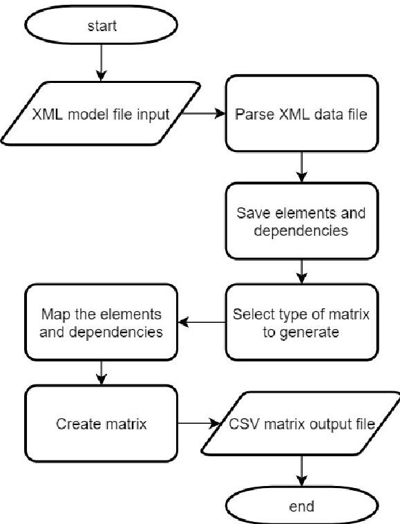
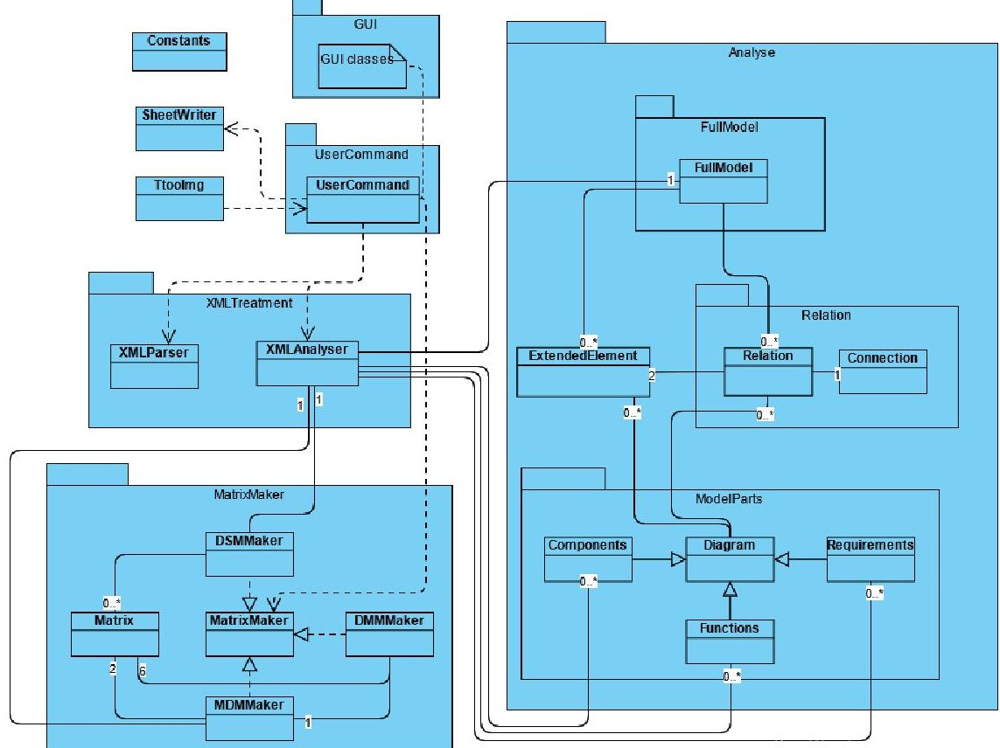
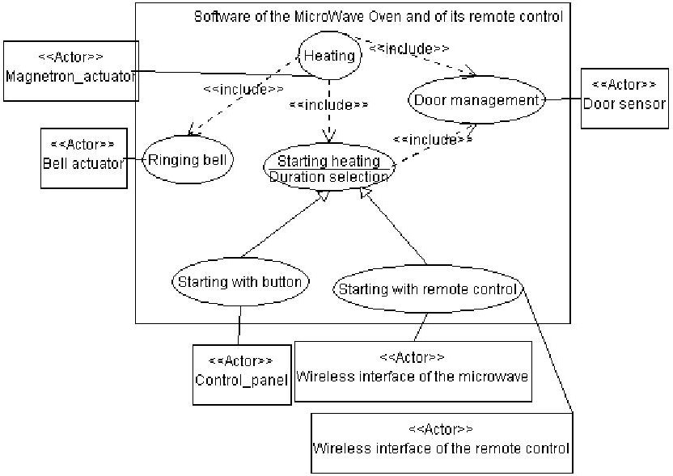

<!-- PDF_PAGE: 1 -->

<div align="center">

# Design Structure Matrix Generation from Open-source MBSE Tools

</div>

William Pons

ISAE-SUPAERO

Université de Toulouse

Toulouse, France

william.pons@student.isae-supaero.fr

Sophia Salas Cordero

ISAE-SUPAERO

Université de Toulouse

Toulouse, France

sophia.salas@isae-supaero.fr

Rob Vingerhoeds

ISAE-SUPAERO

Université de Toulouse

Toulouse, France

rob.vingerhoeds@isae-supaero.fr

Abstract—The usage of Design Structure Matrices is widely applied to represent, cluster, and partition complex systems information for different purposes, one of them being systems design. Nevertheless, open-source software for their automatic creation is rare. This leads to manual workshop sessions for subject matter experts to fill in the design structure matrices, a practice that is very tedious and time consuming. The importance and application of Model Based System Engineering has increased over the years. Nowadays, there are several open-source MBSE software such as StarUML, Papyrus, TTool, Modelio, Capella. This paper describes a novel approach to generate design structure matrices and extract information automatically from xml and xmi formats used widely in open-source Model Based System Engineering tools. This work presents the algorithm and a tool to extract data from the output model files, in order to automatically create a Design Structure Matrix (DSM) of modeled systems.

Index Terms—DSM, Model Based Systems Engineering, Open source tools, systems thinking

## I. INTRODUCTION

Model Based Systems Engineering (MBSE) importance has significantly grown in industry and academia, over the last decades. The International Council on Systems Engineering (INCOSE) has defined MBSE as a key element of systems engineering further development [1]. It has been identified that in contrast to a document-based approach, MBSE provides good benefits, some of them having been observed throughout the literature and presented in [2]: better communication/information sharing, increased traceability and capacity for reuse, reduce time and cost, improved consistency, system understanding and systems design, etc...

This paper considers open-source system modeling tools in order to guarantee the accessibility of the further mentioned tools to everyone. The connectivity of these tools with the process of system assessment is a central point for this study. Four elements have been identified to be dealt with: the software itself, data storage files and their structure, the data extraction tool, and data analysis.

Several points need to be taken into consideration for the current study. A first point is to choose an available MBSE software for SysML representations, and ensure this software both enables to share models with others, and stores reliable data in its storage files. The OMG provides guidelines to ensure software interconnection and advises to use XML

(eXtensible Markup Language) files to store the model data, and to follow a standardised definition of the model. The output file is a XML with a specific architecture, called an XMI (XML Metadata Interchange) [3]. XMI files are for exchanging metadata information via XML, often used for interchanging UML or SysML models. The software targeted in this study needs to be open-source and needs to allows the use of add-ons.

A second point is to understand the structure of data storage files in order to develop a coherent data extracting tool. Both the structure and the exhaustiveness of the data must be watched, so to ensure a good transmission of the model between tools, which brings the attention to the format in which the data is written in the files.

A third point concerns the development of a tool $ ^{1} $ to extract and shape the SysML model data. It should take as an input a file describing the model, and give as an output the set of the components, relationships, requirements and functions of the system. As an application to support systems analysis and representation, the tool has to be able to create Design Structure Matrices (DSM), Domain Mapping Matrices (DMM) and a Multi-Domain Matrix (MDM) from the data. The contribution proposed by this paper is to provide a guideline on how design matrices can be generated from SysML models and a tool that can be used to this extend. This can be greatly beneficial for projects in this research domain which so far seem to have a dominant trend of manually producing DSMs for system analysis. A design structure matrix has a very wide area of applicability, it can be used to represent system dependencies, to analyze change propagation at different system levels, to organize processes or activities, and etc. [4] $ ^{--} $ [8]. Extracting data from models is crucial in order to re-utilize already available data for further system analysis, for all life cycle stages. One of the applications a the data extraction tool could be in particular to automatically create Design Structure Matrices to analyze the obsolescence of a system from early design stages as proposed in [9].

In the following sections of this paper a brief overview on MBSE languages and tools is presented while going into details about the types of data files and connectivity.

<!-- PDF_PAGE: 2 -->

Afterwards, the model file organization of TTool is outlined to go into details in the following section on the algorithm implemented in Java. The resulting design structure matrices from the applied algorithm in Java are shown in the section of results and discussion, and the achievements are summarized in the conclusion section.

## II. DESIGN STRUCTURE MATRICES

A DSM is an NxN matrix that maps the interactions among the set of N elements. It is a network modeling tool used to represent the elements comprising a system and their interactions, thereby highlighting the system's architecture or designed structure. DSMs are particularly well suited for applications in complex systems development and used more often in the area of engineering management [10].

In Fig.1 an example of a DSM can be found. A, B, C and D are elements, whilst a1, a2, a3 represent dependencies. There are two main conventions used to convey the DSM information: inputs in rows (IR) or inputs in columns (IC). For practical purposes on this work the convention IR is used. In Fig.1 it means that B has an input that comes from A, as it is an asymmetrical DSM. If it were symmetrical one (the above the diagonal triangle=under the diagonal triangle) it would just mean there is a dependency between A and B.

<table border="1"><tr><td></td><td>A</td><td>B</td><td>C</td><td>D</td></tr><tr><td>A</td><td></td><td></td><td>a1</td><td></td></tr><tr><td>B</td><td>a2</td><td></td><td></td><td></td></tr><tr><td>C</td><td></td><td></td><td></td><td></td></tr><tr><td>D</td><td></td><td></td><td>a3</td><td></td></tr></table>

<div align="center">

Fig.1. DSM

</div>

Static DSMs can represent system architectures [7], this is the type of DSMs that are presented throughout this work. For example, in the case of a components DSM: A, B, C, D would be components of the system.

DSMs can be either binary or numerical. DSMs are binary when they merely indicate the presence or absence of interactions between elements (if a1, a2, a3=1 in Fig.1). Numerical DSMs on the other hand not only show the presence of an interaction but include attributes of the interaction, such as number, importance, impact or strength. In this case a1, a2, a3 would be natural numbers, or have a value x: $ 0 \leq x \leq 1 $ then Fig.1 would be a numerical DSM.

Different type of design matrices exist. DSMs map a set of elements from a specific domain. A subset of matrices of DSM map relations between elements of different domains and a re referred to as Domain Mapping Matrices (DMM). DMMs map a set of elements within two domains and can be used for example to represent relations between components (N elements) and functions (M elements) of a system [11], leading to NxM matrices. Multi-Domain Matrices (MDM) can be used to represent system interactions between more than two domains. MDM combine DSMs and DMMs to achieve

this. The result is a NxN Multiple Domain Mapping matrix. Its diagonal is made of DSMs, and the rest of the matrix is filled with DMMs. A MDM enables to have a complete overview of the system interactions [8], [12].

## III. MBSE BRIEF OVERVIEW

Model-Based Systems Engineering (MBSE) is a formalized application of modelling to support system requirement, design, analysis, verification and validation activities, beginning in the conceptual design phase and continuing throughout development and later life cycle phases [13]. Models are used to represent systems and enable to better master the design and the verification of complex systems [14].

There are several system modeling languages that coexist such as:

- SysML (System Modeling Language) [15], developed by the OMG (Object Management Group),

- the ARCADIA method [16], developed by Thales,

- OPM (Object Process Methodology) [17], [18] conceived and developed by Prof. Dov Dori.

SysML is implemented in more open-source software and being used more widespread, therefore this paper will focus mainly on this language. Supported by the Object Management Group since 2006, SysML, the System Modeling Language [15], is commonly used in systems engineering to analyze, model and design systems. It is a diagrammatic modeling language for systems engineering, widely used in industry and at the moment its second version is being prepared for release over the coming years [19]. It is important to note that the SysML standard defines a notation, but not a way of using it. Methods have to be defined to make the use of the diagrams explicit, and to express a dedicated methodology conforming to the approach deployed.

Other approaches include OPM with an increasing popularity accompanied by the OPCAT software and ARCADIA that uses the Capella software. The essential difference between OPM and ARCADIA on one hand and SysML on the other hand, is that the former two have a methodology associated to the tool.

There are many SysML-based MBSE tools. This study focuses on those that are open-source, such as:

- Eclipse Papyrus (2013), developed in Java by the French Alternative Energies and Atomic Energy Commission

- Modelio (2009), developed in Java by Modeliosoft

- StarUML (2005), developed in Delphi by MKLabs Co.,Ltd.

- TTool (2011), developed in Java, C and C++ by Télécom Paris

Each of these tools offers different assets, but not all answer the required need for a reliable and inter-model data exchange. Models are saved in different kinds of files, written in XML, in JSON or other types of files. The software handles two kinds of data files: internal and external files. The internal files are implemented so that the software which created them can read them (Case A), while the external ones are meant to

<!-- PDF_PAGE: 3 -->

be used by other software (Case B). The following subsection describes the situation for the above-mentioned tools.

## A. Software data files

Files can be organized in different ways, e.g.: TTool only needs one XML file, Papyrus three, Modelio many, and StarUml a JSON file (see Tab.I for more detailed information).

<div align="center">

TABLE I

</div>

<div align="center">

INTERNAL DATA FILES EXTENSIONS

</div>

<table border="1"><tr><td>Software</td><td>Files extensions</td><td>Comment</td></tr><tr><td>TTool</td><td>xml</td><td>sufficient for all the data</td></tr><tr><td rowspan="3">Papyrus</td><td>uml</td><td>model metadata</td></tr><tr><td>di</td><td>XMI information</td></tr><tr><td>notation</td><td>graphical data</td></tr><tr><td rowspan="2">Modelio</td><td>many exml</td><td>for each kind of object created</td></tr><tr><td>other files</td><td>split in not easily understandable</td></tr><tr><td>StarUML</td><td>mdj</td><td>JSON model description</td></tr></table>

For case A, the data files are mainly conceived to be used by the software itself. In Case B, the data is produced to be used by other software. This work aims to use the files in Case B, as they should fully describe the model, and follow standards enabling to share them efficiently between tools. Three types of file extensions are used by TTool, Papyrus, Modelio and StarUML: .xmi, .xml and .uml. Tab.II associates each software with the file extension it uses, and precises the file standard.

<div align="center">

TABLE II

</div>

<div align="center">

SHARED DATA FILES EXTENSIONS AND FORMAT

</div>

<table border="1"><tr><td>Software</td><td>TTool</td><td>Papyrus</td><td>Modelio</td><td>StarUML</td></tr><tr><td>Extension</td><td>xml</td><td>uml</td><td>xmi</td><td>xmi</td></tr><tr><td>Standard</td><td>-</td><td>xmi</td><td>xmi</td><td>xmi</td></tr></table>

Even though the extension name changes, .xml, .uml and .xmi are all XML files. XML is widely used to store data, it is well-documented, machine-independent and many tools support it. In principle, all the previous files should therefore be portable and easy to parse, which is crucial when targeting data extraction.

As far as Papyrus is concerned, the file for external use is a .uml file, paired with two other XML files that are generated when building a SysML project. The .uml extension of this file indicates that this file is describing the model itself, whereas the other Papyrus data file extension is .notation (see Tab.I). The .uml file complies with the OMG's XMI standard, which should make it compatible with other similar software.

TTool uses the XML format as well, but it does not use the XMI standard. TTool does not provide an import/export option, and thus the only file that could be shared is the file the software uses for storing the model itself (in this scenario Case A and Case B are combined). As a consequence, TTool cannot import model files from other software, nor export its models directly. It complies with its own independent rules: if an XMI is an XML, the opposite is false.

Modelio and StarUML enable to easily import/export models. The data is stored in an XMI file, which is in this case an XML file whose content complies with specific rules which should in principle make them compatible with other similar software.

## B. Software connectivity and data reliability

Being able to open models with different software should permit to benefit from each of their proprietary functionalities. Ideally it would enable to improve models developed in one software using another one. Theoretically, the XMI standard defined by the OMG avoids any loss of information when sharing metadata between software. However, XMI faces several issues that does not always make data exchanges reliable. Different versions of XMI co-exist (1.0, 1.1, 1.2 and 2.0), as well as different versions of modeling languages used to create the models. As a result, all combinations may not be compatible, and some data cannot be exchanged.

Connectivity among the studied set of MBSE software was analysed, to check if they could efficiently and reliably share models. A same basic model was built using each software, it was exported and subsequently imported in the other software mentioned earlier. Comparing the exported model with the imported one permitted to identify information loss.

The developed model used for this experiment contained four out of the nine possible SysML diagrams:

- Use Case Diagram

- Block Definition Diagram

- Requirement Diagram

- State Machine Diagram

The results are displayed in Tab.III. The rows present the models-exporting software, while the columns the software importing the models. As an example, the model built with Papyrus (row 3) can be fully loaded by Modelio (column 2).

<div align="center">

TABLE III

</div>

<div align="center">

MODEL COMPATIBILITY

</div>

<table border="1"><tr><td>From ↓ To →</td><td>TTool</td><td>Modelio</td><td>Papyrus</td><td>StarUML</td></tr><tr><td>TTool</td><td>Full</td><td>Invalid</td><td>Invalid</td><td>Invalid</td></tr><tr><td>Modelio</td><td>Invalid</td><td>Partial</td><td>Partial</td><td>Invalid</td></tr><tr><td>Papyrus</td><td>Invalid</td><td>Full</td><td>Full</td><td>Full</td></tr><tr><td>StarUML</td><td>Invalid</td><td>Invalid</td><td>Invalid</td><td>Partial</td></tr></table>

The meaning of the indication in Tab.III is the following:

- Full: the data is totally transferred and the imported model is conform to the exported one.

- Partial: the model is not fully transferred. Some data is lost while exporting the data, not while importing them in another tool.

- Invalid: the transfer did not work, as the data and software are not compatible enough. Concerning the export from StarUML to Papyrus, it might be possible to get a "Partial" data transfer. However, no data exchange worked during the study.

<!-- PDF_PAGE: 4 -->

Table III underlines two crucial facts concerning software connectivity. First of all, in spite of the XMI standard, there may be losses of information between some software. It seems that Modelio and StarUML do not properly export their model under the XMI format, which makes it incomplete when imported by other software. This is an issue for usage in system modeling as the exported model cannot be read by other software. It should be noted that Modelio and StarUML can also not import the data files they create themselves for export purposes.

Secondly, only Papyrus can properly export its data. Modelio and StarUML can load the complete Papyrus model without any loss of information. TTool, not implementing the standard XMI functionality, cannot read in a Papyrus model.

As far as TTool itself is concerned, it cannot exchange models with the other software. However, it should be noted that TTool uses only one file to save all of its a model data. The TTool data file is complete and easy to analyse, in spite of it not being made to be shared with others. Both TTool and Papyrus can be used as basis for developing a data extraction tool. In the remainder of this paper TTool is used for the implementation of the proposed algorithm, although it can be used analogously for Papyrus models.

## IV. TTOOL MODEL FILE ORGANIZATION

As the goal of the study in this paper is to generate automatically design matrices from MBSE SysML tools, the XML data file content is described for objects related to the following four SysML diagrams:

- Requirement Diagram

- Use Case Diagram

- Internal Block Diagram

- Block Definition Diagram

In TTool, the Block Definition Diagram and Internal Block Diagram are identified in the xml file as a one and the same diagram called Block Diagram, leading to three diagrams to be used for the design matrix generation. Other diagrams, such as: Activity Diagram, Sequence Diagram, State Machine Diagram, Parametric Diagram and Package Diagram, are not necessary for the generation of design matrices and will not be described in this paper $ ^{2} $

Three types of nodes in the XML hierarchy represent all the different SysML elements: COMPONENT, SUBCOMPONENT, CONNECTOR. Each have two attributes: "type" and "id". The "type" is a number which identifies the nature of the element and the id enables to distinguish instances of elements of the same nature. The "id" attribute can be efficiently used to identify the nature of elements. In TTool there is no ambiguity to determine the nature of elements, as it does not depend on the naming of elements, Which is a major advantage of TTool over Papyrus. In addition to attributes, nodes may have "childnodes". Tab.IV details the children of a "COMPONENT" as an illustration.

$ ^{2} $Eventually additional information for design matrices may be included in these diagrams, but this has not been investigated at this point in time.

<div align="center">

TABLE IV CHILDREN NODES OF A COMPONENT

</div>

<table border="1"><tr><td>Node</td><td>Attributes</td></tr><tr><td rowspan="2">cdparam</td><td>x</td></tr><tr><td>y</td></tr><tr><td rowspan="6">sizeparam</td><td>width</td></tr><tr><td>height</td></tr><tr><td>minWidth</td></tr><tr><td>minHeight</td></tr><tr><td>maxWidth</td></tr><tr><td>maxHeight</td></tr><tr><td>hidden</td><td>value</td></tr><tr><td rowspan="4">cdrectangleparam</td><td>minX</td></tr><tr><td>maxX</td></tr><tr><td>minY</td></tr><tr><td>maxY</td></tr><tr><td rowspan="2">infoparam</td><td>name</td></tr><tr><td>value</td></tr><tr><td rowspan="2">TGConnectingPoint</td><td>num</td></tr><tr><td>id</td></tr><tr><td>info</td><td>extension</td></tr></table>

Not all "child-nodes" represent model design information. Some of them are related to graphical information, like "cdparam". Some others are crucial, such as "TGConnectingPoint" that defines the relation between the attributes. By knowing which attributes are connected, it can be deduced for example which components are connected. Indeed, the "id" attributes of "TGConnectingPoint" elements are used by "CONNECTOR" elements as hooks. A "CONNECTOR" element has two children "P1" and "P2", whose "id" attribute is equal to the "id" attribute of the "TGConnectionPoint" it is linked with.

Analysing a "CONNECTOR" thus enables to get the two "TGConnectingPoint" elements that are linked through the connection, and then the linked components or subcomponents by getting the father components of the "TGConnectingPoint" elements. Connections between elements are then accessible.

As this paper only focuses on three diagrams, it is relevant to understand how the data is written in a diagram data block, and how those blocks are ordered in XML. In Fig.2 the analysis of a Block Diagram is presented, the analysis of the other diagrams is similar.

```xml

<TURTLEGMODELING [attributes]>

  <Modeling type="AVATAR Design" nameTab="Design" [attributes]>

    <AVATARBlockDiagramPanel name="Block Diagram" [attributes] >

      <COMPONENT type="5003" id="2940" >

        <[Children nodes]>

      </COMPONENT>

    </AVATARBlockDiagramPanel>

  </Modeling>

</TURTLEGMODELING>

```

<div align="center">

Fig. 2. Block Diagram Hierarchy

</div>

A strict hierarchy enables to quickly find any type of diagram in the XML file. Fig.2 shows an extract of the

<!-- PDF_PAGE: 5 -->

hierarchy. Please note that Fig.2 was simplified by taking out some attributes (indicated by " [attributes] " ) without impacting the approach.

The root of the XML file is a node called "TURTLE-MODELING". This root has as many children as there are diagrams defined in the TTool model. These nodes are called "Modeling". A Block Diagram can be found in a "Modeling" node whose type is "AVATAR Design" (see Table V).

<div align="center">

TABLE V

</div>

<div align="center">

MODELING TYPE FOR EACH DIAGRAM

</div>

<table border="1"><tr><td>Diagram</td><td>Modeling“type”attribute</td></tr><tr><td>Block Diagram</td><td>AVATAR Design</td></tr><tr><td>Use Case Diagram</td><td>Avatar Analysis</td></tr><tr><td>Requirement Diagram</td><td>Avatar Requirement</td></tr></table>

Different diagrams instances can be found in "Modeling" nodes. A Block Diagram is tagged as "AVATARBlockDiagramPanel" (see Tab.VI).

<div align="center">

TABLE VI

</div>

<div align="center">

MODELING TYPE FOR EACH DIAGRAM

</div>

<table border="1"><tr><td>Diagram</td><td>Node tag</td></tr><tr><td>Block Diagram</td><td>AVATARBlockDiagramPanel</td></tr><tr><td>Use Case Diagram</td><td>UseCaseDiagramPanel</td></tr><tr><td>Requirement Diagram</td><td>AvatarRDPanel</td></tr></table>

"COMPONENT", "SUBCOMPONENT" and "CONNECTOR", elements composing the diagrams, can be found in these nodes. Examples of those elements for a Block Diagram are presented in Tab.IV. The letter "N" in an element indicator that this object is the N-th built in its category.

In TTool one can distinguish Blocks and Cryptoblocks. A CryptoBlock is a Block with an extended functionality, for example used for safety and security issues. Recursively, Blocks and CryptoBlocks can be SUBCOMPONENTs themselves if they are included in other Blocks or CryptoBlocks (COMPONENTS). Blocks and Cryptoblocks, share the same identifier (see Tab.VII) However, they can be distinguished through details given in their "extraparam" child in the XML.

<div align="center">

TABLE VII

</div>

<div align="center">

USE CASE DIAGRAM ELEMENTS REPRESENTATIONS IN TTOOL XML

</div>

<table border="1"><tr><td>Element</td><td>Syntax Reference in XML</td><td>Type number</td></tr><tr><td>Block</td><td>BlockN</td><td>5000</td></tr><tr><td>CryptoBlock</td><td>BlockN</td><td>5000</td></tr><tr><td>DataType</td><td>DataTypeN</td><td>5003</td></tr></table>

Having unique identifiers (numbers) for each type of elements permit to easily extract data.This structure is wellordered, unambiguous, and permits to develop an algorithm to parse the XML data and process it.

## V. ALGORITHM TO EXTRACT INFORMATION

As TTool unambiguously organizes modeling data, this data can be parsed and processed using an algorithm. This

section discusses the choice of Java for realising this task and describes the behaviour of the proposed algorithm (Fig.3).

## A. Functionalities

The proposed algorithm (Fig.3) parses the TTool XML file that describes a model, then stores the information and processes it to obtain DSMs, DMMs, and a MDM. The algorithm can create a Functions DSM using the Use Case Diagram in a model, a Components DSM using the Block Diagram, and a Requirement DSM using the Requirement Diagram. The generated DSMs can be either binary or numeric, as required by the user, the binary ones with "1" where there is a relation, or numeric ones when there is information about the number of inputs/outputs. The former could include directional or non-directional dependencies, depending on what is needed. The later would show directed dependencies. In TTool, only Port Connectors enable to define outputs and inputs through the relation. The MDM contains all the elements of Functions, Components and Requirements DSMs. Only one MDM is created per model.





<div align="center">

Fig. 3. DSM generation algorithm

</div>

## B. Language choice

The Java language was selected for two reasons. First of all, TTool is partly developed in Java (as well as in C and C++). Papyrus is fully developed in Java. The developed code for the algorithm could eventually be adapted to work with Papyrus. Secondly, Java has many APIs (Application Programming Interface) that can be used for this development. They provide the necessary reading, processing or writing tasks. Also, Java supports Maven, a powerful project management tool which dynamically downloads Java libraries and Maven plug-ins from different repositories, and store them locally, making library management more convenient and portable.

<!-- PDF_PAGE: 6 -->

Two APIs are used in this development. The Apache POI (Poor Obfuscation Implementation) is an API provided by Apache foundation and is a collection of different Java libraries providing the facility to read, write and manipulate different Microsoft files such as excel sheet, power-point, and word files. In this study, it is used to write data in an Microsoft Excel file. This kind of file is well adapted to store tables, and can thus conveniently contain DSMs, DMMs and the MDM.

The second useful API is JDOM (Java Document Object Model) that is used to parse the XML files. It represents the XML content by a tree structure that contains all the elements of the document and provides many functions that enable the parsed data analysis.

## C. Code structure

This section gives an overview of the how the actions are performed by the program. The class diagram shown in Fig.4 presents the packages and classes of the program. The classes that contribute to parse the input XML file that contains the SysML model information, analyse these data, and map the dependencies between the system elements to create the different matrices are the following:

- The "Main" class is the program operating class. It is the class which is executed.

- The "Constants" class defines all the tags and attributes of the TTool XML model file that must be used to process data, and distinguish elements from one another. They are reused in the rest of the program. In this class are also defined all the constants used in the program.

- The "SheetWriter" class writes in .xlsx files the DSMs, DMMs and MDM that can be created from the system model.

- The "GUI" package contains classes that build a user interface, enabling a user to choose which kind of matrix should be saved (DSMs, DMMs or MDM) and its type (binary, numerical or directed).

- The "UserCommand" class is the only class called by "Main". This is were the GUI is launched. The program ends when the GUI is closed.

Whereas the above mentioned classes are essential, they do not extract nor shape any data. The following classes do contribute to extract, temporarily store and organize the data.

The "XMLTreatment" package parses the XML file with the JDOM API, and then categorize and store the data, using the "XMLParser" and "XMLAnalysis" classes.

Fig.4 shows that "XMLAnalyser" interacts with the classes of the "Analyse" and "MatrixMaker" packages. "XMLAnalyser" first calls the classes of "Analyse" to create the relations between the system elements and then calls the classes of "MatrixMaker" to create the matrices from both the elements and their dependencies.

First, the "Analyse" package is used. If only a DSM is requested to be built, the classes of the "ModelParts" package within the "Analyse" package handle the request and map the dependencies of a DSM. These can be between functions,

components, or requirements. It avoids building all the dependencies if they are not requested. If a DMM or a MDM is requested, then all the dependencies are created with the "FullModel" class. Both the "ModelParts" and "FullModel" classes use the "Relation" class in the package of the same name. This class enables to properly define every kind of dependency between system elements. Each dependency is composed of two members and a connection defined by the "Connection" class. At this point, are all the diagrams of a SysML model made in TTool are analysed and all their elements and dependencies have been created. To avoid redundancy, "ExtendedElement" gathers same type elements from different diagrams if they have same name.

Finally, the classes of the "MatrixMaker" package are called. The "Matrix" class defines the basis structure of a matrix as a list of lists containing strings of characters. The "DSMMaker" class uses the results of from a "Diagram" class to fill a Matrix with the Inputs of dependencies in rows, and the Outputs in columns. The "MDMMaker" class uses the information of the "FullModel" class to realise the same work. The "DMMMaker" class requires a MDM to be built. It extracts the relevant part of data from the MDM. The tables built are then given as arguments to methods of the "SheetWriter" class, that writes them to files.

## D. Potential for extended use of the code

The code can be adapted to treat other data than the targeted ones during this study. So far it was done for Use Case, Block, Requirement diagram. It would be possible to make use of the data contained in other diagrams made on TTool, like from the Activity Diagram, Context Diagram, Sequence Diagram, Attack Tree Diagram, Communication Pattern Diagram, Architecture and Mapping Diagram, Component Task Diagram and etc. by adding classes to the Java code.

Another foreseen functionality of the algorithm would be the ability to provide statistics concerning the types of elements used in the model design. As all the data are stored in the "XMLAnalyser" class, it can be possible to add a class that would be able process the data to get statistics.

## VI. RESULTS AND DISCUSSION

In this section, an example is shown of the analysis of TTool XML data with the previously described algorithm, that enabled to get DSMs, DMMs and the MDM of the model. Here, a binary Functions DSM and a directed Functions/Components DMM were obtained from a microwave oven model. The model can be found in the TTool default repository under the name "MicroWaveOven_SafetySecurity_fullMethodo.xml". In Fig.5 the Use Case Diagram from this project can be found.

In Fig.6 the Functions DSM of the microwave oven model is shown, corresponding to the use cases of the Use Case Diagram (Fig.5). In this Use Case Diagram, all the relationships between use cases are directed, which makes the binary DSM asymmetric. As inputs of a dependency are in rows and outputs are in columns, the table shown in Fig.6 must be read as following: the "Starting heating" function depends on the

<!-- PDF_PAGE: 7 -->





<div align="center">

Fig. 4. Class Diagram

</div>





<div align="center">

Fig. 5. Microwave oven Use Case Diagram

</div>

"Starting with remote control" function, on the "Starting with button" function and the "Heating" function.

The algorithm enables to obtain DMMs as well. Fig.7 shows a DMM of the above-mentioned microwave model. Functions are on the rows and Components on the columns. It is made under the assumption that Actors in the Use Case Diagram have the same name as some Components in the Block Diagram. The DMM shown in Fig.7 must then be read as follows: the "Ringing bell" function depends on the "Bell" Component.

DMM dependencies are obtained under the assumption that the inter-diagram relations are available and well-defined. In

the above-mentioned microwave example in TTool, there is no information that would enable to map Functions to Requirements or Components to Requirements. The matrices rely on the information available in the models. As the extraction of matrices from models do not create new relations that are not present in the input files. As a result, some connections can be obtained under certain assumptions. It is therefore possible to map Functions to Components, under the assumption that Actors in a Use Case Diagram can represent some components of the system. This is not explicitly implemented in TTool and the only way to find such connections is to name the Actors like the Components in the Block Diagram, which makes the algorithm use depend on the elements naming.

The algorithm currently enables to take an XML file from a system model made with TTool, and provides as an output design matrices. It can generate Functions, Components and Requirements DSM. It can also create Components/Functions DMM, but not yet a Functions/Requirements DMM (F/R) nor a Requirements/Components DMM (R/C). Thus, the created MDM that is partial. Nevertheless, the necessary information to create a F/R DMM or a R/C DMM can be extracted by making other assumptions, in the same way Components and Requirements were linked through the use of Actors as Components in the Use Case Diagram. This can also be implemented with Papyrus, as the ambiguity of some elements nature gives more freedom in creating diagrams, which enables to directly link elements that cannot be achieved with TTool. This is part of future work.

<!-- PDF_PAGE: 8 -->

<table border="1"><tr><td></td><td>Ringing bell</td><td>Door management</td><td>Starting with remote control</td><td>Starting with button</td><td>Starting heating</td><td>Heating</td></tr><tr><td>Ringing bell</td><td></td><td></td><td></td><td></td><td></td><td>1</td></tr><tr><td>Door management</td><td></td><td></td><td></td><td></td><td>1</td><td>1</td></tr><tr><td>Starting with remote control</td><td></td><td></td><td></td><td></td><td></td><td></td></tr><tr><td>Starting with button</td><td></td><td></td><td></td><td></td><td></td><td></td></tr><tr><td>Starting heating</td><td></td><td></td><td>1</td><td>1</td><td></td><td>1</td></tr><tr><td>Heating</td><td></td><td></td><td></td><td></td><td></td><td></td></tr></table>

<div align="center">

Fig. 6. Functions DSM of the microwave oven

</div>

<table border="1"><tr><td></td><td>ObserverProp1</td><td>RemotelyControlledMicrowave</td><td>RemoteControl</td><td>MicroWaveOven</td><td>Bell</td><td>Control_panel</td><td>Controller</td><td>Magnetron_actuator</td><td>Door</td><td>WirelessInterface</td></tr><tr><td>Ringing bell</td><td></td><td></td><td></td><td></td><td>1</td><td></td><td></td><td></td><td></td><td></td></tr><tr><td>Door management</td><td></td><td></td><td></td><td></td><td></td><td></td><td></td><td></td><td>1</td><td></td></tr><tr><td>Starting with remote control</td><td></td><td></td><td></td><td></td><td></td><td></td><td></td><td></td><td></td><td>1</td></tr><tr><td>Starting with button</td><td></td><td></td><td></td><td></td><td></td><td>1</td><td></td><td></td><td></td><td></td></tr><tr><td>Starting heating</td><td></td><td></td><td></td><td></td><td></td><td></td><td></td><td></td><td></td><td></td></tr><tr><td>Heating</td><td></td><td></td><td></td><td></td><td></td><td></td><td></td><td>1</td><td></td><td></td></tr></table>

<div align="center">

Fig. 7. Functions/Components DMM

</div>

## VII. CONCLUSION

This paper highlights the need to be able to generate automatically design matrices from existing SysML models. In order to develop an algorithm to extract and process MBSE software data files, a set of open-source MBSE software was studied. For such an algorithm to be of practical use, it is thought that such a MBSE tool would need to be open-source, enabling a reliable and convenient data analysis.

MBSE software connectivity does not come automatically and few models can be exchanged between software: from the analysed MBSE software only Papyrus can share its models without information loss.

For the purpose of this study and even though it cannot share its models with other software, TTool was the most convenient as its data is unambiguous, easy to understand and can be parsed easily. TTool was therefore selected as basis to develop a data extracting algorithm for the generation of design matrices. It should be mentioned that the proposed algorithm can be easily extended to be applied to Papyrus and other SysML software.

The algorithm was coded in Java, and enables to generate DSMs, DMMs and a MDM of a SysML model, thus avoiding the long manual task of mapping connections between system elements, that can be useful in change management to determine change propagation.

As future work the connections between different types of diagrams need to be studied in more depth. The allocation of elements of one diagram to the other should not be forced, but follow the SysML standard and recommendations.

## REFERENCES

[1] A. INCOSE, "world in motion-systems engineering vision 2025, international council on systems engineering," 2014.

[2] K. Henderson and A. Salado, "Value and benefits of model-based systems engineering (mbse): Evidence from the literature," Systems Engineering, vol. 24, no. 1, pp. 51-66, 2021.

[3] O. M. Group, "Xml metadata interchange (xmi) specification," 2015.

[4] S. Maisenbacher, K. Kernschmidt, D. Kasperek, B. Vogel-Heuser, and M. Maurer, "Using dsm and mdm methodologies to analyze structural sysml models," in 2013 IEEE International Conference on Industrial Engineering and Engineering Management. IEEE, 2013, pp. 351-355.

[5] A. Akundi, T.-L. B. Tseng, C. N. Almeraz, R. J. Lopez-Terrazas, and H. Luan, "A novel approach to behavior design for model based systems engineering application using design structure matrix," in 2021 IEEE International Systems Conference (SysCon). IEEE, 2021, pp. 1-7.

[6] S. Nonsiri, E. Coatanea, M. Bakhouya, and F. Mokammel, "Modelbased approach for change propagation analysis in requirements," in 2013 IEEE International Systems Conference (SysCon). IEEE, 2013, pp. 497-503.

[7] S. Salas Cordero, C. Fortin, and R. Vingerhoeds, "Concurrent conceptual design sequencing for mbse of complex systems through design structure matrices," in Proceedings of the Design Society: DESIGN Conference, vol. 1. Cambridge University Press, 2020, pp. 2375-2384.

[8] T. R. Browning, "Design structure matrix extensions and innovations: a survey and new opportunities," IEEE Transactions on Engineering Management, vol. 63, no. 1, pp. 27-52, 2016.

[9] S. Salas Cordero, R. Vingerhoeds, M. Zolghadri, and C. Baron, "Addressing obsolescence from day one in the conceptual phase of complex systems as a design constraint," in Product Lifecycle Management Enabling Smart X. Cham: Springer, 2020, pp. 369-383.

[10] S. D. Eppinger and T. R. Browning, Design structure matrix methods and applications. MIT press, 2012.

[11] V. Holley, B. Yannou, and M. Jancovic, "Using the ff-dmm matrix to represent functional flow in product architecture," in DSM 2011: Proceedings of the 13th International DSM Conference, 2011.

[12] M. Maurer and U. Lindemann, "Structural awareness in complex product design-the multiple-domain matrix," in DSM 2007: Proceedings of the 9th International DSM Conference, Munich, Germany, 16.-18.10.2007, 2007.

[13] S. Friedenthal, R. Griego, and M. Sampson, "Incose model based systems engineering (mbse) initiative," in INCOSE 2007 symposium, vol. 11, 2007.

[14] H. Hick, M. Bajzek, and C. Faustmann, "Definition of a system model for model-based development," SN Applied Sciences, vol. 1, no. 9, pp. 1-15, 2019.

[15] ISO/IEC-19514:2017, "Information technology object management group systems modeling language (omg sysml)," International Organization for Standardization, Geneva, CH, Standard, 03 2017.

[16] P. Roques, Systems Architecture Modeling with the Arcadia Method: A Practical Guide to Capella. Elsevier, 2017.

[17] ISO/PAS-19450:2015, "Automation systems and integration objectprocess methodology," International Organization for Standardization, Geneva, CH, Standard, 12 2015.

[18] D. Dori et al., Model-based systems engineering with OPM and SysML. Springer, 2016, vol. 15.

[19] SysML-V2. (2020) Introduction to the sysml v2 language. [Online]. Available: http://openmbee.org/sysml-v2-release/2020-09