<!-- PDF_PAGE: 1 -->

# Developing a Power Modelling Tool for CubeSats

Tom Etchells, Lucy Berthoud University of Bristol Queen's Building, Bristol, BS8 1TR, UK; +447871764484 tom.etchells@bristol.ac.uk

## ABSTRACT

This paper details the development of a MATLAB and GMAT based power modelling tool for analyzing CubeSat solar power generation. The power model is designed to allow satellite orbit customization, along with a range of attitudes and solar panel configurations, including deployable panels. A graphical user interface was developed to facilitate this customization, with real time representations of both the attitude and geometry being defined by the user. Direct user input to the model can also be used for more complex attitudes or solar panel configurations.

The model has been successfully validated against Thales Alenia Space's "Power Sim" power modelling tool. Future work will include further validation against AGI STK's Solar Panel tool and against real data from CubeSats, or other simple satellites. It is hoped that this freely available tool, hosted on GitHub (https://github.com/tometchells/PowerCubeSat), will prove useful and timesaving for new CubeSat developers.

## INTRODUCTION

The CubeSat Project was started by Stanford and CalPoly in 1999 to reduce the barrier to entry of space, allowing universities and other educational institutions to design, build, and launch their own satellites $ ^{[1]} $ . One of the elements contributing to this is a standard CubeSat Design Specification (CDS) $ ^{[2]} $ which acts as a baseline for organizations to design to, defining standard dimensions for all CubeSats. All CubeSats are made up from $ 10 cm\times 10 cm\times 10 cm $ cubes known as 'U's. The most common sizes are 1U, 2U, and 3U. This standardization allows consumer off-the-shelf (COTS) components to be integrated seamlessly, along with standard launch deployment integration. Since the conception of the CubeSat Program over 850 CubeSats have been launched by academic, government, and private organizations $ ^{[3]} $ .

Whilst the CubeSat Program has greatly lowered the barrier to entry of space; designing, building, and launching a CubeSat still poses a substantial number of challenges to all but the most experienced teams. Some of these challenges stem from the lack of availability of fundamental design tools, software packages, and models that are essential for solving many key design problems, requiring newcomers to spend resources creating their own versions of these tools.

One of these challenges is the design and sizing of the electrical power subsystem (EPS). A major consideration in the sizing of the EPS is making sure that the CubeSat's solar array is large enough to match its power budget. For a 3U CubeSat, due to the limited surface area available, the average power generation capabilities of body mounted solar panels is limited to roughly 5 to 7 Watts $ ^{[4]} $ . CubeSats with greater power requirements are thus required to use deployable solar

panels to supplement their body mounted panels, increasing the overall array size. Due to the rising level of experience in the design and manufacture of CubeSats, the number of CubeSats with larger power demands, and thus a requirement for deployable solar arrays, is also increasing $ ^{[5]} $

The calculation of the power generation capabilities of a satellite's solar array is complex, requiring consideration of the satellite's orbit, attitude, and panel layout, the sun position, and any eclipses the satellite experiences. The addition of deployable solar panels further complicates the calculations due to the self-shadowing effects that occur when a deployable solar panel shadows another solar panel of the satellite. This complexity makes analytical calculation of any satellite's power generation challenging, creating a need for a computational power model.

This need is further emphasized due to the way CubeSats are launched. Most CubeSats are launched as secondary payloads, 'hitching a ride' aboard a launch of a separate full-sized satellite. As such, the final orbit of the CubeSat is not something that can be chosen by the design team, as it is with full sized satellites. The preliminary design of a CubeSat thus requires consideration of a large range of possible orbits.

It is likely that most private space companies and government agencies that design satellites will have their own in-house power modelling tools. However, as mentioned above, there are very few publicly available tools that academic institutions or other newcomers to the CubeSat Program can rely on. The only publicly available power model that could be found is the Satellite Power Analysis Tool (SPAT) $ ^{[6]} $ . This tool is missing some key features however, most importantly the ability to analyze complex deployable panel geometry. SPAT

<!-- PDF_PAGE: 2 -->

also requires a specific old version of the MATLAB Compiler Runtime (MCR) to run and has little documentation. As such, there is a distinct lack of a publicly available power modelling tool that can be used to aid in the design of a CubeSat's EPS.

There have been some papers performing similar calculations to those presented in this report $ ^{[5,7-9]} $ However, once again these do not provide the full calculation process or the model or code itself and so are challenging for CubeSat teams looking to perform their own power modelling.

This paper aims to fill this gap by providing a publicly available power modelling tool, 'PowerCubeSat'. The power model presented below allows the rapid evaluation of any CubeSat solar array design. The user can quickly define the CubeSat geometry and solar panel layout, from a simple body mounted 1U set-up to a complex 3U deployable array, define the desired attitude of the CubeSat, and define its desired orbit.

The main driving factors in the design of the PowerCubeSat power model were ease of use and configurability of the desired CubeSat. To aid in this, a graphical user interface (GUI) was developed to make the model accessible and simple to use whilst still allowing extensive customization, allowing the model to be used to analyse any solar powered CubeSat design. The power model was created using MATLAB, with the GUI being created using the MATLAB App Designer, and the orbit modelling and eclipse event location is currently handled by the NASA Goddard trajectory analysis tool 'GMAT' $ ^{[10]} $ . The use of these tools means the model is widely accessible to academic institutions.

This study first details the design of the PowerCubeSat power model in the 'Power Calculations' section, then goes on to examine the GUI in the next section. The following sections describes the results of the model outputs, along with a discussion of these results. After this future work is described, followed by the conclusions.

## POWER CALCULATIONS

The development of the power model was structured into two main sections, the underlying power calculations and the GUI used to interface with the model. The basic principle of the underlying power calculations is to take inputs in the form of satellite geometry, attitude, and orbit data, along with values such as solar cell efficiency, and return the power generated by each solar panel. The GUI's main function is to let the user define these inputs quickly and intuitively. The following sections will provide a detailed description of how each part of the power model works.

## Power Equation

The underlying power calculation process is performed by solving the following equation for each solar panel on the satellite:

$$
P = S \times \eta \times I _ {d} \times L _ {d} \times \cos (\theta) \times A
$$

where P is the power generated by the panel and depends on the solar constant flux density S, the efficiency of the individual solar cells $ \eta $ , the inherent degradation $ I_{d} $ , the lifetime degradation $ L_{d} $ , the cosine loss $ cos(\theta) $ , and the panel area $ A^{[11]} $ .

The solar constant flux density is a measure of the intensity of the sunlight hitting the satellite. Due to the extreme distances involved, S can be taken as a constant with the value of $ 1 3 6 7 W / m^{2} $ in the vicinity of the Earth $ ^{[11]} $

The solar cell efficiency, the inherent degradation, and the lifetime degradation are all percentages that scale the generated power. The solar cell efficiency, $ \eta $ , is a measure of how much of the energy contained in the incident sunlight is converted to useable power. For the types of solar cells commonly used today (triple junction Gallium Arsenide), an efficiency of roughly 27% to 30% is common $ ^{[12]} $

The inherent degradation is an empirical measure used to account for inefficiencies that occur when scaling from a single solar cell to a full solar panel. This measure attempts to include effects such as the temperature of the cells, packing factors, and power losses in the electrical connections connecting the individual cells to form a solar panel. A typical value for $ I_{d} $ is 77% $ ^{[11]} $ .

The lifetime degradation is a measure of how the efficiency of a solar cell is degraded during its lifetime. This degradation is mostly due to radiation damage although thermal cycling in and out of eclipses and micrometeoroid strikes also factor into the degradation. The lifetime degradation depends on the mission lifetime of the satellite, usually given in years, and the degradation of the solar cells per year. The equation to calculate lifetime degradation is presented in Equation 2, with d being the percentage degradation per year in decimal form and L the mission lifetime in years $ ^{[11]} $

$$
L _ {d} = (1 - d) ^ {L}
$$

The cosine loss, cos( $ \theta $ ), is a measure of the reduced power a solar panel produces when the incident Sun vector, the angle at which the sunlight is hitting the solar panel, is not parallel to the panel normal. This cosine loss effectively scales the area of the panel, providing the effective area projected into the Sun's 'point of view'.

<!-- PDF_PAGE: 3 -->

This effective area reduces as the Sun vector moves away from parallel to the panel normal, eventually reaching zero area when the Sun Vector is perpendicular to the panel normal. Beyond $ 9 0^{\circ} $ the cosine law is ignored, and it is assumed that the panel will be generating no power as the Sun is now 'behind' the panel.

Finally, the total panel area A is simply the size of the solar panel, a large panel will evidently produce more power as it is collecting more sunlight.

## Orbit Model

As can be seen from the explanations above, most of the variables required to calculate the power of a satellite are already known or can be easily defined. The problem comes in calculating the cosine losses used to calculate the effective panel areas or calculating the effective panel areas directly. To calculate the cosine losses, a computational model needs four components, an orbit model, the desired satellite geometry, a pointing model, and an illumination model. Each of these components, as they relate to the PowerCubeSat power model, are described below.

The orbit model captures the satellite's position in its orbit around the Earth, the Sun's position relative to the satellite, and any eclipses that occur when the satellite passes behind the Earth with respect to the Sun, for every time step over the desired simulation period. The satellite and Sun positions, provided in the Earth-centered coordinate system at each time step, are the base upon which the rest of the calculations are performed. The orbit model used for this power model is the General Mission Analysis Tool (GMAT). GMAT is an open-source space mission analysis tool developed by a team of NASA, private industry, public, and private contributors $ ^{[10]} $ . This tool was used as it is freely available and widely used whilst also allowing the detailed simulation of any orbit desired.

## Geometry Model

The satellite geometry provides the total area for each solar panel, and the panel normal directions with respect to the satellite body axis, for use in calculating the effective areas that the Sun sees. As was mentioned in the introduction, CubeSats have a very regular structure with the main body being a simple cube or a rectangular cuboid. The deployable panels also follow this regular structure, almost always being simple rectangles, usually the same size as one of the side panels of the CubeSat. As such, and due to the standardized dimensions of all CubeSats, this section of the model is simple.

Each of the six panels making up the body of the CubeSat and any other deployable panels were defined by their four vertices, following the standard CubeSat coordinate

system provided in the CDS and presented in Figure 1. This coordinate system is centered on the geometric center of the CubeSat, with the z axis pointing along the 'long' axis of 2U and 3U CubeSats.

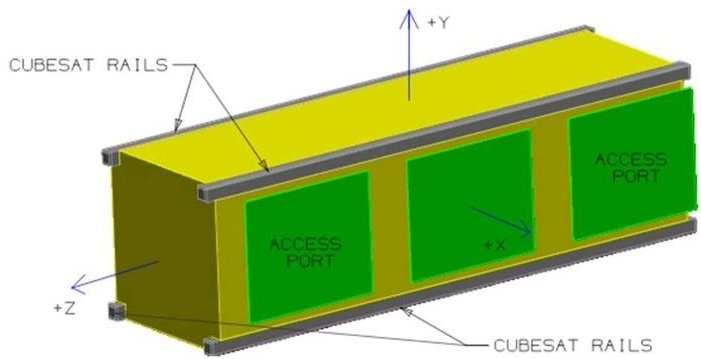

Figure 1: 3U CubeSat coordinate system $ ^{[2]} $

Once the geometry is defined, the panel normals are calculated by taking the cross product of two of the panel edges. The order of this cross product determines which side of the panel the normal will point out of and can be chosen by the user. With the geometry and panel normals defined in the body centered and aligned coordinate system, the power model must then make sure this geometry is pointed correctly to match the desired attitude that has been defined by the user. This is handled by the pointing model.

## Pointing Model

With the geometry defined, the basic principle behind the pointing model is to transform the defined CubeSat geometry from its body aligned coordinate system to a coordinate system with one axis aligned with the Sun's 'point of view'. Viewing the geometry from this axis thus provides the geometry as seen by the Sun, allowing the effective panel areas to be calculated.

The pointing model currently supports two modes, Nadir pointing and Sun pointing (Nadir pointing is pointing 'straight down' toward the center of the Earth). Both modes require the user to define a body alignment vector and a body constraint vector. The body alignment vector is a vector defined in the CubeSat's coordinate system that will be pointed at the desired target, either the Earth or the Sun. The body constraint vector is a second vector which will attempt to be oriented along the satellite's velocity vector. An example of a body alignment vector would be [001] which would point the positive z face of the CubeSat toward the target. A body constraint vector of [100] would similarly point the positive x face of the satellite along the satellite's velocity vector.

An example of this attitude is presented in Figure 2, with the satellite moving counterclockwise about its orbit from this point of view. The face pointing toward the

<!-- PDF_PAGE: 4 -->

center of the Earth is the positive z face and the red face pointing along the satellites orbit is the positive x face.

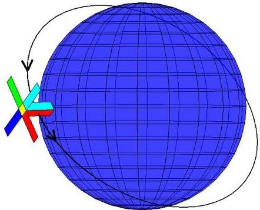

Figure 2: Nadir pointing CubeSat attitude.

The axis-angle rotation method is then used to align the provided body vectors with their targets. This method rotates a given initial vector onto a given desired vector. This is performed by taking the cross product of the two vectors and then rotating the initial vector about this new 'axis' for a given angle until it reaches the desired vector. This process is repeated twice, firstly for the body constraint vector, rotating this vector to be equal to the satellite's velocity vector, and then for the body alignment vector, rotating this vector to be equal to the target vector, either to be pointing toward the Sun or to Nadir.

Once the two rotations are found, they are then applied to vectors representing the principle satellite body axes, the positive x, y, and, z axes. This effectively gives the directions of the x, y, and z faces of the satellite in the Earth centered and aligned coordinate system. At this point in the process of the pointing model, two options were available: firstly to continue to transform the satellite geometry from its body centered and aligned coordinate system into the Earth centered and aligned coordinate system in which the Sun vector needed for the illumination model was known, or secondly, to transform this Sun vector back into the satellite body centered and aligned coordinate system. It was decided that this second method would simplify the work performed in the illumination model and so this was chosen as the method used to move forward.

Using the directions of the x, y, and z faces of the satellite, a change of basis was performed on the Sun vector. A basis for a coordinate system is the set of unit vectors which define that coordinate system. For example, the standard 3D Cartesian coordinate system has the three basis vectors [100], [010], and [001]. A change of basis moves a point, or in this case a vector, from one basis to another, and is performed by multiplying the inverse of a change of basis matrix with

the point or vector whose basis you want to change. A change of basis matrix is simply a matrix containing the three (for 3D space) basis column vectors that define the desired new basis. Equation 3 shows this process, with $ C_{1} $ representing the change of basis matrix, $ \boldsymbol{v} $ representing the Sun vector in the Earth centered basis aligned, and $ [\boldsymbol{v}]_{B} $ representing the Sun vector in the satellite centered and aligned basis.

$$
[ \boldsymbol {v} ] _ {B} = C _ {1} ^ {- 1} \boldsymbol {v}
$$

To transform the Sun vector from its current basis to the satellite body centered and aligned basis, the change of basis matrix needed is made up from the column vectors of the directions of the x,y, and z faces of the satellite in the Earth centered and aligned basis. Equation 4 shows the structure of the basis matrix, with $ x_{1} $ representing the first component of the calculated direction of the satellite's positive x face, $ x_{2} $ being the second, and so on.

$$
\boldsymbol {C} _ {1} = \left[ \begin{array}{l l l} x _ {1} & y _ {1} & z _ {1} \\ x _ {2} & y _ {2} & z _ {2} \\ x _ {3} & y _ {3} & z _ {3} \end{array} \right]
$$

Once the Sun vector has been found in the satellite's basis, a second change of basis is then applied to the satellite geometry. This basis change transforms the geometry to a basis such that the z axis is aligned to the Sun vector, meaning that viewing this transformed geometry from the z axis is identical to viewing the original geometry from the Sun's point of view.

To align the z axis to the Sun vector, the third column of the change of basis matrix for this transformation, representing z axis of the new basis, must be the previously calculated Sun vector in the satellite's basis. The two other columns of the change of basis matrix are not as important, so long as all three column vectors are orthogonal, as rotating about the Sun vector will not change the effective areas of any of the panels. As such, an arbitrary perpendicular vector to the Sun vector is calculated and then the cross product of these two vectors is taken as the third vector, forming three orthogonal vectors. Equation 5 shows the structure of this second change of basis matrix, with s representing the Sun vector and $ v_{1} $ and $ v_{2} $ being the two other orthogonal vectors.

$$
\boldsymbol {C} _ {2} = \left[ \begin{array}{c c c} v _ {1, 1} & v _ {2, 1} & s _ {1} \\ v _ {1, 2} & v _ {2, 2} & s _ {2} \\ v _ {1, 3} & v _ {2, 3} & s _ {3} \end{array} \right]
$$

This change of basis is then applied to every point making up the satellite geometry, transforming each point into the new basis. The second change of basis process is presented graphically in Figure 3. The Sun vector is coming from 'below' the satellite in the first

<!-- PDF_PAGE: 5 -->

image, looking mainly at the negative x (green) and negative y (cyan) body. The second image shows the same geometry but viewed from the Sun vector, the 'bottom' of the deployable panels and the negative z face (yellow) can now be seen. The final image shows the geometry after the change of basis, viewing the x-y plane along the z axis. The geometry appears identical to the geometry from the second image, before the basis change as the z axis is now effectively the Sun vector.

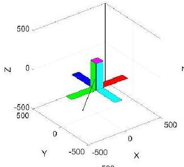

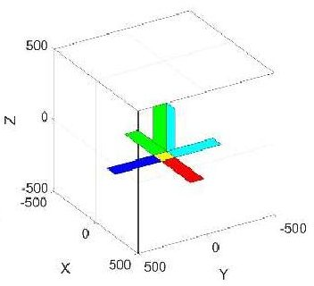

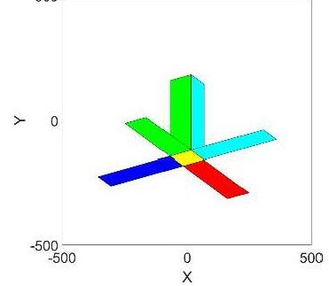

Figure 3: Geometry transformation through change of basis; initial geometry with sun vector in black (top left), initial geometry viewed from sun vector (top right), transformed geometry viewed from z axis (bottom).

## Illumination Model

The illumination model is responsible for calculating which solar panels of the transformed geometry are being illuminated at each time step and the effective areas of these panels.

Having the Sun vector aligned to the z axis allows simple calculation of the effective area of each panel. However, as can be seen in Figure 3, it is possible for some of the deployable panels to be covering some of the body panels, thus causing self-shadowing and preventing part of the body mounted panels from generating power. As such, it is not the total effective area of each panel, but the effective area visible to the sun that must be calculated.

To perform this calculation, first the 3D geometry is transformed into 2D. This is achieved simply by ignoring the z value of the transformed geometry, collapsing it to the x-y plane, effectively turning each each 3D panel into a 2D polygon. The z coordinates of the centre of

each panel, the Z-Level of the panel, are also calculated at this point to aid in the polygon clipping process that takes place next.

The polygon clipping process finds the intersections of two of the polygons, where the two polygons overlap each other, and removes or 'clips' area from one of the polygons. The polygon that the area is removed from is decided by comparing the Z-Levels of the two polygons. If one polygon has a larger Z-Level than another it means it is 'above' the other panel with respect to the Sun's view. As such, for each combination of two polygons area is removed from the one with a smaller Z-Level.

This process is repeated for all the polygons, resulting in a set of non-overlapping polygons that represent the effective area of each panel that is visible to the Sun, taking into account both the attitude of the satellite and any self-shadowing caused due to the layout of deployable panels.

As the power model was created in MATLAB, the inbuilt polygon creation and clipping functions, polyshape() and subtract(), were used to perform these steps. The area() function was then used on the clipped polygons to find the final effective areas for each panel visible to the Sun.

## Final Power Equation

As the effective panel areas have now been calculated directly, Equation 1 can be simplified by removing the cosine loss and using the effective area $ A_{e} $ instead of the total area A of each panel. This final equation is presented below in Equation 6.

$$
P = S \times \eta \times I _ {d} \times L _ {d} \times A _ {e}
$$

Equation 6, and all the calculations required to find $ A_{e} $ for each panel, are then repeated for every time step of the orbit simulation, calculating the individual power produced by each solar panel over the full simulation period. The total power generated at each time step by the satellite is also calculated by summing the individual panel powers. Orbit averaged total power is also calculated to show how the total power generation capabilities change over longer periods of time.

## GUI DESIGN

As one of the main aims of the power model was its ease of use, an intuitive way to interact with the model was considered essential. The graphical user interface (GUI) that was developed aims to provide a simple way for the user to input the parameters discussed in the previous sections. The GUI was split into three tabs, a general section where data such as the solar cell efficiency and mission lifetime is entered and the results are presented,

<!-- PDF_PAGE: 6 -->

a section for defining the geometry, and a section for defining the attitude. Both the geometry and attitude sections have real time representations of the current geometry or attitude that has been defined by the user.

Once the user has entered their chosen CubeSat design the power simulation can be run from the general section and results will be presented here once the simulation has finished. A progress bar is displayed as the simulation runs to provide feedback on its progress. Figure 4 presents the general section as well as the attitude section of the GUI. Note that the GUI is still under development and its appearance is likely to change.

While the work on the two sections of the power model, the power calculations and the GUI, were distinct, careful consideration was made to make sure both parts of the model could communicate properly. The geometry and the body alignment and constraint vectors are both defined by GUI and then passed to the power calculations, along with the information about cell efficiencies and mission lifetime. The results of these calculations must then be presented in a form that is easily passed back to the GUI to be displayed to the user.

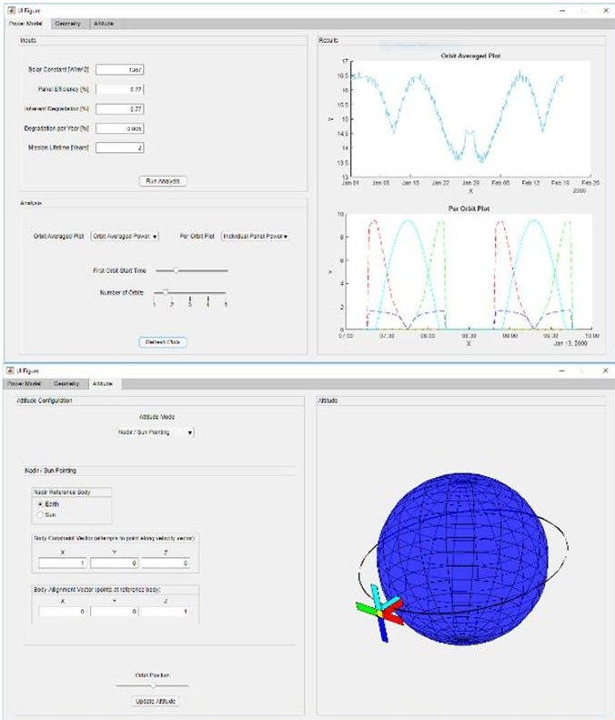

Figure 4: GUI examples.

## RESULTS

Initial validation of the PowerCubeSat power model was performed by comparing three runs of the power model presented in this paper with data kindly provided by Thales Alenia Space UK. The three runs consisted of

both a short and long run for an International Space Station (ISS) style orbit, containing eclipses, and a short run for a high inclination orbit aligned to ensure no eclipses. The orbital parameters for both orbits used for the validation are presented in Table 1 below. As the validation was focused on the pointing and illumination models, the orbit was purposefully kept simple. The specific inclination and right ascension of the ascending node (RAAN) of the high inclination orbit are to align the orbital plane with the Sun such that the satellite experiences no time spent in eclipse.

Table 1: Orbital parameters for validation orbits.

<table border="1"><tr><td>Parameter</td><td>ISS Style</td><td>High Inclination</td></tr><tr><td>Epoch Time[2000-01-01 UTC]</td><td>00:00:00</td><td>00:00:00</td></tr><tr><td>Semi-Major Axis[km]</td><td>6782</td><td>7051</td></tr><tr><td>Eccentricity</td><td>0</td><td>0</td></tr><tr><td>Inclination[deg]</td><td>52</td><td>98.084</td></tr><tr><td>RAAN[deg]</td><td>0</td><td>9.96632</td></tr><tr><td>Argument of Perigee[deg]</td><td>0</td><td>0</td></tr><tr><td>True Anomaly[deg]</td><td>0</td><td>0</td></tr></table>

The graphs produced by both the PowerCubeSat power model and the Thales power model are presented below. The graphs show the power in Watts produced by each individual panel over two orbits for each of the short runs (Figures 5 to 8), along with a graph of orbit averaged total power over the whole run for the long orbit (Figures 9 to 10).

Figures 5 and 6 show an ISS style orbit. This orbit was chosen as one of the validation orbits as many CubeSats are launched from the ISS. The troughs in the plot are caused by the satellite entering eclipse and receiving no sunlight. To make sure the PowerCubeSat model could also handle an orbit with no eclipses, a second validation run was performed on a high inclination sun synchronous orbit (SSO) with specifically chosen RAAN and inclination to make sure there were no eclipses. This run is presented in Figures 7 and 8.

A third, long period run was also performed. The two previously mentioned runs were only simulated for 1 day and so it was not possible to determine if the results would be representative for a longer period or if they would eventually diverge. Figures 9 and 10 show the orbit averaged power for both models over 30 days for the ISS style orbit.

<!-- PDF_PAGE: 7 -->

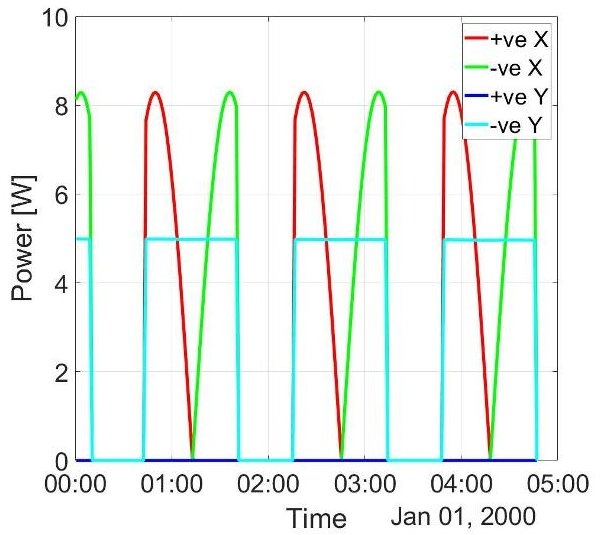

Figure 5: Per panel power for an ISS style orbit, PowerCubeSat.

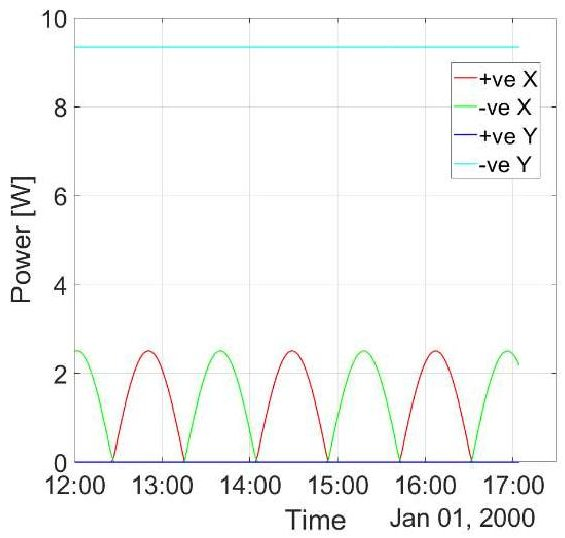

Figure 7: Per panel power for a high inclination orbit, PowerCubeSat.

Figure 9: Orbit averaged total power for an ISS style orbit, PowerCubeSat.

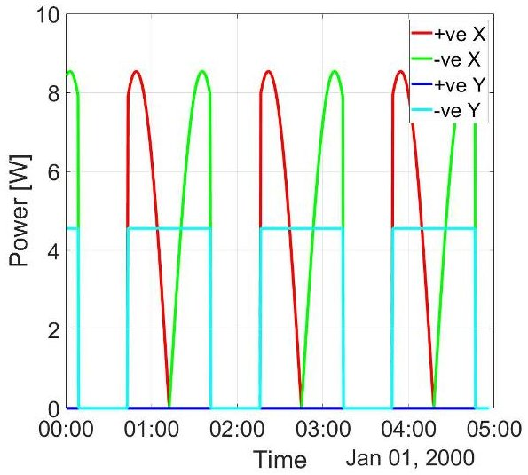

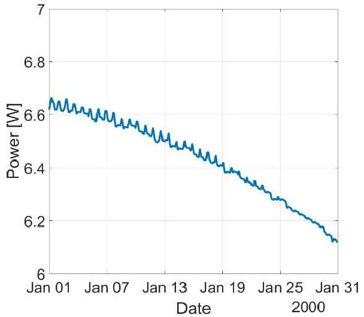

Figure 6: Per panel power for an ISS style orbit Thales power model.

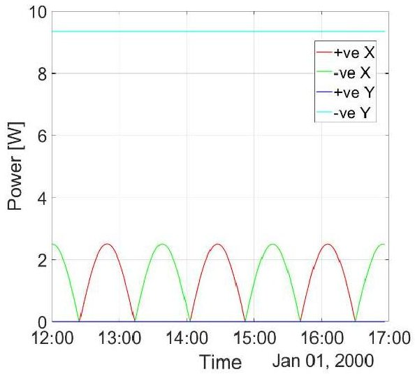

Figure 8: Per panel power for a high inclination orbit, Thales power model.

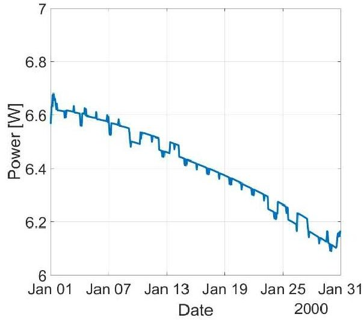

Figure 6: Orbit averaged total power for an ISS style orbit, Thales power model.

<!-- PDF_PAGE: 8 -->

## DISCUSSION

Ideally, real world satellite data would be used for validation but the authors have struggled to access any appropriate telemetry data (and would welcome numbers from CubeSat operators with real data).

With the absence of real-world data, the only option for the validation of the power model was to compare results against other power models. A similar problem exists with this method though, there are very few publicly available power models with which to perform this validation. However, Russell Hills from Thales Alenia Space UK was kind enough to run some simulation's on Thales' "Power Sim" power model to provide some validation data.

The Thales power model functions similarly to the PowerCubeSat power model, requiring the user to define and orbit, an attitude, and the solar array information. The final power calculations of the Thales model are more detailed, considering the individual solar cells and how they are connected in strings, how many strings, specific cell temperatures, etc. The Thales model does not account for deployable panels, however, and so is unable to calculate self-shadowing.

As such, only the pointing model and the illumination model, for exclusively body mounted panels, was considered for validation. This was achieved by intercepting the results from the Thales power model before power calculations and applying the same power calculations that the PowerCubeSat power model uses. Further validation is thus needed for both the power calculations and the self-shadowing.

Qualitative analysis of Figures 5 to 8 shows a good match between the results of the PowerCubeSat power model and the Thales power model, indicating that the pointing and illumination models of the PowerCubeSat power model are comparable to the PowerSim model. The percentage errors between the two models results for peak power value for each panel are presented in Table 2.

Table 2: Percentage errors between PowerCubeSat and Thales power models.

<table border="1"><tr><td>Panel</td><td>ISS Style</td><td>High Inclination</td></tr><tr><td>+ve X</td><td>2.8%</td><td>0.2%</td></tr><tr><td>-ve X</td><td>2.8%</td><td>0.3%</td></tr><tr><td>+ve Y(in shade)</td><td>N/A</td><td>N/A</td></tr><tr><td>-ve Y</td><td>9.1%</td><td>0.0%</td></tr></table>

For Figures 9 and 10, qualitative analysis once again shows the general trend for both models is similar. The orbit averaged power is taken as the average of the set of

total powers per time step over one orbit. The jagged nature of the two plots occurs due to the discrete nature of the simulation. This discreteness means that some orbits will contain more or less time steps and the time steps will also occur at different times during the orbit, resulting in different total powers. As such, a quantitative comparison was not made for these two runs.

As mentioned above, the Thales model did not account for deployable solar panels and so all three of these runs were performed with only body mounted panels. A 3U CubeSat body was used and the average power of 6 to 7 Watts displayed in Figure 9 matches the values for satellites with no deployable panels given in the Introduction $ ^{[4]} $ . This does act as a slight validation of the power calculations, showing they are at least in the correct range for CubeSats.

Whilst the self-shadowing caused by deployable panels could not be validated, the process by which self-shadowing is calculated is the same process used to calculate the effective areas of the body mounted panels. As such, while the self-shadowing effects cannot be considered validated, the method has been validated for body mounted panels.

## FUTURE WORK

There is still much work that could be done to improve the power model further. The most pressing, and simplest, centers around updates to the GUI. Whilst the GUI is currently usable and allows the quick evaluation of a CubeSat design, the configurability could be improved. The simplest improvements would be visual, and workflow related, making sure the GUI is intuitive and is as efficient to use as possible.

Other potential improvements to the power model are centered around increasing functionality. Currently the pointing model only handles Nadir and Sun pointing. Whilst these two pointing modes are very common, including modes such as random tumbling, spin stabilized, and point-and-stare would greatly increase the number of CubeSat projects that were applicable to the model. The geometry model could also be improved to allow modelling of more complex CubeSat and even bespoke geometry. Whilst the model was designed with CubeSats in mind, as this is where such a model is most needed, there is nothing stopping a larger satellite being analyzed so long as its geometry can be modelled accurately.

Further improvements also include improvement and validation of the final power calculations. The power calculations used in the Thales Power Sim power model are much more complex than those used in the power model presented in this paper. Adding functionality to

<!-- PDF_PAGE: 9 -->

support more complex calculations, whilst also validating them to make sure they are accurate, would allow the user to be more confident that the results from the PowerCubeSat power model will match the realworld powers that their satellite will generate once in orbit. Validation of the self-shadowing calculations is also needed before they can be considered accurate.

It is believed that the PowerCubeSat power model presented in this paper will prove a useful tool in the design of future CubeSats, here at the University of Bristol or by any other teams that need a power model. The GUI developed allows a user to quickly define the orbit, attitude, and configuration of the CubeSat they wish to analyze without having to understand or edit any code.

## CONCLUSION

The validation, provided by Thales Alenia Space UK allows the user to be confident in the results the power model produces. Both the pointing and illumination models have been confirmed to be accurate for CubeSats with only body mounted solar panels. Furthermore, the process that the power model uses to calculate the more complex self-shadowing effects, that arise when using deployable solar panels, is the same as the process used when only body mounted panels are being analyzed. The authors would welcome power data from CubeSats in orbit to carry on the validation.

## ACKNOWLEDGEMENTS

The author would like to thank Russell Hills of Thales Alenia Space UK for taking time to provide valuable validation data for the model.

## REFERENCES

1. Heidt, H., Puig-Suari, J., Moore, A., Nakasuka, S. and Twiggs, R., "CubeSat: A New Generation of Picosatellite for Education and Industry Low-Cost Space Experimentation," Proceedings of the $ 14^{\mathrm{th}} $ Annual AIAA/USU Conference on Small Satellites, SSC00-V-5, 2000.

2. The CubeSat Program, "CubeSat Design Specification (CDS) rev. 13," Cal Poly SLO, 2015.

3. Nanosatellite Database website, 2018-04-11 https://www.nanosats.eu/

4. Senatore, P., Klesh, A., Zurbuchen, T. H., McKague, D., and Cutler, J., "Concept, Design, and Prototyping of XSAS: A High Power Extendable Solar Array for CubeSat Applications," Proceedings of the 40th Aerospace Mechanisms Symposium, NASA Kennedy Space Centre, 2010.

5. Clark, C., "Huge Power Demand... Itsy-Bitsy Satellite: Solving the CubeSat Power Paradox," Proceedings of the 24th Annual AIAA/USU Conference on Small Satellites, SSC10-III-5, 2010.

6. SPAT download page, 2018-04-21, https://sourceforge.net/projects/spat-sat/

7. Kharsansky, A., "Power Modelling and Budgeting Design and Validation with In-Orbit Data of Two Commercial LEO Satellites," Proceedings of the 31st Annual AIAA/USU Conference on Small Satellites, SSC17-X-08, 2017.

8. Leonard, B., "Spacecraft System Options for Best Data Rate," Proceedings of the 31st Annual AIAA/USU Conference on Small Satellites, SSC17-S1-07, 2017.

9. Gonzalez-Llorente, J., and Ortiz-Rivera, E. I., "Comparison of Maximum Power Point Tracking Techniques in Electrical Power Systems of CubeSats," Proceedings of the 27th Annual AIAA/USU Conference on Small Satellites, SSC13-WK-4, 2013.

10. GMAT website, 2018-04-23 http://gmatcentral.org/

11. Wertz, J. R., Everett, D. F., and Puschell, J. J., "Space Mission Engineering: The New SMAD," 4th ed., Microcosm Press and Springer, Hawthorne, CA, 2011.

12. Socolovsky, H., Muoz, S., Raggio, D., and Bolzi, C., "Development and Testing of Solar Panels for Small Satellite Applications at CNEA," Proceedings of the 31st Annual AIAA/USU Conference on Small Satellites, SSC17-P1-18, 2017.