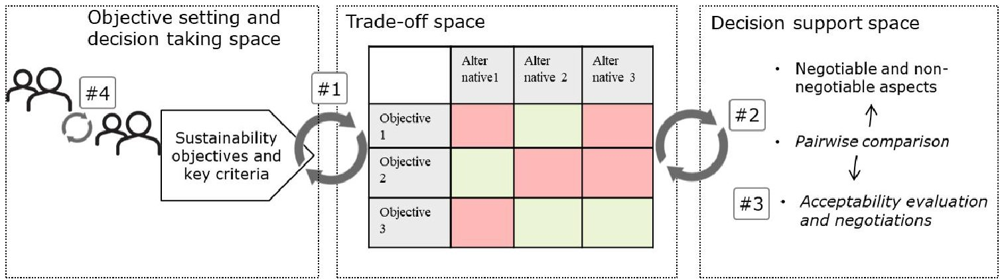

<!-- PDF_PAGE: 1 -->

# DEVELOPING A TOOL TO SUPPORT DECISIONS IN SUSTAINABILITY-RELATED TRADE-OFF SITUATIONS: UNDERSTANDING NEEDS AND CRITERIA

M. Kravchenko $ \times $ , D. C. A. Pigosso and T. C. McAloone

DTU-Technical University of Denmark, Denmark

makrav@dtu.dk

## Abstract

Early integration of sustainability considerations into decision making is seen as a key enabler for companies to understand the potential implications of their decisions on the triple bottom line aspects. Lack of the tools to support decisions when trade-off between sustainability aspects occur, however, may lead to uninformed decision-making and undesired outcomes. By consolidating the learnings from empirical work together with literature recommendations, we propose key criteria to be considered when developing decision support tools to manage sustainability-related trade-off situations.

Keywords: sustainability, decision making, design support system

## 1. Introduction

Early integration of sustainability considerations into decision making during various business processes is seen as a key enabler for companies to understand the potential implications of their decisions on the triple bottom line aspects (Korhonen et al., 2018) and introduce improvements early in the design and development processes (McAloone and Pigosso, 2018). This can support development of more sustainable products, services, processes and systems (Gagnon et al., 2012). Various methods and tools have been proposed to assess the sustainability impact of products, services and processes, such as environmental LCA (ISO 14044, n.d.), cost-benefit analyses (Hoogmartens et al., 2014), Social LCA (Fontes et al., 2016). While the impact assessment methods can be deployed to understand the consequences of a project implementation (McAloone and Pigosso, 2018), their use in early stages to assist decision making is limited due to lack of information to feed the tools (Bengtsson, 2001). This creates several paradoxes: if information is lacking, the tools have limited applicability during the early stages of design to support decision making, thus making it harder to understand the sustainability performance in advance and introduce improvements; if the tools are used later in the process, firstly, the improvements may be harder to introduce, and secondly, the impacts may be impossible to trace back to the decisions that have been made during the process. To address this challenge, several tools have been proposed to be specifically employed early in the design and development processes, such as a streamlined LCA for early vehicle development by Arena et al. (2013), qualitative sustainability compliance index for early product development by Hallstedt (2017), leading sustainability indicators for circular economy screening by Kravchenko et al. (2019). These tools as well as many others aim to provide decision support in different business processes by integrating environmental, economic, social or three-dimensional sustainability considerations. While, indeed, these

<!-- PDF_PAGE: 2 -->

tools provide a structured support in identifying relevant sustainability criteria and the logic for assessing the potential sustainability performance (e.g. of products, services or processes), the research calls for more work on integrating decision support techniques after the assessment is done (Stindt, 2017). Unambiguously this concerns development of structured procedures to support decision making in trade-off situations (Haffar and Searcy, 2017), which are inherent in sustainability-oriented decision making because of the complexity of considered criteria and uncertainty about sustainability outcomes (Siew, 2008; Simonovic et al., 1997). Earlier works (Byggeth and Hochschorner, 2006), as well as more recent (de Koeijer et al., 2017; Wu and Pagell, 2011) discuss the lack of support provided to the decision makers in industry in navigating complex decisions in sustainability trade-off situations. Decision support is needed to ensure the adequate information is used to enable practitioners making informed decisions by explicitly taking into account sustainability considerations and reinforcing knowledge about potential risks and opportunities behind their choices. Consequently, it may support selection of the 'best' alternative during design and development of sustainable products, services and processes.

This paper explores this issue by consolidating the learnings from empirical investigations and literature review to understand the criteria to be considered for the development of a decision support tool to assist decisions in trade-off situations. Before that, we provide theory and examples of sustainability-related trade-offs to bring understanding when trade-off situations occur and when they are difficult. Subsequently, we provide examples of few studies that explored decision support techniques and the extent to which they enable practical management of trade-offs. Based on the findings, we identify gaps and opportunities for future research.

## 2. Research approach

The need for guidance in a trade-off situation emerged as part of the empirical work involving company case studies in a large Nordic research project on circular economy implementaiton. During the workshop activities, which aimed at assessing potential sustainability performance of a specific circular economy solution using leading sustainability indicators (Kravchenko et al., 2019), it became evident that the trade-offs were present. The trade-offs were made explicit after the selected indicators (measuring selected environmental, economic and social aspects), were calculated and used to compare two alternatives: the 'current' and the 'circular economy' solutions. This led to the investigation of the need to support decisions when trade-off between sustainability aspects occur.

Design Research Methodology (DRM) was used as a main framework to support the investigation (Blessing and Chakrabarti, 2009). While the DRM consists of four main and iterative stages, we followed first two to search for evidence to support our initial assumption and then to understand the advances in the current research and obtain information for the effective development of a design support later, as the research proceeded. In the first stage, Research Clarification, the intention was to clarify the need and understand the gaps in research related to trade-offs. As a result of this stage, the need to support practitioners in their decisions under trade-off conditions was made evident, in that:

- there is a need for providing a direct support to practitioners in a trade-off situation within and between sustainability aspects (Byggeth and Hochschorner, 2006; Haffar and Searcy, 2017);

- there is a need to develop decision support tools that are 'easily' integrated into decision processes and are understood by practitioners (Zetterlund et al., 2016).

The second stage, Descriptive Study, was then followed during which a literature review process has been conducted to attain an understanding of what criteria to consider when developing a decision support tool. This stage generated insights about the key aspects to be considered to fill the identified gaps and fulfil the needs (Blessing and Chakrabarti, 2009). The main contribution of this research is to complement current sustainability assessment research by initiating a discussion about how to guide the development of appropriate tools to support designers and project planners in navigating sustainability trade-off situations.

## 3. Research clarification: Sustainability-related trade-offs

Sustainability assessment can be simply defined as any process that directs decision-making towards sustainability (Morrison-Saunders and Pope, 2013). Being a process, decision-making occurs over

<!-- PDF_PAGE: 3 -->

period of time, often under complex and dynamic circumstances involving multiple objectives through participation of stakeholders often eliciting conflicting interests. Integration of sustainability issues further complicates the decision-making process, where the complexity lies not only in defining sustainability criteria and how they can be measured, but to what extent need sustainability considerations be as important as 'traditional' criteria (Gibson et al., 2005; Simonovic et al., 1997). Criteria are used by decision-makers to plan and guide the decision-making process to support taking a certain decision. It is widely acknowledged that the 'importance' of criteria is driven by a variety of values, which reflect fundamental (e.g. corporate or project) objectives (Retief et al., 2013). For instance, for a new product development project, such 'traditional' criteria would be: strategic fit; customer requirements; limited commercial risk and market responsiveness; conformity to law and regulations (Bovea and Pérez-Belis, 2012), while sustainability-related criteria could be: presence of toxic substances; energy efficiency; etc.

## 3.1. Trade-off types and occurrences

Trade-offs can be described as tensions in the decision-making process to favour some criteria that lead to certain desired outcomes over others. Byggeth and Hochschorner (2006) define trade-offs as "situations when a sacrifice is made in one area to obtain benefits in another ... [whereby] it is usually impossible to optimize them, all at once" (p.1420). For instance, during a packaging selection process, the tensions can arise between the 'traditional' criteria, such as cost of material, technical performance and supplier proximity, and sustainability criteria, such as recyclability or recycled content (de Koeijer et al., 2017). It has been reported that corporate trade-offs can arise on different levels, such as strategic (macro level), tactical and operational (micro level) (Hahn et al., 2010; Prendeville et al., 2017). Macro level trade-offs concern the question of whether (whether a company should engage in sustainability projects) with trade-offs related to sustainability dimensions, time considerations and stakeholder demands (Haffar and Searcy, 2017). Micro level trade-offs concern the questions of which (which areas to engage in sustainability) and how (how to engage in them, i.e. how to act and what principles to apply) (Byggeth and Hochschorner, 2006; Prendeville et al., 2017). Table 1 provides examples of trade-offs as identified by the literature. Interestingly, Haffar and Searcy (2017) note that trade-offs encountered on micro levels are influenced by those encountered on macro level, or put similarly, earlier choices influence (facilitate or delimit) further ones, making the decisions sequential (Wu and Pagell, 2011). Unambiguously, the sustainability-related trade-offs on macro level will occur as a result of corporate decisions only when the decision-makers are 'aware' of sustainability-related problems and can understand what opportunities exist (Haffar and Searcy, 2017), thus implicitly or explicitly establishing principles or rules according to which decisions at tactical and operational levels will be made. For instance, a corporate decision to become a producer of one of the most eco-friendly and energy-efficient insulation systems will signal about the corporate awareness of energy preservation needs and the environmental and health impact of insulation materials, while also influencing the principles product designer will follow and the criteria according to which the product's performance will be evaluated. While such criteria as presence of toxic materials and superior thermal properties (good insulator) could play a key role in product design, and can be considered as 'non-negotiable' (i.e. strategically set), consideration of other criteria such as material use, material cost and water usage can potentially lead to the identification of trade-off situations, i.e. more material needs to be used to satisfy the superior insulation requirement, thus increasing costs, or the process of producing the insulation material is very water intensive. These trade-offs, however, can only be identified if the decision makers (in this case product developers) use relevant sustainability assessment tools to identify other criteria to be included in the decision making process. This brings back the discussion in the introduction part about the importance of developing and providing relevant sustainability-related decision support tools to the practitioners to enable them to: i) set decision boundaries and reduce uncertainty of what criteria are important for sustainability-related decision-making (Gagnon et al., 2012); ii) enable a dynamic decision process, where the information selected is meaningful for the information users (Bengtsson, 2001; Zetterlund et al., 2016); iii) evaluate alternatives, uncover trade-off situations and use guidelines and rules to navigate trade-offs in an explicit way (Gibson et al., 2005); iv) make decisions in a rationale way

<!-- PDF_PAGE: 4 -->

and track every decision that has been made, reflect on it and iterate (i.e. select other criteria or select different alternatives for evaluation) whenever necessary (Waas et al., 2014; Watz and Hallstedt, 2018).

Table 1. Trade-off examples from sustainability literature

<table border="1"><tr><td>Reference</td><td>Research domain</td><td>Trade-off classification</td><td>Trade-off example</td></tr><tr><td>Byggeth and Hochschorner(2006)</td><td>Eco-design and product development</td><td>According to sustainability aspect:a) in one environmental aspectb) between different environmental aspectsc) between different sustainability aspects</td><td>a) Material weight vs material toxicity(e.g. small amounts of a toxic material and more weight of a less toxic materialb) More material vs less energy(e.g. more material for insulation to save energy in use)c) Material and cost(e.g. lightweight material that is more expensive)</td></tr><tr><td>Prendeville et al.(2017)</td><td>Eco-design and product development</td><td>According to decision levels:a) strategicb) tacticalc) operational</td><td>a) Higher recyclable material costs due to supplier transportation costsb) Material substitution(recycled form of the virgin material is only offered by one supplier)c) Two parts are to be moulded together that affects cost-efficiency of disassembly</td></tr><tr><td>Björklund and Forslund(2019)</td><td>Sustainable logistics</td><td>No distinctive classification</td><td>-Social considerations vs investment-Uniform performance indicators for all logistic providers vs provider specific indicator and right balance of indicators across sustainability dimensions</td></tr><tr><td>Driessen and Hillebrand(2013)</td><td>New product development</td><td>No distinctive classification, but based on stakeholder value prioritization</td><td>-Organic and locally grown ingredients:if no local suppliers offered organic options,the trade-off is between organic but international supply vs non-organic and local- Reduction of VOC content in chemicals complicates the use of the chemical by the user</td></tr><tr><td>Wu and Pagell(2011)</td><td>Sustainable supply chain management</td><td>No distinctive classification</td><td>-Support locally grown [organic] produce vs reliability of supply in terms of variability and volumes</td></tr><tr><td>de Koeijer et al.(2017)</td><td>Sustainable packaging development</td><td>No distinctive classification</td><td>-Material selection:‘known’ less sustainable material vs‘unknown’ more sustainable material(*unknown was linked to the newness of the material on the market and doubts about its long-term success)</td></tr><tr><td>Holt and Watson(2008)</td><td>Corporate social responsibility</td><td>No distinctive classification</td><td>-local vs international sourcing and carbon footprint:supporting local(often vulnerable) communities internationally(e.g.Fairtrade procurement)vs carbon footprint related to transport</td></tr><tr><td>Amaral and Guerreiro(2014)</td><td>Logistics planning</td><td>No distinctive classification,but based on time response and cost</td><td>-Transport mode:air shipping is costly but provides timely responses vs rail mode is cheaper but provides less timely responses;-Centralization of warehouses:centralized location increases outbound transport cost but lowers the inbound costs while the decentralized has the opposite effects plus increased warehouse cost per warehouse</td></tr></table>

<!-- PDF_PAGE: 5 -->

## 3.2. Management of trade-offs and trade-off support techniques

From the theory presented above and the trade-off examples provided in Table 1, it is clear that understanding trade-offs, their occurrence and management is a complex task.

To understand how the literature has proposed to manage trade-offs and support decisions, we present summaries of several works that reviewed to what extent different tools support decisions in sustainability-related trade-off situations. These works provided reviews of tools from two different, but sustainability-related strategies, such as Eco-design and Sustainable supply chain management.

Byggeth and Hochschorner (2006) analysed 15 Eco-design tools to understand to what extent do they provide decision support in trade-off situations during product development process. Their conclusion was that while nine of the tools included valuation (i.e. implicit rating of importance of criteria or strategies), their support of decision was not sufficient. The authors indicate that valuation should concern not only the identification of trade-offs, but provide guidance for decisions when trade-offs are revealed. Several gaps in relation to the tools and their suitability for trade-off decision support are highlighted, such as: i) they may be too simple and do not address complex issues of sustainability; ii) some of the guidance needs to be supported only by using more comprehensive tools, such as life cycle assessment (for instance, 'dematerialization' strategy needs to be only prioritized when the whole life cycle is considered as opposed only to 'material consumption' aspect, to avoid sub optimization); iii) they do not give direct guidance on managing trade-offs concerning various aspects of sustainability, provided other 'traditional' criteria are satisfied. The latter one is especially relevant to address since few eco-design methods have been proposed to provide support in early design stages considering environmental and functional requirements of a product (e.g. the Green Quality Function Deployment by Bovea and Wang in (Bovea and Pérez-Belis, 2012). Despite the findings by Byggeth and Hochschorner (2006) in early 2000s, there is still a gap in the literature to support decisions in sustainability-related trade-off situations (Haffar and Searcy, 2017; de Koeijer et al., 2017).

Taticchi et al. (2015) analysed decision support tools for managing sustainable supply chain. The authors specifically focused on understanding to what extent performance measurements are supported by decision tools to guide supply chains design and operation. The conclusion was that while various methods and tools have been used to support performance measurements in sustainable supply chain, they rarely supported decisions to address conflicting objectives incorporating triple bottom line approach; furthermore, while mathematical modelling (such as multicriteria decision analysis and agent based modelling) that aims at optimizing solutions may be a practical manner to identify the most suitable option, it can lead to oversight of some trade-offs and impede alternative solution generation as a consequence of the trade-off management (de Magalhães et al., 2019).

To complement the literature, we acknowledge the importance of any sustainability assessment technique to include a decision support procedure to assist decision-making in a trade-off situation. This paper tries to investigate what criteria are necessary for the development of decision support tools. We specifically look at the literature concerning trade-offs that occur at tactical and operational levels, i.e. relate to decisions in business processes (as opposed to strategic processes), e.g. product development or manufacturing processes. Moreover, we are specifically interested in understanding techniques to address trade-offs within and between sustainability criteria, assuming all the other criteria fulfil the requirements of the project.

## 4. Outcomes of the descriptive study: Criteria for the development of a decision-support tool to assist decisions in trade-off situations

Due to the complexity of the trade-off situations and the lack of a generic tool to support sustainability-related trade-off decisions, we have consolidated few criteria that should be considered for the development of a decision-support tool to assist decisions in sustainability trade-off situations. This consolidation is based on the recommendations extracted from the above-cited works as well as on the results of internal discussions in the research group. These criteria are not exhaustive and serve to facilitate the discussion focused on trade-off management for sustainability aspects, as opposed to, for instance, trade-offs between functional requirements in a product development process.

<!-- PDF_PAGE: 6 -->

Criterion #1: it is fundamental to enable elicitation of sustainability objectives and use relevant tools to reveal trade-offs

As discussed before, trade-offs are inherent in sustainability-related projects. However, not all the tools can reveal trade-offs, thus falling short on making them explicit for the decision-makers. Gibson et al. (2005) argue that a 'good' sustainability-oriented assessment should reveal trade-offs, because making the trade-offs explicit helps to address any major critical aspects of sustainability concern that can emerge as part of the decision process (Eakin et al., 2009). It is, therefore, essential to ensure that the decision-makers elicit their sustainability objectives before the assessment. For the objective elicitation, it is crucial to focus on 'fundamental' objectives as opposed to 'means' objectives to avoid too narrow focus (Hammond and Keeney, 1999). A fundamental objective can be to 'reduce overall environmental impact of a product X', rather than stating 'increase recyclability of a product X', which can be a means objective to potentially achieve the fundamental objective. After the objectives have been defined, it is important to select appropriate assessment tools and techniques (e.g. sustainability performance indicators) to understand to what extent the objectives can be achieved by different alternatives. Consequently, a tool that incorporates various sustainability aspects from the three-dimensional perspective should be prioritized (Byggeth and Hochschorner, 2006). Additionally, a tool should enable an assessment from a life cycle perspective (Byggeth and Hochschorner, 2006) and include a guideline or processes for identifying case and context-specific factors (Gibson et al., 2005). This can be linked to the main concerns of the sector, the company or a product can be classified according to (Kravchenko et al., in review): for instance, the packaging use and waste generation along the value chain should be considered as key issues if a company belongs to the food sector. Such guidelines can be very useful for the decision makers during the process, considering that most of the companies in EU are SME's (EC, 2019) and may not have an environmental or sustainability engineer, whose expertise is essential in facilitating the selection of key issues (McAloone, 1998). Furthermore, this process can also serve as a 'checklist' for environmental experts, who would often use heuristics to justify their choice, while being useful, however, may lead to systematic errors if not supported by additional tools (Bakker et al., 2012).

## Criterion #2: it is important to provide several prioritization principles in conjunction to assist trade-offs understanding and management

Once the trade-offs have been revealed, it may be necessary to use several prioritization tools to provide a better understanding of the factors that influence and are influenced in the decision process (Driessen and Hillebrand, 2013). Those prioritization principles may be of qualitative and/or qualitative nature. One of the prioritization techniques can be to use strategic requirements to understand whether they can support or confront the intended decisions (Byggeth and Hochschorner, 2006; Hahn et al., 2010). For instance, the corporate commitment to offer a 10 year warranty can be a driving factor for adding more material (material use aspect) to increase durability. Another factor can be a brand image or customer requirement, which will, for instance, make a specific part or feature of a product 'preserved' from changes, e.g. white surface for medical appliances. For medical appliances, again, the safety criterion and legal requirements can be driving factors to replace some durable parts in a refurbished appliance to guarantee the conformity (i.e. more new parts will be used in a refurbished appliance even though the used parts were quality-tested and could serve another use cycle). To facilitate the preference-setting, those different factors or requirements can be classified as 'negotiable' and 'non-negotiable', thus delineating what can be accepted in design decisions (Morrison-Saunders and Pope, 2013). While it is mandatory to comply with minimum requirements of legislation and standards (Byggeth and Hochschorner, 2006) (i.e. non-negotiable criteria), companies can set their own minimum or maximum requirements. For instance, a minimum requirement for a cosmetics company is to never use parabens as preservatives in their products, which may require finding more expensive alternatives (cost aspect) or adding protective packaging to prevent mould formation (material use aspect). While EU regulates what forms of parabens are banned, and what maximum concentrations of specific parabens are allowed (Andersen and Larsen, 2013), it is still a higher priority for a company to use their own, 'non-negotiable' requirements. These 'non-negotiable' requirements can be set by a company to 'stay ahead' as a respond to a variety of changes, such as

<!-- PDF_PAGE: 7 -->

legislative, social, technological, that might fore come as a consequence of the upcoming megatrends (KPMG International, 2014).

Another prioritization technique to use could be a relatively simple prioritization matrix, which could allocate all important criteria. The prioritization is done by a pair-wise comparison of the criteria and assigning a score to each. After several rounds of prioritizations, it may become obvious what criteria are negotiable, what are not, and what are the likely trade-offs to be 'accepted'.

Criterion #3: it is important to enable evaluation of trade-off acceptability

Different prioritization techniques enable the explication of the most important criteria and their relative importance to each other and to the main objectives. This creates visibility of the rationale about the trade-offs that are potentially to be accepted. However, before the final trade-off acceptance, it is important to evaluate the trade-offs. Gibson et al. (2005) have formulated several rules to be used during the process of argumentation for trade-offs. These rules can be used as a base to develop guidelines or checklists to be followed during the decision process. The following rules should apply for the evaluation of trade-off acceptability:

a) any acceptable trade-off must deliver net sustainability gains (over the long-term);

b) no trade-off involving significant adverse effect is acceptable unless all alternatives are worse;

c) no displacement of significant adverse impact from present to future can be justified unless all alternatives are worse;

To address the evaluation for the rule a), a set of guiding questions or a decision tree can be developed to assist understanding of the net sustainability gains. For instance, such questions as 'can you achieve a balance across objectives that cover all dimensions of sustainability?' can be used to understand if the selected alternative can be adjusted. If only two objectives can be balanced, another guiding question could address whether the 'sacrifice' of the third objective can be managed in the longer term (e.g. increased cost which is expected to decrease with time because of, for instance, maturity of the process or technology) or 'offset' by other projects. If no balance can be achieved between the objectives, the guidance could be to understand if other alternatives exist, otherwise the solution has to be rejected. For instance, if the product redesign can not guarantee achievement of the objective to reduce GHG emissions, the project can be suspended, however the strategic management can take a decision to reduce volume of produced and sold products, so to achieve the objective in an alternative way. In this way, it is essential that the designer team has the right tools to understand the trade-offs and communicate them upwards to have a decision taken. To address rules b) and c), a matrix can be used to understand the importance of trade-offs evaluated by e.g.: severity, probability, scale, duration, frequency of the adverse impact, for instance, using scales and colour schemes as in risk or environmental impact assessment matrices. To understand the severity and probability, it may be necessarily to consult experts from the field related to a trade-off. For instance, if application of a fiberglass material in a product is accepted despite the recyclability aspect being negative, experts from the field may indicate the latest advances in the recycling technology, which can help justify the trade-off acceptability. The expertise in the networks of suppliers, partners and customers can be advantageous to get knowledge about materials, products and processes (McAloone, 1998), which can reinforce sustainability learning and potentially lead to resolving the trade-off (Brennan and Tennant, 2018).

Criterion #4: it is important to develop tools and procedures that are relatively easy to be implemented by industrial practitioners

As previously discussed, a sustainability-oriented decision-making process should not be merely a computational process, but a process that facilitates dialogue between different stakeholders, reinforces learning and creates transparency of the decisions made during the process. Therefore, for a successful integration of sustainability considerations into conventional design and development processes, sustainability assessment and decision support tools need to be relatively simple, so the internal and external decision makers can be involved throughout the whole process, from objective setting, to modelling and assessment and then in interpretation and decision taking.

Interplay of the four criteria in the decision-making process

Taking into account the arguments put forward earlier, we discuss the importance of the above-mentioned criteria in influencing the outcomes of the decision process. Figure 1 visualizes different

<!-- PDF_PAGE: 8 -->

'spaces' of the decision process, such as the space of objective and goal setting and decision taking, trade-off space and decision support space. We can argue that if criterion #1 is not satisfied, the trade-offs may not be revealed, which negates the inherent value of decision-making as a process, making practitioners resort to taking fast, simple and myopic decisions. If criteria #2 and #3 are not satisfied, likewise, the practitioners may use ad hoc approaches to selecting the 'best' alternative while accepting some trade-offs being unaware of potential risks this acceptability brings. This can consequently influence the ability of decision-makers in taking actions to improve performance of the selected alternative or mitigate the accepted trade-offs. Same outcome can also occur when criterion #4 is not satisfied, making it harder for decision-makers interpret the results and meaningfully utilize them.

Figure 1. Relationships between different spaces of the decision-making process when the four criteria are considered

## 5. Concluding remarks

Based on the learnings from the empirical investigation and a literature review, this paper has explored the criteria for the development of a decision-support method to assist decisions in trade-off situations. The empirical work led to the identification of the need, which was then supported by the literature. Furthermore, the literature review provided an understanding of the types of trade-offs related to sustainability aspects and the gap related to the lack of the tool to guide decisions in a sustainability-related trade-off situations, provided all the other important criteria are satisfied. As a result, we elaborate on four criteria that are important to consider when developing a decision support tool. In summary, the key findings are following:

1. the four consolidated criteria seem to be generic to help resolving trade-offs during decision making during various business processes; however there may be more criteria to consider

2. the four criteria can be used to develop an approach to trade-off management in the process of design and development of sustainable products and services

3. there are no apparent approaches focusing on trade-off management of this type, namely within and between sustainability aspects

Therefore, this paper is intended to inspire a discussion about what should be taken into account when developing a sustainability-related trade-off decision support tool. The main limitations of this study are related to the techniques employed to identify the criteria. Therefore, more research is needed to investigate how to complement the consolidated criteria and understand the approach to the development of the support tool. Future work should proceed by developing the support and testing it in empirical settings.

## Acknowledgement

This article is one of the outcomes of the research project CIRCit (Circular Economy Integration in the Nordic Industry for Enhanced Sustainability and Competitiveness), which is part of the Nordic Green Growth Research and Innovation Programme (grant number: 83144), jointly supported by NordForsk, Nordic Energy Research, and Nordic Innovation. The authors would like to thank the CIRCit consortium partners for enriching discussions about CE and sustainability.

<!-- PDF_PAGE: 9 -->

## References

Amaral, J.V. and Guerreiro, R. (2014), "Knowledge and Assessment of Logistics Cost Trade-offs : a Study with Brazilian Professionals", Revista Contabilidade & Finanças, Vol. 25 No. 65, pp. 111-123.

Andersen, D.N. and Larsen, P.B. (2013), "Survey of Parabens", Danish Ministry of the Environment, pp. 1-58.

Arena, M., Azzone, G. and Conte, A. (2013), "A streamlined LCA framework to support early decision making in vehicle development", Journal of Cleaner Production, Elsevier Ltd, Vol. 41, pp. 105-113.

Bakker, C. et al. (2012), "Rethinking eco-design priorities; The case of the Econova television", Electronics Goes Green 2012+, ECG 2012 - Joint International Conference and Exhibition, Proceedings.

Bengtsson, M. (2001), "Weighting in practice: Implications for the use of life-cycle assessment in decision making", Journal of Industrial Ecology, Vol. 4 No. 4, pp. 47-60.

Björklund, M. and Forslund, H. (2019), "Challenges addressed by swedish third-party logistics providers conducting sustainable logistics business cases", Sustainability (Switzerland), Vol. 11 No. 9, available at: https://doi.org/10.3390/su11092654

Blessing, L. and Chakrabarti, A. (2009), "DRM: A Design Research Methodology", Springer London, No. September, pp. 13-42.

Bovea, M.D. and Pérez-Belis, V. (2012), "A taxonomy of ecodesign tools for integrating environmental requirements into the product design process", Journal of Cleaner Production, Elsevier Ltd, Vol. 20 No. 1, pp. 61-71.

Brennan, G. and Tennant, M. (2018), "Sustainable value and trade-offs: Exploring situational logics and power relations in a UK brewery's malt supply network business model", Business Strategy and the Environment, Vol. 27 No. 5, pp. 621-630.

Byggeth, S. and Hochschorner, E. (2006), "Handling trade-offs in Ecodesign tools for sustainable product development and procurement", Journal of Cleaner Production, Vol. 14 No. 15-16, pp. 1420-1430.

Driessen, P.H. and Hillebrand, B. (2013), "Integrating multiple stakeholder issues in new product development: An exploration", Journal of Product Innovation Management, Vol. 30 No. 2, pp. 364-379.

Eakin, H. et al. (2009), "Hidden costs and disparate uncertainties: trade-offs in approaches to climate policy", In: Adger, W.N., Lorenzoni, I. and O'Brien, K.L. (Eds.), Adapting to Climate Change. Thresholds, Values, Governance, Cambridge University Press, Cambridge, p. 501.

EC (2019), "Internal Market, Industry, Entrepreneurship and SMEs", European Commission, available at: https://ec.europa.eu/growth/smes/business-friendly-environment/sme-definition_en (accessed 11 November 2019).

Fontes, J. et al. (2016), "Product social impact assessment", The International Journal of Life Cycle Assessment, pp. 547-555.

Gagnon, B., Leduc, R. and Savard, L. (2012), "From a conventional to a sustainable engineering design process: Different shades of sustainability", Journal of Engineering Design, Vol. 23 No. 1, pp. 49-74.

Gibson, R.B. et al. (2005), Sustainability Assessment: Criteria, Processes and Applications, Earthscan, London.

Haffar, M. and Searcy, C. (2017), "Classification of Trade-offs Encountered in the Practice of Corporate Sustainability", Journal of Business Ethics, Springer Netherlands, Vol. 140 No. 3, pp. 495-522.

Hahn, T. et al. (2010), "Editorial Trade-Offs in Corporate Sustainability: You Can't Have Your Cake and Eat It", Business Strategy and the Environment, Vol. 19 No. 4, pp. 217-229.

Hallstedt, S.I. (2017), "Sustainability criteria and sustainability compliance index for decision support in product development", Journal of Cleaner Production, Elsevier Ltd, Vol. 140, pp. 251-266.

Hammond, J.S. and Keeney, R.L. (1999), "Making smart choices in engineering", IEEE Spectrum, IEEE, Vol. 36 No.11, pp. 71-76.

Holt, D. and Watson, A. (2008), "Exploring the dilemma of local sourcing versus international development The case of the flower industry", Business Strategy and the Environment, Vol. 17 No. 5, pp. 318-329.

Hoogmartens, R. et al. (2014), "Bridging the gap between LCA, LCC and CBA as sustainability assessment tools", Environmental Impact Assessment Review, available at: https://doi.org/10.1016/j.eiar.2014.05.001

ISO 14044 (n.d.), Environmental Management Life Cycle Assessment Requirements and Guidelines.

de Koeijer, B., de Lange, J. and Wever, R. (2017), "Desired, perceived, and achieved sustainability: Trade-offs in strategic and operational packaging development", Sustainability (Switzerland), Vol. 9 No. 10, p. 1923.

Korhonen, J., Honkasalo, A. and Seppälä, J. (2018), "Circular Economy: The Concept and its Limitations", Ecological Economics, available at: https://doi.org/10.1016/j.ecolecon.2017.06.041

KPMG International. (2014), "Future State 2030: The global megatrends shaping governments", pp. 1-80.

Kravchenko, M., Pigosso, D.C.A. and McAloone, T.C. (2019), "Towards the ex-ante sustainability screening of Circular Economy initiatives in manufacturing companies: consolidation of leading", Journal of Cleaner Production, Elsevier Ltd, p. 118318.

<!-- PDF_PAGE: 10 -->

de Magalhães, R.F., de Danilevicz, A.M.F. and Palazzo, J. (2019), "Managing trade-offs in complex scenarios: A decision-making tool for sustainability projects", Journal of Cleaner Production, Vol. 212, pp. 447-460.

McAloone, T.C. (1998), Industry Experiences of Environmentally Conscious Design Integration: An Exploratory Study, Industry Experiences of Environmentally Conscious Design Integration: An Exploratory Study, Cranfield University.

McAloone, T.C. and Pigosso, D.C.A. (2018), "Ecodesign Implementation and LCA", In: Hauschild, M.Z., Rosenbaum, R.K. and Olsen, S.I. (Eds.), Life Cycle Assessment: Theory and Practice, Springer International Publishing, Cham, pp. 545-576.

Morrison-Saunders, A. and Pope, J. (2013), "Conceptualising and managing trade-offs in sustainability assessment", Environmental Impact Assessment Review, Elsevier Inc., Vol. 38, pp. 54-63.

Prendeville, S.M. et al. (2017), "Uncovering ecodesign dilemmas: A path to business model innovation", Journal of Cleaner Production, Elsevier Ltd, Vol. 143, pp. 1327-1339.

Retief, F. et al. (2013), "Exploring the psychology of trade-off decision-making in environmental impact assessment", Impact Assessment and Project Appraisal, Vol. 31 No. 1, pp. 13-23.

Siew, T.F. (2008), "Connecting science and decision-making: A conceptual framework through organisation knowledge management", Proc. IEMSs 4th Biennial Meeting - Int. Congress on Environmental Modelling and Software: Integrating Sciences and Information Technology for Environmental Assessment and Decision Making, IEMSs 2008, Vol. 2, pp. 913-924.

Simonovic, S.P., Burn, D.H. and Lence, B.J. (1997), "Practical sustainability criteria for decision-making", International Journal of Sustainable Development and World Ecology, Vol. 4 No. 4, pp. 231-244.

Stindt, D. (2017), "A generic planning approach for sustainable supply chain management - How to integrate concepts and methods to address the issues of sustainability?", Journal of Cleaner Production, Elsevier Ltd, Vol. 153, pp. 146-163.

Taticchi, P. et al. (2015), "A review of decision-support tools and performance measurement and sustainable supply chain management", International Journal of Production Research, Taylor & Francis, Vol. 53 No.21, pp. 6473-6494.

Waas, T. et al. (2014), "Sustainability assessment and indicators: Tools in a decision-making strategy for sustainable development", Sustainability (Switzerland), Vol. 6 No. 9, pp. 5512-5534.

Watz, M. and Hallstedt, S.I. (2018), "Sustainability in Product Requirements", Submitted to the 15th International Design Conference, Dubrovnik, Croatia, 18-24 May 2018, No. 2017, pp. 1405-1416.

Wu, Z. and Pagell, M. (2011), "Balancing priorities: Decision-making in sustainable supply chain management", Journal of Operations Management, Elsevier B.V., Vol. 29 No. 6, pp. 577-590.

Zetterlund, H., Hallstedt, S. and Broman, G. (2016), "Implementation Potential of Sustainability-oriented Decision Support in Product Development", Procedia CIRP, The Author(s), Vol. 50, pp. 287-292.