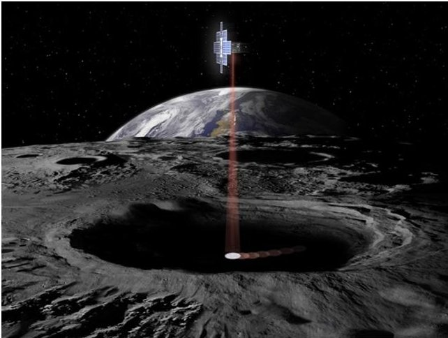
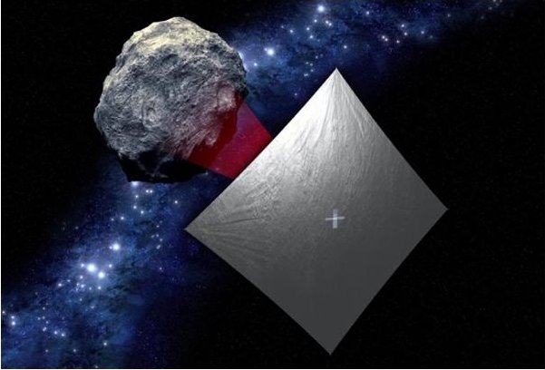
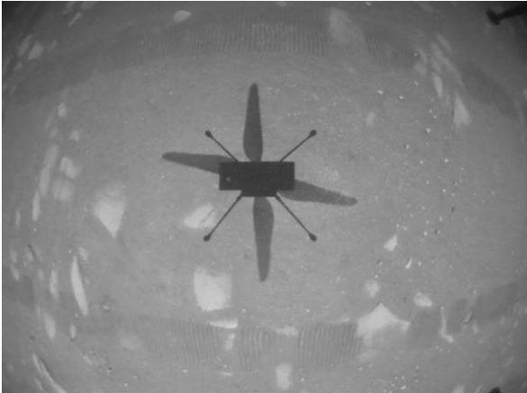
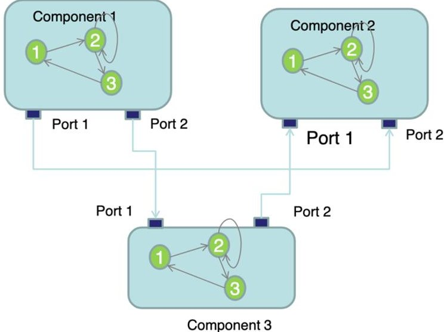
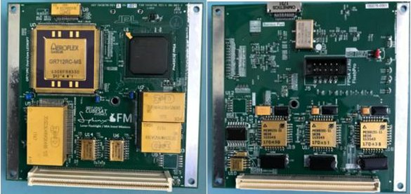
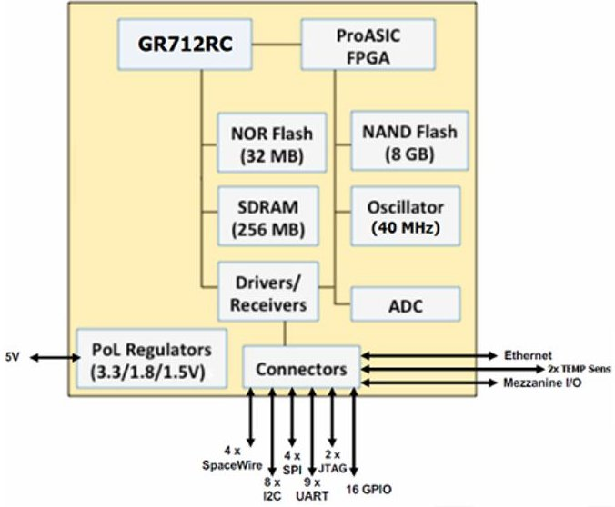
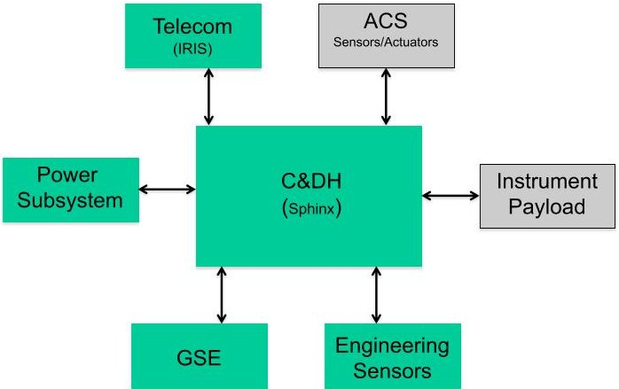
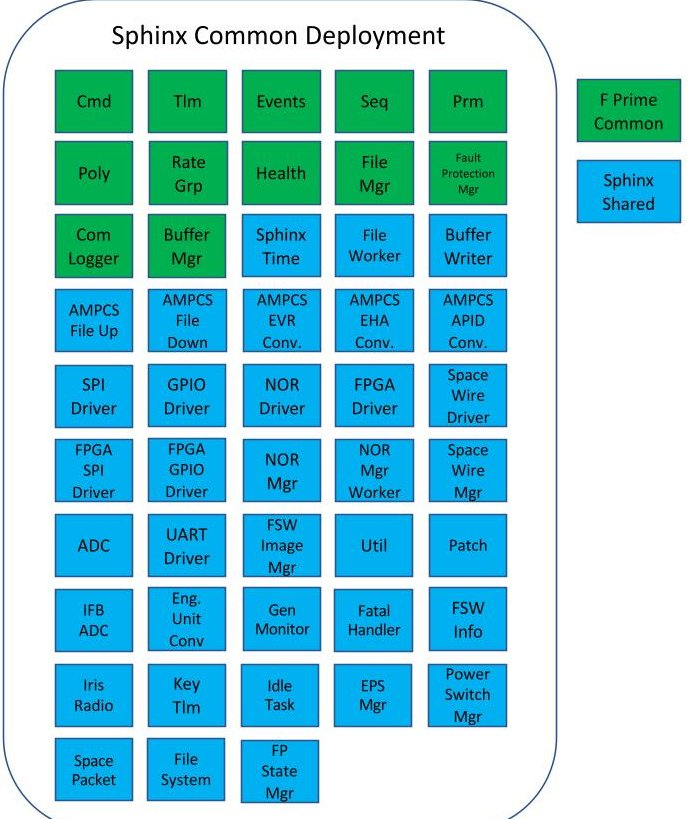
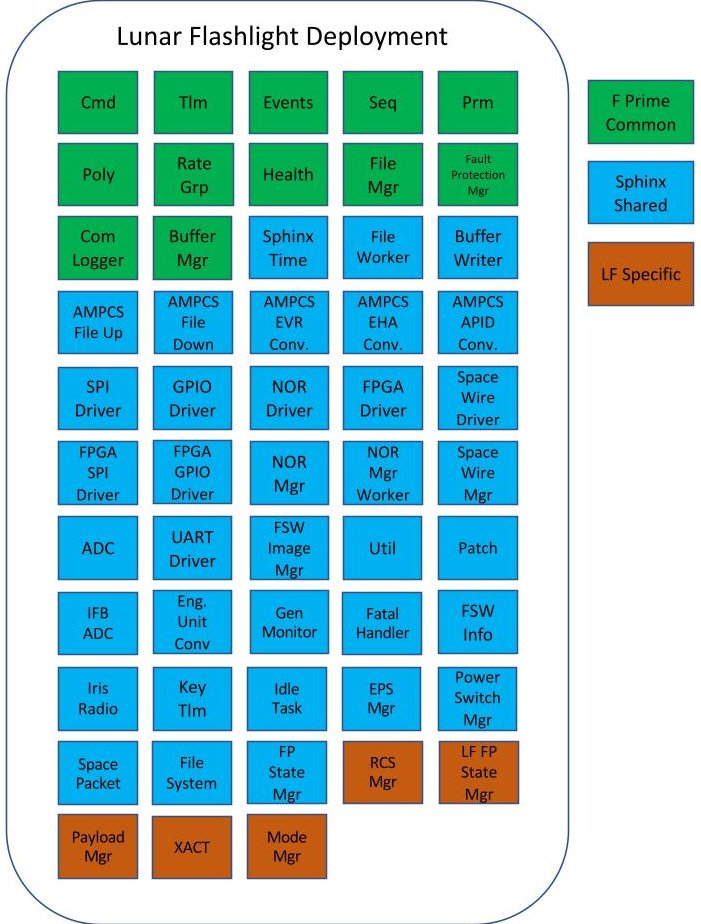
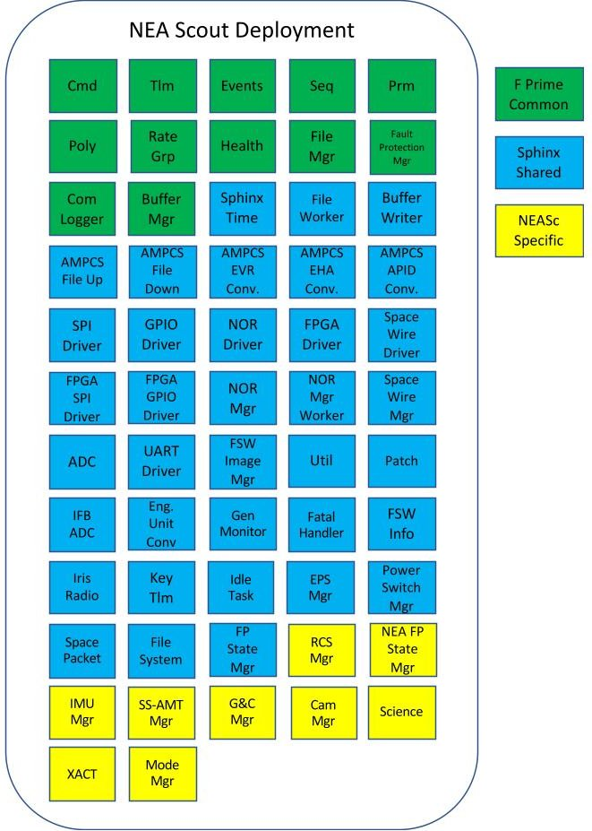

<!-- PDF_PAGE: 1 -->

# Developing Lunar Flashlight and Near-Earth Asteroid Scout Flight Software Concurrently using Open-Source F Prime Flight Software Framework

Aadil Rizvi, Kevin F. Ortega, Yutao He Jet Propulsion Laboratory, California Institute of Technology 4800 Oak Grove Dr. Pasadena, CA - 91109 Aadil.Rizvi@jpl.nasa.gov, Kevin.F.Ortega@jpl.nasa.gov, Yutao.He@jpl.nasa.gov

## ABSTRACT

NASA's Lunar Flashlight (LF) and Near-Earth Asteroid (NEA) Scout CubeSat missions are planned to launch in 2022. Lunar Flashlight is a low-cost secondary payload concept that will map the lunar South Pole for volatiles and demonstrate several technological firsts, including the first planetary CubeSat mission to use green propulsion, and the first mission to use lasers to look for water ice. NEA Scout is a low-cost concept that will map an asteroid and demonstrate several technological firsts, including being the first CubeSat to reach an asteroid.

Flight software for both CubeSat missions is based on the open-source F Prime Flight Software Product Line developed by JPL. F Prime utilizes a reusable component-based architecture with typed ports that can be interconnected to form a topology. Also, F Prime includes a set of auto-coding tools used to generate components and topologies that can be deployed for various mission specific applications. Both CubeSats share a common set of avionics for command and data handling (C&DH), telecom and power. This commonality in hardware is translated to a shared deployment in software enabling concurrent flight software development for both CubeSats. The modularity and reusability in F Prime enable such concurrent flight software development for different applications given a common set of avionics. In particular, F Prime has been used successfully to develop a common software deployment for the Sphinx C&DH platform used on both CubeSats. The common F Prime deployment for Sphinx has also been made open source to provide a starting point for any future F Prime software deployments utilizing the Sphinx platform. This paper provides a comparison between the Lunar Flashlight and NEA Scout Flight Software deployments highlighting the use of a common shared set of F Prime components developed for the Sphinx platform along with general lessons learned for CubeSat flight software development with the F Prime Framework.

## INTRODUCTION

Lunar Flashlight (LF) and Near-Earth Asteroid (NEA) Scout are two Class D NASA CubeSat missions using a common set of avionics for command and data handling (C&DH), telecom, and power; but, with very different mission objectives. Despite the differences in mission objectives, both missions' flight software (FSW) is developed concurrently by a single team. The team took advantage of the missions' overlapping requirements and of a highly modular, reusable, and adaptable FSW framework called F Prime to develop software for two separate missions with the cohesion of a single team.

## Lunar Flashlight

Lunar Flashlight is a six-unit (6U) CubeSat that will be the first mission to use laser reflectometer to look for water ice and will be the first planetary spacecraft to use a "green" propellant called Advanced Spacecraft Energetic Non-Toxic (ASCENT). $ ^{1} $ ASCENT has significantly better performance and lower toxicity compared to hydrazine, which is a common propellant used by spacecraft. $ ^{2} $ The mission goals are to demonstrate the use of an active laser spectroscopy to

distinguish between surface water ice and dry Moon soil, create a map of water ice found near the Moon's South Pole, demonstrate the use of the "green" propellant ASCENT, and show that small spacecraft are capable of exploring the Moon at a lower cost and lower development time compared to missions with larger spacecraft. $ ^{2} $

Figure 1: Artist's rendition of the Lunar Flashlight spacecraft.

<!-- PDF_PAGE: 2 -->

## Near-Earth Asteroid Scout

Near-Earth Asteroid (NEA) Scout is a six-unit (6U) CubeSat selected as a secondary payload on Artemis I. It will be the first CubeSat to reach an asteroid. $ ^{3} $ The CubeSat is equipped with a solar sail that will use sunlight to propel itself towards the asteroid. When flying by the target asteroid, NEA Scout will rely on its cold-gas propellant to maneuver itself to capture images of the asteroid. $ ^{4} $ The mission goals include performing fly-by of a near-Earth asteroid and acquiring images that will allow scientist in determining the asteroid's volume, spectral type, pole position, rotation period, and orbit. Additional mission objectives include understanding the asteroid's shape model, meteorite analogs, debris/dust field in local environment, and the regolith characteristics. $ ^{5} $

Figure 2: Artist's rendition of the NEA Scout spacecraft during its flyby of Asteroid 1991 VG.

## F Prime

F Prime is an open-source embedded systems framework which has been successfully flown on the ISS-RapidScat instrument, ASTERIA (Arcsecond Space Telescope Enabling Research in Astrophysics) CubeSat, and Mars Helicopter (Ingenuity); and will be flown on both Lunar Flashlight and NEA Scout. $ ^{6,7} $ Also, F Prime has been baselined for use on Mars Science Helicopter and Mars Sample Return Sample Retrieval Lander's motor control software.

Figure 3: Ingenuity's shadow as it hovered on Mars.

F Prime implements a component-based architecture that centers around the idea of "components" and "ports." Components encapsulate specific behavior, and are unaware of other components - making components easily reusable. Components use strongly typed ports to interface with each other. These ports encapsulate typed interfaces and serve as the points of interconnection in the architecture. They are directional and can serve as an input or an output to a component. This eliminates code dependencies between components as data is shared using common port types across components. Components connected via ports form a topology, which illustrate the software deployment for a given set of components. These building blocks: ports, components, and topologies; were modelled using XML for the LF and NEA Scout deployments. However, this can now be performed using the newly developed and open-source modeling language F Prime Prime (FPP) $ ^{12} $ . Projects using the latest version of F Prime (v3.0.0) can now model their components and topologies in FPP in-place of XML as FPP is the standard modeling language for F Prime. $ ^{12} $

The F Prime Flight Software Product Line provides a framework and a code generator, which is referred to as the autocoder, that encapsulates thread management, inter-process communication (IPC), commanding, telemetry, and parameters. In addition, the autocoder uses the FPP models to autogenerate boilerplate code component base classes, and stubbed functions for port and command handlers - allowing developers to focus on implementing component specific behaviors. The port and command handling interfaces of a target component are automatically executed by F Prime's internal architecture upon invocation of the target component's port interface.

Figure 4: An F Prime topology containing components and their interconnections via ports.

<!-- PDF_PAGE: 3 -->

## The Sphinx C&DH Technology

At the time of Lunar Flashlight and NEA Scout missions, there were no viable C&DH technologies meeting the avionics requirements for both missions. As a result, JPL funded an internal technology development project in 2014 to develop a small-SWaP, low cost, and rad-hard avionics product, called Sphinx $ ^{13} $ , for a variety of future deep space missions. The first Sphinx incarnation integrated the avionics requirements from NEA Scout, Lunar Flashlight, and some other relevant flight missions.

The Sphinx board fits within the standard CubeSat 1U (10 cm x 10 cm) footprint, with a mass of less than 250 grams, and a power of 2.5W (average) to 7W (max) when operating. Figure 5 shows the top and bottom view of the Sphinx flight model (FM) board.

Figure 5: Sphinx FM PCB View (Top and Bottom)

Unlike the CubeSat standard PC104-pin connector, the board uses a 160-pin mezzanine connector for stack-up configuration of various CubeSat boards. The increased pin density and count allow for almost all of the Sphinx's data interfaces to be brought out together with the avionics power bus. Other than this connector and a GSE connector, the Sphinx itself does not provide any harnessing capability for interfaces. Instead, the board has been designed with the philosophy that missions would create a custom interface board specific to the data needs for that spacecraft.

Figure 6: Sphinx Board Block Diagram

The Sphinx board as shown in Figure 6, is based on the rad-hard Aeroflex GR712 dual-core System-On-Chip (SOC) device. Each processor core is capable of supporting a clock frequency of up to 100 MHz with 2x134 DMIPS (Dhrystone Million Instructions Per Second) $ ^{14} $ . A Microsemi ProASIC FPGA connects to GR712 via the memory I/O bus. It provides additional computation and control logic as needed for the spacecraft. The Sphinx board includes both 256MB SDRAM as volatile memory and 32 MB NOR flash and 8 GB NAND flash as non-volatile memory, all protected by EDAC coding. The Sphinx board includes its own power regulators and all on-board voltage rails are monitored via current sensing and voltage monitoring.

Table 1: The Sphinx C&DH Specification

<table border="1"><tr><td>Category</td><td>Design Features</td></tr><tr><td>Memory(EDACprotected)</td><td>256 MB SDRAM32 MB NOR Flash8GB NAND Flash</td></tr><tr><td>DataInterfaces</td><td>2x SpaceWire with RMAP7x UART(4x RS-422)2x UART RS232 for GSE4x SPI(10 available slaves)8x I2C(masters)2x 32-bit GPIOs2x JTAGs(processor and FPGA)1x Ethernet PHYRMIII(for GSE)8x analog channels</td></tr><tr><td>SystemFeatures</td><td>External watchdog with boot-bank swappingSupports up to 4 software image selections</td></tr></table>

Table 1: The Sphinx C&DH Specification above lists the detailed technical capabilities of the Sphinx.

To meet the radiation requirements, the Sphinx only uses space-grade parts that are able to perform to a minimum total dose of 30 Krads (Si), including the FPGA, memory, driver/receivers, and power regulators. The GR712 processor is tolerant up to 300 Krads (Si). These parts are also chosen to perform against SELs (Single Event Latch-ups), with each part hardened to LET (Linear Energy Transfer) up to 37 MeV-cm $ ^{2} $ /mg for destructive events.

The Sphinx also implements different fault protection methodologies. All on-board memory, including L1 caches, is protected by single-bit-correction-double-bitdetection codes, which can be enabled as needed. A hierarchical robust watchdog methodology is implemented to prevent both hardware and software faults. The main processor runs a watchdog to prevent the main software executable from locking up. The FPGA is able to provide further protection by 'watching the watchdog'. Externally, the Sphinx could be hard reset through a ground command through the Iris

<!-- PDF_PAGE: 4 -->

Transponder. The Sphinx is also capable of carrying multiple copies of the flight software executable image. If a reset event does occur, the Sphinx is able to do a full scan of the onboard memory and load an uncorrupted version of the flight software. This same feature allows updated versions of the flight software to be uploaded from the ground while in flight.

The Sphinx can potentially be used beyond its core CDH role. The board could act as a processor for reading high data rate instrument data and running algorithms. If volume and mass allow, multiple Sphinx boards could be used within a SmallSat to provide discrete processing capabilities to multiple instruments simultaneously. If this architecture is implemented, each Sphinx could have the capability to watch the other boards for faults and lockups - providing some redundancy.

After delivery of the Sphinx to NEA Scout and Lunar Flashlight projects, JPL has licensed the Sphinx to Cobham to build it as an off-the-shelf product. It has been baselined in several upcoming flight missions.

## HARDWARE ARCHITECTURE

## Common Hardware Architecture

To reduce the cost and the complexity of building SmallSats for deep space missions, JPL has developed a flexible and adaptive bus avionics architecture that shares a common form factor, mounting scheme, and board-to-board connector based on the Sphinx, such that the C&DH, the telecom, and the power subsystems are stacked together.

With this baseline architecture, only a custom mission-specific interface board is required as an adapter to external devices. Figure 7 depicts a reference spacecraft block diagram showing the common subsystems. Two CubeSat spacecraft for Lunar Flashlight and NEA Scout missions have been developed with this approach, based on the Sphinx's flexibility and adaptability, at the hardware, firmware, and software levels.

Figure 7: Sphinx-based Spacecraft Block Diagram

The Telecommunication subsystem, called Iris $ ^{15} $ has been developed at JPL. It is made up of several CubeSat 1U hardware slices, allowing different slices to be attached to enable the radio to transmit and receive at different frequencies, and is fully compatible with the Sphinx. Similar to the Sphinx CDH, Iris uses radiation tolerant memory and a radiation tolerant processor to survive the deep space environment. All thermal management is done passively with a metal thermal enclosure.

The Electrical Power Subsystem (EPS) has been designed to include a custom EPS (Electronical Power Subsystem) card that uses the same 160-pin stacking connector common between the Sphinx and Iris. As a result, it is capable of handling the large array generation and deliver the currents required by the avionics.

## Mission Specific Architecture

The key differences between Lunar Flashlight and NEA Scout spacecraft lie in their respective scientific mission objectives that lead to different instrument payloads and the GNC subsystem design.

The NEA Scout spacecraft instrument payload is a <0.5kg/0.5U visible imager camera that offers a ground sampling distance of 10 cm/pixel at <0.8 km from its target and is capable of detecting a 10-m NEA from <50,000 km. The Lunar Flashlight mission carries a 2U point infrared spectrometer focused on search for ice signature on the Moon between 1-2 micron.

The NEA Scout Guidance Navigation Control (GNC) subsystem is a custom design composed of Sun sensors, a miniaturized star tracker, reaction wheels, in conjunction with a solar sail attitude control system. The Lunar Flashlight GNC subsystem on the other hand, uses Blue Canyon Technology's XACT-50 Attitude Control System technology $ ^{16} $

## SOFTWARE ARCHITECTURE

The Lunar Flashlight and NEA Scout CubeSats share significant commonalities in hardware configuration which is reflected in software by having a common software architecture developed using F Prime to facilitate any mission specific application utilizing the common Sphinx hardware configuration.

## Common Architecture

The commonality in hardware for both Lunar Flashlight and NEA Scout CubeSats is reflected in a shared deployment in software leveraging the use of F Prime FSW Framework. The set of components shared across both CubeSats are contained in the Sphinx common deployment that can be executed on a Sphinx-based

<!-- PDF_PAGE: 5 -->

avionics platform. Components comprising the common deployment are given in Figure 8: Sphinx Common Deployment Components.

Figure 8: Sphinx Common Deployment Components

Both CubeSats have several shared requirements for the C&DH, telecom and power sub-systems. This commonality in requirements at the sub-system level is reflected in the list of F Prime components shared between both CubeSats. Also, several data interfaces on the Sphinx platform are shared between the two CubeSats which is reflected in software by re-use of the same driver components such as SPI, GPIO, SpaceWire and others. In addition to hardware and data interfaces, both CubeSats use the same ground data system (GDS) namely AMMOS (Advanced Multi-Mission Operations System) Mission data Processing and Control System (AMPCS). This allows the same set of uplink, downlink and telemetry converter components, compatible with AMPCS, to be shared between the two CubeSats.

An F Prime component is a C++ class which can be instantiated into several objects or instances of the same component. This pattern is leveraged in the Sphinx common deployment to instantiate a telemetry packet converter (AMPCS APID Conv.) for each custom telemetry packet generated in the system. Similarly, the logging (Com Logger) and buffer management (Buffer Mgr) components are instantiated numerous times within the deployment to provide logging and buffering services for different telemetry packets generated by the common deployment.

The common topology is architected as a sub-subsystem which can be inherited by multiple deployments. However, due to F Prime limitations at the time of CubeSat development, the Lunar Flashlight and NEA Scout deployments each contain a copy of the common topology which is further augmented with additional components for mission specific use cases.

## Mission Specific Architecture

Both Lunar Flashlight and NEA Scout leverage the Sphinx common deployment for executing on the Sphinx platform in addition to interfacing with Iris radio and electrical power subsystem (EPS) hardware. As such, all components included in the Sphinx common deployment are re-used on both CubeSats. In addition to components included in the Sphinx common deployment, both CubeSats include software components for managing their respective payload instruments and attitude control hardware. Also, mission specific fault protection and mode management is implemented in separate components respective to each CubeSat.

The Lunar Flashlight deployment includes a Payload manager component for interfacing with the laser instrument used to conduct experiments on-orbit. Also, components are developed to manage the attitude control unit (Blue Canyon Technologies XACT) and propulsion system developed specifically for Lunar Flashlight. Fault responses and spacecraft modes implemented for the Lunar Flashlight deployment are defined in separate Lunar Flashlight specific fault response and mode management components. Components comprising the Lunar Flashlight deployment are given below in Figure 9: Lunar Flashlight Deployment Components.

<!-- PDF_PAGE: 6 -->

Figure 9: Lunar Flashlight Deployment Components

The NEA Scout deployment includes a camera manager component for interfacing with the payload camera used to capture images of the asteroid during fly-by. Also, components are developed to manage the mission specific attitude control unit (XACT), IMU and propulsion system for NEA Scout. The solar sail is deployed using the motor control board (MCB) and a separate component is developed to manage interaction with MCB. Fault protection and mode management implemented for the NEA Scout deployment are defined in separate NEA Scout specific fault response and mode management components. Moreover, algorithm software for guidance and control (G&C) is wrapped into an F Prime component and executed on-board interfacing with various G&C peripheral hardware manager components for executing closed loop control. Finally, science software for on-board image processing is wrapped into an F Prime component as well. Components comprising the NEA Scout deployment are given below in Figure 10: NEA Scout Deployment Components.

Each mission specific application uses the Sphinx common deployment as a starting point and incrementally adds additional functionality as needed to support different applications.

Figure 10: NEA Scout Deployment Components DEVELOPING CONCURRENTLY FOR TWO PROJECTS

The F Prime componentized architecture enables construction of interconnected topologies that can be inherited and augmented for varying applications utilizing common underlying platforms as described for Lunar Flashlight and NEA Scout use cases. This modular approach maximizes code re-use by sharing a set of components common across similar platforms and facilitates concurrent software development for two very different mission applications. The benefits of code reuse facilitated by F Prime are reflected in a comparison of source lines of code (SLOC) for F Prime common (i.e. inherited), Sphinx common, Lunar Flashlight and NEA Scout specific components.

The Sphinx common deployment component SLOC metrics are comprised of the F Prime Common and Sphinx Common components. The Lunar Flashlight deployment component SLOC metrics are comprised of the Sphinx common deployment and LF specific components. Similarly, the NEA Scout deployment component SLOC metrics are comprised of the Sphinx common deployment and NEASc specific components. Therefore, the LF and NEASc deployment SLOC metrics can be represented as a percentage of SLOC shared with Sphinx common deployment components and mission specific (LF or NEASc) deployment components as given below in Table 2: Deployment

<!-- PDF_PAGE: 7 -->

SLOC Metrics Comparison. Also, the benefit of using F Prime Product Line's auto-coding tools is realized upon comparing auto-coded versus hand-coded SLOC metrics. The ability to auto-code component base classes, including commands, telemetry, parameters and port interfaces along with topology interconnections results in a significant portion of the software being auto-coded allowing developers to focus on component specific implementation behaviors. The use of F Prime Product Line, in conjunction with the Sphinx common deployment, enables developers to focus on mission specific component development for Lunar Flashlight and NEA Scout. The mission specific development comprises 6% and 11% of the total SLOC metrics respectively for Lunar Flashlight and NEA Scout as given below in Table 2: Deployment SLOC Metrics Comparison.

Table 2: Deployment SLOC Metrics Comparison

<table border="1"><tr><td></td><td>Common Shared</td><td>Mission Specific</td><td>Auto Coded</td><td>Hand Coded</td><td>Mission Specific Hand Coded</td></tr><tr><td>Common Deployment</td><td>100%</td><td>0%</td><td>72%</td><td>28%</td><td>0%</td></tr><tr><td>LF Deployment</td><td>76%</td><td>24%</td><td>72%</td><td>28%</td><td>6%</td></tr><tr><td>NEASc Deployment*</td><td>68%</td><td>32%</td><td>70%</td><td>30%</td><td>11%</td></tr></table>

*NOTE: SLOC metrics exclude NEA Scout G&C algorithm software developed externally

Concurrent software development for different missions is achieved with the use of F Prime Product Line, in conjunction with Sphinx common deployment, as it provides significant code re-use and auto-coding in a manner where software for different missions can be developed as separate deployments of the same core software.

## TESTING

We leveraged the auto-coding tools, provided by the F Prime Product Line, to generate the unit test stubs and boilerplate unit test files. This allowed the team to rapidly develop unit tests for their components. We also took advantage of the common software architecture among LF and NEASc to develop common functional and integrated test scripts.

## Unit Tests

F Prime comes with its own unit test framework, which we leveraged on all components in LF and NEASc. When developing unit tests for a component C, the framework autogenerates the test component T and automatically connects T with C. T has knowledge of C's ports, commands, telemetry, helper functions, and internal state. This allows developers to augment T with C++ functions to exercise C's port and command

handlers, and verify various component behaviors, use cases, expected telemetry output or state changes.

For each component in the Sphinx Common deployment, we autogenerated the unit test stubs. The stubs were implemented with the necessary checks to verify the component behaved as expected. Bugs discovered during the unit test implementation were immediately addressed. Any reproducible bug found while running FSW on the Sphinx was reproduced in a unit test. This unit test allowed us to understand the source of the bug, develop a fix, and verify the bug was fixed.

The F Prime Product Line also provides a tool to measure a unit test's code coverage. This was a useful metric during peer reviews for a particular component reflecting the extent of unit testing performed.

## Functional and Integrated Testing

Functional and integration test scripts are developed for LF and NEA Scout using a Python-based framework leveraging AMPCS's command-line interface. Thanks to an overlap in LF and NEA Scout's software architecture, several integration test scripts are used and shared between both projects. Each project maintains a separate testbed providing a venue for integrated testing in FlatSat configuration. Each project has their own and separate integration and operation teams, external to the FSW team, utilizing the testbed for additional system-level testing. This tests several of the common core software functionality from Sphinx common deployment in the LF and NEA Scout deployment in different environments, scenarios, and by separate integration and test teams which lead to a more resilient, reliable, and highly tested software. Benefits of this approach are reflected in an example test case performed on LF when a test discovered a concurrency issue within the UART-Driver component's write port. The issue occasionally occurred on LF and was not noticed on NEA Scout. The XACT component would command the XACT hardware, via UART, to retrieve telemetry. The UART's write port was being preempted by a component higher in priority relative to the XACT component. This led to XACT executing a partial and invalid telemetry request, and resulted in FSW reporting failure to read XACT telemetry. The fix involved disabling task context switching at the start of the UART-Driver's write port and enabling it at the end of the write port. Another example was when a test in NEA Scout revealed a Sphinx firmware issue where NAND flash file system activities interfered with NOR flash memory writes. The firmware issue required a fix in software to the NOR-Driver component's write port. Both issues were fixed in the Sphinx common deployment, which resulted in the

<!-- PDF_PAGE: 8 -->

resolution being available to both LF and NEA Scout in a streamline manner.

## MAINTAINING AND SUPPORTING TWO MISSIONS

LF, NEA Scout, and the Sphinx common deployment components are each maintained in separate repositories. The LF repository references both the Sphinx common deployment and the F Prime repository via Git Submodules. Similarly, the NEA Scout uses Git Submodules to reference the Sphinx common deployment and the F Prime repositories. Bugfixes and updates in the Sphinx common deployment and F Prime repositories are made available for both LF and NEA Scout projects concurrently allowing each individual project to choose when certain updates are to be inherited by the project.

## OPEN SOURCING SPHINX COMMON DEPLOYMENT

The Sphinx common deployment has been released open source under the name F Prime Sphinx Reference Deployment. $ ^{17} $ This release includes the VxWorks Operating System Abstraction Layer (OSAL) used on LF and NEA Scout, and many of the LF and NEA Scout Sphinx-shared components accompanied with their XML model files, unit tests, and documentation. In addition, the deployment provides a reference topology with all the components connected including a demo component that exercises the SPI, GPIO, and UART interfaces on the Sphinx. Projects using the Sphinx platform would be able to use the F Prime Sphinx Reference Deployment as a starting point for their development.

## BASELINING OPEN-SOURCE F PRIME SPHINX REFERENCE DEPLOYMENT FOR COYOTE

As of now, JPL has partnered with Cobham to commercialize the Sphinx as a standard product. In particular, the Sphinx single board for Class D missions can be ordered directly from Cobham. In the meantime, the Sphinx Class B technology, newly named as Coyote, a upgrade of the Sphinx, is under development by JPL in partnership with Cobham, which are baselined as the flight computer for the Mars Ascent Vehicle and the Sample Return Lander Motor Controller.

## LESSONS LEARNED

There are several important lessons learned with our approach of concurrent software development for LF and NEA Scout missions. One of the key takeaways include having a common avionics hardware platform to facilitate software development for both missions and architecting the software in a manner that provides a

common shared deployment that can be augmented for mission specific use cases. The use of F Prime Product Line was key in enabling such a modular and reusable architecture. However, there were a few hurdles in our approach of using a Sphinx common deployment shared across both LF and NEA Scout missions.

On one occasion, the LF project requested a feature update in a component part of the Sphinx common deployment and shared with NEA Scout. However, the NEA Scout project did not want the feature updates as part of their software deployment. This conflict and lack of consensus in the implementation of the shared component resulted in that specific component being maintained separately for NEA Scout in its respective deployment namespace. This was achieved by copying and pasting the component from Sphinx common components' repository to the NEA Scout repository. This was the fastest solution given tight schedule deadlines; however, a better approach is to leverage the use of inheritance in using the component's model and the base class with varying underlying implementation behaviors for different deployments.

Topologies for both LF and NEA Scout were developed using a custom MagicDraw plugin, part of the initial F Prime version used on both CubeSats, which did not support use of subsystem topologies. This led to separate topologies being generated independently for LF and NEA Scout each containing a copy of the Sphinx common deployment. As a result, the full benefits of F Prime topology architecture could not be leveraged as several established patterns were repeated for LF and NEA Scout individually rather than shared as part of the Sphinx common deployment. The latest version of F Prime (v3.0.0), along with FPP, provides support for subsystem topologies which is recommended in-place of duplicating topologies.

The reusability and modularity of F Prime components enables them to accrue high mileage across multiple use cases on various projects. The benefit of using the Sphinx common components in LF and NEA Scout allowed the two projects to independently use and test components in different configurations leading to higher-quality components.

Another important lesson learned is that when a problem is encountered while performing integrated software testing on hardware, it's very beneficial to reproduce the bug in a unit test. This allows the developer to isolate the bug in software, test and verify the fix before it can be validated successfully on hardware. This pattern was highly useful on LF and NEA Scout.

<!-- PDF_PAGE: 9 -->

## FUTURE WORK

The current version of the open-source F Prime Sphinx Reference Deployment uses F Prime 2.1.0 and VxWorks 6.7. There is a desire to update the deployment to use the latest version of F Prime and VxWorks, and to have it support bare-metal.

The Coyote Standard Deployment is internal to JPL but work can be done, similar to the open-source F Prime Sphinx Reference Deployment, to make it open source.

## CONCLUSION

Lunar Flashlight and NEA Scout are two mission use cases that demonstrate the potential of the F Prime Product Line. The reusability and modularity of F Prime has proven indispensable to saving cost and schedule with the development of the Sphinx common deployment. Also, this deployment combined with the flexible and adaptable Sphinx platform has served as a reference to other deployments like the open-source F Prime Sphinx Reference Deployment, and the Coyote Standard Deployment. Both of which are baselined for future projects.

## ACKNOWLEDGEMENTS

The authors thank members of the CubeSat community at JPL including John Baker, Calina Seybold, Jeffrey Levison, Anne Marinan, Philippe Adell and many others part of the Lunar Flashlight and NEA Scout projects.

This work was carried out at the Jet Propulsion Laboratory, California Institute of Technology, under a contract with the National Aeronautics and Space Administration.

## References

1. Lunar Flashlight. (n.d.). NASA Jet Propulsion Laboratory (JPL). Retrieved May 15, 2022, from https://www.jpl.nasa.gov/missions/lunar flashlight

2. Hall, Loura. "What is Lunar Flashlight?" NASA. April 26, 2022 https://www.nasa.gov/directorates/spacetech/small_spacecraft/What_is_Lunar_Flashlight

3. Near Earth Asteroid Scout (NEAScout). (n.d.). NASA Jet Propulsion Laboratory (JPL). Retrieved May 15, 2022, from https://www.jpl.nasa.gov/missions/near-earthasteroid-scout-neascout

4. SETI Live: Sailing Toward a Near-Earth Asteroid: NEA Scout. (2022, February 17). [Video]. YouTube.

https://www.youtube.com/watch?v=2DO3uY21f mk

5. NASA. (n.d.). NEA Scout. Retrieved May 15, 2022, from https://www.nasa.gov/content/neascout/

6. Jet Propulsion Laboratory. (2018, January 18). F' Software Framework A Small Scale Component Framework for Space [PowerPoint slides]. NASA GitHub. https://nasa.github.io/fprime/Architecture/FPrime ArchitectureShort.pdf

7. Jet Propulsion Laboratory. (2020, October 3). F' Software Framework A Small Scale Component Framework for Space [PowerPoint slides]. GitHub. https://github.com/nasa/fprime/blob/devel/docs/ Architecture/FPrimeSoftwareArchitecture.pdf

8. Potter, N. (2020). A Mars helicopter preps for launch: The first drone to fly on another planet will hitch a ride on NASA's Perseverance rover - [News]. IEEE Spectrum, 57(7), 06-07. https://doi.org/10.1109/mspec.2020.9126096

9. Rizvi, A., & Ortega, K. (2019, December 9-12) Applying F Prime Flight Software Framework for Lunar Flashlight and Near-Earth Asteroid (NEA) Scout CubeSats [Presentation]. Flight Software Workshop, Huntsville, Alabama. https://www.youtube.com/watch?v=TqzkKEbkVqs

10. Ortega, K., & Roche, M. (2021, February 8-11). Sphinx CDH and the open-source F' Sphinx Reference Deployment [Presentation]. Flight Software Workshop, Virtual, Virtual. https://www.youtube.com/watch?v=oUn-Q1ro-vI

11. Starch, M. (2022, February 8-11). Leveraging Open Source Development to enhance the F Prime Flight Software Framework [Presentation]. Flight Software Workshop, Virtual, Virtual. https://www.youtube.com/watch?v=c8oy3j0Gkv0

12. Bocchino, R. (2021, August 9). F Prime Prime (FPP). GitHub. Retrieved May 15, 2022, from https://github.com/fprime-community/fpp

13. Imken, T., Castillo-Rogez, J., He, Y., Baker, J., & Marinan, A. (2017, March). CubeSat flight system development for enabling deep space science. 2017 IEEE Aerospace Conference. 2017 IEEE Aerospace Conference, Big Sky, Montana. https://doi.org/10.1109/aero.2017.7943885

14. Aeroflex Gaisler. (n.d.). GR712RC Dual Core Leon3-FT. Retrieved May 2022, from

<!-- PDF_PAGE: 10 -->

https://www.gaisler.com/doc/gr712rc-productsheet.pdf

15. NASA Jet Propulsion Laboratory. (2015, July). Iris V2 CubeSat Deep Space Transponder. NASA. Retrieved May 16, 2022, from https://www.nasa.gov/sites/default/files/atoms/files/brochure_irisv2_201507.pdf

16. Klesh, A. (2015, April 22-24). INSPIRE and Beyond: Deep Space CubeSats at JPL [Presentation]. CubeSat Developers Workshop, San Luis Obispo, California.

17. Ortega, K. (2020, September 14). fprime-sphinx. GitHub. Retrieved May 15, 2022, from https://github.com/fprime-community/fprime-sphinx