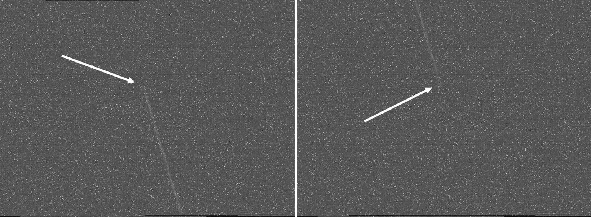
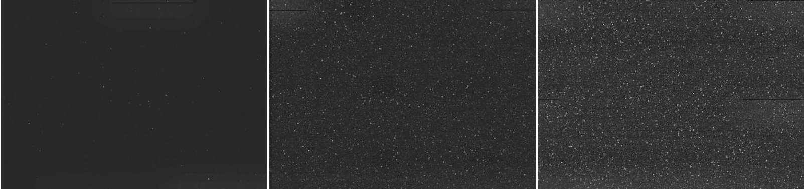
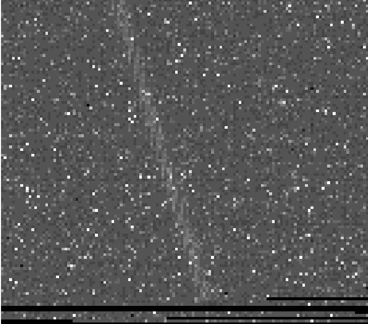

<!-- PDF_PAGE: 1 -->

# In-Space Situational Awareness: Developing Spaceborne Sensors for Detecting Tracking and Characterising Space Debris

Aishling Dignam $ ^{(1)} $ , Toby Harris $ ^{(1)} $ , George Brydon $ ^{(1)} $ , Kevin Charls $ ^{(1)} $

$ ^{(1)} $ Astroscale Ltd., Unit 3, 4, 5, Zeus Building, Harwell Science & Innovation Campus, Rutherford Avenue, Didcot, Oxfordshire, OX11 0DF, United Kingdom , Email: a.dignam@astroscale.com

## ABSTRACT

Astroscale is developing a range of in-orbit servicing (IOS) capabilities to address the risk posed by space debris. Performing IOS on a client object requires highfidelity Space Situational Awareness (SSA) data and a comprehensive knowledge of the client's state to ensure safety is maintained throughout. This information is required not only during mission operation, but also throughout mission planning, and therefore requires sustained access to reliable and accurate data sources. Motivated by this, Astroscale is working to develop InSpace Situational Awareness (ISSA) capabilities, whereby spaceborne sensors are utilised to collect SSA and object characterisation observations.

This paper will provide an overview of the need for ISSA the potential it brings, and the work Astroscale is conducting to develop it. ISSA experiments being performed with ELSA-d will be described, and ISSA data will be presented. Additionally, analysis of ISSA observational requirements and constraints will be discussed, along with ISSA payload concepts.

## 1 INTRODUCTION

Monitoring of objects in the space environment is vital to assessing the threats posed to various space activities by space debris. The ability to detect, track and characterise Resident Space Objects (RSOs) on orbit is essential for any rendezvous proximity operation (RPO) as highfidelity orbital data is required for the precise rendezvous manoeuvres. Many of Astroscale's missions, including End-of-Life (EOL) servicing, Active Debris Removal (ADR) and Life Extension (LEX), rely on space situational awareness (SSA) data for the client objects to be monitored and characterised to inform the RPO manoeuvres.

The range of in-orbit servicing capabilities being developed by Astroscale are to address the risk posed by the growing space debris population by shortening the length of time an object is left in orbit or extending the lifetime of older satellites. To perform these activities, there needs to be high-fidelity SSA data as well as knowledge of the state of the client object to ensure that it is safe to approach and that In-Orbit Servicing (IOS)

activities can be executed. These requirements during both the mission planning and operation phases necessitates continued access to this information and Astroscale is working to develop In-Space Situational Awareness (ISSA) capabilities using spaceborne sensors to collect SSA observations.

## 1.1 Ground-Based SSA

Typically, SSA observations collect data on space debris including their orbits and states using various techniques from ground-based observation facilities such as radar and laser ranging. Large (>10cm) objects are generally observable using these ground based SSA techniques, enabling creation of catalogues of the tracked population of objects with over 325,000 regularly monitored using ground-based sensor networks with potentially millions of other untracked small debris [1]. This essential function of SSA activities provides data to operators to have accurate orbital information of their satellite and avoid collisions between currently active spacecraft and those debris objects within the catalogue.

Realtime observations of small debris objects (<1cm) in orbit are beyond current ground-based SSA capabilities and the current understanding of this population comes predominately from returned space-exposed surfaces, of which the majority were retrieved over 25 years ago [2]. Small debris objects, while of interest academically as the population is thought to be primarily populated by micrometeoroids, do not pose a large risk as individual particles but may number in the millions and present difficulties in tracking as they require more sensitive sensors due to their size and more frequent tracking resulting from their highly changeable orbits [3]. Medium debris objects (1-10cm) are at the edge of what is presently achievable with contemporary systems but are classed as potentially lethal objects as a collision with an object of this size could have catastrophic effects [4].

Both the small and medium debris object populations pose challenges to ground-based observing methods, thus creating uncertainty in the flux and location of these objects. In addition, the evolution of these populations from the sources that create them to the sinks that destroy them are poorly constrained due to the lack of observational capability in these size ranges [4]. With an

<!-- PDF_PAGE: 2 -->

estimate of millions of small and medium-sized objects in orbit which can cause significant, mission-ending damage to spacecraft the observation and tracking of these debris objects is vital to ensuring a safe space environment.

## 1.2 In-Space Situational Awareness

The use of space surveillance capabilities to obtain observations of debris objects from orbit is expanding, allowing for more information on debris objects to be gained such as optical properties and shape [5]. This type of characterisation information can be obtained with photometry, a method that measures the brightness of an object and how it varies over time [4]. Performing observations of debris from orbit removes any of the aberrations introduced by the atmosphere and can improve coverage of objects that are not visible at certain times of year or require multiple observations to perform orbit determination. Another added benefit of spacebased observations is that there can potentially be more visibility to entire orbit regimes independent of geographic location of a ground observer.

Regarding RPO, the more information available on the client object, the safer the operations will be. Clark et al. suggested utilising ISSA to examine the health of a client object to ascertain if there are fragments surrounding the client or assess satellites with known issues [5]. One such satellite performing ISSA is the Near-Earth object Surveillance Satellite (NEOSSat) launched in 2013 to observe space debris, asteroids and exoplanets [5]. This optical telescope has imaged objects in Low Earth Orbit (LEO) with a particular focus on those with which close approaches occurred. It was noted that the methodology employed in NEOSSat imaging has the potential to be developed for self-manoeuvring satellites [6].

## 1.3 Astroscale Missions

End of Life Services by Astroscale - demonstrator (ELSA-d) was launched in March 2021 and has conducted many demonstrations of techniques using the servicer and client spacecraft to perform in-orbit testing including magnetic capture and relative navigation. Onboard ELSA-d the visible camera (VISCAM), designed specifically for use in close-range navigation, is now being used to conduct testing for ISSA capabilities to investigate observing LEO and GEO objects.

The ELSA-M mission currently in-development at Astroscale, will build on the ELSA-d mission and service multiple clients, pre-prepared with a docking plate, using one single servicer. The RPO will be conducted using a suite of cameras and sensors for navigation but can also be utilised to perform ISSA observations. The development of these sensors will incorporate the information gained from the ongoing ELSA-d ISSA experiments.

In the first phase of the Active Debris Removal by Astroscale-Japan (ADRAS-J) mission as part of the JAXA Commercial Removal of Debris Demonstration (CRD2), the ADRAS-J spacecraft will approach and inspect a large debris object. In doing so, vital insight into this debris object will be gained for characterisation through ISSA at close proximity.

The use of ISSA is being investigated as part of the UK Space Agency funded Active Debris Removal (ADR) mission study - Cleaning Outer Space Mission through Innovative Capture (COSMIC). Astroscale is leading a consortium of UK space industry partners with an expected launch date in 2026 to demonstrate the removal from LEO of two defunct, unprepared, UK registered spacecraft. Within the scope of this mission several ISSA objectives have been set out by Brydon et al. including capturing unresolved images of debris of any size, photometric characterisation and resolved imagery [4].

Using ELSA-d operations, imaging and analysis as an input, a better understanding of ISSA technologies and techniques for future Astroscale missions is being developed.

## 2 METHOD

There are orbital constraints on potential imaging windows to be considered when finding observation opportunities for RSOs. From the outset of the imaging campaign, ELSA-d has been in a Sun Synchronous Orbit (SSO) while performing other experiments alongside. Depending on the other experiments being performed, imaging was done either with slewing to observe a particular target at a given time or when slewing was unavailable the targets were chosen based on which objects were crossing the field of view, taking images opportunistically while in a particular orientation required for other experiments. A tool was developed to identify potential imaging opportunities with VISCAM in both cases accounting for the main constraints on space-based imaging.

Primarily, the debris object to be imaged must remain within the field of view (FOV) of VISCAM. The sensor and object must maintain an unobscured line-of-sight (LOS) for the duration of the observation. It is necessary to ensure the object is in sunlight, for illumination. To prevent stray light from the Sun from entering the sensor, if ELSA-d is in sunlight, the Sun, Earth and Moon must be outside the VISCAM FOV and boresight. The Earthhorizon limb is also required to be outside the FOV as it is still bright enough to affect the VISCAM images.

The relative range to the object must be within a limit such that the spectral intensity of the object is above the sensor threshold for detection, for VISCAM this is typically 300 km. The relative angular rate affects the

<!-- PDF_PAGE: 3 -->

streak duration in the images obtained. As such, if the relative angular rate is too high for a given sensor, around 4.5 rad s $ ^{-1} $ , then the streak of the object would not be captured. At least one star-tracker must be valid on ELSA-d. If ELSA-d in sun-light, it is necessary to ensure the star-tracker is not pointing to Sun, Earth and Moon.

The calculation for an observation opportunity for any debris requires precise orbit data for the spacecraft and the object of interest. This was obtained using the latest OEM files of ELSA-d from the Astroscale UK Flight Dynamics team. For the debris object, the orbital information was gathered from Space Track as the latest Two-Line Element (TLE). The desired range of dates for imaging windows, the search time-step and the attitude profiles are used as inputs. The various attitude profiles of ELSA-d must be considered and the profiles available at any given time for the imaging campaign were dependent on other spacecraft activities.

To obtain the optimal imaging windows, if there is a small number of windows, the process is performed manually by the operator considering the configuration of sensors, the location of both objects, operational constraints, etc. For a large set of windows, with various profiles, and when investigating a set of objects, a more automated selection process can be defined with a penalty scoring system. The windows calculated provide the optimal object imaging parameters for a given time frame and with pointing direction if slewing is available.

The imaging was conducted on debris objects compiled from the Russian Mini-Mega TORTORA (MMT) monitoring system, a database of light curves from various spacecraft and debris objects [7]. These objects were narrowed down to those above ELSA-d, as if they were below the light from the Earth reflection would contaminate the image, and those objects that were bright, as the camera onboard the spacecraft was not designed for this type of imaging and therefore requires substantially bright objects. These debris objects were used as the objects of interest when calculating imaging opportunities.

## 3 RESULTS

A streak of a rocket body was successfully imaged using the VISCAM onboard ELSA-d using the previously described imaging method. The resulting image, shown in Figure 1, shows a streak spanning across two images with an exposure time of 10 seconds. In this image the streak is easily identifiable by eye and by using the probabilistic Hough transform the start and end positions of the streak can be obtained. Within these images several noise features are present which may interfere with streak identification and extracting information from the streak. These noise features are intrinsic to the VISCAM sensor and thus cannot be diminished except for post-capture image processing.

Figure 1. A contrast enhanced streak captured of a rocket body using a 10s exposure time. The streak spans across two images with the white arrows indicating the beginning and end of the streak.

## 3.1 Hot & Dead Pixels

Hot pixels are present throughout the sensor. These are pixels that have a higher readout level than those around them in the dark current which generally have a linear relationship between the intensity of the hot pixels and

the exposure time of the image [8]. There are also dead pixels which read no signal. The appearance of these hot pixels is due to radiation damage in orbit with the location and intensity of these pixels varying erratically [9]. As shown in Figure 2, the intensity of the hot pixels increases over time. While it is possible to remove the hot

<!-- PDF_PAGE: 4 -->

pixels with an automated algorithm, the unpredictable locations of the hot pixels would lead to imperfect removal.

Figure 2. Empty field of view of 2s, 10s and 30s exposures showing the increase in hot pixels with the increase in exposure time. The hot pixels can change location on short timescales making them difficult to remove using automated algorithms.

For the sole purpose of obtaining a streak from the passing of an object, the hot pixels do not impede the imaging. In the future, Astroscale aim to perform photometric observations of debris, thus the precise brightness levels of the pixels are required, and this is where the presence of hot pixels can introduce uncertainties into these brightness measurements.

To reduce the effect of hot pixels, a process termed "annealing" can be employed by heating the sensor, as was done on the Hubble Space Telescope Wide Angle Camera. It was found that the population of hot pixels on the CCD had a lower intensity after annealing but remained above average intensity [10]. Annealing is not possible on VISCAM and where the capability is not available this will limit the opportunistic use of spacebased cameras.

## 3.2 Camera Issues

The unstructured, irregular interference patterns present in Figure 3 are a result of a combination of bleeding occurring between pixels and fringing. Bleeding is a common occurrence on most space-based sensors and can be somewhat mitigated using median filtering [8].

Readout issues were experienced, particularly at the edge of the sensor. This created black lines, overlapping at the edge of the sensor, but also present at random locations and intervals on some images. The lines interfere with the interpretation of the streak length and any brightness variations as shown in Figure 3.

Figure 3. Small region of the image of the streak obtained. The hot/dead pixels can be seen throughout as white/black pixels. Throughout the length of the streak the brightness of the hot pixels is of the same level as the streak itself and issues with readout at the edge present difficulties for precise photometric measurements.

Fringing is an intrinsic part of the sensor, and these fringes, or "tree rings", are inherent to the growth of silicon crystals [11]. These features are typically found on CMOS sensors with the severity of the produced pattern relating to defects in the crystals [12]. Park et al. 2017 created similar fringe patterns to those observed in the VISCAM images when they performed imaging of a uniformly illuminated source at wavelengths greater than 900 nm [13]. The issue these fringes pose to the image analysis is that they are present at a level that is the same as that of any of the streaks that we have obtained with an intensity of 0.05% and thus interfere with the streak identification. The fringe pattern is also observed to be

<!-- PDF_PAGE: 5 -->

different in every image, presenting issues with removing them from the image.

These issues can be mitigated using filters to prevent the wavelengths causing the fringing from interacting with the sensor [13], although this option is unavailable for VISCAM as it is currently in orbit. Another option that can be explored is to create flat-field calibration images of a uniformly illuminated field, which can then be used to mitigate the fringing effect. As the VISCAM was not designed for taking images other than those of a close-proximity client, there are no pre-flight calibration images available, as would be the case for astronomical space-based telescopes. Earth flats - using the Earth as the illuminated field - could be investigated for these types of opportunistic, low-cost observing platforms. Multiple instruments on the Hubble Space Telescope have used Earth flats although it has been noted that the presence of clouds affects the uniformity of the field illumination in optical wavelengths [14].

## 4 DISCUSSION

With the interest of performing SSA activities from orbit increasing, the considerations for a dedicated SSA payload have been identified. The opportunity for preflight calibration of instrumentation can mitigate some camera defects. Identifying and minimising sources of noise in the sensor during the design phase of a payload can decrease the noise sources present in the images. A significant source of noise from ELSA-d imaging that could not be mitigated was the stray light from the Sun, Earth and Moon which can be minimised using a baffle to block the light. The thermal noise produced from the sensor and the hot pixel production can be reduced by having the capability to cool and heat the sensor. Cooling the sensor for imaging produces less interference from thermal noise while heating the sensor can be used for annealing on a regular basis, typically monthly, to minimise the appearance of hot pixels.

To prevent the fringing or tree ring patterns observed in the ELSA-d images, a combination of flat fielding and a filter would be the optimal solution. Flat fielding the sensors pre-flight creates calibration data that can be applied in post-processing to eliminate any features that appear in the images as a result of the sensor or filter defects. Using a filter to remove the higher wavelengths that cause fringing in the images may prevent the fringing from occurring but also has the drawback of reducing the overall light observed, potentially limiting the observing threshold of the sensor.

## 5 CONCLUSION

The ELSA-d RPO camera, VISCAM, was used independently of the main mission to detect space debris and spacecraft. In identifying the observing constraints

for the VISCAM, namely the illumination of the target object, the range to the object and the relative angular velocity, an imaging window prediction tool was created. This tool was used for scheduling all observations with VISCAM both when slewing was available and for opportunistic observations.

Streaks of objects of interest were captured infrequently but the images without streaks yielded information about the sensor itself. The VISCAM images contained numerous hot pixels with varying locations on the sensor which increased in intensity along with exposure times. The streak images highlighted a fringe pattern that was of the same level as the observed streak, caused from an intrinsic growth attribute of silicon. To mitigate the sources of noise from an on-orbit sensor with no ground calibration can likely only be achieved through image processing. Using the Earth as a uniformly illuminated object to perform flat fielding is a potential option to remove the fringe pattern and other sensor defects, although in the optical regime clouds have proven a challenge in this endeavour.

If the opportunity for pre-flight calibration or a dedicated SSA payload is available, the ELSA-d imaging campaign has identified that taking calibration frames would be highly beneficial to use in the post-processing of the images as the sensor defects could be diminished. A baffle can be added to prevent stray-light saturating images. For the removal of fringing, applying a filter to the sensor could completely remove these effects. To minimise the thermal noise and provide annealing capabilities, temperature control capabilities would be recommended.

## 6 REFERENCES

1. ESA, "Space debris by the numbers," 2023. https://www.esa.int/Safety_Security/Space_D ebris/Space_debris_by_the_numbers (accessed Jan. 18, 2023).

2. Krisko, P.H., Flegel, S., Matney, M.J., Jarkey, D.R., Braun, V., 2015. ORDEM 3.0 and MASTER-2009 modeled debris population comparison. Acta Astronaut. 113, 204-211. https://doi.org/10.1016/j.actaastro.2015.03.024.

3. J. A. Carroll, 2019. "A Clearer View of Orbital Debris," 1st Int'l. Orbital Debris Conf.

4. Brydon, G., et al., 2022. On-Orbit SSA: Bespoke and Multi-purpose Optical Sensors to Support In-orbit Servicing. 73rd International Astronautical Congress (IAC), Paris, France, 18-22 September 2022

5. Clark, R., Fu, Y., Dave, S., Lee, R. S. K., 2022. Advances in Space Research, Volume 70, Issue 11, p. 3271-3280. https://doi.org/10.1016/j.asr.2022.08.068.

6. Thorsteinson, S., Robert Lauchie, S., Abbasi, V., 2020.

<!-- PDF_PAGE: 6 -->

The Journal of the Astronautical Sciences, Volume 67, Issue 4, p.1735-1754. https://doi:10.1007/s40295-020-00236-x

7. S. Karpov et al., "MASSIVE PHOTOMETRY OF LOW-ALTITUDE ARTIFICIAL SATELLITES ON MINI-MEGA-TORTORA," RevMexAA, vol. 48, pp. 112-113, 2016, Accessed: Jan. 18, 2022. [Online]. Available: http://www.space-track.org/

8. Jerram, P.A., & Stefanov, K.D. 2020. CMOS and CCD image sensors for space applications. High Performance Silicon Imaging p255-287. https://doi.org/10.1016/b978-0-08-102434-8.00009-x

9. Knowles, B., West, R., Helfenstein, P., Verbiscer, A., Wilson, D., & Porco, C., 2020. End-of-mission calibration of the Cassini Imaging Science Subsystem. Planetary and Space Science, 185, 104898. https://doi.org/10.1016/j.pss.2020.104898

10. Polidan, E. J., Waczynski, A., Marshall, P., Johnson, S. D., Marshall, C., Reed, R., ... Hill, R. J. (2004). A study of hot pixel annealing in the Hubble Space Telescope Wide Field Camera 3 CCDs. Optical, Infrared, and Millimeter Space Telescopes. SPIE Astronomical Telescopes Instrumentation. https://doi.org10.1117/12.552111

11. Holland, S. E., Bebek, C. J., Kolbe, W. F., & Lee, J. S., 2014. Physics of fully depleted CCDs. Journal of Instrumentation, 9(03), C03057-C03057. https://doi.org/10.1088/1748-0221/9/03/c03057

12. Rantzer, A., & Svensson, C., 2002. Bulk Wafer Defects Observable in Vision Chips. 32nd European Solid-State Device Research Conference. https://doi.org/10.1109/essderc.2002.195017

13. Park, H. Y., Nomerotski, A., & Tsybychev, D., 2017. Properties of tree rings in LSST sensors. Journal of Instrumentation, 12(05), C05015-C05015. https://doi.org/10.1088/1748-0221/12/05/c05015

14. Bohlin, R. C., Mack, J., 2003. Instrument Science Report ACS 2003-02.