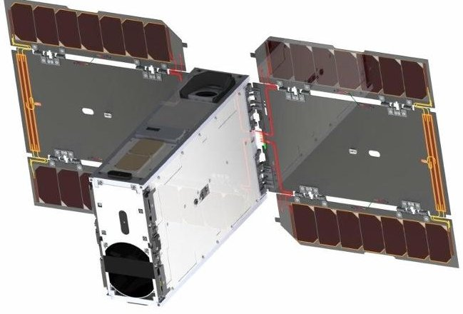
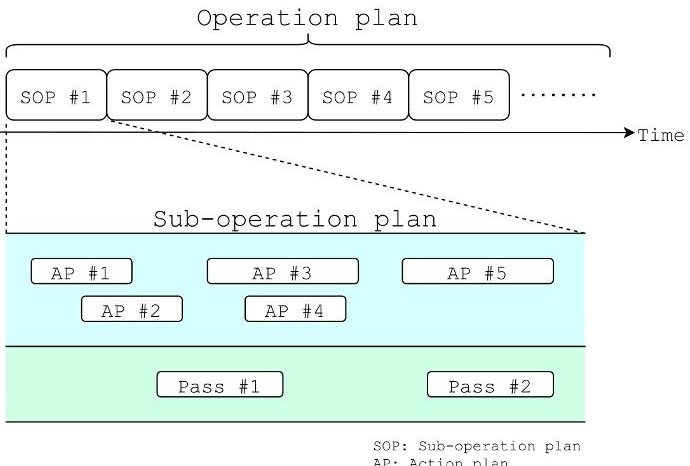
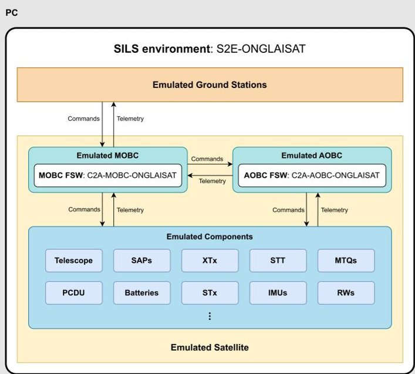
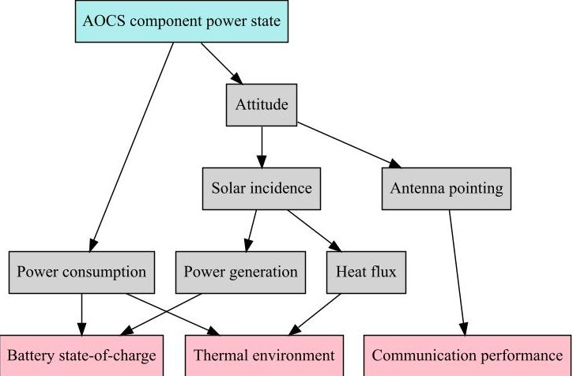
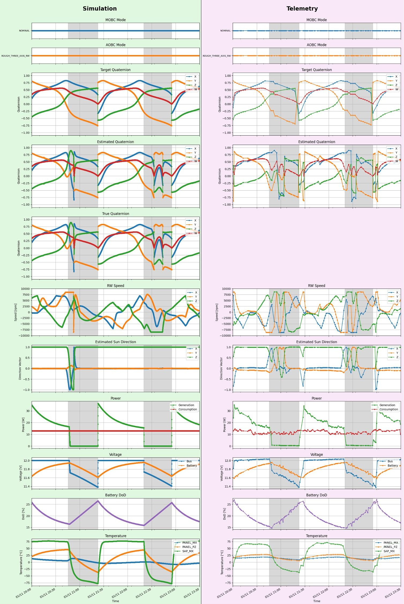
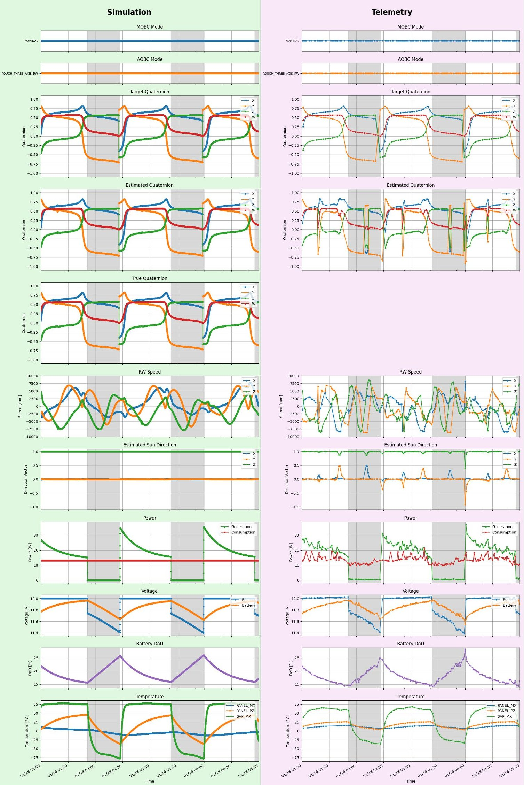
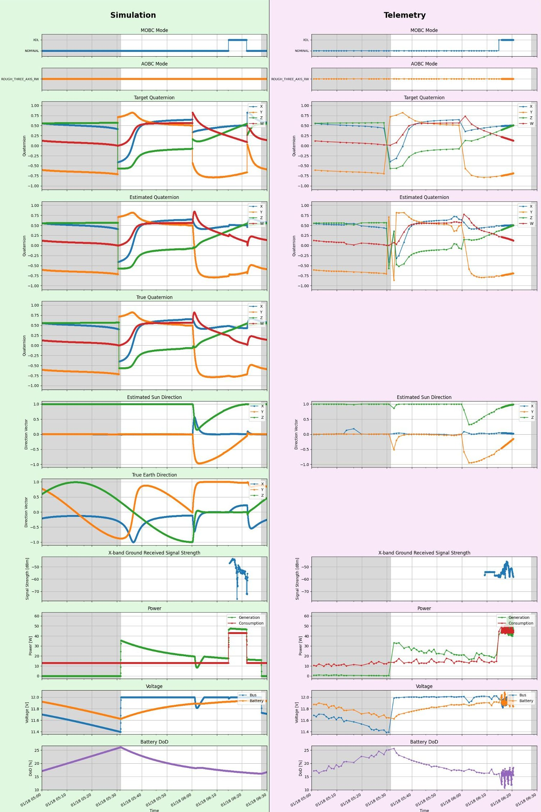
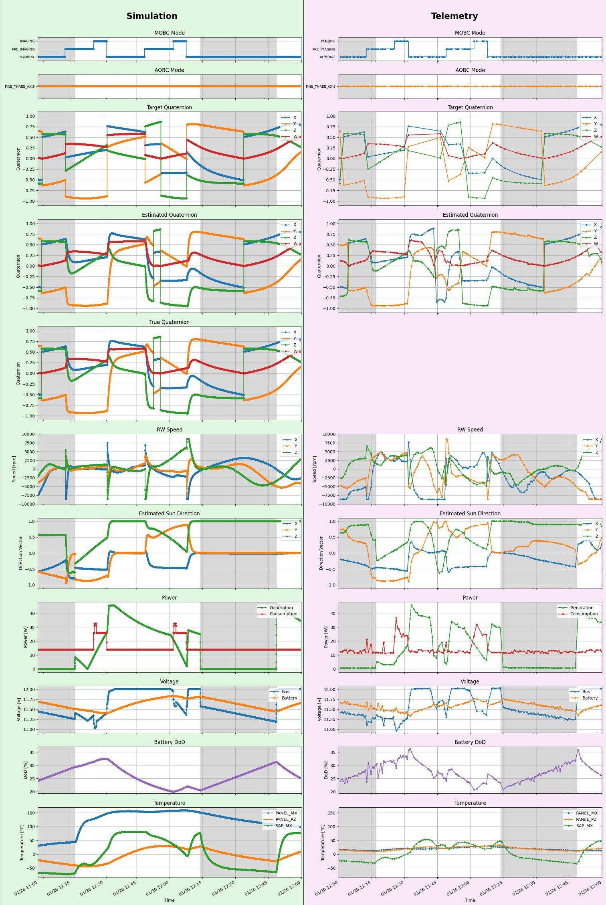

<!-- PDF_PAGE: 1 -->

# Development and Practical Application of a Numerical Simulator for Operation Plan Validation of ONGLAISAT

By Riki NAKAMURA, $ ^{1)} $ Satoshi IKARI, $ ^{1)} $ Shunichiro NOMURA, $ ^{1)} $ Akihiro ISHIKAWA, $ ^{1)} $ Ryu FUNASE, $ ^{1)} $ and Shinichi NAKASUKA $ ^{1)} $

$ ^{1} $The University of Tokyo, Tokyo, Japan

ONGLAISAT is a 6U CubeSat developed by the Taiwan Space Agency, the University of Tokyo's Intelligent Space Systems Laboratory (ISSL), and partners. To support its operations, ISSL developed a numerical simulator based on the Spacecraft Simulation Environment (S2E), enabling Software-In-the-Loop Simulation (SILS) with real flight software. The simulator reproduces satellite behavior, including attitude, power, and thermal responses, under realistic conditions by executing actual onboard software with command sequences. During the ONGLAISAT mission, this simulator was used to emulate operational timelines and evaluate overall system behavior. Several representative scenarios were simulated and compared with in-orbit telemetry. These case studies demonstrated the simulator's ability to capture major trends and identify model limitations, which informed future improvements. This study presents the design and application of the simulator and highlights its value as a practical tool for planning support and system understanding in university-led CubeSat missions.

Key Words: Satellite Operation, Simulation, CubeSat

## 1. Introduction

Recent advancements in small satellite technologies especially CubeSats, have significantly lowered the barriers to entry for space development. This paradigm shift has extended satellite development beyond traditional state-led programs, enabling governments across the globe, private enterprises, and academic institutions to participate in space exploration and utilization. While CubeSats offer the advantages of low cost and short development time, they still require extensive operational expertise. Unlike larger satellites, which typically include extensive design margins and redundant subsystems, CubeSats operate with minimal margins. This limited buffer requires that their operation plans be executed with exceptional care. These challenges underscore the growing need for systems that can support or automate satellite operations.

ONGLAISAT (ONboard Globe-Looking And Imaging SATellite) is a 6U CubeSat jointly developed by the Taiwan Space Agency (TASA), the Intelligent Space Systems Laboratory (ISSL) of the University of Tokyo, ArkEdge Space Inc., and Space BD Inc. Launched in late 2024, the spacecraft demonstrated high-resolution Earth imaging using a Time Delay Integration (TDI) sensor during approximately three months of on-orbit operation. $ ^{1} $

Due to the limited staffing typical of universityled missions, the ONGLAISAT project emphasized operational automation. We therefore developed (1) an operation-plan management system that oversees the execution of verified plans, and (2) an automated operation-planning system that synthesizes plans based on high-level mission objectives and constraints. Both systems require a capability to validate plans in order to ensure their safe execution. It is for this reason

that a numerical simulator is critical to satisfying this requirement.

This paper presents a numerical simulator developed for validating ONGLAISAT's operation plans. The simulator reproduces onboard behaviors and resource state changes under realistic conditions. We evaluate its fidelity by comparing simulation output with telemetry obtained during actual satellite operations and discuss practical findings from using this validation framework in orbit.

## 2. System Overview

## 2.1. ONGLAISAT: ONboard Globe-Looking And Imaging SATellite

ONGLAISAT is a 6U CubeSat developed by ISSL in collaboration with TASA, as shown in Fig. 1. It was launched aboard a SpaceX Falcon 9 rocket on November 5, 2024, transported to the International Space Station (ISS), and deployed into orbit on December 9, 2024. The mission concluded on February 24, 2025, after the orbital altitude dropped below the mission threshold.

Fig. 1. Overview of the ONGLAISAT satellite.

<!-- PDF_PAGE: 2 -->

The satellite carries an optical observation system with a TDI sensor. Its mission was to demonstrate high signalto-noise ratio Earth imaging using TDI, a technique that synchronizes the readout of image sensors with the satellite's motion to accumulate more light per pixel. This enhances image brightness and sharpness while preserving spatial resolution. ONGLAISAT successfully achieved a ground resolution of approximately 2.5 to 3.0 meters, which is one of the best performance levels achieved in the CubeSat class.

The satellite includes multiple onboard computers (OBCs) responsible for different subsystems. Among them, the Main On-Board Computer (MOBC) manages general satellite operations, while the Attitude and Orbit Control System On-Board Computer (AOBC) handles precise attitude control. The flight software (FSW) on these computers is based on the Command Centric Architecture (C2A), $ ^{2,3} $ a modular and reconfigurable framework that enables flexible and reliable spacecraft operations.

## 2.2. OPMS: Operation Plan Management System

The Operation Plan Management System (OPMS) is web-based software developed by ISSL to automate and streamline the management of satellite operation plans. $ ^{4)} $ It provides three core functions:

- Control: As shown in Fig. 2, OPMS centrally manages operation plans using a hierarchical data model consisting of sub-operation plans and modular action plans. Action plans are derived from predefined templates, enabling safe yet flexible command sequences to be built using parameterized inputs.

Fig. 2. Hierarchical structure of an operation plan. $ ^{4} $

- Validate: OPMS allows automated validation of operation plans using an external verification backend. The validation process checks whether the execution of an operation plan satisfies defined constraints under assumed satellite conditions.

- Synchronize: OPMS tracks the operational state of plans and ensures that only validated versions are synchronized with the satellite. It manages the upload of commands, ensures atomicity of synchronization, and supports rollback in the case of communication failure.

These features enable OPMS to reduce manual effort, maintain consistency across subsystems, and increase the reliability of satellite operations. In the ONGLAISAT mission, the simulator developed in this study was utilized as the validation backend.

## 2.3. AOPS: Automated Operation Planning System

The Automated Operation Planning System (AOPS) was developed by ISSL to generate operation plans for the ONGLAISAT mission based on high-level mission objectives and operational constraints. AOPS adopts a model-based planning approach that enables autonomous synthesis of operation plans to meet mission goals.

The system is built upon a dual-model planning framework, which leverages both a simplified analytical model and a high-fidelity simulation model. $ ^{5} $ This framework operates in two main phases:

1. Initial Planning with a Simplified Model: In the first phase, a baseline operation plan is quickly synthesized using a simplified, computationally lightweight model of the spacecraft. This model abstracts away fine-grained dynamics to enable rapid generation of command sequences that meet mission objectives.

2. Plan Refinement with High-Fidelity Simulation The second phase involves validating and refining the baseline plan through high-fidelity simulations. These simulations emulate onboard software behavior, satellite dynamics, and environmental interactions in a realistic manner. By executing the plan in this environment, the system identifies violations of operational constraints and iteratively updates the plan to ensure its correctness and robustness.

AOPS integrates tightly with the numerical simulator developed in this study, which serves as the high-fidelity backend in the refinement phase. The simulator reproduces detailed spacecraft behaviors, including attitude, power, and thermal responses, which allows AOPS to ensure that generated plans are safe for execution on orbit.

By combining fast initial planning and rigorous validation, AOPS significantly reduces the manual workload of operators and increases operational safety and responsiveness. Its successful application in the ONGLAISAT mission demonstrates the feasibility of automated planning for university-led CubeSat missions with limited human resources.

## 2.4. S2E: Spacecraft Simulation Environment

The Spacecraft Simulation Environment (S2E) is a high-fidelity spacecraft simulator developed by ISSL for full-scale numerical simulation of satellite behavior. $ ^{3,6} $ It supports detailed modeling of attitude dynamics, thermal environment, power generation and consumption, and communication links.

The simulator is built for flexibility and extensibility: users can define complex mission scenarios, simulate multiple satellites and ground stations, and configure

<!-- PDF_PAGE: 3 -->

hardware components such as sensors and actuators. It supports multiple execution modes, including:

- Standalone mode: for offline simulations and scenario testing

- Software-In-the-Loop Simulation (SILS): for testing the actual FSW in a closed-loop environment with realistic inputs and outputs

- Hardware-In-the-Loop Simulation (HILS): for testing with actual onboard hardware

S2E has been used throughout various phases of satellite development, from concept design to mission operations. In this study, we utilize the SILS configuration of S2E to simulate the actual behavior of ONGLAISAT's onboard FSW and realistically validate operation plans.

## 3. ONGLAISAT Simulator Architecture

This section describes the architecture of S2E- ONGLAISAT, a SILS environment developed to validate operation plans for the ONGLAISAT mission. The simulator enables command-driven emulation of onboard behavior using the actual FSW, and is designed to run entirely on a PC.

## 3.1. SILS System Overview

S2E-ONGLAISAT is built on top of two open-source libraries developed by ISSL: S2E-CORE and S2E-AOBC. S2E-CORE provides the core simulation framework, including models of the space environment and fundamental satellite components, while S2E-AOBC offers detailed simulation models for attitude and orbit control system (AOCS) components.

As shown in Fig. 3, the simulation environment consists of the following major elements:

- Space environment

- Emulated satellite (ONGLAISAT)

- Emulated onboard computers (MOBC and AOBC)

- Emulated components (sensors and actuators)

Fig. 3. Overview of the developed SILS environment for ONGLAISAT. The diagram illustrates the integration of C2A-based FSW into S2E-based simulation.

- Emulated ground station

The framework ingests initial conditions and a sequence of commands to replicate the satellite's operational context. The OBCs interpret these commands, interact with emulated components, and update system states. Each component, in turn, is subject to the simulated space environment, so its responses reflect realistic external influences. Together, these interactions enable highfidelity evaluation of operation plans at the system level.

## 3.2. FSW in SILS

The emulated MOBC and AOBC run actual FSW used in the ONGLAISAT mission: C2A-MOBC-ONGLAISAT and C2A-AOBC-ONGLAISAT, respectively. These FSW implementations are based on C2A and operate independently within the simulation. Communication between MOBC and AOBC is faithfully emulated via structured command and telemetry exchanges, reproducing the behavior observed in the flight system.

The same communication structure is applied between FSW and satellite components. Commands are sent from the FSW to simulated devices, and telemetry responses are returned accordingly, just as in the real satellite.

## 3.3. Emulated Components

The simulator includes a variety of component models implemented on the S2E platform. Commands issued by the FSWs are transmitted to these components, which respond with sensor data or changes in state. Components emulated in S2E-ONGLAISAT include:

- AOCS

- Inertial measurement units (IMUs)

- Magnetometers

- Sun sensors

- Star tracker (STT)

- GPS receiver

- Magnetorquers (MTQs)

- Reaction wheels (RWs)

- Electrical Power System (EPS)

- Solar array paddles (SAPs)

- Batteries

- Power control and distribution unit (PCDU)

- Communications

- X-band transmitter (XTx)

- S-band transmitter (STx)

- S-band receiver (SRx)

- LoRa transceiver

- Mission Payload

- TDI telescope

- Mission interface board

## 4. Simulation Capabilities and Design Features

This section highlights the key features and design principles of S2E-ONGLAISAT. The simulator is not merely a collection of abstract models; rather, it provides a high-fidelity environment that replicates real satellite behavior under operational command scenarios.

<!-- PDF_PAGE: 4 -->

## 4.1. Multi-Modal Physical Simulation

S2E-ONGLAISAT enables coupled simulation of multiple physical domains, including attitude dynamics, power systems, thermal behavior, and communications. These subsystems interact in dynamic ways that reflect real-world orbital behavior. Representative examples, some of which are depicted in Fig. 4, include:

- A change in satellite attitude modifies the direction of solar incidence, which in turn alters power generation and subsequently affects the battery state-of-charge.

- Increasing the transmitter output power raises power consumption, thereby impacting both power balance and communication margins.

- Switching components ON or OFF changes the overall power load, which in turn influences the thermal state and can even affect the stability of attitude control.

Fig.4. Example of multimodal interdependencies in satellite systems. A change in the power state of an AOCS component can propagate through various subsystems, ultimately affecting battery state-ofcharge, thermal environment, and communication performance.

This multimodal modeling enables the simulator to evaluate operation plans in the context of system-wide interactions, rather than in isolation.

## 4.2. Command-Driven Simulation with Real FSW

The simulator executes real FSW using input command files, enabling mission operations to be validated in a realistic setting. Each OBC processes commands to update its internal state and control connected components. This approach allows direct evaluation of command sequences generated by systems like OPMS, ensuring that plans can be verified without modification or abstraction.

## 5. Results

## 5.1. Simulation Scenarios

This section presents a set of simulation cases designed to evaluate the simulator we developed. An overview of all cases is provided in Tab.1, including their operational context and expected outcomes. Each case focuses on a distinct operational mode, ranging from steady-state maintenance to image downlink and TDI imaging, and is discussed in detail below.

Case-1, as summarized in Tab. 2, simulates a steady state period during which no specific operations were

Tab. 1. Summary of simulation scenario cases.

<table border="1"><tr><td>ID</td><td>Description</td><td>Scenario</td><td>Results</td></tr><tr><td>1</td><td>No-operation(steady-state)</td><td>Tab.2</td><td>Fig.5,Tab.6</td></tr><tr><td>2</td><td>No-operation(steady-state)</td><td>Tab.3</td><td>Fig.6,Tab.7</td></tr><tr><td>3</td><td>Image downlink operation</td><td>Tab.4</td><td>Fig.7,Tab.8</td></tr><tr><td>4</td><td>TDI image capture operation</td><td>Tab.5</td><td>Fig.8,Tab.9</td></tr></table>

Tab. 2. Simulation scenario summary for Case-1.

<table border="1"><tr><td>Parameter</td><td>Value/Description</td></tr><tr><td>Case</td><td>Case-1</td></tr><tr><td>Time Span(UTC)</td><td></td></tr><tr><td>Start</td><td>2025/01/11 20:00:00</td></tr><tr><td>End</td><td>2025/01/11 23:30:00</td></tr><tr><td>Initial MOBC Mode</td><td>NOMINAL</td></tr><tr><td>Initial AOBC Mode</td><td>ROUGH_THREE_AXIS_RW</td></tr><tr><td>Determination</td><td>IMUs, Magnetometers, SSs</td></tr><tr><td>Control</td><td>RWs, MTQs(unloading)</td></tr><tr><td>Initial Target Attitude</td><td>PZ sun-pointing</td></tr><tr><td>Operations Conducted</td><td>None(steady-state period)</td></tr><tr><td>Results</td><td>Fig.5,Tab.6</td></tr></table>

conducted. The satellite operated in the NOMINAL MOBC mode and the ROUGH_THREE_AXIS_RW AOBC mode, which performs coarse 3-axis control using RWs and dumps angular momentum via MTQs. Attitude estimation relied solely on IMUs, magnetometers, and sun sensors; STT was not used. The target attitude was defined such that the +Z panel (PZ), which hosts the SAPs, continuously pointed toward the sun.

Case-2, as summarized in Tab. 3, is another steady state simulation conducted approximately one week after Case-1. The satellite operated in the NOMINAL MOBC mode and the ROUGH_THREE_AXIS_RW AOBC mode, with the

Tab. 3. Simulation scenario summary for Case-2.

<table border="1"><tr><td>Parameter</td><td>Value/Description</td></tr><tr><td>Case</td><td>Case-2</td></tr><tr><td>Time Span(UTC)</td><td></td></tr><tr><td>Start</td><td>2025/01/18 01:00:00</td></tr><tr><td>End</td><td>2025/01/18 05:00:00</td></tr><tr><td>Initial MOBC Mode</td><td>NOMINAL</td></tr><tr><td>Initial AOBC Mode</td><td>ROUGH_THREE_AXIS_RW</td></tr><tr><td>Determination</td><td>IMUs, Magnetometers, SSs</td></tr><tr><td>Control</td><td>RWs, MTQs(unloading)</td></tr><tr><td>Initial Target Attitude</td><td>PZ sun-pointing</td></tr><tr><td>Operations Conducted</td><td>None(steady-state period)</td></tr><tr><td>Results</td><td>Fig.6,Tab.7</td></tr></table>

<!-- PDF_PAGE: 5 -->

target attitude set to PZ sun-pointing. This configuration was identical to that used in Case-1.

Case-3, as summarized in Tab. 4, follows directly after the period simulated in Case-2, continuing the operational timeline without interruption. This scenario evaluates the satellite's behavior during an image downlink operation. Following an initial steady-state phase, the target attitude was changed such that the +Y panel (PY), which hosts the X-band antenna, faced the Earth. This orientation enabled ground communication during the upcoming X-band pass. The MOBC mode was then changed to XDL, which enables downlink operations. In this mode, data is downlinked during the visibility window between AOS (acquisition of signal) and LOS (loss of signal). After the pass, the satellite resumed its nominal configuration by returning to sunpointing attitude and NOMINAL mode.

Case-4, as summarized in Tab. 5, simulates two consecutive TDI image capture operations using fine three-axis attitude control. Unlike the previous cases, the AOBC was configured in FINE_THREE_AXIS mode and the STT was included in the attitude determination loop to meet the pointing requirements of imaging. Each imaging operation was preceded by a preparatory phase (PRE_IMAGING) followed by an execution phase (IMAGING), during which precise attitude maneuvering and stabilization were critical.

Tab. 4. Simulation scenario summary for Case-3.

<table border="1"><tr><td>Parameter</td><td>Value/Description</td></tr><tr><td>Case</td><td>Case-3</td></tr><tr><td>Time Span(UTC)</td><td></td></tr><tr><td>Start</td><td>2025/01/18 05:00:00</td></tr><tr><td>End</td><td>2025/01/18 06:30:00</td></tr><tr><td>Initial MOBC Mode</td><td>NOMINAL</td></tr><tr><td>Initial AOBC Mode</td><td>ROUGH_THREE_AXIS_RW</td></tr><tr><td>Determination</td><td>IMUs, Magnetometers, SSs</td></tr><tr><td>Control</td><td>RWs, MTQs(unloading)</td></tr><tr><td>Initial Target Attitude</td><td>PZ sun-pointing</td></tr><tr><td>Operations Conducted</td><td>Image downlink</td></tr><tr><td>2025/01/18 06:00:03</td><td>Set target attitude to PY Earth-pointing</td></tr><tr><td>2025/01/18 06:14:33</td><td>Change MOBC mode to XDL</td></tr><tr><td>2025/01/18 06:15:03</td><td>AOS of the downlink pass</td></tr><tr><td>2025/01/18 06:21:48</td><td>Change MOBC mode to NOMINAL</td></tr><tr><td></td><td>Set target attitude to PZ sun-pointing</td></tr><tr><td>2025/01/18 06:22:18</td><td>LOS of the downlink pass</td></tr><tr><td>Results</td><td>Fig.7,Tab.8</td></tr></table>

Tab. 5. Simulation scenario summary for Case-4.

<table border="1"><tr><td>Parameter</td><td>Value/Description</td></tr><tr><td>Case</td><td>Case-4</td></tr><tr><td>Time Span(UTC)</td><td></td></tr><tr><td>Start</td><td>2025/01/26 11:00:00</td></tr><tr><td>End</td><td>2025/01/26 13:00:00</td></tr><tr><td>Initial MOBC Mode</td><td>NOMINAL</td></tr><tr><td>Initial AOBC Mode</td><td>FINE_THREE_AXIS</td></tr><tr><td>Determination</td><td>IMUs, Magnetometers, STT</td></tr><tr><td>Control</td><td>RWs, MTQs(unloading)</td></tr><tr><td>Initial Target Attitude</td><td>PZ sun-pointing</td></tr><tr><td>Operations Conducted</td><td>TDI image capture</td></tr><tr><td>2025/01/26 11:12:20</td><td>Change MOBC mode to PRE_IMAGING
Set target attitude for TDI imaging</td></tr><tr><td>2025/01/26 11:25:20</td><td>Change MOBC mode to IMAGING</td></tr><tr><td>2025/01/26 11:27:20</td><td>1st image capture</td></tr><tr><td>2025/01/26 11:31:20</td><td>Change MOBC mode to NOMINAL
Set target attitude to PZ sun-pointing</td></tr><tr><td>2025/01/26 11:48:35</td><td>Change MOBC mode to PRE_IMAGING
Set target attitude for TDI imaging</td></tr><tr><td>2025/01/26 12:01:35</td><td>Change MOBC mode to IMAGING</td></tr><tr><td>2025/01/26 12:03:35</td><td>2nd image capture</td></tr><tr><td>2025/01/26 12:07:35</td><td>Change MOBC mode to NOMINAL
Set target attitude to PZ sun-pointing</td></tr><tr><td>Results</td><td>Fig.8,Tab.9</td></tr></table>

## 5.2. Simulation Results

The simulation results for Case-1, along with the actual telemetry data, are plotted in Fig. 5. The satellite maintained sun-pointing attitude under nominal conditions. The simulation reproduced the overall trends in attitude, power generation and consumption, bus and battery voltage, and battery depth-of-discharge (DoD) reasonably well. However, significant discrepancies were observed in RW speed profiles, which did not match the telemetry data. As a result, RW saturation events and the associated loss of control capability were not accurately reproduced in the simulation. In addition, temperature

<!-- PDF_PAGE: 6 -->

Fig. 5. The comparison of simulation results and actual telemetry for Case-1.

<!-- PDF_PAGE: 7 -->

Fig. 6. The comparison of simulation results and actual telemetry for Case-2.

<!-- PDF_PAGE: 8 -->

Fig. 7. The comparison of simulation results and actual telemetry for Case-3.

<!-- PDF_PAGE: 9 -->

Fig. 8. The comparison of simulation results and actual telemetry for Case-4.

<!-- PDF_PAGE: 10 -->

profiles deviated from telemetry, with more extreme highs and lows than observed.

Figure 6 presents the results for Case-2. The system configuration remained identical to Case-1, and the simulation continued to replicate the main behavioral trends. Compared to Case-1, the actual telemetry exhibited more fluctuations in power generation and consumption. These fluctuations were entirely absent from the simulation results.

The simulation results for Case-3 are shown in Fig. 7. This case involved a downlink operation with attitude transition toward Earth-pointing. The simulation captured the changes in attitude, power, and operational modes associated with the downlink pass. However, the downlinked signal strength deviated considerably from telemetry, especially in timing and peak levels.

The results for Case-4, shown in Fig. 8, reflect the imaging operations with fine attitude control. The simulator successfully reproduced the timing of mode transitions and the changes in power consumption during two TDI image captures. Attitude responses generally followed expected behavior, but as in previous cases, discrepancies in RW speeds and temperature profiles were apparent.

Across all cases, the simulator successfully reproduced the command-driven sequence of operations, including transitions in operational mode, attitude target, and component power states. It also effectively captured the coupling between attitude control and power generation, for example, changes in solar incidence due to attitude maneuvers resulted in corresponding variations in power output and battery behavior. These results demonstrate that the simulator can reliably model high-level system behavior in response to scheduled operation plans.

However, several limitations in the current simulation framework were also observed. Although general trends in attitude, power, and thermal behavior were reasonably reproduced, the RW speed profiles consistently deviated from actual telemetry. This mismatch led to incorrect timing of RW saturation and, in some cases, failed to reproduce the subsequent attitude degradation observed in orbit. As we discuss in detail later in Section 6.2.1, this is likely due to the inability to inject partial states into the FSW, which eventually makes it difficult to accurately initialize states such as RW speeds and attitude at the start of the simulation window. Simulated temperature values showed exaggerated fluctuations, with both higher peaks and lower troughs than telemetry. Additionally, high-frequency fluctuations commonly seen in telemetry were not reflected in the simulation results.

## 5.3. Evaluation of Simulation Accuracy

These discrepancies indicate areas for improvement in the current simulator. The limitations outlined above will be discussed further in a later section.

To complement the qualitative analysis presented earlier, this section provides a quantitative evaluation of the simulation accuracy. The RMSE (Root Mean Square Error) and MAE (Mean Absolute Error) were calculated between the simulation and telemetry data for each case, across a range of physical parameters. The results are summarized in Tables Tab. 6 through Tab. 9.

In general, the simulator reproduced attitude-related quantities with reasonable accuracy, particularly in the target quaternion and sun direction, indicating effective modeling of commanded maneuvers. Power generation, consumption, voltage parameters, and battery DoD also showed moderate agreement with telemetry, capturing the overall trends and load variations.

However, significant discrepancies were found in RW speed across all cases, consistent with the earlier observation. Temperature metrics showed the largest deviations, with RMSEs exceeding $ 2 0^{\circ} \mathrm{C} $ in multiple components, especially under dynamic operations, highlighting the limitations of the simplified thermal model.

Tab. 6. RMSE and MAE of differences between simulation and telemetry values for Case-1.

<table border="1"><tr><td>Metric</td><td>RMSE</td><td>MAE</td></tr><tr><td>Target Quaternion</td><td></td><td></td></tr><tr><td>Norm</td><td>0.071</td><td>0.028</td></tr><tr><td>Error Angle[deg]</td><td>8.17</td><td>3.20</td></tr><tr><td>Estimated Quaternion</td><td></td><td></td></tr><tr><td>Norm</td><td>0.765</td><td>0.397</td></tr><tr><td>Error Angle[deg]</td><td>47.91</td><td>27.37</td></tr><tr><td>RW Speed</td><td></td><td></td></tr><tr><td>Norm</td><td>7025</td><td>6527</td></tr><tr><td>Estimated Sun Direction</td><td></td><td></td></tr><tr><td>Norm</td><td>0.593</td><td>0.334</td></tr><tr><td>Power[W]</td><td></td><td></td></tr><tr><td>Generation</td><td>5.56</td><td>2.18</td></tr><tr><td>Consumption</td><td>1.74</td><td>1.39</td></tr><tr><td>Voltage[V]</td><td></td><td></td></tr><tr><td>Bus</td><td>0.110</td><td>0.044</td></tr><tr><td>Battery</td><td>0.039</td><td>0.032</td></tr><tr><td>Battery DoD[%]</td><td>1.18</td><td>0.975</td></tr><tr><td>Temperature[℃]</td><td></td><td></td></tr><tr><td>MX Panel</td><td>14.92</td><td>13.70</td></tr><tr><td>PZ Panel</td><td>18.86</td><td>15.63</td></tr><tr><td>MX SAP</td><td>32.94</td><td>26.77</td></tr></table>

<!-- PDF_PAGE: 11 -->

Tab. 7. RMSE and MAE of differences between simulation and telemetry values for Case-2.

<table border="1"><tr><td>Metric</td><td>RMSE</td><td>MAE</td></tr><tr><td>Target Quaternion</td><td></td><td></td></tr><tr><td>Norm</td><td>0.019</td><td>0.010</td></tr><tr><td>Error Angle[deg]</td><td>2.21</td><td>1.18</td></tr><tr><td>Estimated Quaternion</td><td></td><td></td></tr><tr><td>Norm</td><td>0.503</td><td>0.174</td></tr><tr><td>Error Angle[deg]</td><td>28.36</td><td>9.98</td></tr><tr><td>RW Speed</td><td></td><td></td></tr><tr><td>Norm</td><td>6299</td><td>5955</td></tr><tr><td>Estimated Sun Direction</td><td></td><td></td></tr><tr><td>Norm</td><td>0.157</td><td>0.071</td></tr><tr><td>Power[W]</td><td></td><td></td></tr><tr><td>Generation</td><td>2.77</td><td>1.93</td></tr><tr><td>Consumption</td><td>2.56</td><td>2.00</td></tr><tr><td>Voltage[V]</td><td></td><td></td></tr><tr><td>Bus</td><td>0.040</td><td>0.022</td></tr><tr><td>Battery</td><td>0.019</td><td>0.014</td></tr><tr><td>Battery DoD[%]</td><td>1.36</td><td>1.26</td></tr><tr><td>Temperature[℃]</td><td></td><td></td></tr><tr><td>MX Panel</td><td>17.15</td><td>16.38</td></tr><tr><td>PZ Panel</td><td>18.78</td><td>15.75</td></tr><tr><td>MX SAP</td><td>25.58</td><td>22.64</td></tr></table>

Overall, these numerical results validate the simulator's ability to capture high-level system behavior while reinforcing the need for improvement in thermal modeling and RW dynamics.

## 6. Discussion

## 6.1. Benefits of SILS Integration and Use Cases

The SILS environment developed in this study proved highly effective in validating operation plans for the ONGLAISAT mission. In particular, it enabled consistent emulation of time-sequenced satellite behavior defined by commands, such as equipment activation, attitude transitions, and resource state changes, by executing real FSW under realistic scenarios. This contributed greatly to the reproducibility and reliability of the mission operations.

A notable advantage of the SILS environment is its ability to execute command files identical to those used in actual operations. This allows seamless validation of command sequences without consideration of hardware-specific ground-to-space interfaces. As a result, the system accurately reproduced mode transitions, attitude target changes, and power state transitions of onboard components according to the scheduled timeline.

Tab. 8. RMSE and MAE of differences between simulation and telemetry values for Case-3.

<table border="1"><tr><td>Metric</td><td>RMSE</td><td>MAE</td></tr><tr><td>Target Quaternion</td><td></td><td></td></tr><tr><td>Norm</td><td>0.013</td><td>0.012</td></tr><tr><td>Error Angle[deg]</td><td>1.48</td><td>1.34</td></tr><tr><td>Estimated Quaternion</td><td></td><td></td></tr><tr><td>Norm</td><td>0.105</td><td>0.026</td></tr><tr><td>Error Angle[deg]</td><td>4.02</td><td>2.47</td></tr><tr><td>RW Speed</td><td></td><td></td></tr><tr><td>Norm</td><td>6029</td><td>5947</td></tr><tr><td>Estimated Sun Direction</td><td></td><td></td></tr><tr><td>Norm</td><td>0.049</td><td>0.028</td></tr><tr><td>Power[W]</td><td></td><td></td></tr><tr><td>Generation</td><td>5.13</td><td>3.79</td></tr><tr><td>Consumption</td><td>2.76</td><td>2.10</td></tr><tr><td>Voltage[V]</td><td></td><td></td></tr><tr><td>Bus</td><td>0.051</td><td>0.033</td></tr><tr><td>Battery</td><td>0.041</td><td>0.029</td></tr><tr><td>Battery DoD[%]</td><td>1.62</td><td>1.21</td></tr><tr><td>Temperature[℃]</td><td></td><td></td></tr><tr><td>MX Panel</td><td>21.28</td><td>21.21</td></tr><tr><td>PZ Panel</td><td>13.15</td><td>7.44</td></tr><tr><td>MX SAP</td><td>23.50</td><td>21.11</td></tr></table>

Furthermore, the simulator captured coupled behaviors across multiple physical domains, such as power generation driven by solar incidence angles, power consumption linked to equipment activity, battery dynamics, and thermal responses. This level of integration goes beyond basic scenario replay and allows comprehensive evaluation of the overall system behavior under realistic operational conditions.

The SILS environment also supports a wide range of practical use cases, including:

- Pre-synchronization validation in OPMS: Enables checking the correctness of operation plans before uploading them to the satellite.

- Feasibility verification during operation planning: Facilitates iterative testing and correction of plans, whether generated automatically using AOPS or manually, and supports more ambitious operations by ensuring plan safety through simulation.

- Communication feasibility analysis during ground station passes: Evaluates not only geometric visibility based on elevation and antenna orientation, but also the actual feasibility of downlink by considering attitude control accuracy, reduced power generation

<!-- PDF_PAGE: 12 -->

Tab. 9. RMSE and MAE of differences between simulation and telemetry values for Case-4.

<table border="1"><tr><td>Metric</td><td>RMSE</td><td>MAE</td></tr><tr><td>Target Quaternion</td><td></td><td></td></tr><tr><td>Norm</td><td>0.007</td><td>0.006</td></tr><tr><td>Error Angle[deg]</td><td>0.76</td><td>0.71</td></tr><tr><td>Estimated Quaternion</td><td></td><td></td></tr><tr><td>Norm</td><td>0.612</td><td>0.241</td></tr><tr><td>Error Angle[deg]</td><td>29.97</td><td>12.61</td></tr><tr><td>RW Speed</td><td></td><td></td></tr><tr><td>Norm</td><td>3631</td><td>2958</td></tr><tr><td>Estimated Sun Direction</td><td></td><td></td></tr><tr><td>Norm</td><td>0.694</td><td>0.492</td></tr><tr><td>Power[W]</td><td></td><td></td></tr><tr><td>Generation</td><td>6.61</td><td>3.60</td></tr><tr><td>Consumption</td><td>2.15</td><td>1.87</td></tr><tr><td>Voltage[V]</td><td></td><td></td></tr><tr><td>Bus</td><td>0.127</td><td>0.064</td></tr><tr><td>Battery</td><td>0.073</td><td>0.053</td></tr><tr><td>Battery DoD[%]</td><td>2.07</td><td>1.51</td></tr><tr><td>Temperature[℃]</td><td></td><td></td></tr><tr><td>MX Panel</td><td>108.24</td><td>102.07</td></tr><tr><td>PZ Panel</td><td>32.28</td><td>26.33</td></tr><tr><td>MX SAP</td><td>32.67</td><td>29.94</td></tr></table>

due to non-sun-pointing attitudes, and increased power consumption from transmitter activation.

- Operator training and contingency procedure validation: Provides a safe and realistic environment for rehearsing nominal and off-nominal procedures.

These features position SILS not merely as a development tool, but as a comprehensive platform applicable across multiple mission phases, including operation design, plan validation, and crew training.

## 6.2. System Limitations and Potential Improvements

While the SILS environment demonstrated strong utility in simulating high-level satellite operations, several limitations remain that restrict its fidelity and flexibility. This section outlines the primary challenges identified through the ONGLAISAT validation and discusses potential improvements.

## 6.2.1. FSW Constraints and State Initialization

One fundamental limitation stems from the structure of the onboard FSW, which is not designed to support midexecution state injection. As a result, the simulation must always begin from the initial boot sequence of the FSW. For example, the AOBC always starts with detumbling followed by sun acquisition and finally transitions to three-

axis control. Because of this constraint, internal FSW variables, such as elapsed time since boot, cannot be arbitrarily set, and the simulator cannot be guaranteed to match the exact system state at a given time in orbit.

This FSW behavior also makes it difficult to set accurate initial conditions for a specific validation window. In order to reproduce a certain operational state, the simulation must be run from an earlier point in time, letting the system naturally progress into the desired state. In practice, this makes it hard to initialize values such as the initial RW speeds, which is a likely cause of the mismatches observed in RW behavior between the simulation and telemetry.

Introducing a framework to allow for partial state injection or checkpoint-based simulation would mitigate this limitation and enable targeted verification of specific time intervals.

## 6.2.2. Incomplete Thermal Modeling

Another major limitation lies in the simplified thermal model used in the current simulator configuration. In real-world thermal analyses, high-fidelity tools such as Ansys Thermal Desktop employ thousands of thermal nodes for CubeSats and require hours of computation to obtain accurate results.

In contrast, the S2E-based simulator developed in this study adopts a thermal model consisting of only tens of nodes. This enables fast execution, typically within minutes, making it suitable for quick validation of operational plans. In principle, the number of thermal nodes can be increased to improve accuracy, as long as the associated computational cost is acceptable.

However, increasing node count alone does not guarantee full fidelity. The current simulator does not yet implement several advanced modeling features, such as self-shadowing or detailed view factor calculations between surfaces.

Moreover, the thermal parameters used in the current model are based on ground testing and heuristic assumptions. They have not yet been tuned against inorbit thermal telemetry. A formal correlation process using actual flight data is planned for future work, and is expected to improve the temperature prediction accuracy significantly.

## 6.2.3. Inaccurate Power Consumption Modeling for Dynamically Controlled Components

In the current implementation, power consumption for most components in the simulator is modeled using either fixed or discretely varying values. This is appropriate for subsystems such as OBCs and sensors, whose power usage remains nearly constant during operation. It also works well for devices like transmitters, where consumption changes between a small number of predefined levels depending on output mode.

However, this approach becomes inadequate for components such as RWs and MTQs, whose power consumption varies continuously with physical quantities,

<!-- PDF_PAGE: 13 -->

namely rotation speed in the case of RWs, and duty cycle for MTQs controlled via PWM. Representing their consumption with fixed values fails to reproduce the finegrained variations observed in actual telemetry.

To address this, incorporating dynamic power models that respond to control inputs or physical states would enable more accurate simulation of these components. This refinement is essential for capturing subtle but significant variations in power usage that are currently missing in the simulation results.

## 6.2.4. Unmodeled Variability in Communication Links

The simulator currently does not model external disturbances affecting communication performance. In reality, communication success depends not only on satellite attitude and ground station geometry but also on environmental conditions (e.g., weather), ground station hardware status, and potential obstructions (e.g., SAPs) blocking the line-of-sight to the antenna. These effects are not currently captured and remain a source of unexplained discrepancies in link behavior. However, since the antenna pattern used in link calculations is loaded from a CSV file, it is possible to incorporate the effect of SAP-induced obstruction by measuring the pattern on the ground with the SAPs deployed and using that data.

## 6.2.5. Temperature-Dependent

## Electrical Characteristics

The electrical characteristics of components such as SAPs and batteries are known to vary with temperature. However, in the current simulator, these characteristics are modeled as fixed values. Incorporating temperature-dependent models for efficiency, capacity, and internal resistance would significantly improve simulation fidelity, especially under extreme thermal conditions. These effects influence both the available power from SAPs and the effective energy storage and delivery capacity of batteries. This enhancement is also essential for accurately modeling long-term operational behavior and degradation over time.

## 7. Conclusion

This paper presented a high-fidelity numerical simulator developed to validate the operation plans of ONGLAISAT, a university-led CubeSat mission. By integrating actual FSW into a SILS environment, the simulator enabled realistic emulation of satellite behavior under scheduled command sequences. It faithfully reproduced system-level interactions across multiple physical domains, including attitude, power, thermal, and communication, allowing for robust pre-flight and in-flight plan validation.

Through comparative analysis with real telemetry data, the simulator demonstrated strong capability in capturing high-level operational trends such as attitude transitions, power dynamics, and mission-mode sequences. The application of this simulator in automated planning (AOPS) and operation management (OPMS) workflows

proved especially effective in reducing operator workload and enhancing operational reliability.

Nonetheless, the evaluation also revealed critical limitations in reproducing fine-grained behaviors, particularly in RW dynamics and thermal responses. These shortcomings stem primarily from rigid FSW initialization constraints, simplified thermal models, static power consumption assumptions, and lack of temperature-dependent modeling.

To address these issues, future work will focus on enhancing simulator fidelity through partial state injection frameworks, telemetry-informed model tuning dynamic power modeling, and expanded environmental modeling. These improvements will further strengthen the simulator's utility across the mission lifecycle from planning and validation to training and contingency analysis.

The ONGLAISAT mission has shown that even smallscale university CubeSats can benefit significantly from advanced simulation-based validation. The framework and findings presented in this paper offer a concrete step toward scalable and reliable satellite operations in resource-constrained missions.

## Acknowledgements

The authors would like to thank all the project members for their contributions to the development and operation of the ONGLAISAT.

## References

1) Chan, C.-Y., Huang, N.-y., Shang, J.-r., Lin, A., Ling, J., Ishikawa, A., Toshihiro, S., Suzumoto, R., Fujiwara, M., Kondo, H., Imamura, T., Karakawa, T., Suda, K., Yamamoto, T., Gyu, Y., Hirayama, R., Kawabata, Y., Ikari, S., Funase, R., Nakasuka, S.: Mission Introduction of ONGLAISAT (ONboard Globe-Looking And Imaging Satellite), 33rd International Symposium on Space Technology and Science, Oita, Japan, 2022.

2) Nakajima, S., Takisawa, J., Ikari, S., Tomooka, M., Aoyanagi, Y., Funase, R., Nakasuka, S.: Command-Centric Architecture (C2A): Satellite Software Architecture with a Flexible Reconfiguration Capability, Acta Astronautica, 171 (2020), pp. 208-214.

3) Suzumoto, R., Ikari, S., Kakihara, K., Hosonuma, T., Yanagida, K., Sakamoto, Y., Fujiwara, M., Kondo, H., Enokida, K., Suzuki, T., Gyu, Y., Sekine, H., Mochizuki, T., Ito, Y., Funase, R., Nakasuka, S.: Open-Source Software Suite for Small Satellites: C2A (Command Centric Architecture), S2E (Spacecraft Simulation Environment), and WINGS (Web-Based Interface Ground-Station Software), 36th Small Satellite Conference, Logan, Utah, USA, 2022.

4) Nomura, S., Mochizuki, T., Kakihara, K., Kawabata, Y., Kondo, H., Enokida, K., Ishikawa, A., Matsushita, S., Funase, R., Nakasuka, S.: Operation Plan Management System (OPMS): Software for the Safe Operations of Satellites, 34th International Symposium on Space Technology and Science, Fukuoka, Japan, 2023.

5) Nakamura, R., Nomura, S., Nakasuka, S., Funase, R.: Dual-Model Planning Framework for Spacecraft Autonomy Using High-Fidelity Simulation, 16th International Symposium on Artificial

<!-- PDF_PAGE: 14 -->

Intelligence, Robotics and Automation in Space, Brisbane Australia, 2024.

6) Ikari, S., Suzuki, T., Sekine, H., Nakamura, R., Hosonuma, T., Okada, H., Ogoshi, S., Mochizuki, T., Sakamoto, Y., Funase, R., Nakasuka, S.: Open-Source Software Suite for Effective Spacecraft Research and Development: Introductions and Case Studies, 75th International Astronautical Congress, Milan, Italy, 2024.