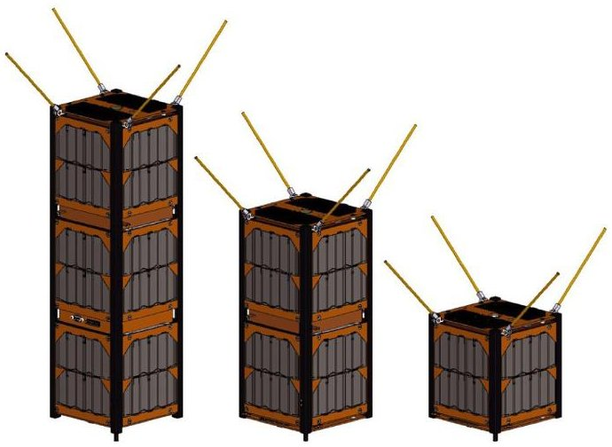
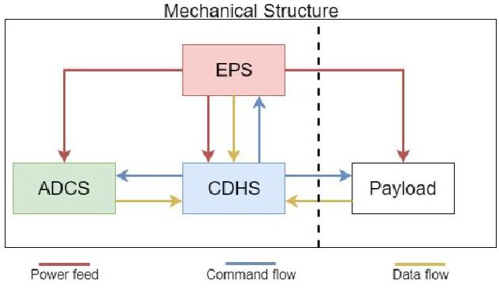
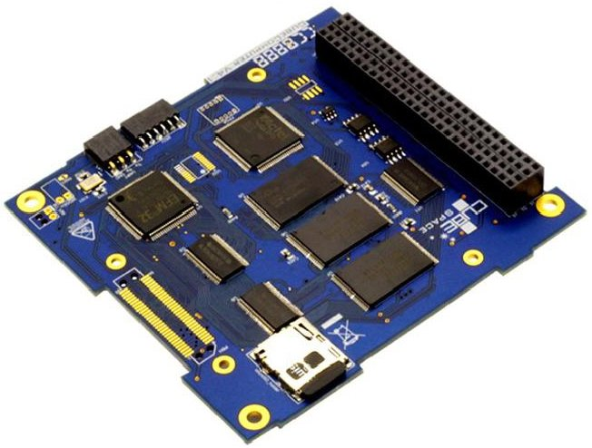
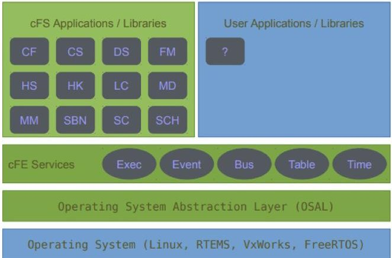
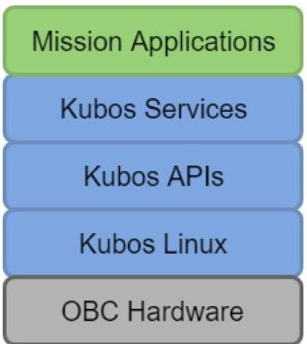
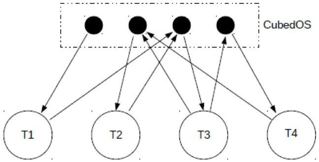
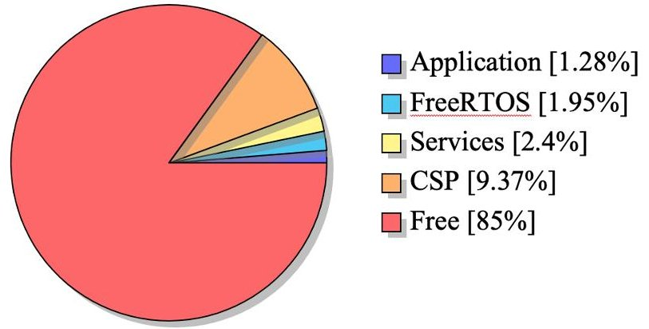
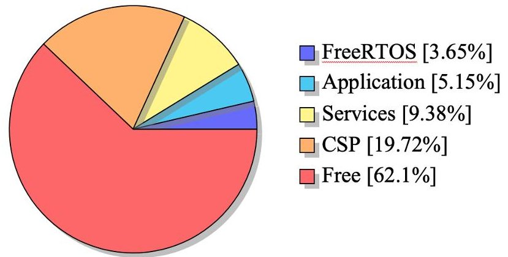

<!-- PDF_PAGE: 1 -->

# Development of a flight software framework for student CubeSat missions

Olman D. Quiros-Jimenez $ ^{1} $ , Duncan d'Hemecourt $ ^{2} $

Quiros-Jimenez, O; d'Hemecourt, D. Development of a flight software framework for student CubeSat missions. Tecnología en Marcha. Edición especial. Movilidad Estudiantil 6, 2019. Pág 180-197.

doi https://doi.org/10.18845/tm.v32i8.4992

<!-- PDF_PAGE: 2 -->

## Keywords

Satellite mission; software stack; framework; CubeSats.

## Abstract

During 2018 a student CubeSat project was developed at George Washington University (GWU) for the first time. The small satellite mission implemented a software stack with the hope of creating a simple and lightweight framework for future academic CubeSats. The developed flight software consisted of a collection of fundamental services and an application layer, which was executed above the Network Layer and the Operating System. Accompanying ground station software was also developed for the mission. This paper presents the resulting software framework, its architecture, features, software quality attributes, and the decisions made during the design and implementation. The paper will address and compare other available open source software frameworks for CubeSat missions and will propose a general architecture for any CubeSat mission at an introductory level. This generic framework will define the minimum features and standards to obtain a flexible, portable and reusable software library. The paper will provide students without previous CubeSat experience some initial information and examples to start the development of a CubeSat flight software.

## Introduction

In recent years the academic community has experiment an important increment on the number of developed space missions. During the year 2011 at least 10 satellites were launched by universities, for the year 2017 this number increased to 55, and each year this number grows [1]. This is due to several reasons, one for example is thestandardization of small satellites that lead to a important reduction on prices of components and launch services, another reason is the importance of actual space missions for education. It is already well known, that a satellite mission involves big efforts on many fields, particularly engineering [2]. Therefore letting university students to develop satellites, will provide them hands-on experience with an aerospace project and real-world systems engineering. In many occasions,satellites build by universities are student satellite missions,this means students of different levels and fields carry out the design, integration, testing and operation phase of the spacecraft. At the same time, this generally implies, that the mission is performed by non experienced personnel, which can conduct to delays on the design and integration phase, and also to failures during the operation in space. The software component of satellites is not exempt of suffering this issues. To address this, the paper attempts to give university students without previous experience, an initial reference when it comes to design and implement the flight software for CubeSats.

## A. Paper Organization

First of all, as background, some basic concepts will be given, which must be taken into account for developing any small satellite, and its flight software. Then some available Software Frameworks for small satellites will be exposedand compared; capabilities, features, modularity, portability, documentation, learning curve and licensing are factors of interest. The examined open source frameworks are: NASAs core Flight System (cFS) [3], KubOS flight software [4] and CubedOS from Vermont Technical College [5]. Based on the two initial sections, a generic flight software framework will be proposed, with the intention of building flexible, portable and reusable flight softwares for most student satellite missions. The architecture, features, software quality attributes, and the decisions taken during the design phase of the framework are presented. After this, a section presents the results of implementing and testing the framework. Lastly, the paper presents a conclusion and future work

<!-- PDF_PAGE: 3 -->

## Background

## The Cube Sat Standard

As mentioned in the introduction, one of the reasons for the increment of university space mission launches per year is the standardization of small satellites. CubeSat is the name given to the standard that defines a small satellite with the dimensions of 10 x 10 x 10 cm, for one unit CubeSat, or 1U, and a total mass of 1 kg. 2U and 3U configurations are also possible, i.e. CubeSats with the dimension of 10 x 10 x 20 cm with total mass of 2 kg and 10 x 10 x 30 cm with a total mass of 3 kg respectively [6][7], as illustrated in figure 1.

## Satellite Subsystems

As described in the book Space Mission Analysis and Design by Wertz and Larson [9], any satellite, including CubeSats, should incorporate a series of subsystems in order to perform correctly. For the intention of this paper,the subsystem of interest is the the Command and Data Handling Subsystem (CDHS). This, alongside the Mechanical Subsystem, the Electric Power Subsystem (EPS), the Attitude Determination and Control Subsystem (ADCS),and the Thermal Subsystem, conform the satellite Bus, in other words, the platform that support the satellite itself and the Payload. Figure 2 illustrates a typical CubeSat Subsystems organization. Next, a short description of each subsystem of interest is given.

Figure 1. 3U, 2U and 1U CubeSats. Isometric CAD drawings of 3U, 2U and 1U CubeSats respectively (based on ISIS structure and GomSpace Gom-X platform). [8]

- Mechanical Subsystem: is the solid structure than hold together all the subsystems, it provides the frame to arrange all parts, even during extreme conditions, for example during launch and deploy. Also provides the way to attach the spacecraft to the launch vehicle [9]. In the case of CubeSats the shape and requirements for the structure are already defined,and can be found in [7].

- Electrical Power System (EPS): is in charge of providing all the electric dependent components of the satellite with the power they need during the lifetime ofthe mission. Also provides a way to store, monitor, control, and in most cases, to generate, electrical power [9]. For CubeSats, the EPS requirements are also delimited, due to spatial and safety constraints [7]. In most cases a CubeSat EPS is conformed by solar cells, batteries, distribution connections and a control board.

<!-- PDF_PAGE: 4 -->

- Attitude Determination and Control Subsystem (ADCS): is capable of determining the attitude and orientation of the spacecraft using sensors, but also of changing it, as needed, with actuators. This system capable of stabilizing and orienting the spacecraft in the desired direction, based on the requirements of the antennas or/and the payload. There are many techniques to achieve this, some passive ones, taking advantage of aerodynamics and the gravitational field, and other active ones, making use of actuators, such as magnetic torquers, reaction wheels and propulsive systems [9]. Most CubeSats mission make use ofthe two first mentioned actuators, due to spatial and safety constraints.

- Command and Data Handling Subsystem (CDHS): is in charge of a fundamental task, provide the data link between the spacecraft and the ground segment, inorder to operate and monitor the satellite. Is capable of transmitting data with the state and health of all subsystems, also called telemetry data. Also is capable of receiving, interpreting and executing commands, addressed to any subsystem. The CDHS can be considered as the interface between the ground stations and all satellite's subsystems, but also as the brain of the spacecraft [10]. This subsystem is composed of various devices, i.e. the On Board Computer, the Communications System and the Data Bus. A further description of this components will be presented in the following sections.

- Payload: the payload is unique for each mission, and is the reason to be of the spacecraft. The payload can be composed by any hardware and/or software, capable of interacting with the outside world. Actual examples of this element is a camera for earth observation, a radiometer or even a communication system in the case of telecommunication satellites. All the previously presented subsystems have one fundamental purpose, to keep the payload safe and operational during the lifetime of the mission [9]. Note that satellites may incorporate more than one payload.

Figure 2. Block Diagram of typical CubeSat Subsystems Organization.

The Subsystems on the left side of the dotted line along side the structure conform the Satellite Bus, on the right side the Payload Segment.

## On BoardComputer

As part of the CDHS, the on-board computer (OBC) will safely ensure the procedural operations of the overall satellite. It is essential to form a communication link between the central flight computer and all other satellite subsystems. Utilizing the capability of a real-time operating system, the OBC can properly schedule and prioritize tasks across the entire satellite. When selecting the processor for the OBC of a CubeSat mission, it is important to consider the speed instruction set size, and memory capabilities.

<!-- PDF_PAGE: 5 -->

One must review the rates at which satellite tasks must be executed and the size of the data being transferred from different subsystems. For example, if a CubeSat designer plans to store images on the OBC, there will likely need to be an external memory chip to handle the larger data sets required of images. The most computationally complex tasks being executed on the OBC must be reviewed prior to the selection of the flight computer. For example, if the designer plans to run an ADCS module on the OBC, it is very important to review the computations required to produce the spatial vector of the satellite (i.e. Kalman filtercomputational complexity).

Alongside these fundamental considerations, the designer must also take into account the available pulse-width modulation (PWM), number of analog-to-digital converters, and available connection interfaces of different flight computers. Depending on the requirements of the satellite, certain flight computers may be lacking the physical connections needed to achieve missionsuccess.

Figure 3. Example of OBC for CubeSats, the CubeComputer from CubeSpace. This model fulfill the CubeSat dimensions [27].

## Data Bus

The way that the OBC and other subsystems communicate, is through the Data Bus. This term refers to all the hardware, ( i.e. wires, pins, plugs, etc. ) and the software protocols, that allows communication between various devices. There can be many Data Buses with different protocols inside the same system. Some of the most used protocols for CubeSats Data Buses are Inter-Integrated Circuit (I2C), Serial Peripheral Interface (SPI), Universal Asynchronous Receiver Transmitter (UART) and Controller Area Network (CAN) [12]. For choosing a Data Bus for an specific application is important to take into account the communication type, data rate, hardware requirement and the amount of devices to be connected to the same Bus (scalability). A summary of each protocol, and its attributes, can be found in table 1.

## Communications System

The communication system of the CubeSat is primarily responsible for sending data and receiving commands from the ground station. Sometimes the communication system also acts as a repeater for other satellites in space. This subsystem must generally be able to filter, amplify, and demodulate incoming signals and must be able to modulate and transmit outgoing signals. Additionally, the communication subsystem needs to be able to interface the incoming and outgoing data to the on-board computer. This interface is often achieved through a serial connection such as UART, I2C, or SPI. One of the most essential roles of the communication

<!-- PDF_PAGE: 6 -->

system design is to ensure that the CubeSat radio frequency and modulation scheme match that of the ground station. The specified RF band must be registered with the competent governmental authorities, to avoid committing violation to regulations.

Table 1. Data Bus Summary

<table border="1"><tr><td>Bus Name</td><td>Type of communication</td><td>#wires required</td><td>Data rate</td><td>Scalability</td></tr><tr><td>I2C</td><td>Synchronous</td><td>2</td><td>400 kbit/s</td><td>High
(multiple devices)</td></tr><tr><td>SPI</td><td>Synchronous</td><td>4</td><td>20 Mbit/s</td><td>High
(multiple devices)</td></tr><tr><td>UART</td><td>Asynchronous</td><td>2</td><td>460 kbit/s</td><td>Low
(point-to-point)</td></tr><tr><td>CAN</td><td>Asynchronous</td><td>2</td><td>1 Mbit/s</td><td>High
(multiple devices)</td></tr></table>

## Flight Software

The flight software refers to the specific software which is executed by the OBC during the lifetime of the mission, in other words, the flight software controls the CDHS, and at the same time controls the spacecraft. This software is different and unique for each spacecraft, because each mission has different goals and requirements, usually it is a very complex system, that involves many functionalities and interfaces.

There is not a rigorous way to design and implement the flight software, and this process requires important efforts and resources which need to be considered by project managers. Although the existing heritage from past missions, sometimes the flight software is written from scratch [13]. To address this issue some organizations have developed software frameworks with the intention of decreasing the time and resources needed to implement the flight software, but also for ensuring basic functionalities, standards and safety measures, along multiplemissions.

In the case of student satellite projects, the effort required by the team is bigger, because of the lack of experience. Most design practice and experience that exist in all major space organizations, such as NASA and ESA, is not available to student teams [13]. The rest of this paper will try to address this issue, by providing resources for implementing the flight software.

## Available Open Source Flight Software Frameworks

Most CubeSats student teams develop the Flight Software having in mind a specific hardware and mission. So for following missions the software needs to be re-factorized or completely rewritten. An approach to avoid this issue, and in general to improve the overall software quality and reduce production time and cost, is to use a framework. According to Pree [14] a software framework can be defined as a generic application that can be tailored for various specific applications. A software framework is composed by a set of software modules that follows a specific architecture. The idea with this is to take advantage of software re-usability, so that programmers just need to write the application-specific code to end with a functional application.

<!-- PDF_PAGE: 7 -->

There are a few available frameworks for building flight software for satellites, only open source frameworks will be presented in the following sections, three were identified during research.

## NASA's cFS

The NASA Core Flight System (cFS) software framework delivers a series of established software applications to operate on-board space flight computer systems. The Core Flight Executive (cFE), within the cFS, provides software developers a set of reusable services tailored to the fundamental functions required of satellite system management. The software environment enables a high-level modular approach to flight computer implementation [26].

NASA cFS aids developers in the enhancement of code re-usability and the reduction in source lines of code. As opposed to what is commonly known as "bare metal" programming, in which the flight software applications are built from the ground up, the cFS advertises rapid development. The cFE within the cFS framework provides many of the fundamental code services required of an on-board flight software system, such as timing and event handling, and software bus maintenance. Application Programming Interfaces (APIs) are also provided for flight-specific applications such as file management and system safety checking [26].

The framework adheres to a publish-subscribe software pattern, in which all cFS applications subscribe to specific cFE services at run-time. This pattern enables a simplified software development process in which applications can be easily added and removed from the software bus. Additionally, the cFE has a configurable set of requirements that can be run on multiple platforms, including a Linux desktop computer. This is essential for testing purposes, as it provides the software development team the ability tobuild and run applications on a desktop with the understanding that the application will be able to run identically on the flight hardware [26].

cFS uses a layered architecture, internals of a layer can be changed, without affecting other layers, this enables the framework to run on multiple operating systems without modification [25]. The architecture of this framework can be better appreciated in figure4.

## KubOS

As stated by the KubOS Documentation [4], it consist of an open source platform that provides satellite developers with the tools and libraries necessary to quickly bring up space-ready software. Developed by the Kubos Corporation, the framework is designed to take care of every aspect of the satellites flight software, so that users only have to write the so called Mission Applications, which govern the behavior of the mission. The Kubos platform consist of a Software development kit (SDK), this means it provides all tools required for building the applications. The central component of the KubOS framework architecture is the KubOS Linux operating system, which consist of a custom Linux distribution created to host the mission applications. Over the operating system, resides the Kubos APIs, which simplify the process of writing mission applications and services. It includes software abstractions for communication protocols and hardware devices. The framework also offer a collection of services, to allow the user to accomplish typical flight software tasks such as telemetry storage, file management, shell access, and hardware interaction. The overlying layer of the architecture are the mission applications, which are anything that governs the behavior of the satellite, this are developed by the users and can be written in Python or Rust programming languages [4]. The architecture of this framework can be better appreciated in figure5.

<!-- PDF_PAGE: 8 -->

Figure 4. Architecture of NASA's cFS framework [28].

Figure 5. Architecture of KubOS framework. Everything in blue is typically developed by Kubos, while everything in green would be mission code, written by the user for their specific mission and payload. [4].

## CubedOS

CubedOS was developed by the CubeSat Laboratory from the Vermont Technical College. The main goal of the framework is to providing a robust software platform for CubeSat missions and to easing the development of CubeSat fight software. Unlike the two previous studied platforms, CubedOS is written in SPARK/Ada, this allow the formal verification of critical sections to be free of the possibility of run-time error[15].

The framework offers an operation environment, which hosts modules and provide inter-module communication based on the publisher-subscriber model, but also provides modules with useful functionalities. The framework is completely modular, this allows modules to be plugged or unplugged as the mission requirements dictate. CubedOS architecture is described in figure 6, where the CubedOS environment, represented by an array of solid circles, provides the communication infrastructure, for the functional modules, represented by the circles labeled as T1 through T4 [15].

CubedOS is not dependent of an operating system, applications can be executed directly on bare hardware. Although for more complex applications that require an operating system, CubedOS can be executed on top of Linux or VxWorks [15]. Depending on the mission requirements this can represent a limitation, because Linux is not a real-time operating system and VxWorks is proprietary software.

<!-- PDF_PAGE: 9 -->

Figure 6. CubedOS-based Architecture [15].

## Comparison

The three frameworks studied in the previous section share many features and attributes in common. The three of them offer the fundamental features, and some extra utilities, required to build the flight software for satellite missions. In table 2 the components and functional features of each framework are enlisted.

The three alternatives focus on modularity, reconfigurability and portability to offer developers the ability of building applications with specific requirements within a relative short time. Also is important to present other non-functional features of each framework, this characteristics are enlisted in table 3.

Clearly, from the three proposals, the more complete and mature one is NASA's cFS, however this also brings a considerable learning curve. The memory footprint is not minimal, a typical configuration of cFS with FreeRTOS has a size around 1 MB [17], this can represent a limitation for low cost OBC modules, like for example the PPM E1 from Pumpkin INC, which has 256KB internal Flash memory and 96KB internal RAM[19].

The KubOS framework also offers a wide range of functionalities, and unlike the other two alternatives, KubOS allows to write the user application on Python or Rust programming languages. For achieving this the KubOS platform runs above the KubOS-Linux distribution. This can bring disadvantages, because limits the portability in term of the operating system layer, increases the memory footprint, a typical KubOS configuration can occupy more than 2.5 MB, and depending on the mission requirements, the Linux Operating System can fail on providing real time capabilities. KubOS hardware portability is also limited, applications are portable only between the official supported COTS boards, the ISIS, Pumpkin and Beaglebone platforms [4].

CubedOS is provably the most innovative of the three frameworks, because offers the capability for formal verification to be free of some types of run-time error. Also, depending on the mission requirements, the CubedOS can be executed without an operating system, which reduces the memory footprint. However, as stated on the web page of the project [20], CubedOS is still a work in progress, and by the time this paper was written many features are still missing.

## Flight Software Framework proposal

## Motivation

We aim to propose an open-source software framework that can be easily understood and implemented by students in future academic CubeSat missions. Many of the current platforms available are either too complex for a simple embedded system, or provide too much of a learning curve for students who are new to real-time systems. For example, NASA cFS offers a highly robust framework, although running it on a micro-controller with limited program memory is likely unrealizable. Our goal is to provide a simple and easy-to-use software framework that can be run on standard real-time operating systems.

<!-- PDF_PAGE: 10 -->

## Philosophies

Before the design and implementation phase of the framework started, some philosophies/ principles were stated in order to guide the team through the development process and help them take decisions when facing a dilemma.

- Focus on simplicity: always keep it simple. Don't implement something if it is not strictly necessary.

- Better explicit than implicit: never assume a user knows everything,better document each function and structure, also try not to use acronyms.

- Easy to learn and use, even without documentation: an intuitive product is expected, because the target users are students.

- Better static than dynamic: always try to use static allocation rather than dynamic, in order to avoid potential memory errors.

- Better greedy than lazy: if it is not possible to implement with static allocation, use dynamic allocation only during initialization of the software. Reserve all memory that will be potentially needed during initialization, never during the normal execution of the mission.

## Software qualityattributes

Taking the example of the three software frameworks presented before, some software quality attributes are desired, in order to overcome the complexity and challenges of space software. In this work, modularity and portability are the focused goals.

- Modularity: this means that each software component is independent from the others, this allows separate validation of each component, and greatly improves the reconfigurability of the framework [13].

- Portability: Mooney [18] defines a software unit as portable (across a class of environments) if the cost to transport and adapt it to a new environmen (in the same class) is less than the cost of redevelopment. For this work, the software unit is the framework, and the portability is desired across two classes of environments: the Hardware and the Operating System layer. This means the framework should be easy to port between different hardware platforms, but also should support different operating systems.

## Architecture

The proposed architecture consists of four layers: the operating system, the network layer, the framework services, and the user-specific software application. At the lowest level, the operating system will uphold the threading of each task in the framework, also will provide communication between tasks and resources management. The goal is to provide a universal real-time software framework. Therefore, the architecture should not be limited to any specific real-time operating system.

Above the operating system at the next level is the network layer, its main purpose is to establish a communication link between the spacecraft and the ground segment, therefore ground stations shall handle the same protocol. To fulfill this requirement the open-source library CubeSat Space Protocol (CSP) [21], has been choose. A further description will be provided later.

Above the network layer is the main functionality of the proposed framework. The services layer abstract away from CSP and will provide seven specific modules: housekeeping, parameter database, timekeeping, data storage, commands handling, debugging and data logger. The services will be described in the following section. Finally, at the highest level, the user will be able to define the flight-specific application using the services provided below. The software framework will clearly lay out a procedural process for the user to make specific calls to the services provided. The described architecture is illustrated in figure 7.

<!-- PDF_PAGE: 11 -->

Table 2. Components And Functionalities Of Cfs, Kubos And Cubedos Frameworks [4][5][15][16][17]

<table border="1"><tr><td>Component/Functionality</td><td>ShortDescription</td><td>cFS</td><td>KubOS</td><td>CubedOS</td></tr><tr><td colspan="5">Housekeeping and Fault Tolerance</td></tr><tr><td>Telemetry collection</td><td>Collect telemetry data automatically</td><td>Yes</td><td>Yes</td><td>No info</td></tr><tr><td>Telemetry storage</td><td>Store collected telemetry data</td><td>Yes</td><td>Yes</td><td>No info</td></tr><tr><td>Telemetry transmission</td><td>Transmit collected telemetry to ground segment</td><td>Yes</td><td>Yes</td><td>No info</td></tr><tr><td>Fault management</td><td>Detect a fault and take an action</td><td>Yes</td><td>Yes</td><td>No info</td></tr><tr><td>Watchdog</td><td>Interface for managewatchdogtimers</td><td>Yes</td><td>Yes</td><td>No info</td></tr><tr><td colspan="5">Commands &amp; Activities</td></tr><tr><td>Accept commands</td><td>Accept and handle commands fromgroundsegment</td><td>Yes</td><td>Yes</td><td>Yes</td></tr><tr><td>Store commands</td><td>Store Commands and scheduled execution</td><td>Yes</td><td>Yes</td><td>Yes</td></tr><tr><td>Event detection</td><td>Trigger activities when an specific event occurs</td><td>Yes</td><td>Yes</td><td>No info</td></tr><tr><td>Activity Scheduler</td><td>Scheduleson-boardactivities</td><td>Yes</td><td>Yes</td><td>Yes</td></tr><tr><td colspan="5">Time handling</td></tr><tr><td>Time management</td><td>Provide and managespacecrafttime</td><td>Yes</td><td>Yes</td><td>Yes</td></tr><tr><td colspan="5">Communications</td></tr><tr><td>Software messages passing</td><td>Message transmission betweensoftwaremodules</td><td>Yes(Publisher-subscribermodel)</td><td>Yes(Implemented by the OS)</td><td>Yes(Publisher-subscriber model)</td></tr><tr><td>Remote communication</td><td>Transfers/receives data to/from the ground</td><td>Yes</td><td>Yes</td><td>Yes</td></tr><tr><td>Communication with subsystems</td><td>Interface to transfer/receive data to/fromthesubsystems</td><td>Yes</td><td>Yes</td><td>Yes</td></tr><tr><td colspan="5">Data handling</td></tr><tr><td>Parameters database</td><td>Interface for managing parameters, set andgetvalues</td><td>Yes</td><td>Yes</td><td>No ifo</td></tr><tr><td>File System</td><td>Interface for managing files</td><td>Yes</td><td>Yes</td><td>Yes</td></tr><tr><td>Log collection</td><td>Collect and store the result of activities(i.e.commands, events, etc.)</td><td>Yes</td><td>No info</td><td>Yes</td></tr><tr><td>Utilities</td><td>Checksum, encoding/decoding,compression,etc.</td><td>Yes</td><td>Yes</td><td>Yes</td></tr><tr><td colspan="5">Testing &amp; debugging</td></tr><tr><td>Debugging support</td><td>Outputs informationfordebugging</td><td>Yes</td><td>Yes</td><td>No info</td></tr><tr><td>Testing support</td><td>Possible to perform automated testing</td><td>Yes</td><td>Yes</td><td>Yes(Allows for formal verification)</td></tr></table>

<!-- PDF_PAGE: 12 -->

Table 3. Non-Functional Features Of Cfs, Kubos And Cubedos Frameworks [4][5][15][16][17]

<table border="1"><tr><td>Non-funtional feature</td><td>Description</td><td>cFS</td><td>KubOS</td><td>CubedOS</td></tr><tr><td>Maturity</td><td>How many times has the software been used in space</td><td>Many missions</td><td>Non</td><td>Non</td></tr><tr><td>Portability</td><td>Easy to port in terms of operating system and hardware</td><td>Yes(OS and Hardware abstraction layer)</td><td>Only between supported boards</td><td>Yes(OS and Hardware abstraction layer)</td></tr><tr><td>Modularity</td><td>Modules are completely independent</td><td>Yes</td><td>Yes</td><td>Yes</td></tr><tr><td>Documentation</td><td>Coverage of the documentation</td><td>Extensive</td><td>Basic</td><td>Basic</td></tr><tr><td>Learning curve</td><td>How difficult to learn</td><td>High</td><td>High(Many technologies involved i.e.Rust,Python,C)</td><td>Low(if you know Spark/Ada)</td></tr><tr><td>Memory footprint</td><td>Memory required</td><td>Around 1MB with FreeRTOS</td><td>Above 2.5MB with Linux</td><td>Low(Do not requires OS)</td></tr><tr><td>Licensing</td><td>Type of License</td><td>NASA Open Source Agreement</td><td>Apache License v2.0</td><td>GNU General Public License</td></tr></table>

<table border="1"><tr><td colspan="5">Mission Specific Application</td></tr><tr><td>HK</td><td colspan="3">Framework Services</td><td>Log</td></tr><tr><td>Debug</td><td>Storage</td><td>Parameters</td><td>Commands</td><td>Time</td></tr><tr><td colspan="5">Network Layer(CubeSat Space Protocol)</td></tr><tr><td colspan="5">Operating System(Linux,Windows,FreeRTOS,...)</td></tr></table>

Figure 7. Architecture of proposed framework. Layers in blue are part of the framework while layers in green should be provided by the user for the specific mission.

## Operating System

The frameworks studied, demonstrates that a real-time operating system is fundamental for implementing a satellite's flight software, because this is inherently concurrent, since space systems comprise large numbers of elements, such as sensors and actuators that operate in real time, sharing resources, such as memory [13]. As described before, the architecture was not designed for a specific real-time operating system, hence an abstraction layer is provided (by CSP), and the software developers are responsible for choosing the operating system. However the operating system layer shall occupies a minimum amount of memory, due the limitations of low cost OBC modules, and shall provide the following fundamental features:

- Threadcreation

- Threadsynchronization

- Threadintercommunication

- Timemanagement

- Memorymanagement

- System shutdown and rebootcalls

<!-- PDF_PAGE: 13 -->

Sometimes is also desired to execute the flight software over non real-time operating systems, such as Linux, Windows or Mac-OS, on a desktop computer. This is useful when the software develops need to start writing and testing the mission-specific application, but they do not have whit the specific hardware for the satellite. This capability is also achievable with the abstraction layer provided by CSP.

## Network Layer

To implement a communication network across the satellite and ground segment, it is essential to establish a reliable protocol for sending and receiving data. There are a multitude of communication protocols in existence, although it is important to use a protocol that adheres to the needs of the satellite while maintaining a small footprint in memory and processing power. AX.25 is a communication protocol used primarily for radio communication systems. It is a simple data format universally used across the amateur radio community. Although its simplicity is advantageous to radio communication links, the protocol does not provide a framework to implement an on-board embedded system network. AX.25 usually fits into a larger communication protocol in theon-board satellite network.

Another highly universal communication protocol is TCP/IP, which is usually associated with Internet. TCP/IPhas been proven to be a robust and reliable tool in establishing computer networks, although its footprint is likely too large for a CubeSat mission with limited computing power and memory.

The CubeSat Space Protocol (CSP) was established specifically to meet the needs of CubeSat missions. The protocol maintains simplicity and a reliable functionality, which is perfectly suited for establishing an on-board CubeSat net- work. CSP offers a wide range of high level functionalities, while maintaining a very small memory footprint, as 48 KB of code and less that 1 KB RAM required [21]. It isessential to use an operating system to which CSP can be ported. CSP can make all operating system calls (i.e. creating tasks, synchronizing tasks, creating queues, etc.) without requiring the software developer to invoke operating system-specific language. This greatly contribute to the portability of the whole framework.

## Framework Services

Based on the Table II we can identify the fundamental modules that should be present in a flight software frame- work in order to be suitable for most satellite missions. As stated before, on of the main intentions of this work is to develop a simple and intuitive software framework, easy to learn and use, therefore this proposal tries to achieve asmany functionalities as possible with just a few general modules. The resulting modules form this analysis are enlisted as follow:

- Housekeeping Service: the Housekeeping (HK) Service is in charge of providing the ground segment with telemetry data about the state and health of the spacecraft, therefore this service shall be able to automatically collect, store and transmit telemetry data. Storing telemetry data may be of interest for the mission, if it is required to know the state of the spacecraft even during the section of the orbit without a communication link withground.

- Parameters Service: the Parameter Service acts as a database for the spacecraft's parameters, it shall provide an easy way to set and get the value of any parameter. A parameter can be described as a variable that helps model or describe a system, it can be for example the pointing direction of the ADCS, or the output voltage of the EPS, or even if the communication system is on or off. Therefore this service should supportany kind of value (i.e.: boolean, integer numbers, floating point numbers and strings). Implementing the mission specific application using the Parameters Service instead of built-in variables from platform facilitates the control and monitoring of the spacecraft, because any parameter value can be modified or retrieved at anytime.

<!-- PDF_PAGE: 14 -->

- Commands Service: the Command Service is in charge of providing the ground segment with the ability of controlling the spacecraft at any time. This module shall be able to accept and execute commands coming from ground in real-time. Usually commands arrive encoded inside packages form the Network layer, therefore this module shall be capable of decoding an interpreting the content of a command package. For this work the specific action performed by a command will be called command routine. The amount of command routines needed and the actions performed by each command routine are specify of the mission and shall be implemented by the user. Normally, the ground segment expects a result for each command sent to the spacecraft, therefore this service shall be capable of capturing the result from any command routine and sending it back toground. Depending on the mission requirements, storing commands is also necessary, this provides the ability to execute commands, even during the section of the orbit without a communication link with ground. For this the command packages shall also specify when to execute the command routine, this can be specified with a eventual condition, for example when the time reach a certain value, or when the GPS coordinates are between a certain range, or even when the battery charge drops under a certain threshold. Some flight softwares treat time-based conditions separated from other event conditions, for simplicity this proposal will treat time-based conditions as any event condition.

- Time Service: the Time Service provides an interface for managing the time on-board the satellite. This module shall be capable of providing with the actualtime-stamp to the software units that requires this. Time-stamps can be the mission elapsed time or the actual ground time. For the second type, this service shall provide a routine to synchronize the time-stamp with ground. This service shall also provide an interface for interacting with watchdog timers. Watchdog timers are electronic timers which are reseted within a specific period of time, if at any given moment the period elapses and the timer is not reseted, it means that an exception has occurred, so the watchdog triggers a corrective action, usually reboots the affected subsystem. As with the Storage Service, the calls for interact with the clock and watchdog timers can differ between platforms. Therefore the underlying implementation shall be given by theuser.

- Storage Service: the Storage service consist of ain- terface for managing files, this shall provide functions to create, read, update and delete files. Is important to note that the low level calls to handle files can differ between platforms (hardware/operating system), therefor this service shall provide an abstraction layer, but the underlying implementation shall be provided by theuser.

- Log Service: sometimes is very desired to store information about the state of the spacecraft, the result of activities, error occurrences or any other event. The Log service is in charge of storing this type of data in a file called the log file. When a new record is added to the log file, it shall include the accurate time-stamp when the event occurred.

- Debug Service: the Debug service is a small but important module which allows the mission developers to monitor and manipulate the flight software during the developing process. It shall provide functions for printing information and reading commands to and from a debug console. The actual implementation for this functions may differ between platforms, therefore this service shall provide an abstraction layer, but the underlying implementation shall be provided by the user.

<!-- PDF_PAGE: 15 -->

## Implementation of Proposed Framework

For the implementation and testing phase, the GWU CubeSat team make use of the STK600 development system [23] and the AT32UC3C0512C micro-controller [24], both by Microchip Technology Inc. The 32-bits micro-controller features 512 KB of programmable memory, 68 KB of RAM memory, and a was configured to run at 16 MHz.

For the operating system layer, FreeRTOS [22] was selected by the team. FreeRTOS is an open source real-time operating system, which meets all the requirements stated in section IV-E, and CSP is already ported to it. This will also be the operating system used by the GWU CubeSat, and is the recommended option for implementing flight software.

With this configuration the GWU CubeSat team demonstrates a light-weight and functional flight software framework with the following attributes.

## Modularity

The implemented framework demonstrated to be modular, all services from the framework services layer are independent, and can be used separately. This gives the option to the software developers to use just some services for the specific application, but also to add other modules.

## Portability

The implemented framework demonstrated great portability in terms of the operating system layer. All operating system calls made by the framework services and the mission-specific application, use the interface provided by CSP. Therefore the framework can be easily executed over any of the operating system supported by CSP (i.e. FreeRTOS, Linux, Windows and MacOS). However, ports for other operating system can be easily written.

In terms of the hardware, the framework also demonstrated to be portable, by providing interfaces for the specific hardware. Interfaces for the file system, clock management and watchdog timers management are provided by theframework services layer. Interfaces for the memory management and for shutting down and rebooting the hardware, are provided by CSP. The underling implementation for specific hardware shall be provided by the software developers.

## Real Time Capabilities

The implemented framework demonstrates to provide real-time capabilities, thanks to the realtime supporting platform conformed by FreeRTOS. This was demonstrated through the testing phase, where the software was able to respond in real-time to incoming messages with different requests.

## Memory Footprint

The implemented framework demonstrates a very low memory footprint, even lower than the cFS and Kubos frameworks. For a configuration with FreeRTOS, CSP, the seven proposed services and a basic application with the specific hardware drivers, the software requires around 76 KB ROM and 26 KB of RAM. This makes the framework suitable for low-cost commercial OBCs, such as the previously mentioned, PPM E1 from Pumpkin INC, which has 256KB internal Flash memory and 96KB internal RAM [19]. Figures 8 and 9, show the breakdown of the memory occupied by the compiled implementation on the AT32UC3C0512C microcontroller, which has 512 KB of ROM and 68 KB of RAM memory.

<!-- PDF_PAGE: 16 -->

Figure 8. AT32UC3C0512C ROM (512 KB) allocation breakdown. Total allocated 15% (76.8 KB).

Figure 9. AT32UC3C0512C RAM (64 KB) allocation breakdown. Total allocated 37.9% (25.79 KB).

From figures 8 and 9 can be noticed, that for both ROM and RAM, CSP represents the biggest partition. This may be due the extensive amount of functionalities that the library offers, but also because of the memory space which has to be allocated for storing the incoming and outgoing CSP packets. For both ROM and RAM, the proposed framework services represents the second biggest partition, this may be because of the tables which are allocated by the Parameters and Commands Services. FreeRTOS and the Application requires similar amount of space for both RAM and ROM, this demonstrates the very low footprint of FreeRTOS kernel, which makes it highly suitable for CubeSat missions. The Application segments on the pie charts also contemplate the hardware support packages, which differs for each platform, this may be the reason for the Application to require more RAM than the FreeRTOSkernel.

## Documentation

Each module of the framework services offer a documented API, with a description of the module's general functionality, and a description for each structure and function of the API. Some functions and structures descriptions also offer examples of how to use them. The GWU CubeSat team made sure to document all the software units during the implementation process. The documentation follows the Doxygen format, so that adocument can be generated.

## Conclusions

When the GWU CubeSat team start designing and developing the flight software, the specific platform and mission application requirements were still unclear. This was one of the

<!-- PDF_PAGE: 17 -->

main reasons for the team to developing a generic solution. Not for bad, because the team demonstrates a modular, portable, general-purpose, real-time and open-source platform. The team hope with this work to provide future missions and other student teams, with a resource to facilitate the implementation of the flight software.

## Current Status & Next Steps

By the time this paper was written, the implementation of the proposed framework was still in progress, the GWU CubeSat team hopes to include all proposed features and make a first release by late 2018.

For the current version of the implementation, visit: https://github.com/ olmanqj/sfsf.

Furthermore some next-steps have been identified. A further documentation is desired, with a user manual and building instructions, a example application is also desired. The team also hopes to provide the framework with a few more functionalities, for example, a file transfer protocol would be highly valuable. One of the main disadvantages of this work, compared with the frameworks studied before, is the lack of fault detection and recovery capabilities. The only method provided by the proposed framework is the utilization of watchdog timers. Further fault tolerance features are highly desired in potential future versions.

## Acknowledgment

Thanks to the members of The Space System Laboratory (SETEC Lab) at Costa Rica Institute of Technology, to the members of The GW-CubeSat Lab and The Micropropulsion and Nanotechnology Laboratory (MpNL) at The George Washington University, for making this work possible.

## References

[1] M. A. Swartwout, "CubeSat Database," Google Sites. [On-line]. Available: https://sites.google.com/a/slu.edu/ swartwout/home/cubesat-database. [Accessed: 17-May-2018].

[2] M. A. Swartwout, "CubeSats and Mission Success: 2017 Update", presented at the 2017 Electronic Technology Workshop, NASA Elec- tronic Parts and Packaging Program (NEPP), NASA Goddard Space Flight Center, 27 June2017.

[3] NASA, "core Flight System (cFS)," nasa.gov, 2017. [Online]. Available:https://cfs.gsfc.nasa.gov/.

[4] Kubos Corporation, "Kubos Documentation," kubos.co,2017. [Online]. Available: http://docs.kubos.co/1.2.0/index.html.

[5] C. Brandon and P. Chapin, "CubedOS: A SPARK MessagePassing Framework for CubeSat Flight Software," 2017. [Online]. Available: https://frama-c.com/download/framaCDay/ FCSD17/talk/07_Brandon_Chapin.pdf.

[6] R. Nugent, R. Munakata, A. Chin, R. Coelho, and J. Puig-Suari, "The CubeSat: The Picosatellite Standard for Research and Education," bluecubesat.com, 2014. [Online]. Available: http:// www.bluecubesat.com/wp content/uploads/2014/05/www.cubesat.org_images_More_Papers_cps2008.pdf.

[7] A. Hutputtanasin and A. Toorian , "CubeSat Design Specification," http://org.ntnu.no,03-Jun-2004. [Online]. Available: http://org.ntnu.no/studsat/docs/proposal_1/A8-CubesatDesignSpecification.pdf.

[8] R. Bedington, X. Bai, E. Truong-Cao, Y. C. Tan, K.Durak, Villar Zafra, J. A. Grieve, D. K. L. Oi, and A. Ling, Nanosatellite experiments to enable future space-based QKDmissions, EPJ Quantum Technology, 18-Oct 2016. [Online]. Available: https://epjquantumtechnology.springeropen.com/ articles/10.1140/epjqt/s40507 016-0051-7.

[9] J.R. Wertz, W.J. Larson, "Space Mission Analysis and Design." Third Edition, Microcosm Press, 1999.

[10] A. E. Heunis, "Design and Implementation of GenericFlight Software for a CubeSat," psu.edu, 2014. [Online]. Available: http://citeseerx.ist.psu.edu/viewdoc/download?doi=10.1.1.838.2694&rep=rep1&type=pdf.

<!-- PDF_PAGE: 18 -->

[11] J. Bahr, "An Advanced Approach to Satellite Software andCom- munication Based on SmartOS and Compass Protocol," 2016. [Online]. Available: http://www.diva-portal.org/smash/get/diva2:1031994/FULLTEXT02.

[12] M. L. Volstad, "Internal Data Bus of a Small Student Satellite," 2011. [Online]. Available: https://daim.idi. ntnu.no/ masteroppgaver/006/6403/masteroppgave.pdf.

[13] A. B. Ivanov and S. Bliudze, "Robust Software Development for University-Built Satellites," 2017. [Online]. Available: https://infoscience.epfl.ch/record/225659/ files/2017IEEEPaper.pdf.

[14] W. Pree, "Meta PatternsA Means For Capturing the Essentials of Reusable Object-Oriented Design." [Online]. Available: https://pdfs.semanticscholar.org/2bf6/ 7e7f683acf2625640892b72ef07f7bafdd95.pdf.

[15] Vermont Technical College, CubedOS Operating System. 2018. Cube- dOS documentation generated from Latex files. [Online]. Avail- able: https://github.com/cubesatlab/cubedos/tree/ master/doc.

[16] L. Prokop, NASAs Core Flight Software - a Reusable Real-Time Framework, 2014. [Online]. Available:http:// www.uh.edu/nsm/_docs/cosc/seminars/2015/0225-prokop-slides.pdf.

[17] J. Wilmot, Using CCSDS Standards to Reduce Mission Costs. [On-line]. Available: https://ntrs.nasa.gov/archive/nasa/ casi.ntrs.nasa.gov/20170007440.pdf.

[18] J. D. Mooney, Bringing Portability to the Software Process, 1997. [Online]. Available: https://pdfs.semanticscholar.org/ ef08/695a3e437ea58f48e247f72b4bac61140c5c.pdf.

[19] Pumpkin Inc, Pluggable Processor Module E1 (PPM E1). [Online]. Available: http://www.pumpkinspace.com/ store/p129/Pluggable_Processor_Module_E1_(PPM_E1).html. [Accessed:Jun-2018].

[20] CubedOS Project Overview, cubesatlab.org. [Online]. Available: http://www.cubesatlab.org/CubedOS.jsp. [Accessed: Jun-2018].

[21] GitHub - libcsp. [Online]. Available: https://github.com/ libcsp/libcsp. [Accessed:Jun-2018].

[22] Features Overview [About FreeRTOS]. [Online]. Available:https://www.freertos.org/FreeRTOS_Features.html. [Accessed: Jun-2018].

[23] STK600, Microchip Technology Inc. [Online]. Available: http://www.microchip.com/DevelopmentTools/ ProductDetails.aspx?PartNO=ATSTK600. [Accessed: Jun-2018].

[24] AT32UC3C0512C, Microchip Technology Inc. [Online]. Available: https://www.microchip.com/wwwproducts/en/AT32UC3C0512C. [Accessed:Jun-2018].

[25] D. McComas, NASA/GSFCs Flight Software Core Flight System, 2012. [Online]. Available: https://ntrs.nasa.gov/ archive/nasa/casi.ntrs.nasa.gov/20130013412. pdf.

[26] A. Cudmore, NASA/GSFCs Flight Software Architecture: Core FlightExecutiveandCoreFlightSystem,2011. [Online]. Available: http://flightsoftware.jhuapl.edu/files/2011/FSW11_Cudmore.pdf.

[27] CubeSpace, "CubeComputer." [Online]. Available: https://cubespace.co.za/cubecomputer/.

[28] A. Cudmore, G. Crum, S. Sheikh, and J. Marshall, Big Software for SmallSats: Adapting cFS to CubeSat Missions. [Online]. Available: https://digitalcommons.usu.edu/cgi/viewcontent. cgi?referer=https://www.google.com/&httpsredir=1&article=3303&context=smallsat.