<!-- PDF_PAGE: 1 -->

## POLITECNICO DI TORINO Master's Degree in Aerospace Engineering

# Development of a MATLAB tool for Automated Calculation of CubeSat Budgets with Margins

Supervisors

Ran Qedar

Candidate

Saish Sridharan

Edlira Hoxha

Manuela Battipede

July 2023

<!-- PDF_PAGE: 2 -->

This work was carried out at Space Products and Innovation S.a.r.l. during an internship.

<!-- PDF_PAGE: 3 -->

## Acknowledgements

Special thanks go to my mentors, Ran Qedar and Saish Sridharan, for their guidance, indispensable advice and knowledge imparted throughout the project. Your experience and support have been instrumental in completing this thesis.

Ringrazio particolarmente la mia relatrice di tesi, la professoressa Manuela Battipede. Grazie per il suo sostegno costante, la sua pazienza e il suo incoraggiamento nel corso di questi mesi.

Vorrei dedicare un profondo ringraziamento alla mia famiglia. In particolare desidero ringraziare mia mamma, che ho sempre ammirato e stimato. Sei stata un esempio di forza per me, insegnandomi che con determinazione si possono ottenere i risultati desiderati. Grazie per avermi sempre incoraggiata e supportata in ogni momento. A mia sorella, grazie per avermi insegnato l'importanza di affermare la mia personalità. Infine, un sentito grazie a mio papà per aver sempre creduto in me. Grazie al loro supporto e il loro amore per me, sono riuscita a realizzare tutti i miei desideri.

Un grazie di cuore a Leo, per il suo inestimabile supporto morale durante questi mesi. Hai condiviso e sopportato con me l'ansia, i timori e le vittorie di questi ultimi periodi all'università. Grazie per esserci.

Ringrazio i miei amici, vecchi e nuovi, compagni di avventure universitarie e non solo. Voglio ringraziarvi per aver reso questi anni indimenticabili.

Ringrazio infine tutti i presenti per aver scelto di condividere con me la gioia di questo traguardo. Grazie per aver reso questa esperienza così preziosa e memorabile.

<!-- PDF_PAGE: 4 -->

## Abstract

The thesis, carried out in collaboration with Space Products and Innovation S.A.R.L. (SPiN), presents the study and development of a tool in Matlab for the automated calculation of the system budgets for a generic CubeSat, with the use of margins. The goal is to program a Matlab code that is able to calculate the budgets of a CubeSat, such as mass, volume, power, data, momentum, pointing and thermal, taking as input variable parameters, characterized by a range of values around to the nominal value of the parameter plus or minus its margin, and output the results with a margin.

In the introductory chapter there is a brief description of the CubeSats, of the modularity and of the SPiN projects in which these two aspects are highlighted. The second chapter presents an introduction on mission design, in particular a brief description of the system budgets of a satellite, and finally the research carried out to understand different techniques and approaches used in the mission design of various CubeSat missions.

The third chapter delves into the description of the tool development. In the first part an overview of the code developed in Matlab is presented, followed by the theory of error propagation, and how this has been used to implement the calculation of margins. Subsequently all the calculations performed for the calculation of the budgets and their implementation in Matlab are described. The chapter concludes with the verification and testing phase of the tool.

The thesis contributes to the CubeSat design field by providing a useful tool for budget calculation, which allows to speed up the design process, reducing the required number of iterations in the components selection for the CubeSat. The implementation of margins also helps in understanding the evolution and influence of variable parameters in the initial design phases.

<!-- PDF_PAGE: 5 -->

## Table of Contents

Table of Contents ... 5

List of Figures ... 7

List of Tables ... 9

1 Introduction ... 10

    1.1 CubeSats ... 10

    1.2 Modularity ... 11

    1.3 SPiN projects ... 11

        1.3.1 SPiN-1 ... 11

        1.3.2 Modular ADCS ... 12

        1.3.3 Modular Avionics Test Bench ... 13

    1.4 Structure of the thesis ... 13

2 Mission design ... 15

    2.1 Overview of the mission design process ... 15

    2.2 Mission definition ... 15

    2.3 System definition ... 16

        2.3.1 Budgets definition ... 17

    2.4 Assembly, Integration and Testing ... 18

    2.5 Mission design approach in different case studies ... 18

        2.5.1 SPiN-1 ... 18

        2.5.2 SwissCube ... 19

        2.5.3 OpenOrbiter ... 21

        2.5.4 Omotenashi and Equuleus ... 22

        2.5.5 Orca²Sat ... 24

3 Algorithms development ... 26

    3.1 Overview ... 26

    3.2 Error propagation theory ... 27

        3.2.1 Margins ... 28

    3.3 Budgets calculations ... 28

        3.3.1 Mass budget ... 28

        3.3.2 Volume budget ... 29

        3.3.3 Power budget ... 32

        3.3.4 Data and Link budget ... 39

        3.3.5 Momentum and Pointing budget ... 44

        3.3.6 Thermal budget ... 57

<!-- PDF_PAGE: 6 -->

3.4 Matlab implementation ... 63

3.4.1 Mass budget... 63

3.4.2 Volume budget... 65

3.4.3 Power budget... 67

3.4.4 Data and Link budget... 70

3.4.5 Momentum and Pointing budget... 71

3.4.6 Thermal budget... 77

3.4.7 Code consolidation... 79

3.5 Test and Verification... 84

4 Conclusions... 87

5 Future work... 88

References... 90

<!-- PDF_PAGE: 7 -->

## List of Figures

Figure 1-1 SPiN-1 [4] ... 12

Figure 2-1 SPiN-1 Design process ... 19

Figure 2-2 SwissCube ... 20

Figure 2-3 OpenOrbiter ... 21

Figure 2-4 OpenOrbiter computer board configuration [7] ... 22

Figure 2-5 OpenOrbiter configuration [7] ... 22

Figure 2-6 Omotenashi [9] ... 23

Figure 2-7 Equuleus [10] ... 23

Figure 2-8 Orca2Sat [12] ... 24

Figure 3-1 Code Structure ... 26

Figure 3-2 Coverage angle ($\beta$) and elevation angle (s) ... 40

Figure 3-3 Gravity gradient torque ... 48

Figure 3-4 Environment heat fluxes ... 58

Figure 3-5 CubeSat attitude hot case ... 61

Figure 3-6 Mass budget - Input dialog ... 64

Figure 3-7 Volume budget - PCBs input dialog (1) ... 66

Figure 3-8 Volume budget - PCBs input dialog (2) ... 66

Figure 3-9 Volume budget - Other components input dialog ... 67

Figure 3-10 Power budget - Components input dialog ... 68

Figure 3-11 Power budget - Modes input dialog ... 68

Figure 3-12 Power budget - Orbital cycles input dialog ... 69

Figure 3-13 Power budget - Batteries parameters input dialog ... 70

Figure 3-14 Data budget - Components input dialog ... 70

Figure 3-15 Data budget - input selection ... 71

Figure 3-16 Data budget - Ground Stations and transmitting antenna input dialog ... 71

Figure 3-17 Momentum budget - Orbital parameters input dialog ... 72

Figure 3-18 Momentum budget - Mass and Geometry input dialogs ... 73

Figure 3-19 Detumbling simulation in Simulink ... 73

Figure 3-20 Detumbling simulation - IGRF model ... 74

Figure 3-21 Detumbling simulation - B-dot ... 74

Figure 3-22 Detumbling simulation - Euler equations ... 75

Figure 3-23 Detumbling simulation – Quaternions ... 75

Figure 3-24 Detumbling simulation - Scope angular velocities ... 76

Figure 3-25 Pointing budget - Sensors and actuators input dialog ... 76

Figure 3-26 Pointing budget - Pointing errors input dialog ... 77

Figure 3-27 Thermal budget - Operational temperatures input dialog ... 77

Figure 3-28 Thermal analysis - Examples of mesh refinement ... 78

Figure 3-29 Thermal analysis – Results ... 79

Figure 3-30 Consolidation - Components definition ... 80

Figure 3-31 Consolidation - CubeSat definition ... 81

Figure 3-32 Consolidation – Inertia matrices definition ... 81

Figure 3-33 Consolidation - Orbital parameters ... 82

Figure 3-34 Consolidation - Ground Stations definition ... 82

Figure 3-35 Consolidation - Momentum and Pointing parameters ... 83

Figure 3-36 Consolidation - Results mass budget ... 84

Figure 3-37 CubeSat J3 power consumption – Test ... 84

Figure 3-38 CubeSat J3 power consumption – Original [32] ... 85

<!-- PDF_PAGE: 8 -->

Figure 3-39 Mass and Power test results...85

<!-- PDF_PAGE: 9 -->

## List of Tables

Table 3-1 CubeSat standard dimensions ...29

Table 3-2 Constant values Data budget...41

Table 3-3 Earth's parameters...44

Table 3-4 Geocentric longitude...45

Table 3-5 Constant values for disturbance torques ...47

Table 3-6 Constant parameters hot case...60

Table 3-7 Heat fluxes on each face, hot case ...61

Table 3-8 Constant parameters cold case...61

Table 3-9 Heat fluxes on each face, cold case ...62

<!-- PDF_PAGE: 10 -->

## 1 Introduction

This master's thesis presents the work conducted during an internship at Space Products and Innovation. The main focus of this work is the development of a Matlab code that automates the calculation of system budgets for CubeSats, with variable parameters as the central aspect. The code is designed to perform calculations with margins, taking variable parameters as input and providing results as a range of values around a nominal value, plus or minus its margin. Margins are integrated into the calculations, treating them as errors or uncertainties on the measurement of a parameter. The theory of error propagation is then applied for calculating the margins in the results.

To provide the reader with a comprehensive understanding of the code and its development, the thesis begins with a concise introduction to CubeSats, emphasizing the concept of modularity and highlighting SPiN projects.

Concluding the chapter, a section is dedicated to summarizing the key topics addressed in each subsequent chapter.

## 1.1 CubeSats

CubeSats belong to the category of nanosatellites with the characteristic of being modular and having variable dimensions that adapt to the type of mission. These modular satellites are constructed by combining a base unit measuring 10x10x10 cm with a maximum weight of 1.33 kg per unit. The base unit, also known as 1U, represents the fundamental building block, while CubeSats commonly adopt configurations such as 1U, 2U, 3U, 6U and 12U [1].

These nanosatellites are launched as a secondary payload on board large rockets, for this very reason there is a high standardization of the size and weight of these satellites. This secondary payload characteristic renders CubeSats a cost-effective option compared to traditional satellites.

From a cost perspective, CubeSats are further economical due to their predominant use of commercial-off-the-shelf components (COTS) readily available on the market. Their modular nature, composed of 1U and COTS units, simplifies the assembly and grants flexibility in component selection for specific missions. These attributes streamline the design process, reduce assembly and design times, and take advantage of volume and shape standardization. Moreover, the miniaturization of spaceflight components has seen remarkable progress owing to the small size of CubeSats.

The CubeSat project was born within the academic domain. The pioneers of this design were professors at California Polytechnic State University and Stanford University in the 90s. It originated as an economical and accessible solution for students involvement.

Over time, CubeSats have gained increasing popularity, finding extensive application in both academic and industrial settings. They are primarily employed for low Earth orbit (LEO) missions, such as Earth observation missions exemplified by Planet Labs' DOVE CubeSat constellation [2], as well as for telecommunications purposes, such as Kepler Communications' Kepler-16 to Kepler-19 missions [2]. Furthermore, their low cost and ease of construction make them suitable for technology demonstration missions, including California Polytechnic State University's CP1 and CP2 projects [2]. Although fewer in number, there have been CubeSat launches for lunar missions, such as the University of Tokyo and JAXA's Omotenashi and Equuleus [2], while interplanetary missions are being explored with varying degrees of success.

<!-- PDF_PAGE: 11 -->

However, this design approach also entails certain drawbacks related to satellite size and component limitations. CubeSats exhibit constraints in terms of power, communication range, and data processing, which restrict the complexity of their systems. Additionally, careful attention must be paid to satellite volume and mass during the design process. Finally, CubeSats typically have shorter operational lifetimes compared to traditional satellite missions.

## 1.2 Modularity

Modularity is a fundamental concept in systems engineering design, which adopts a holistic approach to create and optimize complex systems by integrating various components, considering their interactions, and ensuring that the system meets its intended objectives and requirements.

When designing a modular system, the approach involves breaking down a complex system into smaller, more manageable subsystems. These "modules" can be individually designed, manufactured, and tested before being integrated and assembled into the complete system.

One significant advantage of modular design is the ease, affordability, and effectiveness of upgrading individual modules without having to revise the entire project. Additionally, standardized interfaces between modules facilitate integration and assembly, allowing for limited customization and reducing costs.

CubeSats, as mentioned in the previous section, are commonly associated with the concept of a modular system approach, using the PCB104 standard. However, it is important to note that while the PC104 standard provides mechanical flexibility, true modularity in terms of digital integration can be challenging to achieve. Unless there is vertical integration of components from the same company, referring to them as fully modular may not be accurate. When utilizing components from different companies, customization is often required, especially concerning PC104 pins and digital integration, particularly when different protocols are involved. Their modularity can be examined from two perspectives. Firstly, they consist of standard 1U units. Secondly, they predominantly employ stackable commercial-off-the-shelf components, some of which are partially modular. The satellite component market, specifically for CubeSats, has witnessed a growing trend toward manufacturing Printed Circuit Boards (PCBs) that function as complete subsystems. For instance, there are PCBs designed as comprehensive Attitude Determination and Control Systems (ADCS), Electrical Power Systems (EPS), or On-Board Computers (OBC) [3].

These components can be integrated and assembled much like LEGO pieces. In contrast, traditional satellites necessitate unique and non-repeatable assembly processes for each satellite. This highlights the advantages of working with modular systems, which significantly reduce design times and costs.

## 1.3 SPiN projects

## 1.3.1 SPiN-1

SPiN-1 is a technology demonstration mission showcasing the capabilities of MA61C (Multipurpose Adapter Generic Interface Connector) cubesat version, the universal adapter developed by Space Products and Innovation [4].

<!-- PDF_PAGE: 12 -->

The mission's objective is to demonstrate in-orbit reconfiguration enabled by MA61C adapter and to showcase the reduced assembly times made possible by its capabilities.

The MA61C adapter is the first space-grade subsystem with plug-and-play functionalities, allowing for seamless connection of subsystems with the on-board computer. It eliminates the need for hardware or software adaptations by integrating existing interfaces and software.

The SPiN-1 mission was designed for operation in a low Earth orbit at altitudes ranging from 300 to 500 km, with an expected operational duration of two months.

Several partners have collaborated and contributed to the mission, including Telespazio Vega, AAC Clyde Space, CrystalSpace, NewSpace Systems and TUM (Technische Universität München). These partners supplied the CubeSat components and assisted with software development.

Originally scheduled for launch in December 2021 aboard Transporter-3, the launch date had to be rescheduled due to propellant leak issues of the carrier affecting another payload of that launch. Eventually, SPiN-1 was successfully launched on May 25, 2022 aboard Falcon 9 as part of Transporter-5.

Unfortunately, after reaching orbit, no connection could be established with SPiN-1. The cause of this connection failure remains unknown and is currently under study.

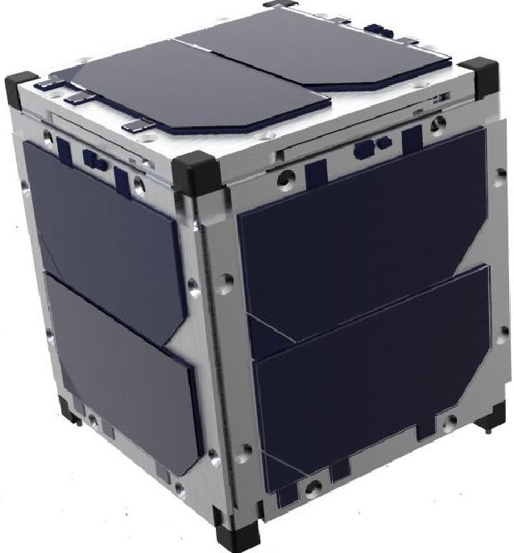

Figure 1-1 SPiN-1 [4]

## 1.3.2 Modular ADCS

The Modular ADCS project is a collaborative effort between SPiN and TUM aimed at developing an integrated and modular attitude determination and control subsystem for the SmallSat market [5].

The project's core objective is to create a modular ADCS by combining SPiN's MA61C smallsat hardware platform and TUM's ADCS software. The subsystem consists of the versatile MA61C, featuring seven different interfaces with plug-and-play capabilities, and a universal ADCS software provided by TUM.

To ensure the project's modularity, three distinct mission scenarios have been designed: Earth Observation, Telecommunication, and Space Tug missions. These scenarios encompass a wide range of SmallSat projects.

Each scenario involves the selection of specific sensors and actuators that meet the minimum requirements of the end users while keeping the complete functionalities of each mission.

<!-- PDF_PAGE: 13 -->

To evaluate the system's functionalities, two testing techniques are employed: Hardware in the Loop (HIL) and Software in the Loop (SIL).

Hardware in the Loop (HIL) testing involves connecting real hardware components to simulated software, while Software in the Loop (SIL) testing simulates the hardware while assessing the performance of real software components.

## 1.3.3 Modular Avionics Test Bench

SPiN and ESA have initiated a project named Modular Avionics Test Bench, aiming to enhance the compatibility of existing CubeSat and SmallSat subsystems in the European market with the MA61C adapter.

The primary objective of the project is to achieve 80% compatibility of MA61C with European suppliers, encompassing nine interface standards.

The project kicked off in January 2023 and is scheduled to conclude in September 2023.

The ultimate deliverable will be a Command, Control & Data Handling System (CDHS) electronic platform along with a supporting library software. These components will undergo testing and validation up to Technology Readiness Level (TRL) 6, ensuring full qualification for off-the-shelf CubeSat subsystems.

The Modular Avionics Bench builds upon the utilization of the MA61C CubeSat board, as in SPiN-1.

## 1.4 Structure of the thesis

This section describes the topics covered in the chapters of the thesis, summarizing the work done in the 6 months internship at Space Products and Innovation.

The first chapter is an introductory chapter on CubeSats, the concept of modularity and some SPiN projects in which these aspects are recognized. Specifically, the advantages and disadvantages of the CubeSat design compared to traditional satellites are discussed, and how modularity is becoming a central aspect in this type of design is highlighted.

The second chapter summarizes the steps of the mission design, namely the definition of the mission, the definition of the subsystems and the Assembly, Integration and Verification phase. The various system budgets are described briefly in this chapter. Furthermore, some projects studied during the first months of internship are listed here, used to understand and deepen different techniques in mission design.

The third chapter of the thesis is the longest of this document, describing the implementation part of the Matlab code. It is divided into 5 sections: an overview of the code, the theory of error propagation, budget calculations, the implementation in Matlab, and verification and testing. The overview section involves the description of the code and its main functions. The second section is an introduction to error propagation theory and discusses the use of this theory in implementing margins calculations. The third section details all the calculations performed in each system budget (mass, volume, power, data, momentum and pointing, thermal). The fourth section describes the implementation of the calculations in Matlab and in particular how it interfaces with the user. The last part briefly explains the testing phase of the code, the identification of bugs and errors, and an application in a real world scenario of mass and power budget.

<!-- PDF_PAGE: 14 -->

In the conclusion, the objectives of the thesis and the results achieved are summarized. In the future work part, aspects of the code that need modifications or improvements, or that need to be integrated with other software, are highlighted.

<!-- PDF_PAGE: 15 -->

## 2 Mission design

## 2.1 Overview of the mission design process

Space mission design is an iterative process that involves the interaction of several technical and engineering disciplines, including aerospace engineering, systems engineering, electrical and electronic engineering, structural engineering, telecommunications, computer and control systems engineering, propulsion, orbital and space mechanics. Additionally, knowledge in the fields of costs, risk management, and mission planning is essential.

In general, the space mission design process can be divided into three macro-phases: mission definition, system (and subsystem) definition, and assembly, integration and testing (AIT). The transition from one phase to another occurs through the verification of mission requirements in the solution(s) found. Similarly, the final phase of AIT can only take place when the system requirements have been verified.

## 2.2 Mission definition

The first step in defining a space mission is to establish its objectives and understanding the associated constraints. The objective of a space mission can vary, ranging from technology demonstration missions, scientific studies and observations, telecommunications missions, to space exploration, among others. Identifying constraints in this initial phase primarily involves understanding the mission's costs, both financially and in terms of time, and evaluating the feasibility of pursuing the objective.

The second step involves identifying the stakeholders who have a vested interest in the mission. These stakeholders play a crucial role in influencing the mission's success and may also be impacted by it. Alongside stakeholder identification, the mission timeline is defined.

Next, a preliminary assessment of the mission's needs (requirements and constraints) is conducted. This includes determining the necessary elements for mission success, specifying the desired mission objectives, and considering any limitations that may affect the requirements or execution of the mission itself. In the case of CubeSat missions, constraints typically revolve around the total mass and volume that can be accommodated by the launcher. Other constraints are related to the space environment, where the spacecraft must endure the typical loads and radiation exposure of space. Additionally, financial and legislative constraints are taken into account.

Following this initial study, various mission architectures are defined. Typically, there is no single solution for implementing the mission, resulting in multiple mission architectures. These architectures encompass the components of the mission, including the space segment (such as a single satellite or a constellation), the ground segment (comprising ground stations used for operations), and the launcher.

Once the mission architectures are established, the mission concept is developed. This involves examining how the different components collaborate and function together. It is during this phase that the mission drivers are identified, i.e., the key aspects to be considered during the

<!-- PDF_PAGE: 16 -->

design and development process. Concurrently, the critical requirements, which are indispensable for mission success, are also determined.

Once the mission drivers are established, trade studies are conducted on the previously studied architectures and mission concepts to identify the ones that best meet the critical requirements. It is also essential to assess the mission's utility and figures of merit, gauging whether the mission is truly beneficial and meaningful.

Finally, the basic mission concept (baseline) is defined for further development in subsequent phases. The requirements are reviewed and definitively established. Alternative solutions are also formulated, serving as backup plans if the initial mission concept is not feasible or encounters issues.

## 2.3 System definition

The next step involves defining the system, specifically the CubeSat subsystems responsible for carrying out the required functions outlined in the requirements. To define these subsystems and their components, a functional study is conducted. Each mission objective is broken down into the functions that comprise it, and further divided into sub-functions. This process, also known as functional tree, entails the breakdown of mission functions. Eventually, the basic functions that are directly implemented by a tool are defined, leading to the identification of spacecraft subsystems and their components.

Following that, the requirements for each individual subsystem must be established, and throughout the process, it is crucial to verify compliance with these requirements to ensure the success of the mission.

In general, the spacecraft system can be divided into two main parts: the payload and the service module. The payload refers to the instrument(s) or tool(s) responsible for fulfilling the primary mission objective. It can include observation instruments like cameras, communication systems for telecommunications missions, or specific components on board the spacecraft dedicated to technology demonstration missions. The service module consists of all the subsystems that support the payload and the overall mission. Typically, these service modules encompass the electrical and power system (EPS), the command and data handling system (CD&H) and the on-board computer (OBC), the telecommunication system (TT&C), the attitude and orbit control system (AOCS), propulsion system, thermal control and protection system (TPS), and structure.

The EPS is responsible for supplying power and energy to the various spacecraft components throughout the mission. Its main tasks involve generating, storing, regulating, and distributing electrical power to the payload and system bus. The CD&H and OBC manage data within the spacecraft, including data generation, storage in the memory system, transfer and command management for the various subsystems. Additionally, the OBC runs the on-board software that handles spacecraft commands and is responsible for the on-board time management. The TT&C handles ground and potentially inter-satellite communications. The AOCS determines and controls the spacecraft's orbit and attitude. The propulsion system enables orbital manoeuvres. The TPS is responsible for thermal control inside the spacecraft, protecting against thermal shocks, dissipating heat produced by components, and generating heat when necessary. Finally, the structure serves to hold spacecraft components together, providing structural strength during launch and in orbit.

<!-- PDF_PAGE: 17 -->

## 2.3.1 Budgets definition

The definition of the CubeSat's subsystems involves studying the budgets, which calculate the performance and general characteristics of the system. These budgets are intended to be compared with the mission and subsystems requirements and constraints.

The mass budget calculates the total mass of the system and ensures that it is within the mass constraint imposed by the launcher (in the case of a CubeSat) or decided for the mission.

The delta-V budget calculates the total propellant mass needed for the mission, particularly for orbital manoeuvres in the case of a CubeSat. The delta-V budget and the mass budget must be analysed together.

The volume budget is similar to the mass budget. It calculates the total volume occupied by the components and verifies that it is within the allocated volume for the spacecraft. For a CubeSat, volume calculations can be done in two ways: by determining the total volume occupied by the components or by calculating the total height resulting from the components stacked one above the other. This is due to the standardized form factor of CubeSats components, often composed of stackable printed circuit boards (PCBs).

The power budget considers three aspects: the power consumption of the components, the power generation by the solar panels, and the battery charge/discharge. During eclipse periods, power-consuming components draw energy from the batteries, while in daylight periods, components can be powered by the solar panels, which also recharge the batteries. The power budget ensures that the power produced by the solar panels is sufficient to cover power consumption during daylight and recharge the batteries, while also managing battery discharge during eclipse periods. It also ensures that the lifetime of the batteries is maintained, avoiding high Depth of Discharge (DOD) percentages.

The data budget calculates the volume of data generated by the spacecraft components and estimates the time required for data transmission to Earth. This includes evaluating the link budget to ensure a stable connection between the spacecraft and a Ground Station, as well as verifying the spacecraft's line-of-sight time with the Ground Stations, which must be compatible with the required data download time. In addition, the data budget ensures that the total memory available onboard is enough to store the data generated.

The momentum budget calculates the torques for attitude manoeuvres (such as slew and detumbling manoeuvres), evaluates disturbance torques acting on the spacecraft, and verifies that the on-board actuators can apply the required torques for the manoeuvres. In terms of attitude, the pointing budget also considers pointing errors caused by external or internal noise sources and ensures that the total resulting error is within the maximum pointing error requirement.

The thermal budget involves calculating the heat flows and the temperature distribution inside the spacecraft. The resulting temperatures are compared with the operating temperatures of the various spacecraft components. In addition, the thermal analysis ensures that the spacecraft is able to dissipate excess heat resulting from accumulated heat over time.

The mechanical budget entails a structural analysis of the vibration modes of the structure and verifies that the structural requirements are met, especially during launch.

<!-- PDF_PAGE: 18 -->

## 2.4 Assembly, Integration and Testing

The assembly, integration and testing phase (AIT) is a crucial stage in the spacecraft development process. It involves the assembly and integration of the different subsystems to form a complete spacecraft. Prior to assembling all the components, subsystems tests are typically conducted to verify aspects such as mass and power budgets, as well as interface connections between components. Subsequently, the CubeSat undergoes electrical and functional tests to validate key functions like communication and flight control. Following that, the spacecraft is subjected to environmental tests, including a random vibration test, a thermal vacuum test, and radiation tests. These tests aim to ensure the spacecraft's ability to withstand the rigors of the space environment and the loads experienced during launch, completing the comprehensive testing process.

## 2.5 Mission design approach in different case studies

The sections of this chapter provide insights into the mission design approaches employed in several CubeSat missions. The objective of this research is to comprehend and analyse the techniques and methodologies used to calculate system budgets, their integration within the design process, and the reciprocal influence between them.

The focal point of this study is the SPiN-1 mission, which serves as the reference mission. The objective is to explore and investigate any differences in the design process methods employed in this mission, compared to others in the CubeSat domain.

## 2.5.1 SPiN-1

The first mission studied is SPiN-1, and its design process is depicted in Figure 2-1 as a flow chart. The flow chart highlights two main blocks of activities: mission definition and system design.

It all starts with the mission idea, which involves understanding the purpose and necessity of the mission.

The mission definition encompasses the mission objectives and requirements, including the identification and characterization of mission needs, expected performance, and operational constraints. This phase also involves formulating the mission statement. A stakeholder analysis is then conducted to identify the main parties that have an impact on the mission.

During the stakeholder analysis, suppliers and providers are identified, enabling the design process to proceed with the mission analysis. The mission analysis involves specifying the products and functions of the mission. Subsequently, the concept of operations is established, including the timeline for mission operations. This information is crucial for developing the mission architecture, which includes defining the space segment, ground segment, and launch. Following the mission definition, two checks are performed before proceeding to the system design phase.

The first check involves ensuring that the high-level requirements of the mission are satisfied. If all the requirements described in the mission requirements are met, the design process can move forward with the system definition. If some of the requirements are not met, they need to be revised or changed.

After verifying the high-level requirements, the availability of the resources is checked. This involves ensuring the availability of launch providers, mission operation centres, testing facilities, laboratories, and other resources required for mission development.

<!-- PDF_PAGE: 19 -->

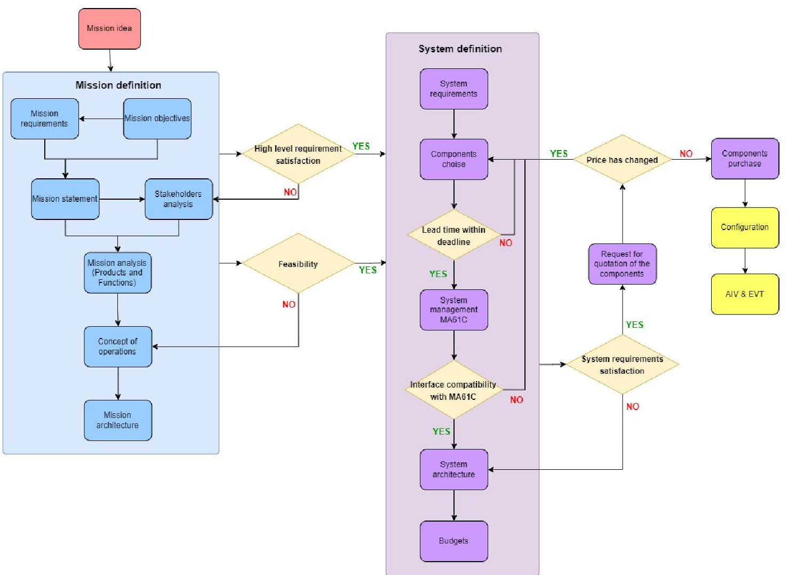

Figure 2-1 SPiN-1 Design process

The system definition phase encompasses the definition of all the systems and subsystems of the mission. First, the system's requirements are defined. Then, a list of components capable of fulfilling the functions expressed in the requirements is established, considering different suppliers. Before selecting specific components, their lead time is checked to ensure it aligns with the schedule constraints for system assembly and integration.

The study of system management via MA61C is conducted, followed by the establishment of the system architecture. The final step in system definition is the estimation of budgets for mass, power, volume, data, momentum, pointing accuracy and thermal operability.

If the interfaces of components chosen during the system definition process are incompatible with the MA61C board, an additional iteration is required to select new components.

Furthermore, there is a check on the satisfaction of requirements. If they are not met, they need to be revised or changed, or the system architecture may need to be revised.

Once all the requirements are met, a request for quotation is made for the selected components. This step is necessary in case there have been price changes since the initial component definition, considering the time that may have passed. If the price is still acceptable, the components can be purchased to proceed with system configuration. This involves conducting a CAD simulation and subsequently assembling the system in reality.

## 2.5.2 SwissCube

SwissCube is a 1U CubeSat developed by the Swiss Federal Institute of Technology with a primary focus on education and training for students both at the institute and other universities. The project involved active student participation and collaboration in all phases, ranging from design and development, to satellite operations in orbit [6].

<!-- PDF_PAGE: 20 -->

Technologically, the mission aimed to observe the "night glow" light phenomenon occurring approximately 100 km above the surface of the Earth. This observation was carried out using a small telescope, with all subsystems and components being commercially available off-the-shelf products.

Launched in 2009, the mission was initially planned to last six months. However, the CubeSat exceeded expectations and remained operational for over 10 years.

This mission not only promoted space education but also contributed to the validation of miniaturized components for space applications.

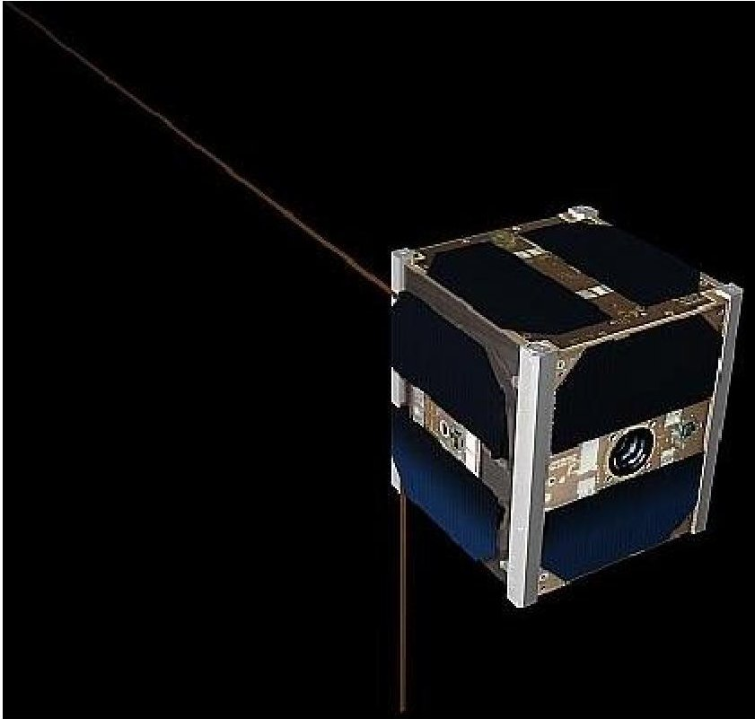

Figure 2-2 SwissCube

A key aspect of SwissCube's design, which has contributed to its prolonged operation, is the incorporation of functional redundancy. This design philosophy involves implementing redundancy in critical satellite systems and structures while utilizing non-redundant design for non-critical parts, all while adhering to scientific and mission requirements. This approach helps reduce mass and design complexity in non-critical systems. By carefully defining critical and non-critical systems based on mission requirements, informed choices are made regarding system design and architecture.

<!-- PDF_PAGE: 21 -->

## 2.5.3 OpenOrbiter

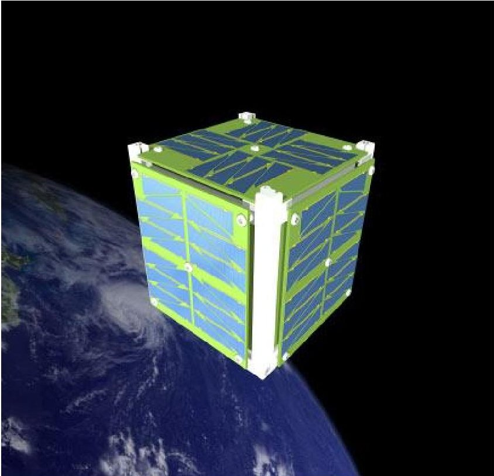

Figure 2-3 OpenOrbiter

OpenOrbiter is a CubeSat project initiated by students from the University of North Dakota in 2013 [7]. According to [8] the launch was programmed for March 2018, but it never took place, and it seems that the project was cancelled.

The primary objectives of the OpenOrbiter mission were educational, aiming to showcase the institute's technological capabilities in satellite launch. Additionally, the project aimed to implement the OPEN method in the design of their 1U CubeSat.

The satellite's payload was intended to include remote sensing payloads for the visible electromagnetic spectrum.

The OPEN design incorporates an innovative internal structure that separates processing for payload and operations, while also providing tools to identify integration mistakes more easily. To facilitate the production of affordable CubeSat-class satellites, OPEN is developing a comprehensive set of design documents, construction guidelines, and test plans. This cost-effective form factor allows universities to finance spacecraft development efforts through teaching budgets, eliminating the need to seek external research funding.

Figure 2-4 and Figure 2-5 illustrate the optimized utilisation of space within the 1U structure. The design maximizes available space, utilizing the areas adjacent to the structure rails and creating overhang space to expand the volume available for subsystems. The placement of subsystems circuit boards on all four sides of the spacecraft enables central positioning of payload/mission-specific components.

This arrangement facilitates the placement of fuel tanks at the spacecraft's centre of gravity and optimizes the utilization of the overhang space specified for CubeSats.

<!-- PDF_PAGE: 22 -->

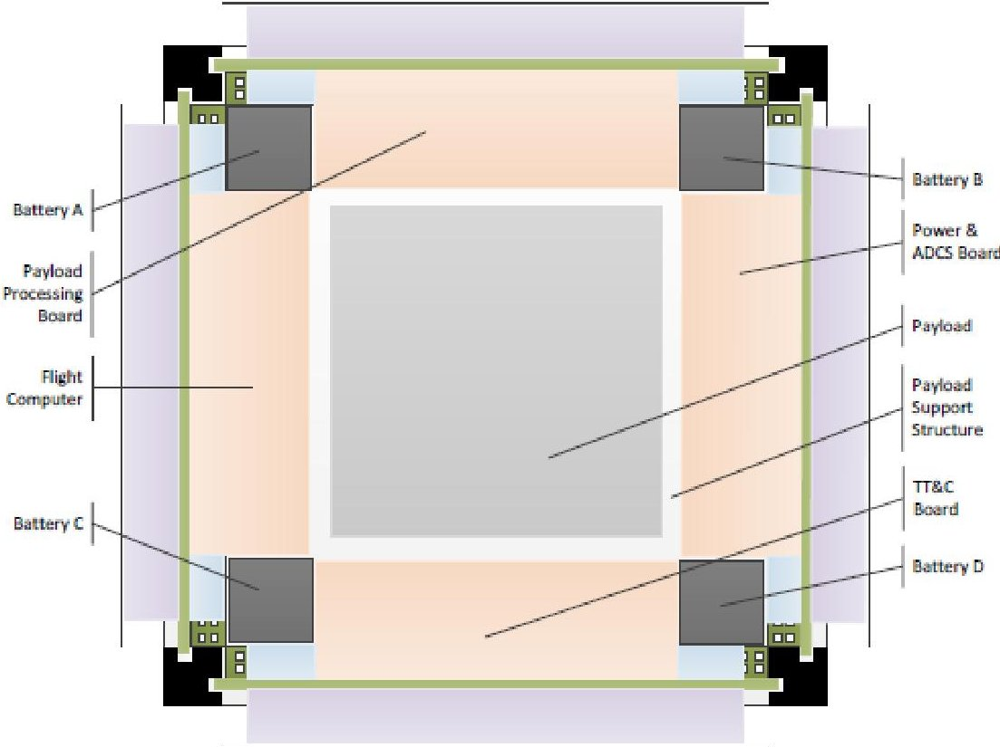

Figure 2-4 OpenOrbiter computer board configuration [7]

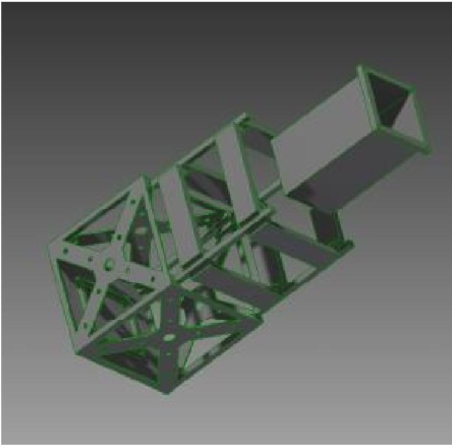

Figure 2-5 OpenOrbiter configuration [7]

## 2.5.4 Omotenashi and Equuleus

In 2016, JAXA was selected to secure two payload spots on NASA's maiden flight Exploration Mission 1 (EM1), now known as Artemis-1, which was conducted using the SLS launch vehicle. The University of Tokyo, in collaboration with JAXA, developed two spacecrafts for this mission: OMOTENASHI (Outstanding MOon exploration TEchnologies demonstrated by NAno Semi-Hard Impactor), the world's smallest lunar lander, and EQUULEUS (Equilibrium Lunar-Earth point 6U Spacecraft), an Earth Liberation-point orbiter [11].

OMOTENASHI's primary objective is to demonstrate the technology of a hard landing on the Moon using a CubeSat. Additionally, it aims to conduct various lunar observations, including

<!-- PDF_PAGE: 23 -->

the study of radiation and soil mechanics. Notably, the unique aspect of this lunar lander is its landing method: it employs a solid rocket motor for insertion into lunar orbit, descent, and moon landing, followed by a free fall impact on the lunar surface.

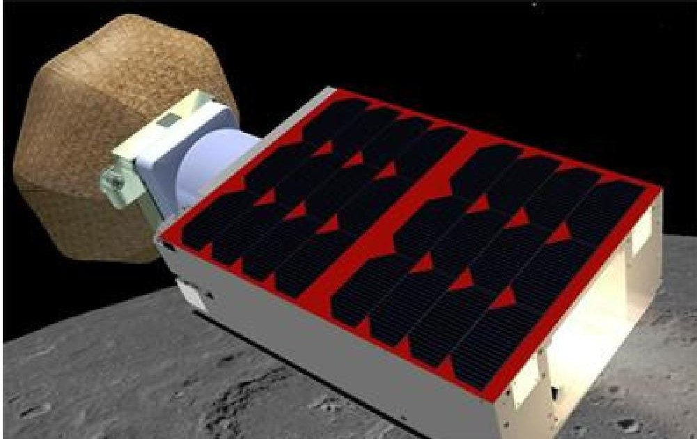

Figure 2-6 Omotenashi [9]

EQUULEUS, on the other hand, focuses on demonstrating trajectory control techniques by leveraging the dynamics of the Sun-Earth-Moon system. Its objective is to reach an Earth-Moon libration orbit, from which it will perform scientific observations using three payloads: an extreme UV imager, a dust detector, and a camera. The camera payload specifically imposes requirements on the CubeSat's orbit.

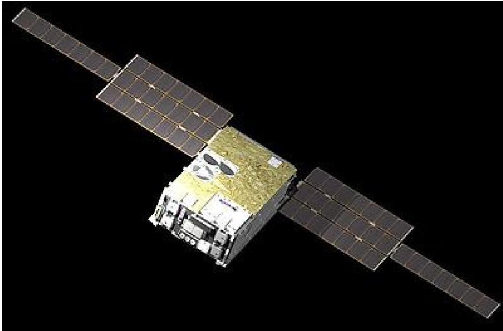

Figure 2-7 Equuleus [10]

For these two missions, particular attention was paid to defining the trajectory and studying the delta V budget.

The OMOTENASHI mission involves simulations of the moon landing manouvre using different models. Various cases of angle of approach are simulated to account for errors in instrument sensitivity. Subsequently, a database of possible trajectories that meet the mission requirements is generated. These trajectories are then evaluated and classified based on the angle of approach and the roughness index of the local topography around the predicted landing

<!-- PDF_PAGE: 24 -->

point. Finally, the trajectory with the highest landing success rate, considering both parameters, is chosen.

The EQUULEUS mission consists of three identified phases for the trajectory: the science phase, forward transfer phase, and backward transfer phase. Since during the initial design the exact launch date is unknown, a comprehensive database of thousands of possible trajectories and orbits is created for each of these phases. For each trajectory, a corresponding delta V budget is calculated, taking into account all mission parameters, including deterministic factors, gravity losses, dispersion for launcher correction, orbit change manoeuvres, and station-keeping manoeuvres. Additionally, margins are included to accommodate any changes or emergency situations.

The trajectory solution for EQUULEUS involves optimization in the three phases, finding the best trajectory for each phase, and subsequently optimizing the combination of the three phases to create the most favourable overall trajectory.

## 2.5.5 Orca $ ^{2} $Sat

Orca $ ^{2} $Sat is a collaborative project involving the University of Victoria, Simon Fraser University, University of British Columbia, Technical University of Lisbon, and Harvard University [13]. Additionally, there was collaboration with Space Systems Loral and the Canadian National Research Council. It is a 2U CubeSat that was launched aboard the Falcon 9 rocket in 2022.

The primary objective of the project is educational, aiming to provide university students with hands-on experience in designing a real satellite mission. The project intends to train students to a professional level through their involvement in all aspects of the mission.

The secondary objective of the Orca $ ^{2} $ Sat mission is to perform an optical calibration of a light source in a Low Earth Orbit (LEO). This calibration will be valuable for researchers and students in calibrating ground-based optical telescopes, enhancing their accuracy and performance.

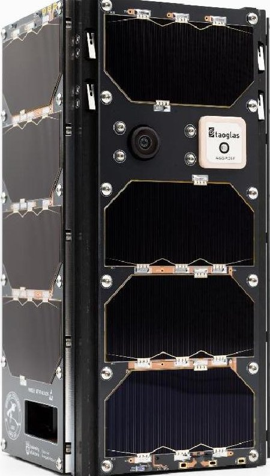

Figure 2-8 Orca2Sat [12]

<!-- PDF_PAGE: 25 -->

In this particular study, a detailed analysis was conducted on the power generation capabilities of the satellite. The satellite is equipped with fixed solar cells mounted on five of its side faces, with the nadir-facing face being the only one without solar cells. Additionally, the satellite does not have specific pointing requirements, except for the need to maintain nadir-pointing by completing a rotation around the Y-axis during each orbit. Given this configuration, it becomes crucial to determine the optimal attitude that maximizes power generation efficiency through the solar cells.

Two different attitude configurations were thoroughly examined to assess their respective performance in terms of power generation. The aim was to identify the configuration that yielded the highest efficiency. To further evaluate the power generation capabilities over the course of a year, a comprehensive power budget was developed, taking into account both power generation and battery discharge. These same two attitude configurations were also considered for studying the satellite's decay towards the end of its operational life.

Ultimately, the attitude configuration that prevented complete battery discharge was selected as the preferred option, ensuring optimal power management throughout the satellite's mission duration.

<!-- PDF_PAGE: 26 -->

## 3 Algorithms development

## 3.1 Overview

The Matlab code calculates the system budgets (mass, volume, power, data, momentum, pointing and thermal) for any CubeSat. It takes variable parameters as input and provides the results with margins.

The code was developed in the Matlab and Simulink environment, and inputs, as well as results, are stored in Excel documents for ease of reading.

The code can be divided into three main parts:

- User parameter input

- Budget calculations

- Result visualization

Figure 3-1 illustrates the structure of the code.

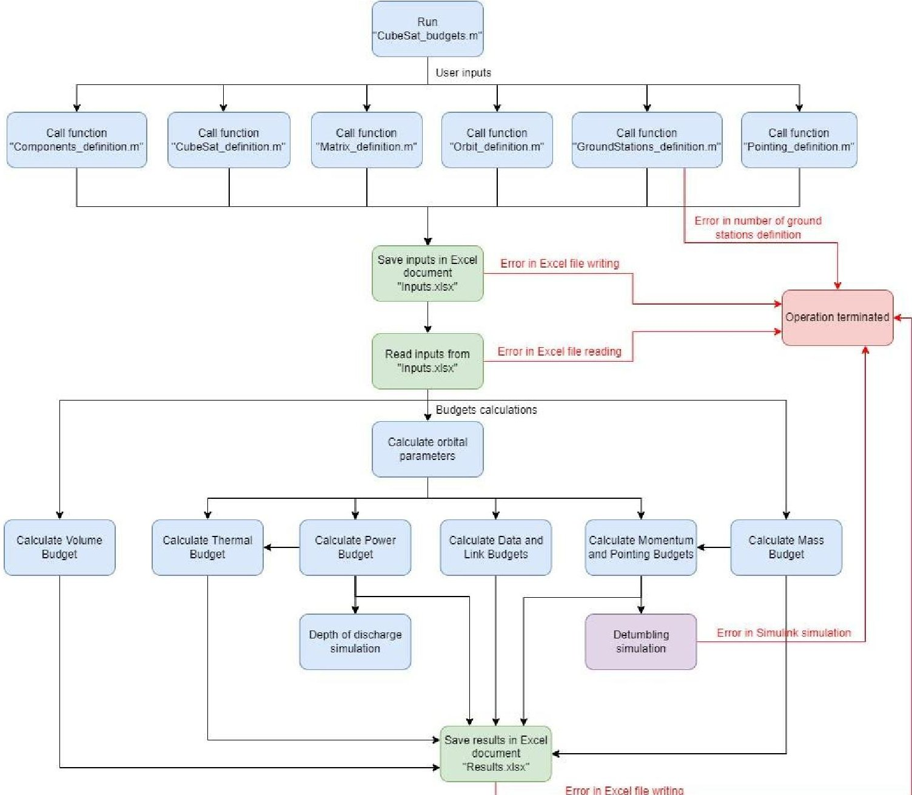

Figure 3-1 Code Structure

<!-- PDF_PAGE: 27 -->

In the first part, the user is prompted to input all the necessary data for budget calculations. The code employs input dialogs, implemented as functions, to facilitate the entry of these parameters, some of which also require margins. Section 3.4 provides a detailed description of these functions. All user-entered data is saved in an Excel document. Additionally, the user has the option to input the data either through Matlab's input dialogs or directly into the Excel document.

The second part of the code performs all the calculations related to the system budgets, as described in Section 3.3.

The final part involves displaying the results in both the Matlab command window and an Excel document. Additionally, the simulation results for detumbling and battery depth of discharge will be displayed.

## 3.2 Error propagation theory

Error propagation analysis is a method used to quantify the propagation of uncertainties in physical measurements or mathematical variables. This is why it is also known as uncertainty propagation, or error analysis.

From a physical perspective, uncertainties arise from the measurement process itself. For example, when measuring the length of an object, the precision of the instrument, such as a meter, determines the accuracy of measurement. Different instruments have varying levels of precision, which can affect the accuracy of the measurements obtained. Additionally, variations in the makings on different instruments introduce further uncertainty. Manufacturers typically provide information about the uncertainty associated with their instruments. This uncertainty applies to the measurements taken using the instrument.

Error analysis is used to understand how uncertainties in input variables affect the uncertainty in output variables in calculations or measurements. Uncertainty is often expressed as a standard deviation $ (\sigma) $ when a statistical analysis is performed, as a percentage (%) of error on the parameter value, or as an error range $ (\Delta) $

To evaluate the propagation of errors from input variables to the output of a mathematical equation, the partial derivatives of the mathematical equations are calculated with respect to each uncertain variable. These derivatives represent the sensitivity to changes of the input variables in the output. They are then multiplied by the uncertainty of the corresponding variable and summed. The resulting error is given by the square root of this sum (Equation (3-1)).

For a generic function $ f=f\left(x_{1},x_{2},x_{3},\dots,x_{n}\right) $ , where each variable $ x_{i} $ of the function is associated with an uncertainty $ \pm \Delta x_{i} $ , expressed as $ x_{i}=x_{i_{nom}}\pm \Delta x_{i} $ , the final error $ \Delta f $ can be calculated using a general formula given by [14]:

$$
\Delta f = \sqrt {\sum_ {i = 1} ^ {n} \left(\frac {\partial f}{\partial x _ {i}} \Delta x _ {i}\right) ^ {2}}
$$

This equation assumes that the variables $ x_{i} $ are independent of each other.

If there are correlated variables, a covariance term needs to be considered, resulting in the expression:

<!-- PDF_PAGE: 28 -->

$$
\Delta f = \sqrt {\sum_ {i = 1} ^ {n} \sum_ {j = 1} ^ {n} \left(\frac {\partial f}{\partial x _ {i}} \frac {\partial f}{\partial x _ {j}} C _ {i , j}\right)}
$$

Where the term $ C_{i,j} $ represents the covariance between the variables i and j.

## 3.2.1 Margins

From an engineering point of view, we can apply the theory of error propagation to variables that have not yet been determined with absolute certainty. For example, during the initial stages of a satellite's design, the specific components to be used are unknown. Therefore, parameters related to these components, such as mass, dimensions, power consumption, and more, are initially defined as tentative values or variable values, hence characterized by uncertainty.

To address this uncertainty, it can be expressed as a margin. Traditionally, the design process involves a trial and error approach, where initial values are assigned to unknown parameters and subsequently modified in iterative steps as needed. However, in this study, we want to streamline the systems design by trying to reduce the number of iterations required for the definition of the systems. This is achieved by incorporating margins into the calculations, thus studying the mission from the beginning with a variable set of parameters.

Incorporating margins into the calculations provides the user with the flexibility to consider a range of values that align with system and mission requirements. The results of the budgets will be provided as a range of values, among which there may be some that meet the requirements and others that do not. The user can choose to work with the range of values that meets the requirements, and thus choose components that fall within these parameters, without the need for iterative calculations with several trial components. This approach simplifies the process, saving both time and resources.

## 3.3 Budgets calculations

## 3.3.1 Mass budget

The mass budget for a CubeSat is determined based on the individual masses of its components. If the CubeSat is equipped with a propulsion system, the mass of the required propellant must also be taken into account.

The total mass of the CubeSat is primarily constrained by the launcher's requirements, meaning it cannot exceed the maximum mass capacity of the launch vehicle.

To ensure compliance with this requirement, margins are incorporated during the early design stages. These margins are applied to each component based on factors such as their Technology Readiness Level (TRL) or previous experience with similar components. Systems engineers and component suppliers are responsible for defining these margins.

The total mass $ ( m_{tot} ) $ of the system can be calculated using the following equation:

$$
m _ {t o t} = \sum_ {i = 1} ^ {n} m _ {i}
$$

<!-- PDF_PAGE: 29 -->

Here, i represents the i-th mass of each component within the CubeSat.

## Margins

As discussed in Section 3.2, the calculation of margins utilizes the principles of error propagation theory, which involves applying Equation ( 3-1 ) to the equations employed in the budget calculation. Specifically, the equations account for variable parameters that include margins.

In the case of the mass budget, the variable parameter affected by a margin is the individual component mass of the CubeSat, represented as:

$$
m _ {i} = m _ {n o m _ {i}} \pm \Delta m _ {i}
$$

Here, $ m_{nom_{i}} $ denotes the nominal mass of the i-th component, while $ \Delta m_{i} $ represents the margin associated with it. By applying Equation ( 3-1 ) to Equation ( 3-3 ), the margin of the total system mass can be determined:

$$
\Delta m _ {t o t} = \sqrt {\sum_ {i = 1} ^ {n} \Delta m _ {i} ^ {2}}
$$

This expression quantifies the overall margin considering the contributions from each individual component.

## 3.3.2 Volume budget

The volume budget of a CubeSat involves evaluating the space occupied by its components in relation to the available volume provided by the chosen deployer for launch. Therefore, the total volume occupied by the CubeSat's elements must not exceed the internal volume of the deployer.

Margins related to the dimensions of individual components are considered, typically based on the TRL of the components. These margins are determined by the systems engineer and/or by the component's supplier.

## Deployer

The primary constraint in the volume budget is the internal volume of the deployer, which represents the maximum size of the spacecraft.

CubeSats are composed of repeating units measuring 100x100x113.5 mm. In Table 3-1 the standard dimensions allowable for CubeSats of different sizes are given [18]. However, it is important to note that each deployer has its own specific maximum internal dimensions, rendering the dimensions in the table not universally applicable.

Table 3-1 CubeSat standard dimensions

<table border="1"><tr><td>Number of units</td><td>Dimensions [mm]</td></tr><tr><td>1U</td><td>100x100x113.5</td></tr><tr><td>2U</td><td>100x100x227</td></tr><tr><td>3U</td><td>100x100x340.5</td></tr><tr><td>6U</td><td>200x100x340.5</td></tr><tr><td>12U</td><td>200x200x340.5</td></tr></table>

<!-- PDF_PAGE: 30 -->

<table border="1"><tr><td>16U</td><td>400x200x227</td></tr></table>

## Printed Circuit Boards

Printed Circuit Boards (PCBs) play a significant role in the volume calculations. The volume of a PCB can be calculated using the formula:

$$
V _ {P C B} = l _ {P C B} \cdot w _ {P C B} \cdot h _ {P C B}
$$

Here, $ l_{PCB} $ represents the length (90.17 mm), $ w_{PCB} $ represents the width (95.89 mm), and $ h_{PCB} $ represents the height of the PCB. These values are an average of the standard dimensions for 1U CubeSat PCBs available on the market [18]. All sizes are considered with millimetre accuracy.

When multiple PCBs are stacked, empty spaces are created between them due to the varying heights of the components on the boards. These empty spaces can be utilized for the allocation of connection cables. To estimate this empty space, the height difference $ \left( \delta h_{PCB}\right) $ between the tallest and second-tallest component on the board is multiplied by the base area of the board:

$$
V _ {f r e e _ {P C B}} = l _ {P C B} \cdot w _ {P C B} \cdot \delta h _ {P C B}
$$

The effective volume of the PCB, accounting for the empty space, can be calculated as:

$$
V _ {e f f _ {P C B}} = V _ {P C B} - V _ {f r e e _ {P C B}}
$$

The total height of the stacked PCBs is given by:

$$
h _ {t o t _ {P C B}} = \sum_ {i = 1} ^ {n} h _ {P C B _ {i}}
$$

Similarly, the total volume occupied by the PCBs, the total free volume between them, and the total effective volume can be calculated as follows:

$$
V _ {t o t _ {P C B}} = \sum_ {i = 1} ^ {n} V _ {P C B _ {i}}
$$

$$
V _ {t o t _ {f r e e}} = \sum_ {i = 1} ^ {n} V _ {f r e e _ {P C B _ {i}}}
$$

$$
V _ {t o t _ {e f f}} = \sum_ {i = 1} ^ {n} V _ {e f f _ {P C B _ {i}}}
$$

## Other components

For other components of the CubeSat, their volume can be calculated using the formula:

$$
V _ {c o m} = l \cdot w \cdot h
$$

Where l is the length, w the width, and h the height of the component.

The total volume occupied by these components is given by:

<!-- PDF_PAGE: 31 -->

$$
V _ {t o t _ {c o m}} = \sum_ {j = 1} ^ {n} V _ {c o m _ {j}}
$$

## Total volume

The total volume occupied by PCBs and other components can be calculated as follows:

$$
V _ {t o t} = V _ {t o t _ {P C B}} + V _ {t o t _ {c o m}}
$$

At this stage, it is important to determine if the total volume can fit within the volume of the deployer $ ( V_{dep} ) $ :

$$
V _ {e x t r a} = V _ {d e p} - V _ {t o t}
$$

If the value of $ V_{extra} $ is positive, it indicates that a component configuration that satisfies the requirements and can fit within the deployer's volume exists. However, if the value is negative, it signifies that not all components can be accommodated within the deployer, necessitating modifications.

## Margins

In the case of the volume budget, the variable parameters considered are the dimensions of the CubeSat components. These dimensions include length $ ( l_{i} ) $ , width $ ( w_{i} ) $ , and height $ ( h_{i} ) $ , each expressed with a nominal value and a corresponding margin:

$$
l _ {i} = l _ {n o m _ {i}} \pm \Delta l _ {i}
$$

$$
w _ {i} = w _ {n o m _ {i}} \pm \Delta w _ {i}
$$

$$
h _ {i} = h _ {n o m _ {i}} \pm \Delta h _ {i}
$$

To determine the margins associated with the volume equations, Equation ( 3-1 ) is once again applied. Therefore, the margin for the component volume ( 3-13 ) (or PCB volume ( 3-6 ), as the equations are the same) is calculated as:

$$
\Delta V _ {c o m _ {i}} = \sqrt {\left(h _ {i} \cdot w _ {i} \cdot \Delta l _ {i}\right) ^ {2} + \left(h _ {i} \cdot l _ {i} \cdot \Delta w _ {i}\right) ^ {2} + \left(l _ {i} \cdot w _ {i} \cdot \Delta h _ {i}\right) ^ {2}}
$$

$$
\Delta V _ {P C B _ {i}} = \sqrt {\left(h _ {P C B} \cdot w _ {P C B} \cdot \Delta l _ {P C B}\right) ^ {2} + \left(h _ {P C B} \cdot l _ {P C B} \cdot \Delta w _ {P C B}\right) ^ {2} + \left(l _ {P C B} \cdot w _ {P C B} \cdot \Delta h _ {P C B}\right) ^ {2}}
$$

The total volume margin for the PCBs ( 3-10 ) is then calculated using the margin of the PCBs individual volume:

$$
\Delta V _ {t o t _ {P C B}} = \sqrt {\sum_ {i = 1} ^ {n} \Delta V _ {P C B _ {i}} ^ {2}}
$$

Similarly, the total volume margin for the other components ( 3-14 ) is computed as:

<!-- PDF_PAGE: 32 -->

$$
\Delta V _ {t o t _ {c o m}} = \sqrt {\sum_ {j = 1} ^ {n} \Delta V _ {c o m _ {j}} ^ {2}}
$$

The total volume margin of the CubeSat (3-15) is then determined by combining the PCB volume margin and the component volume margin:

$$
\Delta V _ {t o t} = \sqrt {\Delta V _ {t o t _ {P C B}} ^ {2} + \Delta V _ {t o t _ {c o m}} ^ {2}}
$$

Finally, the margin for the total height of the PCBs ( 3-9 ) is calculated as:

$$
\Delta h _ {t o t _ {P C B}} = \sqrt {\sum_ {i = 1} ^ {n} \Delta h _ {P C B _ {i}} ^ {2}}
$$

## 3.3.3 Power budget

The power budget involves calculating the total power consumed by the components during one or more orbital cycles, the power produced by the solar panels, and the charge/discharge level of the battery pack. Its main purpose is to verify that the power generated by the solar panels during the period of exposure to the Sun is sufficient to cover the power consumption of the components and the recharging of the batteries. Similarly, it must ensure that the energy stored in the batteries is enough to cover the component consumption during the eclipse period, with an appropriate depth of discharge. The margins considered are related to the power consumption of the components, and to the dimensions of the solar panels. Additionally, two other parameters are considered: the altitude of the orbit and the angle of incidence of the solar rays on the panels.

## Orbital parameters

For this study, Low Earth Orbits (LEO) are considered, with the altitude $ ( h_{sc} ) $ varying from 400 to 600 km, with an increase of 10 km for each subsequent orbit. The orbits are assumed to be circular. All calculations regarding orbital parameters are obtained from [15] and [16]. The orbital period can be calculated using the altitude as follows:

$$
T = 2 \pi \sqrt {\frac {a ^ {3}}{\mu}}
$$

Where a represents the semimajor axis of the orbit, given by a=R+hsc, with R=6378 km being the Earth's equatorial radius; and $ \mu=3 9 8 6 0 0 \, \mathrm{k m} 3 / \mathrm{s} 2 $ Earth's gravitational constant. The period of eclipse (TE) and exposure to the Sun (TS) are expressed as:

$$
T E = 2 \frac {\rho}{2 \pi} T
$$

$$
T S = T - T E
$$

<!-- PDF_PAGE: 33 -->

$$
\rho = \arcsin \left(\frac {R}{a}\right)
$$

With these values, it is possible to define the number of orbital cycles (C) completed by the CubeSat during its mission lifetime (ML):

$$
C = \frac {M L}{T}
$$

## Power consumption

The power consumed by the spacecraft is given by the sum of the powers required by each device in the system. It can be calculated based on the periods of eclipse and exposure to the Sun or based on the operating modes of the Electrical Power System (EPS). In the first case, the power of each device is multiplied by its duty cycle in the eclipse and daylight periods, respectively. The total power consumed in the eclipse and daylight is obtained by summing the different values obtained in the two periods ([15], [16]).

$$
P _ {e} = \sum_ {i = 1} ^ {n} P _ {i} \cdot d c _ {i, T E}
$$

$$
P _ {d} = \sum_ {i = 1} ^ {n} P _ {i} \cdot d c _ {i, T S}
$$

Where $ P_{i} $ is the power required by the i-th component, $ d c_{i, T E} $ and $ d c_{i, T S} $ are the i-th component's duty cycles respectively in the eclipse period and in the daylight period.

In this study, the second approach is followed, which involves considering the operating modes of the EPS. The EPS operating modes are defined, taking into account a complete orbital cycle or an integer number of cycles that includes the execution of all the modes. Each mode can operate in daylight, eclipse, or both. The power consumed by the components can be idle, average or peak state, representing the minimum power consumption (when the component is not used), the average power and the peak power, respectively. For each mode, it is necessary to define the power consumed by each individual component specific to that mode. Additionally, the duty cycle of the mode must be defined for the period in which it operates. If it operates during the eclipse, it will have a duty cycle over the eclipse period. If it operates during daylight, it will have a duty cycle specific to the daylight period. If it operates during both, it will have a duty cycle over the complete orbital cycle. The power consumed in each mode is calculated by summing the powers consumed by the components and multiplying them by the duty cycle of the mode.

Furthermore, the powers consumed in the eclipse period $ ( P_{e} ) $ and in the daylight period $ ( P_{d} ) $ can be defined as the sums of the powers of the active modes during those periods. This approach allows the calculation of power consumption to align with satellite operation, providing the flexibility to add or remove modes during the design phase. The equations for power consumption are as follows:

$$
P _ {e} = \sum_ {j = 1} ^ {m} P _ {j, T E} \cdot d c _ {j, T E}
$$

<!-- PDF_PAGE: 34 -->

$$
P _ {j, T E} = \sum_ {i = 1} ^ {n} P _ {i, T E}
$$

$$
P _ {d} = \sum_ {j = 1} ^ {m} P _ {j, T S} \cdot d c _ {j, T S}
$$

$$
P _ {j, T S} = \sum_ {i = 1} ^ {n} P _ {i, T S}
$$

Where $ P_{j} $ represents the total power of the j-th mode.

## Solar panels and generated power

The power generated by solar panels depends on various factors, including the distance from the Sun (which affects the solar energy received), the efficiency of the solar cells $ (\eta) $ , the total area of the panel (A), and the angle of incidence of the sun's rays on the panels $ (\theta) $ . In addition, solar panels in orbit experience degradation over time, with a certain annual degradation rate $ (\eta_{degr}) $ , resulting in a decrease in power output at the end of their life compared to the beginning. For LEO orbits, a value of the solar energy constant $ (P_{in}) $ approximately equal to $ 1 3 5 8 \, W / m^{2} $ is considered.

The power output at the beginning of a solar panel's life is given by [19]:

$$
P _ {o u t} = P _ {i n} \cdot \eta
$$

The power generated at the beginning of life (BOL) can be calculated as:

$$
P _ {g e n, B O L} = P _ {o u t} \cdot A \cdot \cos (\theta)
$$

Taking into account the degradation of the panels over time, the end-of-life (EOL) cell efficiency can be expressed as:

$$
\eta_ {E O L} = \eta \left(1 - \eta_ {d e g r}\right) ^ {M L}
$$

Finally, the power generated at EOL is given by:

$$
P _ {g e n, E O L} = \eta_ {E O L} \cdot P _ {g e n, B O L}
$$

So far, the power considered, is the power generated by a single solar panel. In the case of a CubeSat, multiple panels are typically used, mounted in different configurations. The most common configurations are body mounted solar panels, which are attached to the faces of the CubeSat, and deployable panels, which are initially folded inside the deployer and later unfolded once the satellite is released into orbit.

## Body mounted solar arrays

First, the number of solar panels （ $ n_{body} $ ）on each face of the CubeSat needs to be defined. When a face of the Cubesat is directly facing the Sun, with an angle of incidence of zero, the power produced is [20]:

<!-- PDF_PAGE: 35 -->

$$
P _ {g e n, t o t (f r o n t)} = P _ {o u t} \cdot A \cdot \cos \left(0 ^ {\circ}\right) \cdot n _ {b o d y (f r o n t)}
$$

(For simplicity, the subscripts BOL and EOL are omitted in this and the following equations). As the angle of incidence changes, the power generated, determined by the cosine of the angle, also varies. When the satellite rotates with respect to the Sun's direction, the power generated by the panels mounted on the other faces must also be considered:

$$
P _ {g e n, t o t (s i d e)} = P _ {o u t} \cdot A \cdot \sin (\theta) \cdot n _ {b o d y (s i d e)}
$$

The total power produced at a certain angle of inclination is given by:

$$
P _ {g e n, t o t} (\theta) = P _ {g e n, t o t (f r o n t)} (\theta) + P _ {g e n, t o t (s i d e)} (\theta)
$$

## Deployable solar arrays

Similarly, the total number of solar panels $ ( n_{dep} ) $ must be defined. The total power generated in sun tracking can be calculated as [20]:

$$
P _ {g e n, t o t} (\theta) = P _ {o u t} \cdot A \cdot \cos (\theta) \cdot n _ {d e p}
$$

The deployable arrays remain fixed with respect to the CubeSat, so they rotate accordingly as the body rotates.

## Body mounted + Deployable solar arrays

Some CubeSats may incorporate both body mounted and deployable solar arrays to increase the available surface area for power generation.

In this case, the total power generated is the sum of the values calculated above for the two configurations:

$$
P _ {g e n, t o t} (\theta) = P _ {g e n, t o t (f r o n t)} (\theta) + P _ {g e n, t o t (s i d e)} (\theta) + P _ {o u t} \cdot A \cdot \cos (\theta) \cdot n _ {d e p}
$$

## Batteries discharge and charge

The discharged energy of the batteries corresponds to the power consumed during the eclipse period multiplied by the time of use $ ( U T_{e} ) $ . The time of use in eclipse can be calculated as:

$$
U T _ {e} = T E \cdot N o C
$$

It is important to note that calculations on the total power consumed are based on the power consumed in the operating modes, which may not necessarily run within a single orbital cycle. Therefore, it is necessary to calculate the battery usage time as a product of the eclipse period and the number of cycles (NoC) in which all modes are performed. The energy consumed during the eclipse period is given by:

$$
E g _ {d i s c h a r g e} = E g _ {e} = P _ {e} \cdot U T _ {e}
$$

<!-- PDF_PAGE: 36 -->

Similarly, the energy consumed during the daylight period, i.e., the energy supplied by the solar panels to the subsystems, can be calculated. In this case, the time of use of the solar panels during daylight is calculated as well.

$$
U T _ {d} = T S \cdot N o C
$$

$$
E g _ {d} = P _ {d} \cdot U T _ {d}
$$

The solar panels must, therefore, provide a power equal to or greater than the sum of the power consumed by the subsystems and the power required to recharge the batteries after their discharge cycle.

$$
P _ {g e n} \geq P _ {d} + P _ {c h a r g e}
$$

The term $ P_{charge} $ is defined in Equation ( 3-55 ), which is provided in this paragraph. The same equation applies to the energy produced:

$$
E g _ {g e n} \geq E g _ {d} + E g _ {c h a r g e}
$$

For these calculations, the solar panel configuration with the optimal angle of incidence, which allows for maximum power generation, is chosen.

$$
P _ {g e n} = P _ {g e n, t o t} \left(\theta_ {o p t}\right)
$$

From here, it is possible to calculate the energy produced during the time of use in daylight:

$$
E g _ {g e n} = P _ {g e n} \cdot U T _ {d}
$$

Finally, the energy left for battery recharge can be calculated:

$$
E g _ {c h a r g e} = E g _ {g e n} - E g _ {d}
$$

If $ E g_{charge} $ is greater than $ E g_{discharge} $ , it indicates that the energy required to recharge the batteries is equal to the energy consumed during the eclipse. In this case, there will be surplus energy produced by the solar panels that will not be used, but the batteries will be fully recharged after executing all the implemented operating modes during the eclipse. If $ E g_{charge} $ is less than $ E g_{discharge} $ , the batteries will not be fully recharged after executing the eclipse modes. Consequently, if the modes are repeated in the same manner throughout the mission, the batteries will continue to discharge until they run out of energy. The power required for recharging can be calculated as:

$$
P _ {c h a r g e} = \frac {E g _ {c h a r g e}}{T S}
$$

Finally, the charging time can be calculated as [21]:

<!-- PDF_PAGE: 37 -->

$$
t _ {c h a r g e} = \frac {C a p \cdot D O D}{I _ {c h a r g e} \cdot \eta_ {c h a r g e}}
$$

Here, Cap represents the total battery capacity, DOD is the depth of discharge of the batteries, $ I_{charge} $ is the charging current (the outgoing current from the solar arrays), and $ \eta_{charge} $ is the charging efficiency of the batteries.

A consideration needs to be made for DOD, which is linked to the degradation of the batteries. Similar to solar panels, batteries also degrade with use, resulting in a decrease of their total capacity. Therefore, it is important to know the degradation coefficient of the batteries $ \eta_{batt} $ . The calculation of $ \eta_{batt} $ is derived from reference [22]. It is based on the battery manufacturer's specifications, including the total nominal number of cycles (CB) and the nominal capacity at the end of its life $ (Cap_{end}[\%]) $ , expressed as a percentage relative to the initial total capacity.

$$
\eta_ {b a t t} = (C B) ^ {\frac {1}{C a p _ {e n d} [ \% ]}}
$$

$$
C a p _ {E O L} = \eta_ {b a t t} \cdot C a p _ {B O L}
$$

$$
D O D _ {B O L / E O L} = \frac {E g _ {d i s c h a r g e}}{C a p _ {B O L / E O L}}
$$

$$
I _ {c h a r g e} = \frac {P _ {c h a r g e}}{V _ {S A}}
$$

Here, $ V_{SA} $ represents the voltage of the solar arrays.

If $ t_{charge} $ is less than $ UT_{d} $ , it indicates that the time required to recharge the batteries is sufficient.

If $ t_{charge} $ is greater than $ UT_{d} $ , it means that the time spent in sunlight is not enough to recharge the batteries. In this case as well, if the modes are repeated in the same manner throughout the subsequent cycles, the batteries will continue to discharge further until they run out of energy.

## Margins

In the power budget, the parameters considered with margins are the power consumption of the components $ ( P_{i} ) $ , and the dimensions of the solar panels (area A). These parameters are expressed as follows:

$$
P _ {i} = P _ {n o m _ {i}} \pm \Delta P _ {i}
$$

$$
A = A _ {n o m} \pm \Delta A
$$

To determine the margins associated with the power equations, Equation ( 3-1 ) is once again applied.

By calculating the power consumption during each operational mode (Equations ( 3-34 ) for the eclipse period and ( 3-36 ) for the daylight period), the margins can be obtained as:

$$
\Delta P _ {j, T E / T S} = \sqrt {\sum_ {i = 1} ^ {n} P _ {i , T E / T S} ^ {2}}
$$

<!-- PDF_PAGE: 38 -->

Calculating the total power in eclipse ( 3-33 ) or daylight ( 3-35 ), the margin is given by:

$$
\Delta P _ {e / d} = \sqrt {\sum_ {j = 1} ^ {m} \left(\Delta P _ {j , T E / T S} \cdot d c _ {j , T E / T S}\right) ^ {2}}
$$

Regarding the power generated by a single solar panel (Equations ( 3-38 ) for the beginning of life, and ( 3-40 ) for the end of life), the margin is calculated as:

$$
\Delta P _ {g e n _ {i}} = \sqrt {\left(P _ {o u t} \cdot \cos (\theta) \cdot \Delta A\right) ^ {2}}
$$

The margin for the total power generated by solar panels (Equations ( 3-43 ), ( 3-44 ), ( 3-45 )) is determined as:

$$
\Delta P _ {g e n _ {t o t}} = \sqrt {\sum_ {i = 1} ^ {n} \Delta P _ {g e n _ {i}} ^ {2}}
$$

The subsequent equations calculate the margins for the energy in discharging/charging the batteries (Equations from ( 3-47 ) to ( 3-60 )):

$$
\Delta E g _ {d i s c h a r g e} = \Delta E g _ {e} = \sqrt {\left(U T _ {e} \cdot \Delta P _ {e}\right) ^ {2}}
$$

$$
\Delta E g _ {d} = \sqrt {\left(U T _ {d} \cdot \Delta P _ {d}\right) ^ {2}}
$$

$$
\Delta E g _ {g e n} = \sqrt {\left(U T _ {d} \cdot \Delta P _ {g e n _ {t o t}}\right) ^ {2}}
$$

$$
\Delta E g _ {c h a r g e} = \sqrt {\Delta E g _ {g e n} ^ {2} + \Delta E g _ {d} ^ {2}}
$$

$$
P _ {c h a r g e} = \sqrt {\left(\frac {\Delta E g _ {c h a r g e}}{T S}\right) ^ {2}}
$$

$$
\Delta D O D = \sqrt {\left(\frac {\Delta E g _ {d i s c h a r g e}}{C a p}\right) ^ {2}}
$$

$$
\Delta I _ {c h a r g e} = \sqrt {\left(\frac {\Delta P _ {c h a r g e}}{V _ {S A}}\right) ^ {2}}
$$

$$
\Delta t _ {c h a r g e} = \sqrt {\left(\frac {I _ {c h a r g e} \cdot C a p \cdot \eta_ {c h a r g e}}{\left(I _ {c h a r g e} \cdot \eta_ {c h a r g e}\right) ^ {2}} \cdot \Delta D O D\right) ^ {2} + \left(\frac {D O D \cdot C a p \cdot \eta_ {c h a r g e}}{\left(I _ {c h a r g e} \cdot \eta_ {c h a r g e}\right) ^ {2}} \cdot \Delta I _ {c h a r g e}\right) ^ {2}}
$$

<!-- PDF_PAGE: 39 -->

## 3.3.4 Data and Link budget

The data budget involves calculating the total amount of data produced by the various devices and sensors on board the spacecraft, their update rate, and their storage in the memory system. It enables verification of whether the time spent over the ground stations is sufficient for downloading the data collected during the orbit. The precise amount of data transmitted by a component, or its output rate, is not always known and can change during the design process. Therefore, margins are used to define the number of data and the output rate.

## Orbital parameters

To calculate the total amount of data during one orbit, knowledge of the orbital period is required, which can be derived from the orbital parameters. The orbital period is expressed in Equation ( 3-26 ).

## Data generation

Components generating data can be categorized into two groups. Firstly, there are components with a fixed output data rate (DR) that maintain a consistent update rate (frequency, freq). In this case, margins are applied to the data rate. Secondly, there are components with a variable output data rate, where the data update frequency changes based on external conditions. For these components, the number of data generated (NoD), and the generation frequency, along with their margins, are provided. The data rate can be calculated as follows:

$$
D R = f r e q \cdot N o D
$$

By knowing the data rate, the total number of data generated during one orbit (DpO) can be calculated as follows [23]:

$$
D p O = T \cdot \sum_ {i = 1} ^ {n} D R _ {i} = T \cdot D R _ {t o t}
$$

$$
D R _ {t o t} = \sum_ {i = 1} ^ {n} D R _ {i}
$$

Where $ D R_{i} $ represents the output data rate of the i-th component.

## Data storage

As data is generated, it needs to be stored in the spacecraft's memory system (M).

The total available memory serves as a constraint for data storage, or conversely, the data generated during an orbit serves as a constraint for the memory system's size.

If the data generated during one orbit exceeds the system's memory capacity, a larger memory system should be chosen. On the other hand, assuming a fixed available memory, the data generated during one orbit must not surpass the memory limit. Simultaneously, efficient downloading to the ground is necessary to free up memory for subsequent cycles.

Assuming that all data generated during an orbital cycle is downloaded to the ground, the free memory (MA) at the end of the cycle can be calculated as follows:

$$
M A = M - D p O
$$

<!-- PDF_PAGE: 40 -->

## Download time and download data rate

The time available for downloading data to the ground stations is determined by the satellite's visibility period $ ( t_{pass} ) $ , during which the communication system is active. It is essential to ensure that the data collected during the orbit can be successfully transmitted to the ground within this timeframe. If the data transfer is not completed, the mission may need to be replanned to extend the satellite's visibility over the ground station or consider utilizing multiple ground stations for data download.

The visibility period depends on the orbital speed of the spacecraft $ \left(v_{sc}\right) $ and the coverage angle $ \left(\beta\right) $ of the ground station. For LEO circular orbits, the average orbital speed of the CubeSat can be calculated as derived from references [15] and [16]:

$$
v _ {s c} = \sqrt {\frac {\mu}{a}}
$$

The ground velocity is given by:

$$
v _ {g r} = v _ {s c} \cdot \frac {R}{a}
$$

The coverage angle (illustrated in Figure 3-2) of the ground station can be calculated as follows [24]:

$$
\beta = \operatorname {a c o s} \left(\frac {R}{a} \cdot \cos (s)\right) - s
$$

Here, s represents the elevation angle of the ground station.

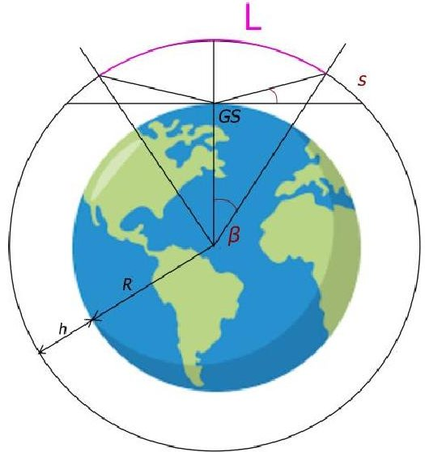

Figure 3-2 Coverage angle ( $ \beta $ ) and elevation angle (s)

The arc length indicated by L in Figure 3-2 represents the space covered by the spacecraft within the coverage area:

$$
L: 2 \pi a = 2 \beta: 2 \pi
$$

Where $ a=R+h_{sc}. $

Rewriting Equation ( 3-82 ):

<!-- PDF_PAGE: 41 -->

$$
L = 2 \beta a
$$

Finally, the satellite's passage time through the coverage area is given by:

$$
t _ {p a s s} = \frac {L}{v _ {g r}}
$$

Considering the presence of N ground stations, the total download time is given by:

$$
t _ {d o w n l o a d} = N \cdot t _ {p a s s}
$$

Additionally, the required download data rate (DDR) can be calculated as follows:

$$
D D R = \frac {D p O}{t _ {d o w n l o a d}}
$$

The download rate of the communication system is fixed based on the system parameters. The calculated download rate represents the minimum rate required to transmit all the data collected during one orbit to Earth. If the requested download rate exceeds the system's capabilities, not all the data will be successfully transmitted to the ground, and the memory will continue to fill up during the subsequent orbits.

## Link margin

To ensure successful data transmission to the ground station, it is important to verify if the link between the spacecraft and the ground station meets the minimum requirement, which is given by the 3 dB margin.

The calculations in this Section and the data used for approximations are taken from the references [15], [16] and [25].

Table 3-2 Constant values Data budget

<table border="1"><tr><td>Variable</td><td>Value</td><td>Reference</td></tr><tr><td>$T_{s}$</td><td>135K</td><td>[25]</td></tr><tr><td>$L_{a}$</td><td>-0.5dB</td><td>[25]</td></tr></table>

The link margin depends on various parameters that consider factors such as the data transmission power and capacity, losses, and noise during the transmission. All parameters should be expressed in decibels.

- Half power beamwidth of transmitting antenna (HPBW): it represents the angle within the effective radiated field of the antenna where the power exceeds 50% of the peak power. It depends on the frequency $ ( f_{t} ) $ and the diameter (D) of the transmitting antenna.

$$
H B P W = \frac {2 1}{f _ {t} \cdot D}
$$

- Antenna pointing loss $ ( L_{pr} ) $ : it represents the signal loss caused by antenna pointing error $ ( err_{a} ) $ . The pointing error is assumed to be one fifth of the HPBW.

<!-- PDF_PAGE: 42 -->

$$
e r r _ {a} = \frac {H B P W}{5}
$$

$$
L _ {p r} = - 1 2 \left(\frac {e r r _ {a}}{H B P W}\right) ^ {2}
$$

- Antenna transmitting power $ \left(P_{t}\right) $

$$
P _ {t} (d B) = 1 0 \log P _ {t} (W)
$$

- Atmospheric losses $ ( L_{a} ) $: these represent the signal losses due to the presence of the Earth's atmosphere. For this calculation, they are assumed to be equal to -0.5 dB.

- Path loss $ ( L_{s} ) $ : it is the signal loss related to the distance between the spacecraft and the ground station (S). It depends on the wavelength $ (\lambda) $ of the signal.

$$
\lambda = \frac {c}{f t}
$$

$$
S = R \cdot \left(\sqrt {\frac {a ^ {2}}{R} - \cos^ {2} (s)} - \sin (s)\right)
$$

$$
L _ {s} = - 2 2 + 2 0 \log \left(\frac {\lambda}{S}\right)
$$

- Total space losses ( $ L_{space} $ )

$$
L _ {s p a c e} = L _ {p r} + L _ {s} + L _ {a}
$$

- Transmitting antenna gain $ ( G_{t} ) $ : it represents the antenna gain in transmission and takes into account the actual antenna gain (G), antenna efficiency $ (\eta_{a}) $ and pointing error $ ( L_{pr} ). $

$$
\eta_ {a} (d B) = 1 0 \log \left(\eta_ {a}\right)
$$

$$
G _ {t} = G + L _ {p r} + \eta_ {a} (d B)
$$

- Effective Isotropic Radiated Power (EIRP)

$$
E I R P = P _ {t} + L _ {s p a c e} + G _ {t}
$$

After defining all the above parameters, the link margin (LM) can be calculated as the difference between the required signal to noise ratio $ ( E b / N_{r e q} ) $ and the actual signal to noise ratio $ ( E b / N_{0} ) $ In this case, a required signal to noise ratio of 5 dB is considered.

$$
\frac {E b}{N _ {0}} = E I R P + L _ {s p a c e} + 1 0 \log G _ {r} + 2 2 8. 6 - 1 0 \log T _ {s} - 1 0 \log D D R
$$

<!-- PDF_PAGE: 43 -->

Where $ G_{r} $ is the receiving antenna gain, and $ T_{s} $ is the system noise temperature. In these calculations, $ T_{s} $ is set to 135 K.

$$
L M = \frac {E b}{N _ {0}} - \frac {E b}{N _ {r e q}}
$$

## Margins

In the data budget, the input parameters considered with a margin are the number of data $ ( No D_{i} ) $ , the update frequency $ ( freq_{i} ) $ , and the output data rate of the components $ ( DR_{i} ) $ . The transmitting power of the CubeSat's antenna $ ( P_{t} ) $ is the only parameter considered with a margin in the link budget. These parameters are expressed as follows:

$$
N o D _ {i} = N o D _ {n o m _ {i}} \pm \Delta N o D _ {i}
$$

$$
f r e q _ {i} = f r e q _ {n o m _ {i}} \pm \Delta f r e q _ {i}
$$

$$
D R _ {i} = D R _ {n o m _ {i}} \pm \Delta D R _ {i}
$$

$$
P _ {t} = P _ {t _ {n o m}} \pm \Delta P _ {t}
$$

If the data rate is not provided as an input (3-75), its margin can be calculated using Equation (3-1):

$$
\Delta D R _ {i} = \sqrt {\left(f r e q \cdot \Delta N o D\right) ^ {2} + \left(N o D \cdot \Delta f r e q\right) ^ {2}}
$$

The margin for the data rate over one orbit (3-77) can be calculated using either Equation (3-102) or (3-104):

$$
\Delta D R _ {t o t} = \sqrt {\sum_ {i = 1} ^ {n} \Delta D R _ {i} ^ {2}}
$$

The margin for the total data generated during one orbit ( 3-76 ) is given by:

$$
\Delta D p O = \sqrt {\left(T \cdot \Delta D R _ {t o t}\right) ^ {2}}
$$

The margin for the download data rate (3-86) can be calculated as:

$$
\Delta D D R = \sqrt {\left(\frac {\Delta D p O}{t _ {d o w n l o a d}}\right) ^ {2}}
$$

For the Effective Isotropic Radiated Power (3-97), the only parameter with a margin is the transmitting power of the antenna, so the margin for EIRP is the same as the transmitting power margin:

$$
\Delta E I R P = \Delta P _ {t}
$$

<!-- PDF_PAGE: 44 -->

The margin for the signal to noise ratio (3-98) can be calculated as:

$$
\Delta \frac {E b}{N _ {0}} = \sqrt {\Delta E I R P ^ {2} + \Delta D D R ^ {2}}
$$

## 3.3.5 Momentum and Pointing budget

The momentum involves calculating all external and internal torques acting on the CubeSat and determining the allocation of torque necessary to counteract unwanted forces. External torques typically arise from disturbance factors such as gravity gradient, magnetic fields, aerodynamic drag, and solar radiation pressure. Internal torques, on the other hand, are generated during slew manoeuvres or allocated in momentum wheels. The spacecraft's actuators must apply counteracting moments to mitigate disturbances and provide the required torque for manoeuvres.

The pointing budget considers the accuracy of sensors and actuators and their pointing errors. It is used to assess whether the combined sensor and actuator accuracy meets the mission requirements and to ensure that the total pointing error remains within the specified tolerance (pointing error requirement).

## Reference frames

## Earth Centered Inertial (ECI)

The Earth Centered Inertial reference frame has its origin at the centre of mass of the Earth. The x-axis points towards the vernal equinox, the z-axis points towards the North Celestial Pole, and the y-axis completes a right-handed triad with the x and z axes. This reference frame is fixed relative to the stars, making it an inertial system.

- Earth-Centered Earth-Fixed (ECEF)

The Earth-Centered Earth-fixed reference frame also has its origin at the centre of mass of the Earth. The x-y plane corresponds to the equatorial plane, and the z-axis points towards the North Celestial Pole. Unlike the ECI frame, this reference frame is not inertial as it rotates with the Earth.

## Body Fixed

The body fixed reference frame has its origin at the centre of mass of the spacecraft. In the case of a CubeSat, the x, y and z axes extend from the centre of the CubeSat towards its sides. This reference frame is particularly useful for describing the spacecraft's attitude. When the CubeSat is in Nadir pointing mode, the body frame aligns the x-axis with the direction of motion, the z-axis points towards the Earth's centre, and the y-axis completes a right-handed triad with the x and z axes.

## Earth's parameters

In spacecraft attitude calculations, several parameters related to Earth's geometry are essential. These parameters, along with their descriptions, are listed in Table 3-3.

Table 3-3 Earth's parameters

<table border="1"><tr><td>Parameter</td><td>Value</td><td>Description</td></tr><tr><td>$\mu$</td><td>398600.4415$\cdot$109m3/s2</td><td>Gravitational constant</td></tr><tr><td>$R_{av}$</td><td>6371000m</td><td>Average radius</td></tr><tr><td>R</td><td>6378137m</td><td>Equatorial radius</td></tr><tr><td>$e_{Earth}$</td><td>0.0818</td><td>Eccentricity</td></tr><tr><td>$\omega_{Earth}$</td><td>7.2921159$\cdot$10-5rad/s</td><td>Rotation rate</td></tr></table>

<!-- PDF_PAGE: 45 -->

## Orbital parameters

The orbital period can be calculated using Equation (3-26), and the circular orbit velocity using Equation (3-79).

The mean motion of the spacecraft $ \left( \Omega_{sc}\right) $ can be obtained from the period of the orbit:

$$
\Omega_ {s c} = \frac {2 \pi}{T}
$$

To calculate the geocentric latitude $ ( L a t_{s c} ) $ and longitude $ ( L o n g_{s c} ) $ of the spacecraft, Keplerian orbital parameters are required, specifically the inclination of the orbit (i), the right ascension of the ascending node $ (\Omega) $ , the argument of periastrum $ (\omega_{p}) $ , and the true anomaly $ (\nu) $ The geocentric latitude is determined as:

$$
L a t _ {s c} = \operatorname {a s i n} \left(\sin (i) \cdot \sin \left(\omega_ {p} + \nu\right)\right)
$$

The calculation of longitude involves considerations that differentiate the calculation into four cases, as summarized in Table 3-4:

Table 3-4 Geocentric longitude

<table border="1"><tr><td colspan="2">If Latsc≥0</td><td colspan="2">If Latsc&lt;0</td></tr><tr><td>If L&gt;0</td><td>If L&lt;0</td><td>If L&gt;0</td><td>If L&lt;0</td></tr><tr><td>Longsc=L+Ω-2π</td><td>Longsc=L+Ω-π</td><td>Longsc=L+Ω-π</td><td>Longsc=L+Ω</td></tr></table>

Where L is defined as:

$$
L = \operatorname {a t a n} \left(\cos (i) \cdot \tan \left(\omega_ {p} + \nu\right)\right)
$$

Finally, the components of the spacecraft's position and velocity in the ECI reference frame can be calculated using the derived orbital parameters.

First, the eccentric anomaly (E) is determined, which, in this study, is equal to the true anomaly since only circular orbits are covered.

$$
E = \nu
$$

Then, the position $ ( r_{orb} ) $ and velocity $ ( v_{orb} ) $ of the spacecraft in the orbital plane are calculated as follows:

$$
r _ {o r b} = \left[ \begin{array}{c} p \cdot \cos (E) \\ p \cdot \sin (E) \\ 0 \end{array} \right]
$$

$$
v _ {o r b} = \left[ \begin{array}{c} - \sqrt {\frac {\mu}{p}} \cdot \sin (E) \\ \sqrt {\frac {\mu}{p}} \cdot (e + \cos (E)) \\ 0 \end{array} \right]
$$

<!-- PDF_PAGE: 46 -->

$$
p = a \left(1 - e ^ {2}\right)
$$

Where e = 0 represents the orbit eccentricity.

To obtain the position $ ( r_{ECI} ) $ and velocity $ ( v_{ECI} ) $ in the ECI frame, these vectors must be multiplied by the appropriate rotation matrices:

$$
R _ {\Omega} = \left[ \begin{array}{c c c} \cos (\Omega) & \sin (\Omega) & 0 \\ - \sin (\Omega) & \cos (\Omega) & 0 \\ 0 & 0 & 1 \end{array} \right]
$$

$$
R _ {i} = \left[ \begin{array}{c c c} 1 & 0 & 0 \\ 0 & \cos (i) & \sin (i) \\ 0 & - \sin (i) & \cos (i) \end{array} \right]
$$

$$
R _ {\nu} = \left[ \begin{array}{c c c} \cos (\nu) & \sin (\nu) & 0 \\ - \sin (\nu) & \cos (\nu) & 0 \\ 0 & 0 & 1 \end{array} \right]
$$

$$
R _ {o r b - E C I} = R _ {v} \cdot R _ {i} \cdot R _ {\Omega}
$$

$$
r _ {E C I} = R _ {o r b - E C I} \cdot r _ {o r b}
$$

$$
v _ {E C I} = R _ {o r b - E C I} \cdot v _ {o r b}
$$

## Mass and geometric properties

The total mass of the spacecraft $ ( m_{sc}=m_{tot} $ , Equation ( 3-3 ) ), and its distribution are determined by the mass budget (Section 3.3.1).

The geometric distribution of mass within the spacecraft is crucial for defining the moments of inertia and, consequently, the inertia matrix (I), as well as determining the position of the Centre of Mass (CoM). It is important to note that the centre of mass may not coincide with the geometric centre of gravity of the spacecraft. In these calculations, it is assumed that these two points do not coincide to consider the worst-case scenarios in torque calculations.

Knowing the position of the centre of mass of each component $ ( CoM_{i} ) $ of the CubeSat with reference to the geometric centre of the CubeSat, the CubeSat's centre of mass $ ( CoM_{sc} ) $ can be calculated as follows:

$$
C o M _ {s c} = \frac {\sum_ {i = 1} ^ {n} C o M _ {i} \cdot m _ {i}}{m _ {s c}}
$$

The inertia matrix is generally represented as follows [26]:

$$
I = \left[ \begin{array}{c c c} I _ {x x} & I _ {x y} & I _ {x z} \\ I _ {y x} & I _ {y y} & I _ {y z} \\ I _ {z x} & I _ {z y} & I _ {z z} \end{array} \right]
$$

Each element of the matrix is nonzero.

However, by adjusting the orientation of the body axes, the values of the matrix components can change. There exists a specific orientation, known as the principal axes of inertia, where the off-diagonal elements are cancelled out:

<!-- PDF_PAGE: 47 -->

$$
I = \left[ \begin{array}{c c c} I _ {x x} & 0 & 0 \\ 0 & I _ {y y} & 0 \\ 0 & 0 & I _ {z z} \end{array} \right]
$$

This orientation of the axes greatly simplifies calculations involving the inertia matrix.

For the calculations that follow, it is assumed that the principal axes of inertia align with the body axes of the spacecraft. This alignment allows to utilize the diagonalized inertia matrix and simplify subsequent calculations.

Knowing the matrix of inertia of each component $ ( I_{i} ) $ of the CubeSat, and the distance between the centre of mass of each component and the CubeSat's centre of mass $ ( d_{i} ) $ , the matrix of inertia of the CubeSat $ ( I_{sc} ) $ can be calculated using the parallel axis theorem:

$$
I _ {s c} = \sum_ {i = 1} ^ {n} \left(I _ {i} + m _ {i} \cdot d _ {i}\right)
$$

## Disturbance torques

In a LEO orbit, disturbance torques primarily arise from the gravitational gradient, aerodynamic drag, Earth's magnetic field, and solar radiation pressure. The calculations for disturbance torques on the spacecraft are sourced from [26] and [27].

Table 3-5 presents the parameters considered constant in the calculations, along with their respective values.

Table 3-5 Constant values for disturbance torques

<table border="1"><tr><td>Variable</td><td>Value</td><td>Description</td><td>Reference</td></tr><tr><td>$\theta_{gg}$</td><td>$\pi/4$</td><td>Angle between local vertical and body z-axis</td><td></td></tr><tr><td>$C_{D}$</td><td>2.2</td><td>Drag coefficient</td><td>[26]</td></tr><tr><td>$\rho$</td><td>$10^{-11}kg/m^{3}$</td><td>Atmospheric density</td><td>[26]</td></tr><tr><td>$K_{r}$</td><td>1</td><td>Spacecraft&#x27;s reflectivity</td><td>[26]</td></tr><tr><td>$P_{in}$</td><td>$1361W/m^{2}$</td><td>Solar constant</td><td></td></tr><tr><td>c</td><td>299792458m/s</td><td>Light speed</td><td></td></tr></table>

## Gravity gradient torque

The gravity gradient torque arises due to variations in gravitational forces acting on different parts of the spacecraft. This torque aligns the spacecraft's minimum inertia axis with the local gravitational gradient, which corresponds to the local vertical frame. The effect is a result of the discrepancy between the gravitational forces acting on the portions of the satellite closest to Earth and those acting on the more distant parts.

Figure 3-3 illustrates the action of gravitational gradient torque on a CubeSat. In this example, the minor axis of inertia coincides with the z-body axis. The angle between this axis and the local vertical (a line connecting the CubeSat's centre of mass with the centre of the Earth) is denoted as $ \theta_{gg} $ . By envisioning the mass of the CubeSat as two equal point masses positioned at the top and at the base of the spacecraft, it becomes apparent that the gravitational force acting on these masses is unequal. This difference arises from the angle between the local vertical and the axis of inertia. As the angle at the base is greater than the angle at the top, a greater gravitational attraction force acts at the base of the CubeSat, while a lesser force acts at the top $ ( F_{1} > F_{2} ) $ . This dissimilarity generates a torque that aims to rotate the spacecraft and align its minor axis of inertia with the local vertical.

<!-- PDF_PAGE: 48 -->

The components of the gravity gradient torque, in the body fixed reference frame, can be calculated as follows:

$$
T _ {g g _ {x}} = \frac {3}{2} \left(\frac {\mu}{a ^ {3}}\right) \sin \left(2 \theta_ {g g}\right) \left(I _ {s c _ {z z}} - I _ {s c _ {y y}}\right)
$$

$$
T _ {g g _ {y}} = \frac {3}{2} \left(\frac {\mu}{a ^ {3}}\right) \sin \left(2 \theta_ {g g}\right) \left(I _ {s c _ {x x}} - I _ {s c _ {z z}}\right)
$$

$$
T _ {g g _ {z}} = \frac {3}{2} \left(\frac {\mu}{a ^ {3}}\right) \sin \left(2 \theta_ {g g}\right) \left(I _ {s c _ {y y}} - I _ {s c _ {x x}}\right)
$$

Here, $ \theta_{gg} $ represents the angle between the local vertical and the body z-axis. To consider the worst-case scenario, the value of the term $ (\sin \left(2\theta_{gg}\right)) $ is assumed to be 1, thus setting $ \theta_{gg} $ equal to $ \pi/4 $ . The other parameters in the equations include $ \mu $ (Earth's gravitational constant), a (orbit's semimajor axis), and the elements $ I_{xx},I_{yy} $ , and $ I_{zz} $ of the inertia matrix I.

The total torque is calculated as:

$$
T _ {g g} = \sqrt {T _ {g g _ {x}} ^ {2} + T _ {g g _ {y}} ^ {2} + T _ {g g _ {z}} ^ {2}}
$$

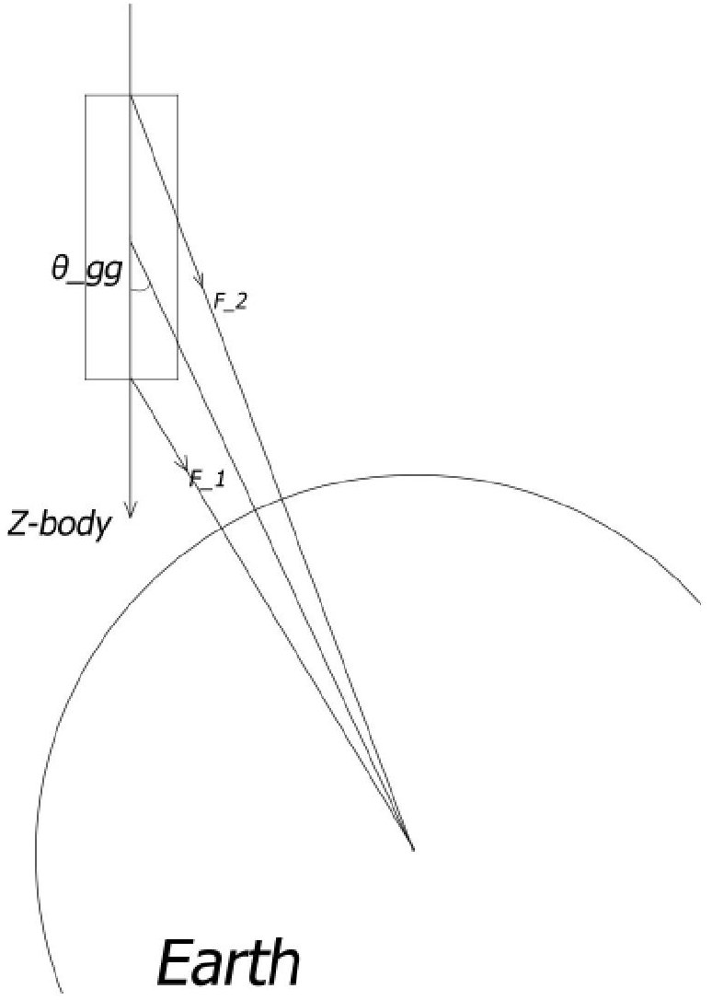

Figure 3-3 Gravity gradient torque

<!-- PDF_PAGE: 49 -->

## Aerodynamic drag

The torque resulting from aerodynamic drag emerges from the interaction between the spacecraft's surface and the surrounding air molecules. This force opposes the spacecraft's velocity vector, reducing its kinetic energy and causing orbital decay over time. Additionally, aerodynamic drag can impact the spacecraft's attitude, potentially inducing spinning or tumbling motions.

Assuming that one of the spacecraft's faces is perfectly perpendicular to the airflow and that the centre of aerodynamic pressure coincides with the centre of the face, the components of the torque due to aerodynamic force can be calculated in the body fixed reference frame. (In this case, the face in the yz plane is considered perpendicular to the airflow.)

$$
T _ {a e r o _ {x}} = 0
$$

$$
T _ {a e r o _ {y}} = \frac {1}{2} C _ {D} A \rho v _ {s c} ^ {2} L _ {y}
$$

$$
T _ {a e r o _ {z}} = \frac {1}{2} C _ {D} A \rho v _ {s c} ^ {2} L _ {z}
$$

The parameters involved in these equations are:

$ \circ $ $ C_{D} $ : drag coefficient, assumed to be 2.2.

O A: area of the face in the yz plane.

$ \circ $ $ \rho $ : atmospheric density. For orbits ranging from 400 and 600 km, atmospheric density typically falls between $ 10^{-11} $ and $ 10^{-12} $ kg/m $ ^{3} $ . In these calculations, a value of $ 10^{-11} $ kg/m $ ^{3} $ is used.

$ \circ $ $ v_{sc} $ : spacecraft's orbital velocity.

O $ L_{y} $ and $ L_{z} $ : distances between the centre of aerodynamic pressure and the centre of mass along the y and z axes.

The total torque is given by:

$$
T _ {a e r o} = \sqrt {T _ {a e r o _ {x}} ^ {2} + T _ {a e r o _ {y}} ^ {2} + T _ {a e r o _ {z}} ^ {2}}
$$

## Magnetic disturbance torque

Magnetic disturbance torque arises from the interaction between the spacecraft's magnetic moment and Earth's magnetic field. The magnetic torque can be calculated by multiplying the spacecraft's residual magnetic dipole moment $ ( m_{res} ) $ by the external magnetic field (i.e., Earth's magnetic field B). The calculation is performed with reference to the body fixed reference frame.

$$
T _ {m a g _ {x}} = m _ {r e s} \cdot B _ {x}
$$

$$
T _ {m a g _ {y}} = m _ {r e s} \cdot B _ {y}
$$

$$
T _ {m a g _ {z}} = m _ {r e s} \cdot B _ {z}
$$

The total torque is obtained as:

<!-- PDF_PAGE: 50 -->

$$
T _ {m a g} = \sqrt {T _ {m a g _ {x}} ^ {2} + T _ {m a g _ {y}} ^ {2} + T _ {m a g _ {z}} ^ {2}}
$$

## Solar radiation pressure

Torque caused by solar radiation pressure arises from the interaction between the spacecraft's surface area and the incident solar radiation. Photons arriving with solar radiation impart momentum to the spacecraft, resulting in rotational motion.

Assuming that the spacecraft's largest face is directed towards the sun, with zero angle of incidence, and that the optical centre of pressure aligns with the face's centre, the components of the torque due to solar radiation pressure can be calculated in the body fixed reference frame. (This example considers the face in the yz plane as the largest.)

$$
T _ {s r _ {x}} = 0
$$

$$
T _ {s r _ {y}} = \left(1 + K _ {r}\right) \frac {P _ {i n}}{c} A _ {m a x} L _ {y}
$$

$$
T _ {s r _ {z}} = \left(1 + K _ {r}\right) \frac {P _ {i n}}{c} A _ {m a x} L _ {z}
$$

The parameters used in these equations are:

$ \circ $ K: reflectivity (from 0 to 1). For these calculations, it is assumed to be 1.

$ \circ $ $ P_{in} $ : solar constant 1361 W/ $ m^{2}. $

o c: speed of light 299792458 m/s.

$ \circ $ $ A_{max} $ : area of the spacecraft's largest face.

$ \circ $ $ L_{y} $ and $ L_{z} $ : distances between the optical centre of pressure and the centre of mass along the y and z axes.

The total torque is given by:

$$
T _ {s r} = \sqrt {T _ {s r _ {x}} ^ {2} + T _ {s r _ {y}} ^ {2} + T _ {s r _ {z}} ^ {2}}
$$

## Total disturbance torque

By summing up the contributions of the disturbing torques, the total disturbance torque is obtained:

$$
T _ {d i s t} = T _ {g g} + T _ {a e r o} + T _ {m a g} + T _ {s r}
$$

## Slew manoeuvres

Slew manoeuvres involve rotating the spacecraft to change its pointing target. For example, it can transition from Nadir pointing (for Earth observations) to Sun pointing (to maximize the power generation), or from Nadir pointing to the communication attitude.

## Switching from Sun pointing to Nadir pointing

The first manouvre studied is the transition from Sun pointing to Nadir pointing since it could be the initial manouvre implemented during the space mission. Once the spacecraft is released into orbit, it needs to perform detumbling using magnetorquers, which consume power from the batteries. After detumbling is complete, recharging the batteries is necessary, so detumbling should end in the Sun pointing attitude.

<!-- PDF_PAGE: 51 -->

To perform scientific observations (if there is an observation payload on board), the spacecraft must switch from Sun pointing to Nadir pointing.

It is assumed that the payload will make Earth observations, so it will likely be positioned on the Z+ face of the CubeSat.

First, the initial attitude of the spacecraft and the desired final attitude need to be determined.

To know the spacecraft's attitude in Sun pointing, the vector from the spacecraft's position to the Sun's position, and its attitude relative to this vector must be calculated. Let's denote $ r_{Sun,sc} $ as the vector distance from the Sun to the spacecraft, which depends on the day of the year. This radius equals the vector difference between the distance between Earth and Sun $ (r_{Sun}) $ and the distance between Earth and the spacecraft $ (r_{sc}) $ . In this calculation, $ r_{sc}=r_{ECI}. $

$$
r _ {S u n, s c} = r _ {S u n} - r _ {s c}
$$

The distance from Earth to the Sun is calculated as explained in [28].

$$
\delta_ {S u n} = \operatorname {a s i n} \left(0. 3 9 7 9 5 \cdot \cos \left(0. 9 8 5 6 3 \cdot (N - 1 7 3)\right)\right)
$$

$$
\omega_ {S u n} = 1 5 \cdot \left((h o u r + m i n \cdot 6 0 + s e c \cdot 3 6 0 0) - 1 2\right)
$$

$$
r _ {S u n} = D _ {S u n - E a r t h} \left[ \begin{array}{c} \cos \left(\delta_ {S u n}\right) \cdot \cos \left(\omega_ {S u n}\right) \\ - \cos \left(\delta_ {S u n}\right) \cdot \sin \left(\omega_ {S u n}\right) \\ \sin \left(\delta_ {S u n}\right) \end{array} \right]
$$

Where $ \delta_{Sun} $ is the declination angle, $ \omega_{Sun} $ is the hour angle, $ D_{Sun-Earth}= 1 4 9 5 9 7 8 7 0 7 0 0 m $ is the average distance between Earth and the Sun, and N is the day number, counting from January 1st.

The distance $ r_{Sun,sc} $ is calculated in the ECI reference frame.

The spacecraft's attitude is considered in Sun pointing when the face aligned with the x-axis of the body reference frame aligns with the vector $ r_{Sun,sc} $ . Rewriting it in the body frame gives:

$$
r _ {S u n, s c} (b o d y) = \left[ \begin{array}{c} \left\| r _ {S u n, s c} (E C I) \right\| \\ 0 \\ 0 \end{array} \right]
$$

Now, the Euler angles between the ECI reference and the body reference for Sun pointing can be calculated ([26] and [27]).

First, the unit vectors of the position in ECI and body frames are calculated:

$$
u _ {S u n} (E C I) = \frac {r _ {S u n , s c} (E C I)}{\left\| r _ {S u n , s c} (E C I) \right\|}
$$

$$
u _ {S u n} (b o d y) = \frac {r _ {S u n , s c} (b o d y)}{\left\| r _ {S u n , s c} (b o d y) \right\|}
$$

The axis of rotation $ \left( \omega_{Sun}\right) $ of the reference system and the rotation angle $ \left( a_{Sun}\right) $ are calculated as:

<!-- PDF_PAGE: 52 -->

$$
\omega_ {S u n} = u _ {S u n} (E C I) \times u _ {S u n} (b o d y)
$$

$$
a _ {S u n} = \operatorname {a c o s} \left(u _ {S u n} (E C I) \cdot u _ {S u n} (b o d y)\right)
$$

From these two parameters, the rotation matrix can be obtained:

$$
R _ {E C I - b o d y} = \cos \left(a _ {S u n}\right) \cdot I d + \left(1 - \cos \left(a _ {S u n}\right)\right) \cdot \left(\omega_ {S u n} \cdot \omega_ {S u n}\right) + \sin \left(a _ {S u n}\right) \cdot S
$$

$$
I d = \left[ \begin{array}{c c c} 1 & 0 & 0 \\ 0 & 1 & 0 \\ 0 & 0 & 1 \end{array} \right]
$$

$$
S = \left[ \begin{array}{c c c} 0 & - \omega_ {S u n} (3) & \omega_ {S u n} (2) \\ \omega_ {S u n} (3) & 0 & - \omega_ {S u n} (1) \\ - \omega_ {S u n} (2) & \omega_ {S u n} (1) & 0 \end{array} \right]
$$

From the rotation matrix, the Euler angles and the relative quaternion are calculated:

$$
\phi_ {S U n} = a t a 2 \left(E _ {E C I - b o d y} (2, 3), R _ {E C I - b o d y} (3, 3)\right)
$$

$$
\theta_ {S u n} = \operatorname {a s i n} \left(- R _ {E C I - b o d y} (1, 3)\right)
$$

$$
\psi_ {S u n} = a t a n 2 \left(R _ {E C I - b o d y} (1, 2), R _ {E C I - b o d y} (1, 1)\right)
$$

$$
q _ {S u n} = e u l 2 q u a t \left(\left[ \phi_ {S u n}, \theta_ {S u n}, \psi_ {S u n} \right]\right)
$$

The atan2 function is a Matlab function that returns the four-quadrant inverse tangent [29], and the eul2quat function is a Matlab function that returns the quaternion of a given Euler angles configuration [29].

The same procedure is repeated to calculate the Euler angles $ \left( \left[ \phi_{Sun},\theta_{Sun},\psi_{Sun}\right] \right) $ and relative quaternion $ \left(q_{Nadir}\right) $ for Nadir pointing. For Nadir pointing, the spacecraft's attitude is such that its face aligned with the z-body axis points to Nadir.

$$
r _ {s c} (b o d y) = \left[ \begin{array}{l} 0 \\ 0 \\ a \end{array} \right]
$$

Where a is the semimajor axis of the orbit.

Knowing the initial attitude (Sun pointing) and the desired attitude (Nadir pointing), it is possible to calculate the rotation $ \left( \delta_{SN} \right) $ that the spacecraft must make to switch between the two attitudes. This calculation is done using Matlab's built-in functions, which allow obtaining the rotation matrices from a given quaternion (quat2dcm) and subsequently obtaining the Euler angles from a rotation matrix (dcm2angle).

Finally, it is possible to calculate the angular acceleration $ \left( \alpha_{SN}\right) $ required for the slew manouvre and, from this, calculate the required slew torque $ \left( T_{SN}\right) $ [26].

$$
\alpha_ {S N} = \frac {2 \delta_ {S N}}{t _ {S N} ^ {2}}
$$

$$
T _ {S N} = \alpha_ {S N} \cdot I _ {s c} + T _ {d i s t}
$$

<!-- PDF_PAGE: 53 -->

Where $ t_{SN} $ is the time required for the manouvre, and $ I_{sc} $ is the inertia matrix of the spacecraft.

External disturbance torques （ $ T_{dist} $ ）are also taken into account in the equation.

## Switching from Nadir pointing to communication attitude

Similarly to the procedure described above, the required slew torque for a manouvre from Nadir pointing to the attitude for communication with a Ground Station is calculated.

In this case, the position of the Ground Station in the ECI frame needs to be calculated ([15] and [16]). Assuming that the altitude $ ( h_{GS} ) $ , latitude $ ( L a t_{GS} ) $ and longitude $ ( L o n g_{GS} ) $ of the Ground Station are known, its position can be calculated in the ECEF frame and subsequently transformed into the ECI frame.

$$
r _ {G S} (E C E F) = \left[ \begin{array}{l} \left(r _ {c} + h _ {G S}\right) \cos \left(L a t _ {G S}\right) \cos \left(L o n g _ {G S}\right) \\ \left(r _ {c} + h _ {G S}\right) \cos \left(L a t _ {G S}\right) \sin \left(L o n g _ {G S}\right) \\ \left(r _ {c} \left(1 - e _ {E a r t h} ^ {2}\right) + h _ {G S}\right) \sin \left(L a t _ {G S}\right) \end{array} \right]
$$

$$
r _ {c} = \frac {R}{\sqrt {\left(1 - e _ {E a r t h} ^ {2}\right) \sin^ {2} \left(L a t _ {G S}\right)}}
$$

$$
r _ {G S} (E C I) = R _ {E C E F - E C I} \cdot r _ {G S} (E C E F)
$$

Here, $ R_{ECEF-ECI} $ is the rotation matrix from ECEF to ECI reference frame, and it is calculated using a built-in Matlab function called dcmeci2ecef.

By calculating the distance between the Ground Station and the spacecraft in the ECI and body frames $ ( r_{GS,sc} ) $ the steps given in Equations ( 3-150 ) to ( 3-160 ) can be repeated to calculate the attitude Euler angles for communication.

$$
r _ {G S, s c} (E C I) = r _ {E C I} - r _ {G S} (E C I)
$$

$$
r _ {G S, s c} (b o d y) = \left[ \begin{array}{c} 0 \\ 0 \\ \left\| r _ {G S, s c} (E C I) \right\| \end{array} \right]
$$

Using the same procedure explained in the previous paragraph, the angle of rotation $ \left( \delta_{N C}\right) $ necessary for the manouvre is calculated.

Finally, the angular acceleration and the torque required for the manouvre are calculated:

$$
\alpha_ {N C} = \frac {2 \delta_ {N C}}{t _ {N C} ^ {2}}
$$

$$
T _ {N C} = \alpha_ {N C} \cdot I _ {s c} + T _ {d i s t}
$$

## Detumbling

Detumbling is the process of reducing the angular rate of the spacecraft after it has been launched into orbit.

In the case of small satellites like CubeSats, detumbling typically accomplished using magnetorquers with a control law known as B-dot. The B-dot control law utilizes measurements of the Earth's magnetic field to calculate the rate of change of the magnetic field (the derivative

<!-- PDF_PAGE: 54 -->

of the magnetic field, hence the name "B-dot"). This rate of change is then used to determine the torque required to control the CubeSat's rotation. The B-dot control law can be expressed as follows [30]:

$$
\mu_ {M} = - \frac {K}{\| B \| ^ {2}} (B \times \omega)
$$

Where $ \mu_{M} $ represents the magnetic moment of the magnetorquers, B is Earth's magnetic field, $ \omega $ is the CubeSat's angular velocity in the body frame, and K is the gain of the control law.

Detumbling occurs over a specific period of time, and the satellite is considered detumbled once it reaches an angular velocity that allows for the activation of the normal control system for the mission. To determine the required detumbling time, simulations are conducted, which involve the integration of the Earth's magnetic field, as well as the position and attitude of the spacecraft over time.

For the position of the CubeSat, it is sufficient to calculate its geocentric latitude and longitude at each time step, which are then used to calculate the magnetic field at that position. This calculation is performed through an iterative process, updating the true anomaly variable at each time step to obtain the geocentric latitude and longitude of the spacecraft using the formulas from Equations ( 3-111 ) to ( 3-113 ).

The Euler equation is used to calculate the attitude [26]:

$$
\dot {\omega} = I _ {s c} ^ {- 1} \left(- \omega \times I _ {s c} \omega + \tau_ {M} + T _ {d i s t}\right)
$$

In this equation, $ \omega $ once again represents the spacecraft's angular velocity in the body frame, $ I_{sc} $ is the matrix of inertia, $ \tau_{M} $ is the magnetic torque applied by the magnetorquers, and $ T_{dist} $ is the disturbance torque.

By simulating the detumbling process, the change in angular velocity of the spacecraft can be visualised, providing insights into the required detumbling time.

## Pointing errors

When considering the pointing budget, two attitudes are taken into account: Nadir pointing and the attitude required for communication with Ground Stations.

The error is initially determined by the sensitivity of the spacecraft's attitude and position sensors, as well as the ADCS actuators. It is calculated as the average and the root mean square of the errors of the sensors and actuators, as shown below:

$$
e r r _ {s c} = m e a n \left(e r r _ {a c t u a t o r s}, e r r _ {s e n s o r s}\right)
$$

$$
e r r _ {s c} = r m s \left(e r r _ {a c t u a t o r s}, e r r _ {s e n s o r s}\right)
$$

For the communication attitude, it is assumed that the elevation angle $ \left( \varepsilon_{comm}\right) $ at which the spacecraft is observed from the Ground Station is known.

The azimuth of the Ground Station relative to the ground track is calculated according to the procedure explained in [27].

$$
\begin{array}{l} A Z _ {c o m m} = a t a n 2 \left(\sin \left(L o n g _ {G S} - L o n g _ {s c}\right), \cos \left(L a t _ {s c}\right) \tan \left(L a t _ {G S}\right)\right) \\ - \sin \left(L a t _ {s c}\right) \cos \left(L o n g _ {G S} - L o n g _ {s c}\right)) \\ \end{array}
$$

<!-- PDF_PAGE: 55 -->

The angle at Nadir $ (\eta_{comm}) $ , the Earth central angle $ (\lambda_{comm}) $ , and the distance between the Ground Station and the spacecraft $ (D_{comm}) $ can be calculated using the formulas described in [16].

$$
\eta_ {c o m m} = \operatorname {a s i n} \left(s i n \left(R _ {a n g}\right) \cos \left(\varepsilon_ {c o m m}\right)\right)
$$

$$
R _ {a n g} = \frac {R _ {e q u a t}}{R _ {e q u a t} + h _ {s c}}
$$

$$
\lambda_ {c o m m} = \frac {\pi}{2} - \varepsilon_ {c o m m} - \eta_ {c o m m}
$$

$$
D _ {c o m m} = R _ {e q u a t} \cdot \frac {\sin \left(\lambda_ {c o m m}\right)}{\sin \left(\eta_ {c o m m}\right)}
$$

In the reference [16], the sources of errors are divided into two categories: errors due to displacement in position and errors in the orientation of the spacecraft's rotation axis. The sources of error are considered known, and the relative errors are calculated as follows:

$$
\Delta I _ {c o m m} = \frac {I _ {c o m m}}{D _ {c o m m}} \sin \left(a c o s \left(c o s \left(A Z _ {c o m m}\right) \sin \left(\eta_ {c o m m}\right)\right)\right)
$$

$$
\Delta C _ {c o m m} = \frac {C _ {c o m m}}{D _ {c o m m}} \sin \left(a c o s \left(\sin \left(A Z _ {c o m m}\right) \sin \left(\eta_ {c o m m}\right)\right)\right)
$$

$$
\Delta R s _ {c o m m} = \frac {R s _ {c o m m}}{D _ {c o m m}} \sin \left(\eta_ {c o m m}\right)
$$

$$
\Delta a n g _ {c o m m} = a n g _ {c o m m}
$$

$$
\Delta r o t _ {c o m m} = r o t _ {c o m m} \cdot \sin \left(\eta_ {c o m m}\right)
$$

Here:

- $ I_{comm} $ represents the displacement along the spacecraft's velocity vector.

- $ C_{comm} $ denotes the displacement normal to the spacecraft's velocity vector in the orbital plane.

- Rs comm represents the displacement in the radial direction (towards Nadir).

- ang comm is the error in angle from the Nadir direction to the sensing axis.

- rot comm is the error in rotation of the sensing axis about the Nadir direction.

The total pointing error for the communication attitude is given by:

$$
\begin{array}{l} \begin{array}{l} e r r _ {c o m m} \\ = m e a n \left(e r r _ {a c t u a t o r s}, e r r _ {s e n s o r s}, \Delta I _ {c o m m}, \Delta C _ {c o m m}, \Delta R s _ {c o m m}, \Delta a n g _ {c o m m}, \Delta r o t _ {c o m m}\right) \end{array} \\ \begin{array}{l} e r r _ {c o m m} \\ = r m s \left(e r r _ {a c t u a t o r s}, e r r _ {s e n s o r s}, \Delta I _ {c o m m}, \Delta C _ {c o m m}, \Delta R s _ {c o m m}, \Delta a n g _ {c o m m}, \Delta r o t _ {c o m m}\right) \end{array} \\ \end{array}
$$

Similarly, the Nadir pointing error can be calculated with some modifications in the initial data. The elevation angle at the nadir is $ 9 0^{\circ} $ $ \varepsilon_{Nadir}=\frac{\pi}{2} $ , and the azimuth is zero.

The resulting errors are as follows:

<!-- PDF_PAGE: 56 -->

$$
\begin{array}{l} \begin{array}{l} e r r _ {N a d i r} \\ = m e a n \left(e r r _ {a c t u a t o r s}, e r r _ {s e n s o r s}, \Delta I _ {N a d i r}, \Delta C _ {N a d i r}, \Delta R s _ {N a d i r}, \Delta a n g _ {N a d i r}, \Delta r o t _ {N a d i r}\right) \end{array} \\ \begin{array}{l} e r r _ {N a d i r} \\ = r m s \left(e r r _ {a c t u a t o r s}, e r r _ {s e n s o r s}, \Delta I _ {N a d i r}, \Delta C _ {N a d i r}, \Delta R s _ {N a d i r}, \Delta a n g _ {N a d i r}, \Delta r o t _ {N a d i r}\right) \end{array} \\ \end{array}
$$

## Margins

In the calculations of the momentum budget, the mass of the components $ ( m_{i} ) $ and the mass of the CubeSat $ ( m_{sc} ) $ are used.

Their margins are already defined respectively in Equations ( 3-4 ) and ( 3-5 ).

The other parameters defined with margins are the position of the centre of mass of each component with reference to the geometric centre of the CubeSat $ ( C o M_{i} ) $ , the distance between the position of the component's centre of mass and the position of the CubeSat's centre of mass $ ( d_{i} ) $ , and the distance between the geometric centre and the centre of mass of the CubeSat along the three body axes $ ( L_{x}, L_{y}, L_{z} ) $ . These parameters are expressed as follows:

$$
C o M _ {i} = C o M _ {n o m _ {i}} \pm \Delta C o M _ {i}
$$

$$
d _ {i} = d _ {n o m _ {i}} \pm \Delta d _ {i}
$$

$$
L _ {x, y, z} = L _ {n o m _ {x, y, z}} \pm \Delta L _ {x, y, z}
$$

The margin on the CubeSat's centre of mass can be calculated as:

$$
\begin{array}{l} \Delta C o M _ {s c} \\ = \sqrt {\sum_ {i = 1} ^ {n} \left(\frac {C o M _ {i} \cdot \Delta m _ {i}}{m _ {s c}}\right) ^ {2} + \sum_ {i = 1} ^ {n} \left(\frac {m _ {i} \cdot \Delta C o M _ {i}}{m _ {s c}}\right) ^ {2} + \left(- \left(\sum_ {i = 1} ^ {n} \left(m _ {i} \cdot C o M _ {i}\right) m _ {s c}\right) \Delta m _ {s c}\right) ^ {2}} \\ \end{array}
$$

The margin on the CubeSat's inertia matrix ( 3-127 ) is given by the margin of the distance of each component from the centre of mass of the satellite $ \Delta d_{i} $ ) and their mass margin $ \Delta m_{i} $ ).

$$
\Delta I _ {s c} = \sqrt {\sum_ {i = 1} ^ {n} \left[ \left(d _ {i} \cdot \Delta m _ {i}\right) ^ {2} + \left(m _ {i} \cdot \Delta d _ {i}\right) ^ {2} \right]}
$$

In the calculation of external disturbances, for the gravity gradient torque (Equations from (3-128) to (3-131) the margin is given by the matrix of inertia margin. For the solar radiation pressure (Equations from (3-140) to (3-143)) and the aerodynamic torque (Equations from (3-132) to (3-135)) margins are given by the distance from the centre of pressure to the centre of mass of the CubeSat, this distance is assumed equal to $ L_{x,y,z}. $

$$
\Delta T _ {g g _ {x, y, z}} = \sqrt {2 \cdot \left(\frac {3}{2} \frac {\mu}{a ^ {3}} \sin \left(2 \theta_ {g g}\right) \Delta I _ {s c}\right) ^ {2}}
$$

<!-- PDF_PAGE: 57 -->

$$
\Delta T _ {s r _ {x, y, z}} = \sqrt {\left((K + 1) \left(\frac {P _ {i n}}{c}\right) A _ {m a x} \Delta L _ {x , y , z}\right) ^ {2}}
$$

$$
\Delta T _ {a e r o s _ {x, y, z}} = \sqrt {\left(\frac {1}{2} C _ {d} A \rho v _ {s c} ^ {2} \Delta L _ {x, y, z}\right) ^ {2}}
$$

Considering the components along the three body axes of the CubeSat, the margins of the resulting disturbances are:

$$
\Delta T _ {g g} = \sqrt {\left(\frac {2 T _ {g g _ {x}}}{2 T _ {g g}} \Delta T _ {g g _ {x}}\right) ^ {2} + \left(\frac {2 T _ {g g _ {y}}}{2 T _ {g g}} \Delta T _ {g g _ {y}}\right) ^ {2} + \left(\frac {2 T _ {g g _ {z}}}{2 T _ {g g}} \Delta T _ {g g _ {z}}\right) ^ {2}}
$$

$$
\Delta T _ {s r} = \sqrt {\left(\frac {2 T _ {s r _ {x}}}{2 T _ {s r}} \Delta T _ {s r _ {x}}\right) ^ {2} + \left(\frac {2 T _ {s r _ {y}}}{2 T _ {s r}} \Delta T _ {s r _ {y}}\right) ^ {2} + \left(\frac {2 T _ {s r _ {z}}}{2 T _ {s r}} \Delta T _ {s r _ {z}}\right) ^ {2}}
$$

$$
\Delta T _ {a e r o} = \sqrt {\left(\frac {2 T _ {a e r o _ {x}}}{2 T _ {a e r o}} \Delta T _ {a e r o _ {x}}\right) ^ {2} + \left(\frac {2 T _ {a e r o _ {y}}}{2 T _ {a e r o}} \Delta T _ {a e r o _ {y}}\right) ^ {2} + \left(\frac {2 T _ {a e r o _ {z}}}{2 T _ {a e r o}} \Delta T _ {a e r o _ {z}}\right) ^ {2}}
$$

Finally, the margins for the total disturbances torques ( 3-144 ) are:

$$
\Delta T _ {d i s t _ {x, y, z}} = \sqrt {\Delta T _ {g g _ {x , y , z}} ^ {2} + \Delta T _ {s r _ {x , y , z}} ^ {2} + \Delta T _ {a e r o _ {x , y , z}} ^ {2}}
$$

$$
\Delta T _ {d i s t} = \sqrt {\left(\frac {2 T _ {d i s t _ {x}}}{2 T _ {d i s t}} \Delta T _ {d i s t _ {x}}\right) ^ {2} + \left(\frac {2 T _ {d i s t _ {y}}}{2 T _ {d i s t}} \Delta T _ {d i s t _ {y}}\right) ^ {2} + \left(\frac {2 T _ {d i s t _ {z}}}{2 T _ {d i s t}} \Delta T _ {d i s t _ {z}}\right) ^ {2}}
$$

The margin on the inertia matrix also affects another variable, which is the slew torque (Equations ( 3-163 ) and ( 3-170 )):

$$
\Delta T _ {S N} = \sqrt {\left(\alpha_ {S N} \cdot \Delta I _ {s c}\right) ^ {2} + \left(\Delta T _ {d i s t}\right) ^ {2}}
$$

$$
\Delta T _ {N C} = \sqrt {\left(\alpha_ {S N} \cdot \Delta I _ {s c}\right) ^ {2} + \left(\Delta T _ {d i s t}\right) ^ {2}}
$$

## 3.3.6 Thermal budget

The thermal budget involves the analysis and design of a spacecraft's thermal control system. Its purpose is to ensure that the temperatures of the various spacecraft components remain within operational and survivability limits during the mission phases.

In the preliminary analysis, the spacecraft's worst-case scenarios from a thermal perspective are typically studied. These scenarios include the cold case and the hot case conditions. The equilibrium temperatures for these cases are determined based on the internal heat production of the spacecraft and the external heat fluxes from the space environment.

While equilibrium temperatures provide an overview of the spacecraft's thermal state under these conditions, they do not provide an accurate assessment of the temperature distribution

<!-- PDF_PAGE: 58 -->

inside the spacecraft. To determine the temperature distribution, a thermal analysis considering the thermal properties of the spacecraft's components is necessary.

## Preliminary analysis

As mentioned above, the preliminary analysis aims to calculate the equilibrium temperatures for the worst thermal cases that the CubeSat may experience.

The equilibrium temperature is obtained by balancing the external heat fluxes with the internal heat fluxes of the spacecraft.

Before evaluating the worst cases, it is important to understand the typical heat fluxes encountered during a space mission in a low Earth orbit.

## Heat fluxes

The primary external heat fluxes include solar radiation, Earth's albedo, and Earth's infrared radiation (Figure 3-4). Internal heat fluxes are generated by the power consumption of the spacecraft. Additionally, heat is radiated from the CubeSat into outer space. The following paragraphs analyse these fluxes individually.

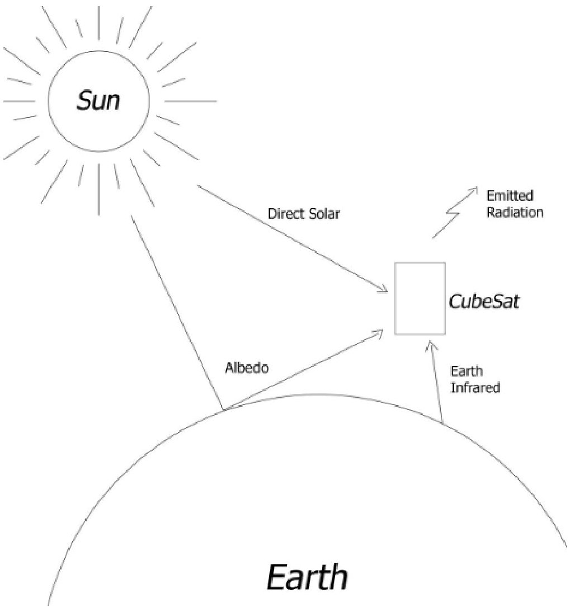

Figure 3-4 Environment heat fluxes

## Direct solar radiation

Solar radiation refers to the amount of heat emitted by the sun that reaches an object in space. The intensity of direct solar radiation depends on the distance between the spacecraft and the Sun. Since LEO orbits are considered, this distance depends on the Earth-Sun distance.

This radiation is expressed using the solar constant $ P_{in} $ , which varies throughout the year. It reaches a minimum value during the summer solstice (21st June) with $ P_{in_{min}} $ =

<!-- PDF_PAGE: 59 -->

1322 W/ $ m^{2} $ , and a maximum value during the winter solstice (22nd December) with $ P_{in_{max}}=1414W/m^{2}. $

The heat flux absorbed by a spacecraft in LEO can be described as follows [19]:

$$
Q _ {s o l a r} = P _ {i n} \cdot \alpha_ {s c} \cdot F _ {e} \cdot A _ {\perp}
$$

Here, $ \alpha_{sc} $ represents the absorptance of the CubeSat's surface, $ F_{e} $ accounts for the solar eclipse view (0 during an eclipse and 1 in daylight), and $ A_{\perp} $ is the surface area of the CubeSat perpendicular to the solar rays.

## Earth albedo

Albedo refers to the portion of solar radiation reflected by the Earth's surface.

It varies based on the evaluated areas (e.g., sea/ocean, land, desert) and atmospheric conditions (clear sky, clouds, rain). The average value for spacecrafts in LEO is approximately $ a_{Earth}=0.3. $

The heat flux absorbed by the CubeSat is expressed as [19]:

$$
P _ {a l b e d o} = P _ {i n} \cdot a _ {E a r t h} \cdot F _ {e}
$$

$$
Q _ {a l b e d o} = P _ {a l b e d o} \cdot \alpha_ {s c} \cdot A \cdot V F
$$

Where A is the spacecraft's surface area, and VF is the view factor from the spacecraft's surface to Earth.

For a CubeSat in Nadir pointing attitude, the view factors for the different faces can be calculated as follows, assuming a perfectly spherical. For the face pointing Nadir the view factor is [31]:

$$
V F _ {N a d i r} = \frac {\cos (\lambda)}{(1 + H) ^ {2}}
$$

$$
H = \frac {h _ {s c} + R}{R}
$$

Where R is Earth's radius, $ h_{sc} $ is the CubeSat's altitude, and $ \lambda $ is the angle between the normal of the CubeSat's face and the sphere. For surfaces facing the sphere, $ \lambda=0 $ . For faces perpendicular to the Nadir-facing face:

$$
V F _ {s i d e} = - \frac {\sqrt {H ^ {2} - 1}}{\pi H ^ {2}} + \frac {1}{\pi} \tan^ {- 1} \left(\frac {1}{\sqrt {H ^ {2} - 1}}\right)
$$

The face opposite the Nadir will have a view factor of zero.

## Earth infrared

This refers to the radiation emitted by the Earth in the infrared region of the spectrum. The heat flux absorbed by the spacecraft can be calculated as [19]:

$$
P _ {I R} = \varepsilon_ {E a r t h} \cdot \sigma \cdot T _ {E a r t h} ^ {4}
$$

$$
Q _ {I R} = P _ {I R} \cdot \varepsilon_ {s c} \cdot A \cdot V F
$$

<!-- PDF_PAGE: 60 -->

Where $ \varepsilon_{Earth} $ represents Earth's emissivity, which varies between 0.97 during the day and 0.99 during the night. $ \sigma=5. 6 7 0 \cdot1 0^{-8} W / ( m^{2} K^{4} ) $ is the Stefan-Boltzmann constant, and $ T_{earth} $ is the Earth's surface temperature, ranging between $ 1 5^{\circ} \mathrm{C} $ during the day and $ 5^{\circ} \mathrm{C} $ during the night. $ \varepsilon_{sc} $ represents the spacecraft's surface emissivity.

## Internal heat

The internal heat $ ( Q_{int} ) $ of the spacecraft is determined by power dissipation. In thermal budget calculations, it is conservative to consider that all instantaneous power consumed $ ( P_{cons} ) $ by the components is transformed into heat. The power consumed at each instant depends on the state of each subsystem and is therefore not a constant throughout the mission.

$$
Q _ {i n t} = P _ {c o n s}
$$

## Emitted radiation

This refers to the radiation emitted by the spacecraft into space [19]:

$$
Q _ {r a d} = \varepsilon_ {s c} \cdot \sigma \cdot T _ {s c} ^ {4} \cdot A _ {t o t}
$$

Where $ T_{sc} $ is the spacecraft's equilibrium temperature (the unknown variable of the problem), and $ A_{tot} $ is the total area of the spacecraft.

## Equilibrium temperature

The equilibrium temperature is determined using the following equation [19]:

$$
Q _ {r a d} = Q _ {s o l a r} + Q _ {a l b e d o} + Q _ {I R} + Q _ {i n t}
$$

By substituting Equation ( 3-213 ) into the first term, the equilibrium temperature can be calculated as follows:

$$
T _ {s c} = \sqrt [ 4 ]{\frac {Q _ {s o l a r} + Q _ {a l b e d o} + Q _ {I R} + Q _ {i n t}}{\varepsilon_ {s c} \cdot \sigma \cdot A _ {t o t}}}
$$

## Worst hot case

The worst hot case is calculated for the CubeSat when it is exposed to sunlight and consuming the highest power. Table 3-6 provides the constant parameters for the hot case:

Table 3-6 Constant parameters hot case

<table border="1"><tr><td>Parameter</td><td>Value</td></tr><tr><td>$P_{in}$</td><td>$1414W/m^{2}$</td></tr><tr><td>$F_{e}$</td><td>1</td></tr><tr><td>$a_{Earth}$</td><td>0.3</td></tr><tr><td>$\varepsilon_{Earth}$</td><td>0.97</td></tr><tr><td>$\sigma$</td><td>$5.670\cdot10^{-8}W/(m^{2}K^{4})$</td></tr><tr><td>$T_{Earth}$</td><td>288.15K</td></tr></table>

<!-- PDF_PAGE: 61 -->

Figure 3-5 illustrates the attitude of the spacecraft considered for the calculations, where the Z+ face points to Nadir, and the X+ face is fully exposed to sunlight with zero inclination angle. The heat fluxes on each face of the CubeSat are then calculated.

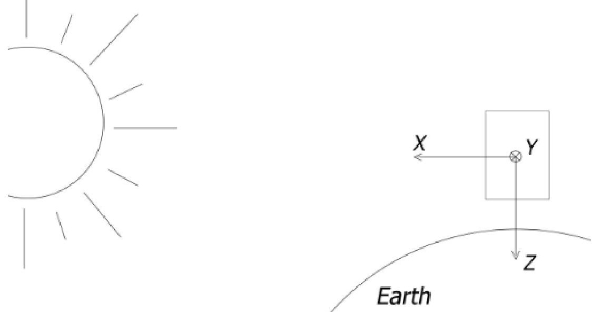

Figure 3-5 CubeSat attitude hot case

Table 3-7 summarizes the heat fluxes for each face of the CubeSat.

Table 3-7 Heat fluxes on each face, hot case

<table border="1"><tr><td></td><td>X+</td><td>X-</td><td>Y+</td><td>Y-</td><td>Z+</td><td>Z-</td></tr><tr><td>$Q_{solar}$</td><td>$P_{in}\cdot\alpha_{sc}\cdot A_{x}$</td><td>0</td><td>0</td><td>0</td><td>0</td><td>0</td></tr><tr><td>$Q_{albedo}$</td><td>$ALB\cdot A_{x}\cdot VF_{side}$</td><td>$ALB\cdot A_{x}\cdot VF_{side}$</td><td>$ALB\cdot A_{y}\cdot VF_{side}$</td><td>$ALB\cdot A_{y}\cdot VF_{side}$</td><td>$ALB\cdot A_{z}\cdot VF_{nadir}$</td><td>0</td></tr><tr><td>$Q_{IR}$</td><td>$IR\cdot A_{x}\cdot VF_{side}$</td><td>$IR\cdot A_{x}\cdot VF_{side}$</td><td>$IR\cdot A_{y}\cdot VF_{side}$</td><td>$IR\cdot A_{y}\cdot VF_{side}$</td><td>$IR\cdot A_{z}\cdot VF_{nadir}$</td><td>0</td></tr></table>

Where $ ALB=P_{albedo}\cdot\alpha_{sc} $ , and $ IR=P_{IR}\cdot\varepsilon_{sc} $

By applying Equation (3-215) to each face, the equilibrium temperature on that face of the CubeSat is obtained. The minimum and maximum temperatures for the case study can be identified using these values. This information provides an idea of the temperature distribution on the spacecraft's surface, and it can be compared with the operating temperature values of the various components to modify the thermal control system (TSC) if necessary.

## Worst cold case

The worst cold case is calculated for the CubeSat when it is in eclipse and consuming the least power.

In this case, the CubeSat's Z+ face also points to Nadir. The only source of external heat is given by infrared radiation, as there is no contribution from solar radiation during eclipse. Table 3-8 provides the constant parameters for the cold case:

Table 3-8 Constant parameters cold case

<table border="1"><tr><td>Parameter</td><td>Value</td></tr><tr><td>$P_{in}$</td><td>$1322W/m^{2}$</td></tr><tr><td>$F_{e}$</td><td>0</td></tr><tr><td>$a_{Earth}$</td><td>0.3</td></tr><tr><td>$\varepsilon_{Earth}$</td><td>0.99</td></tr></table>

<!-- PDF_PAGE: 62 -->

<table border="1"><tr><td>$\sigma$</td><td>$5.670\cdot10^{-8}W/(m^{2}K^{4})$</td></tr><tr><td>$T_{Earth}$</td><td>$287.15K$</td></tr></table>

Table 3-9 shows the heat fluxes on each face of the CubeSat for the cold case.

Table 3-9 Heat fluxes on each face, cold case

<table border="1"><tr><td></td><td>X+</td><td>X-</td><td>Y+</td><td>Y-</td><td>Z+</td><td>Z-</td></tr><tr><td>$Q_{solar}$</td><td>0</td><td>0</td><td>0</td><td>0</td><td>0</td><td>0</td></tr><tr><td>$Q_{albedo}$</td><td>0</td><td>0</td><td>0</td><td>0</td><td>0</td><td>0</td></tr><tr><td>$Q_{IR}$</td><td>$IR\cdot A_{x}$
$\cdot VF_{side}$</td><td>$IR\cdot A_{x}$
$\cdot VF_{side}$</td><td>$IR\cdot A_{y}$
$\cdot VF_{side}$</td><td>$IR\cdot A_{y}$
$\cdot VF_{side}$</td><td>$IR\cdot A_{z}$
$\cdot VF_{side}$</td><td>0</td></tr></table>

Where $ I R=P_{I R}\cdot \varepsilon_{s c} $

By applying Equation ( 3-215 ) to each face, the equilibrium temperature on that face of the CubeSat is obtained. The minimum and maximum temperatures for the case study can be identified using these values.

## Thermal analysis

In a preliminary approach, the thermal analysis was tested using the PDE toolbox of Matlab. However, this tool does not allow for a purely radiative thermal analysis, so it was decided not to pursue it at the moment.

## Margins

First, the operating temperatures of the components are defined with the relative margin:

$$
T _ {o p} = T _ {o p _ {n o m}} \pm \Delta T _ {o p}
$$

These temperatures are needed to understand if the CubeSat is able to withstand the temperatures in the worst cases of the mission.

The equilibrium temperatures calculated above (Equation ( 3-215 )) must be within the limits of the operating temperatures, and the survivability temperatures of the component, also taking into account the margins.

In addition, two other parameters with margins are defined, namely the absorptance and emissivity of the CubeSat surface.

$$
\alpha_ {s c} = \alpha_ {s c _ {n o m}} \pm \Delta \alpha_ {s c}
$$

$$
\varepsilon_ {s c} = \varepsilon_ {s c _ {n o m}} \pm \Delta \varepsilon_ {s c}
$$

For the heat fluxes on the CubeSat, the margin on the power consumed is defined, which results from Equation ( 3-33 ) for eclipse and Equation ( 3-35 ) for daylight. Their margins are defined in Equation ( 3-64 ). This gives the margin on the internal heat flux ( 3-212 ).

$$
\Delta Q _ {i n t} = \Delta P _ {e / d}
$$

The margins on the absorptance and emissivity of the CubeSat result in margins in the external heat fluxes: direct solar radiation ( 3-204 ), albedo ( 3-206 ) and infrared radiation ( 3-211 ).

<!-- PDF_PAGE: 63 -->

$$
\Delta Q _ {s o l a r} = \sqrt {\left(P _ {i n} \cdot F _ {e} \cdot A _ {\perp} \cdot \Delta \alpha_ {s c}\right) ^ {2}}
$$

$$
\Delta Q _ {a l b e d o} = \sqrt {\left(P _ {a l b e d o} \cdot A \cdot V F \cdot \Delta \alpha_ {s c}\right) ^ {2}}
$$

$$
\Delta Q _ {I R} = \sqrt {\left(P _ {I R} \cdot A \cdot V F \cdot \Delta \varepsilon_ {s c}\right) ^ {2}}
$$

Finally, the margin on the total heat flux ( 3-214 ) is:

$$
\Delta Q _ {r a d} = \sqrt {\Delta Q _ {i n t} ^ {2} + \Delta Q _ {s o l a r} ^ {2} + \Delta Q _ {a l b e d o} ^ {2} + \Delta Q _ {I R} ^ {2}}
$$

The margin on the equilibrium temperature (3-215) will be expressed as follows:

$$
\Delta T _ {s c} = \sqrt {S _ {1} + S _ {2}}
$$

$$
S _ {1} = \left[ \left(\frac {Q _ {r a d}}{A _ {t o t} \cdot \varepsilon_ {s c} \cdot \sigma}\right) ^ {- \frac {3}{4}} \cdot \frac {A _ {t o t} \cdot \sigma}{4 \left(A _ {t o t} \cdot \sigma \cdot \varepsilon_ {s c}\right) ^ {2}} \cdot \varepsilon_ {s c} \cdot \Delta Q _ {r a d} \right] ^ {2}
$$

$$
S _ {2} = \left[ \left(\frac {Q _ {r a d}}{A _ {t o t} \cdot \varepsilon_ {s c} \cdot \sigma}\right) ^ {- \frac {3}{4}} \cdot \left(- \frac {A _ {t o t} \cdot \sigma}{4 \left(A _ {t o t} \cdot \sigma \cdot \varepsilon_ {s c}\right) ^ {2}} \cdot Q _ {r a d} \cdot \Delta \varepsilon_ {s c}\right) \right] ^ {2}
$$

## 3.4 Matlab implementation

Initially, each budget was studied and implemented individually, leading to the creation of a separate Matlab code for each budget. After verifying the correct functionality of these individual codes, the consolidation and merging process was undertaken to combine them into a single code.

In this section, first the implementation of individual budgets is explained and then the consolidation process is described.

## 3.4.1 Mass budget

The script for calculating the mass budget can be divided into four sections, each defined by a function:

- Input dialog definition

- Saving new component data in an Excel document

- Editing existing components in the Excel document

- Performing calculations

These four steps will be repeated equally for the calculation of the other budgets, what changes are the input dialog boxes and the equations implemented in the calculations.

The input dialog is a window with which the user can interact, it is used to take various inputs from the user and use them within the script. Each input dialog was defined by creating a specific function.

<!-- PDF_PAGE: 64 -->

This window was created using the Matlab command "uicontrol", which allows the inclusion of interactive elements such as buttons and text boxes. Each element is assigned a callback function to enable interactivity.

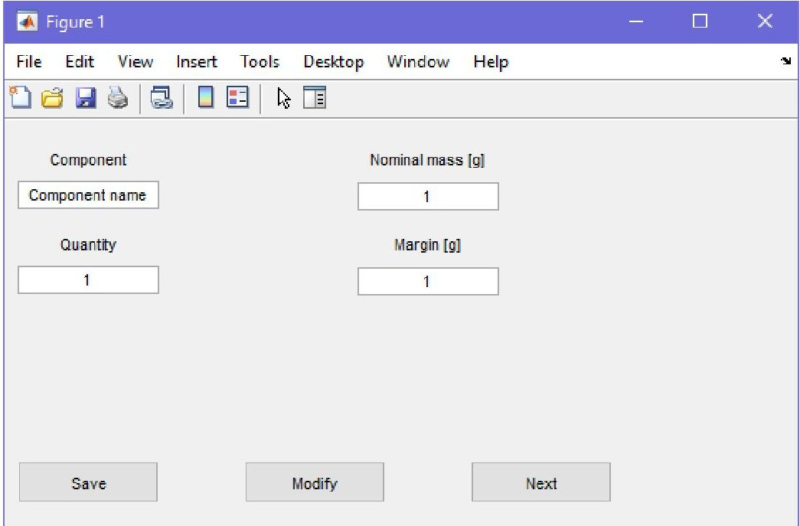

Figure 3-6 Mass budget - Input dialog

Figure 3-6 illustrates the input dialog used for the mass budget. It includes fields for entering the component's mass, margin, and quantity. The quantity parameter allows the user to specify multiple instances of a component. This parameter $ ( q_{i} ) $ becomes a simple multiplicative factor in the mass budget equations (Equations from ( 3-3 ) to ( 3-5 ))

As for the name of the component, it is useful for a matter of recognition, this aspect is explained below in this section.

The entered data is treated as strings by the "uicontrol" function, so the numerical values are converted using the Matlab command "str2double".

The user can enter component data one at a time.

The "Save", "Modify" and "Next" buttons, when clicked by the user, perform the following functions:

- Save: saves the entered data in an Excel document using the "xlswrite" command. Since the components are saved one at a time (therefore the user must click "Save" every time he enters the data of a new component in the boxes), it is necessary to specify each time in which row Matlab must write the values. To do this, before saving new data, the Excel document is read using the "xlsread" command and it determines how many lines of the sheet have been used, then the new line on which to write the data is set as the number of lines written, plus 1. This identifies the first free row on which to write the new data. Using this procedure it is possible to insert potentially unlimited numbers of components, without the need to define in advance the dimension of a matrix or a vector that contains all the components of the satellite. Every time "Save" is clicked, the Excel document is read and subsequently the entered data is saved in the first empty row. A check has been inserted to verify that the newly inserted component does not already exist, and if so it is not saved. This also avoids saving the same component twice, in case the user clicks the "Save" button several times consecutively. Finally, when the component has been saved in Excel, the user will see a message appear in the command window notifying of correct saving.

- Modify: in this case the user can modify the data of a previously entered component by writing them in the boxes and clicking the "Modify" button. For this procedure to work,

<!-- PDF_PAGE: 65 -->

the user must enter the name of a component that he saved previously. The Excel document is read, and in the column where the names of the components have been saved, the code searches for the name of the component that the user wants to modify. This is used to identify the row where the component data is saved, and write the new data over. In this case, a check has been inserted to verify that the name of the component inserted by the user is present in the list of those already inserted. If it does not exist, the user will see a message in the command window warning him of this, but the execution of the code is not interrupted. Then the user just needs to double check that he entered the correct name and click the button again.

- Next: this button closes the dialog window. The input dialog function is called in the code's main, and immediately afterwards the "waitfor" command is used which allows to pause the execution of subsequent commands until the figure is closed.

Using an Excel document to save data is useful for two reasons, the first is that the user can review and check the already inserted components whenever he wants. The second is that he can choose to enter the data directly into the Excel document, rather than entering it from Matlab. In this case, when the user starts the code and the input dialog appears, he can simply click "Next" and the code is still able to read the data saved on the Excel file and perform the calculations.

After clicking "Next" the code reads the complete Excel document, and performs the budget calculations (Section 3.3.1). Finally, the results are written to the same Excel document, and the "Complete" message appears in the command window.

## 3.4.2 Volume budget

At the beginning of the script execution the user is asked to enter the dimensions of the deployer, he is asked if he wants to enter them manually, or if he wants to use the default options - Table 3-1. In the first case, using the Matlab command "input", the user can enter the dimensions of the deployer in the command window. In the second case, he must enter the number of units of the CubeSat, according to Table 3-1. A check has been inserted to prevent the user from choosing a configuration not foreseen in the script. In this case the execution of the code is not interrupted, the user will see a message in the command window urging him to enter a valid configuration, or to stop the execution of the program and run it again to be able to enter the dimensions manually.

Once the volume budget constraint has been defined, the following input dialogs will appear in order (created in the same way as described in Section 3.4.1):

<!-- PDF_PAGE: 66 -->

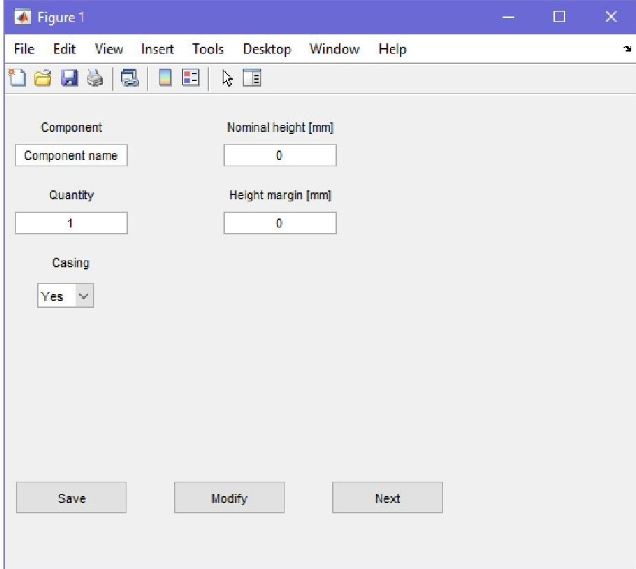

Figure 3-7 Volume budget - PCBs input dialog (1)

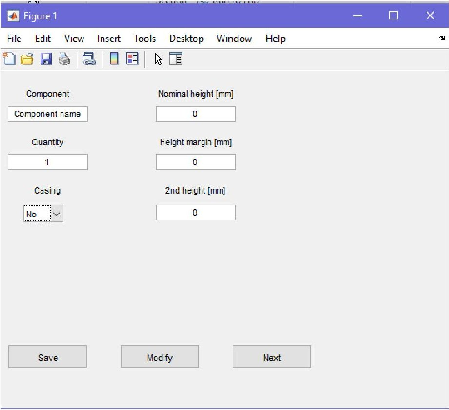

Figure 3-8 Volume budget - PCBs input dialog (2)

The first one is used for the definition of the PCBs. In this case, only the height of the component is requested since length and width are defined beforehand (Equation (3-6)). Furthermore, the user is asked whether or not the inserted PCB has a casing, and if the answer is negative, the height of the second highest component on the platform is requested.

The "Save", "Modify" and "Next" buttons perform the same functions described in Section 3.4.1.

<!-- PDF_PAGE: 67 -->

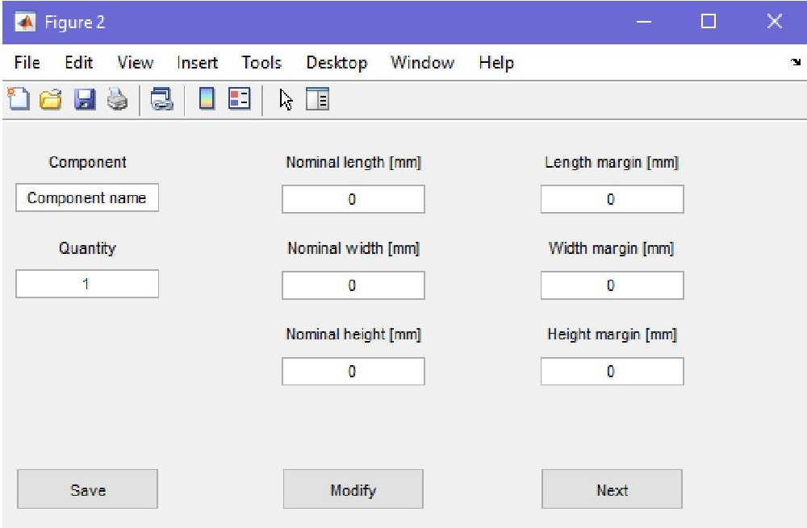

Figure 3-9 Volume budget - Other components input dialog

The second figure is used to define the other components of the CubeSat.

Once the second window is also closed, the code performs the calculations described in Section 3.3.2 and saves them in an Excel document.

## 3.4.3 Power budget

For the power budget, four parts can be identified: the calculation of the orbital parameters, the definition of the components and operating modes with the calculation of the consumed power, the definition of the solar panels and calculation of the generated power, and finally the discharge and recharge of the batteries.

First, the code performs the calculations on the orbital parameters, immediately after asking the user to enter the mission lifetime (through the "input" command).

In the part of the consumed power calculation, the first input dialog that opens is the one for entering the components that consume power (Figure 3-10). The user is asked to enter the voltage, current and power consumed by each component. The power consumption of each component is defined by three parameters: idle (for very low or zero consumption), average and peak.

Here, the "Save", "Modify" and "Next" buttons perform the same functions described in Section 3.4.1.

<!-- PDF_PAGE: 68 -->

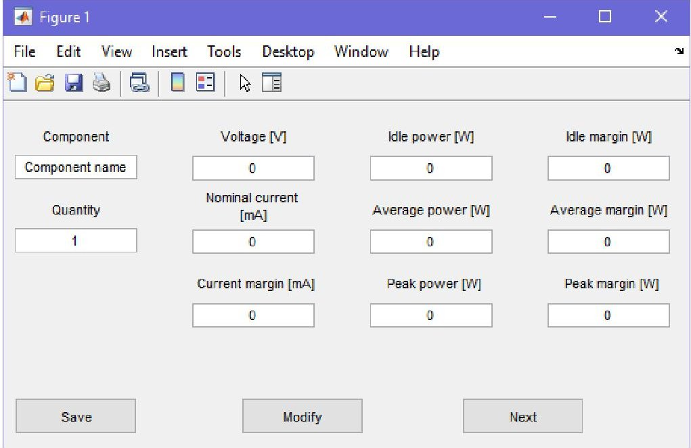

Figure 3-10 Power budget - Components input dialog

After clicking on "Next", a second window appears:

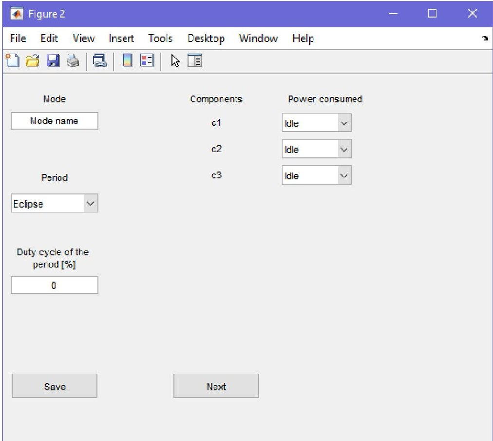

Figure 3-11 Power budget - Modes input dialog

Here the user is asked to enter the operating modes of the satellite. For each operating mode, the name is required (for recognition, the same as that described for the components), the period in which this mode is performed (whether during the eclipse period, the daylight period or both), the duty cycle over that period, and finally the selection of the power consumption (idle, average, peak) of each saved component.

In this case, only the "Save" and "Next" buttons were created, which perform the same functions described in Section 3.4.1.

In order for the list of components to appear in this figure, the input dialog function was created to take the list of component names as input. Inside the function, the boxes are created via a for loop that loops through the total number of components inserted.

<!-- PDF_PAGE: 69 -->

A check has been implemented on the entered duty cycle percentages of each mode, to avoid exceeding an overall duty cycle value of 100%.

Here, the calculations of the power consumption in eclipse and in daylight are performed (Equations ( 3-33 ) and ( 3-35 ))

Once the window is closed, the user is asked to insert in how many orbital cycles the satellite can execute all the entered modes, by writing an integer in the command window.

If the number is different than 1, a third window will appear:

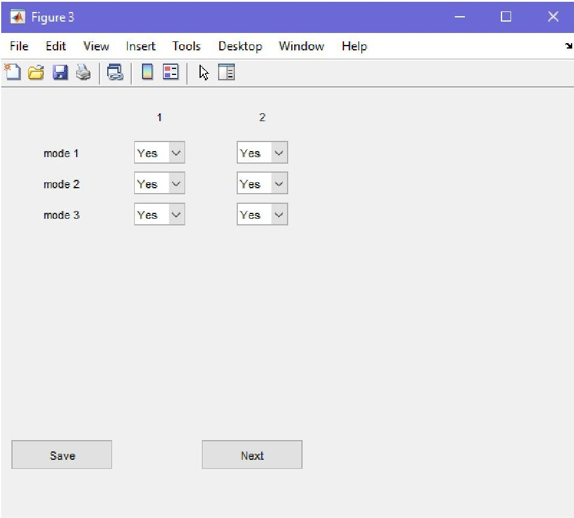

Figure 3-12 Power budget - Orbital cycles input dialog

Here the user must specify which mode runs in which orbital cycle, by specifying "Yes" or "No" in the drop-down box.

After clicking on "Next", the calculations of the consumed power are performed, considering only the contributions given by "Yes" in the sum.

The third involves taking as input the required parameters for the calculation of the power generated by the solar panels and then performing the calculation. The user is asked to enter, via the command window, the efficiency of the panels, the coefficient of degradation and the dimensions of a single panel (with relative margins). Furthermore, the user is asked to denote the configuration of the solar panels: body mounted or deployable, and their number. For the body mounted configuration it is necessary to enter the number of solar panels on each face of the satellite (this is always requested via the Matlab "input" command).

Once all the inputs have been taken, the power produced by the solar panels is calculated, based on the configuration.

The last section concerns the calculation of the discharge level of the batteries after the eclipse period and the charge during the following daylight period. Also in this case, the user is asked for some data on the performance of the batteries, via the following input dialog:

<!-- PDF_PAGE: 70 -->

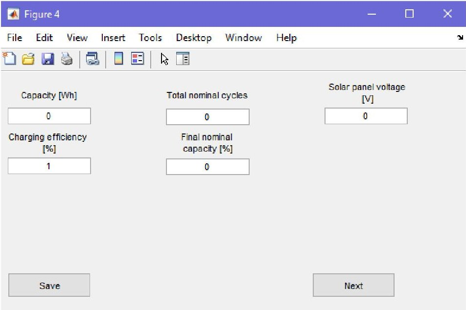

Figure 3-13 Power budget - Batteries parameters input dialog

At the end of each section, the data entered by the user and the results of the calculations performed are transcribed into an Excel document.

## 3.4.4 Data and Link budget

For the data budget, the orbital parameters are calculated first. Immediately afterwards, the user can enter the requested data via the input dialog in Figure 3-14.

The user can choose whether to enter the data rate of the component, or whether to enter the number of data and the update frequency, by selecting the preferred option using the drop-down box.

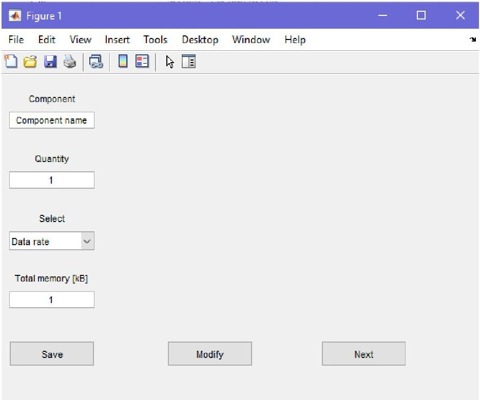

Figure 3-14 Data budget - Components input dialog

<!-- PDF_PAGE: 71 -->

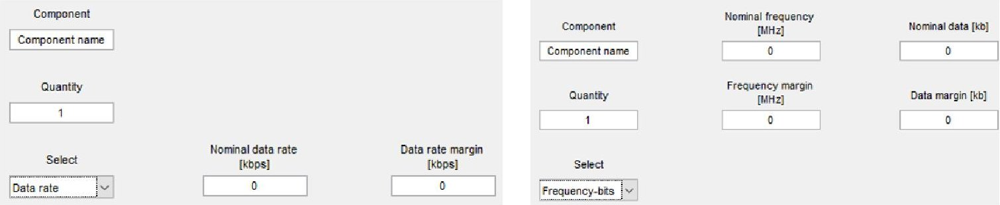

Figure 3-15 Data budget - input selection

After saving these components, the code calculates the total data generated in one orbit, and calculates the difference between the available memory and the number of data generated. The result is saved in an Excel document.

To calculate the download data rate required for data transmission, the parameters of the ground stations are required. In this case, the user is asked to enter an average of the parameters of the ground stations that are planned to be used during the mission, such as the gain of the receiving antenna and the elevation angle. Furthermore, he is asked to enter the total number of ground stations, as can be seen in Figure 3-16.

In addition to these parameters, the parameters of the satellite transmitting antenna appear in the same input dialog, such as the diameter (assuming a parabolic antenna), the transmission power, the gain, the efficiency and the frequency.

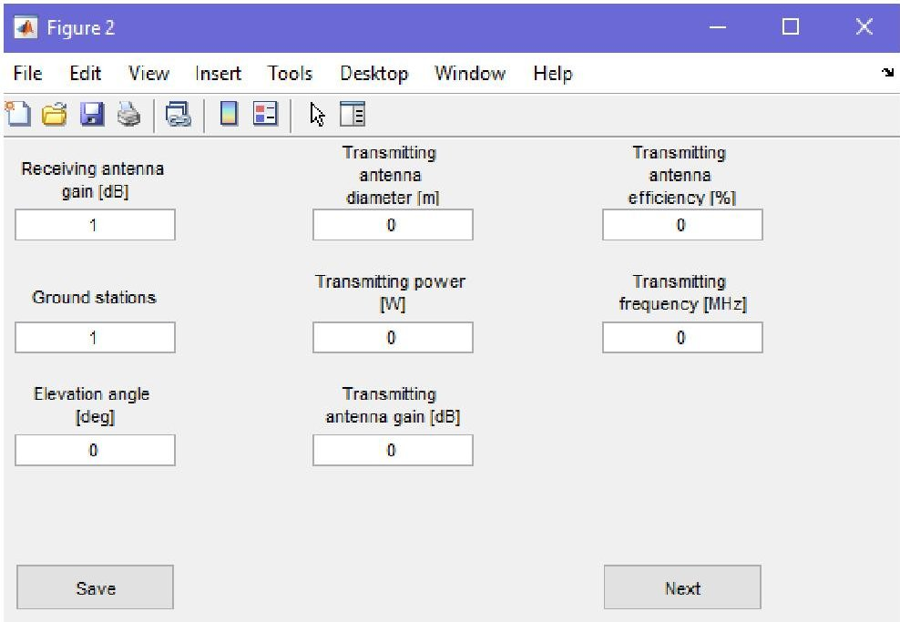

Figure 3-16 Data budget - Ground Stations and transmitting antenna input dialog

Using these data, the download data rate required for the transmission to Earth of all the data generated in one orbit is calculated. Furthermore, the calculation of the link margin is performed, to verify that the connection between CubeSat and ground stations is closed.

## 3.4.5 Momentum and Pointing budget

The momentum and pointing budget script is divided into six sections: the calculation of the orbital parameters, the definition of the geometric and mass properties of the CubeSat, the calculation of the external torque disturbances, the calculation of the torque for slew maneuvers, the simulation for detumbling, and the pointing error budget calculation.

<!-- PDF_PAGE: 72 -->

Through the use of an input dialog, the user can enter the Keplerian orbital parameters (orbit inclination, argument of periapsis, right ascension of ascending node, and true anomaly), mission start date, and ground stations parameters (altitude, longitude and latitude). Here the user is asked to enter only the data of one of the ground stations selected for the mission, for the calculation of the pointing maneuvers.

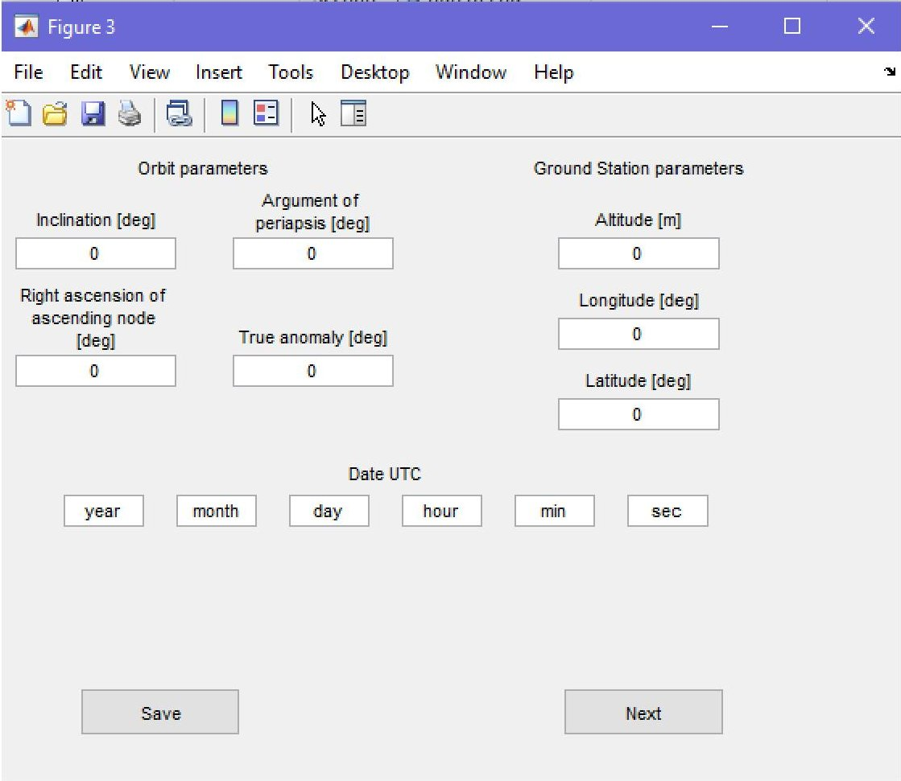

Figure 3-17 Momentum budget - Orbital parameters input dialog

After clicking "Next", the code performs the calculations described from Equation ( 3-110 ) to Equation ( 3-123 ).

Also in the case of the definition of mass properties and geometry, the user can enter the parameters in the following input dialogs:

<!-- PDF_PAGE: 73 -->

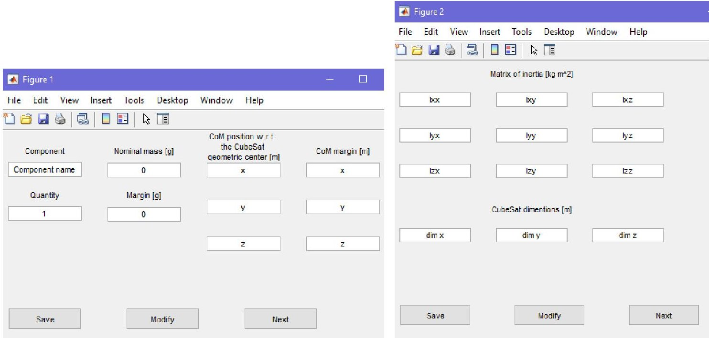

Figure 3-18 Momentum budget - Mass and Geometry input dialogs

When the second window closes, the code calculates the surface areas of the CubeSat, and its total area.

In the external disturbances calculation section, no user input is required, the calculations expressed in Equations from ( 3-128 ) to ( 3-144 ) are performed.

For slew maneuvers, the user is asked to enter the time required for the maneuver in the command window.

Compared to the other codes, a simulation in Simulink has been inserted here to understand the behavior of the CubeSat during detumbling. The user is asked to enter the gain of the control law in the command window, which, by default, is set to 5000 to have a fast detumbling, but when the user enters its value this is rewritten. He also has to enter the magnetic moment of the magnetorquers along the three CubeSat body axes, the initial angular velocity of the CubeSat after it's deployed from the launcher, and the initial Euler angles (which can be arbitrary). The schematics of the simulation is shown in Figure 3-19

The schematics of the simulation is shown in Figure 3-19.

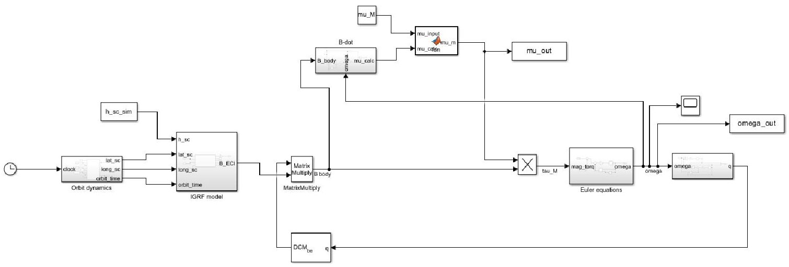

Figure 3-19 Detumbling simulation in Simulink

The simulation starts with a "Clock" which indicates the simulation time ("clock") and is used to calculate the mission time starting from the start mission time.

<!-- PDF_PAGE: 74 -->

The first block "Orbit dynamics" calculates the geocentric latitude ("lat_sc") and longitude ("long_sc") of the spacecraft, and provides the mission time ("orbit_time"). It is represented by a Matlab function, written directly in Simulink.

The IGRF model block calculates the Earth's magnetic field ("B_ECI") at the position of the CubeSat at the time indicated by "orbit_time". The magnetic field is calculated in ECI coordinates, it is therefore necessary to transform it into body coordinates ("B_body") before using it in the control law. This transformation is performed by multiplying the magnetic field by a direction cosine matrix which represents the attitude of the CubeSat through a quaternion. The calculation of the magnetic field is performed by the "International Geomagnetic Reference Field" block, which requires as input the altitude of the spacecraft ("h_sc_sim"), its latitude and longitude and the time. As an output it gives the magnetic field in nano Tesla, so a "gain block" has been added in front of the result to transform the nanoTesla to Tesla.

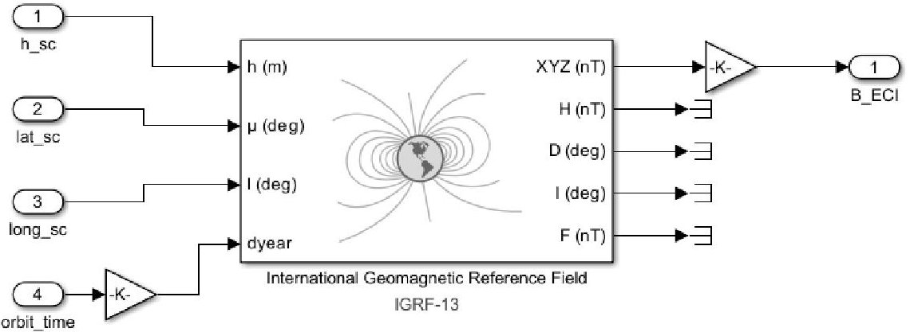

Figure 3-20 Detumbling simulation - IGRF model

The "B-dot" block represents the control law.

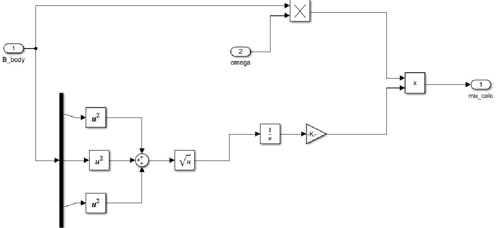

Figure 3-21 Detumbling simulation - B-dot

In input it requires the magnetic field in body frame and in output it supplies the magnetic moment calculated, that the magnetorquers need to apply.

This block represents Equation ( 3-171 ).

Immediately after, there is a block that represents a Matlab function that checks if the calculated magnetic moment ("mu_calc") is greater than the maximum magnetic moment of the magnetorquers ("mu_M"). In this case, the maximum magnetic moment of the magnetorquers is applied and not the calculated one. This result is saved in the workspace, using a "To workspace" block.

<!-- PDF_PAGE: 75 -->

The vector product between the magnetic field and the magnetic moment gives the applied magnetic torque ("tau_M" or "mag_torq") which acts as input for the block "Euler equations". This block calculates the derivative of the angular velocity, which is integrated through the "integrator" block and which supplies the angular velocity ("omega") in output. "omega" is saved in the workspace, using a "To workspace" block.

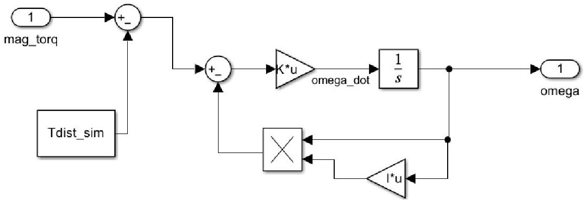

Figure 3-22 Detumbling simulation - Euler equations

Finally, the "Quaternions" block calculates the spacecraft attitude quaternion ("q") , that is the input into the "Quaternions to Direction Cosine Matrix" block which calculates the direction cosine matrix for the ECI to body reference frame transformation.

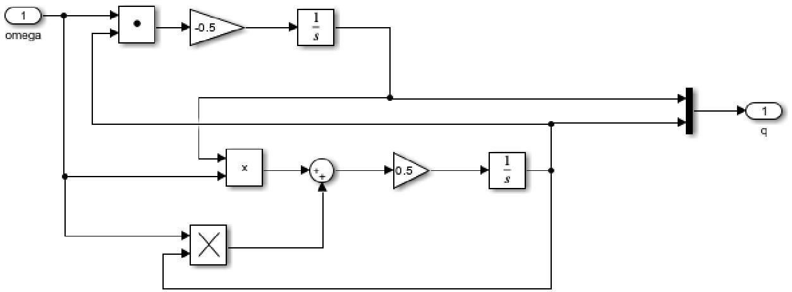

Figure 3-23 Detumbling simulation - Quaternions

The trend of the angular velocity can be viewed in the "Scope" block. Figure 3-24 shows an example of the Scope block for the angular velocity.

<!-- PDF_PAGE: 76 -->

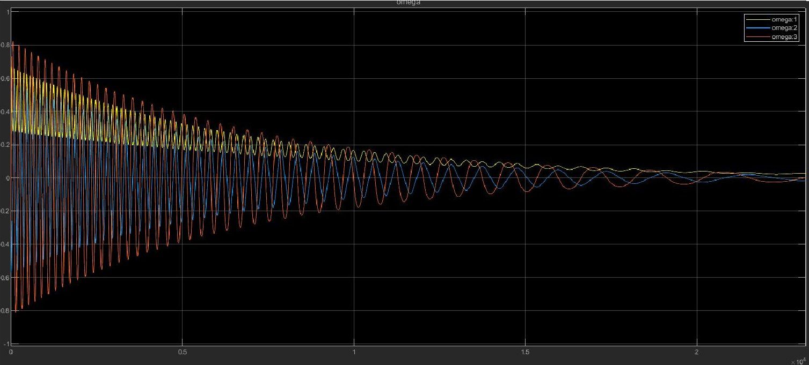

Figure 3-24 Detumbling simulation - Scope angular velocities

Finally, in the pointing budget section, the user is asked to first enter the accuracy of sensors and actuators and their accuracy errors through an input dialog.

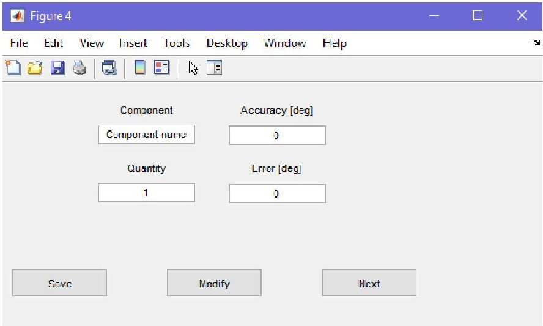

Figure 3-25 Pointing budget - Sensors and actuators input dialog

Subsequently the user needs to enter the pointing error sources, defined according to the description in the Space mission engineering: the new SMAD [16].

<!-- PDF_PAGE: 77 -->

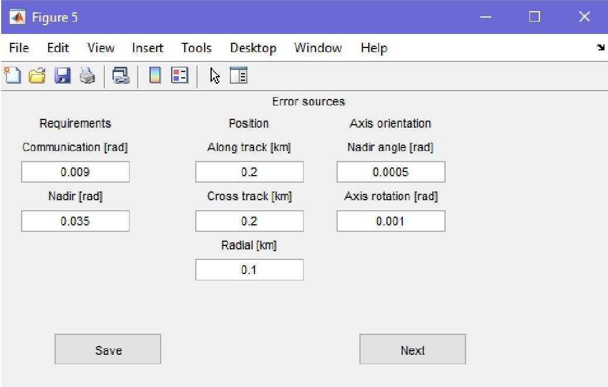

Figure 3-26 Pointing budget - Pointing errors input dialog

Finally, through the command window, the user is asked to enter the elevation angle of the satellite, as seen from the ground station.

As in the previous scripts, the inputs and results of all sections of the code are written to an Excel document.

## 3.4.6 Thermal budget

The thermal budget script is composed of two sections: the definition of the operational temperatures through an input dialog, and the calculation of hot and cold case equilibrium temperatures.

Figure 3-27 Thermal budget - Operational temperatures input dialog shows the input dialog for the definition of the operational temperatures and their margins.

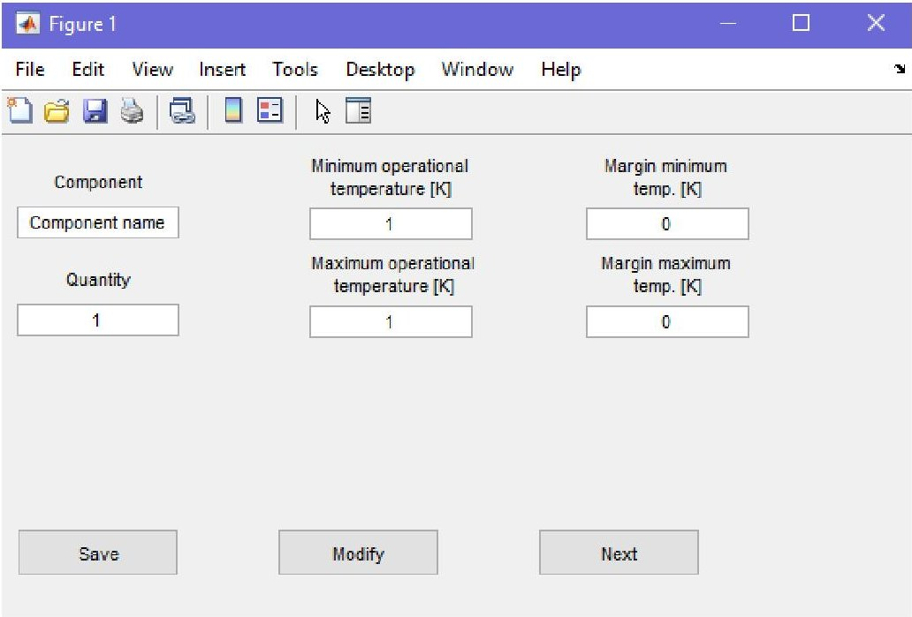

Figure 3-27 Thermal budget - Operational temperatures input dialog

The "Save", "Modify" and "Next" buttons, when clicked by the user, perform the same functions described in Section 3.4.1.

<!-- PDF_PAGE: 78 -->

In this section, after the input dialog is closed, the code looks for the maximum value among the minimum temperatures, and the minimum value among the maximum temperatures, to define the temperature limits for the entire spacecraft.

In the worst case scenario calculation section, the user is asked to enter the absorbance and emissivity of the satellite surface and its dimensions, using the "input" command.

Furthermore, the consumed power values are requested separately for the hot case (maximum power consumed) and for the cold case (minimum power consumed).

The heat fluxes are calculated separately on each face of the spacecraft, and finally the equilibrium temperature on each face of the CubeSat and the mean equilibrium temperature are calculated.

The corresponding margins are also calculated for each of these parameters.

As anticipated in Section 3.3.6, thermal analysis using the PDE toolbox is not suitable for this study. However, the first attempt to use the tool and the results are presented below.

The thermal analysis is solely static and performed only on the external structure of the spacecraft.

This type of analysis is performed using the Matlab PDE toolbox, which allows to solve the thermal model through a finite element analysis.

First, a "PDE model" is created, in which the type of analysis to be performed (in this case thermal) is defined.

The geometry of the CubeSat is then assigned to this model, which will simply be a parallelepiped with the dimensions previously defined by the user. Once the geometry has been created, the domain is divided into many small parts, thus creating a mesh. The PDE model will solve the equations on each node of the created mesh, therefore the mesh must be fine based on the desired accuracy in the analysis. Figure 3-28 shows two examples of mesh refinement.

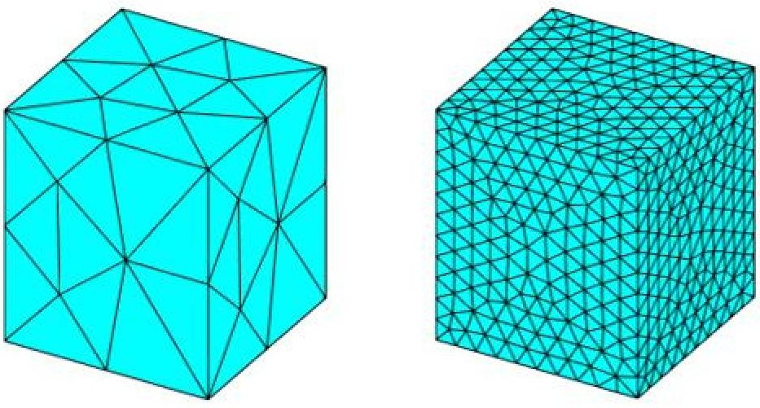

Figure 3-28 Thermal analysis - Examples of mesh refinement

Once the mesh is defined, the thermal properties must be assigned to the model. For the static analysis, only the thermal conductivity of the CubeSat material is required. This is requested as input by the user, who will have to provide an average of this parameter.

Then the internal heat production, equal to the power consumed, is assigned. The boundary conditions are defined for each face, assigning the value of the external heat flux on that surface and the surface temperature.

Finally, the initial temperature conditions are defined, also requested as input from the user.

The result of the analysis provides the temperature gradients on the surface of the CubeSat, as shown in Figure 3-29. The temperature range is given in Kelvin.

Thermal analysis was performed for both the hot case and the cold case.

<!-- PDF_PAGE: 79 -->

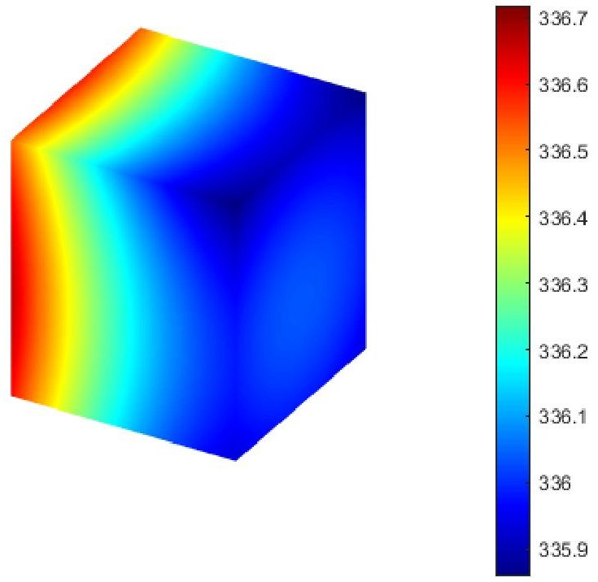

Figure 3-29 Thermal analysis - Results

## 3.4.7 Code consolidation

The consolidation of the code involved the integration of all the codes of the different budgets into a single code. To do this, all the inputs required in the various scripts have been grouped and inserted into various dialog boxes, each of which is represented by a function.

The list of functions used in the main code is as follows, each function will be explained in detail below:

- "CubeSat_budgets.m"

- "Components_definition.m"

- "CubeSat_definition.m"

- "Matrix_definition.m"

- "Orbit_definition.m"

- "GroundStations_definition.m"

- "Pointing_definition.m"

- "modes_definition.m"

- "cycles_definition.m"

- "num2x1col.m"

- "orbit2ECI.m"

In addition to these functions, the code works thanks to the use of two Excel documents, called "Inputs.xlxs" and "Results.xlsx", and the inclusion of the simulation for detumbling created in Simulink, "detumbling_sim.slx".

The "CubeSat_budgets" function is the main part of the code, within which the functions of the input dialogs are called and all budget calculations are performed.

As can be seen in the previous sections, for each budget the user was asked to enter some parameters of the components. All these parameters have been grouped within a single input dialog, defined by the "Components_definition" function (Figure 3-30).

<!-- PDF_PAGE: 80 -->

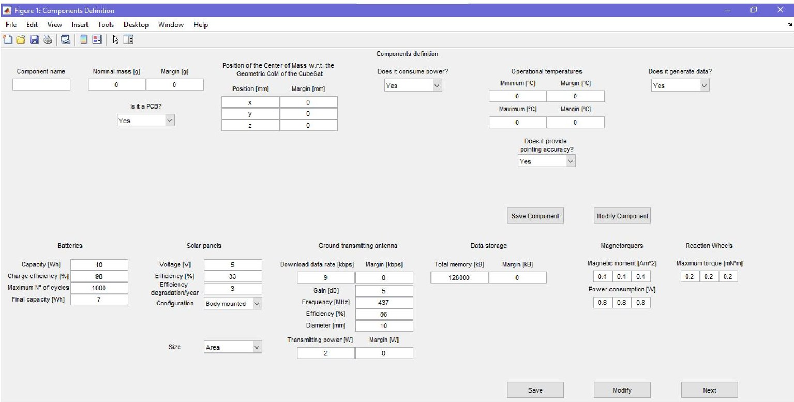

Figure 3-30 Consolidation - Components definition

In the upper part of the window the user can enter all the data of the components required for the calculation of the budgets, such as the mass, the dimensions, the position with respect to the geometric center of the CubeSat, the power consumption (if any), the operating temperatures, data generation (if any), and pointing accuracy (if any).

The "Save component" and "Modify component" buttons save the component inserted in the "Inputs" Excel document, or modify it. Their functionality is the same as described in Section 3.4.1.

The lower part of the window concerns the parameters of the special components of the CubeSat, such as the batteries, the solar panels, the communication antenna with the Ground Stations, the system memory, the magnetorquers and the reaction wheels.

The "Save", "Modify" and "Next" buttons perform the same functions described in Section 3.4.1, saving the data in the Excel document named "Inputs".

Also in this case the user can choose whether to enter the data via the Matlab input dialog, or whether to enter them directly into the Excel document.

The "CubeSat_definition" function is shown in Figure 3-31.

Here the characteristics of the CubeSat are asked, such as its dimensions, magnetic and thermal properties, and the maximum mass allowed by the requirements.

<!-- PDF_PAGE: 81 -->

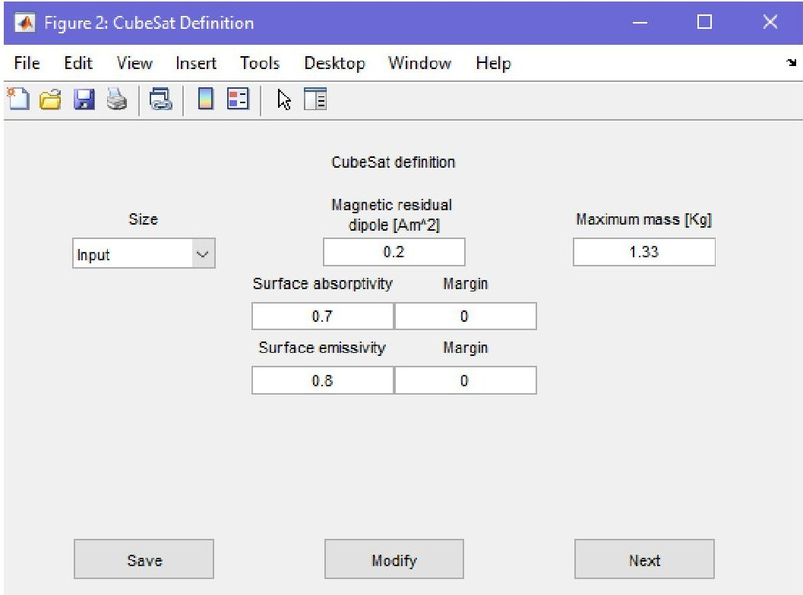

Figure 3-31 Consolidation - CubeSat definition

The "Matrix_definition" function asks for the inertia matrices of each component that has been inserted previously.

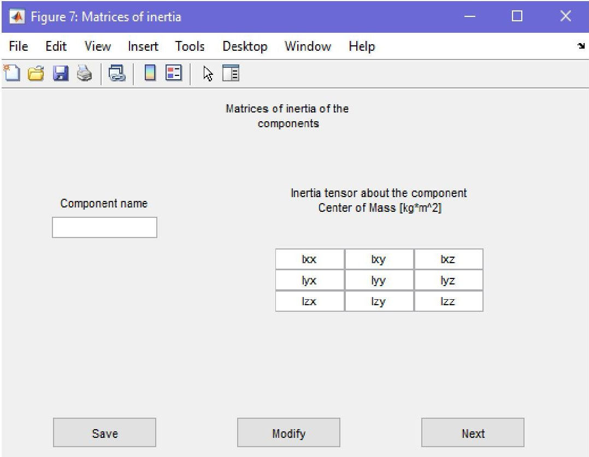

Figure 3-32 Consolidation-Inertia matrices definition

The code returns an error message and blocks the execution if the user has not entered the inertia matrix of all the components entered in the first window.

The "Orbit_definition" function asks for the orbital parameters:

<!-- PDF_PAGE: 82 -->

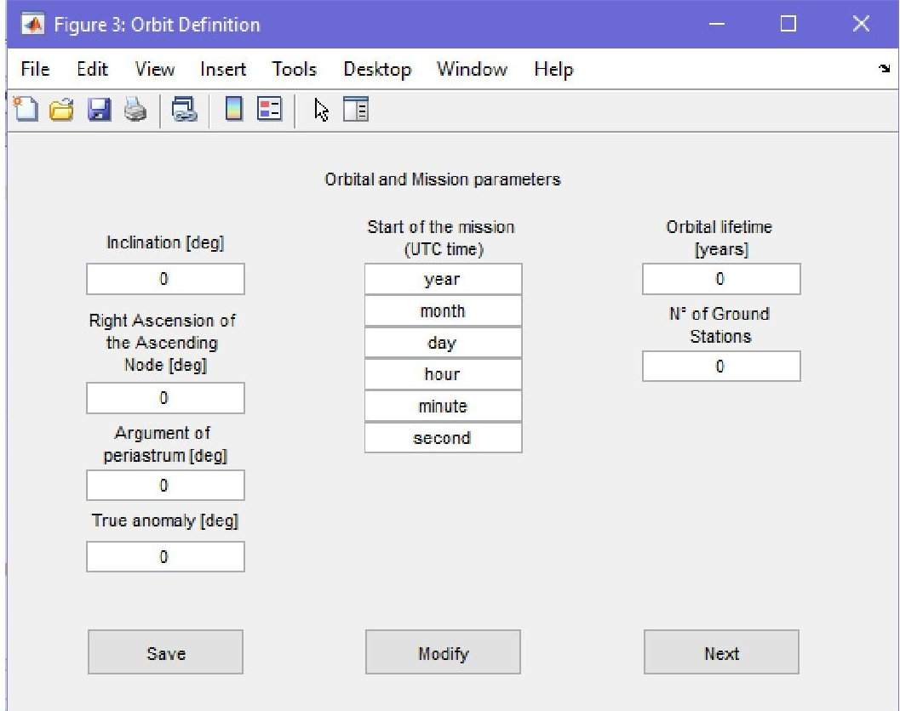

Figure 3-33 Consolidation - Orbital parameters

And immediately after this the parameters of the ground stations are requested ("GroundStations_definition"):

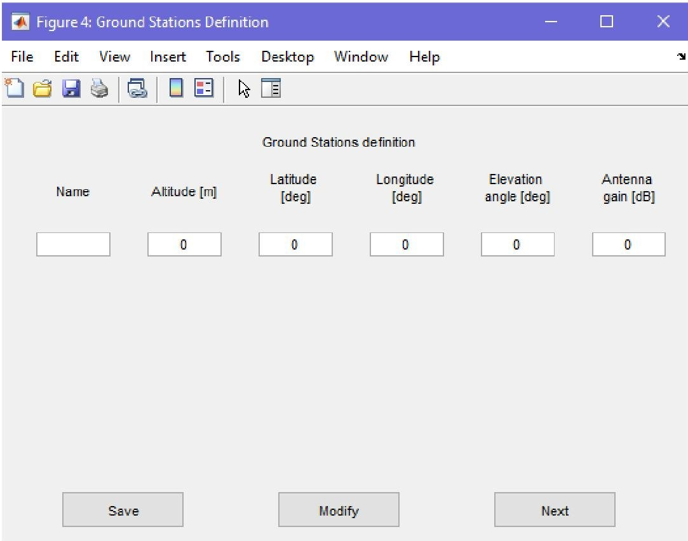

Figure 3-34 Consolidation - Ground Stations definition

Here the user must enter the data of the ground stations identified for the mission one at a time. Once the window is closed, if the number of ground stations inserted does not correspond to the number entered in the previous window, the execution of the code is interrupted and an error message appears which invites the user to verify the inserted data.

<!-- PDF_PAGE: 83 -->

Compared to the data budget and momentum budget codes developed individually, in this case the data of each ground station considered is requested, so as to have a more precise picture of the parameters concerning communication with the Earth.

The last input dialog is defined by the "Pointing_definition" function:

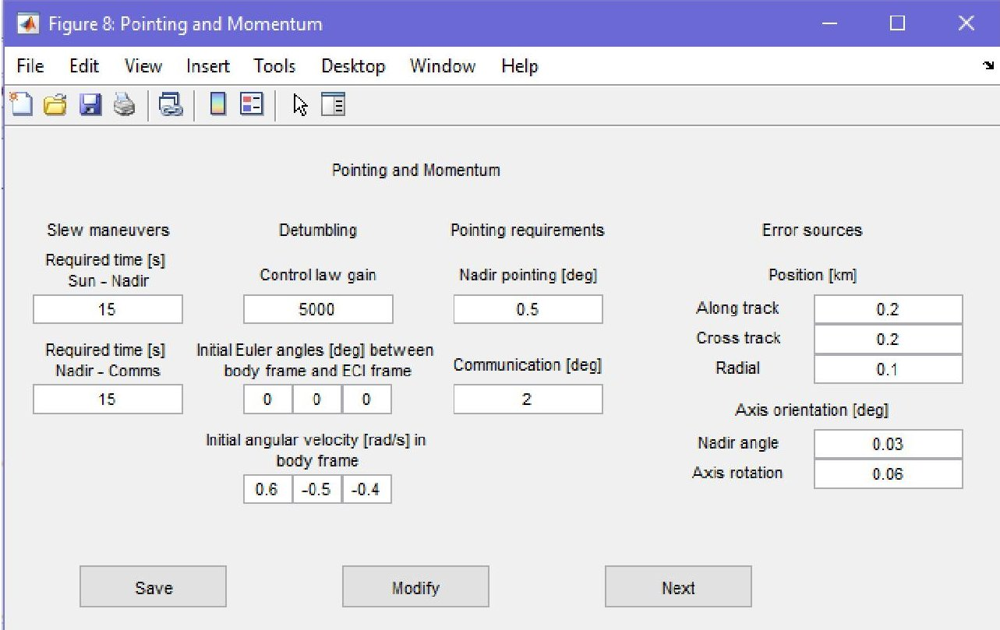

Figure 3-35 Consolidation - Momentum and Pointing parameters

All parameters for momentum and pointing budget are grouped here, such as required times for slew manoeuvres, parameters for detumbling, pointing requirements and sources of pointing errors.

All data entered in these windows is saved in the Excel document "Inputs". Then the code reads the document and saves all the data in the workspace to be able to use it in the calculations. The most important part of the code is the budgets calculations, which exactly reproduces the calculations reported in Sections 3.3.1 to 3.3.6.

In the power budget section, two other input dialogs have been added to enter the operating modes ("modes_definition" and "cycles_definition" functions). These two functions are the same as those described in Section 3.4.3 (Figure 3-11 and Figure 3-12).

Finally the "num2xlcol.m" function is used to transform a number in the corresponding column in Excel, it is used to save consecutive elements in the column, such as the operating modes. The "orbit2ECI.m" function transforms the satellite position and velocity vector from coordinates in the orbital plane to coordinates in the ECI reference system. The "detumbling_sim" simulation is the same as described in Section 3.4.5.

After calculating each budget, the code provides a message in the command window informing the user of the results. The message tells if the requirement of that budget is met. For example, for the mass budget, the code says if the result is less than the maximum imposed mass, or if it is greater. If the constraint is not respected, the message also returns the value of the excess. Furthermore, considerations are also made with the margins. In the event that the constraint is respected, the margin which provides the worst result is considered and vice versa when the requirement is not met.

<!-- PDF_PAGE: 84 -->

Budget results are saved in the "Results" Excel document. To highlight the effect of the margins we can see the example of the mass budget (Figure 3-36), in which the nominal value, the margin, and the minimum and maximum value given by the nominal value minus or plus the margin are saved. Finally, the constraint that represents the comparison value for the budget is highlighted.

<table border="1"><tr><td></td><td>A</td><td>B</td><td>C</td><td>D</td><td>E</td></tr><tr><td>1</td><td>Mass[kg]</td><td>Margin[kg]</td><td>Minimum mass[kg]</td><td>Maximum mass[kg]</td><td>Constraint[kg]</td></tr><tr><td>2</td><td></td><td></td><td></td><td></td><td></td></tr></table>

Figure 3-36 Consolidation - Results mass budget

Furthermore, the code provides graphs of the trend of the angular velocities in the CubeSat body axes, during detumbling, for each altitude considered.

Finally, a simulation of the depth of discharge of the batteries over the orbital cycles is also performed. This graph only shows the battery discharge and charge process at the end of each orbital cycle, no battery usage peaks are highlighted due to the power consumption of a specific component within the single orbital cycle.

## 3.5 Test and Verification

To verify the accuracy and reliability of the code, a comprehensive validation process was followed. After completing the programming of each section of the code, code execution tests were performed to identify and correct errors or warning messages.

To further validate the individual codes developed for each budget, they were tested on examples of system budgets of various CubeSats found in articles or online researches. One of these was the study of the power budget of the CubeSat J3 [32], on which the implementation of the power budget in Matlab was initially based.

Figure 3-37 shows the result obtained with the code on the power consumption for CubeSat J3 (Figure 3-38).

<table border="1"><tr><td>Mode</td><td>Eclipse/Sunlight/Both</td><td>Total power/mode[W]</td></tr><tr><td>Instr Off</td><td>Both</td><td>0,399</td></tr><tr><td>Instr On</td><td>Both</td><td>0,572</td></tr><tr><td>Comm On</td><td>Both</td><td>0,344</td></tr></table>

Figure 3-37 CubeSat J3 power consumption - Test

A comparison was made between the calculations of the power consumed in the different operating modes, considering the line of the "Total" in Figure 3-38 and multiplying those values by the duty cycle of the mode. The results obtained from the code are very close to the original ones, a slight difference can be seen due to the margin applied in the original calculations, which in the Matlab code is not considered as a percentage, but as a value added or subtracted from the result.

<!-- PDF_PAGE: 85 -->

Table 4.2: Power consumption budget of $ \mathrm{J}^{3} $ CubeSat

<table border="1"><tr><td rowspan="2">Component</td><td rowspan="2">Voltage(V)</td><td rowspan="2">Power(W)</td><td colspan="2">Instrument Off</td><td colspan="2">Instrument On</td><td colspan="2">Comm. On</td><td></td><td>Total(W)</td></tr><tr><td>Converter Eff.(%)</td><td>Power(W)</td><td>Converter Eff.(%)</td><td>Power(W)</td><td>Converter Eff.(%)</td><td>Power(W)</td><td></td><td></td></tr><tr><td>NanoMind</td><td>3.3</td><td>0.13</td><td>93</td><td>0.14</td><td>93</td><td>0.14</td><td>92</td><td>0.14</td><td></td><td></td></tr><tr><td>SolarPanel(x6)</td><td>3.3</td><td>0.01</td><td>93</td><td>0.01</td><td>93</td><td>0.01</td><td>92</td><td>0.01</td><td></td><td></td></tr><tr><td>Antenna</td><td>3.3</td><td>0.02</td><td>93</td><td>0.02</td><td>93</td><td>0.02</td><td>92</td><td>0.02</td><td></td><td></td></tr><tr><td>Reciever</td><td>3.3</td><td>0.18</td><td>93</td><td>0.20</td><td>93</td><td>0.20</td><td>92</td><td>0.20</td><td></td><td></td></tr><tr><td>Transmitter</td><td>3.3</td><td>2.64</td><td></td><td></td><td></td><td></td><td>92</td><td>2.87</td><td></td><td></td></tr><tr><td>RATEX-J</td><td>3.3</td><td>0.53</td><td></td><td></td><td>93</td><td>0.57</td><td></td><td></td><td></td><td></td></tr><tr><td>RATEX-J</td><td>5</td><td>0.15</td><td></td><td></td><td>92</td><td>1.72</td><td></td><td></td><td></td><td></td></tr><tr><td>RATEX-J</td><td>12</td><td>1.16</td><td></td><td></td><td>81</td><td>Included to 5V</td><td></td><td></td><td></td><td></td></tr><tr><td>RATEX-J</td><td>-5</td><td>TBD</td><td></td><td></td><td>TBD</td><td>TBD</td><td></td><td></td><td></td><td></td></tr><tr><td>RATEX-J</td><td>-12</td><td>TBD</td><td></td><td></td><td>TBD</td><td>TBD</td><td></td><td></td><td></td><td></td></tr><tr><td>EPS</td><td></td><td>0.15</td><td></td><td>0.15</td><td></td><td>0.15</td><td></td><td>0.15</td><td></td><td></td></tr><tr><td></td><td></td><td></td><td></td><td></td><td></td><td></td><td></td><td></td><td></td><td></td></tr><tr><td>Total</td><td></td><td></td><td></td><td>0.52</td><td></td><td>2.80</td><td></td><td>3.39</td><td></td><td></td></tr><tr><td>Total(+20%)</td><td></td><td></td><td></td><td>0.62</td><td></td><td>3.36</td><td></td><td>4.07</td><td></td><td></td></tr><tr><td>Duty Cycle</td><td></td><td></td><td>70%</td><td>0.43</td><td>20%</td><td>0.67</td><td>10%</td><td>0.41</td><td></td><td>1.51</td></tr></table>

Figure 3-38 CubeSat J3 power consumption - Original [32]

Other examples were provided by the company, such as power simulation and data budget calculation for SPiN-1. Or the definition of the operating modes in the Modular ADCS (for the power budget) and the pointing requirements for the pointing budget. The data provided by the company was used to study the method of implementing the calculations in the code, and for this reason the test results on this data were the same as those obtained by the company.

Once the code consolidation was completed, the tool was tested on a project the company is currently working on (for confidentiality reasons the project name cannot be disclosed). In Figure 3-39, the numerical results obtained using an Excel spreadsheet ("Original") and the results obtained using the Matlab tool ("Matlab code") are displayed. The mass budget test immediately gave results consistent with those previously calculated with Excel.

<table class="table table-bordered"><thead><tr><th></th><th>A</th><th>B</th><th>C</th><th>D</th><th>E</th><th>F</th><th>G</th><th>H</th></tr></thead><tbody><tr><td colspan="10">Power budget [Wh]</td></tr><tr><td colspan="3">Mass budget [kg]</td><td></td><td></td><td colspan="2">Avionics Battery Pack (28,8 Wh)</td><td colspan="2">Fan Battery Packs (2 kWh x2)</td></tr><tr><td>Original</td><td>Matlab code</td><td></td><td></td><td>Original</td><td>Matlab code</td><td>Original</td><td>Matlab code</td><td></td></tr><tr><td>38,51</td><td>38,51</td><td></td><td></td><td>24,1615</td><td>24,1604</td><td>228,4533</td><td>228,4273</td><td></td></tr><tr><td colspan="10">Post-processing Matlab</td></tr><tr><td></td><td></td><td></td><td></td><td>Eclipse period [%]</td><td>Eclipse (1 orbit - 1,58h)</td><td>Eclipse (4 orbits - 6,3h)</td><td>Eclipse (3,49 orbits - 5,5 h)</td><td>Complete orbit</td></tr><tr><td colspan="3">Avionics Battery Pack</td><td>37,79</td><td>2,617684</td><td>10,47074</td><td>9,130219</td><td>24,16041</td><td></td></tr><tr><td colspan="3">Fan Battery Packs</td><td>37,79</td><td>24,74919</td><td>98,99675</td><td>86,32269</td><td>228,4273</td><td></td></tr></tbody></table>

Figure 3-39 Mass and Power test results

The power budget test was also performed, but in this case the tool provided different results from those previously calculated. The difference lies in the calculation of the energy discharged from the batteries, in fact in the Matlab code the use of the batteries is considered only during

<!-- PDF_PAGE: 86 -->

the eclipse period, while in the daylight period the power comes from the power generated by the solar panels. For this mission, however, the use of solar panels is not foreseen, and the satellite must make a single orbit around the Earth and fall back to Earth immediately after. Therefore, since only the batteries were present, it was necessary to carry out post-processing calculations of the results to verify if the results obtained are compatible with those given.

First, the percentage of the eclipse period on the complete orbital cycle, equal to about 38% of the orbit, and the energy of the batteries consumed during that period in one orbit were obtained from the Matlab code. The altitude of the orbit is not yet known, but the duration of the mission is known to be approximately 5.5 hours. So starting from a reference altitude of 500 km, it has been calculated that the orbits that are completed in 5.5 hours are about 4 (3.5 orbits). Multiplying the value of the energy consumed during an eclipse period inside one orbit by 3.5 we obtain the energy consumed during an eclipse for one orbit that lasts 5.5 hours. Now it's easy to calculate the proportion with the percentage of the eclipse on the complete orbit to obtain the energy consumed during the entire orbit.

As can be seen in Figure 3-39, the results obtained are very close to those expected, except for a small error in the decimal part of the result. If margins are also considered in the calculations, the small difference in the result becomes negligible, since the result is seen as a range of possible values that meet the mission requirements. The difference obtained occurs due to the numerical approximations given by the code and those used in the post-processing calculations. Furthermore, the project foresees the use of two different battery packs for the on-board avionics and for the other components. There is no such division in the code for battery usage, so the code was executed twice. In one case the avionics components were defined with their normal power consumption and the other components with zero consumption, and vice versa in the other case. This way it was possible to obtain the results shown in the figure.

There are currently no details on the volume, data, momentum, pointing and thermal budgets for this project, so these have not yet been tested. The test of these budgets is part of the future work for the validation and use of the tool in a real-world scenario.

<!-- PDF_PAGE: 87 -->

## 4 Conclusions

The study conducted aims to address the calculation of the system budgets of a generic CubeSat using variable rather than fixed parameters, with the aim of speeding up the design process in the initial stages and providing a more in-depth understanding of the evolution of the system in different scenarios. To achieve this goal, extensive research has been carried out on the correlation between different system budgets, examining various methodologies, techniques and procedures for calculation and trying to understand how margins affect the results.

The first phase of the research focused on analysing existing methods and approaches for calculating system budgets, in order to identify best practices and relationships between different budgets. Subsequently, once the procedure and the calculations for each budget had been established, we moved on to the programming phase in Matlab. During this phase, a way was studied to make the code user-friendly, easy to use and intuitive for users. To this end, input dialogs (interactive figures) have been developed, containing boxes and buttons that simplify entering parameters and viewing the results.

In order to ensure correct use of the code, a complete user manual has been provided to users which explains all the necessary steps in detail. Additionally, research was conducted to understand how to implement margins in budget calculations. Since the margins represent the uncertainty of the parameters, it was decided to exploit the theory of error propagation, or uncertainty propagation, to obtain the results of the budgets defined by a range around a nominal value, taking into account the calculated margin.

Although the code has not yet been used in a real world scenario, some sections of it have been tested and validated through the application of system budgets on some CubeSat missions. In particular, mass budget and power budget were tested on a mission currently in the planning stage. The results obtained for mass budgeting were identical both using the traditional Excel spreadsheet and using Matlab code. For the power budget, it was necessary to perform post-processing calculations, as the code envisaged the discharge of the batteries only during the eclipse period, while the mission required the consumption of the batteries during the entire orbital cycle. After post-processing, the obtained results were in line with the expected ones, although there may be a small difference in the decimal part due to numerical approximations in the code and in the post-processing.

However, it is important to point out some limitations of the study. In particular, a significant limitation was found in thermal analysis. During code development, it was discovered that the capabilities of Matlab's PDE toolbox for thermal analysis were limited, requiring a simplified approach that focused on the surface temperature of the CubeSat rather than a full three-dimensional CAD model. However, this simplification has not proved sufficient, since the analysis performed was not purely radiative, and for this reason the thermal analysis has been temporarily set aside to be addressed in the future with the support of other more suitable software.

Despite the limitations encountered, the development of user-friendly code, combined with the incorporation of margins, lays the groundwork for a potentially effective tool for decision making during the design phase of CubeSat projects. By allowing designers and engineers to effortlessly explore different parameter values and evaluate their impact on the overall budget, this interactive and adaptable approach promises to improve the design process, minimize reliance on repetitive calculations and make it easier to locate components that meet mission requirements.

Furthermore, the developed code can be partially used for the study of space missions which are not necessarily CubeSats. With some modifications, the code can be adapted for a wide range of missions. In summary, this project contributes to the CubeSat design field by providing

<!-- PDF_PAGE: 88 -->

a useful budgeting tool that helps speed up the design process by reducing the number of iterations required in selecting components for the CubeSat. The implementation of margins also helps to understand the evolution and influence of variable parameters in the initial design stages.

While there are some limitations to address, the developed code represents a significant step toward a more efficient and informed design process for CubeSat projects.

## 5 Future work

During this study, a few challenges emerged, which prevented the project from being completed on time, and some points emerged on which improvements could be made. The highlights are broken down below:

- Integration of other software: Matlab alone proved to be an excellent solution for calculating system budgets, but relying only on the available toolboxes of the software it was not possible to carry out thermal and mechanical analyses on the CubeSat design. A solution to this aspect is to integrate the use of other software that can perform a thermal and/or mechanical analysis in a simple way, and that can be connected to Matlab for example by taking the input data from a Matlab script, or supplying the Matlab script with the results of the analyses. An example of such a software is Ansys. Another way to make the calculations in Matlab more precise can be to take the results of an orbital simulation performed on a software like STK and input these results to Matlab. This can help with more precise values in the evaluation of the orbital parameters, and above all in the attitude of the satellite, but also in the power generation of the solar panels. In fact, at this time the code considers the optimal generation of power by the solar panels, without taking into consideration the attitude of the CubeSat.

- Improved user interface: Currently the user interface consists of several dialog boxes that take as input parameters associated with a specific category. The user also has to click the "Save" button every time he inserts a new component or parameter, and this makes the application of the code a bit slow. Furthermore, the code does not currently provide for the possibility of going back, unless the user stops the execution of the script and then re-executes it. The interface could be improved by having a single, more interactive input dialog that allows the user to navigate from one section to another of the parameters to be entered, thus having the possibility of going back and modifying any parameter at any time. It might be interesting to find a way for the code to perform the budget calculations partially, so that if the user realizes that the path chosen is not the right one, he can immediately change the parameters and obtain different results.

- Depth of Discharge simulation: The battery DOD simulation only foresees the trend of the discharge and charge process at the end of the orbital period (eclipse for discharge and daylight for charge). This trend is useful for understanding how quickly the battery discharges, but does not provide any indication of how it discharges, this means that maximums (or minimums) are not highlighted in relation to higher consumption (or lower consumption) at a specific time. So, in addition to defining which components are active (average or peak power) in which operational modes, it is necessary to implement a component activation timeline. Another solution could be to specify the power consumption of each component in the DOD graph, so the user can easily identify the instants when the most consuming components are active.

<!-- PDF_PAGE: 89 -->

- Use of batteries both in eclipse and in daylight: The use of batteries is implemented only for periods of eclipse, while in daylight the solar panels provide power to the system. Instead, it is useful to give the user the possibility to choose whether the batteries are used only in eclipse or also in periods of light.

<!-- PDF_PAGE: 90 -->

## References

[1] Cappelletti, C., Battistini, S., & Malphrus, B. K. (2020). CubeSat Handbook: From Mission Design to Operations. Elsevier Gezondheidszorg.

[2] Kulu, E. Nanosatellite & CubeSat Database, Nanosats Database. Available at: https://www.nanosats.eu/database (Accessed: 13 June 2023).

[3] CubeSatShop. (2023, March 14). CubeSatShop.com - One-stop webshop for CubeSats & Nanosats. CubeSatShop.com. https://www.cubesatshop.com/

[4] SPiN, modularity. (n.d.). SPiN. https://www.spinintech.com/

[5] Modular ADCS final report

[6] SwissCube. (2012, June 14). https://www.eoportal.org/satellite missions/swisscube#mission-status

[7] Straub, J., Korvald, C., Nervold, A., Mohammad, A., Root, N., Long, N., & Torgerson, D. (2013). OpenOrbiter: A Low-Cost, Educational Prototype CubeSat Mission Architecture. Machines, 1(1), 1-32. https://doi.org/10.3390/mach1010001

[8] Johson, C. (n.d.). Open Orbiter. Dakota Student. https://dakotastudent.com/9737/news/open-orbiter/

[9] OMOTENASHI. (n.d.). Gunter's Space Page. https://space.skyrocket.de/doc_sdat/omotenashi.htm

[10] EQUULEUS. (n.d.). Gunter's Space Page. https://space.skyrocket.de/doc_sdat/equuleus.htm

[11] Campagnola, S., Hernando-Ayuso, J., Kakihara, K., Kawabata, Y., Chikazawa, T., Funase, R., Ozaki, N., Baresi, N., Hashimoto, T., Kawakatsu, Y., Ikenaga, T., Oguri, K., & Oshima, K. (2019). Mission Analysis for the EM-1 CubeSats EQUULEUS and OMOTENASHI. IEEE Aerospace and Electronic Systems Magazine, 34(4), 38-44. https://doi.org/10.1109/maes.2019.2916291

[12] Kulu, E. (n.d.). ORCA2Sat @ Nanosats Database. Nanosats Database. https://www.nanosats.eu/sat/orca2sat

[13] Bousson, K. (2021, January 4). Study of Low Earth Orbit impact on ORCA2SAT subsystems. https://ubibliorum.ubi.pt/handle/10400.6/8569

[14] Morrison, F. A. (2021). Uncertainty Analysis for Engineers and Scientists (1st ed.). Cambridge University Press.

[15] Larson, W. J., & Wertz, J. R. (1999). Space Mission Analysis and Design, 3rd edition (Space Technology Library, Vol. 8) (3rd ed.). Microcosm.

[16] Wertz, J. R., Everett, D. W., & Puschell, J. J. (2011). Space mission engineering: the new SMAD.

<!-- PDF_PAGE: 91 -->

[17] Zhu, F. (n.d.). A Guide to CubeSat Mission and Bus Design - Open Textbook Pressbooks. https://pressbooks-dev.oer.hawaii.edu/epet302/

[18] CubeSat - Deployer Standards. (n.d.). Retrieved February 14, 2023, from https://www.eoportal.org/other-space-activities/cubesat-deployer-standards

[19] Corpino, "Aerospace Systems" lessons, Politecnico di Torino, 2021

[20] Power usage simulation - SPiN-1

[21] Zhang, C., Jiang, J., Gao, Y., Zhang, W., Liu, Q., & Hu, X. (2017). Charging optimization in lithium-ion batteries based on temperature rise and charge time. Applied Energy, 194, 569-577. https://doi.org/10.1016/j.apenergy.2016.10.059

[22] Perez, A., Quintero, V., Rozas, H., Jaramillo, F., Moreno, R., & Orchard, M. E. (2017b). Modelling the degradation process of lithium-ion batteries when operating at erratic state-of-charge swing ranges. International Conference on Control, Decision and Information Technologies. https://doi.org/10.1109/codit.2017.8102703

[23] Cubesat IOD budgets - SPiN 1

[24] Battipede, "Space flight mechanics" lessons, Politecnico di Torino, 2021

[25] Link budget - SPiN-1

[26] Capello, "Spacecraft dynamics and control" lessons, Politecnico di Torino, 2021

[27] Markeley et.al., "Fundamentals of Spacecraft Attitude Determination and Control", Springer, 2014.

[28] Chong, K.-K., & Wong, C.-W. (2010). General Formula for On-Axis Sun-Tracking System. Solar Collectors and Panels, Theory and Applications. https://doi.org/10.5772/10341

[29] MATLAB Documentation - MathWorks Italia. (n.d.).

https://it.mathworks.com/help/matlab/index.html?s_tid=hc_panel

[30] Sharma, Rishav & Kawari, Rohit & Bhandari, Sagar & Panta, Shishir & Prajapati, Rakesh & Adhikari, Nanda. (2021). Simulation of CubeSat Detumbling Using B-Dot Controller. 10.1007/978-981-33-4355-9_40.

[31] Naraghi, Mohammad. "Radiation View Factors from Differential Plane Sources to Disks - a General Formulation." Journal of Thermophysics and Heat Transfer, vol. 2, no. 3, 1 July 1988, pp. 271-274, https://doi.org/10.2514/3.96.

[32] Sirin, A. (2015). Power System Analysis of J3 CubeSat and RATEX-J High Voltage Power Supply Calibration. Master's Thesis. http://ltu.diva- portal.org/smash/record.jsf?pid=diva2:1020892