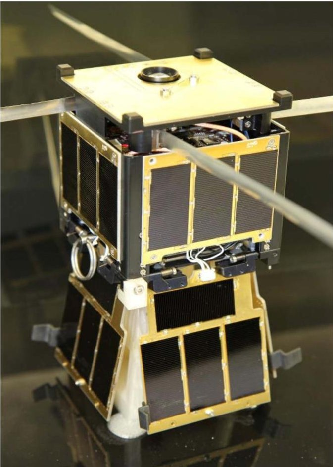
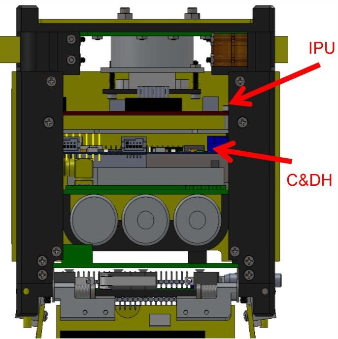
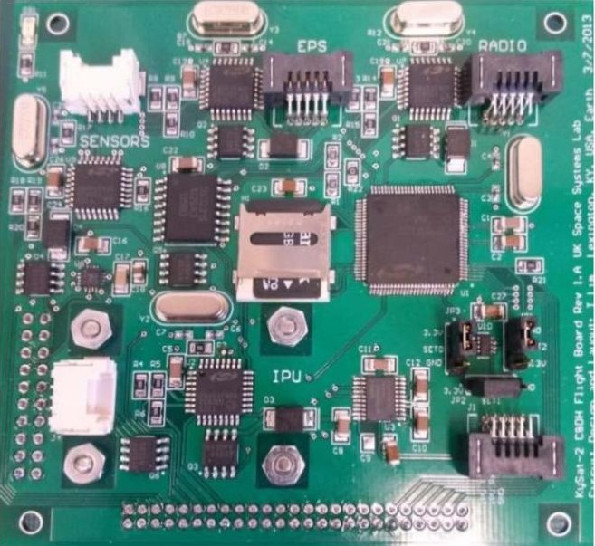
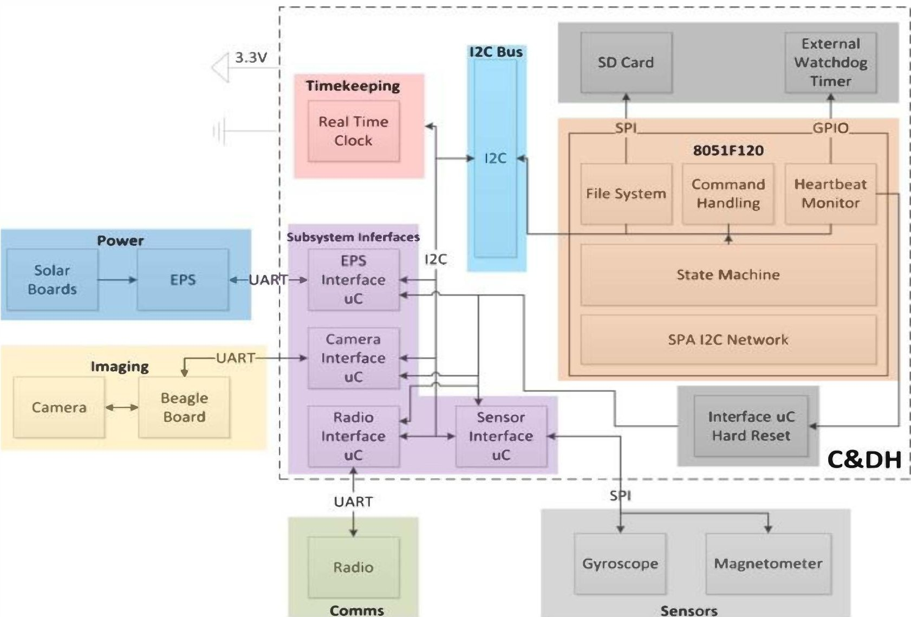
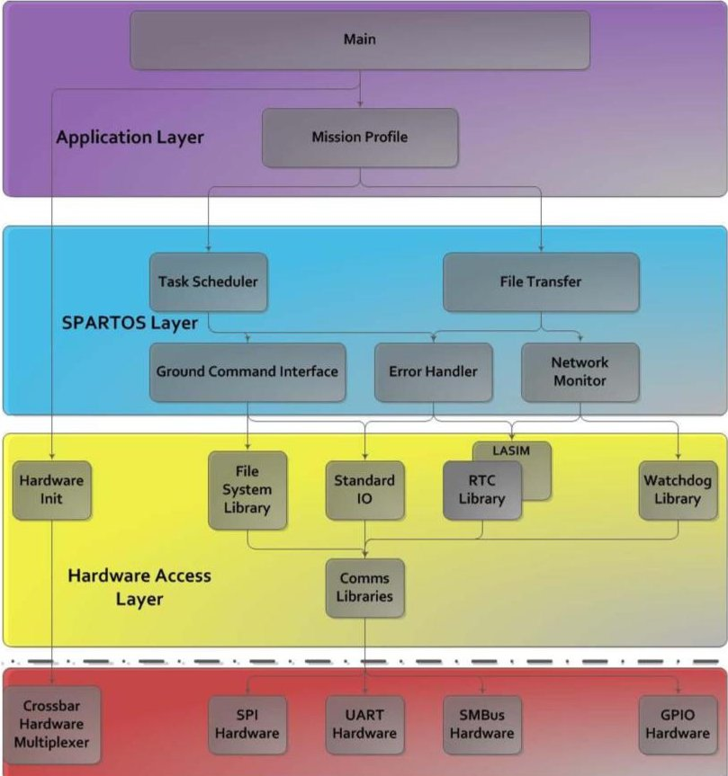
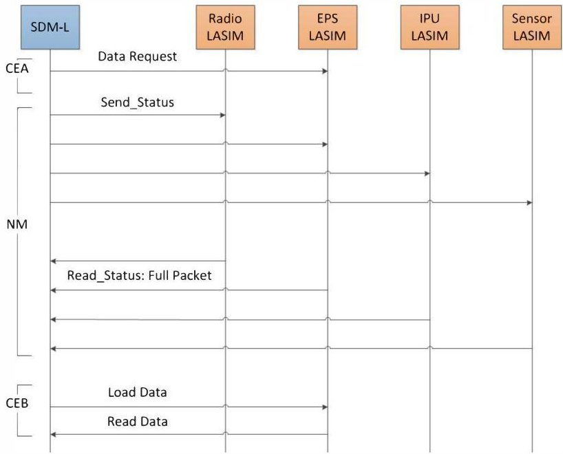
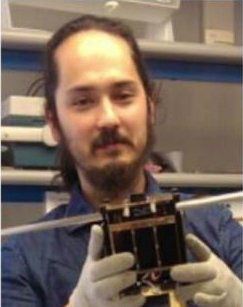
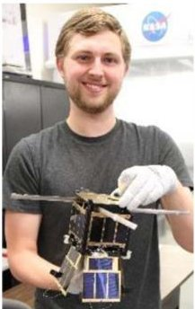
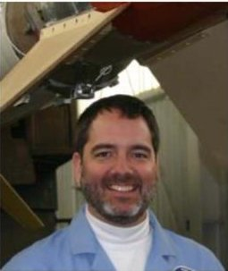

<!-- PDF_PAGE: 1 -->

# Development of a Modular Command and Data Handling Architecture for the KySat-2 CubeSat

Christopher Mitchell, Jason Rexroat Samir A. Rawashdeh, James Lumpp

Space Systems Laboratory

University of Kentucky

Lexington, KY 40506

859-257-8042

jel@uky.edu

Abstract—KySat-2 is a 1U CubeSat launched on the NASA ELaNa IV mission on November 19, 2013. The Command & Data Handling (C&DH) architecture for KySat-2 leverages aspects of the Space Plug-and Play Avionics (SPA) standard developed by the Air Force Research Laboratory (AFRL) and adapts it to the constraints of the CubeSat form factor. The design eases interfacing commercial-off-the-shelf (COTS) and legacy components in the satellite and also enhances software reusability, with motivation to decrease time-to-orbit and reduce system cost and complexity, while increasing reliability. The KySat-2 CubeSat C&DH architecture utilizes a central processor that carries out mission-specific functionality, command interpretation, and scheduling. Interface processors are dedicated to, and all processors communicate on a shared $ \mathrm{I}^{2} \mathrm{C} $ bus. This distributed processing architecture provides a level of abstraction between the mission-specific functionality and the more general purpose features of satellite subsystems, enabling increased reuse of non-mission specific hardware and software. This paper describes the distributed architecture of the KySat-2 C&DH, as well as the advantages and challenges of the distributed approach.

## Table of Contents

1. INTRODUCTION...1

2. BACKGROUND...1

3. KYSAT-2...2

4. HARDWARE ARCHITECTURE...3

5. SOFTWARE ARCHITECTURE...4

6. DISCUSSION...7

7. PRELIMINARY RESULTS...8

8. CONCLUSION...9

9. ACKNOWLEDGEMENTS...9

REFERENCES...9

## 1. Introduction

The goal of the design of the custom C&DH for KySat-2 was to create a modular architecture that would maximize reuse of subsystem hardware and software on future missions. Using the operating principles of the Space Plug-and-play Avionics (SPA) standard, the modular C&DH specifies both

a hardware and software architecture.

The result distributes subsystem-specific software such that each processor is dedicated to its subsystem, acting as a subsystem interface. By adhering to the internal KySat-2 API, each processor provides generic routines that can be called by the central processor to communicate with that processor's subsystem, yielding health and status information and commanding ability.

## 2. Background

The CubeSat Standard describes a standard picosatellite-class spacecraft design, which has facilitated rapid access to space and reduce both development time and cost in the construction of satellites [1]. In accordance with the standard Poly Picosatellite Orbital Deployer (P-POD), multiple 1U （10x10x10 $ cm^{3} $ ）satellites can be launched at a time and maintain accordance with NASA safety requirements as secondary payloads. CubeSats have enjoyed widespread and worldwide success, with over 90 CubeSats launched since 2003 [2].

Originally envisioned as teaching tools that could be built and operated by traditional graduate students [1], CubeSat design has matured to exhibit significant complexity and support a wide range of missions. Through NASA's Educational Launch of NanoSatellites (ELaNa) initiative, university CubeSats have measured the Earth's magnetic field, analyzed irregularities in the ionosphere, gathered data on the intensity of the Van Allen radiation belts, and conducted multispectral Earth imaging [3]. As science payloads become more complex and expensive, the supporting satellite subsystems

<!-- PDF_PAGE: 2 -->

Figure 1: KySat-2 Flight Model

have also matured to incorporate greater levels of fault tolerance and modularity, specifically the C&DH subsystem.

The Space Systems Lab (SSL) at the University of Kentucky, as part of the Kentucky Space consortium, previously developed the KySat-1 CubeSat, which flew on the ELaNa I mission. Development of the C&DH for KySat-1 presented many challenges, notably stemming from its centralized architecture and commercial-off-the-shelf (COTS) emphasis. The C&DH for KySat-1 was an FM430, which in general provides a solid COTS option for a special purpose satellite. As a technology demonstrator with educational outreach goals, roving mission objectives and heavy student attrition during the long development cycle created problems for the development team. Using a centralized architecture, the burdens of mission and file management, subsystem access, fault tolerance, and radio interfacing all fell on a single processor with limited code space and limited RAM. During development, the code size limit was reached on the flight processor; switching to a different model solved the problem, but reached the RAM limit, necessitating external chips posthardware design to implement the mission. While the software architecture rested on the limited resources available to a single low-power processor, the software implementation also rested on the ability of several programmers to implement software and bug fixes on that single processor. Bug fixes implemented by one programmer broke another programmer's bug fixes, and all programmers had to understand the entire operation of the flight software in order to code effectively and identify bugs. This centralized architecture also made individual subsystem

testing more difficult, as all integrated components of the software had to be working to conduct subsystem tests. This experience with the centralized architecture of KySat-1 serves as the primary motivation for the distributed approach, which is implemented on the KySat-2 CubeSat and is described in this paper.

The COTS solution to many subsystems on KySat-1 also highlighted several problems, notably the lack of customization available. A noble goal for CubeSat design is to be able to pick and choose from a host of COTS parts, connect them together, and have a built, functioning satellite. While there are particular missions this may work for, the nature of the university-level CubeSat design challenge implies quick-turnaround missions that don't necessarily yield the appropriate time to exhaustively flesh out designs. Rapid design phases and all-but-certain post-integration tinkering and tweaking necessitate agile hardware and software, and the drawback of COTS solutions is that they are not nearly as agile is custom parts. With the looming design challenge of KySat-1's successor, these questions of the pertinence of centralized architectures and COTS components significantly influenced the design and potential success of the next spacecraft.

In addition to drawing on lessons learned from KySat-1, the distributed architecture design draws upon the Space Plugand-Play Avionics (SPA) standard, developed by the Air Force Research Laboratory (AFRL). SPA describes a modular design philosophy intended to ease the complexity with rapid integration of spacecraft by standardizing network enumeration and data management protocols through selfdescribing and machine-negotiated interfaces [4]. SPA aims to reduce the amount of time required to integrate a spacecraft in support of the Operationally Response Space (ORS) mission. Several small spacecraft have been designed using SPA: the small satellite RISESat [5], and the CubeSats PnPSat [6], RAMPART CUBESAT [7], and QuadSat-PnP [8]. The goal of this work is to utilize the lessons learned from KySat-1 and the design philosophies of SPA to create a distributed C&DH for the KySat-2 mission.

## 3. KySat-2

KySat-2 is a 1U CubeSat developed by the University of Kentucky Space Systems Lab and its partners: the Morehead State Space Science Center (SSC) and Kentucky Space. The primary goals of KySat-2 are technology demonstration and educational outreach, specifically the K-12 student audience within the state of Kentucky [9]. Two identical models of KySat-2 were built, with the flight model shown in Figure 1.

<!-- PDF_PAGE: 3 -->

Figure 2: KySat-2 Internal Stack

The KySat-2 block diagram is shown in Figure 4 and is comprised of the following subsystems: communications system, electrical power system (EPS), C&DH, image processing unit (IPU), and sensors. The communications system uses an Lithium-1 UHF radio operating at 9600 baud, purchased from AstroDev. The EPS is a custom direct energy transfer (DET) system supplying 3.3V and 5V regulated rails, running off of three lithium-ion cells, developed by and purchased from the Morehead State SSC. Both of these subsystems were supplied by the Morehead State SSC. The C&DH and IPU were developed by the SSL, depicted on the KySat-2 stack in Figure 2. The IPU consists of a Linux-powered Beagleboard-xM single-board computer and 5MP CMOS sensor. The purpose of the IPU is twofold: to take Earth photos for public and educations dissemination in the state of Kentucky, and to verify the stellar gyroscope approach. The stellar gyroscope is a novel method of attitude determination based on inferring spacecraft attitude from successive star images [2]. Intended as a mechanism to reset the drift in MEMS gyroscopes, the stellar gyroscope can function as a standalone attitude vector measurement. The IPU in KySat-2 serves as a technology demonstration of the stellar gyroscope approach: KySat-2 will record gyroscope and magnetometer data while taking successive images for post-processing and attitude propagation, as a measure of performance. The stellar gyroscope is also featured in the Attitude Determination and Control System (ADCS) for TechDemoSat-1, developed by the SSBV Aerospace and Technology Group [10].

## 4. Hardware Architecture

The KySat-2 C&DH utilizes a distributed processing design philosophy, and includes hardware time-keeping, mass storage, and all processors on the same physical board, pictured in Figure 3. There are five total processors that make up the KySat-2 C&DH: one central processor and four

subsystem interface processors. The C&DH is not strictly limited to four subsystem interface processors, and can theoretically scale to support any number of subsystems below the address limit of $ \mathrm{I}^{2} \mathrm{C} $ . Practically, as the number of interface processors increases, the increase in bus capacitance will require larger pull-up resistors, resulting in more power consumed by the network.

The naming convention for the architecture is taken from the SPA standard [11]. The central processor is called the Satellite Data Manager-Lite (SDM-L). This processor handles the mission-specific implementation software, including ground command handling. The SDM-L also implements routine health and status monitoring, file system management, and data exchange. The processor chosen for KySat-2 was the Silicon Labs 8051F120, with 8kB of RAM and 128kB of flash memory. This processor was chosen for its low power consumption and peripheral options, including communications modules （ $ \mathrm{I}^{2} \mathrm{C} $ , SPI, UART). The C8051 family from Silicon Labs also has flight heritage with prior SSL missions, including the Sub-Orbital CubeSat Experimental Mission (SOCEM) [12]. The subsystem interface processors are called Lite-Applique Sensor Interface Modules (LASIM), and utilize the Silicon Labs 8051F930, a smaller form-factor, lower power processor that includes 8kB of RAM and 64kB of flash memory. This processor was also chosen for its low power consumption and similar availability of serial communications peripherals, including $ \mathrm{I}^{2} \mathrm{C} $ , SPI, and UART.

Figure 3: KySat-2 C&DH

The KySat-2 C&DH includes internal subsystems. The SDM-L implements a FAT file system using a micro-SD card and the SPI communication protocol for reading and writing data. Timekeeping onboard the satellite is managed using a Real-Time Clock (RTC). The RTC serves as the time-base for satellite's custom operating system, and has a resolution of one second, limiting the periodicity of command execution and time-keeping to one second. Fault-tolerant hardware features were designed to complement the software's fault tolerant features, and consist of individual MOSFET power switches on the LASIMs, controllable from the SDM-L in the

<!-- PDF_PAGE: 4 -->

Figure 4: Hardware Architecture of KySat-2

event of LASIMs becoming unresponsive. Finally, an external watchdog timer (WDT) maintains reset control over the SDM-L. The WDT has jumper-selectable timeout intervals measuring from one millisecond to 60 seconds allowing for development flexibility in timeout selection. The WDT is kicked with a frequency of approximately six hertz during routine command servicing by the SDM-L.

One of the goals of the CubeSat Standard is to allow for rapid construction of spacecraft, and the KySat-2 C&DH design supports this goal by addressing post-integration reconfiguration. The ability to reprogram a mission-critical processor typically becomes difficult after the satellite has been integrated, a problem magnified four-fold by KySat-2's four extra processors. As a result, reprogrammability was added by breaking all processor programming pins out to a 50-pin ribbon cable with an external interface on the -Z side of the spacecraft. This cable connects to a custom-designed programming board, allowing for each of the C&DH processors to be reprogrammed post-integration and post-environmental testing. The ribbon cable also breaks out UART debugging lines, reset switches, and provides individual power to each processor for further debugging.

## 5. Software Architecture

The goal of the software architecture design for KySat-2 was to mimic the distributed nature of SPA. The SPA software architecture is managed by a middleware component called the Satellite Data Model (SDM.) The SDM provides network services that allow data producers and consumers to dynamically join or leave the network and be paired with appropriate resources. When a new device joins the SPA network, an enumeration process begins that includes giving the device an address and registering its XTEDs, an XML format that describes the needs and capabilities of the subsystem in the form of interfaces. The result is a plug-andplay network of devices.

While SPA greatly reduces the amount of time required to integrate a complex system, it requires a system with more power and computational capabilities seen in previous CubeSat designs. With an emphasis on a pure PnP methodology, a typical SPA network is primarily composed of a heterogeneous mixture of 32 bit processors, all running a complex real time operating system (RTOS) such as VxWorks or Linux [4]. The SPA standard would dictate one of these processors act as a gateway for every subsystem to the SPA network greatly, increasing power consumption. Due to wildly varying spacecraft requirements of data

<!-- PDF_PAGE: 5 -->

Figure 5: KySat-2 Software Architecture

transfers and power, SPA exists in four different interfaces: optical (SPA-O), SpaceWire (SPA-S), USB (SPA-U), and $ \mathrm{I}^{2} \mathrm{C} $ (SPA-1). While the SPA-1 variant allows for devices with lower processing capabilities and power requirements, we worked with COSMIAC at the University of New Mexico to develop a lighter $ \mathrm{I}^{2} \mathrm{C} $ derivative of SPA intended to be used with extremely low power eight-bit processors, called SPA1L.

SPA-1L differs from a full SPA design in several key ways to facilitate its use in lower power applications. First of which, we removed self-describing network entrance, discovery and enumeration through the transfer of XTEDS. We found this process to be extremely computationally intensive and required much more RAM than is typically available in low power, eight bit processors. With this change, we induced a requirement that mission specific software have a known network configuration and addressing scheme, therefore losing pure PnP operation. We considered this to be an acceptable trade off as hardware components and network configuration are typically established before application specific software development begins, making it possible to address the issue with configurable software.

SPA-1L has currently been implemented in two different applications. The Trailblazer CubeSat, built by COSMIAC and manifested on ELaNa IV, has a SPA-centered C&DH. In addition, the SSL has worked to extend the CubeLab Bus adaptor for the NanoRacks platform aboard the ISS [13]. This technology provides a SPA-1 bus and experiment scripting capabilities for microgravity testing of SPA-1 devices on orbit [14]. Finally, the KySat-2 C&DH utilizes the

SPA-1L communication layer as its communications bus protocol between processors.

The modular architecture created for KySat-2 functions as a distributed kernel, executing system and application tasks across the command network at programmable priority and frequency. These tasks range from mission-specific ground commands executed by a LASIM in the form of a remote procedure call (RPC) to network maintenance operations performed by the SDM-L. To facilitate reuse, we utilized the layered design approach shown in Figure 5 that will now be discussed in detail.

The abstracted software model of KySat-2 allows for rapid porting to multiple hardware platforms or missions due to its layered approach. At the bottom of this hierarchy resides the Hardware Access Layer (HAL), which is the only layer to directly access the micro-controller-specific subsystems. For KySat-2, this includes the SPI, UART, and $ \mathrm{I}^{2} \mathrm{C} $ for serial drivers, general purpose input/output (GPIO) drivers, and hardware registers for initialization configuration; however in general this could include any number of hardware-specific peripheral drivers. The HAL also provides an API to provide software access to external peripheral support devices through use of on-chip communications drivers. The peripheral hardware libraries include the WDT library, providing a watchdog-kick function and timeout configuration; and the RTC library, providing both time and alarm setting and reading. This layer is the only purely device-specific layer, and is the only layer that would need to be re-configured for modified hardware architectures.

The next layer is the distributed kernel layer. This layer provides many reusable protocols such as network status and health management, data transfer and storage, task scheduling, and system debugging. The kernel acts as a distributed operating system by carrying out tasks both locally on the SDM-L and also through the use of specific remote procedure calls to the LASIMs, adhering to the messaging standard in Figure 6. Within the kernel, the mission task handler acts as a non-preemptive priority scheduler. Task execution timing precision is a function of both the RTC resolution and also the resulting latency from communication rates across the distributed network. This

<table border="1"><tr><td>Send Status</td><td>Data</td><td>Notes</td></tr><tr><td>‘s’</td><td>1 byte</td><td>Command ID</td></tr><tr><td>RDY</td><td>1 byte</td><td>Task State/Error</td></tr><tr><td>CMD</td><td>1 byte</td><td>Response ID</td></tr><tr><td>SIZE</td><td>1 byte</td><td>Data Size</td></tr><tr><td>Checksum A</td><td>1 byte</td><td rowspan="2">Fletcher&#x27;s 8-bit Algorithm</td></tr><tr><td>Checksum B</td><td>1 byte</td></tr></table>

Figure 6: LASIM Message Format

<!-- PDF_PAGE: 6 -->

allows the kernel to be configured for a wide range of requirements including sub-second task execution resolution at approximately 30Hz and facilitates ground command scheduling periods up to 30 days in the future in its current revision. Due to the non-preemptive nature of the kernel, the task scheduler maintains a requirement that no individual thread or task contain a critical section longer than the WDT period. This allows the WDT kick subroutine to only be called by the scheduler, thus increasing the redundancy of the software by eliminating the ability for a potentially hung task to kick the WDT.

<table border="1"><tr><td>SDM-L</td><td>RadioLASIM</td><td>EPSLASIM</td><td>IPULASIM</td><td>SensorLASIM</td></tr><tr><td colspan="5">I2C Write: Send_Status</td></tr><tr><td colspan="5">I2C Read: Send_Status</td></tr></table>

Figure 7: Network Monitor Data Exchange

One of the primary features of the kernel layer is the network monitor in Figure 7. The network monitor is responsible for maintaining the status of all the LASIMs on the network and take corrective action if an error is encountered. The network monitor functions by successively sending each LASIM a report status message. After each network member has been sent the message, the SDM-L then reads the status of each LASIM and takes an appropriate action. LASIMs report to the SDM-L their current task status or completion, general health, or in the case of the Radio LASIM, a pending up-link packet to be processed. The general API of these status messages are enumerated in Figure 6. The purpose of this round-robin style polling of each peripheral processor is to uniformly limit the latency during task execution. Each communication transaction, each remote RPC, etc. to any LASIM rides on the network monitor process, ensuring each LASIM is visited periodically no matter what task is executing and no matter how long that task takes to execute.

To keep track of these LASIM status messages, the kernel layer also provides a general LASIM structure that contains parameters for each individual LASIM. This equips network monitor with a configurable allowable LASIM latency before corrective action is taken in the event of an unresponsive subsystem. When the SDM-L receives a corrupt packet from a LASIM, there are three possible conditions:

1. The physical characteristics of the $ \mathrm{I}^{2} \mathrm{C} $ network has dropped or corrupted the packet.

2. The LASIM is executing a critical section of code, and has turned off communication interrupts in order to avoid data corruption.

3. The LASIM is in a fault condition.

The first condition stems from the physical connection over the $ \mathrm{I}^{2} \mathrm{C} $ bus, which does not guarantee successful delivery of data. If $ \mathrm{I}^{2} \mathrm{C} $ data is corrupt from a LASIM, the SDM-L first assumes the lossy connection is to blame, and immediately re-requests the data. If the LASIM continues to either provide corrupt data or is unresponsive, the SDM-L proceeds to assuming the second condition. This condition represents expected corruption indicating a temporary suspension of communications interrupts. This allows each LASIM to execute critical sections of remote procedure calls without disrupting network performance or management. If a LASIM is unresponsive during successive network monitoring sessions, the SDM-L allows that LASIM to carry on until it reaches its configurable maximum latency. If this limit is reached, the third condition is assumed to be the case. The LASIM is flagged as a runaway device and is hardware reset. The LASIMs themselves are required to start up in an environment-independent state, meaning they are able to recover from any number of hardware resets. The ability to recover in known states increases the robustness of the network, but incurs additional overhead for the SDM-L, since the hardware reset aborts any commands being executed and requires resending the command.

One limiting factor of any communication system is its protocol-limited max transfer size and speed. The kernel manages this limitation by including a data management protocol, depicted in Figure 8, to facilitate transporting and reconstructing large files both around the network and downlinked over the air. This protocol decomposes a large file into individual meta data-encoded packets for transfer, each transfer corresponding to the data size of a radio packet. This allows for seamless packetization of data, and allows for

Figure 8: Data Transfer Exchange

<!-- PDF_PAGE: 7 -->

straightforward data request both from the SDM-L and from the ground. Transfer of files uses the network monitor process from the kernel layer, transferring only one packet at a time before polling the other LASIMs and checking the scheduler. As a result, the transfer of small files is no different than the transfer of large files in terms of latency or impact on the system's resources, preventing starvation of other LASIMs and allowing for multiple tasks to be executing. On KySat-2, this protocol is used to transmit both inertial measurement data and captured images to the ground for processing.

This data exchange process is split into three phases. The first is Command Execution A (CEA), which is executed when a mission profile command in the application layer wishes to retrieve data from a LASIM. This phase consists of sending the RPC command to gather the required data from the LASIM's subsystem. The SDM-L then drops into the Network Monitor (NM) phase, which is just the normal network monitor routine, checking the status of the LASIMs and executing normal health and status routines. Once the LASIM completes its task and is ready for the data to be read, it notifies the SDM-L in its network monitor status response by giving the full packet flag, the API command ID it is responding to, and the size of the data to be read. This prompts the command to be rescheduled and the Command Execution B (CEB) phase to execute, which sends the RPC commands to load and read the data. Data transfer proceeds in this manner until the desired file has been transferred. This phased approach makes the size of the total file irrelevant to the process, which transfers one packet a time before tending to the health and status of the satellite. The transfer protocol takes advantage of the introduced polling latency, allowing the LASIM time to gather and load the next packet of data for transfer, requiring no computational downtime at the master node. By transferring data in stages, the normal health and status and scheduler maintenance operations continue to function regardless of the file size, yielding a more responsive and fault tolerant system.

The highest software layer, shown in Figure 5, is the application layer. The application layer houses the variable mission specific functionality such as ground command processing and LASIM RPC definitions. Each LASIM contains two sets of command APIs: internal network operations and subsystem-specific operations. The internal network operations are handled by the network monitor functionality in the kernel layer; however, the subsystem-specific operations are handled here in the application layer. This includes the functionalities for operating each subsystem in order to implement the mission. For KySat-2, these include: powering on and off different voltage rails through the EPS LASIM, taking pictures with the IPU LASIM, gathering sensor data with the Sensor LASIM, and transmitting files through the Radio LASIM. As mentioned previously, one of the purposes of the distributed C&DH approach was to allow an application-level programmer to utilize the subsystem-specific operations API to abstract

away hardware knowledge and complexities, yielding more time for other application-level programming. Furthermore, it should be noted that the subsystem-specific operations API is specific to the general subsystem, not the implementation of the subsystem. For example, the EPS LASIM does not imply the specific design or model number of the EPS to the application-level programmer. Rather, it implements the functionality of that subsystem and could be changed to accommodate a different kind of EPS that makes no difference to the mission.

Two examples from the development of KySat-2 lend support to this design. The first involved a gyroscope replacement with a different model number after device-specific code development had already begun on the Sensor LASIM. However, short of changing #define register addresses and contents of outgoing SPI registers, the subsystem-specific operations API did not change and caused no problems or delay to the application-level programmers on the SDM-L. The second example involved the EPS. The EPS for KySat-2 was built by the Morehead State University SSC, and was updated after engineering model delivery to include a required watchdog kick from the C&DH. The required change was made on the EPS LASIM, with no knowledge from the application layer or the SDM-L.

## 6. Discussion

This design has many advantages over centralized C&DH architectures and COTS implementations. With this architecture, the computational workload was distributed across a number of smaller processors which yields several key benefits. By giving each processor specific functionality, the complexity of application-specific software was greatly reduced, allowing for the same hardware architecture to be quickly reused on differing missions. By adhering to the internal communications API, any subsystem can be adapted for use with the established architecture, providing extensive reusability between missions. This design also allows for use of much more modest hardware to complete systems. A typical C&DH would require many hardware modules, such as I $ ^{2} $ C, UART, and SPI, to allow for communication with a variety of subsystems. The KySat-2 C&DH design specifies that each processor only require one $ ^{2} $ C module for bus communication, and then their specific interface module. This approach also removed the burden of software multitasking allowing for lower system clock requirements. As power consumption for most microcontrollers is a function of clock frequency, reducing this requirement allows further scaling for power saving if necessary. Between distributed computational workload and scaled power savings, the distributed processor design yields a greater level of data throughput and computational efficiency versus a single processor design.

In addition to spreading the computational load over multiple processors, the distributed approach also spread the

<!-- PDF_PAGE: 8 -->

implementation load across programmers, each with discreet, self-contained tasks. Each programmer became an expert in the communications protocol, command API, and functionality of their assigned subsystem; as opposed to being responsible for the entire flight software, they focused on their subsystem and complying with the internal messagepassing API of the C&DH. For instance, the EPS programmer didn't need to know how the IPU captures photos or why a particular subsystem is being turned on. Likewise, the central SDM-L programmer didn't need to know how to gather sensor telemetry or how to manage radio transmissions; they only needed to call the non-mission specific API commands for that subsystem.

The custom, non-COTS implementation of a C&DH is also an advantage. For KySat-2, hardware problems were easily diagnosed and fixed throughout the development cycle, while functional testing early in development allowed more features to be incorporated into the design, such as the power switches on LASIMs. From a software perspective, there were no "black boxes" for potential sources of bugs, other than the file system. Through the use of subsystem experts, each piece of functionality of the satellite, from individual subsystems and communications libraries to internal task scheduling and file management, was accounted for and directly programmed by a member of the current team. Of course, this familiarity with the software by all involved was partially due to the fast development cycle and quick turnaround time of KySat-2 (approximately 11 months); however, the familiarity and authorship of all but the file system code allowed for quick bug fixes and late-game enhancements on a fundamental level.

Despite the advantages, there are also several challenges introduced by the distributed approach. Chiefly, an increase in the number of processors in the architecture introduces greater initial software complexity. When dealing with a bus networked approach versus a single processor with point to point connections, message-passing requires adherence to both hardware communication protocols and internal, custom communications protocols. While it was an advantage having multiple programmers working on different pieces of the mission, all of these programmers had to learn and contribute to the development of the internal protocols, leading to extra time spent on interpreting and debugging communications between subsystems. While this protocol is designed to be reusable, circumventing this issue on future missions, it contributed to a higher software complexity initially than with the centralized design. In addition to the human element of distributed programming, there is also the hardware element. Internal C&DH communications, instead of running between functions on a single processor, must rely on hardware communications protocols between physical processors and is capped by the limitations of said protocols. For KySat-2, the 100 kHz maximum 256-byte transfer over the $ \mathrm{I}^{2} $ C-based SMBus provided by the 8051 leads to file transfer times on the order of minutes, stretching out file writes that are vulnerable to radiation. By using the layered

design approach, however, this problem could be alleviated by using a faster hardware communications protocol, such as Controller Area Network(CAN), with no change to the above layers.

In addition to software complexity, the nature of the distributed architecture introduces latency into file transfer, as mentioned in section five. While it solves the problem of LASIMs not being able to instantaneously access and prepare data, it means that the file transfer speed is intentionally slower than it could be. A partial solution to this was implemented on KySat-2 specifically for file transmission to the Radio LASIM, by sending a "bucket" of eight packets at a time in order to minimize the down time when trying to transmit radio packets. This could be extended such that buckets of several packets at a time are transferred in each CEB phase for larger files. For KySat-2, this would be most beneficial in the transfer of image files due to the fast 115200 baud UART communications from the IPU. Again, using a faster hardware communications protocol such as CAN would be useful here as well.

Aside from software challenges, there were also several hardware challenges due to the distributed approach. Increasing the number of devices on the common $ \mathrm{I}^{2} \mathrm{C} $ bus increased the capacitance of the bus, such that for initial pull-up resistor values, the $ \mathrm{I}^{2} \mathrm{C} $ square wave pulses sloped with an RC constant value, resembling the voltage response of a capacitor. This effect caused the rise time of the pulse to cause overflows in LASIM timers, aborting the transaction and corrupting data. This was fixed by lowering the pull-up resistor value, lowering the RC constant and yielding sharper transitions between logic high and logic low. However, lowering the pull-up resistor value leads to more power consumption during $ \mathrm{I}^{2} \mathrm{C} $ transactions; a final fix to this issue would employ $ \mathrm{I}^{2} \mathrm{C} $ isolators to isolate sections of the bus and lower the overall capacitance of the bus.

## 7. Preliminary Results

KySat-2 launched on November 19, 2013 out of Wallops Flight Facility on a U.S. Air Force Minotaur-I launch vehicle. As part of the ELaNa IV mission, over twenty other CubeSats were deployed in this launch, including ten other educational satellites. KySat-2 settled into a 500 km altitude, 40.5 degree inclination circular orbit, passing over Kentucky ground stations six times per day, with elevations ranging from two degrees to 85 degrees. In order to operate the satellite, a wxPython-powered GUI was built to form commands and interpret data; a HAM user version of this software was released to the global community. Over 8000 beacons have been collected from KySat-2 to date, from HAM radio operators in Australia, Japan, Russia, Argentina, Germany, and all over the continental United States. This beacon data already yields results about the design of the C&DH.

<!-- PDF_PAGE: 9 -->

Due to yet-to-be diagnosed issue, subsystems suffer a loss of power approximately every hour causing a reset of the C&DH and radio. This power loss causes a loss of volatile memory and a reset of the RTC on the C&DH, resetting the C&DH time and clearing the scheduler. While less than ideal, these resets do highlight the viability and durability of the network's startup conditions, recovering successfully from every reset to date and resuming operation.

To date the C&DH is performing routine spacecraft health and status maintenance nominally, with all four LASIMs have successfully being interacted with and checked out on the network. File system operations are nominal, with directory listings having been downlinked to verify the connection and operation of the file system and SD card. The RTC has also performed satisfactorily, providing expected time-keeping before and after resets. These resets also highlight a missing feature that would mitigate the resets' effect on scheduling capabilities: non-volatile storage of the scheduler. The entire state of the scheduler can be saved in only 97 bytes. The next design of this modular C&DH will provide a scheduler redundancy routine, periodically writing mission schedule data to either a file or discrete memory chip, allowing for seamless scheduler persistence through resets and power loss.

## 8. Conclusion

The Space Systems Lab has developed a modular C&DH architecture for CubeSats, and is demonstrating that architecture on KySat-2, a 1U CubeSat that launched on the ELaNa IV mission in November 2013. The hardware architecture utilizes a distributed design that splits subsystem communications and commanding into separate processors, distributing the computational load and providing a reusable, non-mission specific level of subsystem intelligence. The software architecture adopts a layered, distributed approach that abstracts the hardware specific to the mission, requiring only one layer of software to be changed between missions. This achieves the goal of a reusable CubeSat C&DH that can be scaled to support different and/or additional subsystems or payloads over a variety of missions.

## 9. Acknowledgements

The authors would like to recognize the many contributors to the design and development of the KySat-2 C&DH: Tyler Green, Zach Jacobs, Timothy Lim, Joshua Evans, Steve Alvarado, and Trevor Fenwick. We would also like to thank all of those who helped build KySat-2: Twyman Clements from Kentucky Space and the Morehead State Space Science Center. Support for this work was provided by Kentucky Space, LLC and NASA Kentucky Space Grant and EPSCoR programs.

## References

[1] The CubeSat Program, Cal Poly SLO, "CubeSat

Design Specification (CDS)," San Luis Obispo, California, 2009.

[2] S. A. Rawashdeh, "Theses and Dissertations-- Electrical and Computer Engineering," 2013. [Online]. Available: http://uknowledge.uky.edu/ece_etds/30. [Accessed 2013].

[3] "CubeSat ELaNa III Launch on NPP Mission," October 2011. [Online]. Available: http://www.nasa.gov/pdf/627975main_65121-2011 CA000-NPP_CubeSat_Factsheet_FINAL.pdf. [Accessed 2013].

[4] J. Lyke, D. Fronterhouse, S. Cannon, D. Lanza and W. Byers, "Space Plug-and-Play Avionics," 3rd Responsive Space Conference, p. 12, 2005.

[5] T. Kuwahara, K. Yoshida, Y. Sakamoto and e. al, "International Scientific Micro-satellite RISESat based on Space Plug and Play Avionics," in 26th Annual AIAA/USU Conference on Small Satellites, Logan, 2012.

[6] D. Fronterhouse and J. Lyke, "Plug-and-Play Satellite (PnPSat)," in First Annual International SpaceWire Conference, Dundee, 2007.

[7] G. Moore and e. al, "3D Printing and MEMS Propulsion for the RAMPART 2U CUBESAT," in 24th Annual AIAA/USU Conference on Small Satellites, Logan, 2010.

[8] F. Bruhn and e. al, "QuadSat/PnP: A Space-Plug-andplay Architecture (SPA) Compliant Nanosatellite," in Infotech@Aerospace, St. Louis, 2011.

[9] D. Erb, T. Clements, J. Lumpp and B. Malphrus, "Kentucky Space: A Multi-University Small Satellite Enterprise," in 23rd Annual AIAA/USU Conference on Small Satellites, Logan, 2009.

[10] S. Rawasheh, J. Lumpp, J. Barrington-Brown and M. Pastena, "A Stellar Gyroscope for Small Satellite Attitude Determination," in 26th Annual AIAA/USU Conference on Small Satellites, Logan, 2012.

[11] J. Lyke, J. Mee, F. Bruhn, G. Chosson, R. Lindegren, H. Lofgren, J. Schulte, S. Cannon, J. Christensen, B. Hansen, R. Vick, A. Vera and J. Calixte-Rosengren, "A Plug-and-play Approach Based on the I2C Standard," in 24th Annual AIAA/USU Conference on Small Satellites, Logan, 2010.

[12] J. Lumpp, A. Karam, D. Erb, J. Bratcher, S. Rawashdeh, T. Clements, N. Fite, J. Kruth, B. Malphrus, I. Bland, R. Munakata, R. Coelho, J. PuigSuari, J. Reese, C. Brodell and S. Schaire, "SOCEM: Sub-Orbital CubeSat Experimental Mission," in 31st IEEE Aerospace Conference, Big Sky, Montana, 2010.

[13] J. Lumpp, D. Erb, T. Clements and J. Rexroat, "The CubeLab Standard for Improved Access to the International Space Station," in 34th IEEE Aerospace Conference, Big Sky, 2011.

[14] Z. Jacobs, "Providing a Persistent Space Plug-and-Play Avionics Network on the International Space Station,"

<!-- PDF_PAGE: 10 -->

## BIOGRAPHY

Christopher Mitchell joined the Space Systems Lab in the spring of 2012 and obtained a bachelor's degree in Computer Engineering from the University of Kentucky in the fall of 2013. Since joining the lab, he worked on projects including the AmesLab Bus the extension of existing ISS hardware

for Space Plug and Play Avionics payloads, the SSL Advanced Satellite Orbit Tracker, and served as the C&DH Software Lead for the KySat-2 CubeSat mission. His research focuses are low power and fault tolerant embedded systems.

Jason T. Rexroat is a graduate student pursuing a Master's degree in Electrical Engineering. He joined the Space Systems Lab as a freshman in the spring of 2009, and obtained his Bachelor's degrees in Computer Engineering and Electrical Engineering in the spring of 2013. He has worked on a variety of projects including: hardware design on the

NanoRacks/CubeLab ISS platforms, operations lead for CubeLab ISS operations, payload design and chase teams for several balloon missions, software design on the SOCEM/ADAMASat suborbital CubeSat, hardware build on the KySat-1 orbital CubeSat, hardware/software lead on CubeLab Bus/AmesLab payload, and C&DH lead on KySat2. His research focuses are hardware and software design for embedded systems and fault-tolerant avionics.

Samir A. Rawashdeh (M'05) became a Member (M) of IEEE in 2005. He is currently a post-doctoral researcher at the Space Systems Laboratory and an Instructor in the Electrical and Computer Engineering department at the University of Kentucky. He received the BSEE from the University of Jordan in 2007 and the

MSEE in 2010 and PhD in 2013 from the department of Electrical and Computer Engineering at the University of Kentucky. He joined the University of Kentucky Space Systems Laboratory in 2007, and took part in the design, development, testing, and execution of several missions since then, including High Altitude Balloons, Sub-orbital payloads, Orbital Satellites, and the CubeLab platform on the International Space Station.

James E. Lumpp, Jr. is Director of the Space Systems Laboratory and Associate Professor of Electrical and Computer Engineering at the University of Kentucky and is Director of Engineering for Kentucky Space. He received the BSEE and MSEE degrees from the School of Electrical

Engineering at Purdue University in 1988 and 1989 respectively, and the PhD from the Department of Electrical and Computer Engineering at the University of Iowa in 1993 and joined the faculty of the University of Kentucky in 1993. He is a Member of IEEE, AIAA, and the Center for Advanced Networking and the Advanced Science and Technology Commercialization Center at the University of Kentucky. He has served as a visiting scientist or intern at AT&T Bell Labs, Rockwell International, Northrop Defense Systems Division, and Oak Ridge National Laboratory and has served as PI or Science-PI on several NASA sub-orbital, orbital, and International Space Station missions. His research interests include embedded systems, safety critical systems, and small spacecraft design and development.

<!-- PDF_PAGE: 11 -->

