<!-- PDF_PAGE: 1 -->

# Development of a Space System Power Management and Distribution (PMAD) Subsystem Modeling Capability

Jacob Zhong $ ^{*} $ , Bradford Robertson $ ^{\dagger} $ , and Dimitri Mavris $ ^{+} $ Georgia Institute of Technology, Atlanta, Georgia, 30332

Recent years have seen a resurgence of interest in space missions by nations and companies alike. A commonality among many various mission concepts that have been proposed is the need for novel spacecraft architectures, many of which will require higher fidelity sizing of the power management and distribution (PMAD) system for more accurate mass estimation. This effort will tackle the modeling of the PMAD system within Dyreqt, a physics-based rapid sizing and synthesis framework for space architectures based on OpenMDAO. First, sizing equations obtained through a literature search are incorporated into SubElements, the building blocks of Dyreqt, to enable the improved sizing of a PMAD system. A key role of the PMAD system is to handle the distribution of power from the power generation and energy storage systems, so an algorithm is formulated to allocate loads and handle various sizing cases. Then, methods are created for assembling PMAD components into a complete PMAD system for a spacecraft. Next, a procedural PMAD layout generation function is created to automate the instantiation of a generic PMAD system given the rest of the spacecraft's architecture. A sensitivity analysis is conducted to evaluate the validity of various assumptions about the PMAD system and its interfaces with the rest of the spacecraft. Finally, the developed PMAD sizing capability is applied in the context of spacecraft sizing in a sample problem.

## I. Nomenclature

AC = Alternating Current

BCDU = Battery Charge/Discharge Unit

BCU = Battery Charge Unit

BDU = Battery Discharge Unit

BOL = Beginning of Life

CONOPS = Concept of Operations

DC = Direct Current

DDCU = DC to DC Converter Unit

DoD = Depth of Discharge

EOL = End of Life

EPS = Electrical Power System

MDAO = Multidisciplinary design and optimization

PMAD = Power Management and Distribution

PPT = Power Point Tracker

RBI = Remote Bus Isolator

RPC = Remote Power Controller

RPCM = Remote Power Control Module

SoC = State of Charge

<!-- PDF_PAGE: 2 -->

## II. Introduction

In recent years, there has been a renewed surge of interest in space missions by both nations and companies alike [1]. Major players such as NASA and China have announced plans to land astronauts on the Moon within the next decade.[2-4]. Simultaneously, the advent of a commercial space age is currently underway with various companies investing in lunar landing, launch services, space tourism, etc. [5]. In support of ongoing efforts to plan and architect the future of cislunar space, the capability to rapidly size the various space systems that are key to stakeholders' plans (e.g., lunar landers, crew vehicles, space tugs) is needed.

A framework for rapid physics-based sizing, synthesis, and optimization of space systems exists in the form of Dyreqt, which was originally developed in the Aerospace Systems Design Lab (ASDL), and is currently being actively developed by NASA/MSFC [6,7]. In order to use the Dyreqt MDAO framework for spacecraft sizing and synthesis, subsystem-level models for analysis of the space transportation system architectures of interest are required [8-10]. Among the subsystems is the spacecraft power system which provides electrical power to all other subsystems in the spacecraft. As such, its sizing is significantly affected by both the design of the other subsystems as well as the spacecraft's design reference mission [11]. A spacecraft power system can be divided into three major elements: power generation, energy storage, and power management and distribution (PMAD) [12]. Of these elements, the PMAD system is highly dependent on the particular system and loads being designed but typically comprises ~20-30% of the total mass of the power system—a sizable contribution [11,13]. Many past spacecraft sizing studies have cited this 20-30% figure and assumed that the PMAD system mass can be approximated as a percentage of the overall power system mass rather than explicitly modeling the PMAD system [8,10,14]. Such an approximation may be a reasonable zeroth order assumption for "conventional" spacecraft architectures similar to the spacecraft that the estimate is based on. However, whereas past systems were typically in the kilowatts power level range, future applications such as the Power and Propulsion Element (PPE) for NASA's Gateway and future Mars transfer vehicles are expected to require power in the 60 kW and 400 kW to 2 MW range, respectively [15]. Additionally, there is interest in utilizing high voltage or AC systems in future systems to reduce power losses, whereas most space-based power systems to date were DC and below 160 V [16]. For new systems where the baked-in assumptions associated with the typical estimate do not apply, a higher fidelity model for PMAD sizing is needed.

In this paper, the development of a spacecraft PMAD modeling and simulation capability for sizing space systems in Dyreqt is presented. The first objective of this exercise is to develop a suite of PMAD SubElements that can be used to more accurately size spacecraft power systems within the Dyreqt framework. Modeling the various PMAD components in Dyreqt enables more accurate sizing of the spacecraft electrical power system (EPS) and thus overall spacecraft mass. The second objective is to develop a method for allocating loads to the power generation and energy storage systems to handle peak loads, baseline loads, and eclipses. The third objective is to automate the process of designing a generic PMAD system for a given spacecraft architecture by developing a procedural PMAD layout generation function compatible with Dyreqt. Automating PMAD system generation in Dyreqt enables the PMAD models to be used by any analyst—even one without familiarity with PMAD design—such the increased accuracy can come at a lower cost and rapid sizing and synthesis of spacecraft with said PMAD models can be performed. A sensitivity analysis will then be performed to determine the sensitivities of the PMAD and spacecraft sizing results to various PMAD parameters and assumptions. The results of the sensitivity analysis will allow the validity of default assumptions made in the automated PMAD generation process to be evaluated. Finally, the developed PMAD sizing capability is applied in the context of spacecraft sizing in a sample problem.

## III. Background

## A. Dyreqt Overview

Dyreqt is a space architecture M&S framework that is formulated on an ontology based on model-based systems engineering (MBSE) principles, as shown in Figure 1, that is driven by OpenMDAO, an open-source framework for multidisciplinary analysis and optimization developed by NASA [17]. A space systems architecture is comprised of a Vehicle and a Mission. Missions are comprised of Events, which can be of various types. A Vehicle is comprised of one or more Elements that can be either of type Payload or Propulsion Stage, and Elements can be further decomposed into SubElements [8]. SubElements and/or other SubElementGroups can be arranged within a SubElementGroup. A mission concept of operations (CONOPS) is built up by assembling Events into Branches, where a Branch is defined as "any sequence of events undergone by a common collection of Elements" [18]. At the top level is the Campaign, which contains the Element and Branch definitions. The assembled Campaign is then used to build up the OpenMDAO Problem which can then be solved and optimized.

<!-- PDF_PAGE: 3 -->

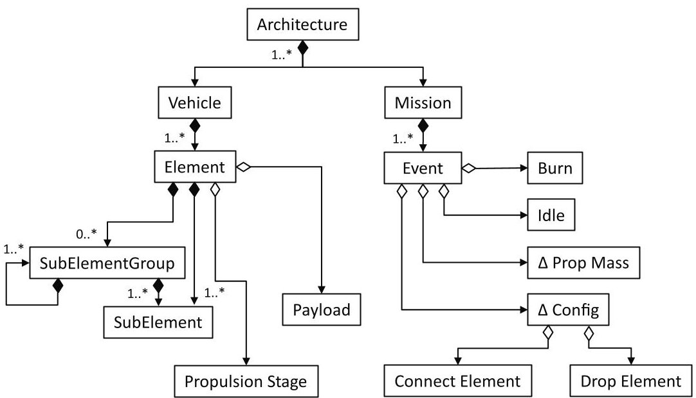

Fig.1 A class diagram representing the Dyreqt modeling ontology [8]

Within Dyreqt , the accounting of resources is performed during the vehicle sizing process. Default resources include propellant, power, and heat. SubElements in Dyreqt can have 5 roles with respect to resources: Producer, Consumer, Source, Sink, or Conduit. These roles are summarized in Table 1 below.

Table 1 Resource Roles in Dyreqt [18]

<table border="1"><tr><td>Resource Role</td><td>Description</td></tr><tr><td>Source</td><td>A source will passively add to the quantity of a resource over time.</td></tr><tr><td>Sink</td><td>A sink will passively add to the quantity of a resource over time.</td></tr><tr><td>Producer</td><td>A producer is a SubElement which is sized to zero out the net demand of a resource imposed on it.</td></tr><tr><td>Consumer</td><td>A consumer is a SubElement which is sized to zero out the net surplus of a resource in the system.</td></tr><tr><td>Conduit</td><td>A conduit is a SubElement which interacts with a resource that flows through it.</td></tr></table>

Associated with the resource roles are certain restrictions. With respect to a given resource, a SubElement can only be either a producer or consumer and a source or a sink. If the SubElement is a conduit of a resource, it cannot have any other role with respect to that same resource [18]. By default, Dyreqt assumes that each resource is fully connected between all producers/consumers and all sources/sinks, where all producers/consumers evenly split the load of the sources/sinks. If there is a SubElement which has a conduit role with respect to a resource, the resource connections for that resource within an element must be defined by the user in a resource network. Internally, Dyreqt carries out calculations from sources to consumers and sinks to producers since the requirements for consumers and producers are set by sources and sinks, respectively [18].

Sources and sinks of a resource have a resource impact output which is a vector representing the rates of resource generation and usage at various time steps. Conduits have inputs associated with the required resource loads from sources and sinks as well as outputs associated with the allocation of the required resource loads to other SubElements in the resource network. Consumers and Producers have inputs associated with the resource load required of it from sources and sinks connected to the resource network. Within the context of the MDAO problem, the resource outputs of sources, sinks, and conduits are connected to the resource inputs of consumers, producers, and conduits and the OpenMDAO driver works to converge the resource connections between SubElements using either a Newton or Nonlinear Block Gauss-Seidel (NLBGS) solver, though the performance of the Newton solver has been found to be generally poor, so the NLBGS is typically used.

<!-- PDF_PAGE: 4 -->

## B. Power and PMAD Overview

The spacecraft power system provides electrical power to the other subsystems and consists of power generation, energy storage, and power management and distribution [11, 12]. The power generation is responsible for producing power for the spacecraft and includes solar arrays, primary batteries, primary fuel cells, radioisotope thermoelectric generators (RTGs), nuclear reactors, etc. The energy storage stores and releases power produced by the power generation to meet spacecraft loads when the power generation cannot meet spacecraft power demands.

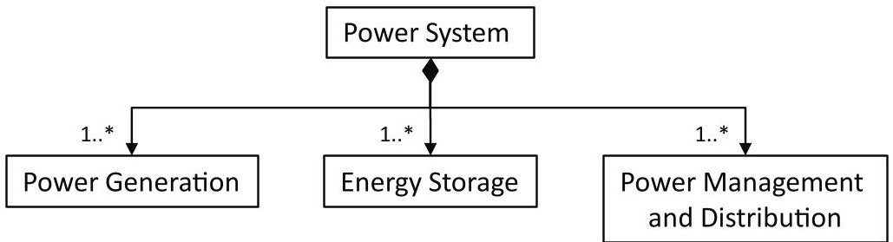

Fig.2 Spacecraft power system hierarchical structure

Eclipse operation and peak power operation drive power generation and energy storage sizing. The electrical power system is assumed to have 4 possible states, as shown below in Figure 3.

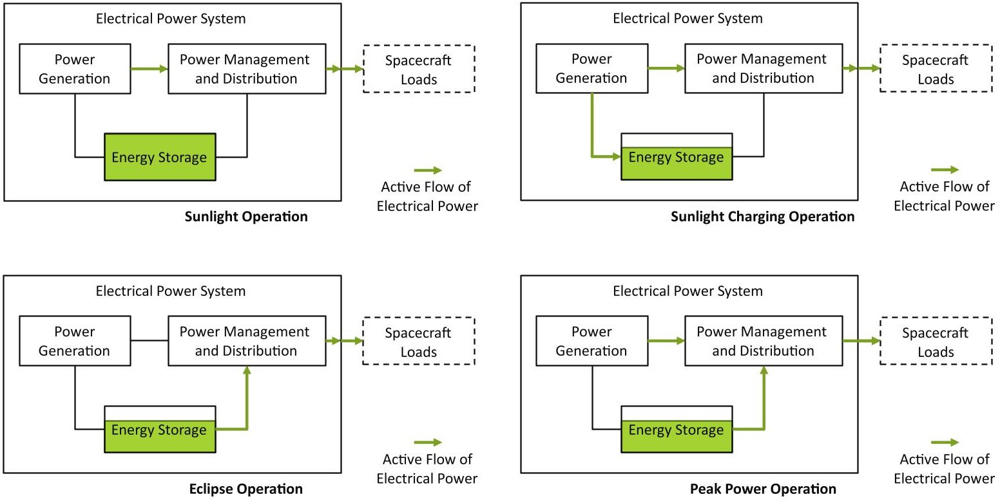

Fig.3 EPS operational states

In the nominal sunlight operation case when the battery is fully charged and spacecraft load is below the maximum solar array power, the solar array provides the entirety of the spacecraft load. During the eclipse operation case, the solar array is unable to produce power, so the battery must provide the entirety of the spacecraft load. During the sunlight charging case, the solar array provides the entirety of spacecraft load similar to the sunlight operation case, but the battery is not yet at full charge and the total spacecraft loads are less than the solar arrays' max power, so the excess power that would normally either be shunted to a parasitic load radiator or simply not produced is instead used to charge the battery. Finally, during the peak power operation case, the solar arrays are producing power, but the max power the solar array can produce is below the peak total spacecraft load. In this case, the battery will discharge power to fill the gap between what max solar array power and the total peak power demand.

The PMAD system includes the conditioning, regulation, control, and distribution of electrical power for the entire spacecraft [19]. More specifically, the PMAD system performs the following functions [20]:

- Control and direct electrical power from the primary power source(s) to charge and discharge the energy storage and to the power distribution system.

<!-- PDF_PAGE: 5 -->

- Distribute power from the main power bus to primary and secondary distribution points.

- Provide voltage source (regulated or unregulated) to all satellite buses and payload loads.

- Provide fault protection functionality to ensure no single failure results in loss of EPS capability to meet mission.

Components within the PMAD system are sized based on the maximum power that they are expected to handle, so the sizing of the PMAD system is mostly driven by peak loads. In general, the PMAD system matches the electrical power generation to the electrical power loads. This means conditioning the power such that the spacecraft loads receive the proper amount of power at the proper voltage, type (DC or AC, and if AC number of phases), frequency (if AC), and number of phases (if AC) with fluctuations within specification. Additionally, the PMAD system must provide a level of fault protection and isolation between power generation and loads.

PMAD systems can be categorized based on whether their bus voltage is unregulated or regulated. In an unregulated system, the spacecraft bus voltage is equal to the voltage provided by the power generation or energy storage systems, minus voltage drops due to losses. In a regulated system, the bus voltage can be set independently of the voltage provided by the power generation and energy storage systems and is maintained at a constant voltage by regulators [11]. Other types of systems, such as quasi-regulated or partially regulated systems, are also possible. Fully regulated systems are more common in designs that either have higher power requirements or that are crewed because regulated systems have higher efficiency with increasing power, provide a more stable power supply, and provide a higher level of fault protection [12]. On the other hand, unregulated systems are much lighter than regulated systems. The advantages and disadvantages of each are briefly summarized below in Table 2.

Table 2 Unregulated vs Regulated PMAD Systems [9, 21, 22]

<table border="1"><tr><td colspan="2">Unregulated</td><td colspan="2">Regulated</td></tr><tr><td>Advantages</td><td>Disadvantages</td><td>Advantages</td><td>Disadvantages</td></tr><tr><td>-Fewer parts</td><td>-Fluctuations in bus voltage</td><td>-Stable bus voltage</td><td>-More parts</td></tr><tr><td>-Simpler</td><td>-Weight penalty in load regulators or secondary distribution</td><td>-Enables higher voltages</td><td>-More complex</td></tr><tr><td>-Significantly lighter</td><td>-Require lighter load/secondary distribution units</td><td>-Require lighter load/secondary distribution units</td><td>-Higher inefficiencies</td></tr></table>

For spacecraft with solar arrays, there are two main methods of limiting the power generated by the solar arrays such that the power production matches the spacecraft loads. Direct energy transfer (DET) shunts excess power to resistors, and results in a fixed output voltage. Peak power tracking or power point tracking (PPT) controls the voltage of the solar array such that the power produced matches the power required. The advantages and disadvantages of DET and PPT systems are briefly summarized below in Table 3.

Table 3 Peak Power Tracking vs Direct Energy Transfer Systems [9, 21, 22]

<table border="1"><tr><td colspan="2">Peak Power Tracking(PPT)</td><td colspan="2">Direct Energy Transfer(DET)</td></tr><tr><td>Advantages</td><td>Disadvantages</td><td>Advantages</td><td>Disadvantages</td></tr><tr><td>-Can always operate solar arrays at maximum power point(MPP)</td><td>-Higher mass- Greater complexity-Higher cost-Lower efficiency</td><td>-Fewer parts-Lower mass-Higher efficiency at EOL</td><td>-Usually operates below MPP-Less efficient at BOL</td></tr></table>

In practice, there are many ways to implement regulated or unregulated and PPT or DET systems, and the selection of PMAD architecture is often dependent on the rest of the spacecraft architecture and mission. Some example layouts are shown below.

<!-- PDF_PAGE: 6 -->

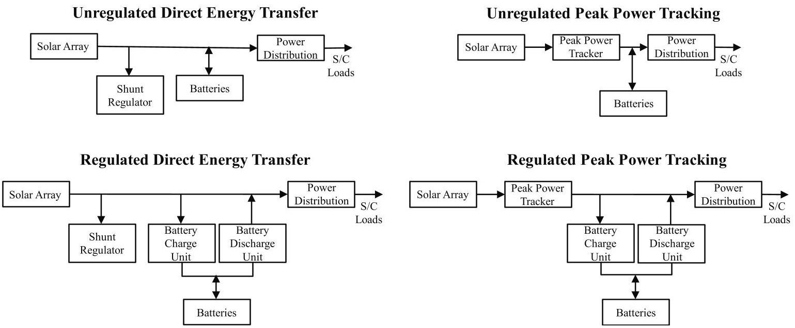

Fig.4 Major Categories of Spacecraft PMAD Architectures [21]

IV. Power Generation and Energy Storage Modeling

## A. Solar Array and Battery Models

In order to model the PMAD subsystem in the context of the overall power subsystem, new power models were needed. Solar array and secondary battery SubElement models were created for initial power subsystem modeling since they are the most commonly used power generation and energy storage elements in spacecraft today. The solar array SubElement modeling was fairly straightforward; the solar array sizing equations were implemented in a Photovoltaic Array SubElement which was modeled as a producer of power. The solar array is sized to its maximum power output required and is sized based on equations from Wertz et al. [22]. A battery model was needed that sized the component by integrating the power production required leaving the battery and power flowing in to charge the battery. This battery is modeled as a producer of power for when it is discharging during peak or eclipse operation, but additionally as a sink of power for when it is being charged.

## B. Power System Sizing Cases

When it comes to energy storage of a spacecraft, there are two primary requirements that drive its size: eclipse operation and peak power, where peak power is needed for short periods (as opposed to housekeeping power, which is needed continuously) [11, 13]. The first requirement is that the energy storage must provide power to spacecraft loads when the primary power source is incapable of generating power, such as in the case of an eclipse for solar arrays. In the case that this is the requirement driving energy storage sizing, the energy storage is sized to have a capacity large enough to continue supplying power to the spacecraft for the longest duration during which the primary power source is incapable of providing power, while also being capable of being charged fast enough so that it can provide power when needed. The second requirement is that if the instantaneous loads on the spacecraft exceed the primary power source's maximum power generating capability, then the energy storage must fill the gap [11]. Peak power may drive energy storage sizing when the peak power demands of the spacecraft greatly exceed the average power demands—in some cases peak power demands exceed twice the baseline power level. In such a case, it may not be possible nor economical to size the primary power source to the peak power. Use of energy storage to provide the difference between peak power and housekeeping power will allow the primary power source to be sized to a substantially lower power load, reducing its mass and cost, though with the tradeoff of added energy storage mass and cost.

## C. Power System Sizing Problem Formulation

The approach below addresses the power system sizing problem, in which both peak and eclipse operation are considered. Though the intended application of the approach described below is for solar array and battery sizing, it is generally applicable to other types of power generation and energy storage systems as well, perhaps with slight modifications.

<!-- PDF_PAGE: 7 -->

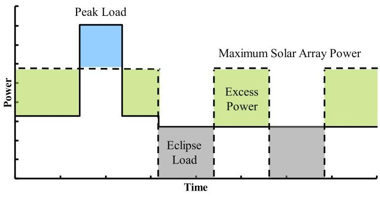

Fig.5 Notional Spacecraft Power Timeline

When it comes to solving optimization problems, defining appropriate variable bounds is useful for restricting the search space to improve performance. Bounds on solar array and battery size are defined based on the two extremes to load allocation. On one end of the spectrum, all of the spacecraft loads are supplied by batteries, in which case the batteries are primary batteries, and no power generation system is required. At the other end of the spectrum, the batteries are sized to be as small as possible providing the minimum capacity required to supply power when the power generation system is incapable of producing power (i.e., eclipse). When batteries are sized as primary batteries to supply all spacecraft loads, no solar arrays are necessary.

The variables are nondimensionalized and normalized to have magnitudes at or around unity. The battery scale factor is defined as the capacity of the battery normalized by the integral of the total loads over the mission (capacity of the battery required if there were no power generation system) and is bounded between 0 to 1.

$$
x _ {b a t} = \frac {C a p a c i t y}{\int_ {0} ^ {T} T o t a l L o a d d t}, 0 \leq x _ {b a t} \leq 1
$$

$$
0 \leq x _ {b a t} \leq 1
$$

The solar array scale factor is defined as the maximum power of the solar array normalized by the maximum spacecraft load. This lower bound on the solar array scale factor is 0, while the upper bound is calculated based on the maximum power required to recover the energy discharged during every eclipse period in the following insolation period. This value is generally of order 1.

$$
x _ {S A} = \frac {P _ {S A , m a x}}{\max \left(T o t a l L o a d\right)}
$$

$$
0 \leq x _ {S A} \leq x _ {S A, u p p e r}
$$

In terms of constraints, regarding the battery, before accounting for margins and redundancy, its operation is constrained by its allowable range of state of charge (SoC) as defined by its initial state of charge, max state of charge, max allowable depth of discharge (DoD), while also charging at a rate below its maximum allowable charge rate. The state of charge is defined as the capacity currently available divided by its rated full capacity, varying from 0 to 100% [23]. The depth of discharge represents the percentage of the battery that has been discharged relative to the overall rated capacity of the battery and is the difference between 100% and its minimum state of charge [24]. The max SoC and max DoD for a battery may be set to below 100% in order to improve the longevity of the battery. The lower the max state of charge of the battery and the less of the battery's rated capacity that is used, the greater the cycle life of the battery [25]. The max allowable charge rate is defined by the C-rate, expressed as a multiple of the battery's rated capacity. The C-rate is the time it takes to charge the battery from 0 to 100% state of charge [20]. Due to operational constraints that may require the battery to be fully recharged at certain times, such as before eclipse periods while in orbit, an additional constraint requires the battery to be fully recharged to its maximum state of charge at user-defined times during the mission. This full charge constraint can be used to ensure that the spacecraft is capable of indefinitely loitering in orbit by being at least power neutral over one orbital period.

<!-- PDF_PAGE: 8 -->

$$
\min \left(m _ {s o l a r a r r a y} + m _ {b a t t e r y}\right)
$$

The solar arrays and batteries are sized by solving a minimization problem using the sequential least squares programming (SLSQP) algorithm to find the battery and solar array scale factors (and hence battery capacity and maximum solar array output power) to minimize combined solar array and battery mass while satisfying constraints. A notional example of the constrained trade space for spacecraft power system sizing without the full charge constraint is shown below. The mass of the battery and mass of the solar arrays are directly proportional to the battery scalar and solar array scalar, respectively, which results in the contour plot of combined battery and solar array mass shown below. Three distinct regions can be observed in the constrained trade space. In Region A, the battery is functionally being sized as a primary battery, and the smaller the solar arrays, the larger the spacecraft load that the batteries are sized for. In region C, the minimum battery capacity is constrained by eclipse periods which require some minimum battery size to provide power when the solar arrays cannot. In region B, there is an interesting tradeoff between solar array and battery size where the shape of the minimum battery size constraint is dependent on the spacecraft sizing mission.

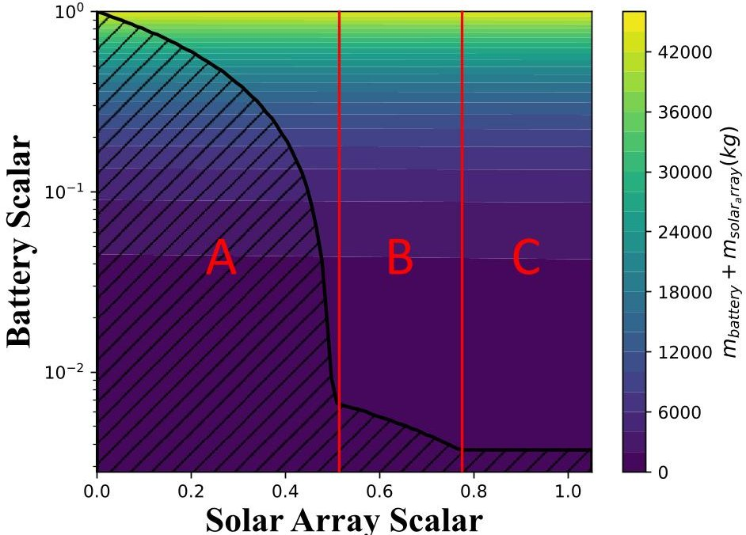

Fig.6 Constrained Trade Space for Power System Sizing Without Full Charge Constraint

The full charge constraint essentially imposes a minimum requirement on the solar array size, such that the solar arrays can fully recharge the batteries by the specified times. This can be seen in Figure 7 below. Since the full charge constraint is generally used to model charging before eclipses when a spacecraft is in orbit, if the full charge constraint results in only region C being feasible, then it can be said that the eclipse sizing case dominates. In this case, the batteries are sized to the minimum required capacity for eclipse, and the solar arrays are sized to recharge the batteries between eclipse periods, and the point that minimizes the combined solar array and battery mass lies on the intersection of the two constraints.

<!-- PDF_PAGE: 9 -->

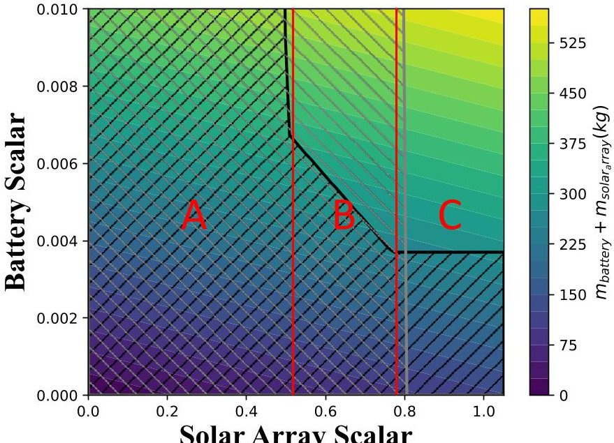

Fig.7 Constrained Trade Space for Power System Sizing (Full Charge Constraint in Grey)

## V. Power Management and Distribution System Modeling

Since power generation is sized to fulfill the key function of providing power to the spacecraft, it is modeled as a producer of power. Since energy storage also provides power but can only provide power that it has previously stored, it is modeled as both a producer of power and sink of power to model its discharging and charging operations, respectively.

In the power conditioning stages approach to PMAD modeling, common PMAD stages are the building blocks which comprise power conditioning components, which in turn comprise the overall PMAD [27, 28]. The hierarchical structure of the PMAD system based on the power conditioning stages approach is shown in Figure 8. In terms of PMAD sizing, the masses of most components generally scale as a function of the power, voltage, and frequency of the electrical power the components interact with [28]. A library of PMAD models was created to support the modeling of PMAD systems in Dyreqt. The PMAD stages were modeled as functions in a PMAD stage function sizing library. Each component contains mass sizing equations for its constituent stages and ancillary hardware and equations to calculate the impact of the component on power (i.e., losses due to inefficiencies). A 25% reduction in estimated mass was applied to Metcalf PMAD component models to account for technological improvements since the development of the models in 2011 [29]. The PMAD stages and components are shown in the Appendix in Table A1 and Table A2, respectively.

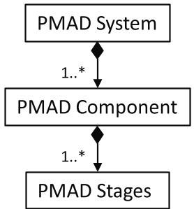

Fig. 8 PMAD hierarchical structure

All PMAD components are modeled conduits of power which interact with the power resource by causing losses and potentially altering power properties. They also produce heat as a byproduct of operation due to inefficiencies. As such, PMAD components are modeled in Dyreqt as conduits of power and sources of heat.

Generally, Dyreqt components that have been developed in the past assume power to mean electrical power. Thus, to maintain plug and play compatibility between PMAD components and other user-defined components that interact

<!-- PDF_PAGE: 10 -->

with (electrical) power, it was decided to use the same power resource but define additional properties—such as voltage, frequency, number of phases, and peak power—that would be used for PMAD component calculations. Regardless of power type, the standard unit for quantification remains the Watt.

Most PMAD components, with a few exceptions, can be modeled using a predefined configuration of stages (i.e., a DC-to-DC converter unit will always consist of an input DC filter, chopper, inverter transformer, rectifier, and output DC filter, in that order). The exceptions arise in the case when a component can have multiple input or output channels such as in the case of a switchgear, used to provide fault isolation for power sources and loads, which may have a variable number of input and output RBIs depending on how many components it is connected to. The DC switchgear, AC switchgear, DC RPCM rack, and AC RPCM rack are the PMAD components which have this issue.

In terms of Dyreqt modeling, a Power Conditioning Component class was created which inherited from the SubElement class for all other power conditioning components (which followed the PMAD stage construction) to inherit from. This class defines common options, inputs, default values, and methods shared by power conditioning components. A specific power conditioning component, such as a DDCU, will inherit from this class, implement its own basic dry mass calculation method (depending on its stages) that calls the relevant stage sizing functions, add additional inputs or options, overwrite default values, and overwrite inherited methods if needed.

Of particular interest are the switchgear and RPCM rack models, since they have a variable number of internal components depending on their number of inputs and outputs. The internal analyses for switchgears and RPCM racks were implemented such that they could detect the number of incoming and outgoing resource connections and size the number of internal components accordingly, i.e., if a switchgear must provide power to 4 components and has power entering from 2 components, it will be sized to have 4 output RBIs and 2 input RBIs. The models for the DC and AC switchgears as well as the DC and AC RPCM racks are nearly identical, with the main difference being that the DC switchgear will have DC instead of AC input and output RBIs, and the DC RPCM rack will have DC instead power that it must output and select RBIs and RPCs accordingly.

While RPCM racks are used to distribute power to multiple components and only have one input, the switchgear is unique in that it can have multiple inputs. As previously mentioned, the switchgear must calculate the allocation of power between the solar array and battery in accordance with the different sunlight and eclipse operation cases. It does so by calling a method that calculates the allocations based on any arbitrary user-defined function that is specified through its options. By default, if no allocation function is specified, it defaults to the even resource allocation. A custom allocation function, based on the power system sizing problem formulation described above, was defined for the switchgear to account for peak power and eclipse sizing cases. During sunlight operation when the total spacecraft load is less than the solar array maximum power, the switchgear allocates the entirety of the load to the solar array. During sunlight operation when the total spacecraft load is greater than the solar array maximum power, the switchgear allocates a portion of the total load equal to the solar array max power to the solar array and the rest (dubbed peak power) to the battery. During mission events when the solar array is specified to be "active" and under eclipse, the switchgear allocates the entirety of the total spacecraft load to the battery.

## VI. Procedural PMAD Generation

A drawback of using a more detailed PMAD model is the associated additional complexity and difficulty of use. As such, a procedural PMAD generation function was developed such that a conceptual design engineer who is not necessarily a PMAD specialist can obtain the benefits of the higher fidelity PMAD models.

It is common for PMAD architectures to be custom designed according to mission specific power requirements, as the specific selection and arrangement of components, selection of key parameters, and level of redundancy is highly dependent on the spacecraft requirements [20]. A number of spacecraft PMAD layouts that have been designed by subject-matter experts (SMEs) and published in available literature, shown in the Appendix in Table A3, have been surveyed to create a process for generating PMAD layouts.

The PMAD generation process begins with the user first defining their vehicle and mission through the standard process. To insert the PMAD system, the user adds a PMAD Placeholder SubElement to their vehicle definition. In that placeholder SubElement definition, the user can specify certain options or parameters for the PMAD system, though all options and parameters are optional since default values exist based on common PMAD architectures and characteristics that were informed by a survey of existing PMAD layouts. As such, a user can simply choose a name and select the PMAD Placeholder as the model if they wish to use the default values. The options and parameters with brief descriptions are listed in Table A4 in the Appendix.

Since the PMAD Placeholder SubElement is a conduit of power, the user must also define a power resource network to indicate power flows from their power producers to the PMAD Placeholder and from the PMAD

<!-- PDF_PAGE: 11 -->

placeholder to the spacecraft loads. The power resource network consists of a directed graph that has the SubElements interacting with power as nodes and directed edges labeled "power" to indicate the flow of power.

The user can then build, setup, and run the problem as normal using the PMAD Placeholder SubElement to return a "solved" problem object. The PMAD Placeholder SubElement assumes the PMAD mass is a fraction of the overall mass of the vehicle's power producers and use an assumed efficiency for this initial run in case the mass and efficiency of the PMAD system has a sizable impact on the required power levels and properties of the rest of the vehicle. There are several reasons for running the problem with the Placeholder PMAD SubElement. First, this allows estimated power loads and power properties for the spacecraft loads to be estimated, which informs the design of the PMAD system. Second, this allows information not available in the vehicle definition dictionary to be extracted and used to inform the PMAD system design. Building the problem allows the SubElements defined in the vehicle definition to be instantiated such that information about it such as its roles with respect to power, parent classes, required power properties (voltage, frequency, phases), and option/parameter values can be extracted.

The PMAD generation process involves two main tasks: modifying the vehicle definition dictionary to include the required PMAD SubElements with proper option with the proper parameter values and modifying the directed graph representing the power network to include the added PMAD SubElements. These are accomplished simultaneously in the PMAD generation function in a procedural manner. As PMAD SubElements are appended to the SubElement list of the vehicle definition, a corresponding node will be added in the power network with the required directed edges. The PMAD generator first extracts all the information it needs about the vehicle, including the options and parameter values defined in the PMAD Placeholder SubElement and the names and power resource roles of SubElements connected to the PMAD Placeholder.

The PMAD generation process begins at the loads (power sinks), since the loads impose requirements on the power level, voltage, frequency, and phases required. If the SubElements receiving power from the PMAD system do not have voltage, frequency, or phases as additional properties of the power resource, the PMAD generator will add a massless and lossless power conduit that adds those properties with the default load voltage, frequency, and phases values defined in the PMAD Placeholder parameters. If the option to include secondary distribution components is selected, RPCM racks will be added to supply power to the loads. An RPCM rack consists of multiple RPC modules, each of which contains multiple RPC channels. If the option to consolidate secondary distribution is selected, a single RPCM rack will be added to the PMAD, with each connection from the RPCM rack to a load resulting in an additional RPC module sized within the RPCM rack. Otherwise, a separate RPCM rack will be added for each load SubElement the PMAD Placeholder is connected to. The PMAD generator then adds a switchgear that acts as the spacecraft bus, allowing individual loads or secondary distribution networks to be isolated in the event of faults. The properties required at the switchgear are set by the PMAD Placeholder parameters. If the switchgear bus properties do not match the properties at the RPCM rack, then a converter must be added in between. A function was created to identify the specific converter needed to convert the voltage, frequency, and/or phases from one side to the voltage, frequency, and/or phases at the other. The logic used to identify the converter is shown in the decision tree in Figure 9.

<!-- PDF_PAGE: 12 -->

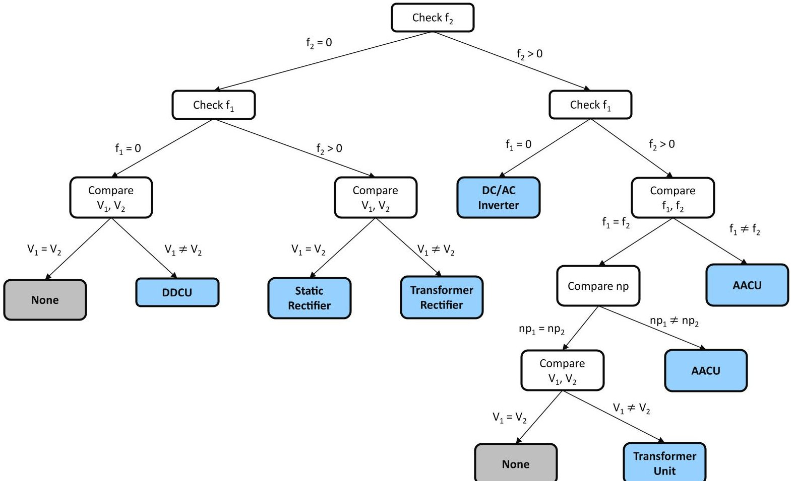

Fig. 9 Decision tree used to identify the power converter needed to match power properties.

If the user opts not to include a secondary distribution network in the PMAD system, then the switchgear will either be directly connected to the loads if the bus and load power properties match or be connected with an appropriate power converter in between. Once the loads have been connected to the bus switchgear, the load portion of the PMAD system has been completed. If the user opts to include a transmission line, a converter will be placed between the transmission line and bus switchgear if the transmission and bus properties are mismatched. A switchgear will then be placed on the power source side of the transmission line for isolation of individual power producers in the event of faults. The power source switchgear is assumed to be operating with the same power properties of the power sources, so if the power sources produce power of a voltage, frequency, or phase different from the characteristics of the transmission line, a power converter will be added to bridge the gap. If there is no transmission line, there is just a single switchgear in the PMAD system.

Currently, the only power producers supported are solar arrays and batteries. A solar array will always be connected to a power point tracker (PPT) that allows the solar array to operate at the voltage needed to produce exactly the power required of it while outputting a fixed voltage. The alternative to a power point tracker is to use a shunt and parasitic load radiator to get rid of excess power, though since power point trackers are more efficient, they are generally used for systems with higher power demands [13]. A battery will always be paired with a battery charge discharge unit (BCDU), though for Dyreqt modeling purposes the BCDU was modeled as a separate battery charge unit (BDU) and battery discharge unit (BDU). This is because modeling the BCDU as a single component would mean power has to flow in both directions, which results in conflicting edge directions in the power network and is not permitted in Dyreqt. The battery and its BCDU are connected to the bus switchgear near the loads since doing so results in a smaller required battery capacity as the energy stored in the battery will not experience the sizable transmission line losses before reaching the loads. A summary of the PMAD generation procedure is shown in Figure 10.

A limitation of the PMAD generator in its current state is that it can only generate regulated peak power tracking systems. Since the vehicles these PMAD models were initially developed to size are what would be considered higher power systems, a decision was made to focus on regulated PMAD architectures, though there is ongoing work to expand the scope to other types of PMAD architectures, including systems that are unregulated or use direct energy transfer for power control.

<!-- PDF_PAGE: 13 -->

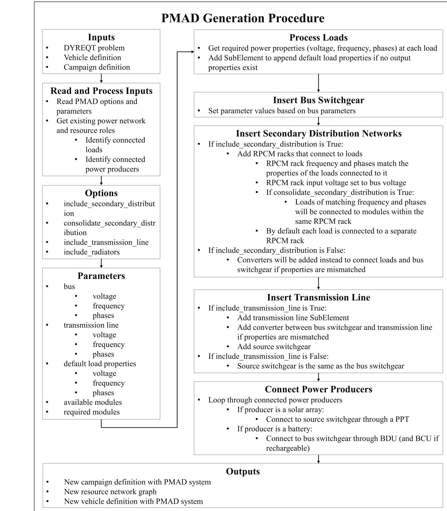

Fig.10 PMAD Generation Procedure

<!-- PDF_PAGE: 14 -->

## VII. Sensitivity Analysis Setup

Since one of the objectives of this study was to draw conclusions on the suitability of assumptions made when procedurally generating the PMAD system (and thus the applicability of PMAD sizing results obtained using the default settings), a sensitivity analysis was conducted to determine how certain input parameters affected key figures of merit for the PMAD system such as overall PMAD system mass, PMAD system mass fraction (of overall power system mass), and overall efficiency. Overall efficiency is defined here as the total energy that either reaches the loads or is stored in the battery (relative to the battery's initial energy level) divided by the total energy produced by the solar array.

The initial hypothesis is that default parameters could be selected for the PMAD system such that either they are the industry standard where selection of an alternative would be an intentional design decision (in which case the designer would have the expertise to assemble a PMAD architecture on their own), or the sensitivities of the overall PMAD system and other figures of merit to the exact parameter value (within a reasonable range) is low such that the exact value is not important.

## D. Running Batch Cases

To support running many cases for sensitivity analyses or design of experiments (DOEs), two wrapper functions were created to support running large batches of PMAD sizing cases. The first wrapper function allows the vehicle loads and mission to be created based on parametric function inputs. In addition to the PMAD options and parameters in the PMAD Placeholder SubElement, this function also has inputs for load parameters such as number of load SubElements, load voltage, load frequency, and load phases. Furthermore, the wrapper function allows a mission definition to be parametrically generated based on the mission variables shown in Table 4. The ability to parametrically vary the mission variables was implemented so that the impact of the mission on solar array and battery sizing could be assessed. This function then runs the single case and returns the mass breakdown of the sized power/PMAD system.

Table 4 Parametric mission variables for PMAD sizing

<table border="1"><tr><td>Variable</td><td>Description</td><td>Values</td></tr><tr><td>peakinsolation_power_scale_factor</td><td>Multiplier applied to baseline insolation power level to obtain total peak power level of combined spacecraft loads during the non-eclipse phase</td><td>1,2,5</td></tr><tr><td>duration_peak_insolation</td><td>Duration of peak power usage during the non-eclipse phase</td><td>15min</td></tr><tr><td>power_baseline_insolation</td><td>Total baseline power level of combined spacecraft loads during the non-eclipse phase</td><td>1kW,5kW,10kW,50kW,100kW</td></tr><tr><td>duration_baseline_insolation</td><td>Duration of baseline power usage during the non-eclipse phase</td><td>45min</td></tr><tr><td>peak_eclipse_power_scale_factor</td><td>Multiplier applied to baseline insolation power level to obtain total peak power level of combined spacecraft loads during the eclipse phase</td><td>0.75</td></tr><tr><td>duration_peak_eclipse</td><td>Duration of peak power usage during the eclipse phase</td><td>5min</td></tr><tr><td>baseline_eclipse_power_scale_factor</td><td>Multiplier applied to baseline insolation power level to obtain total baseline power level of combined spacecraft loads during the eclipse phase</td><td>0.5</td></tr><tr><td>duration_baseline_eclipse</td><td>duration of baseline power usage during the eclipse phase</td><td>55min</td></tr></table>

<!-- PDF_PAGE: 15 -->

<table border="1"><tr><td>num_periods</td><td>Number of periods (consisting of one non-eclipse and one eclipse phase) to include in the mission</td><td>2</td></tr></table>

The second batch case wrapper function allows the single case wrapper function to be run using inputs read from either a pandas DataFrame or an Excel spreadsheet. As a result, a user could use JMP to generate a DOE table, the DOE can be exported to an Excel spreadsheet, and the spreadsheet can be read by the batch case wrapper function. The results of the cases are then saved to a separate output Excel spreadsheet.

## E. Determining Parameter Values and Ranges

Certain variables were fixed where there was a high confidence the default value would be representative of most spacecraft systems. This was done to reduce the dimensionality of the problem to a manageable size. First, it was assumed that there would be no transmission line. A transmission line would only be used when power is transmitted over a long distance, which would likely only be applicable for space stations or crewed vehicles with a nuclear propulsion system that must be distanced from the crew for protection. Second, it was assumed that the spacecraft bus would be DC, so the bus frequency would be 0 and the bus would be single phase. All existing space-based electrical power systems as of 2006 were DC based, and as of 2014, DC distribution had been used almost exclusively [11,13]. As such, if a spacecraft were to be designed with an AC bus, that would likely be a conscious decision by the designer with the relatively unproven status of AC distribution in mind. The spacecraft was assumed to be in a circular low Earth orbit (LEO) with a period of two hours-one hour of sunlight operation and one hour of eclipse, as this leads to one of the most demanding battery sizing cases. The duration of eclipse for circular Earth orbits is 47 minutes or shorter and the maximum duration of eclipse for lunar orbits at low lunar orbit (LLO) or higher is similar [24]. Other cases, such as near-rectilinear halo orbit or a trans-lunar injection, will have much shorter eclipse durations. The baseline eclipse power level was assumed to be 50% of the baseline sunlight power level, and the peak eclipse power level to be 150% of the baseline eclipse power level. Two full periods were assumed for the mission definition. It was determined that increasing the number of periods (and thus simulation time) did not impact results. Peak power periods were assumed to occur at the beginning of the sunlight and eclipse periods, with durations of 15 minutes and 5 minutes respectively. Finally, an assumption was made that radiators would not be sized as components built-in to the PMAD system and that the heat impact of the PMAD system would not be examined. The Metcalf PMAD models are based on ISS components which are exposed to space-a configuration where it makes sense for each component to have individual radiators—whereas most spacecraft applications will likely have a centralized spacecraft thermal control system (TCS).

The remaining parameters, shown below in Table 5, are varied over predetermined values to assess the sensitivity of the figures of merit to these parameters. Possible values for bus and load voltages were selected based on standard spacecraft bus and electronics operating voltages [29, 30-32]. The possible values for load frequencies and phases were similarly based on common AC characteristics.

Table 5 Sensitivity analysis input variable ranges.

<table border="1"><tr><td>Variable</td><td>Values</td></tr><tr><td>include_secondary_distribution</td><td>True，False</td></tr><tr><td>consolidate_secondary_distribution</td><td>True，False</td></tr><tr><td>bus_voltage(V)</td><td>28，50，70，100，120，160</td></tr><tr><td>num_loads</td><td>1，2，4</td></tr><tr><td>voltage_load(V)</td><td>5，10，20，28，50，70，100，120</td></tr><tr><td>frequency_load(Hz)</td><td>0，50，60，400</td></tr><tr><td>num_phases_loads</td><td>1，3</td></tr><tr><td>baseline_power_level(kW)</td><td>1，5，10，50，100</td></tr><tr><td>peak_power_scale_factor</td><td>1，2，5</td></tr></table>

VIII. Sensitivity Analysis Results

A total of 60,480 cases were run to evaluate all the combinations of input variables. At a computational time of 300 ms per case, it took an estimated 5 hours of total run time for the entire batch of cases. The results were saved to

<!-- PDF_PAGE: 16 -->

an Excel spreadsheet and imported into JMP for analysis. The results were first plotted on a scatterplot matrix to roughly visualize the correlation between the input variables and figures of merit and identify areas for further investigation. Two-dimensional plots of figures of merit vs individual input variables were created with data grouped by a second variable while filters were applied to the remaining input variables. Curves were fitted to the grouped data to identify relationships between the figures of merit and variables. These plots are shown in the Appendix in Figures A1-A4.

## A. Scatterplot Matrix

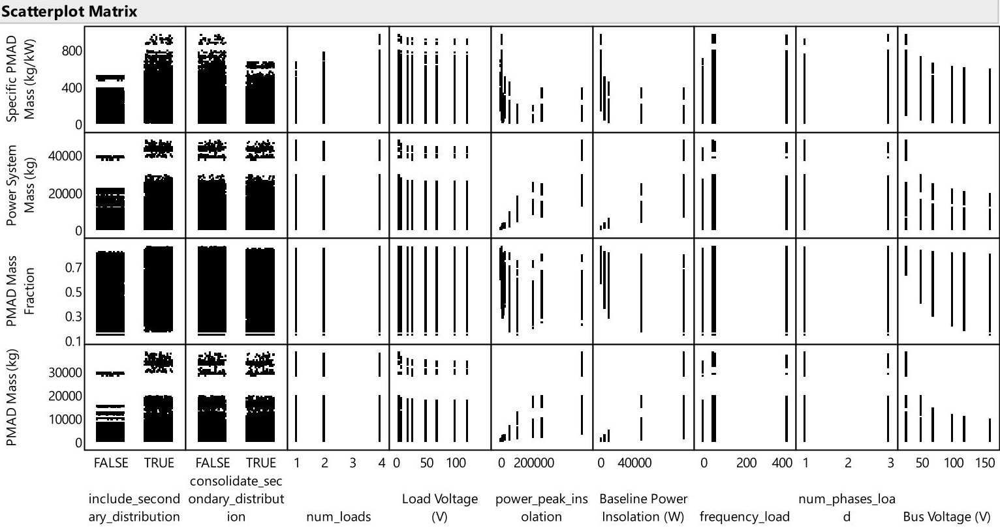

Fig.11 Scatterplot matrix showing general trends of PMAD outputs with respect to selected inputs.

From the sensitivity analysis, several observations can be made about the general dependence of PMAD sizing on the selected inputs. First, the inclusion of secondary distribution is generally correlated with greater PMAD mass, greater power system mass, and greater PMAD mass fraction. Second, the consolidation of secondary distribution networks (by connecting loads to the same instead of separate RPCM racks) has little discernable impact on PMAD mass or mass fraction. The load voltage only seems to have a noticeable impact on PMAD mass at low voltages. Increasing bus voltage is correlated with a lower PMAD mass fraction, with bus voltage having a greater impact as power level increases. A significant reduction in PMAD mass fraction can be achieved when increasing bus voltage from 28 V to 120 V at higher power levels. Increasing power levels resulting in an asymptotic decrease in PMAD mass fraction. DC loads (frequency = 0 Hz) seem to be correlated with slightly lower PMAD mass fraction and slightly higher overall efficiency than AC loads, while the number of phases for AC loads does not seem to have any noticeable impact.

It is important to note that this implementation results in unreasonably high mass estimates for the PMAD subsystem, especially for low voltages and low power levels. At low voltages, Ohmic losses are high through the components are high, resulting in much greater conductor mass being required to maintain efficiency. In practice, lower efficiencies are acceptable when spacecraft have lower voltages as the impact of higher efficiency in reducing power generator mass is outweighed by the increased PMAD mass. Since the PMAD component models were based on ISS data and intended for higher power systems, some of the assumptions regarding conductor and connector mass, and component enclosure mass are unsuitable for low power levels at the lower end of the models' recommended input ranges. A power scaling factor in the component models which results reduces specific mass as power levels increase results in high specific mass at low power levels. There is ongoing work to expand this effort to improve modeling in these areas.

<!-- PDF_PAGE: 17 -->

## IX. Application to Sample Problem: Reusable Lunar Lander

The power and PMAD models implemented in the previous sections were then applied to a reusable lunar lander sample problem. A Dyreqt Campaign was defined based on the Altair ascent and descent trajectories [33]. The solar arrays are assumed to maintain a tail-to-Sun attitude to keep solar arrays oriented normal to the Sun for maximum power generation capability, though since this attitude may not be maintained during burns, the solar arrays were assumed to be in eclipse during burn events. The campaign definition used in the sample problem is decomposed into translunar cruise, descent, and ascent segments and shown below.

Table 6 Lunar Lander Reference Mission: Lunar Transit

<table border="1"><tr><td>Event</td><td>Event Model</td><td>Propulsion System</td><td>Metric</td></tr><tr><td>LEO Loiter</td><td>BasicIdle</td><td></td><td>4 days</td></tr><tr><td>TLI Coast</td><td>BasicIdle</td><td></td><td>3 h</td></tr><tr><td>TCM1</td><td>BasicBurn</td><td>RCS</td><td>21.5m/s</td></tr><tr><td>TLI Coast</td><td>BasicIdle</td><td></td><td>21h</td></tr><tr><td>TCM2</td><td>BasicBurn</td><td>RCS</td><td>2.0m/s</td></tr><tr><td>TLI Coast</td><td>BasicIdle</td><td></td><td>38h</td></tr><tr><td>TCM3</td><td>BasicBurn</td><td>RCS</td><td>3.7m/s</td></tr><tr><td>TLI Coast</td><td>BasicIdle</td><td></td><td>26h</td></tr><tr><td>TCM4</td><td>BasicBurn</td><td>RCS</td><td>2.6m/s</td></tr><tr><td>TLI Coast</td><td>BasicIdle</td><td></td><td>8h</td></tr><tr><td>LOI Settling Burn</td><td>BasicBurn</td><td>RCS</td><td>0.6m/s</td></tr><tr><td>LOI Burn1</td><td>BasicBurn</td><td>MPS</td><td>326m/s</td></tr><tr><td>LOI Burn2</td><td>BasicBurn</td><td>MPS</td><td>59m/s</td></tr><tr><td>LOI Burn3</td><td>BasicBurn</td><td>MPS</td><td>565m/s</td></tr><tr><td>LOI Dispersion</td><td>BasicBurn</td><td>MPS</td><td>2.6m/s</td></tr><tr><td>LOI Clean Up</td><td>BasicBurn</td><td>RCS</td><td>7.0m/s</td></tr><tr><td>LLO Minimum Loiter</td><td>BasicIdle</td><td></td><td>1 day</td></tr><tr><td>LLO Altitude Maintenance</td><td>BasicBurn</td><td>RCS</td><td>10.1m/s</td></tr><tr><td>LLO Extended Loiter</td><td>BasicIdle</td><td></td><td>3 days</td></tr><tr><td>LLO Day</td><td>BasicIdle</td><td></td><td>73min</td></tr><tr><td>LLO Eclipse</td><td>BasicIdle</td><td></td><td>47min</td></tr><tr><td>Undock Transfer Vehicle</td><td>Drop</td><td></td><td></td></tr></table>

<!-- PDF_PAGE: 18 -->

Table 7 Lunar Lander Reference Mission: Descent

<table border="1"><tr><td>Event</td><td>Event Model</td><td>Propulsion System</td><td>Metric</td></tr><tr><td>DOI</td><td>BasicBurn</td><td>RCS</td><td>19.4m/s</td></tr><tr><td>PDI Settling Burn</td><td>BasicBurn</td><td>RCS</td><td>2.2m/s</td></tr><tr><td>Braking Burn</td><td>BasicBurn</td><td>MPS</td><td>1798.9m/s</td></tr><tr><td>Guidance Phase</td><td>BasicBurn</td><td>MPS</td><td>216.9m/s</td></tr><tr><td>PDI Dispersion</td><td>BasicBurn</td><td>MPS</td><td>53m/s</td></tr><tr><td>Approach Redesignation</td><td>BasicBurn</td><td>MPS</td><td>3m/s</td></tr><tr><td>Descent RCS</td><td>BasicBurn</td><td>RCS</td><td>11m/s</td></tr><tr><td>Detach Payload</td><td>Drop</td><td></td><td></td></tr></table>

Table 8 Lunar Lander Reference Mission: Ascent

<table border="1"><tr><td>Event</td><td>Event Model</td><td>Propulsion System</td><td>Metric</td></tr><tr><td>Lander Surface Ops</td><td>BasicIdle</td><td></td><td>14 days</td></tr><tr><td>Ascent</td><td>BasicBurn</td><td>MPS</td><td>1829.5m/s</td></tr><tr><td>Ascent Launch Window</td><td>BasicBurn</td><td>MPS</td><td>8.0m/s</td></tr><tr><td>Ascent Dispersions</td><td>BasicBurn</td><td>MPS</td><td>5.1m/s</td></tr><tr><td>Ascent ACS</td><td>BasicBurn</td><td>RCS</td><td>10.0m/s</td></tr><tr><td>Ascent Abort</td><td>BasicBurn</td><td>RCS</td><td>74.0m/s</td></tr><tr><td>Correction Combination</td><td>BasicBurn</td><td>RCS</td><td>1.8m/s</td></tr><tr><td>TPI</td><td>BasicBurn</td><td>RCS</td><td>19.0m/s</td></tr><tr><td>RPOD</td><td>BasicBurn</td><td>RCS</td><td>3.7m/s</td></tr><tr><td>RPOD Dispersions</td><td>BasicBurn</td><td>RCS</td><td>22.4m/s</td></tr><tr><td>Rendezvous</td><td>Connect</td><td></td><td></td></tr></table>

Default propellant tank and engine SubElements provided in Dyreqt were used for the propulsion subsystem, while SubElements developed as part of other efforts were used for the other subsystems, including avionics, structures, engines, tanks, and thermal control. Since these are low-fidelity conceptual design models intended for first-order sizing, the engine SubElements lacked models for power, and the other subsystems had constant power requirements. Since the propulsion system generally accounts for the bulk of the peak power usage during burn events, it was assumed that augmenting the propulsion SubElement with baseline and peak power loads would be sufficient to capture the impact of peak power requirements. For this study, assumptions were made for the peak and baseline propulsion system loads based on values for engines and RCS thrusters found in literature or datasheets, though there are ongoing efforts to improve the power models of these subsystems to get more detailed power timelines. A powered equipment list is shown in Table 9 and a power timeline is shown in Figure 12.

<!-- PDF_PAGE: 19 -->

Table 9 Lunar Lander Powered Equipment List

<table border="1"><tr><td>Subsystem</td><td>Nominal(W)</td><td>Peak(W)</td></tr><tr><td>MPS Tanks</td><td>14.9</td><td>14.9</td></tr><tr><td>MPS Engine</td><td>30</td><td>2700</td></tr><tr><td>RCS Tanks</td><td>3.7</td><td>3.7</td></tr><tr><td>RCS Engine</td><td>0</td><td>288</td></tr><tr><td>Thermal Control System</td><td>0</td><td>0</td></tr><tr><td>Actuators</td><td>1200</td><td>1200</td></tr><tr><td>Sensors</td><td>99.6</td><td>99.6</td></tr><tr><td>Communications</td><td>5</td><td>5</td></tr></table>

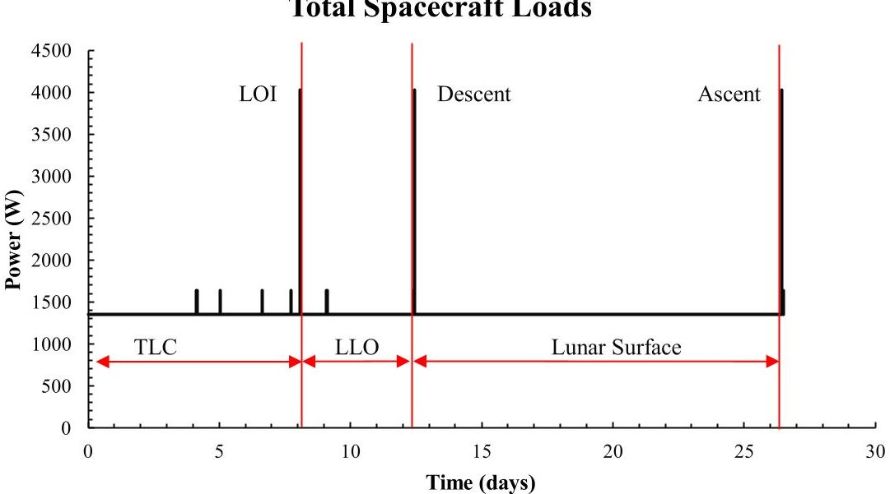

Fig.12 Sample Mission Spacecraft Power Timeline

A PMAD architecture with a peak power tracker and 28 VDC regulated bus was modeled. Loads were assumed to match the 28 VDC bus voltage so no additional converters were required.

The results of the load allocation algorithm indicate that for the lunar landing mission, there is a maximum solar array power that minimizes overall EPS mass, as shown in Figure 13. There are diminishing returns as the solar array scale factor increases, as increasing power generation capacity no longer results in mass savings in the battery. At this point, the eclipse sizing case dominates the battery sizing, as the battery has the minimum capacity needed to supply power throughout the eclipse periods. Further increasing solar array power decreases the battery recharge times but does not decrease the battery capacity required. In this case, with the full recharge constraint implemented to model a three day loiter in low lunar orbit (LLO), the eclipse sizing case drives the overall power system sizing as the battery capacity that minimizes the overall power system mass is the minimum battery capacity required to for eclipse in LLO.

<!-- PDF_PAGE: 20 -->

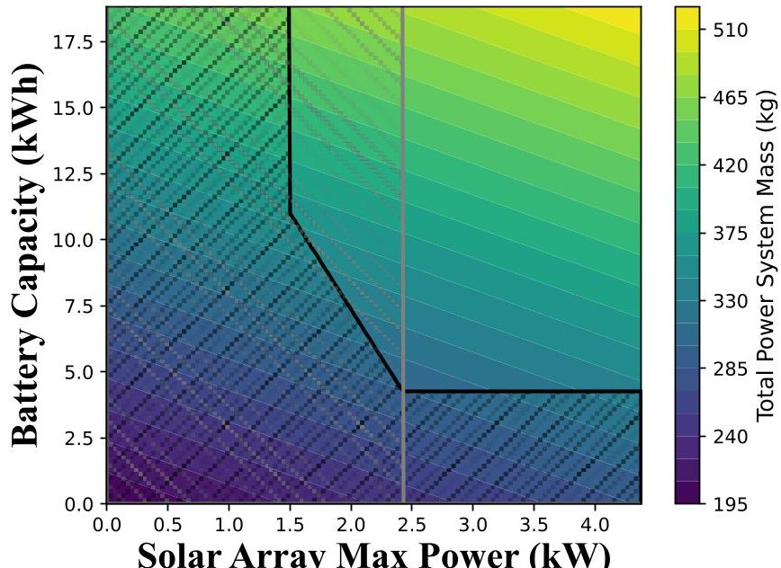

Solar Array Max Power (kW)

Fig.13 Impact of Solar Array and Battery Sizing on Power System Mass.

## X. Conclusion

Overall, this study of PMAD system modeling in Dyreqt resulted in the creation of a library of Dyreqt models and PMAD sizing functions in Python that lays the groundwork for a more detailed accounting of PMAD and power system masses in future studies. A PMAD generator function was created to procedurally build and incorporate PMAD architectures based on an initial vehicle definition to expedite the PMAD design process and lower the barrier to using the developed PMAD models. Functions were then created to expedite the running of many different PMAD sizing cases to support conducting sensitivity analyses and DOEs. A sensitivity analysis was then conducted to determine the sensitivity of power system mass, PMAD mass, PMAD mass fraction, overall efficiency, and specific PMAD mass to various variables. The overall conclusion based on the sensitivity analysis is that required load properties can indeed be assumed to be default properties while still obtaining reasonable and applicable PMAD sizing results. On the other hand, the sensitivity analysis revealed that the current PMAD models are less applicable at lower bus voltages and powers levels, necessitating further development to expand the applicability of the PMAD modeling effort. There are also ongoing efforts to include PMAD architectures that are unregulated or that use direct energy transfer power control. An approach to sizing the batteries and solar arrays that accounts for eclipse and peak power sizing was formulated and demonstrated in a sample problem. While the work to-date shows an initial implementation of PMAD modeling such that this PMAD modeling capability can be incorporated into resource modeling in Dyreqt 2.0, there is ongoing work to refine this resource modeling implementation.

<!-- PDF_PAGE: 21 -->

Appendix

Table A1 PMAD Stages and their functions [27]

<table border="1"><tr><td>PMAD Stage Models</td><td>Functions</td></tr><tr><td>Chopper stage</td><td>Change a fixed DC voltage to variable DC at a higher/lower voltage</td></tr><tr><td>Inverter transformer stage</td><td>Step up/down the input AC voltage, and/or provide insulation between the input and output</td></tr><tr><td>Standard transformer stage</td><td>Step down a high transmission voltage to a level suitable for secondary distribution</td></tr><tr><td>Rectifier stage</td><td>Convert AC into DC</td></tr><tr><td>DC filter stage</td><td>Condition the DC voltage to obtain the power quality required by the system</td></tr><tr><td>AC filter stage</td><td>Prevent external harmonics from being amplified</td></tr><tr><td>DC RBI</td><td>Switch DC power and interrupt fault currents</td></tr><tr><td>AC RBI</td><td>Switch major AC power feeds and interrupt faults</td></tr><tr><td>DC RPC</td><td>Switch and monitor individual DC load circuits and provide circuit protection</td></tr><tr><td>AC RPC</td><td>Switch and monitor individual AC load circuits and provide circuit protection</td></tr><tr><td>Conductors and connectors</td><td>Internal power distribution and the transmission of control and monitoring commands and data</td></tr><tr><td>Control and monitoring subsystem</td><td>Respond to high level commands, query internal sensors and provide data on the component operating status, and convert the sensor signals into the proper form for data bus transmission</td></tr><tr><td>Component enclosure</td><td>Provide protection from the environment, structural attachment, and thermal management</td></tr><tr><td>Radiator</td><td>Dissipate waste heat that a power conditioning component generates</td></tr></table>

<!-- PDF_PAGE: 22 -->

Table A2 PMAD Component Information

<table border="1"><tr><td>PMAD Component Models</td><td>Functions</td><td>Constituent Elements</td><td>Reference(s)</td></tr><tr><td>DC/DC converter (DDCU)</td><td>Change a DC voltage to a higher or lower level and provide isolation</td><td>Chopper, Inverter transformer, Rectifier, DC filter</td><td>[27]</td></tr><tr><td>AC/AC frequency converter (AACU)</td><td>Change an incoming AC frequency to a higher or lower value and provide isolation</td><td>Rectifier, DC filter, Chopper, Inverter transformer</td><td>[27]</td></tr><tr><td>AC/DC static rectifier</td><td>Convert an AC into DC without active power output regulation</td><td>Rectifier, DC filter, Chopper, Inverter transformer</td><td>[27]</td></tr><tr><td>Transformer unit</td><td>Change AC to a different voltage</td><td>Standard transformer</td><td>[27]</td></tr><tr><td>DC RBI switchgear</td><td>Interconnect DC system power sources and load distribution networks, allow sources and networks to be disconnected, and provide fault isolation</td><td>DC RBIs</td><td>[27]</td></tr><tr><td>AC RBI switchgear</td><td>Interconnect AC system power sources and load distribution networks, allow sources and networks to be disconnected, and provide fault isolation</td><td>AC RBIs</td><td>[27]</td></tr><tr><td>DC RPCM rack</td><td>Provide power to individual loads in a DC secondary distribution network and allow frequent switching</td><td>DC RPCs</td><td>[27]</td></tr><tr><td>AC RPCM rack</td><td>Provide power to individual loads in an AC secondary distribution network and allow frequent switching</td><td>AC RPCs</td><td>[27]</td></tr><tr><td>Shunt Regulator</td><td>Shunt excess power to match spacecraft loads</td><td>Shunt elements, Parasitic load radiator</td><td>[27,34]</td></tr><tr><td>Battery Charge Unit</td><td>Control the power supplied to the battery during charging</td><td>DDCU</td><td>[35]</td></tr><tr><td>Battery Discharge Unit</td><td>Regulate the battery output voltage during discharging</td><td>DDCU</td><td>[35]</td></tr><tr><td>Power Distribution Unit (PDU)</td><td>To supply electrical power to spacecraft subsystems and payloads and provide fault protection for the main power bus</td><td>RPCM Rack</td><td>[36]</td></tr><tr><td>DC transmission line</td><td>Connect DC power conditioning components</td><td>N/A</td><td>[37]</td></tr><tr><td>AC transmission line</td><td>Connect AC power conditioning components</td><td>N/A</td><td>[35]</td></tr><tr><td>Peak Power Tracker (PPT)</td><td>Control a solar array&#x27;s voltage so it produces only the power required by the spacecraft</td><td>DDCU</td><td>[13]</td></tr><tr><td>Alternator Speed Regulator</td><td>Control the alternator and turbine speed of a nuclear engine by adjusting the connected parasitic load to maintain a constant total load</td><td>N/A</td><td>[34]</td></tr><tr><td>Parasitic Load Radiator</td><td>Dissipate excess power</td><td>N/A</td><td>[34]</td></tr></table>

<!-- PDF_PAGE: 23 -->

Table A3 PMAD System Options and Parameters

<table border="1"><tr><td>Option/Parameter</td><td>Description</td><td>Default Value</td></tr><tr><td>include_secondary_distribution</td><td>Determines whether RPCM racks will be used to deliver power to spacecraft loads</td><td>True</td></tr><tr><td>consolidate_secondary_transmission</td><td>Loads with the same frequency and phases are connected to modules on the same RPCM rack if True. Loads are connected to separate RPCM racks if False.</td><td>True</td></tr><tr><td>include_transmission_line</td><td>Determines whether a transmission line will be included</td><td>False</td></tr><tr><td>include_radiators</td><td>Determines whether radiators will be built-in to the components to dissipate heat</td><td>False</td></tr><tr><td>bus_voltage</td><td>Sets the voltage of the spacecraft bus</td><td>120V</td></tr><tr><td>bus_frequency</td><td>Sets the frequency of the spacecraft bus</td><td>0</td></tr><tr><td>bus_num_phases</td><td>Sets the number of phases of the spacecraft bus</td><td>1</td></tr><tr><td>transmission_voltage</td><td>Sets the voltage of the transmission line</td><td>120V</td></tr><tr><td>transmission_frequency</td><td>Sets the frequency of the transmission line</td><td>0</td></tr><tr><td>transmission_phases</td><td>Sets the number of phases of the transmission line</td><td>1</td></tr><tr><td>transmission_distance</td><td>Sets the length of the transmission line</td><td>10m</td></tr><tr><td>default_load_voltage</td><td>Sets the voltage of connected spacecraft loads that have no power properties to this value</td><td>120V</td></tr><tr><td>default_load_frequency</td><td>Sets the frequency of connected spacecraft loads that have no power properties to this value</td><td>0</td></tr><tr><td>default_load_phases</td><td>Sets the number of phases of connected spacecraft loads that have no power properties to this value</td><td>1</td></tr><tr><td>available_modules</td><td>The available modules divided by required modules gives the redundancy of the system</td><td>3</td></tr><tr><td>required_modules</td><td>The number of modules in each PMAD SubElement needed to achieve the full required output power</td><td>2</td></tr></table>

## Acknowledgements

This work was supported by the Georgia Tech Research Institute's Independent Research and Development (IRAD) program. We would like to thank Robert Hetterich at NASA Marshall Space Flight Center for his work on Dyreqt and input on this project. We would also like to thank Fernando Morales of the School of Aerospace Engineering at the Georgia Institute of Technology for his input and feedback on this work.

<!-- PDF_PAGE: 24 -->

[1] Reimann, N., "NASA plans for humans to live on the Moon 'This decade,' official tells BBC," Forbes Available: http://www.forbes.com/sites/nicholasreimann/2022/11/19/nasa-plans-for-humans-to-live-on-the-moon this-decade-official-tells-bbc/?sh=3b411c80413a.

[2] Stephens, K., and Ghosh, P., "Can Humanity's New Giant Leap into Space Succeed?," BBC News Available: https://www.bbc.com/news/science-environment-64039146.

[3] “Artemis,” NASA Available: https://www.nasa.gov/specials/artemis/.

[4] Bender, B., "We better watch out': NASA boss sounds alarm on Chinese Moon ambitions," POLITICO Available: https://www.politico.com/news/2023/01/01/we-better-watch-out-nasa-boss-sounds-alarm-on-chinesemoon-ambitions-00075803.

[5] Weinzierl, M., and Sarang, M., "The Commercial Space Age is here," Harvard Business Review Available: https://hbr.org/2021/02/the-commercial-space-age-is-here.

[6] Edwards, Stephen J., Diaz, M. J., Mavris, D. N., and Trent, D., "A Model-Based Framework for Synthesis of Space TransportationArchitectures,"2018 AIAA SPACE and Astronautics Forum and Exposition, American Institute of Aeronautics and Astronautics,2018. https://doi.org/10.2514/6.2018-5133.

[7] Trent, Douglas, and Mavris, D. N., "Impacts on High-level Systems-of-Systems Figures of Merit due to Integrated Architecture Sizing and Technology Evaluation at the Subsystem-Level,"2018 AIAA SPACE and Astronautics Forum and Exposition, American Institute of Aeronautics and Astronautics, 2018.

[8] Edwards, S. J., Trent, D., Diaz, M. J., and Mavris, D. N., "A model-based framework for synthesis of Space Transportation Architectures," 2018 AIAA SPACE and Astronautics Forum and Exposition, Sep. 2018.

[9] Mendez Ramos, E., Robertson, B. E., Diaz, M. J., and Mavris, D. N., "Development of a lunar lander modeling and Simulation Capability," AIAA SCITECH 2022 Forum, 2022.

[10] Trent, D. J., "Integrated Architecture Analysis and Technology Evaluation for Systems of Systems Modeled at the Subsystem Level," thesis, 2017.

[11] Larson, W. J., McQuade, P. D., and Pranke, L. K., Human Spaceflight: Mission Analysis and Design, New York: McGraw-Hill, 2015.

[12] NASA Technology Roadmaps TA 3: Space Power and Energy Storage Available: https://www.nasa.gov/sites/default/files/atoms/files/2015_nasa_technology_roadmaps_ta_3_space_power_energy_storage_final.pdf.

[13] Shao, A., Maruyama, C., and Greer, J., Space Mission Engineering - The New SMAD. workbook, Hawthorne, CA: Microcosm Press, 2011.

[14] Robertson, B., Ramos, E. M., Diaz, M. J., and Mavris, D., "A Conceptual Design Study for an Unmanned, Reusable Cargo Lunar Lander," NASA Technical Reports Server (NTRS) Available: https://ntrs.nasa.gov/api/citations/20190033382/downloads/20190033382.pdf.

[15] Sands, K., "The Propulsion We're Supplying, It's Electrifying," NASA Available: https://www.nasa.gov/feature/glenn/2020/the-propulsion-we-re-supplying-it-s-electrifying.

[16] Z. Khan, A. Vranis, A. Zavoico, S. Freid, B. Manners; Power System Concepts for the Lunar Outpost: A Review of the Power Generation, Energy Storage, Power Management and Distribution (PMAD) System Requirements and Potential Technologies for Development of the Lunar Outpost. AIP Conference Proceedings 20 January 2006; 813 (1): 1083-1092.

[17] Gray, J. S., Hwang, J. T., Martins, J. R., Moore, K. T., and Naylor, B. A., "OpenMDAO: An Open-Source Framework for Multidisciplinary Design, Analysis, and Optimization," Structural and Multidisciplinary Optimization, vol. 59, 2019, pp. 1075-1104.

[18] DYREQT User Guide, the DYREQT Development Team, NASA Marshall Space Flight Center Advanced Concepts Office, 2022.

[19] “BU-808: How to Prolong Lithium-based Batteries,” Battery University Available: https://batteryuniversity.com/article/bu-808-how-to-prolong-lithium-based-

[20] Barrera, T. P., Spacecraft Lithium-Ion Battery Power Systems, Hoboken, NJ, USA: Wiley-IEEE Press, 2023.

[21] Chetty, P. R. K., "Electrical Power System for low Earth Orbit Spacecraft Applications," 22nd Intersociety Energy Conversion Engineering Conference, 1987.

[22] Wertz, J. R., Everett, D. F., and Puschell, J. J., Space Mission Engineering: The New SMAD, Torrance, CA: Microcosm Press, 2018.

<!-- PDF_PAGE: 25 -->

[23] Abdi H, Mohammadi-ivatloo B, Javadi S, Khodaei AR, Dehnavi E. Energy Storage Systems. Distributed Generation Systems, Elsevier; 2017, p. 333-68. https://doi.org/10.1016/B978-0-12-804208-3.00007-8.

[24] Waag, W., and Sauer, D. U., "Secondary Batteries - Lead-Acid Systems | State-of-Charge/Health," Encyclopedia of Electrochemical Power Sources, 2009, pp. 793-804.

[25] “BU-808: How to Prolong Lithium-based Batteries,” Battery University Available: https://batteryuniversity.com/article/bu-808-how-to-prolong-lithium-based-

batteries#:~:text=Most%20Li%2Dions%20charge%20to,typically%20delivers%20300%E2%80%93500%20cycles.

[26] Metcalf, K. J., "Lunar PMAD Technology Assessment," NASA Technical Reports Server (NTRS) Available: https://ntrs.nasa.gov/citations/19930002829.

[27] Metcalf, K. J., "Power Management and Distribution (PMAD) Model Development: Final Report," NASA Technical Reports Server (NTRS) Available: https://ntrs.nasa.gov/citations/20110023763.

[28] Oleson, S., Turnbull, E., Colozza, A., Drexler, J., Conway, M., Chang, C., Weckesser, N., Dosa, B., Lantz, N., Gyekenyesi, J., Fittje, J., Packard, T., Wilson, S., Barth, C., Tian, L., Klefman, B., and Schmitz, P., "40kW Fission Surface Power System (FSPS) Deployability," NASA Technical Reports Server (NTRS) Available: https://ntrs.nasa.gov/api/citations/20220012395/downloads/TM-20220012395.pdf.

[29] Wilkinson, B., "Distribution Issues Between Central Power and POL Architectures - Microsemi," Microsemi Available: https://www.microsemi.com/document-portal/doc_view/132931-distribution-issues-between-centralpower-and-pol-architectures-russia-2013.

[30] Beal, D., Harris, D., Bonometti, J., Mueller, R., and Murphy, G., "The Lunar Engineering Handbook," Auburn ESMD Course, Home Page Available: https://www.eng.auburn.edu/~dbeale/ESMDCourse/.

[31] Scheidegger, R., and Soeder, J., "Spacecraft Bus Voltage Selection," NASA Technical Reports Server (NTRS) Available: https://ntrs.nasa.gov/citations/20150019744.

[32] epanorama, "Common DC Voltage Levels," ePanoramanet Available: https://www.epanorama.net/newepa/2011/09/29/common-dc-voltage-levels/.

[33] Kos, L., Polsgrove, T., Sostaric, R., Braden, E., Sullivan, J., and Le, T., "Altair Descent and Ascent Reference Trajectory Design and Initial Dispersion Analyses," AIAA Guidance, Navigation, and Control Conference, 2010.

[34] Metcalf, K. J., "Power Conditioning System Modelling for Nuclear Electric Propulsion," NASA Technical Reports Server (NTRS) Available: https://ntrs.nasa.gov/citations/19940016706.

[35] Yang, Y., Jia, Y., Li, A., and Zhang, H., "Processor-in-the-Loop Simulation of Three Port DC/DC Converter for DC Power Generation and Distribution System," Researchgate Available: https://www.researchgate.net/publication/346480250_Processor-in-the-

Loop_Simulation_of_Three_Port_DCDC_Converter_for_DC_Power_Generation_and_Distribution_System.

[36] Oeftering, R. C., "Modular Power Interface Standard for Space Explorations Missions," AIAA SPACE 2016, 2016.

[37] Gordon, L. B., "Electrical Transmission on the Lunar Surface Part I—DC Transmission," NASA Technical Reports Server (NTRS) Available: https://ntrs.nasa.gov/api/citations/20040191588/downloads/20040191588.pdf.