<!-- PDF_PAGE: 1 -->

# Development Progress of an Adaptable Deorbit System for Satellite Constellations

IEPC-2019-225

Presented at the 36th International Electric Propulsion Conference University of Vienna, Austria September 15-20, 2019

J. Skalden $ ^{*} $ , G. Herdrich $ ^{ \dagger} $ M. Ehresmann $ ^{ \ddagger} $ and S. Fasoulas $ ^{\S} $ Institute of Space Systems, University of Stuttgart, 70569 Stuttgart, Germany

End-of-Life strategies are an important factor in planning future mega constellation systems. Not only shall the generation of more space debris be mitigated, also the risk of reentering fragments and the complexity of operations need to be considered. To account for this situation, the Institute of Space Systems is currently developing a deorbit module that features a next generation ammonia arcjet thruster. The aim is to achieve high flexibility and efficiency via additive manufacturing to meet the requirements of adaptable, low-cost satellite platforms. The first task is to verify the laser melted material's feasibility to be operated in an arc environment, which is displayed in this study. The behavior is similar to findings in conventionally manufactured nozzles and general feasibility was proven. Further test procedures are introduced and will be conducted soon.

## Nomenclature

I = Current

t = Thruster operation time

<!-- PDF_PAGE: 2 -->

## I. Introduction

$ \mathrm{T}_{\mathrm{HERMAL}} $ arcjet thrusters (arcjets) have been in development at the Institute of Space Systems (IRS) for many years. A variety of thrusters in power classes ranging from 100 W-100 kW have been tested. Highlights were the engineering model of the 1 kW hydrazine thruster ARTUS and the flight model ammonia thruster ATOS. Additionally, a large data base of operational points has been built up to allow scaling for different mission requirements. $ ^{1} $

The IRS is currently engaged into the Integrated Research Platform for Affordable Satellites (IRAS) project lead by the German Aerospace Center (DLR). Its aim is the reduction of satellite costs by combining industry 4.0 manufacturing methods with an advanced digital concurrent engineering platform (DCEP). $ ^{2} $ The IRS contributes in the topics general satellite design, mission analysis and architecture, and satellite propulsion systems. The latter is again separated into a DCEP development and experimental studies, which is the focus of this paper. The DCEP part is being displayed in Ref. 3.

A major trend towards more cost-effective satellite missions is the use of mass produced satellites in mega constellations. The Oneweb constellation and SpaceX' Starlink are currently pioneering this field and other competitors are expected. $ ^{4} $ From a propulsion point of view, orbit raising, positioning, and deorbiting are important to be investigated. Especially End-of-Life (EoL) servicing is a crucial task to mitigate further space debris generation and to maintain the constellation itself by keeping the orbit clean. $ ^{5} $ Since there is a rising demand for generic satellite platforms that can be fast adapted to changing mission needs via industry 4.0 methods like additive manufacturing (AM), the propulsion system has to be able to follow.

At the IRS, previous research has been performed on investigating the feasibility of thermal arcjet thrusters for deorbit and orbit raising purposes. Stand-alone and dual mode arcjet systems, sharing common hydrazine tanks with chemical thrusters, were outlined as involvement in the European Space Agency's (ESA) CleanSat project. $ ^{6} $ This study also considered green propellants and ammonia as potential propellant for an arcjet thruster. The latter can be considered as origin of the ammonia based arcjet system presented within this paper.

Thermal arcjet thrusters have the advantage of delivering high thrust compared to other electric propulsion systems, at a weight-specific impulse of up to 1000 s at a power class, which is feasible for small satellites. This would lead to shorter deorbit periods, which would again lead to less complex EoL-scenarios, especially if several satellites have to be deorbited at the same time. Furthermore, controlled reentry could be achieved lowering the satellites overall design for demise requirements. By making use of state of the art selective laser melting with tungsten as print material the design freedom provided by AM can be introduced into arcjet nozzle design. Regenerative cooling and novel geometries can be realized to optimize the systems overall performance.

## II. Background

## A. Thermal Arcjets

Of a thermal arcjet nozzle, the inner geometry, as specially the constrictor, are almost exclusively made of tungsten alloys to withstand the heat load of the electrical arc. Due to the high brittleness and hardness of the material, nozzle designs are driven by manufacturing capabilities. Furthermore, the production process becomes exponentially more expensive with geometric complexity. This limitation leads to the problem that major efficiency losses by thermal radiation and frozen flow conditions cannot be mitigated optimally. The term thermal losses covers all excess heat, which is generated but not introduced into the gas acceleration process. For thermal arcjet thrusters, those losses can sum up to 15% of input power, depending on the propellant. Frozen flow losses describe the power fraction consumed during the non-reversed dissociation and ionization process and have a maximum at 50% , again depending on the propellant. $ ^{1} $

With the use of additive manufacturing, the challenge is tackled to reduce these major losses to a competitive level. In addition, functional structures of relevance can be more likely implemented. Such structures are e.g. cooling channel systems for regenerative cooling, recuperatory gas generators (e.g. for ammonia as propellant) and others. Thermal losses can be accounted for by the use of regenerative cooling. This has been achieved before in several thruster designs, at IRS. $ ^{7} $ However, ALM allows helix shaped cooling channels integrated into the nozzle wall. The cold gas can be exposed longer to the heat flux and can be brought very close to the hot gas flow inside the nozzle. It is expected to further increase the regenerative cooling capability.

<!-- PDF_PAGE: 3 -->

Aside from increasing the thrust efficiency, the cooling channels serve another purpose. Currently only pure tungsten can be manufactured additively, alloys like the usually used thoriated tungsten or tungsten lanthanum oxide are not possible at the current state of the art. The reason lies in different coefficients of thermal expansion of the different alloy constituents, which warps the melted spot and heavily reduces accuracy and structural integrity of the products. Usually the above mentioned alloys are used for arcjet operation, due to the reduced work function. Pure tungsten requires more energy to release electrons and, therefore, suffers increased thermal loads. Experiments will have to show, if the cooling channels can compensate this additional heat load.

However, even if the thermal losses could be completely compensated, which is physically not possible, the gained efficiency would again be halved by the frozen flow losses to 7.5% in a worst case scenario. Therefore, it is obvious that a major focus needs to be put on increasing the recombination rate in the divergent section of the nozzle. This has been accounted for already in earlier arcjet designs, with two primary solutions, the recombination chamber and dual-cone nozzle. The general idea is to maintain the gas flow at a higher pressure level to support recombination of particles. The dual-cone nozzle geometry balances the gain in recombination efficiency with losses due to deviation from a bell-shaped nozzle. $ ^{1} $ Both proof of concepts were experimentally produced at IRS, but the maximum efficiency reached with hydrogen was 50% $ ^{7} $

With the use of additive manufacturing the efficiency could be further increased, by finding a nozzle geometry that is adapted for a certain operating point. Work on developing this nozzle shape is currently being conducted at IRS.

## B. State of the Art: ALM with Tungsten

Selective laser melting (SLM) with metal is already at an advanced level of development for stainless steel or nickel based alloys like Inconel. Densities up to 99 % and more can be achieved with very high quality surfaces. With tungsten however, the process is still in development. According to the Austrian supplier of tungsten AM components Plansee SE, densities of theoretically 96 % are the maximum that can be achieved at the moment. This is in accordance with research in the field stating similar results. $ ^{8} $ Density in this case does not necessarily mean that the part is open porous, hence, not gas tight. It also refers to encapsulated cavities inside the material due to the additive manufacturing process.

During the SLM process, melt spreading and solidification are two critical parameters, which need to be balanced for a proper product with high material density. Due to high thermal conductivity of tungsten, heat is dissipated fast to surrounding powder and support structures causing a fast solidification process. The droplets can solidify faster than they can wet the support structure or lower powder layer, and hence, the result is a rough surface. This effect is called balling and prevents the production of fully dense/massive structures. A possible solution is to scan for balling droplets and melting them in a second laser scanning process. However, this approach did not yet result in densities close to 100% $ ^{9} $

Another issue is the absence of availability of the tungsten alloys thoriated tungsten (WT20) and tungsten lanthanum oxide (WL10) for SLM production. These are usually used for thermal arcjet nozzles. Those alloys have a lower work function, which results in less heating and, hence, reduced wear on the electrodes. The effect is critical for the cathode, but also relevant for the anode, which will be subject to increased temperatures if it is manufactured from pure tungsten. The higher thermal load needs to be compensated by additional cooling to be achieved by integrated cooling channels.

Design limitations were given by the manufacturer Plansee SE, listed in Table 1. For the nozzle designs, the limiting parameters smallest cavity and wall thickness were multiplied by a factor of 3-4 to ensure a proper part quality in terms of flat surfaces. This originates from previous experience with metallic ALM products designed and utilized at IRS.

## III. Experimental Setup

In this section the vacuum facility including pump layout and power supply, is displayed. The thruster's design used for the experiments is explained in detail with focus on the novel additively manufactured tungsten nozzles. Furthermore the instrumentation to measure thrust, mass flow rate, and thruster parameters and to conduct plasma diagnostics is introduced.

<!-- PDF_PAGE: 4 -->

Table 1: Geometry limitations and accuracies of tungsten ALM processes at Plansee SE

<table border="1"><tr><td>Parameter</td><td>Range</td></tr><tr><td>Powder layer thickness</td><td>20-50μm</td></tr><tr><td>Maximum part size</td><td>230x230x150mm</td></tr><tr><td>Accuracy</td><td>$\pm$0.05mm</td></tr><tr><td>Smallest cavity</td><td>$＞$0.5mm</td></tr><tr><td>Wall thickness</td><td>$＞$0.1mm</td></tr></table>

## A. Vacuum Facility

The IRS features a vacuum facility, which was optimized for lifetime test of the flight model arcjet ATOS. $ ^{10} $ It consists of a chamber with a diameter of 1 m and 2 m length and a three stage pumping system listed in Table 2. During operation, an ambient pressure of 0.6-0.7 Pa is provided with an argon mass flow rate of 20-30 mg/s.

The chamber seen on Figure Fig. 1 is equipped with a low-pressure water cooling system. A copper floor with welded on cooling tubes and water cooled towers in the plasma plume allows endurance tests over long time periods. $ ^{11} $

Table 2: Vacuum facility pumps at IRS

<table border="1"><tr><td>Number</td><td>Type</td><td>Suction rate</td></tr><tr><td>Ⅰ</td><td>Rotary vane pump</td><td>275m3/h</td></tr><tr><td>Ⅱ</td><td>Roots pump</td><td>2050m3/h</td></tr><tr><td>Ⅲ</td><td>Roots pump</td><td>12000m3/h</td></tr></table>

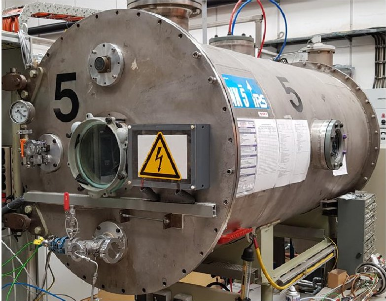

Figure 1: Vacuum facility at IRS for arcjet experiments

## B. Power Supply

To operate a thermal arcjet under stable conditions, the current needs to be controlled via high-frequency voltage adjustments. For this test campaign the engineering model of the arcjet power processing unit (PPU) flown on the AMSAT-P3-D mission was operated. $ ^{10} $ During the ignition phase, a high-voltage pulse is generated for the Paschen breakdown and collapses fast to prevent overheating once the current is applied. The adjustable range of applied current to the thruster is $ I_{Th}=0-10 $ A.

<!-- PDF_PAGE: 5 -->

## C. Arcjet Configurations

Two configurations of the operated arcjet thruster were setup to cover operation with a radiative cooling nozzle and a regeneratively cooled nozzle, which are explained in the following section. The basis for both configurations is the laboratory model arcjet thruster ARTUS-LM3, previously developed at the IRS. $ ^{7} $

To test the AM tungsten suitability for electric arc environments, the original configuration, seen in Fig. 2, was used. A large fraction of the nozzle is outside the casing, allowing better radiative cooling. In this configuration, argon was used as working gas to mitigate influences from chemical reactions. A cathode made of thoriated tungsten to lower the work function and, hence, reduce the heat load, marks the nozzle's counter part electrode in the center of the thruster. The distance to the nozzle, which is also the anode, was set to 0.4 mm. Since the whole case made of titan-zirconium-molybdenum (TZM) is biased as anode, proper insulation, in this case boron nitride and alumina, is required to prevent unwanted discharges. Sealing is achieved with flexible graphite fabrics and copper washers. A spring pushes the anode towards the casing to prevent leakage due to thermal expansion of the system.

The experiments conducted with the regenerative cooling require encasing of the whole nozzle for better heat transfer and sealing purposes. Therefore, the case was extended and the interface adapted to mount the nozzle, as it is displayed in Fig. 3.

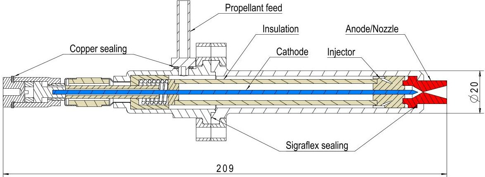

Figure 2: Arcjet laboratory model ARTUS-LM3 (blue: cathode, red: anode, beige: elec. insulation). $ ^{12} $

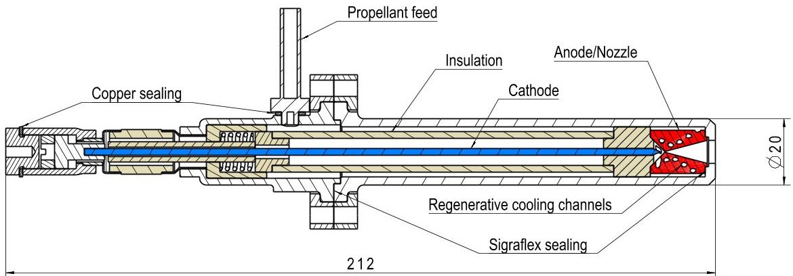

Figure 3: Arcjet laboratory model for testing regenerative cooling with an ALM nozzle (blue: cathode, red: anode, beige: elec. insulation). $ ^{12} $

## D. Nozzle Designs

For each measurement campaign, a different nozzle was designed and manufactured. The nozzle for material tests, depicted in Fig. 4, is a reproduction of the original ARTUS-LM3 nozzle. Thus, a direct comparison of a conventional manufactured and an additively manufactured nozzle can be achieved in terms of surface quality, performance, and wear and tear.

The convergent part of the nozzle opens at an angle of 90 deg and at 30 deg on the divergent side towards the nozzle exit. The constrictor has a diameter of 0.4 mm at a length of 0.3 mm. Inner surfaces and sealing

<!-- PDF_PAGE: 6 -->

areas require a surface roughness of $ R_{Z}=6. 3 $ . In its current state, the tungsten AM process cannot delivery this quality yet, therefore, post processing was applied.

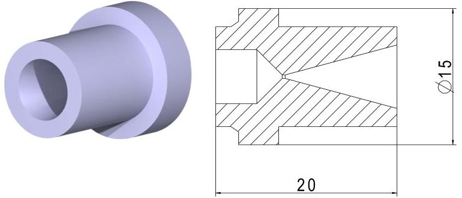

Figure 4: CAD view and cross-section of ALM nozzle design $ \mathrm{A}^{1 2} $

The second nozzle, displayed in Fig. 5 was designed and manufactured as a proof of concept of integrated cooling channels in AM tungsten. Furthermore, this nozzle serves characterizing the regenerative cooling efficiency and the general heat transfer into the propellant. The latter is of crucial importance when the cooling channels will be used as gas generator for operation with ammonia.

The internal geometry, divergent-convergent nozzle angles and constrictor, are identical to the first nozzle. This allows direct performance comparison to evaluate the gain of the regenerative cooling feature.

The channels are realized as three intertwined helices with the entrance lying at the nozzles tip. After entering the channel, the propellant will flow back to the discharge chamber and get ejected with a swirl. By doing so, the propellant passed the nozzle first on the outer surface and again inside the cooling channel. This allows improved preheating and, in case of ammonia, a more reliable gas generation. The cooling channel profile resembles an egg-shaped curve, with the tip in printing direction. Previous investigations at IRS with Inconel ALM structures have shown that this geometry grants the highest success rate for unobstructed internal channels. $ ^{2} $ The propellant is brought very close to the constrictor with a minimum wall thickness of 1.5 mm to prevent collapsing due to erosion.

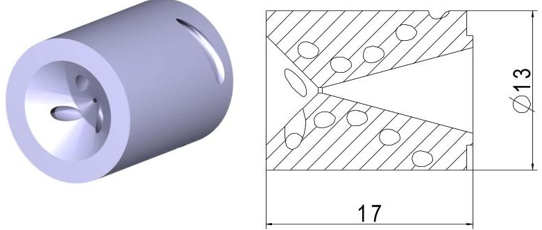

Figure 5: CAD view and cross-section of ALM nozzle design $ \mathrm{B}^{1 2} $

## E. Instrumentation

The test facility is currently being upgraded to a fully autonomous arcjet thruster characterization unit. Thrust measurements, plasma diagnostics, and thermal analysis shall be conducted simultaneously. This will be especially useful to support verifying the numerical rebuilding performed with the IRS in-house code SAMSA. $ ^{15} $

The main elements of this setup are a thrust balance, Langmuir probe, and a pyrometer. The setup and positioning of the instruments inside and outside the vacuum chamber are depicted in Fig. 6. Copper shields for cooling purposes are not shown here for better visibility.

The thrust balance is realized as an inverted pendulum balance, which was previously setup at IRS. $ ^{13} $ The thruster is mounted on top of the balance via a water cooled interface to reduce influences due to thermal drifts. Four leaf springs connect the pendulum table to the structure. An inclination control unit consisting of an inclinometer and a step motor is used to level out the pendulum with respect to the gravity vector. This is not only important to reduce gravity induced uncertainties, but also for correct alignment

<!-- PDF_PAGE: 7 -->

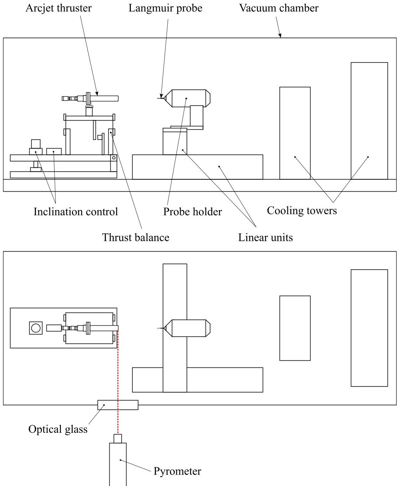

Figure 6: Experimental setup of the arcjet test facility seen from the side and top

with the Langmuir probe. The displacement of the pendulum is measured by a capacitive sensor, which is positioned under the pendulum table. Calibration is done by the usual practice of applying known masses to the pendulum and correlating the resulting displacements. $ ^{14} $

For plasma diagnostics, a Langmuir setup was established located in the plume area of the thruster. The probe is designed to allow electron temperature and number density measurements within a thin sheath, collision free probe regime. Further insight into the design process and probe geometry is presented in Ref. $ ^{15} $ The probe holder is water cooled and mounted on two linear units. These allow diagnostics along the plume direction and radial mapping. If necessary, the probe can be brought completely outside the plasma plume, in case needed. The linear units are equipped with copper shields to prevent overheating of the step motors.

To measure the temperature of the nozzle outer surface, a TMR 85 H pyrometer from the Dr. Georg Maurer GmbH is installed outside the vacuum facility. It features a measurable temperature range of 883 K 1413 and is pointed through an optical glass towards the nozzle.

Further instrumentation to observe and record operational parameters are a coriolis mass flow meter, an in-house made multimeter that measures the thruster current $ I_{Th} $ by deriving the voltage drop over a 100 $ \Omega $ shunt, and thermo couples to measure the temperature of the structure, propellant feed line, and shielded

<!-- PDF_PAGE: 8 -->

instruments. Additionally, the propellant feeding system and the vacuum chamber itself are equipped with several pressure sensors of different types.

## F. Test Matrix and Procedure

For the material and performance test campaigns, different parameters are measured and controlled. Furthermore, the test procedures are varying for material and performance characterization. Within this paper, only the material test campaign is thoroughly explained, since the performance tests are yet to be finalized. To inflict the highest possible thermal wear on the AM nozzle, the current was set to 10 A, which is the PPU's limit. The mass flow rate was set to 15 mg/s of argon, which was found as stable point of operation during a preceding test with the conventional manufactured counterpart of the nozzle. To comply with the previous material analysis by Bock, the same test pattern was applied. $ ^{16} $ After the time steps defined in Table 3, the thruster was disassembled, the nozzle's condition photo documented and the constrictor measured with a microscope. Before the images were taken, the microscope was calibrated with a calibration ruler. Prior to each follow-up test, the cathode was sanded and polished to remove possible deposits or cavities and the sealings renewed. The nozzle however received only a minimum of maintenance, by polishing the sealing area. After integration of the thruster inside the vacuum chamber, the facility was evacuated for 24 hours to allow outgassing of the nozzle and chamber walls. Once a test run was completed, the chamber was flooded with argon to prevent any damage due to oxidation during the cool-down phase.

Table 3: Test parameters and measurands

<table border="1"><tr><td>Parameter</td><td>Range</td><td>Measurement device</td></tr><tr><td>$I_{Th}$</td><td>10A</td><td>In-house multimeter</td></tr><tr><td>$\dot{m}$</td><td>15mg/s</td><td>Bronkhorst mini CORI-FLOW M13</td></tr><tr><td>t</td><td>1,5,10,30h</td><td>Test facility clock</td></tr><tr><td>$d_{Con}$</td><td>Measured</td><td>Microscope</td></tr></table>

## IV. Results

This section shows the results from testing the additively manufactured tungsten in an arcjet thruster. In total, the thruster was operated for 5 hours, 4 of those consecutive. The influence of the arc and plasma on the material is displayed as microscope image of the constrictor (Fig. 7), photographs of the outer surface (Fig. 8), and as progression in number in Fig. 9b.

Prior to operation, impurities can be spotted in the nozzle's constrictor. These were expected, du to the manufacturing process. The diameter is roughly 0.01 mm less then the designed 0.4 mm, but this is within the manufacturing tolerance. Once the first hour of operation was concluded, the impurities were eroded by the arc. Since no intense sputtering was observed during operation, it is likely the material was melted an wetted the surrounding surface. The overall diameter remained nearly constant and the outer surface did not show any signs of wear.

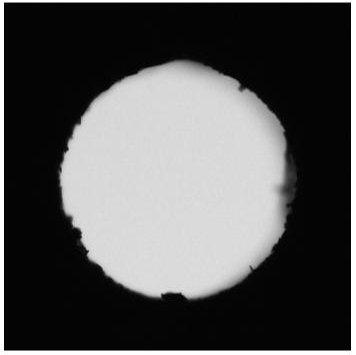

Nozzle throat prior to operation

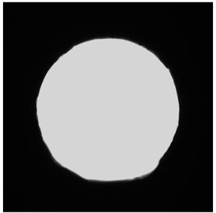

Nozzle throat after 1 hour of operation

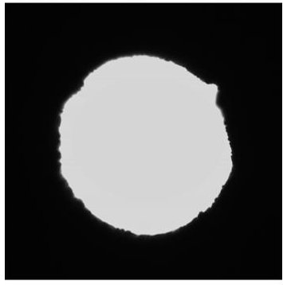

Nozzle throat after 5 hours of operation

Figure 7: Influence on the nozzle constrictor after thruster operation $ ^{11} $

<!-- PDF_PAGE: 9 -->

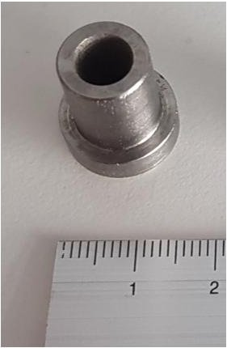

Nozzle prior to operation

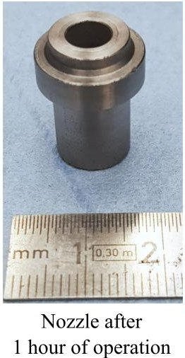

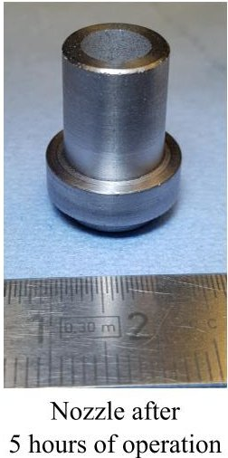

Figure 8: Nozzle outer surface prior and after thruster operation $ ^{11} $

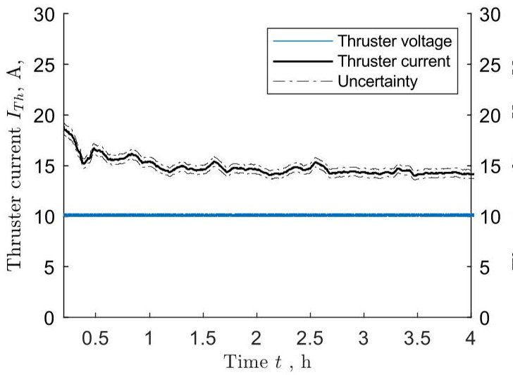

(a)

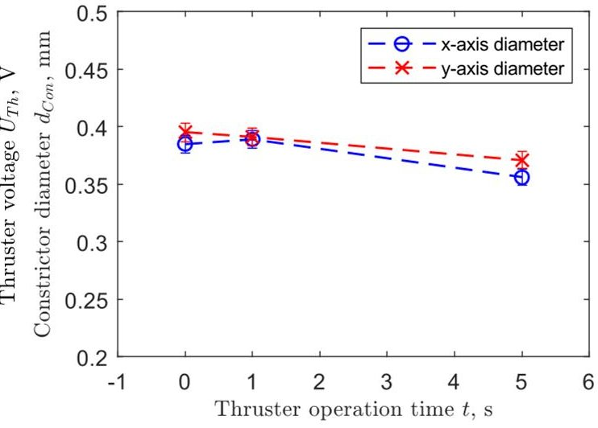

(b)

Figure 9: a) Thruster voltage and current behavior over the continuous 4 hours test run, b) Development of the material test nozzle's constrictor diameter against thruster operation time $ ^{11} $

After 5 hours of operating the material test nozzle, more significant changes can be observed. The constrictor wall shows a more coarse pattern, which could be directly related to the tungsten powder size. Also a similar constrictor shrinking process, as it was observed by Bock, $ ^{16} $ occurred, reducing the diameter by about 6 %. A larger fragment was consumed by the arc in the top right corner, which might have been partially melted tungsten powder. However, this is not unusual for an arcjet constrictor after several hours of operation and has been observed in the reference study as well. The outer surface also shows minor changes compared to the previous images. The AM structure is more clearly seen with several micro cavities opened on the surface. This most likely happened due to trapped air inside the material, which was expanded while heated up during arcjet operation. However, the structural integrity did not suffer from this effect.

Overall, the additively manufactured tungsten withstood the electric arc environment without major damages. Operation was stable over the full 5 hours, which can be seen in Fig. 9a and no significant anomalies were found. So far it can be assumed that AM tungsten is in general feasible for arcjet operation. However, follow-up test with hydrogen and ammonia will have to proof, if this trend continuous.

## V. Outlook

With the general feasibility of AM tungsten operated in arcjet environment being proofed, the performance campaigns can be conducted. The next step is to operate both nozzle designs with hydrogen and

<!-- PDF_PAGE: 10 -->

measure the thrust to characterize the efficiency gain from the integrated cooling channels. This also allows higher power levels up to 1kW, which is another test of the materials integrity. Furthermore, by measuring the surface temperature and feeding these data into a thermal model of the thruster, the heat flux into the propellant can be estimated. This is very important for developing a regenerative gas generator for operation with ammonia.

## VI. Conclusion

Two nozzle designs for thermal arcjet thrusters were manufactured via selective laser melting of tungsten with the required quality. A successful 5 hours test, with 4 continuous hours of operation proofed the general feasibility of the material for use in thermal arcjet thrusters. Further testing of the nozzle at higher power levels and a performance comparison between the described nozzle designs will give further insight into the behavior of the material.

## Acknowledgments

The support of the IRAS project as well as the Ministry of Economic Affairs Baden-Wurttemberg is greatly acknowledged.

## References

$ ^{1} $Wollenhaupt, B. (2017). Die Entwicklung Thermischer Lichtbogentriebwerksysteme, Ph.D. Dissertation, University of Stuttgart, Stuttgart, Germany.

$ ^{2} $Ehresmann, M., Skalden, J., Fugmann, M., Fasoulas, S., Klinkner, S. & Sakraker, Isil, Stabler, Tina, Refle, Oliver (October 2018). IRAS: Low-cost Constellation Satellite Design, Electric Propulsion and Concurrent Engineering, IAC-18-B4.6, 69th International Astronautical Congress, Bremen, Germany.

$ ^{3} $Ehresmann, M., Spanoudis, T., Herdrich, G. & Fasoulas, S. (September 2019). Progress in Automated System Design by Evolutionary Algorithms, IEPC-2019-456, 36th International Electric Propulsion Conference, Vienna, Austria.

$ ^{4} $ del Portillo, I., Cameron, B.G. & Crawley, E.F. (October 2018). A Technical Comparison of Three Low Earth Orbit Satellite Constellation Systems to Provide Global Broadband, IAC-18-B2.1.7, 69th International Astronautical Congress, Bremen, Germany.

$ ^{5} $ Wertz, J.R. & Larson, W.J. (1999). Space mission analysis and design, volume v.8 of Space technology series, Microcosm and Dordrecht and London : Kluwer Academic, Torrance, Calif., 3rd ed. / edited by james r. wertz and wiley j. larson edition, ISBN 1-881883-10-8.

$ ^{6} $Dropmann, M., Ehresmann, M., Pagan, A.S., Le, Q.H., Romano, F., Montag, C. & Herdrich, G. (April 2017). Low Power Arcjet Application for End of Life Satellite Servicing, 7th European Conference on Space Debris, Darmstadt, Germany.

$ ^{7} $Wollenhaupt, B., Le, Q.H. & Herdrich, G. (2018). Overview of Thermal Arcjet Thruster development, Aircraft Engineering and Aerospace Technology, 90(2), 280-301, ISSN 0002-2667, doi:10.1108/AEAT-08-2016-0124.

$ ^{8} $Iveković, A., Omidvari, N., Vrancken, B., Lietaert, K., Thijs, L., Vanmeensel, K., Vleugels, J. & Kruth, J.P. (2018). Selective Laser Melting of Tungsten and Tungsten Alloys, International Journal of Refractory Metals and Hard Materials, 72, 27-32, ISSN 02634368, doi:10.1016/j.ijrmhm.2017.12.005.

$ ^{9} $Zhou, X., Liu, X., Zhang, D., Shen, Z. & Liu, W. (2015). Balling Phenomena in Selective Laser Melted Tungsten, Journal of Materials Processing Technology, 222, 33-42, ISSN 09240136, doi:10.1016/j.jmatprotec.2015.02.032.

$ ^{1 0} $Riehle, M. (1994). ATOS - Arcjet Flugeexperiment auf dem Amateurfunksatelliten AMSAT-P3-D, Technical Report Final report, DARA FKZ TT 50 TT 9404.

$ ^{11} $Skalden, J., Ehresmann, M., Herdrich, G. & Fasoulas, S. (June 2019). Development of an Arcjet Deorbit Module for Low-Cost Constellations, 32st International Symposium on Space Technology and Science, Fukui, Japan.

$ ^{1 2} $Skalden, J., Ehresmann, M. & Herdrich, G. (November 2018). Test Schedule and Material Analysis, IRAS Report D3.2.5.

$ ^{13} $Heinrich, K. (2014). Commissioning of a mobile thrust balance for 1 kW Arcjets, Bachelor Thesis, University of Stuttgart, Stuttgart, Germany.

$ ^{1 4} $Polk, J.E., Pancotti, A., Haag, T., King, S., Walker, M., Blakely, J. & Ziemer, J. (October 2013). Recommended Practices in Thrust Measurements, IEPC-2013-440, 33rd International Electric Propulsion Conference, Washington, D.C., USA.

$ ^{15} $Skalden, J., Ackermann, L., Upadhyay, P.P., Herdrich, G., Fasoulas, S., Schönherr, T., Gonzalez del Amo, J. & Feili, D. (September 2019). Electrostatic Probe Investigation of Very Low Power Arcjet VELARC in IRS and ESA-ESTEC Facilities, IEPC-2019-224, 36th International Electric Propulsion Conference, Vienna, Austria.

$ ^{1 6} $Bock, D. (2009). Untersuchung eines thermischen Lichtbogentriebwerksystems für die Lunar Mission BW1, Ph.D. Dissertation, University of Stuttgart, Stuttgart, Germany.