<!-- PDF_PAGE: 1 -->

DEPARTMENT OF DEFENSE

DEFENSE SCIENCE BOARD

# Digital Engineering Capability to Automate Testing and Evaluation

## Final Report

## May 2024

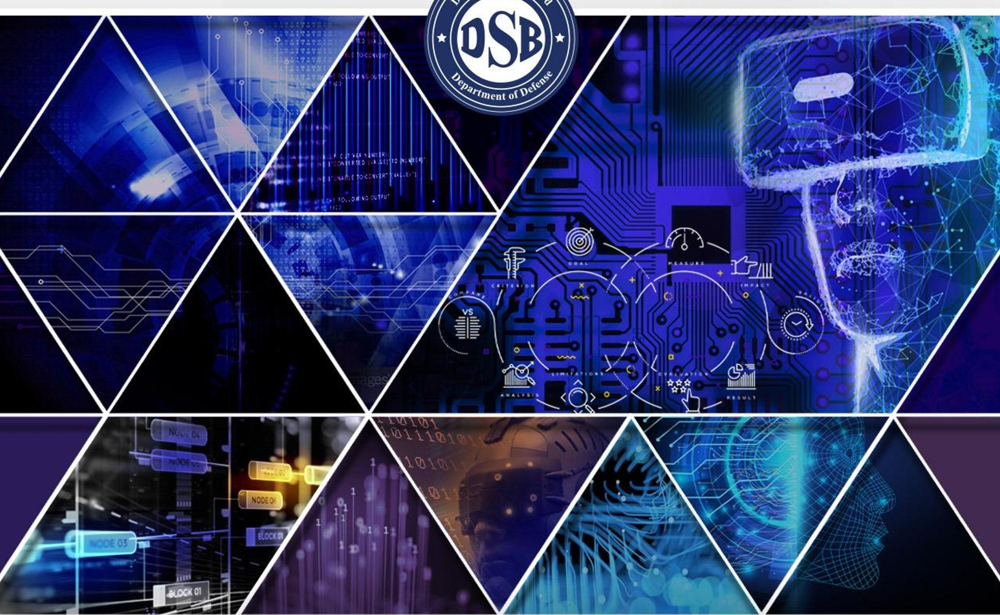

OFFICE OF THE UNDER SECRETARY OF DEFENSE FOR RESEARCH AND ENGINEERING

<!-- PDF_PAGE: 2 -->

This report is a product of the Defense Science Board (DSB). The DSB is a Federal Advisory Committee established to provide independent advice to the Secretary of Defense. Statements, opinions, conclusions, and recommendations in this report do not necessarily represent the official position of the Department of Defense.

<!-- PDF_PAGE: 3 -->

# OFFICE OF THE SECRETARY OF DEFENSE 3140 DEFENSE PENTAGON WASHINGTON DC 20301-3140

MEMORANDUM FOR UNDER SECRETARY OF DEFENSE FOR RESEARCH AND ENGINEERING

SUBJECT: Defense Science Board (DSB) Final Report on Digital Engineering Capability to Automate Testing and Evaluation

I am pleased to forward the final report of the DSB Task Force on Digital Engineering Capability to Automate Testing and Evaluation, which was co-chaired by Dr. Robert Grossman and Dr. Mark Maybury. A generational shift in the practice of engineering is underway, with ramifications not only for those who design and build, but also mission planners, testers, maintainers, and users of equipment ranging from personal devices to the largest systems fielded by the U.S. military.

High-quality models, high-powered simulation, tool interconnectivity, and many other factors enable "digital engineering," a practice that not only relies upon these capabilities, but also extends throughout the system life cycle to consider how it will meet needs and be sustained over time. Although synonymous in some minds with the creation of "digital twins" that are one-to-one paired with physical systems, digital engineering represents a much more fundamental reimagining of the engineering process to interlink and overlap phases of development and testing.

This shift is neither new nor unexpected, but it is progressing at a pace that the Department must account for and is striving to do so. Although the Department may not choose to digitally engineer every system, fully traditional engineering will become more difficult over time due to shifting expertise in the workforce and contractor capabilities.

Given this evolution in capabilities and expectations, the Department must be prepared to exist within a broader digital engineering ecosystem. Leaders must understand how and when to apply it in their programs. Acquirers must know which deliverables to require and what contracting language to employ. Planners must convey their needs, and maintainers must know what information they can rely upon. Educating the workforce on what can be accomplished via digital engineering is as important as developing its capabilities, giving a clear understanding of costs and benefits at every stage.

I fully endorse all the study's recommendations and urge their careful consideration and adoption. Understanding and applying digital engineering will ensure that the next generation of systems serve warfighters as ably as possible.

Dr. Eric D. Evans

Chair, Defense Science Board

<!-- PDF_PAGE: 4 -->

THIS PAGE LEFT INTENTIONALLY BLANK

<!-- PDF_PAGE: 5 -->

# OFFICE OF THE SECRETARY OF DEFENSE 3140 DEFENSE PENTAGON WASHINGTON DC 20301-3140

## MEMORANDUM FOR THE CHAIR, DEFENSE SCIENCE BOARD

SUBJECT: Report of the Defense Science Board (DSB) Task Force on Digital Engineering Capability to Automate Testing and Evaluation

Attached is the final report of the congressionally directed DSB Task Force on Digital Engineering Capability to Automate Testing and Evaluation. Properly employed, Digital Engineering (DE) has demonstrated cost, schedule, performance, agility and evolvability benefits and is applicable not only at multiple levels of systems (from components to systems of systems) but also across the full life cycle from requirements to design, to manufacturing, to test and evaluation, to operations, and even to sustainment. Moreover, DE can help shape and reduce physical test and evaluation that can be time intensive, expensive, dangerous, or revelatory to adversaries. However, as the report illuminates, DE is no substitute for rigorous systems engineering, sound program management, common sense, and real-world testing and evaluation (T&E) of complex phenomena. Moreover, DE introduces new challenges including increased digital attack surfaces, dependency on digital expertise and commercial tools, and upfront investment.

In reviewing case studies in the defense and commercial sectors, the Task Force found many examples across domains, missions, and life cycle where DE offered significant benefits in programs ranging from aircraft carriers and major DoD platforms to logistics systems; however, these benefits did not come without cost. Developing models at a useful level of fidelity requires modern tools, a workforce with specialized knowledge, and digitally evolved acquisition and contract processes. While the benefits of investment will accrue over time for systems that are made in large quantities or must be maintained over the course of decades, other programs may not be suited for DE at the same level due to cost, security, or complexity.

Asking how, where, and when to apply DE is necessary for any portfolio or program manager, but the support afforded to them is often insufficient. DoD must employ more sophisticated assessment to guide DE applicability; provide data, simulations, model repositories, and tools that enable reuse, accelerate speed, and reduce cost; establish and promulgate best practices for programs; and upskill talent and infuse expert DE experience across all disciplines and functions. As DE is not simply engineering with digital tools but is instead a transformation of fundamental processes enabled by interconnectivity, the policy frameworks surrounding digitally engineered programs must also be open to change.

Contributions detailed in the study include a set of DE case studies across government, FFRDCs, and commercial entities with attendant benefits and challenges; a prosed standards based DE infrastructure and open systems DE architectural framework to accelerate progress; a research plan to address DE gaps in the near, mid, and far term; a DE maturity model for assessing and guiding organizational and process development; a DE skills development focus; and a practical DE checklist for portfolios and programs.

Dr. Robert Grossman

Co-chair

Dr. Mark Maybury Co-chair

<!-- PDF_PAGE: 6 -->

THIS PAGE LEFT INTENTIONALLY BLANK

<!-- PDF_PAGE: 7 -->

# Table of Contents

Executive Summary...1

1. Introduction: “Imagine If...”...1

2. An Overview of Digital Engineering...3

   2.1. Definitions...3

   2.2. DE/MBSE Across the Product Life Cycle and System Hierarchy...4

   2.3. Digital Engineering Ecosystems...5

   2.4. Authoritative Source of Truth...5

   2.5. Digital Twins...6

   2.6. Towards MBSE Metrics and a Digital Engineering Maturity Model...7

   2.7. Finding for Quantitative Evidence and Capability Maturity...9

   2.8. Benefits and Limits of Digital Engineering...9

   2.9. DevOps for Automating T&E...12

   2.10. Verification, Validation and Accreditation (VV&A)...12

   2.11. Summary of Current State of Digital Engineering...13

3. Digital Engineering Case Studies...14

   3.1. Navy Ford-Class Aircraft Carrier...14

   3.2. Air Force T-7A Red Wing Training Aircraft...15

   3.3. Nuclear Power Design at Idaho National Laboratory...16

   3.4. Amazon Web Services IoT TwinMaker...17

   3.5. Digital Engineering for Sustainment...18

   3.6. Digital Engineering at SpaceX...19

   3.7. Summary of Lessons Learned...21

   3.8. Findings: Case Studies...22

4. Digital Acquisition in DoD...23

   4.1. Progress in Policy...23

   4.2. Progress in Standards...23

   4.3. Insufficient DE Infrastructure and Standards Investment...23

   4.4. Need for Increased DE Knowledge Sharing...24

   4.5. Need for DE Contractual Evolution...24

   4.6. Assessment of OSD Response to FY 2020 NDAA Section 231(a) through (c)...24

   4.7. Findings: Digital Acquisition...25

5. Digital Engineering in DoD...26

   5.1. Trade-Offs Applying Digital Engineering to Complex Projects...26

   5.2. Lack of a Common, Open Reference Architecture...26

   5.3. Impediments for Sharing the Information and Artifacts Required for Digital Engineering...27

   5.4. New Attack Surfaces Created by Digital Engineering...28

<!-- PDF_PAGE: 8 -->

5.5. Research in DE is Needed in Selected Areas...29

5.6. Trade-offs Required for Effective Digital Engineering...29

5.7. Continued Need for Real World Test and Evaluation...30

5.8. Findings: Digital Engineering ...30

6. Digital Engineering Workforce Challenges for DoD...32

6.1. Progress in DE Knowledge and Knowledge Sharing ...32

6.2. Need for DE Workforce Development...32

6.3. Findings: DE Workforce ...35

7. Recommendations...36

7.1. Recommendation 1: Develop DoD DE Reference Architecture and DE Infrastructure...36

7.2. Recommendation 2: Accelerate Digitally Enabled Acquisition ...36

7.3. Recommendation 3: Accelerate Virtual Testing and Reuse of Test Data...37

7.4. Recommendation 4: Invest in DE Research and Development...37

7.5. Recommendation 5: Develop Workforce DE Skills...39

8. Summary...40

Appendix A: Terms of Reference ...A-1

Appendix B: Task Force Membership ...B-1

Appendix C: Digital Engineering Checklist for Programs and Portfolios...C-1

Appendix D: Mapping of Findings and Recommendations...D-1

Appendix E: Briefings Received...E-1

Appendix F: Glossary...F-1

Appendix G: Acronym List...G-1

<!-- PDF_PAGE: 9 -->

## Executive Summary

The Defense Science Board (DSB) Task Force on Digital Engineering Capability to Automate Testing and Evaluation was charged with investigating the current state of, and future potential for, digital engineering (DE) within the Department of Defense (DoD). Through an analysis of digital engineering use in both defense and commercial industries, the Task Force found that digital engineering, when properly applied, can improve cost, schedule, and performance of complex projects and programs. However, DE is not a panacea for ill-formed acquisition strategies, poorly executed systems engineering, overly optimistic cost and schedule predictions, or contractor compliance issues. Moreover, oversight of DE processes and products must be performed by technically qualified personnel to achieve desired results.

While progress has been made in developing DoD digital acquisition policies and processes, insufficient and/or inconsistent architectures, standards, shared digital infrastructure, and intellectual property rights impede realization of Department-wide benefits. In terms of engineering, the lack of shared and interoperable reference architectures, standards, test data, models, and digital infrastructure and tools for digital engineering increases cost, lengthens schedules, and introduces unnecessary risks for programs. Likewise, increased use of digital engineering expands attack surfaces and creates potential vulnerabilities that must be protected. This includes protecting all associated data, models, tools, and infrastructure from hostile actors. Decision makers and developers need to ensure data and models are appropriately protected, verified, and validated to manage the risk of loss or misapplication. Existing gaps in high-performance computing and multiscale modeling and simulation (M&S), verification and validation (V&V), and generative artificial intelligence (GAI) modeling impede progress on creating increasingly complex, adaptive, reliable, and resilient digital models. Finally, despite the importance of a skilled workforce, there are not enough training opportunities in digital acquisition processes or DE methods and tools (e.g., model-based acquisition, model-based systems engineering (MBSE)) for all functional areas, including engineers, analysts, program managers, testers and evaluators, contract managers, operators, maintainers, and most importantly leaders.

The Task Force recognizes that real-world testing and evaluation is still needed when models do not provide necessary fidelity, when models are not sufficiently mature, in complex and contested environments (e.g., stealth, electronic warfare), when complexities and interdependencies are insufficiently understood (e.g., human behavior, autonomous systems), and when the investment required for digital test and evaluation (T&E) exceeds expected benefits. The Task Force noted multiple challenges with adopting DE, including required up-front investments, insufficient standards, limited expertise and training, insufficient acquisition and contracting support, and cultural biases against digital engineering.

The Task Force principally recommends that the Office of the Secretary of Defense (OSD) and the Military Services should invest in DE architectures and infrastructure at the appropriate level of detail for their intended applications. Each Service Acquisition Executive (SAE), in close coordination with the Office of the Under Secretary of Defense for Acquisition and Sustainment (OUSD(A&S)) , Office of the Under Secretary of Defense for Research and Engineering (OUSD(R&E)) , and Director, Operational Test and Evaluation (DOT&E) should also invest in a DE infrastructure and incorporate rigorous digital engineering at levels where it maximizes current benefits and future digital artifact reuse. This needs to

<!-- PDF_PAGE: 10 -->

be resourced as a critical piece of infrastructure; it should not be left to programs or projects to fund out of resources intended for their own development effort. Essential actions include developing a "Reference Architecture" for DoD digital engineering implementation in each acquisition pathway and developing a concept of operations (CONOPS) that supports implementation of an exemplar reference architecture for the DoD DE ecosystem. This reference architecture and CONOPS will leverage various ongoing efforts across the Department and related entities. Service Acquisition Workforce Directors must also develop a government workforce fluent in DE techniques appropriate to their activities, both to oversee system development and to perform government life-cycle functions for the full spectrum of DoD activities. USD(A&S) should adapt the acquisition process and contractual milestones to include practical application of digital engineering, requiring digital deliverables derived from the contractor's digital core and using digital artifacts, analytics, and tools to inform decision making. This includes maximizing the use of virtual techniques in test and evaluation, validated by selective, real-world tests and measurements. OUSD(R&E) should fund the research community to accelerate DE science and technology to close critical gaps. MBSE should be enabled across the full life cycle, and OUSD(A&S) should change contracts to require a continuum of MBSE from development to operations and sustainment, conducted in such a way as to guard against interference.

As threats shift and new capabilities emerge, digital engineering is an important component of the agility needed to be responsive. In summary, digital engineering has the potential to be a critical enabler to deliver sustainable systems superiority in addition to cost, schedule, and performance benefits, but only so long as it is thoughtfully implemented and reliably supported.

<!-- PDF_PAGE: 11 -->

## 1. Introduction: "Imagine If..."

The future use of digital engineering (DE) is exciting and powerful. Imagine if every location, object, person, and process had a digital twin that mirrored its real-world status as shown in Figure 1. Analysts could predict and prescribe actions based on collected data and continuously updated models that are machine-learned and reality-validated. Acquirers could anticipate and govern systems at multiple scales, including total life-cycle costs, schedule, and performance to guide transformational outcomes. Testers

and evaluators could be more accurate and precise, with risk identified in advance and used to inform focused tests. These specialists would be able to identify and validate operationally useful models, transitioning from the current use of a few general models toward a large number of models used for specific purposes. Future acquirers could create threads of reasoning across multiple functional domains to enable the Department of Defense (DoD) to rethink concept of operations (CONOPS), increasing efficiency and effectiveness. Information about and from systems fielded could be reused in future development. Engineers could generatively design the future, rapidly modeling complex systems (materials, biological, cognitive, social,

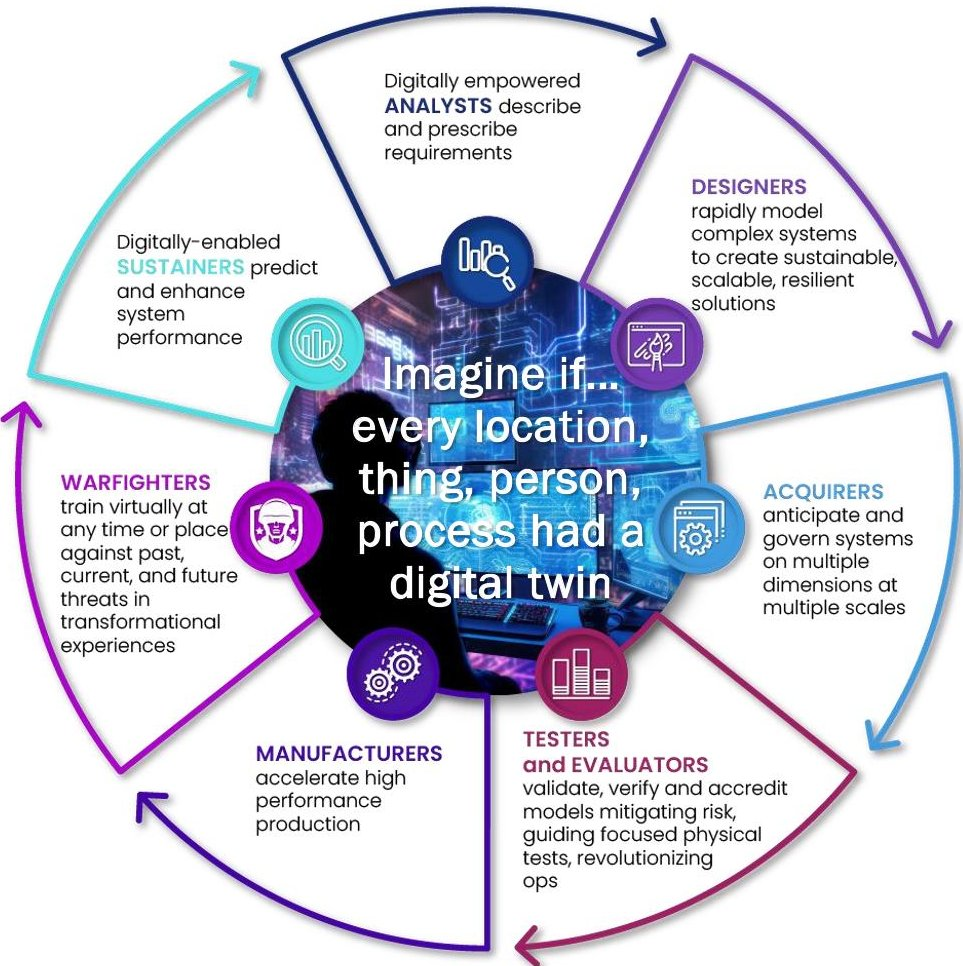

Figure 1. Digital Engineering Vision

medical, etc.) to create sustainable, scalable,

resilient solutions for all missions and functions (including use of 3D machine readable maps with 3D machine readable resolution). Manufacturers could accelerate production of affordable, interoperable, and impactful solutions. Warfighters could train virtually at any time or place against past, current, and future threats to affordably reskill and upskill with fielded systems. Digital engineering could be used to develop doctrine for broader strategy and campaign planning, including training tailored for missions, with digital engineering employed to identify new vulnerabilities and attack vectors. Finally, modelbased forecasting could enable sustainers to preposition capabilities, materiel, and services to ensure sustainable, continuous operations in future conflicts.

This future perspective reveals how digital engineering will introduce new opportunities and challenges across the full spectrum of defense systems and environments. Its significance has been reinforced by many studies within the Department, including a recently completed review by the Army Science Board, and has been recognized by other government bodies, including Congress. Section 231(f) of the National Defense Authorization Act (NDAA) for Fiscal Year (FY) 2020, Public Law 116-92, signed on December 20,

<!-- PDF_PAGE: 12 -->

2019, directed the Defense Science Board (DSB) to complete an independent assessment of the progress made by the Secretary of Defense in implementing Sections 231(a) through (c) of the FY 2020 NDAA, which focused on the application of digital engineering to test and evaluation (T&E). Section 231 of the FY2020 NDAA was later supplemented by Section 836 of the FY 2021 NDAA, which required broader implementation of digital engineering throughout the acquisition process for both programs and portfolios. Section 231(f) further required the results of the DSB assessment to be provided to the Congressional Defense Committees. This report captures the findings and recommendations from the DSB Task Force.

<!-- PDF_PAGE: 13 -->

## 2. An Overview of Digital Engineering

## 2.1. Definitions

Digital engineering is an emerging field with various definitions. One definition, adapted in part from Idaho National Laboratory (INL), is: $ ^{1} $

Digital engineering is an approach to the design of a complex system across its entire life cycle that uses models and data instead of documents, integrates data across models, and enables the exchange of digital artifacts from an authoritative source of truth enabling the reduction of project costs and the improvement of schedules.

The Defense Acquisition University (DAU) Glossary defines digital engineering as "an integrated digital approach that uses authoritative sources of systems' data and models as a continuum across disciplines to support life-cycle activities from concept through disposal." $ ^{2} $

Figure 2 contrasts the traditional, paper-based waterfall engineering process with model-based iterative digital engineering, in which models shared across the life cycle enable more collaborative, rapid, and agile systems engineering.

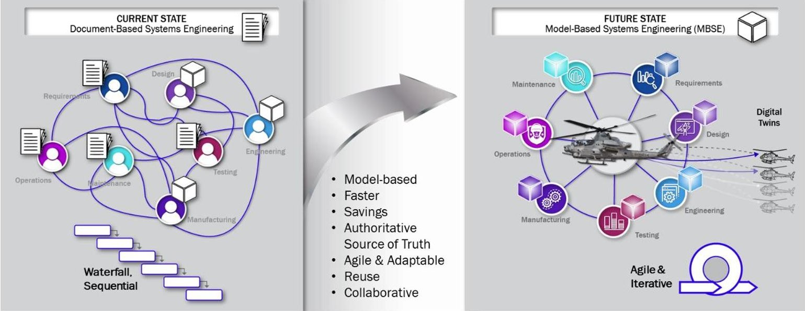

Figure 2. The Transition to Model-Based Systems Engineering

A 2021 MITRE report on digital engineering fundamentals described DE as:

Digital engineering is an integrated digital approach using authoritative sources of system data and models as a continuum throughout the development and life of a system. Digital engineering updates traditional systems engineering practices to take advantage of computational technology, modeling, analytics, and data sciences. $ ^{3} $

<!-- PDF_PAGE: 14 -->

These definitions all imply a change in practice from the written documentation to digital specifications that can be used computationally, which forms the groundwork for model-based systems engineering.

As defined by the International Council on Systems Engineering (INCOSE), model-based systems engineering (MBSE) is the "formalized application of modeling to support system requirements, design analysis, [and] verification and validation [V&V] activities beginning in the conceptual design phase and continuing throughout development and later life-cycle phases." As illustrated in Figure 2, MBSE is a continuum building upon systems engineering principles that transitions from unstructured documentcentric engineering to formalized data- and model-driven characterization of systems of systems at multiple levels of abstraction. This characterization ranges from high-level requirements and mission analysis to detailed hardware/software subsystems that capture structure, interfaces, and behavior as it evolves through the life cycle, incorporating stakeholder requirements and use case development, systems of system interactions, dependencies, and schedule breakdowns. Appendix F provides additional terms and definitions.

DE and MBSE change the way engineering, acquisition, T&E, and operations and management (O&M) are done; when appropriately used, DE reduces costs, improves schedules, and increases flexibility. Achieving these benefits requires a workforce with specialized skills such as creating and evaluating detailed models, performing simulations to answer specific engineering questions, evaluating uncertainty within those models and simulations, and translating them across tools and platforms.

## 2.2. DE/MBSE Across the Product Life Cycle and System Hierarchy

With digital engineering and model-based systems engineering, there are two hierarchies across which data and models are exchanged:

- System and mission hierarchy from components, to systems, to systems of systems, to mission threads, to mission outcomes, and

- Life cycle of a system from requirements to specifications, to design, to development, to testing and V&V, to manufacturing, to operations, to maintenance.

These dimensions are illustrated in Figure 3. The term continuum is commonly used in digital engineering and MBSE to describe how data and models are exchanged throughout these two dimensions, as in "model-based continuum" or as in "continuum throughout the development and life of a system" within the INCOSE definition of MBSE.

Another commonly used term is traceability, which describes the degree to which a relationship can be established between two or more products of the development process, especially products having a predecessor-successor or entity-sub-entity relationship to one another.

DE and MBSE create value across the product life cycle by ensuring digital continuity and traceability across multiple data streams and processes to provide insights to stakeholders for decision making.

<!-- PDF_PAGE: 15 -->

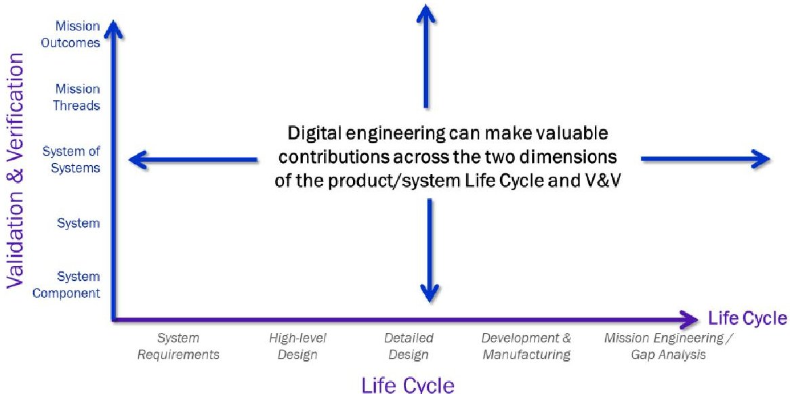

Figure 3. Digital Engineering Across Systems Verification & Validation (V&V) and Product/System Life Cycle

## 2.3. Digital Engineering Ecosystems

The software infrastructure necessary to support digital engineering is diverse, depends in part on the domain, and is known by a variety of names including the digital engineering ecosystem (DEE), DE infrastructure, integrated development environment, and the digital environment. This report uses the term DE ecosystem.

The DAU Glossary defines a DEE as "the interconnected infrastructure, environment, and methodology (process, methods, and tools) used to store, access, analyze, and visualize evolving systems' data and models to address the needs of the stakeholders." $ ^{4} $ A successful DE ecosystem: i) spans multiple disciplines, domains, tools, and providers; ii) leverages appropriate formal, informal, and emerging standards; iii) provides common access to data, including test data, simulation data, model data, etc.; iv) provides common access to models; and v) supports traceability.

A well-accepted approach to building DEEs is to use a Modular Open Systems Approach (MOSA) $ ^{5} $ that relies on RESTful APIs, RPCs, and other widely accepted protocols.

## 2.4. Authoritative Source of Truth

The establishment of what digital engineering calls an authoritative source of truth (ASOT) is essential for digital engineering to be used across the life cycle of a system. As discussed in the 2018 DoD Digital Engineering Strategy, $ ^{6} $ and as seen in use, the ASOT "captures the current state and the history of the technical baseline... Properly maintained, the ASOT will mitigate the risk of using inaccurate model data." It provides traceability as the system evolves, contains current information about the system, and supports effective control of the baseline. As with all computational elements, the ASOT must be

<!-- PDF_PAGE: 16 -->

designed to contain all data necessary for the tasks that it supports. It must be flexible enough to evolve, both in content and size, and must be readily available for the activities and practitioners who use and produce its contents.

A complex system with multiple domains, a hierarchical structure, and components across the product life cycle has multiple ASOTs by necessity. Each of these different ASOTs carries the burden to host persistent traceability records, histories of change, versions of tools, workflows, practices, data, and contexts. At the same time, the system as a whole must federate information across these ASOTs without corrupting any of them. One solution the Task Force found to this challenge is establishing federated data support and frameworks for local sub-versioning.

## 2.5. Digital Twins

A digital twin is a virtual representation of a real-world object, being, or system that can be continuously updated with data from its physical counterpart. More than just a descriptive representation (e.g., a SysML model), it is typically a multi-physics, multiscale modeling and simulation (M&S) of a systems modeling language (SysML) including its behaviors across multiple conditions and operating environments. Digital twins, like any model, can be developed at different levels of fidelity.

It is important to understand that a digital twin is a virtual representation of a particular asset. For example: an item identified by a serial number that is updated over time through sensors and other mechanisms (e.g., tracking part replacements) to reflect the state of the asset at any given moment. However, digital twins can drift from their physical counterparts without careful tracking, the lack of which will produce increasingly flawed data underlying the digital twin over time.

The Task Force looked at other examples from the commercial sector. For example, an auto manufacturer creates a digital twin of each of its cars that is updated via sensors in real time. When problems are detected (which can occur before drivers notice due to high instrumentation) they can either be fixed remotely by software update or locally at a mechanic. Importantly, the digital twins can also be used in simulations to improve the car's software and improvements can be digitally deployed to the entire fleet-instead of a hundred drivers driving physical cars for one month to test the software, one hundred digital twins of the cars can be virtually driven for one day (with enough computing power) to generate the same information.

A related but distinct concept is a digital thread, which, following an influential 2018 paper by Victor Singh and Karen Wilcox, is defined as a software architecture that links authoritative data about an asset "across all stages of the product life cycle (e.g., early concept, design, manufacturing, operation, postlife, and retirement) through a data-driven architecture of shared resources (e.g., sensor output, computational tools, methods, and processes) for real-time and long-term decision making."

More recently, the term digital thread also refers to a software architecture that enables multiple digital twins to share authoritative data so that interactions and other complex behaviors of multiple digital twins can be tracked, modeled, and simulated.

<!-- PDF_PAGE: 17 -->

## 2.6. Towards MBSE Metrics and a Digital Engineering Maturity Model

Assistant Secretary of the Air Force for Acquisition, Technology, and Logistics Will Roper championed the benefits of DE imploring the need to "ECreate Before You Aviate." $ ^{8} $ Unable to find clear data on how much digital engineering saves in cost and schedule, Air Force Secretary Frank Kendall observed "my best feel for that is, it's on the order of 20 percent, as a ballpark number" before citing additional benefits such as fully integrated digital design, government-industry collaboration, and reduction of misunderstanding and error. He further noted the importance of real-world testing to validate models for unprecedented systems and cited advanced aircraft or hypersonic missiles as good examples: "If you haven't done it before, you're going to have to go and actually do it." $ ^{9} $

Secretary Kendall's statements describe a persistent problem in digital engineering: sparse quantification of the benefits of implementing DE and MBSE. A review of the literature published in 2021 found that less than 1% of reports measured the benefits of MBSE versus perceiving benefits, observing benefits, or referencing benefits:

Overall, the disparity between the extent to which MBSE benefits have been measured or are simply perceived, as reported in existing literature, is staggering. Perceived benefits emerged as the largest type of claim. In other words, two-thirds of the papers citing benefits of MBSE do so without supporting evidence of any kind (i.e., they have not been formally measured, nor observed as part of an actual implementation of MBSE). The other classifications follow with referenced benefits at just over 30%, observed benefits with 10%, and measured benefits with just less than 1%. $ ^{10} $

Beyond reliable data, metrics for quantifying the benefits of digital engineering are themselves still emerging. A 2021 study presented at the Eighteenth Annual Acquisition Research Symposium in 2021 listed ten most commonly accepted metrics to measure the effectiveness of digital engineering: increased traceability, reduced defects/errors, reduced time, improved consistency, increased capacity for reuse, a higher level of support for automation, better communication and information sharing, the establishment of robust DE/MBSE methods and processes, the accessibility of training, and an increased willingness to use DE/MBSE tools. $ ^{11} $ The study continues:

It is important to note that measurement of DE/MBSE is a complex process that must be integrated with the entirety of enterprise measurement strategies across all enterprise functions. DE/MBSE cannot be isolated to a small group or limited set of programs if the goal is to understand and track enterprise value. Generally pilot efforts are recommended to start the

<!-- PDF_PAGE: 18 -->

adoption process, but maturity in DE/MBSE must become enterprise strategy and a component of enterprise performance measurement. $ ^{12} $

INCOSE has been a leading voice in the metrics area, both in the development of a framework, and the publication of papers related to metrics for digital engineering improvement. DoD along with the industry trade associations, Federally Funded Research and Development Centers (FFRDCs), University Affiliated Research Centers (UARCs), etc., $ ^{13} $ have collaborated to create a Digital Engineering Measurement Framework, of which v1.0 was published in 2022. $ ^{14} $ As this measurement framework gains acceptance, the ability to assess practices will shift from qualitative measures to quantitative measures. The development of any framework is a sign that the practice is continuing to mature over time.

One opportunity in the evolution of digital engineering is the development of a DE/MBSE capability maturity model. Important enabling work includes an INCOSE effort to create a model-based capabilities matrix $ ^{15} $ to be used as an assessment tool when characterizing an organization's current and desired MBSE implementation in 42 capabilities and skills areas. The matrix measures these 42 areas in five stages of capability, from level 0 to level 4: ad hoc capability application (level 0); use for specific objectives (level 1); application of modeling standards and tools (level 2); program/project wide capabilities and functionally integrated digital threads/digital twin (level 3); and enterprise-wide standards, ontologies, models, and applied capabilities (level 4).

Inspired by the Software Engineering Institute Capability Maturity Model for Integration, which collects best practices for institutions to improve their overall software processes, a standardized maturity model could become an important tool to benchmark, guide, and motivate improvement of DE maturity levels. Figure 4 provides a notional DE/MBSE maturity model which characterizes the progress of developing critical enablers such as strategy, people and culture, process and operations, and underlying infrastructure, graduating in maturity from ad hoc to enterprise-wide optimization.

In summary, moving from anecdotal evidence to qualitative and quantitative measurements is essential to maturing the DE enterprise. We summarize this in the Task Force's first finding.

<!-- PDF_PAGE: 19 -->

<table border="1"><tr><td></td><td>Level1</td><td>Level2</td><td>Level3</td><td>Level4</td><td>OPTIMIZED</td></tr><tr><td></td><td>AD HOC</td><td>REPEATABLE</td><td>DEFINED</td><td>MANAGED</td><td></td></tr><tr><td>ENABLERS</td><td></td><td></td><td></td><td></td><td></td></tr><tr><td>Strategy</td><td>Undefined; unpredictable</td><td>Digital standards and project definitions</td><td>Digitally specified project requirements, outcomes, and processes</td><td>Digital strategy organizationally defined; managed and measured across life cycle</td><td>Model-based designed in quality; defect/rework prevention</td></tr><tr><td>Leadership</td><td>No leadership support</td><td>Limited leadership support</td><td>Leadership acceptance</td><td>Leadership advocacy</td><td>Leadership championship</td></tr><tr><td>People &amp; Culture</td><td>No explicit training program; DE disincentivized</td><td>Configuration management; standard curriculum</td><td>Required training and certification; digital benefits recognized</td><td>Apprenticeship mastery; planned mentorship</td><td>Lifelong learning; growth mindset; sustainable institutional memory; DE benefits rewarded</td></tr><tr><td>Process / Operations</td><td>Undocumented; uncontrolled; reactive</td><td>Project planning; planned T&amp;E subcontractor management</td><td>Project and requirement management; process orchestration; peer review</td><td>Continuous assessment/machine learning; quantitative process and outcome management; portfolio and quality management; periodic red teaming</td><td>Process change management; After action reviews; continuous red teaming</td></tr><tr><td>Technology</td><td>Individual</td><td>Shared data, software, subsystems, services</td><td>Manual systems for digital requirements; defect management; specified services; defined metamodel</td><td>Intelligent process automation for model-based design, analysis, &amp; ops; shared metamodel; incorporation of new technologies at planned insertion points</td><td>AI enabled optimization and continuous learning of models and twins; Agile incorporation of new technologies</td></tr></table>

Figure 4. A Digital Engineering/MBSE Capability Maturity Model

## 2.7. Finding for Quantitative Evidence and Capability Maturity

2. 7.1 Finding: There is a need for more quantitative evidence on cost savings, schedule improvements, and increases in flexibility that is the result of MBSE and DE, as well as a need for a capability maturity model for digital engineering.

## 2.8. Benefits and Limits of Digital Engineering

Leaders should not assume that integrating digital engineering into the product life cycle is an all-or nothing proposition, just as there should be no expectation that developing single-use models in every circumstance is worth the investment. Digital engineering use must be carefully planned to balance its benefits and limitations. Digital engineering enables maximum use of data, but data sharing is also dependent on policy and security rules; it enables digital process flow in areas such as mission

<!-- PDF_PAGE: 20 -->

engineering but requires data or tool interoperability across missions and functions. Proper implementation of digital engineering may also enable new thinking, such as collapsing the systems engineering "vee" or allowing previously infeasible analysis, but these new approaches present decision makers with unfamiliar options.

A key tenet of digital engineering is using a continuum of models and data as appropriate. Business case analyses should be conducted before applying digital engineering to any part of the life cycle. If applied incorrectly, or at an inappropriate place in the life cycle, digital engineering may drain an unacceptable amount of resources or cause program delays. Like any tool, its application must be well considered, and it should not be treated like a crutch that will ameliorate other engineering flaws. If handled correctly, DE should not be feared.

Digital engineering has brought about numerous benefits to the defense industry, as illustrated below with several examples:

- Reduced development time and risk: The B-21 Raider program utilized digital engineering extensively, resulting in a notable reduction in development time. According to Tom Jones, President of Northrop Grumman Aeronautics System, "by being able to burn down a lot more risk digitally, we're able to take this step, which cuts years out of the overall development program and really wrings a lot of risk out." $ ^{16} $

- Improved design accuracy: The T-7 Red Hawk program, which embraced DE principles, has shown impressive savings. According to Boeing, the T-7 program achieved 75% increase improvement in first-time engineering quality, 80% reduction in assembly hours, and 50% reduction in software development and verification time compared to traditional aircraft development programs. This cost efficiency was attributed to the effective use of DE tools and processes throughout the program. $ ^{17} $

- Design optimization: Sentinel, formerly known as the Ground Based Strategic Deterrent, explored 'six billion iterations' to identify the optimal design for cost and performance. $ ^{18} $

- Reduced cost and downtime: Aviation battalions with CH-47s avoided $24 million in costs and realigned 6,237 maintenance hours to higher priority systems over a six-year period, though the exact span is not specified. The Army also reported avoiding $215 million in costs and realigned 5,324 maintenance hours to higher priorities after using predictive maintenance on UH-60 Blackhawk helicopters over a six-year period. $ ^{19} $

- Enhanced life-cycle management: Digital engineering supports the entire life cycle of defense systems including sustainment and maintenance. The United States Navy Digital Twin Shipyard (DTS)

<!-- PDF_PAGE: 21 -->

initiative has demonstrated the benefits of digital engineering in life-cycle management. Bill Couch, Naval Facilities Engineering Systems Command spokesman, stated:

"Industrial modeling and simulation is being used in conjunction with detailed engineering studies and master planning to determine the optimum shipyard configuration and process workflow, facility and infrastructure recapitalization requirements, initial cost estimating, and a phased implementation plan necessary to sustain ongoing ship maintenance." $ ^{20} $

While digital engineering offers a variety of benefits, it also comes with some limitations:

- Skill and expertise requirements: Implementing digital engineering requires a skilled workforce with expertise in digital tools, modeling, simulation, and data analytics. Training personnel and ensuring they possess the necessary skills can pose significant challenges. Organizations must invest in continuous training and development to keep up with rapidly evolving technologies.

- Data quality and availability: Digital engineering relies on access to accurate and reliable data. Obtaining high-quality data can be challenging, especially when integrating legacy systems or working with diverse data sources. Incomplete or inconsistent data can cause inaccuracies, affecting the reliability of digital models, which in turn degrades the accuracy of simulations conducted with them.

- Integration and interoperability: Integrating DE tools and systems across various platforms, domains, and organizations can be complex. Ensuring interoperability and seamless data exchange between different tools poses a significant technical challenge in the absence of an open, interoperable, and collaborative approach.

- Security and cybersecurity concerns: Digital engineering involves managing large volumes of sensitive data. Protecting this data from unauthorized access and cyber threats is critical. Organizations must prioritize robust cybersecurity measures to safeguard digital assets, preventing exfiltration as well as tampering.

- Cost and infrastructure requirements: Implementing DE practices often requires substantial investments in infrastructure, software licenses, and hardware. Organizations need to assess the costs associated with acquiring and maintaining the necessary resources.

- Culture and organizational change: Adopting digital engineering may cause significant cultural and organizational shifts. Traditional processes and mindsets need to be reevaluated and adjusted to embrace new ways of working. This can involve overcoming resistance to change, fostering collaboration, and promoting cross-disciplinary teamwork.

Section 6.2 addresses the challenges associated with training and retaining tomorrow's DE defense workforce.

<!-- PDF_PAGE: 22 -->

## 2.9. DevOps for Automating T&E

There is a common perception that the adoption of Agile software development processes in combination with automation technology (DevOps or DevSecOps) is key to streamlining T&E processes. True, under sets of constrained circumstances, there are benefits to these continuous integration/continuous delivery (CI/CD) approaches in classic information technologies such as the Army's Integrated Personnel and Pay System. However, as the DoD shifts toward complex digital systems (e.g., real-time cyberspace and/or electronic operations) and increases software integration in traditional platforms such as missiles, ships, tanks, and aircraft, the complexity of conducting T&E increases. Its difficulty additionally increases when assessing systems of systems in all domains, as well as joint operations in congested, contested, and complex environments. For example, digital twins can improve the pace of T&E on all programs, not just programs using the software acquisition pathway. A digital twin could also streamline acquisition processes if a waterfall software development process was being used.

In a principled DE approach, these digital modeling tools should share a common engineering baseline to facilitate maturing tools and associated data. This enables an efficient approach to using tools over the life cycle of a program, as well as improving tools with knowledge gained through development and testing over that period. For example, early in its life cycle, a digital modeling tool could simply be a constructive model for performing trade studies with no actual system software. Over time, and as more parameters become available through design and development progress, the digital modeling tool might become a software-based emulator that only includes models of electronic warfare waveforms. Later, in a live test, it may become important for this emulator to provide exact and physically consistent waveforms, so the digital modeling tool takes on a physical form as well. During deployment, the mature digital twin developed through this process can generate simulated data in parallel with data collected from the actual system, to be used for assessing its state (e.g., predicting failure modes) and improving the fidelity of the digital twin with additional data (e.g., system flight hours). This post-deployment application will assume greater importance across the DoD as more rapid software upgrades are pushed to the field to expand or enhance system functionality.

## 2.10. Verification, Validation and Accreditation (VV&A)

All programs—not just those developed within the Agile paradigm, and especially if they have system-of-system or joint requirements—should possess a digital model; that model, by current practice, must be accredited as fit for purpose by relevant authorities. $ ^{21} $ Unfortunately, validation, verification, and accreditation are often thought of as one and the same instead of as three distinct processes, performed as an afterthought, or appended to the development process of a model at a time when resources have already been exhausted. Under such circumstances, the VV&A process becomes a tax on an already burdened program and a headache for the program manager. This can be mitigated to some extent by separating the activities within VV&A into their three constituent parts, integrating them into the requirements, design, development, and testing process (performed incrementally), and gradually accumulating a body of evidence over time that supports model suitability.

<!-- PDF_PAGE: 23 -->

The term "fit for purpose" is especially critical, as it is the purpose or intended use of the digital model that ultimately governs how much risk and what types of risk the accreditation agent is willing to accept, which in turn governs model uncertainty parameters. This is also why it is "wicked hard" to develop universal standards of goodness. Each case is unique. That said, progress has been made over the past several years in developing a framework for measuring goodness-of-fit metrics in digital models. $ ^{22} $

## 2.11. Summary of Current State of Digital Engineering

Significant progress has been made in the science and technology of digital engineering, including MBSE, digital twins, tools and infrastructure, automated T&E, and maturity models. However, gaps remain in standards, interoperability, V&V, and adoption. While MBSE is now considered mainstream technology in the aerospace and defense industry, not all domains, disciplines, and detail levels can be accommodated within a DE framework. Interoperability of enterprise-level software systems, data transformation on demand across these systems, and expectations on standards to address these preexisting organizational conditions, represent a few critical challenges that require additional work.

With wider adoption of open protocols and interfaces for operational integration, traditional extensive customization services of the enterprise service bus are no longer cost effective. The solution may lie in accepting a modular open systems approach and federating data via Data as a Service (DaaS). This empowers organizations to readily support existing standards and, more importantly, connect to legacy systems with the same speed as modern enterprise systems, including M&S.

For V&V, one of the key remaining challenges is to define specific quantifiable goals for programs and organizations. Top-level goals on systems performance (i.e., measure of effectiveness), cost, schedule, and risk are becoming more readily definable from original and emergent requirements. These are then made verifiable by M&S infrastructure within the DE framework, including the fusion of model data and available test/operation data. Further work is required to enable supply-chain, intellectual property (IP)-protected ecosystem-level verification and validation.

<!-- PDF_PAGE: 24 -->

## 3. Digital Engineering Case Studies

To reach its findings and recommendations, the Task Force studied a multiplicity of digital acquisition and engineering programs, both defense and commercial, in a broad range of areas from transformation of enterprise functions to operational capabilities, in domains ranging from automotive to combat aircraft to space operations. The Task Force also reviewed the research previously conducted by the Office of the Under Secretary of Defense for Research and Engineering (OUSD(R&E)) under its FY 2020 NDAA Section 231 requirements. This section examines several case studies to understand the groundwork necessary for successful DE implementation, as well as potential limitations and pitfalls. Figure 5 is a full list of case studies explored by the Task Force.

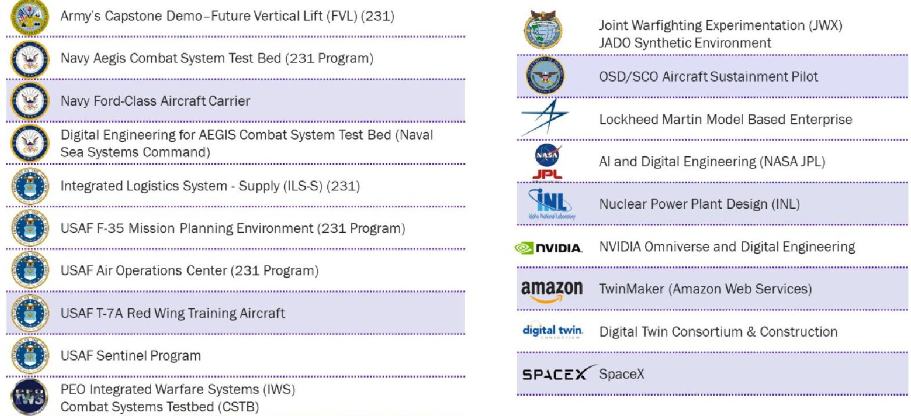

Figure 5. Case Studies (highlighted case studies examined in this section)

It is important to note that most of the data and statistics in this chapter were either provided by the programs themselves or were derived from industry and U.S. government reports. The Task Force did not validate the information provided, nor do we endorse its accuracy. However, the Task Force believes that, in the aggregate, these data points reflect several distinct trends in digital engineering adoption and can bound expectations moving forward. As stated in Recommendation 7.2.4, the Department should begin a process of collecting specific, verifiable data via an independent third party to quantify the benefits and risks of digital engineering in defense programs (both large and small). They should also foster the maturation of DE measurement standards such as INCOSE's Digital Engineering Measurement Framework. Until then, DoD will be forced to rely on similar case studies and qualitative comparisons to guide decision making.

## 3.1. Navy Ford-Class Aircraft Carrier

The Ford-class aircraft carrier is the first carrier design in more than forty years. This carrier class is at the forefront of the Navy's transition to fully digital ship design and construction, with the lead ship of the class, the USS Gerald R. Ford (CVN-78), having been built using mostly traditional construction practices; the second ship (USS John F. Kennedy, CVN-79) using modern database tools; and the third

<!-- PDF_PAGE: 25 -->

(USS Enterprise, CVN-80) and fourth (USS Doris Miller, CVN-81) ships, under a two-ship block buy contract, are implementing what the Navy calls "Integrated Digital Shipbuilding" (iDS). iDS as implemented by the prime contractor, Huntington Ingalls Industries Newport News Shipbuilding, is an ecosystem that includes digital shipbuilding imagery, laser scanning for precision component placement, augmented reality, M&S, and additive manufacturing. The contractor employs a three-dimensional rendering of the design, down to fine details of cable, pipe, and other component placement, critical to achieving promised labor savings. Anticipated savings are shown in Figure 6, with CVN 81 expected to benefit from a 22% reduction in total labor costs, compared to the labor costs for the CVN 78 lead ship.

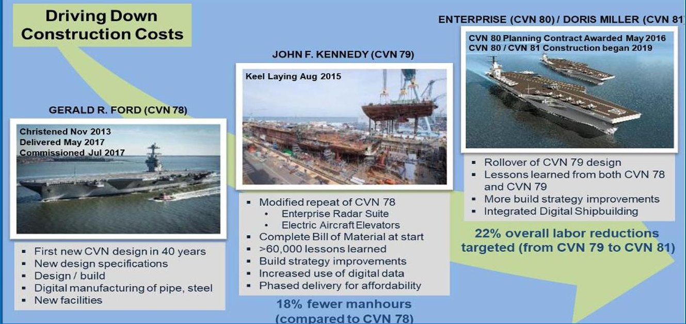

Figure 6. Projected Labor Cost Avoidance for Ford-Class Aircraft Carrier from First to Third Ship (Adapted and updated from program office briefing) $ ^{23} $

## 3.2. Air Force T-7A Red Wing Training Aircraft

In 2020, the Air Force T-7A Red Wing training aircraft was designated the first Air Force "eSeries" acquisition program, which indicates that an aircraft, satellite, or weapon system is developed, procured, tested, and evaluated using digital engineering as a central enabling system acquisition tool. $ ^{24} $ The Boeing Company, as the prime contractor, employed digital engineering along with open architecture design and Agile software development to achieve its first developmental test flight three years after concept formulation. $ ^{25} $

It is useful to compare the T-7A program's experience employing digital engineering to other Major Defense System Acquisition Programs (MDAPs) that do not adopt a DE approach: using data from the Government Accountability Office's 2022 Weapon Systems Annual Assessment, $ ^{26} $ one can approximately

<!-- PDF_PAGE: 26 -->

compare the interval between program start and the beginning of operational testing. Using 37 active and complete MDAP and MDAP increment programs from the Air Force, Navy, Marines, and Army, the median (mean) for this interval is eight (ten) years, compared to approximately five years for the T-7A program.

The prime contractor has made other observations about the benefits of adopting digital engineering. In particular, Boeing states that their DE focus is responsible for a 75% increase in first-time engineering quality, an 80% reduction in assembly hours, and a 50% reduction in software development and verification time. $ ^{27} $ Other benefits include easier maintenance and flexible technology refresh.

However, digital engineering is not a panacea for all challenges facing large DoD acquisition programs. The T-7A program has incurred actual delays or is expecting additional delays due to complications in four major areas: the pilot escape system, flight control software, the suite of ground-based training systems, and an incomplete contractor-supplied bill of materials needed for formulating a sustainment plan. $ ^{28} $ The confluence of these issues contributed to the Air Force delaying the program's Milestone C decision to February 2025 (14 months later than its prior planned decision date), thus delaying low-rate initial production of the aircraft and achievement of initial operational capability by three years, from 2024 to 2027. $ ^{29} $

## 3.3. Nuclear Power Design at Idaho National Laboratory

At the INL nuclear facilities, digital engineering has been undertaken to reduce capital costs, shrink schedules, increase performance, and reduce operating risks. In particular, the Digital Innovation Center of Excellent at INL employs MBSE, augmented/virtual reality (AR/VR), and reuse of code and site level requirements. As summarized in Figure 7, INL's DE approach employs an open-source digital thread that enables connection of data, assets, and analytics across energy systems. Immersive AR enables teams to visualize and interact with both physical assets and virtual digital twins, including multi-physics models and simulations. A model-based approach maintains rigor across systems and facility design while also integrating tests between government acquirers and contractor developers. A centralized source of truth enables real-time views across the life cycle, process optimization, and cost and risk reduction, while digital twins connected to real systems enable predictive maintenance.

<!-- PDF_PAGE: 27 -->

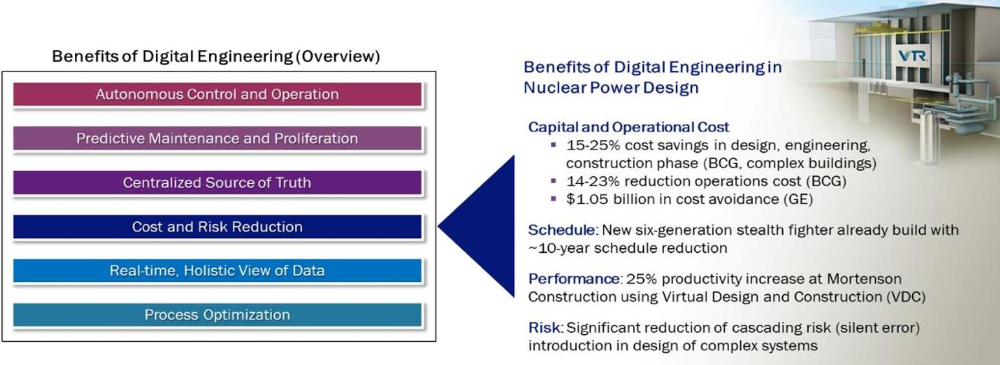

Figure 7. Digital Engineering in Nuclear Power Design: Character and Benefits $ ^{30} $

Drawing on other industry and government examples, INL projects that DE adoption offers the opportunity to increase design productivity by 25%, reduce building construction costs 15-25%, and reduce operating costs by 14-23%, according to Boston Consulting Group; $ ^{31} $ furthermore, General Electric observed that adopting a digital approach has avoided $ 1 B $ in losses among customers. $ ^{32} $ INL expects DE to significantly reduce cascading risk in future reactor designs by better capturing the interactions of complex systems.

INL notes several research and development (R&D) gaps including policy limitations on the use of autonomy, the need for faster and explainable machine learning, lack of digital models for particle sizes at scale, and challenges with data and model interoperability.

## 3.4. Amazon Web Services IoT TwinMaker

Amazon Web Services (AWS) has thousands of customers who use AWS Internet of Things (IoT) TwinMaker to accelerate a range of systems development in areas including automobiles, robots, and manufacturing facilities. By creating a digital twin development platform and leveraging scalable software development infrastructure (e.g., cloud computing, GitHub, Grafana for low-code application development) and enabling import and reuse of 3D Computer Aided Design (CAD) and Building Information Modeling (BIM) files, AWS has significantly reduced the barrier to entry for building digital twins. 3D visualization and user augmentation of models with artificial intelligence and machine learning (AI/ML) can enable highly realistic representations, behavior, and analytics to accelerate development and improve understanding of systems.

One important lesson learned across many application areas is the importance of M&S, which provides an ability to iteratively test and evaluate solutions before physically producing them. Connecting directly

<!-- PDF_PAGE: 28 -->

to an environment with IoT devices, video feeds, or event data informs the creation of 3D digital twins which can then be composed with additional models. A MBSE approach enables near real-time evolution of systems given new sensor data and/or changes in customer requirements. For example, Amazon fulfillment centers use simulation to conceptualize, design, and improve robotic operations as shown in Figure 8.

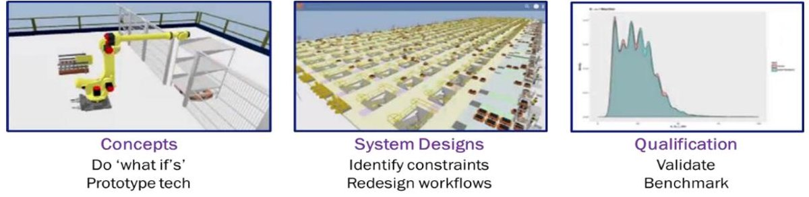

Figure 8. Amazon Use of Simulation to Improve Robotic Operations

Case studies published by Amazon detail the benefits of employing AWS IoT TwinMaker. It has been used to improve productivity and efficiency of distributed plant operations at Investa. At Carrier, it accelerated the development of the carrier.io IoT platform to monitor smart buildings and was combined with machine learning to decrease service costs, optimize maintenance schedules, and increase reliability and profitability. At John Holland, an infrastructure development company in Australia, it was used to perform compliance analysis in environmental impact monitoring.

Given such a broad set of applications, AWS has encountered challenges working within the current "state of the art" that include digital asset management and model interoperability.

## 3.5. Digital Engineering for Sustainment

The Office of the Secretary of Defense (OSD) Strategic Capabilities Office (SCO) recognized Air Force and Navy aircraft across multiple missions (air combat, global strike, mobility, and command and control (C2)) have not met availability goals. $ ^{33} $ The key drivers of this deficit include aging aircraft, maintenance delays, and/or shortages in the supply chain often caused by diminishing sources or obsolescence. Former Assistant Secretary of the Air Force for Acquisition, Technology and Logistics and founding Director of SCO Dr. Will Roper commented that "more than 10,000 parts requests are delayed or unfilled each year despite our reluctant willingness to pay premium prices." $ ^{34} $ Figure 9 illustrates a process employed by SCO to create a structural digital twin starting with acquiring, scanning and modeling the legal structural part, creating a generalized finite element method (GFEM) model of the part, and employing an MBSE tool-based model for advanced manufacturing simulation and V&V.

<!-- PDF_PAGE: 29 -->

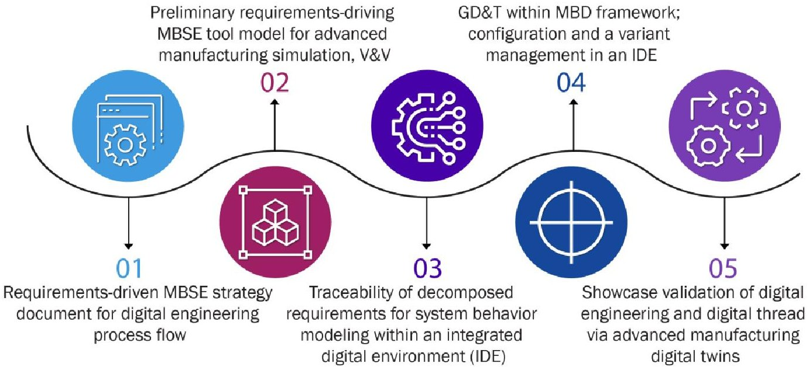

Figure 9. SCO Process to Create a Structural Digital Twin

As the graphic in Figure 10 illustrates, this digital engineering and digital thread process requires more upfront investment (shown in blue vs. the traditional acquisition shown in purple) and effort but flattens the long-term cost curve through significant reduction in operating and support costs.

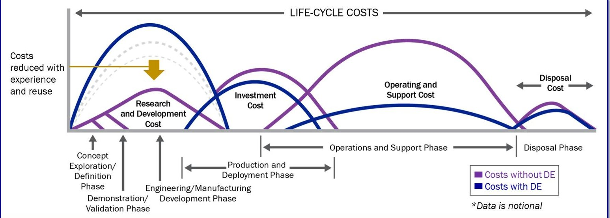

Figure 10. Notional Graph Showing How Digital Engineering Flattens the Life Cycle Cost Curve (adapted from SCO briefing to the DSB DE Task Force)

## 3.6. Digital Engineering at SpaceX

Space Exploration Technologies Corp. (commonly referred to as SpaceX) provides a useful example of the advantages gained via full integration of digital engineering into development, production, and operational life cycles, as well as the obstacles to such implementation within the U.S. government under current policies. Since its founding in 2002 to late 2023, SpaceX has performed 265 launches with at least partial success, delivering satellites into orbit for both its own Starlink constellation and thirdparty clients (both commercial and government), $ ^{35} $ including 61 successful or partially successful launches in 2022 alone (35% of launches worldwide). $ ^{36} $ For comparison, 78 launches were performed in

<!-- PDF_PAGE: 30 -->

total worldwide in 2010, and 82 in 2015. $ ^{37} $ This pace relies upon a process of rapid and continuous design iteration, by which SpaceX has brought the cost of launch down from an average of $ 18.5k/kg (using various rockets between 1970-2020) to $ 1.4k/kg (using the Falcon Heavy). $ ^{38} $ Combined with its rapid rate of operations, this availability of space launch has supported a flourishing ecosystem of spacebased companies developing small- and medium-scale satellites for deployment into low- and medium-Earth orbits, many of which would not be effective under past launch paradigms.

The SpaceX development process consists of continuous cycles of development and testing of both physical components and software updates. Automated code testing is conducted overnight to cover recent changes, and new parts are fabricated based on the data collected during highly instrumented tests. This practice is enabled by company-wide use of models (exceeding 25,000 part-assemblies as of 2015) shared across the enterprise and accessed via a consistent toolkit from a single vendor, which a Siemens study found resulted in a 50% increase in the productivity of SpaceX's design process. $ ^{39} $ This ensures that employees at every level have access to the requirements and dependencies for both individual components and larger systems within each rocket, as well as awareness of changes to any given part that arose during aforementioned test cycles.

The rapid development of technology by SpaceX relies upon a risk-acceptant culture nurtured by its leadership. This perspective understands that technical undertakings may fail for any number of reasons (especially during active testing), but that the information gained from these tests outweighs the cost in time and resources required to fully minimize that risk. This policy has seen high-profile failures in its extension to operations, including early rockets exploding on launch pads and damage to launch equipment, $ ^{40} $ but has also found success in terms of launch pace and rocket reuse that would have previously been out of reach for a commercial entity. The extent to which these achievements were possible without digital engineering is debatable, but the timeline of accomplishments almost certainly would have been elongated otherwise. Given the continued DoD interest in space-based assets (both proliferated constellations and traditional satellites), as well as its broader test and development needs, it would behoove the Department to consider which philosophies, policies, tools, and techniques are applicable within DoD programs. Considering the interplay of these elements within SpaceX, it may be that government adoption of only a specific subset will not confer similar benefits.

For example, rapid test and iteration of systems requires continuous (or at least frequent) access to suitable facilities. Current schedules at DoD test ranges are unlikely to allow for this under existing policies, and prominent failures when testing systems are less tolerable from a political perspective even

<!-- PDF_PAGE: 31 -->

when they offer useful results, as illustrated by public angst about some hypersonic weapon programs. Considering the lethal nature of many systems in question, as well as the potential for human loss during failures, a similar philosophy of risk may prove unfeasible for both political reasons and safety concerns. Finally, acquisition policy (both as established within DoD and by law) sets milestones, approval processes, and oversight functions that do not map cleanly onto continuous development cycles, a discrepancy which must be accounted for in some fashion.

Predicting which of these concerns would limit the effectiveness of digital engineering within DoD is impossible due to the number of factors that contributed to SpaceX's success and the degree to which they are interlinked. Several lessons can be learned from its example, however, which will prove useful even in a more restrained transition to DE practice within the Department:

- Models provide value to the extent they can be shared, collaborated on, and updated. Adopting shared processes and tools for collaboration in secure environments is necessary to achieve comparable results.

- Extensive instrumentation for tests with uncertain outcomes can provide key data if supported on a political level. Program managers are unlikely to engage in such tests otherwise.

- Rapid testing requires rapid updates to software and hardware to provide useful results. Practices that facilitate both must be adopted in tandem.

## 3.7. Summary of Lessons Learned

A number of lessons can be gleaned from previous DE activities as summarized in Figure 11 both for model-based acquisition and model-based systems engineering. Many of these are anecdotal results, and as previously discussed in this report, require further quantifications activities to full verify.

<!-- PDF_PAGE: 32 -->

<table border="1"><tr><td>Benefits</td><td>Challenges</td></tr><tr><td>Time:20% to400% reduced time</td><td>Increase modeling time and investment for upfront and life-cycle modeling</td></tr><tr><td>Cost:20%+ reduced labor cost</td><td>Need to skill/upskill talent</td></tr><tr><td>Operations:14%-23% reduced operating costs</td><td>Need to incentivize model-based acquisition(MBA)和MBSE</td></tr><tr><td>Quality:75% increase in quality</td><td>Immature DE maturity model</td></tr><tr><td>Reduction in required skill across life cycle and more rapid and effective knowledge management</td><td>Need to establish education and training</td></tr><tr><td>Increase in predictive analytics helping increase readiness rates</td><td>Need for digital data, infrastructure,and tools</td></tr><tr><td>50% reductions in software development and verification</td><td>Insufficient policies, procedures,and technology for digital acquisition processes</td></tr><tr><td>Reuse and open architectures enabling more rapid evolution</td><td>Insufficient standards enabling re-use and interoperability across data,models,tools,and test infrastructure</td></tr><tr><td>As complexity increases,ability to meet or improve cost,schedule,and performance</td><td>Need for quantified use cases,case studies,and economic models to enable DE planning,analysis,and forecasting</td></tr></table>

Figure 11. Digital Engineering Benefits and Challenges as Reported by the Case Studies: Lessons Learned

## 3.8. Findings: Case Studies

We summarize our main lessons learned from these six case studies with the following findings:

3. 8.1. Finding: When properly applied, digital engineering has demonstrated the ability to improve cost, schedule, performance, and agility of complex projects and programs.

3. 8.2. Finding: Digital engineering cannot solve all problems associated with complex DoD acquisition programs. While the use of digital engineering can improve cost and schedule estimation, streamline design of subsystems, and enable precision integration of these subsystems, digital engineering cannot mitigate missteps in acquisition strategy, overly optimistic cost and schedule construction, or contractor compliance.

3. 8.3. Finding: Effective use of digital engineering requires oversight and review of DE methodologies, processes, tools, and products by technically qualified personnel from the functional area and domain in which digital engineering will be implemented.

<!-- PDF_PAGE: 33 -->

## 4. Digital Acquisition in DoD

As previously discussed, the potential advantages of digital engineering are bound by the reality of a large bureaucracy that is, by structure, size, and typical practice, not positioned to adopt its central elements. Changes can and are being made to improve the Department's posture in this regard, which will be covered in this section alongside the significant hurdles that remain.

## 4.1. Progress in Policy

DoD recognizes the significant acquisition opportunities of digital engineering, as well as the challenges its adoption creates at various stages of the process. $ ^{41} $ Progress over the past several years includes drafting and/or approving the following policies: DoD Instruction 5000.97 , Digital Engineering, DoD Instruction 5000.02, Operation of the Adaptive Acquisition Framework (AAF), DoD Instruction 5000.88, Engineering of Defense Systems, and DoD Instruction 5000.89, Test and Evaluation. Related are updates to its modeling and simulation strategy, including DoD Instruction 5000.61, DoD Modeling and Simulation VV&A and DoD Instruction 5000.70, Management of DoD M&S Activities.

## 4.2. Progress in Standards

DoD has also contributed to the advancement of DE and MBSE standards, including SysML 2.0, Open Services for Lifecycle Collaboration (OSLC), and a standard for sharing Modelling and Simulation Information in a Collaborative Systems Engineering Context (MoSSEC). The DoD has engaged in the Joint Enterprise Standards Committee, the governance body for DoD information technology (IT) standards and for intelligence community enterprise standards, which manages the DoD IT Standards Registry.

## 4.3. Insufficient DE Infrastructure and Standards Investment

Unfortunately, there has been insufficient investment in DE infrastructure within the Department. Each program is generally left to decide how, when, and where to apply the intent of digital engineering strategy for its own purposes—a consistent understanding of what constitutes DE infrastructure does not exist. Furthermore, it is burdensome for many projects to set up the necessary applications and tools required for digital engineering. An initiative to develop a reference architecture for digital engineering is required to offer these programs a solid digital foundation. One option, as we discuss below, is to develop cloud environments with all necessary DE applications and tools, as well as a data infrastructure through which users and tools can share any ASOTs.

Despite the progress described above, the establishment of DE standards within the DoD is also lacking. DoD support for the evolution of standards used internally for DE and MBSE, including SysML 2.0, OSLC and MoSSEC, is necessary but insufficient. The DoD must also influence additional standards, such as the Unified Architecture Framework, and emerging standards that support computational manipulation, which provide for architectures as artifacts within the DEE. Fortunately for the DoD, the Defense Standardization Program Office maintains a repository, titled ASSIST, of standards across all disciplines. More frequent use of the ASSIST repository to identify usable standards would be of great benefit to the

<!-- PDF_PAGE: 34 -->

DE practitioners, as it is highly likely that those relevant for any computational activity will work within the DEE.

## 4.4. Need for Increased DE Knowledge Sharing

DoD continues to make significant progress in DE knowledge sharing via the Digital Engineering and Modeling & Simulation Community of Practice, helping to curate best practices, updating training at the DAU, sharing successful implementations, measuring usefulness, and integrating the traditional M&S practice with needs from the DE practice.

DAU is investing in new courses focused on digital engineering (e.g., Digital Literacy, Digital Engineering Credential); additionally, academic-related organizations, such as the Systems Engineering Research Center (SERC), have developed DE bootcamps that have been delivered to the U.S. Space Force and others. However, additional work is required to develop a workforce that is cognizant of various aspects of digital engineering at relevant levels of detail. This is a critical training investment that the DoD needs, despite its long lead time. As mentioned above, DoD has helped instantiate authoritative resources for the engineering community to use in implementing digital engineering, starting with systems engineering and expanding to specific disciplines, engineering domains, and specialty areas. DAU courses should continue to build upon this progress while developing talent. Other efforts to increasing knowledge sharing within the Department includes the Digital Engineering Body of Knowledge (DEBoK), which focuses on underlying fundamentals, enablers, guidance, and examples of DE implementation.

Some foundational investments for developing a workforce development framework are in place. In addition to support for other user communities in appropriate elements of digital engineering (thereby expanding the community of practice), an academic outreach effort is likely necessary to evolve their graduate-level DE courses at a scale capable of meeting DoD and defense industrial base (DIB) workforce needs.

## 4.5. Need for DE Contractual Evolution

Investments to develop the necessary contractual elements to support digital engineering and digital transformation is lacking, which makes it difficult for classical contract data requirement lists to reflect the equivalent and relevant digital artifacts. While there are small investments happening across services and programs regarding specific statement of work language, methods and methodologies to conduct design reviews and establish technical baselines in a DE context with digital artifacts are still immature at best. A community effort in this regard is necessary and important.

## 4.6. Assessment of OSD Response to FY 2020 NDAA Section 231(a) through (c)

Congressional guidance on digital engineering includes both Section 231(a) through (c) of the FY 2020 and FY 2022 NDAA. The OSD review in response to Section 231 was comprehensive, thoughtful, and detailed in its assessment of the use of digital engineering in some of the most important MDAP programs. Importantly, the team identified how digital engineering benefited the development and test of key defense weapon systems. However, the team was not able to forward its recommendations for action for various reasons. The additional reports (workforce and infrastructure) should be finalized and released to the Department for further action. The FY 2022 NDAA reiterated the importance of making progress on digital acquisition and digital engineering, and this Task Force strongly concurs.

<!-- PDF_PAGE: 35 -->

## 4.7. Findings: Digital Acquisition

While progress has been made in application of digital engineering in acquisition in the DoD, immaturity is still reflected in necessary but insufficient policies and standards, insufficient shared digital acquisition infrastructure, and immature architectures and standards resulting in disconnection of data flows within and across functions (e.g., program management, development, testing and evaluation). This is exacerbated by insufficient engagement with the standards community resulting in inconsistent application of digital engineering across the acquisition process. More specifically:

4. 7.1 Finding: There has been positive progress on policies (e.g., Common Data Environment, Data Acquisition Visibility Enterprise), contracts, and knowledge sharing since the release of the Digital Engineering Strategy on June 18, 2018, which led to acquisition-functional policies on Digital Engineering.

4. 7.2. Finding: The digital transformation of the DoD acquisition process (policies and guidebooks associated with the Adaptive Acquisition Framework (AAF)) is inconsistent, and related policies, processes, and standards are not fully integrated across functions. The shift from DE strategy to DE implementation on programs has been inconsistent. A review of the AAF policies and guidebooks reveals that the functional activities, as well as the pathways are discontinuous in continuum of data flow, and inconsistent in application of digital methods and tools to conduct analysis and support decision making at all levels.

4. 7.3. Finding: Some DE intellectual property policies support sharing models and data for digital engineering, while other policies create restrictions and friction with the DE processes and implementations that require sharing models and data.

4. 7.4. Finding: Each project and program must develop their own infrastructure for digital engineering, and this can be prohibitive for some projects and programs.

<!-- PDF_PAGE: 36 -->

## 5. Digital Engineering in DoD

## 5.1. Trade-Offs Applying Digital Engineering to Complex Projects

Almost all advanced systems that the DoD develops and operates from this point forward can benefit from the powerful modeling and analysis that is supported by digital engineering. However, applying digital engineering to a complex project is not an all-or-nothing proposition, and no application of technologies and methodologies has only benefits. Just as we understand some development processes should be more "agile" and some more "waterfall," there are resource costs to the use of digital engineering; a serious analysis of costs vs. benefits must be conducted before digital engineering is applied to a project, the specifics of which must in turn be tailored to meeting specific needs and challenges.

Taking full advantage of digital engineering requires moving from a document-based acquisition process into a data and model-based decision process. The acquisition processes currently in place often prove cumbersome and were developed for managing large, complex, typically physical systems. This is in stark contrast to the rapid, fail-fast, iterative approaches common with applications of software engineering, especially in the commercial world. Applying such an agile approach in digital engineering may include a reimagining of the AAF pathways, $ ^{42} $ remapping guidebooks and policies, and retraining decision makers to achieve proficiency with data and model-based decision processes.

To facilitate this transition from document to model-centric systems engineering, the Task Force created a checklist of critical steps programs and portfolios should follow when considering DE implementation which can be found in Appendix C in this report.

## 5.2. Lack of a Common, Open Reference Architecture

A DoD reference architecture must enable representation of environments, systems and subsystems, various levels of fidelity (from lower-level physics to higher-level mission and campaign models), various aspects of the systems (e.g., physical, electrical, digital), and capture full life cycles (from requirements through design, development, T&E, and deployment to end of life). The lack of system- and component-level DE reference architectures can increase costs and delay schedules for projects whose teams have not used digital engineering previously. The lack of a standard reference architecture can also result in incompatibilities and lack of interoperability, introducing complexity that undermines readiness and exposes the system to additional threats.

Figure 12 illustrates a potential reference architecture for digital engineering illustrating various levels of models and life cycles.

<!-- PDF_PAGE: 37 -->

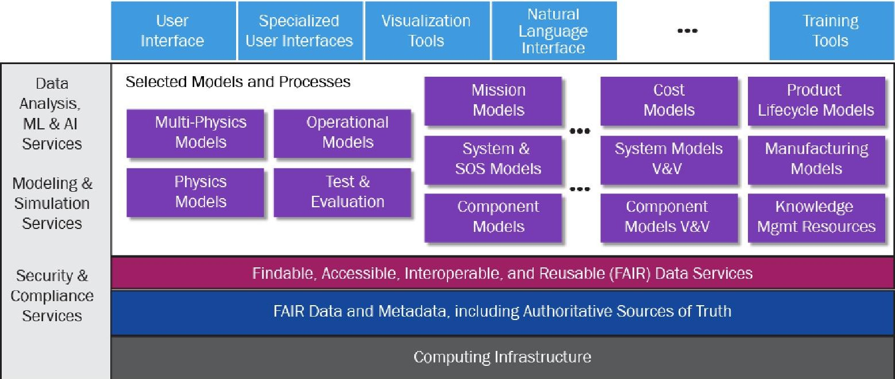

Figure 12. A Potential Reference Architecture for Digital Engineering

Note that in the potential reference architecture in Figure 12, all models, services, applications, and interfaces have access to ASOT. This increases the speed of development, improves V&V, simplifies interoperability, and removes barriers for reuse.

Until DE instantiations become commonplace, and the acquisition process is updated to support it, digital engineering will require more planning up front than traditional programs. Once a project commits to digital engineering, its ecosystem must be established, with the appropriate ASOT and all tools necessary to produce artifacts for the user community. Tool and simulation interoperability must be ensured at this stage. Because of the introduction of new attack surfaces, cybersecurity requirements must also be carefully evaluated before these constructs are populated. Furthermore, DE architecting must accommodate use of the models, simulations, data, and tools expected for each project.

Contracting must be adjusted to ensure that delivered and accepted artifacts are constantly updated and used instead of languishing as static, single-use existences; validation and verification may also require new processes. DE architectures are also typically constrained by one or more existing standards set by policy or law. These up-front constraints may interfere with Agile development methodologies and incur significant development resource costs.

## 5.3. Impediments for Sharing the Information and Artifacts Required for Digital Engineering

Effective information sharing across various parties, including acquirers, sustainers, contractors, and operators involves a complex set of tradeoffs between protecting creators and enabling users of digital artifacts. Competitive market forces can create intellectual property barriers to the information sharing required for digital engineering unless this is carefully addressed by contracts at the start of the project. It can be challenging to separate and isolate digital data according to its IP, making sharing even more difficult. Although the law provides for acknowledgement of this through the Doctrine of Segregability, $ ^{43} $

<!-- PDF_PAGE: 38 -->

all current practices regarding intellectual property do not employ digitalization to this level and will require cultural and practice adaptation.

Other disincentives to sharing data are not so obvious or technically solvable. While the DoD Chief Information Officer (CIO) and the data strategy encourage appropriate and secure data availability, in practice this is not supported. Sharing data often comes with disincentives in the form of additional inquiries and criticisms, misuse of data, and/or pushback on reuse. Responding to these requires resources which are not typically planned for in cost or schedule considerations.

## 5.4. New Attack Surfaces Created by Digital Engineering

Risk of Abuse/Attack (from increased attack surface). Because a model is a digital artifact maintained on a network and accessible to people, it is subject to abuse and attacks of all forms, and greater reliance upon models opens new avenues for attack. Care must be taken to ensure models and the systems they reside upon are secured, maintained, and operated correctly. An increase in the number of DoD and DIB personnel conducting digital engineering will also increase the number of systems requiring this level of protection—especially when attacks corrupting models, altering the outcomes of simulations, or otherwise degrading the effectiveness of digital engineering may be harder to detect than large-scale exfiltration of information (discussed below). Security concerns constrain the use of reusable libraries and other open resources that may contain their own unknown or unreported vulnerabilities. Future systems with embedded models (or other information used for digital engineering) also offer novel avenues of attack against digital twins or other resources that are continuously updated using real-world results.

The cost of preventing these attacks, like everything relating to digital security, adds to the cost of programs implementing digital engineering (although DoD must develop techniques for countering cyberthreats in general). Still, it represents a cost over models used in economic sectors that are not frequently targeted by state actors.

Risk of Information Exfiltration and Disruption. Enormous amounts of information about operational systems are embedded within models. The better models are, the more valuable they are as a specification for operational intent, description of capabilities, or representation of battlespace research. Therefore, the danger posed by any given model being stolen and exfiltrated is significantly higher than many other digital assets. While theft of a model's implementation is a great risk, it is equally dangerous if adversaries can break into existing systems and learn their precise operating characteristics.

Adversary use of Digital Engineering. Adversaries are likely to adopt (and are currently adopting) DE approaches because of potential cost, schedule, and performance benefits to gain advantage in weapons system development. They also are likely to be motivated to steal, degrade, or destroy our DE infrastructure (including digital data and models) for battlefield advantage. Existing IP exfiltration efforts suggest that some adversaries are more capable in this field than others, and developing better tools

<!-- PDF_PAGE: 39 -->

and techniques to prevent these attacks will be critical as reliance upon highly detailed models increases.

## 5.5. Research in DE is Needed in Selected Areas

Given the significant amount of commercial investment in DE and MBSE, DoD should focus its research investments to meet needs that are unlikely to be addressed otherwise. Figure 13 summarizes near-, mid-, and far-term focus areas across each stage of the systems life cycle. As illustrated in the rightmost DoD role column, the Department should generally be a fast follower in underlying DE tools and infrastructure development, which will be dominated by commercial investment. It should focus its efforts to lead on national security domain and unique operational areas in design, analysis, T&E, and O&M. For example, DoD should lead in digital engineering of large, complex systems of systems that need to operate in contested, congested, or denied environments with adversaries engaged in denial and deception, entailing significant uncertainty.

<table border="1"><tr><td></td><td>Life Cycle</td><td>2023</td><td>2028</td><td>2033</td><td>DoD Role</td></tr><tr><td>Analysis</td><td>Descriptive</td><td>Predictive</td><td>Prescriptive</td><td>Lead in national/military intelligence</td><td></td></tr><tr><td>Design&amp;Manufacturing</td><td>Platform-centric systems</td><td>Predefined systems of systems</td><td>Rapidly reconfigurable complex SoS(Operates over multiple classes, multiple modes,and multiple scales)</td><td>Lead in resilient SoS</td><td></td></tr><tr><td>Test&amp;Evaluation</td><td>Paper-based,Requirements driven T&amp;E</td><td>DE-enabled,blended live,virtual,and constructive T&amp;E for some sub systems and systems. Acceptability of digital results by community</td><td>DE-enabled,blended live,virtual and constructive T&amp;E for most systems</td><td>Lead in time sensitive,high uncertainty,adversarial environments</td><td></td></tr><tr><td>Operations</td><td>Human guided(operator in loop)</td><td>Machine generated and guided(operator on loop)</td><td>Machine optimized(operator on loop)</td><td>Fast follow commercial;Lead in contested operations</td><td></td></tr><tr><td>Maintenance</td><td>Descriptive,unoptimized</td><td>Predictive,resilient</td><td>Prescriptive,sustainable</td><td>Fast follow commercial</td><td></td></tr></table>

Figure 13. DoD Digital Engineering/MBSE Focus Areas

Sustainment through distributed and Agile manufacturing is another area where the Department's unique needs may drive research and investment. DE models coupled with additive manufacturing enable creation of components for complex systems in the field. Digital designs enable manufacturing of obsolete parts for aging systems when diminishing supply chains can no longer meet DoD demand. Digital models also enable flexible manufacturing that can provide agile creation of parts, and even entire systems, when modular robots can import digital designs and create flexible on demand products.

Other broad research gaps exist in high-performance computing and multiscale M&S, uncertainty quantification, cybersecurity, deep learning, generative AI modeling, and determining how these can be used to create increasingly complex, adaptive, reliable, and resilient digital models. These fields have significant overlap with other DoD focus areas, and research is likely to be driven by other needs as a result.

## 5.6. Trade-offs Required for Effective Digital Engineering

Populating a DEE with models and developing digital twins requires understanding what use they will be put to and what level of model fidelity is required to support those uses. There is currently little work to

<!-- PDF_PAGE: 40 -->

match model internals to intended uses, and few methods to determine what level of modeling is required. Challenges with respect to model fidelity for digital twins include the following:

- Leaders must specify precise goals within developer capabilities that fill user needs. Is the digital twin supposed to faithfully mimic all aspects of a real-world system or just some? How much modeling is enough to answer the question? How much fidelity is needed?

- Modelling inaccuracy must be predicted and accounted for: Digital twins with errors have the potential to propagate issues into physical systems, as does flawed M&S. Furthermore, digital twins are likely to be built of a hierarchy or (more generally) a network of interlocking models. Even if each model works correctly when isolated, the ensemble may behave differently.

Without clarity on both the objectives and accuracy of the digital twin, users may not be able to trust it sufficiently to gain its benefits. Consulting real-world systems to evaluate the trustworthiness of a digital twin's output limits its value, as V&V adds complexity to an entire project, particularly with the reverification and revalidation that is required every time changes are made to real-world systems.

## 5.7. Continued Need for Real World Test and Evaluation

The Task Force recognizes that while digital T&E provides many benefits, there are numerous circumstances in which real-world testing and evaluation are still necessary. This occurs under circumstances:

- when models do not provide the required fidelity,

- when the complexities and interdependencies are insufficiently understood (e.g., individual and group human behavior, autonomous systems),

- in complex and contested environments (e.g., stealth, electronic warfare) where models are not sufficiently mature, and

- when the investment required for digital T&E exceeds its benefits.

Examples of limitations in model fidelity and accuracy include multilevel physics-based models and their interactions such as thermal, vibrology, acoustics, tribology, etc., as well as representation of and reasoning about environmental effects (e.g., weather, atmospherics, space, subsurface). Unmodeled interactions with external systems also cause areas of uncertainty that may require physical testing. Of course, as the fidelity and capabilities of MBSE improve over time, the number of these cases will decrease.

## 5.8. Findings: Digital Engineering

5. 8.1 Finding: The lack of a common open reference architecture for digital engineering creates additional costs and risks for projects that use digital engineering.

5. 8.2 Finding: The lack of standards can increase the costs of using digital engineering and the likelihood of errors and risks.

<!-- PDF_PAGE: 41 -->

5. 8.3 Finding: The lack of test data and its reuse and the lack of models and their reuse decrease the ability to create system-of-systems models, decrease the fidelity of results, and add significantly to costs of testing and validation.

5. 8.4 Finding: The cost of acquiring DE tools and applications is a barrier for some projects and programs to use digital engineering.

5. 8.5 Finding: The growing use of digital engineering creates more attack surfaces and potential vulnerabilities that must be protected. This includes protecting all associated data, models, tools, and infrastructure.

5. 8.6 Finding: Decision makers and developers need to ensure data and models are appropriately verified and validated and applied or re-used appropriately to manage the risk of misapplication.

5. 8.7 Finding: Existing gaps in high performance computing and multiscale modeling and simulation, verification and validation, cybersecurity, deep learning, and generative AI modeling impede more rapid progress on creating increasingly complex, adaptive, reliable, and resilient digital models.

<!-- PDF_PAGE: 42 -->

## 6. Digital Engineering Workforce Challenges for DoD

## 6.1. Progress in DE Knowledge and Knowledge Sharing

As previously noted, the DoD has improved knowledge sharing by establishing DEBoK, a body of authoritative resources for the engineering community to use when implementing digital engineering, starting with systems engineering and expanding to specific disciplines, engineering domains, and specialty areas. Training and practice are advanced by a community of practitioners via access to best practices and standard terms and definitions. The DEBoK focuses on underlying fundamentals, enablers, guidance, and examples of DE implementation. In addition to engagement with industry DE standards organizations, DoD has advanced all-domain digital operations analysis through its recent efforts, including engineering Joint All-Domain Command and Control and digital experimentation in the Rapid Defense Experimentation Reserve.

## 6.2. Need for DE Workforce Development

Digital engineering requires a disparate range of skills beyond engineering practice principles, including programming, modeling, simulation, and data analysis. Today, there is no clear definition or standard resume for a DE expert. Many of these skills, taken independently, are in high demand across many industries. These factors make it difficult to recruit, train, and retain a DE-capable workforce. Instead of waiting for market conditions to shift, the defense industry needs to develop and maintain a digitally enabled acquisition workforce and culture that understands model-based engineering; modern software development practices; DE processes, methods, and tools; and digital artifacts across the acquisition life cycle. $ ^{44} $

A successful short-term workforce development program should emphasize training and internal reorganization to adopt emerging technologies into specific use—such as model-based engineering, AI/ML, VR/AR, digital twins, and additive manufacturing—that are beginning to transform the industry. In this way, defense organizations may be able to carry forward the knowledge of legacy engineering processes, taking full advantage of new tools and developing more efficient and effective practices. This approach focuses on adapting the current workforce to the new realities of the industry.

However, the future of digital engineering will require a larger cultural shift in how the DoD and DIB understand the practice of engineering. This will require nothing less than a full DE educational curriculum across the spectrum of DoD activities, one which embraces technologies that are considered disruptive today.

A proper DE curriculum should focus on two principles: multidisciplinary thinking and collaborative learning.

- Multidisciplinary thinking exposes people to complementary sets of skills and knowledge that can be applied to real-world situations. This leads to an adaptable workforce capable of handling ambiguous, complex, and dynamic situations. Multidisciplinary training can also help to identify

<!-- PDF_PAGE: 43 -->

weaknesses or opportunities in strategy by contrasting possible approaches, leading to more effective and efficient operations.

- Collaborative learning encourages knowledge sharing and teamwork. This approach can help DE stakeholders learn from each other's experiences and perspectives, fostering a more innovative work environment.

- These core principles are likely to be affected by five important technological trends: MBSE, VR/AR, AI/ML, digital twins, and additive manufacturing.

- Model-based systems engineering enables disparate DE stakeholders to collaborate effectively, reducing errors, delays, and miscommunications. Equally important are the enhanced flexibility and agility afforded by these model-based ecosystems. These ecosystems also supply the building blocks for increased automation, enabling engineers to delegate repetitive tasks and focus on high-level work.

- Virtual and augmented reality technologies provide an immersive training experience that enables workers to practice in a realistic-but-simulated environment. This approach can help workers gain hands-on experience in a controlled setting, improving their proficiency and confidence.

- Artificial intelligence and machine learning technologies can help workers analyze increasingly complex data sets, identify patterns, and make more informed decisions. Properly applying AI/ML will enable workers to offload repetitive or time-consuming tasks, liberating them to focus on the critical thought required to address future challenges. According to the National Security Commission on Artificial Intelligence:

DoD and [the Department of Homeland Security] should require mandatory training designed to improve baseline AI literacy... The training should focus on end users and their ability to collect and manage data and include a short introduction to AI with an emphasis on machine learning, data management, the capabilities and limitations of AI, software decision-making, probabilistic reasoning, and an introduction to the responsible and ethical development and fielding of AI. $ ^{45} $

- While digital twins already provide substantial value in the development of modern systems through predictive insights, manufacturing optimization, etc., there is still a clear need for developing knowledge of tools, methods, and best practices to accelerate understanding, adoption, and broader realization. $ ^{46} $

- Additive manufacturing is expected to revolutionize how products are designed and produced. This technology will likely transform some of the deepest and oldest foundations of fielding and sustaining platforms as outlined in the DoD Additive Manufacturing Strategy. $ ^{47} $ Combining rapid

<!-- PDF_PAGE: 44 -->

design iteration with flexible manufacturing will allow the industrial base, or even warfighters within their area of operations, to better respond to emerging adversary capabilities.

Not every position will require the same mix of the skills and knowledge presented above. A successful DE curriculum will therefore have two essential characteristics: an expanded partnership with academia and flexible, personalized learning experiences.

Academic partnerships are essential because a curriculum that satisfies the core principles outlined here while remaining adaptive to technological advances must be embraced in higher education. There will be a significant advantage for the defense industry and its next-generation workforce if students become familiar with DE principles as an integral part of their collegiate education.

One leading example of academic partnership is the DAU, which provides the knowledge, skills, and abilities required to perform specific acquisition-related functions and tasks. Another example is the Aerospace Systems Design Laboratory at the Georgia Institute of Technology, which offers several modes of engagement with industry. These include sponsored research, centers of excellence, strategic alliances, fellowships, grand challenges, and a professional master's degree in applied systems engineering.

A DAU course of instruction (e.g., DE 101, DE 201) should be actively curated both in terms of current best practices, as well as enabling tools and technologies, for both digital acquisition and engineering in both defense and commercial contexts. This education should leverage modern digital methods that enable not only remote delivery and broader accessibility but also the ability to personalize curricula and advance microcredentials, enabling more rapid upskilling and reskilling of the workforce to create and leverage digital artifacts across the life cycle. A senior-level course (perhaps as a capstone to lower-level courses) should also be developed, given that leadership education is particularly important to influence strategic outcomes.

As the workforce becomes more diverse, training programs will need to become more flexible to meet the needs of individual workers. This approach can help workers focus their training while learning at their own pace in a way that best suits individual learning style and preferences.

To realize the full potential of digital engineering, the defense industry must invest in entirely new ways of training the workforce. By taking the long view, defense organizations can improve workforce development by beginning their DE education in conjunction with traditional engineering education. And by embracing key emerging technologies, these organizations can prepare their workforces to take the greatest advantage of them while contributing to ongoing developments. Meanwhile, establishing a consensus curriculum for this discipline—and promoting undergraduate and graduate programs of study for it—will enable the DIB to recruit new workers who see digital engineering as a passionate and promising career path.

Training and education provide a necessary-but-insufficient basis for digital engineering adoption and eventual transformation within DoD. The culture of the DoD must itself be open to forward movement within the engineering discipline, and within the functional activity areas supported by engineering. It would be dangerous for medical treatment to be unchanging and incapable of innovation. In the same way, the engineers and engineering practice of the DoD must continuously advance and improve when developing new technologies.

<!-- PDF_PAGE: 45 -->

## 6.3. Findings: DE Workforce

Workforce training is provided in DoD in both core and specialty areas. The Engineering and Technical Management (ETM) workforce area is supported by a functional integrated team, developing competencies, training, and credentials for the ETM workforce. However, not all ETM training is fully developed. For example, as of January 2023 only five (of a potential 25) credentials are available to the ETM workforce, with only one specifically calling out digital engineering. There is also only one credential for data analytics.

There is insufficient acquisition workforce education and training in digital processes and DE methods and tools (e.g., MBSE, DE, Agile software development) across functional areas beyond engineering to include analysts, program managers, testers and evaluators, contract managers, operators, and maintainers. This impedes the realization of the cost, schedule, and performance benefits of digital engineering. It increases the likelihood of expensive rework, acquisition delays, system errors and failures, and disengagement, if not loss of, high-quality talent, timely and relevant solutions to ever-advancing threats.

Effective digital engineering requires the exchange of data and models across the life cycle and granularity (e.g., sub-component, component, system, system of systems) of products and programs. Unfortunately, the acquisition policies and processes do not currently specify the necessary exchange of data and models as required. This imposes a burden on the DE workforce and complicates training.

In summary, DE workforce education must be guided by a plan and enabled by a culture that supports experimentation and change, focusing on the end result of improved systems for the warfighter and savings for the taxpayer.

6. 3.1. Finding: There is no articulated approach to training the acquisition workforce in digital processes and DE methods and tools in all functional areas of acquisition.

6. 3.2. Finding: Existing DoD programs such as the Highly Qualified Experts (HQE) appointing authority and the Intergovernmental Personnel Act (IPA) Mobility Program to acquire critical talent pools from academia and industry, together with the possibility of investing in fellowship-based military research and/or defense focused DE institutes, can provide additional pipelines of talent.

<!-- PDF_PAGE: 46 -->

## 7. Recommendations

## 7.1. Recommendation 1: Develop DoD DE Reference Architecture and DE Infrastructure

Each Service Acquisition Executive (SAE), in close coordination with the Under Secretary of Defense for Acquisition and Sustainment (USD(A&S)) USD(R&E), and Director, Operational Test and Evaluation (DOT&E), review, leverage and harmonize existing DE reference architectures and create an enabling DE infrastructure that incorporates rigorous digital engineering at levels to maximize benefits and future capability reuse:

7. 1.1. Immediately initiate an activity to develop a set of harmonized "Reference Architecture patterns" for DoD digital engineering implementation for the Department's effort across multiple services, domains, and systems (including platforms, payloads, and subsystems) to support the innovation and evolution of policy, processes, operations, and implementation with DE best practices.

7. 1.2. Immediately initiate a task to develop a CONOPS that leads to the implementation of an Exemplar Reference Implementation for a Digital Engineering Ecosystem, leveraging the various ongoing efforts across the DoD, FFRDCs, UARCs, and the DIB, in coordination with the relevant DE/MBSE standards and professional organizations (e.g., National Institute of Standards and Technology (NIST), INCOSE, Object Management Group). This would include approaches to allow semantically rich data interoperability across acquisition pathways, acquisition functions, engineering domains, and abstraction levels. An Exemplar Reference Implementation could also give guidance on how and when to tailor digital engineering based on program features.

7. 1.3. Explore creating DE Infrastructure as a Service (DEIaaS) that would enable appropriate cross-DoD and -DIB access to data, models, tools, and computational infrastructure to help accelerate learning and engineering and sharing best practices, and to help foster reuse of digital artifacts.

## 7.2. Recommendation 2: Accelerate Digitally Enabled Acquisition

The USD(A&S), with support from USD(R&E) and Chief Digital and Artificial Intelligence Office (CDAO), evolve the acquisition policy, processes, operations, and digital transformation to include practical application of digital engineering across the acquisition life cycle in acquisition and contract management, including digital deliverables of DE artifacts at key contractual milestones.

7. 2.1. Evolve acquisition portfolios and programs to employ digital engineering best practices across the acquisition life cycle in acquisition and contract management.

7. 2.2. Pursue whenever appropriate a MBSE-first approach in all acquisition pathways, strategies, and contracts to support continuous operations and sustainment of portfolios and programs to better meet rapidly changing adversarial threats, not just at initial procurement.

7. 2.3. Tailor language to acquisition and contract management policy and procedures encouraging use of models and simulation results to strengthen data-driven decisions in acquisition and sustainment activities.

<!-- PDF_PAGE: 47 -->

7. 2.4. Within six months of the publication of this report, begin collecting quantitative evidence of cost, schedule, and performance benefits of MBSE as well as required investments, and identify a UARC, FFRDC, or systems engineering professional society as a long-term, trusted repository for sharing data, aggregated data, evidence, best practices, and lessons learned to advance learning and performance across the Department. Ensure contributing data have as few restrictions as possible so it can be used as a body of evidence that can be used to improve the state of digital engineering.

## 7.3. Recommendation 3: Accelerate Virtual Testing and Reuse of Test Data

7. 3.1. DOT&E and Military Service test offices conduct tradeoff analyses for all programs and portfolios to quantify, identify, and select virtual testing over physical testing where there are resource, safety, and/or confidentiality advantages. Favor virtual testing to shift resources to improve test and model fidelity.

7. 3.2. USD(R&E) and DOT&E ensure live test is digitally captured and shared in the engineering ecosystem to more rapidly evolve models and the corresponding systems they represent. Data captured from operations should be used to improve digital engineering models wherever feasible.

7. 3.3. USD(R&E) finalize and deliver to the DoD infrastructure reports for Section 231(a) through (c) of the FY 2020 NDAA.

## 7.4. Recommendation 4: Invest in DE Research and Development

OUSD(R&E), DARPA, and Military Service laboratories invest in gaps in DE practice that are insufficiently addressed commercially, including high performance computing and multiscale (fidelity, resolution, and level of application) modeling and simulation, enhanced quantitative modeling and simulation of software, verifiability and validity, cybersecurity, and generative AI modeling in contested environments, as well as investigate impediments and solutions to increase the adoption of digital methods.

Figure 14 captures DE gaps that should be addressed in the near-, mid- and far term. These are arrayed across various areas in the acquisition cycle that could accelerate DE progress. While there are varying levels of DE capability across domains (e.g., air, land, sea, space, cyberspace) and missions (e.g., ISR, Command and Control (C2), O&M, logistics, business systems) or particular missions (e.g., missile defense, nuclear C2, counterterrorism, humanitarian operations), this table is intended to capture gaps across these areas.

<!-- PDF_PAGE: 48 -->

<table border="1"><tr><td></td><td>Data and Data Analytics</td><td>Models and Digital Twins</td><td>Engineer Tools</td><td>Acquisition Tools</td><td>T&amp;E</td><td>O&amp;M</td></tr><tr><td>Near Term(1-3 years)</td><td>Data standardsData sharing protocolsShared DoD data modelDoD catalog of distributed dataStandards for data analytics and data visualization</td><td>Shared physics-based model catalogModel bias, incompatibility,and anomaly detectionModel integrity and IP protection assurance</td><td>Open DE framework and reference architectureDE design catalogIntuitive and learnable human-model interfaces(AR/VR/XR compatible)</td><td>Model-based acquisition(MBA) frameworkCatalog of shared,interoperable MBA toolsPathfinder model-based RFP and source selection(with MB threat definition,MB system-level functional and performance requirements)</td><td>Digital twin validation and verification methodology and toolsModel metrologyDigital test scenarios(at unit test,system,system-of-systems,and operational levels)</td><td>Model maintenance frameworkPredictive and prescriptive maintenance developmentVirtual training infrastructureOperational learningCase studies of quantitative benefits,costs,and risks</td></tr><tr><td>Mid Term(5 years)</td><td>Dynamic DoD catalog of distributed dataShared DoD ontologyResilience and sustainability data ingestion and analytics</td><td>DoD metamodel standardComplex system modeling across disparate modeling classes(e.g.,physical/material,biological,cognitive,social,etc.)Resilient models for adaptable systemsDE vulnerability analysis tool(e.g.,using NIST RMF)</td><td>Tools for data and model uncertainty management.Explainable visual analytics for human-model interfacesGenerative design for digital twin analyticsQuantum algorithm suite to improve simulation models for MBSE applications</td><td>Digital thread across acquisition cycle for mission critical system,Re-use and machine learning from digital twins</td><td>Digital twin validation and verification tools for adaptable systems</td><td>Continuous model and digital twin validation and verificationMeasurement and case studies of impact of digital twin incorporation into LVC exercises and experimentsBest practices identification and adoption process</td></tr><tr><td>Far Term(10 years)</td><td>Real-time data ingestion,analytics,and visualization for mission-critical systems</td><td>Complex models that are multi-class,multimodal and multiscale(across fidelity,resolution,and level)Resilient self-describing and self-diagnosing complex models</td><td>MBSE for generative,adaptive AI systemsMBSE for quantum-enabled sensing,communication,and computing systems</td><td>Governance for complex(multi-class,multimodal and multiscale) models and DEDigital thread across a pathfinder portfolio</td><td>Validation and verification of models and DE for generative,adaptive AI systemsEvaluation framework for trustworthy autonomy</td><td>Continuous operations analysis and maintenance for generative AI systemsCybersecure operations,models,and data</td></tr></table>

Figure 14. DE Research Gaps by Capability Area

<!-- PDF_PAGE: 49 -->

## 7.5. Recommendation 5: Develop Workforce DE Skills

Given advancement of digital engineering requires new knowledge, skills, and abilities, as well as cultural transformation, up- or reskilling the workforce up and down echelons and across mission and functional areas will be essential to realize the benefits and mitigate the risks of digital engineering. Accordingly, the Task Force recommends the following workforce initiatives with both near- and long-term outcomes:

7. 5.1. USD(R&E) finalize and release DE workforce reports for Section 231(a) through (c) of the FY 2020 NDAA.

7. 5.2. Defense Acquisition University (DAU) advance acquisition curricula covering the knowledge, skills, and abilities addressing DE processes, methods, and tools required to enable model-based acquisition. This should leverage technologies such as model-based engineering, AI/ML, VR/AR, digital twins, and advanced manufacturing. Ensure target audience includes competencies related to acquisition, including, for example, cost, contracts, logistics, test, and evaluation.

7. 5.3. OSD(R&E) incentivize DE defense fellowships that provide experience in digital engineering for defense application. One exemplary model is the design of the DAF-MIT AI Accelerator.

7. 5.4. Given the highly limited talent and experience pool in digital engineering, OSD and the Military Services should extensively employ their Highly Qualified Expert (HQE) appointing authority to acquire HQEs and HQE- Senior Mentors who possess critical DE expertise and experience. In addition, leverage the Intergovernmental Personnel Act (IPA), where:

1. Experts from IPA-eligible organizations (academia, non-profit R&D organizations, FFRDCs, UARCs, DOE Laboratories) invested in DE knowledge temporarily transfer to serve tours with appropriate DoD organizations.

2. Civilian DoD employees working in DE-focused positions serve tours with IPA-eligible organizations to learn and transfer best DE practices from industry to government.

7. 5.5 USD(R&E) investigate the feasibility of establishing a DoD Manufacturing Innovation Institute (MII) for Digital Engineering (see public private partnerships in manufacturing). $ ^{48} $

<!-- PDF_PAGE: 50 -->

## 8. Summary

The DSB Task Force on Digital Engineering Capability to Automate Testing and Evaluation found that, when properly applied, digital engineering can improve cost, schedule, and performance of complex projects and programs. Moreover, as multiple case studies document, DE is a valuable tool for enhancing the speed, agility, and future-proofing that our national security community requires to stay ahead of increasingly capable adversaries operating in complex and contested environments. Achieving the full potential of digital engineering will require revision of policies and procedures; creation of shared digital infrastructure; advancement and adoption of architectures, standards, technology advancement to address gaps, such as in V&V and cybersecurity; and talent upskilling across operational and functional areas to enable digital transformation across the life cycle. Defense leaders and managers are implored to take the necessary steps to create a digital-first culture that will realize the exciting futures articulated in this study and accelerate toward sustainable systems superiority.

<!-- PDF_PAGE: 51 -->

RESEARCH AND ENGINEERING

CLEARED For Open Publication

Jul 13, 2022

Department of Defense OFFICE OF PREPUBLICATION AND SECURITY REVIEW

10 JUL 2022

# MEMORANDUM FOR CHAIR,DEFENSE SCIENCE BOARD

SUBJECT: Terms of Reference - Defense Science Board Task Force on Digital Engineering Capability to Automate Testing and Evaluation

Section 231(f) of the National Defense Authorization Act (NDAA) for Fiscal Year (FY) 2020 Public Law 116-92, signed by the President on December 20, 2019, directs the Defense Science Board (DSB) to complete an independent assessment of the progress made by the Secretary of Defense in implementing sections 231(a) through (c) of the FY 2020 NDAA. Section 231(f) further indicates the results of the DSB assessment will be provided to the Congressional Defense Committees. I am tasking the DSB to complete an independent assessment of the progress made by the Department of Defense (DoD) in implementing sections 231(a) through (c) of the FY 2020 NDAA (Attached). In order to facilitate the completion of this study, I am establishing the Defense Science Board Task Force on Digital Engineering Capability to Automate Testing and Evaluation ("the Task Force") to assist the DSB.

The study findings, observations, and recommendations of the Task Force will be presented to the full DSB for its thorough, open discussion and deliberation at a properly noticed and public meeting subject to Government in the Sunshine Act requirements. The DSB will provide its findings and recommendations to the Under Secretary of Defense for Research and Engineering (USD(R&E)) as the sponsor of the DSB and to the congressional defense committees. The USD(R&E) will serve as the DoD decision-maker for the matter under consideration and will as appropriate take into consideration other stakeholders identified by the study's findings and recommendations. The nominal start date of the study period will be within 30 days of the initial appointment of its members. In no event will the duration of the study exceed 24 months from the start date.

The Task Force members are granted access to those DoD officials and data necessary for the appropriate conduct of their studies. As such, the Office of the Secretary of Defense and Component Heads are requested to cooperate and promptly facilitate requests by DSB staff regarding access to relevant personnel and information deemed necessary, as directed by paragraphs 5.1.8. and 5.3.4. of DoD Instruction 5105.04, "Department of Defense Federal Advisory Committee Management Program," and in conformance with applicable security classifications.

The DSB and the Task Force will operate in accordance with the provisions of the Federal Advisory Committee Act (Title 5 United States Code (U.S.C.), Appendix), the Government in the Sunshine Act (Title 5, U.S.C. $ 552b ), and other applicable federal statutes, regulations, and policy. Individual DSB and Task Force members, as well as the

<!-- PDF_PAGE: 52 -->

Task Force as a whole, do not have the authority to make decisions or recommendations on behalf of the DSB nor report directly to any Federal representative. The members of the Task Force and the DSB are subject to certain Federal ethics laws governing conflicts of interest, including18 U.S.C. $ \§ 208 $ , and the Standards of Ethical Conduct regulations in 5 Code of Federal Regulations Part 2635.

Heidi Shyu

<!-- PDF_PAGE: 53 -->

<table border="1"><tr><td colspan="2">Appendix B: Membership</td></tr><tr><td colspan="2">Task Force Co-Chairs</td></tr><tr><td colspan="2">Dr. Robert Grossman
Dr. Mark Maybury</td></tr><tr><td colspan="2">Task Force Members</td></tr><tr><td colspan="2">Dr. Prith Banerjee
Dr. Jack Fleischman
Dr. Paul Nielsen
Dr. Alfred Spector
Dr. Dinesh Verma
Dr. Robert Wisnieff
Ms. Philomena Zimmerman</td></tr><tr><td colspan="2">Executive Secretary</td></tr><tr><td colspan="2">Mr. Daniel Hettema(OUSD(R&amp;E))</td></tr><tr><td colspan="2">Government Advisors</td></tr><tr><td colspan="2">Dr. Amy Henninger(DHS)
Mr. Mark Krzysko(OUSD(A&amp;S))</td></tr><tr><td colspan="2">DSB Secretariat</td></tr><tr><td colspan="2">Ms. Elizabeth Kowalski,DSB Executive Director
Mr. Kevin Doxey,DSB Executive Director(former)
Dr. Troy Techau,Designated Federal Officer(DFO)</td></tr><tr><td colspan="2">Support Staff</td></tr><tr><td colspan="2">Mr. Paul Normolle(SAIC)
Ms. Hannah Gonzalez(SAIC)</td></tr></table>

Ms. Hannah Gonzalez (SAIC)

<!-- PDF_PAGE: 54 -->

## Appendix C: Digital Engineering Checklist for Programs and Portfolios

First. Identify, assess, and leverage existing digital artifacts, digital processes, and/or infrastructure.

Second. Identify if, where, and when digital engineering can deliver cost, schedule, performance, and agility.

Third. If warranted under these analyses, then pursue a MBSE-first approach in all acquisition pathways, strategies, and contracts. Key actions include:

- Establishing DE Reference Architecture.

- Creating an enabling DE infrastructure and reference implementation that enables semantically rich data interoperability across acquisition pathways and acquisition functions; engineering domains; and abstraction levels.

- Creating a DE implementation plan including Digital Engineering Infrastructure as a Service (DEIaaS) across life cycle and DoD/DIB including contracting, engineering, T&E, and sustainment.

- Assessing the full costs of a digital approach, to potentially include increased security risk, increased rigidity (overly constraining/conflicting standards, restrictive procurement), and digital immaturity.

- Capturing data systematically across the life cycle including evidence of cost, schedule, performance, and agility of MBSE.

- Employing virtual testing over physical testing where there is resource, safety, and/or confidentiality advantages.

- Upskilling the workforce up and down echelons, across mission and functional area in terms of DE knowledge, skills, and abilities, as well as cultural transformation.

<!-- PDF_PAGE: 55 -->

Appendix D: Mapping of Findings and Recommendations

<table border="1"><tr><td>Recommendation</td><td>Finding</td></tr><tr><td>7.1 Develop DoD DE reference architecture and DE infrastructure</td><td>4.7.2 Inconsistent policies and standards;4.7.4 No shared infrastructure;5.8.1 Lack of open reference architecture expensive;5.8.2 Insufficient standards;5.8.5 Increase cybersecurity risk</td></tr><tr><td>7.1.1 Reference architecture</td><td>4.7.2 Inconsistent, unintegrated;5.8.1 Costs of no reference architecture</td></tr><tr><td>7.1.2 Reference implementation of Digital Engineering Ecosystem (DEE)</td><td>4.7.3 Impediments to sharing;4.7.4 No shared infrastructure;5.8.2 Insufficient standards</td></tr><tr><td>7.1.3 Digital Engineering Infrastructure as a Service (DEIaaS)</td><td>4.7.4 No shared infrastructure an impediment to DE;3.8.3. Oversight of tools and processes</td></tr><tr><td colspan="2">7.2 Accelerate Digital Acquisition</td></tr><tr><td>7.2.1 Best practices</td><td>3.8.1 Use cases;3.8.2 Not applicable;4.7.2;4.7.3;4.7.4</td></tr><tr><td>7.2.3 Tailor DE acquisition</td><td>4.7.1 Progress on policies and contracts;3.8.3 Acquisition requires oversight</td></tr><tr><td>7.3.4 Collect quantitative data and long-term repository</td><td>2.7.1 Need for MBSE metrics and a DE maturity model</td></tr><tr><td colspan="2">7.3 Accelerate Virtual Testing and Reuse of Test Data</td></tr><tr><td>7.3.1 Favor digital V&amp;V</td><td>3.8.1 Use cases;5.8.3 Reuse;5.8.6 V&amp;V of data and models</td></tr><tr><td>7.3.2 Share live test data</td><td>3.8.1 Use cases;5.8.3 Reuse</td></tr><tr><td>7.3.3 Sec 231 infrastructure report</td><td>4.6 Assessment of OSD Response;4.7.4 No shared infrastructure</td></tr><tr><td colspan="2">7.4 Invest in DE Research and Development</td></tr><tr><td>7.5 Develop the DE Workforce</td><td>3.8.3 Need for qualified experts</td></tr><tr><td>7.5.1 Sec 231 workforce report</td><td>3.8.3 Technically qualified personnel;6.3.1 Training DE workforce;6.3.2 Existing training programs</td></tr><tr><td>7.5.2 DAU curriculum</td><td>6.3.1 Insufficient education and training</td></tr><tr><td>7.5.3 Fellowships</td><td>3.8.3 Need for qualified experts</td></tr><tr><td>7.5.4 HQEs/IPAs</td><td>6.3.2 Opportunity to leverage and enhance talent pipelines</td></tr><tr><td>7.5.5 DoD Manufacturing Innovation Institute</td><td>3.8.1 Use cases;4.7.2 Inconsistent policies and standards</td></tr></table>

<!-- PDF_PAGE: 56 -->

## Appendix E: Briefings Received

Meeting 1 (21 Sept 2022)

Digital Engineering in the DoD Ms. Philomena Zimmerman, Task Force Member

DE Overview from GEMS Study Dr. Dinesh Verma, Task Force Member

## Meeting 2 (24-25 Oct 2022)

Digital Engineering at Amazon Amazon Web Services

Digital Twin Consortium Digital Lendlease

Development and Adoption of DE Maturity Models Systems Engineering Research Center

Section 231 in OUSD(R&E) USD(R&E)

Digital Innovation Center of Excellence Idaho National Laboratory, DOE Digital Innovation COE

## Meeting 3 (29-30 Nov 2022)

Ansys Perspective on Digital Engineering Ansys, Inc.

JHU-APL Perspective on Digital Engineering Johns Hopkins University Applied Physics Laboratory

Digital Engineering for Tool Interoperability MITRE

Omniverse and Digital Engineering at NVIDIA NVIDIA

## Meeting 4 (18 Jan 2023)

Joint Acquisition Innovation Research Center/OUSD(A&S) Data Management Program

Virginia Tech National Security Institute

Digital Engineering in OUSD(R&E) and DoD OUSD(R&E)

<!-- PDF_PAGE: 57 -->

## Meeting 5 (13-14 Feb 2023)

Digital Engineering and Developmental Testing DTE&A

Lockheed Martin Model Based Enterprise Lockheed Martin

Lockheed Martin Joint All-Domain Operations (JADO) Synthetic Environment and Joint Warfighting Experiment (JWX)

Lockheed Martin

Digital Engineering for AEGIS Combat System Test Bed Cutlass Systems Engineering, Naval Research Laboratory, Naval Sea Systems Command

## Meeting 6 (14 Mar 2023)

F-35 Mission Planning Environment F-35 Joint Program Office

Strategic Capabilities Office Perspective Strategic Capabilities Office

U.S. Air Force Air Operations Center AFLCMC/HBB "Kessel Run"

Meeting 7 (28 Apr 2023)

U.S. Air Force Base Distribution and Accountability Integrated Logistics Systems-Supply AFLCMC/GBS

Artificial Intelligence and Digital Engineering at NASA Jet Propulsion Laboratory NASA Jet Propulsion Laboratory

Meeting 12 (12 Sept 2023)

DE in Future Long-Range Assault Aircraft Program

USA DEVCOM

<!-- PDF_PAGE: 58 -->

## Appendix F: Glossary

## Agile

End user(s) team with developers in order to make instant decisions on user functionality. High level requirements are initially prioritized and developed quickly by small teams in order to get a working product quickly to the customer. Multiple, rapidly executed Increments are developed, and capabilities are released to the customer as soon as possible. Prototypes may be used as a starting place and utilize a modular, open-systems approach. Agile methods are typically used for small, low risk projects. (DAU Glossary)

## Application Programming Interfaces (API)

Used to provide simplified, reusable integration patterns between a user and a system or from system to system." (Defense Acquisition University, Adaptive Acquisition Framework)

## Authoritative Source of Truth

An entity such as a person, governing body, or system that applies expert judgment and rules to proclaim a digital artifact is valid and originates from a legitimate source (DAU Glossary)

## Concept of Operations (CONOPS)

Describes the way the system works from the operator's perspective. CONOPS includes the user description and summarizes the needs, goals, and characteristics of the system's user community. This includes operation, maintenance, and support personnel. (INCOSE)

A verbal or graphic statement, in broad outline, of a commander's assumptions or intent in regard to an operation or series of operations. It is designed to give an overall picture of the operation. It is also called the Commander's Concept. (DAU Glossary)

## Data Federation

Government-wide capacity-building to support distributed data management challenges, data interoperability, and broader data standards activities. (resources.data.gov)

## Development, Security, and Operations (DevSecOps)

An organizational software engineering culture and practice that aims at unifying software development, security, and operations. The main characteristic of DevSecOps is to automate, monitor, and apply security at all phases of the software life cycle: plan, develop, build, test, release, deliver, deploy, operate, and monitor. In DevSecOps, testing and security are shifted left through automated unit, functional, integration, and security testing - this is a key DevSecOps differentiator since security and functional capabilities are tested and built simultaneously. (DoDI 5000.87)

## Digital Artifact

The artifacts produced within, or generated from, the DE ecosystem. These artifacts provide data for alternative views to visualize, communicate, and deliver data, information, and knowledge to stakeholders. (DAU Glossary)

<!-- PDF_PAGE: 59 -->

A digital artifact is any combination of professional data, information, knowledge, and wisdom expressed in digital form and exchanged within a digital ecosystem. (DEIX Topical Encyclopedia)

## Digital Engineering (DE)

An integrated digital approach that uses authoritative sources of systems' data and models as a continuum across disciplines to support life-cycle activities from concept through disposal. (DAU Glossary)

## Digital Engineering Ecosystem (DEE)

A digital engineering ecosystem includes enterprises' interconnected digital environments, stakeholder networks, and semantic data that allows the exchange of digital artifacts from an authoritative source of truth to serve the stakeholder communities' interests. (DAU Glossary)

## Digital System Model

A digital representation of a defense system, generated by all stakeholders that integrates the authoritative technical data and associated artifacts which define all aspects of the system for the specific activities throughout the system life cycle. (DAU Glossary)

## Digital Thread

An extensible, configurable, and component enterprise-level analytical framework that seamlessly expedites the controlled interplay of authoritative technical data, software, information, and knowledge in the enterprise data-information-knowledge systems, based on the Digital System Model template, to inform decision makers throughout a system's life cycle by providing the capability to access, integrate, and transform disparate data into actionable information. (DAU Glossary)

## Digital Transformation

Digital transformation is the integration of three developing trends and capabilities. First is the adoption of advanced digital technologies such as IoT, AI, Big Data, Digital Twin, VR/AR/MR/XR, Blockchain, etc. Second is the reformulation of business platforms and processes to operate in a lean, resilient, and real-time collaborative manner with customers and supplier networks. Third is the shift in workforce engagement to operate using virtual and boundary-less teams. The result is to significantly improve operations or disruptively enable new business models. (IEEE)

## Digital Twin

A physics-based description of a system resulting from the generation, management, and application of data, models, and information from authoritative sources across the system's life cycle. The digital twin must be more than just a descriptive model or collection of related digital information (e.g., a SysML model). It is a complete physical description including all behaviors. (CIMdata A&D PAG Glossary)

An integrated multi-physics, multiscale, probabilistic simulation of an as-built system, enabled by Digital Thread, that uses the best available models, sensor information, and input data to mirror and predict activities/performance over the life of its corresponding physical twin. (DAU Glossary)

<!-- PDF_PAGE: 60 -->

## Fidelity

The degree to which a model or simulation represents the state and behavior of a real-world object or the perception of a real-world object, feature, condition, or chosen standard in a measurable or perceivable manner; a measure of the realism of a model or simulation. (DoD Modeling & Simulation Coordination Office)

## Interoperability

The ability of a model or simulation to provide services to and accept services from other models and simulations, and to use these exchanged services to operate effectively together. (SISO-REF-002-1999) (DoD Modeling & Simulation Coordination Office)

## Mission Engineering

The deliberate planning, analyzing, organizing, and integrating of current and emerging operational and system capabilities to achieve desired warfighting mission effects. (DAU Glossary - Mission Engineering Guide, November 2020)

## Model-Based Definitions

The practice of using 3D models (such as solid models, 3D PMI and associated metadata) within 3D CAD software to define (provide specifications for) individual components and product assemblies. The types of information included are geometric dimensioning and tolerancing, component level materials, assembly level bills of material, engineering configurations, design intent, etc. (NAFEMS)

## Model-Based Engineering

The formalized application of modeling to support system requirements, design, analysis, verification, and validation activities beginning in the conceptual design phase and continuing throughout development and later life-cycle phases. (INCOSE SE Vision 2020)

## Model-Based Systems Engineering (MBSE)

The formalized application of modeling to support system requirements, design, analysis, verification, and validation activities beginning in the conceptual design phase and continuing throughout development and later life-cycle phases. (INCOSE SE Vision 2020)

## Modular Open Systems Approach (MOSA)

An acquisition and design strategy, consisting of technical architectures, that adopts open standards and supports a modular, loosely coupled, and highly cohesive system structure. (OSD(R&E))

## Product Data Management (PDM)

Solutions and methodologies used within an enterprise to 1) organize, access, and control data related to its products, and 2) manage the life cycle of those products. A single PDM solution may work with CAD, CAM, CAE, other software applications, and with traditional non-computer systems that generate or use product data (such as paper documents). It also provides access and security controls, maintains relationships among product data items, enforce rules that describe and control data flows and processes, and provides notification and messaging facilities. PDM systems are used by managers, administrators, and end-users. (CIMdata A&D PLM Glossary)

<!-- PDF_PAGE: 61 -->

## Product Life Cycle Management (PLM)

A strategic approach to creating and managing a company's product-related intellectual capital, from the product's initial conception to the product's retirement. As an information technology undertaking, PLM support entails modeling, capturing, exchanging, and using information in all PLM decision-making processes. (NIST)

## Reference Architecture

An authoritative source of information about a specific subject area that guides and constrains the instantiations of multiple architectures and solutions... A common theme among [definitions] is that the primary purpose of a Reference Architecture is to guide and constrain the instantiations of solution architectures... Based on this, a Reference Architecture is considered an organizational asset in:

- Providing common language for the various stakeholders.

- Providing consistency of implementation of technology to solve problems.

- Supporting the validation of solutions against proven Reference Architectures.

- Encouraging adherence to common standards, specifications, and patterns.

(OASD/NII; DoD Reference Architecture Description)

## Remote Procedure Call (RPC)

A protocol that provides the high-level communications paradigm used in the operating system...

[implementing] a logical client-to-server communications system designed specifically for the support of network applications. (IBM Documentation)

## Requirements

1) The need or demand for personnel, equipment, facilities, other resources, or services, by specified quantities for specific periods of time or at a specified time. 2) For use in budgeting, item requirements should be screened as to individual priority and approved in the light of total available budget resources. (DAU Glossary)

A statement that identifies a system, product, or process characteristic or constraint, which is unambiguous, clear, unique, consistent, standalone (not grouped), and verifiable, and is deemed necessary for stakeholder acceptability. (INCOSE)

## Subsystem

A system element comprising an integrated set of assemblies, which performs a cleanly and clearly separated function, involving similar technical skills, or a separate supplier. (INCOSE)

## System

An integrated set of elements, subsystems, or assemblies that accomplish an objective (defined or undefined). These elements include products (hardware, software, firmware), processes, people, information, techniques, facilities, services, and other support elements. (NAFEMS/INCOSE)

<!-- PDF_PAGE: 62 -->

## System Architecture Model

Fundamental concepts or properties of a system, its environment embodied in its elements, relationships, and the principles of its design and evolution. (ISO/IEC/IEEE 42010:2011)

## System Model

An interconnected set of model elements that represent key system aspects including its structure, behavior, parametric, and requirements. $ (ISO/IEC/IEEE24641:2000(E) )^{49} $

The system model is an integrating framework for other models and development artefacts including text specifications, engineering analytical models, hardware and software design models, and verification models. In particular, the system model relates the text requirements to the design, provides the design information needed to support analysis, serves as a specification for the hardware and software design models, and provides the test cases and related information needed to support verification and validation. (ISO/IEC/IEEE 24641:2021-DIS)

## System of Systems

Systems of systems applies to a system-of-interest whose system elements are themselves systems; these typically entail large scale inter-disciplinary problems with multiple, heterogeneous, distributed systems. (NIST Glossary)

## Systems Engineering

An interdisciplinary approach and process encompassing the entire technical effort to evolve, verify and sustain an integrated and total life cycle balanced set of system, people, and process solutions that satisfy customer needs. System engineering is the integrating mechanism for the technical and technical management efforts related to the concept analysis, materiel solution analysis, engineering and manufacturing development, production and deployment, operations and support, disposal of, and user training for systems and their life-cycle processes. (DAU Glossary)

## Test & Evaluation (T&E)

Process by which a system or components are exercised, and results are analyzed to provide performance-related information. The information has many uses including risk identification and risk mitigation and empirical data to validate models and simulations. T&E enables an assessment of the attainment of technical performance, specifications, and system maturity to determine whether systems are operationally effective, suitable, and survivable for intended use, and/or lethal. There are various types of T&E defined in statute or regulation: Developmental Test and Evaluation (DT&E), Operational Test and Evaluation (OT&E), Live Fire Test and Evaluation (LFT&E), and Interoperability Certification. (DAU Glossary)

## Traceability

The degree to which a relationship can be established between two or more products of the development process, especially products having a predecessor-successor or master-subordinate relationship to one another. (IEEE Guide for Developing System Requirements Specifications)

<!-- PDF_PAGE: 63 -->

<table border="1"><tr><td>AAF</td><td>Adaptive Acquisition Framework</td></tr><tr><td>AI</td><td>artificial intelligence</td></tr><tr><td>AI/ML</td><td>artificial intelligence/machine learning</td></tr><tr><td>AIA</td><td>Aerospace Industries Association</td></tr><tr><td>AIAA</td><td>American Institute of Aeronautics and Astronautics</td></tr><tr><td>API</td><td>Application Programming Interface</td></tr><tr><td>AR/VR</td><td>augmented reality/virtual reality</td></tr><tr><td>AR/VR/XR</td><td>augmented reality/virtual reality/extended reality</td></tr><tr><td>ASOT</td><td>authoritative source of truth</td></tr><tr><td>ASSIST</td><td>Acquisition Streamlining and Standardization Information System</td></tr><tr><td>AWS</td><td>Amazon Web Services</td></tr><tr><td>C2</td><td>command and control</td></tr><tr><td>CAD</td><td>computer-aided design</td></tr><tr><td>CAE</td><td>computer-aided engineering</td></tr><tr><td>CAM</td><td>computer-aided manufacturing</td></tr><tr><td>CDAO</td><td>Chief Digital and Artificial Intelligence Office</td></tr><tr><td>CI/CD</td><td>continuous integration/continuous delivery</td></tr><tr><td>CIO</td><td>Chief Information Officer</td></tr><tr><td>CONOP</td><td>concept of operations</td></tr><tr><td>CTO</td><td>Chief Technology Officer</td></tr><tr><td>DaaS</td><td>data as a service</td></tr><tr><td>DARPA</td><td>Defense Advanced Research Projects Agency</td></tr><tr><td>DAU</td><td>Defense Acquisition University</td></tr><tr><td>DE</td><td>digital engineering</td></tr><tr><td>DEBoK</td><td>Digital Engineering Body of Knowledge</td></tr><tr><td>DEE</td><td>digital engineering ecosystem</td></tr><tr><td>DEIaaS</td><td>Digital Engineering Infrastructure as a Service</td></tr><tr><td>DEVCOM</td><td>Combat Capabilities Development Command</td></tr><tr><td>DevOps</td><td>development operations</td></tr><tr><td>DevSecOps</td><td>development, security, and operations</td></tr><tr><td>DIB</td><td>Defense Industrial Base</td></tr><tr><td>DoD</td><td>Department of Defense</td></tr><tr><td>DOE</td><td>Department of Energy</td></tr><tr><td>DOT&amp;E</td><td>Director, Operational Test and Evaluation</td></tr><tr><td>DSB</td><td>Defense Science Board</td></tr><tr><td>DT&amp;E</td><td>Developmental Test and Evaluation</td></tr></table>

<!-- PDF_PAGE: 64 -->

<table border="1"><tr><td>DTE&amp;A</td><td>Director, Developmental Test, Evaluation, and Assessments</td></tr><tr><td>DTS</td><td>Digital Twin Shipyard</td></tr><tr><td>ETM</td><td>engineering and technical management</td></tr><tr><td>EW</td><td>electronic warfare</td></tr><tr><td>FFRDC</td><td>Federally Funded Research and Development Centers</td></tr><tr><td>FY</td><td>Fiscal Year</td></tr><tr><td>GAI or GenAI</td><td>generative artificial intelligence</td></tr><tr><td>GEMS</td><td>gaming, exercising, modeling, and simulation</td></tr><tr><td>GFEM</td><td>generalized finite element method</td></tr><tr><td>HQE</td><td>highly qualified experts</td></tr><tr><td>iDS</td><td>integrated digital shipbuilding</td></tr><tr><td>ILS-S</td><td>integrated logistics systems-supply</td></tr><tr><td>INCOSE</td><td>International Council on Systems Engineering</td></tr><tr><td>INL</td><td>Idaho National Laboratory</td></tr><tr><td>IOT</td><td>internet of things</td></tr><tr><td>IPA</td><td>Intergovernmental Personnel Act</td></tr><tr><td>ISR</td><td>intelligence, surveillance, and reconnaissance</td></tr><tr><td>IT</td><td>information technology</td></tr><tr><td>IWS</td><td>Integrated warfare systems</td></tr><tr><td>JADC2</td><td>Joint All-Domain Command and Control</td></tr><tr><td>JADO</td><td>Joint All Domain Operations</td></tr><tr><td>JWX</td><td>Joint Warfighting Experimentation</td></tr><tr><td>LVC</td><td>live, virtual, and constructive</td></tr><tr><td>M&amp;S</td><td>modeling and simulation</td></tr><tr><td>MBA</td><td>model-based acquisition</td></tr><tr><td>MBSE</td><td>model-based systems engineering</td></tr><tr><td>MDAO</td><td>multidisciplinary design, analysis, and optimization</td></tr><tr><td>MDAP</td><td>major defense acquisition program</td></tr><tr><td>MII</td><td>Manufacturing Innovation Institute</td></tr><tr><td>ML</td><td>machine learning</td></tr><tr><td>MOSA</td><td>Modular Open Systems Approach</td></tr><tr><td>MoSSEC</td><td>Modelling and Simulation Information in a Collaborative Systems Engineering Context</td></tr><tr><td>NATO</td><td>North Atlantic Treaty Organization</td></tr><tr><td>NDAA</td><td>National Defense Authorization Act</td></tr><tr><td>NDIA</td><td>National Defense Industrial Association</td></tr><tr><td>NIST</td><td>National Institute of Standards and Technology</td></tr><tr><td>O&amp;M</td><td>operation and maintenance</td></tr></table>

<!-- PDF_PAGE: 65 -->

<table border="1"><tr><td>OSD</td><td>Office of the Secretary of Defense</td></tr><tr><td>OSLC</td><td>Open Services for Lifecycle Collaborative</td></tr><tr><td>OT&amp;E</td><td>operational test and evaluation</td></tr><tr><td>OUSD(A&amp;S)</td><td>Office of the Under Secretary of Defense for Acquisition and Sustainment</td></tr><tr><td>OUSD(R&amp;E)</td><td>Office of the Under Secretary of Defense for Research and Engineering</td></tr><tr><td>PDM</td><td>product data management</td></tr><tr><td>PLM</td><td>product life-cycle management</td></tr><tr><td>PSM</td><td>Practical Software and Systems Measurement</td></tr><tr><td>R&amp;D</td><td>research and development</td></tr><tr><td>RESTful API</td><td>Representational State Transfer Application Programming Interface</td></tr><tr><td>RFP</td><td>request for proposal</td></tr><tr><td>RMF</td><td>risk management framework</td></tr><tr><td>RPC</td><td>remote procedure call</td></tr><tr><td>SAE</td><td>Service Acquisition Executive</td></tr><tr><td>SCO</td><td>Strategic Capabilities Office</td></tr><tr><td>SE</td><td>systems engineering</td></tr><tr><td>SERC</td><td>Systems Engineering Research Center</td></tr><tr><td>SysML</td><td>systems modeling language</td></tr><tr><td>T&amp;E</td><td>test and evaluation</td></tr><tr><td>UARC</td><td>University Affiliated Research Center</td></tr><tr><td>USD(A&amp;S)</td><td>Under Secretary of Defense for Acquisition and Sustainment</td></tr><tr><td>USD(R&amp;E)</td><td>Under Secretary of Defense for Research and Engineering</td></tr><tr><td>V&amp;V</td><td>verification and validation</td></tr><tr><td>VV&amp;A</td><td>verification, validation, and accreditation</td></tr></table>

<!-- PDF_PAGE: 66 -->

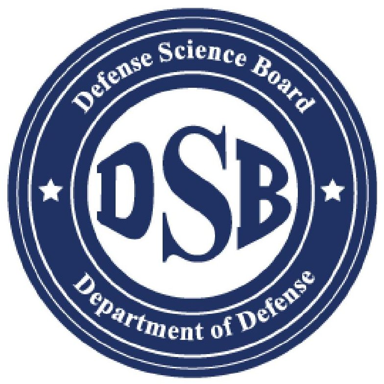

