<!-- PDF_PAGE: 1 -->

# Digital Engineering Hub Pathfinder

Marcel Verhoef $ ^{*} $ , Sam Gerené $ ^{\dagger} $ , Alex Vorobiev $ ^{\dagger} $ , Nathanael Smiechowski $ ^{\dagger} $ , Stephan Jahnke $ ^{\ddagger} $ , Jan Knippschild $ ^{\ddagger} $ Sven Weikert $ ^{\S} $ , Marc Becker $ ^{\S} $ , Stéphane Paquay $ ^{\P} $ , Juan Pablo Hernandez Vogt $ ^{\P} $ and Ivan Fontaine $ ^{\P} $

$ ^{*} $ European Space Agency, Noordwijk, The Netherlands. Email: marcel.verhoef@esa.int

$ ^{\dagger} $ RHEA Group, Diegem, Belgium. Email: s.gerene@rheagroup.com

$ ^{\ddagger} $ OHB System AG, Bremen, Germany. Email: stephan.jahnke@ohb.de

$ ^{\S} $ Astos Solutions GmbH, Stuttgart, Germany. Email: sven.weikert@astos.de

$ ^{\P} $ Open Engineering, Angleur, Belgium. Email: s.paquay@open-engineering.com

Abstract—We present an overview of an integrated modelbased engineering environment to support space system definition and feasibility assessment using concurrent engineering techniques. We briefly introduce the information model that has been development over the last decade and, as our main contribution in this paper, show how domain specific tools can be practically integrated in order to improve the data exchange in support of highly iterative design evolutions. The different styles of interfaces are presented in the context of a few representative domain specific engineering tools. The way they can be used in a typical engineering setting is presented, and we conclude by placing the development of this pathfinder project in context of the on-going digitalization of the space systems engineering workflow in the European space sector.

Index Terms—integrated model-based engineering environment, concurrent design

## I. INTRODUCTION

Designing new systems, starting from just a list of informal, and typically vague, unclear and sometimes even conflicting requirements, is a notoriously hard problem to solve. In our case, the challenge is to assess the feasibility of new space missions, that are proposed by a large variety of stakeholders. The Concurrent Design Facility (CDF, see https://www.esa.int/cdf) at the European Space Agency (ESA) was established in 1998 to address this challenge, by applying concurrent engineering techniques to perform new mission concept assessment, space systems trade-offs and option evaluation and validation of new technology at systems or mission level. Concurrent engineering is a systematic approach to integrated product development that explicitly emphasises the response to customer expectations. It embodies team values of cooperation, trust and sharing information in such a way that decision making is done by consensus, involving all perspectives in parallel, right from the beginning of the system life-cycle. This significantly reduces the time needed to evolve the initial design.

The CDF provides a collaborative engineering working environment, by bringing together all stakeholders, allowing them to discuss all aspects of the mission under design, from requirements to costing, including all relevant disciplinary specific viewpoints, in a structured workflow consisting of

plenary and breakout sessions and "home work" assignments. Typically two intensive plenary sessions are held per week, and depending on the complexity of the mission, it can take up to one month to reach sufficient detail in all aspects of the initial design to confirm the feasibility of the mission, based on a consolidated set of top-level requirements and to list the conditions that must be met in order to achieve that goal. The end result is a so-called CDF study Final Report, that summarises all findings, which is then typically used to secure funding for the next phase of the life-cycle, the preliminary design. Since the inception of the CDF, several hundreds of studies have been performed, many of which have been selected for implementation and are now realised. The success of CDF has propagated in the industry, with several national space agencies and large-scale system integrators implementing their own facilities, e.g. the Concurrent Engineering Facility at OHB (CEFO).

The key success factor is to enable effective communication between all stakeholders and bringing all experts together, colocated in a high-end decision room facility with all the bells and whistles, is the enabler. Ensuring that the participants are able to use their own tools on site, present their own results and share data with others is what brings the added value. The concurrent engineering process followed ensures that all stakeholders are able to contribute at the right time, answering the right questions, but managing the flow of information between all of them, and ensuring that everyone has access to the latest and consolidated information is what really ensures success at the end of the day. It was recognised very early on that this data exchange process should be well-structured and standardised. This led to the definition of the ECSS-E-TM-10-25 technical memorandum [1], published by the European Cooperation for Space Standardization (ECSS, see https://ecss.nl) as part of the E-10 System Engineering branch in their series of standards, handbooks, and technical memoranda that are the baseline in the European space industry.

ECSS-E-TM-10-25 is composed of three parts. Annex A defines the Concurrent Engineering Information Model (CEIM) main objects, such as Organisation, EngineeringModel, ElementDefinition and ElementUsage. In total 167 classes, enumerations and data types are defined, using a UML notation, to enable storage and transfer of the engineering

<!-- PDF_PAGE: 2 -->

information segregated into two main containers (referred to as TopContainers): a singleton SiteDirectory that holds data reusable by projects, including reference data; and an EngineeringModel, each securely containing the engineering data itself, including role-based access rights management, and supporting an explicit notion of design iterations. Annex B defines the Generic Engineering Reference Data Library, which contains names, descriptions, dimensions, units and unique codes for the set of parameters defining a Concurrent Engineering design. Finally, Annex C holds the formal definition of the Web Services Interface (HTTP REST) and the exchange file format. Large parts of the tools are automatically generated from these definitions, ensuring implicit compliance across different tool implementations.

The purpose of ECSS-E-TM-10-25 is to define and promote common data definitions and data exchange in the context of concurrent design, and engineering model reviews. Primarily intended to be used in phases 0/A (i.e. mission definition and feasibility analysis), it provides the facilities to create a decomposition of a system on a logical and physical architectural level with associated strongly typed parameters, supported by concepts of ownership by domain experts. The protocol defined in ECSS-E-TM-10-25 was developed with concurrent Model Based System Engineering (MBSE) in mind from the start, where exchange of information would occur in nearreal time between any arbitrary number of active engineers. The underlying paradigm is publish-subscribe information exchange, which allows to define datasets of interest for each domain specialist, which can be requested at any time from the server (pull action). Domain specialists can also update information on the central store (push action), these will however not be visible to other users unless they are approved by the study lead. So the actual data exchange is always instantaneous, with all changes under version control, but the visibility of changes is explicitly orchestrated. This provides a basic level of consistency checking and coordination, as a lightweight and flexible approach to model configuration management during the study. Multiple software implementations of ECSS-E-TM-10-25 exist, such as the ESA Open Concurrent Design Tool (OCDT) [2], RHEA COMET (formerly known as CDP4) [3] and COSM from Blue Engineering [4]. These tools all follow a traditional client-server architecture, with a central datastore and end-user applications that are provided to the study participants. These end-user applications can be tightly integrated into classic office tools, to provide a convenient, well-known and therefore low threshold experience to end users. They can use the tools with very little training to lookup the information that is relevant to them at any time, update their own outputs and provide it to others, while the system engineer in charge of the CDF session ensures that the updated information is provided to all affected stakeholders. The notion of design iterations and versioned data is of course key to manage the overall workflow.

All of these tools, however, currently offer very little in terms of direct interoperability with industry standard domain specific tools (DSTs) - the tools that the experts typically bring

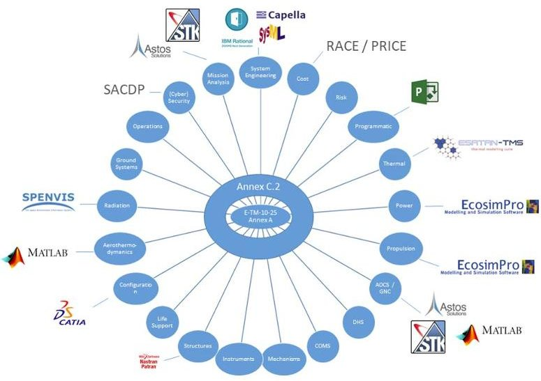

Fig.1. The digital engineering hub

to the CDF sessions to do their own analysis work. The only practical solution for the end user (i.e. a domain expert) to facilitate the exchange of information would be limited to either manual creation of architectures and management of parameter values, or development of connections and models in spreadsheets such as Excel, which is supported from both OCDT and COMET. This shortcoming has the unfortunate side-effect of making ECSS-E-TM-10-25 look unattractive as a central data hub for users of complex simulation and analysis tools, as well as graphical architecture modelling tools, as double work and potential human errors are unavoidable, yet the advantages of using those tools cannot be denied. They, in turn, almost unanimously do not address the needs for concurrent engineering or interoperability with other domain specific tools, which creates a gap between the typical phase 0/A engineering activities and those following, where these DSTs become more dominant.

Thus, one of the main obstacles of full deployment of MBSE in space projects is identified: a lack of a centralized, real time "data hub" that is able to seamlessly interact in a bidirectional manner with industry standard tools, bridging the gap between concurrent engineering and the preliminary and detailed design phases that follow. The Digital Engineering Hub Pathfinder (DEHP) project sets out to demonstrate that, while complex, this concept is entirely achievable. ECSS-E TM-10-25 remains at the heart of the DEHP project, where an Annex C.2-enabled data source (COMET Web Services or OCDT WSP for example) is used to provide, collect, and persist data from DSTs in an automatic, yet configurable fashion, as is shown in Figure 1.

## A. COMET IME

The COMET Integrated Model Editor (IME) is a standalone Windows desktop client application as well as the accompanying Excel addin desktop application exposing a GUI that allows manipulation of 99% of the TM-10-25 Annex A constructs. It is based on a plugin framework that is easy to extend to add new functionality. A standard installation of the

<!-- PDF_PAGE: 3 -->

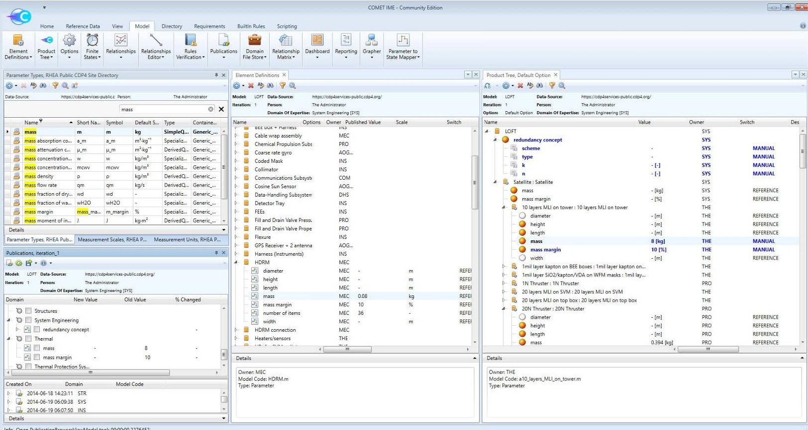

Fig. 2. The COMET Integrated Model Editor

COMET IME includes plugins for requirements engineering, solution architecting, as well as site directory and reference data management, as is shown in Figure 2.

Next to these editors, the IME includes features like automatic requirement verification, traceability matrix generation, report designer (can be used for budgets for example, as shown in Figure 3) and Python scripting with access to all model elements.

## B. Tool integration

In part supported by the work performed in previous ESA activities on explorative integration, in the frame of the DEHP project the following DSTs are integrated into the ECSS-E TM-10-25 ecosystem via development of what we refer to as "DST Adapter", undertaken by the identified companies:

- Simulation applications: Matlab (RHEA), Ecosim Pro (RHEA), ASTOS (Astos Solutions)

- Thermo-Mechanical Engineering: Catia v5 (RHEA), STEP-TAS ESATAN-TMS (Open Engineering), STEP 3D CAD (Open Engineering)

- System Engineering/Architecting: Cameo Systems Modeler SysML (RHEA), Enterprise Architect SysML (RHEA), Capella (RHEA)

- Space Specific System Engineering/Architecting: MARVL CIP (RHEA)

Figure 1 shows that more tools are identified as potential candidates for integration, and these would follow the same implementation approach as the tools in scope for the pathfinder project. In this paper, we will present the status

Mass Budget Detailed Summary Mission Option: Default Option

<table border="1"><tr><td>System/Subsystem</td><td>S/C Mass Budget</td><td>(#)</td><td>+Margin</td><td>Mass [kg]</td></tr><tr><td>Satellite</td><td></td><td></td><td></td><td>1,716.98</td></tr><tr><td>AOGNC</td><td>Attitude and Orbit Guidance, Navigation and Control</td><td></td><td></td><td>78.09</td></tr><tr><td>COM</td><td>Communications</td><td></td><td></td><td>16.52</td></tr><tr><td>DHS</td><td>Data-Handling</td><td></td><td></td><td>15.40</td></tr><tr><td></td><td>On Board Computer</td><td></td><td></td><td>15.40</td></tr><tr><td>INS</td><td>Instruments</td><td></td><td></td><td>106.97</td></tr><tr><td>MEC</td><td>Mechanisms</td><td></td><td></td><td>46.35</td></tr><tr><td>PWR</td><td>Power</td><td></td><td></td><td>155.70</td></tr><tr><td>PRO</td><td>Propulsion</td><td></td><td></td><td>64.39</td></tr><tr><td>STR</td><td>Structures</td><td></td><td></td><td>524.26</td></tr><tr><td>SYS</td><td>System Engineering</td><td></td><td></td><td>676.85</td></tr><tr><td>THE</td><td>Thermal</td><td></td><td></td><td>32.45</td></tr><tr><td></td><td>Harness</td><td></td><td></td><td>85.85</td></tr><tr><td></td><td>Dry Mass w/o System Margin</td><td></td><td></td><td>1,802.83</td></tr><tr><td></td><td>System Margin</td><td>20%</td><td></td><td>360.57</td></tr><tr><td></td><td>Dry Mass including System Margin</td><td></td><td></td><td>2,163.39</td></tr><tr><td></td><td>CPROP Fuel Mass</td><td></td><td></td><td>100.00</td></tr><tr><td></td><td>CPROP Fuel Margin</td><td>2%</td><td></td><td>102.00</td></tr><tr><td></td><td>CPROP Oxidizer Mass</td><td></td><td></td><td>80.00</td></tr><tr><td></td><td>CPROP Oxidizer Margin</td><td>2%</td><td></td><td>81.60</td></tr><tr><td></td><td>CPROP Pressurant Mass</td><td></td><td></td><td>70.00</td></tr><tr><td></td><td>CPROP Pressurant Margin</td><td>2%</td><td></td><td>71.40</td></tr><tr><td></td><td>EPROP Propellant Mass</td><td></td><td></td><td>0.00</td></tr><tr><td></td><td>EPROP Propellant Margin</td><td>2%</td><td></td><td>0.00</td></tr><tr><td></td><td>Total Wet Mass</td><td></td><td></td><td>2,418.39</td></tr><tr><td></td><td>Launcher Adapter</td><td></td><td></td><td>240.00</td></tr><tr><td></td><td>Wet Mass + Adapter</td><td></td><td></td><td>2,658.39</td></tr></table>

Fig. 3. An example mass budget report

of several of these domain specific tool adaptors, that are currently under development. The project is expected to complete in 2021, with all software available in open source [3].

<!-- PDF_PAGE: 4 -->

## II. ARCHITECTURE OF THE DATA HUB

In order to support the common tasks of the users for the different domain specific tools, a survey among end-users was held consisting of a questionnaire and follow-up interviews. The survey was designed to elicit the typical tasks and interactions of the different tools, identifying their in- & outputs down to the level of detail of parameter types and data constructs to be exchanged as well as identifying all involved stakeholders. This information was used to define the Concept of Operations for all individual tools and for the data hub itself, as well as to identify commonly used information and interdependencies in the different analysis across domains and tools. In addition, the users were challenged to define supporting features and capabilities they would need to efficiently use the DST adapters.

The principle of operations of all adapters is the same: it is a piece of software that provides an application interface such that the DST can access the model that is stored in the central data hub. The user interface allows the user to inspect, configure, and initialize the transfer, in both directions. The application interface on one hand communicates to the hub via ECSS-E-TM-10-25 Annex C.2 RESTful protocol, and on the other hand via whatever API the DST allows. Three distinct types of software architectures were identified to support the development of the adapters:

- DST Adapter Bridge: a standalone application directly interfacing with a running instance of the DST on the client computer through the means of either COM Interoperability or some other API that the DST provides.

- DST Adapter Plugin: direct integration into the DST in question, utilizing the underlying infrastructure, user interface elements, programming language and access to the model. This option presents the simplest approach to regular users of the DST as transfer can be initiated directly from the tool.

- DST Adapter Standalone: primarily aimed at exchange of standardized file formats rather than specific tools, such as STEP-TAS and STEP AP-242 through parsing files and extracting information inside of them.

The static architecture of a generic DST Adapter Standalone is presented in Figure 4. Distinction is also made between the types of information being exchanged. Some of the adapters deal purely with mapping of arbitrary DST workspace variables to existing ECSS-E-TM-10-25 parameters, while others make much more complicated model transformations that influence the architecture of the system being designed. Either way, the same isolated component takes care of handling the mapping and the transfer, leaving the adapter developers focusing on writing the rules that govern the transformation from model A to model B while the mechanism remains the same.

Special care was taken to identify reusable components that can be shared between the adapters, when possible, as well as a basis for any future integrations outside the scope of this activity. These components are then gathered into standalone

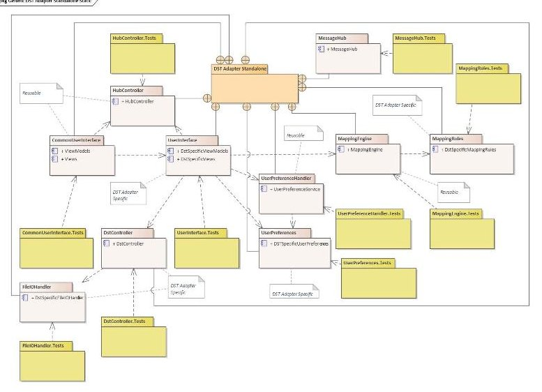

Fig. 4. Software architecture of the DST stand-alone interface

libraries that can later be used to develop even more adapters than defined in the scope of this project. Furthermore, all adapters share the general workflow of mapping, previewing, and transferring information so as to minimize the need for individual re-familiarization between the tools. The user interface is completely reused where possible, eliminating the need to reimplement on a case-by-case basis.

The adapters are able to make a sensible preview of the changes before the transfer is initiated, allow the user to make partial transfers of the full model mapping, store and display local exchange history, while the persistence of the mapping is relegated to the hub itself, enabling re-use between study participants. All adapters are utilizing either the C# or the Java versions of the COMET SDK [3]. An example for each type of domain specific tool adapter is presented in the following sections.

## II. DST BRIDGE EXAMPLE: ECOSIM

ECOSIM Pro (see https://www.ecosimpro.com) is a simulation tool capable of modelling any kind of dynamic system that can be expressed by differential algebraic equations and discrete events. Developed originally for space applications with funding from ESA and with the goal of simulating environmental control and life support systems for manned spacecraft, it's broad application was realized at an early stage, and it is now being used across many different domains. The application consists of a graphical and programmatic modelling interface with a large set of libraries containing various types of components (mechanical, electrical, pneumatic, hydraulic, etc.). It is widely used within ESA for rocket and satellite propulsion systems modelling and analysis. In the scope of this activity the focus was on applicability of the tools to dimensioning of Power and Propulsion subsystems.

The adapter for ECOSIM Pro, as shown in Figure 5, is an example of the DST Adapter Bridge. Bidirectional exchange between experiment variables in the ECOSIM Pro model and the corresponding ECSS-E-TM-10-25 parameter values can be

<!-- PDF_PAGE: 5 -->

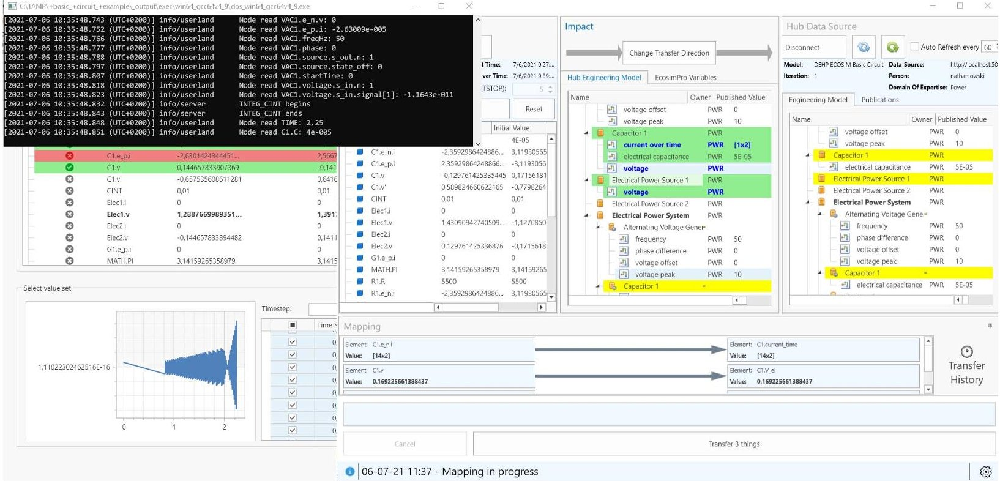

Fig. 5. Overview of the DST for ECOSIM Pro, while running a simulation

achieved with very little effort. The connection between the hub and this particular DST is established through the Open Platform Communications Unified Architecture (OPC-UA) protocol [5]. ECOSIM Pro provides functionality to compile experiments into OPC server-enabled standalone decks, which the adapter can interact with. Once connected to both the hub and the deck, the user can choose to load or create a new mapping (as mentioned before, mappings are persistent), select the direction of transfer, preview impact on the target model based on a selected subset of the mapping and eventually initiate the information transfer itself. The experiment can be controlled (started or paused) directly in the adapter, with the ability to modify the timestep. Initial values can be injected into the experiment by performing the mapping from the hub to DST first and transferring the inputs. At this point the experiment is executed and values of all output parameters at every timestep are recorded.

To be able to transfer this information safely back to the hub, reversing the transfer direction, a new type of parameter was introduced in the TM-10-25 data model: SampledFunctionParameterType. It allows for persistence of parameters, whose value is discretely sampled, with each sample consisting of any number of independent parameter values mapped to any number of dependent parameter values. This allows the encoding of time series data in a convenient yet flexible form. The need for this additional data type was a direct consequence of the integration of this type of simulation based tool, which was neither considered nor feasible before. The COMET IME (the standard TM-10-25 desktop client application, provided to inspect the model state) was also extended with functionality to support creation, visualization and editing of this new

parameter type. Furthermore, the adapter is able to display graphs and re-sample the data in various ways. The type of variables is also being automatically checked to minimize problems with incorrect mapping.

The TM-10-25 model does not have to be completely prepared before the transfer. The user has the ability to initiate ElementDefinitions and create additional parameters directly through the adapter, which saves a lot of time. With the mapping applied, the user can inspect changes within the impact view before initiating transfer, which can also be done selectively. The adapter will display the number of objects that will be taken into the transaction. In the case of transfer in the direction of the hub, an additional justification message can be submitted, i.e. to provide context to the provided simulation results. Finally, as the implementation of the interface is based on OPC-UA, supporting other simulation platforms, such as OpenModelica should also be a feasible with minimal effort.

## IV. DST STAND-ALONE EXAMPLE: STEP AP242

The STEP-AP242 format is a standard that is supported by numerous CAD tools. These tools are generally able to import/export geometries using this STEP file format [6]. The format is aimed at exchanging the final result of a CAD program. It is widely supported but has some limitations. It doesn't contain any parametric information and it just contains geometry. The main weakness of the STEP format is that there are several ways to describe a given geometry and every CAD tool can do it in its own way. It means that the content of the STEP files, even for an equivalent geometric content cannot be considered being the same. Throughout its life, the content of the file can be deeply modified internally while remaining almost the same aspect-wise. It means that, as it cannot rely

<!-- PDF_PAGE: 6 -->

on a stable internal geometry description, the STEP adapter must currently stick to the only stable content: the names of STEP assemblies.

Despite the limitations of the STEP format, the developed STEP adapter already presents interesting functionalities that are shortly presented below:

- Load a local STEP file and build its "High Level Representation" (HLR) that is exposed to the user. This HLR exposes in a hierarchical way the different labelled step assemblies and their relations, as shown in Figure 6.

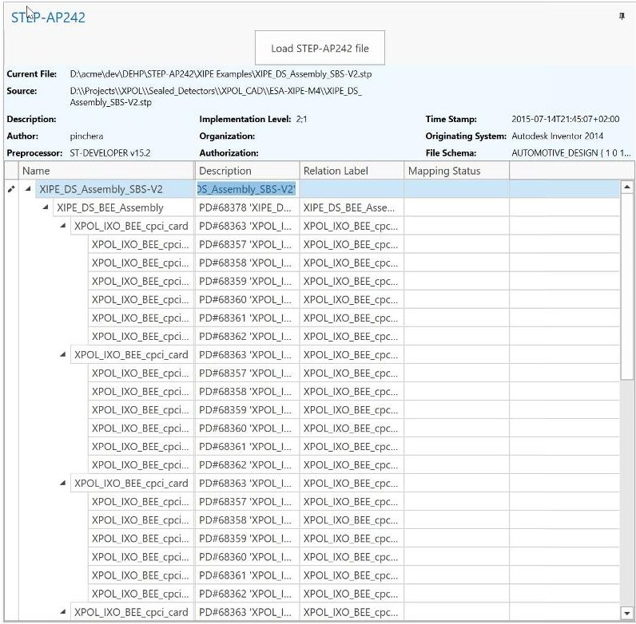

Fig. 6. STEP AP242 HLR inspection

- Define mappings from items of the HLR to ElementDefinition or ElementUsages defined in the engineering model on the hub. The selections are then highlighted in the "Impact Frame" of the application, as shown in Figure 7.

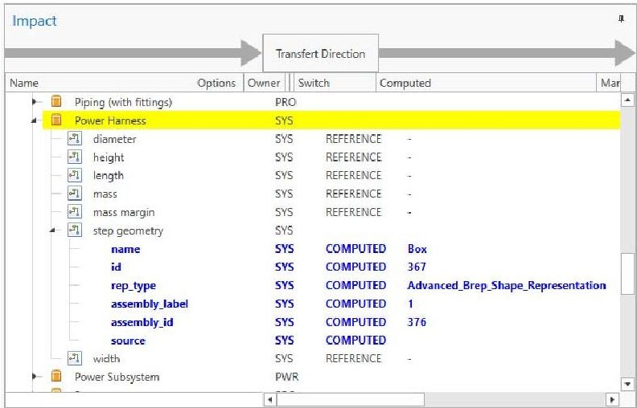

- Once mappings are defined, they (or a user-selection of them) can be committed to the engineering model on the hub. This operation will attach items of STEP files (that will be stored in the "Domain File Store" on the hub) to ElementDefinition or ElementUsages by the use of a new STEP geometry compound parameter.

Fig. 7. AP242 to TM-10-25 mapping

- The user is also able to retrieve locally a STEP file from the hub (available in the Hub File Store) or he can visualize it directly if a CAD tool is installed on the same computer, as shown in Figure 8.

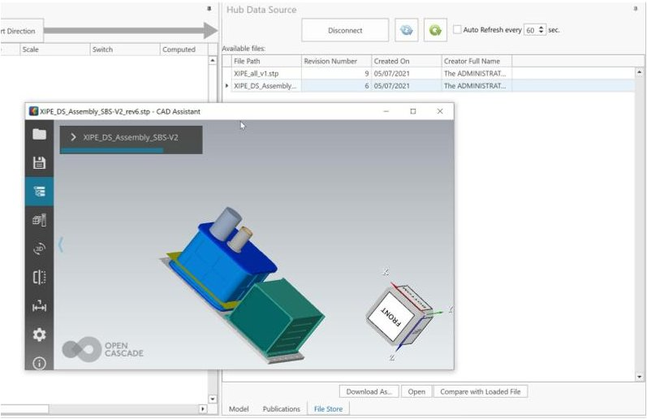

Fig. 8. AP242 visualization

- Last but not the least, the adapter permits to perform a comparison between a STEP file that is stored locally and another that is stored in the engineering model on the hub. This comparison tool is only based on HLRs of the two files that are compared, as shown in Figure 9.

To conclude, the STEP-AP242 adapter is an example of a DST standalone adapter and it permits to efficiently track the geometric entities (from step files) attached to components of the engineering model during the concurrent design process. Due to the complexity of the STEP-AP242 format (the same geometry can be exported in a completely different way by different CAD tools), the related adapter is only unidirectional since the mapping can be only performed with "Local STEP file to Hub" direction.

## V. DST PLUG-IN EXAMPLE: ASTOS

ASTOS is a commercial optimization, analysis and simulation software for various space applications (see https:// www.astos.de/products/astos). It is used for concurrent vehicle design, trajectory optimization as well as mission and system concept analysis. It can also be used as simulator in closed-loop applications for GNC development, software functional verification up to satellite check-out (AOCS SCOE).

Within a concurrent engineering environment, ASTOS typically interacts with other domain expert tools, e.g. for aerodynamics or structural analysis. The COMET DST adapter has been directly integrated into ASTOS (DST Adapter Plugin architecture pattern) which allows for an easy and reliable data exchange between these tools via a TM-10-25 data hub. While

<!-- PDF_PAGE: 7 -->

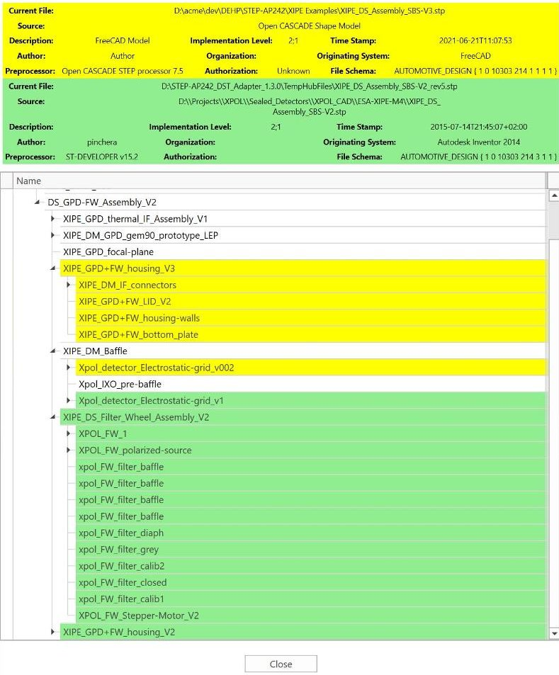

Fig. 9. AP242 comparison

it was the goal of the project to keep the design and workflow consistent throughout the various DST adapters, it has been decided in this case to reuse concepts of the ASTOS userinterface instead. The appearance of the ASTOS DST Adapter is different from the other adapters presented in this paper, especially when it comes to data import as shown in Figure 10, but the underlying implementation is in fact identical. In this way, the workflow of the existing tool remains unchanged, but still allows to exploit data exchange via TM-10-25.

The configuration of the scenario and the analysis tasks are handled via the ASTOS graphical user interface, whereas each numerical setting can be assigned to a variable. Variables can be used as a configuration parameter that are required for several settings at a central place, but also to hook up ASTOS with external data sources such as MySQL databases, Excel tables and so forth. The extension of this concept towards the TM-10-25 data hub promised to be the best option to ease the entrance into the TM-10-25 data hub for the ASTOS user.

The export to the data hub is handled directly in the Adapter window. The user can map any scalar or time-tagged data created by ASTOS to a suitable parameter type in the hub product tree. Furthermore, it is possible to export derived data like integrals and derivatives of time-tagged output data and also to increase its sampling interval. Before exporting any data to the hub, the effective net change can be inspected

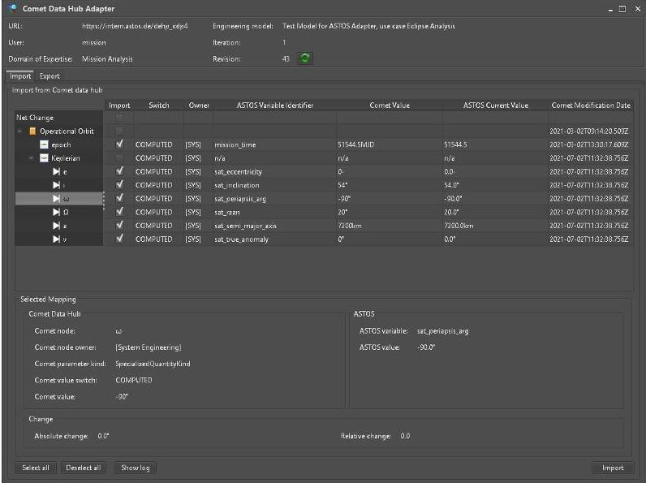

Fig. 10. Importing TM-10-25 data into ASTOS

and data values can be manually overridden before export if desired. For time-tagged data, the adapter provides plot and tabular representations for data comparison. Figure 11 shows the difference between a simulation run already available in the hub, compared to the output of a new simulation experiment, just prior to pushing this data as new shared values back to the TM-10-25 hub.

In order to ease the mapping process, the scenario wizard of ASTOS has been extended such that it can create the various use-cases that comprise import and export mappings for a TM-10-25 Data Hub. An extension to the reference data library (RDL) has been defined that comprises parameter types suitable for data exchange with ASTOS and that are not yet directly provided by the generic RDL. The newly added SampledFunctionParameterType was a key extension needed in order to effectively export the multitude of time-tagged output data from ASTOS.

## VI. CONCEPT OF OPERATIONS

In the previous sections, we discussed the three types of tool integrations. The development of the other domain specific tool adapters follows the same architectural pattern. But how do these tools then support the concurrent engineering process? We recall that the connection of domain specific tools to a common data source (data hub) allows the fast exchange of information and providing consistency by establishing a single source of truth for all engineering data. This is of special importance for the early design phases, where the design is undergoing constant iterations with multiple options being traded-off in parallel.

The general concept of operations for engineering work supported by a central data hub needs to be defined separately for the two main applications considered in this activity: concurrent engineering studies, where the domain experts are working at the same place and at the same time and thus are able to directly communicate, and on the other hand, collaborative engineering, when work is conducted in a time

<!-- PDF_PAGE: 8 -->

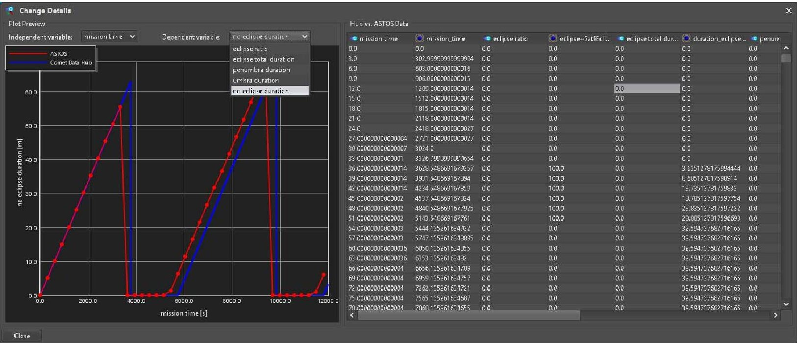

Fig. 11. Comparing new ASTOS results to previous simulations already shared in the hub

and place independent manner (i.e. in continuous project work, not necessarily co-located, but still connected through the hub) [7].

For concurrent engineering, the communication of implemented changes of system-relevant information can be done directly during the discussion (e.g. in domain rounds in CDF sessions). Based on these discussions, the domains impacted by the changes would be asked to update their information via the DST Adapters and then jointly assess whether the netchanges make an iteration of the associate task inside the DST necessary and potentially initiate a new evaluation cycle.

For collaborative engineering, this communication and distribution of information needs to be controlled by the system engineer and overall model administrator, orchestrating the execution of tasks. The step-wise publication scheme in the data hub supports the centrally controlled distribution of information and thus starting a new iteration.

Typical use case scenarios are defined through surveys and discussion with the end-user (i.e. tool experts) for the individual exchange between each specific DST and the data hub together with exchanged data types, which are used for the validation of each DST adapter involving the end users. Moreover, exemplary tool-overarching scenarios are identified by analyzing the exchanged information and data types, which allows for the linkage of tool specific use cases to global scenarios, representing the common tasks and iterations between different domains and their respective tools. In the following, two of the identified tool-chain scenarios are described in more detail, to give the reader insight to how these tools are used together in practice.

## A. Synchronisation of architectures

The information exchange between different Systems Engineering DSTs (Capella, MagicDraw/Cameo Systems Modeler,

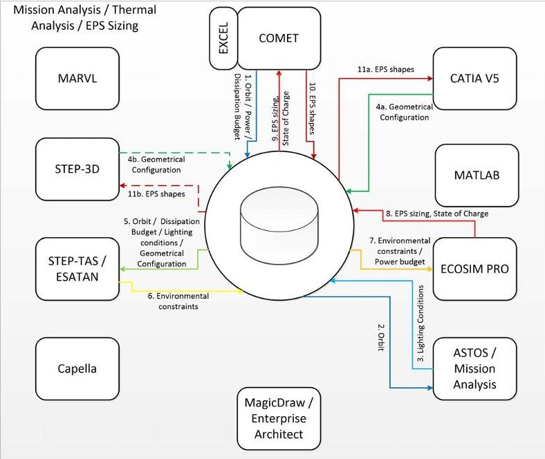

Fig. 12. System sizing use-case in CDF sessions

Enterprise Architect and COMET) in combination with other architectural organized tools (e.g. CAD tools) is showing high potential to synchronize the physical system decomposition and thus enables component selection or organization. As such, the Operational and Functional Analysis would typically be conducted in SysML / Capella tools, followed by a first Logical Architecture. This Logical Architecture can be published via the hub and used as a starting point for a Concurrent Engineering activity, where system modelling is done in COMET and supported by CAD design (e.g. CATIA v5 or STEP-3D). Design parameters and changes in the architecture can be pushed back into the MBSE tool.

<!-- PDF_PAGE: 9 -->

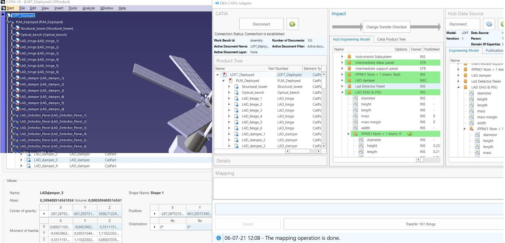

Fig. 13. System configuration management in Catia through TM-10-25 data exchange

Furthermore, the exchange of MBSE artefacts and concepts across tools (especially between SysML and Capella) allow for tool-independent collaboration, which is extremely important as manufacturers in the supply chain typically use different MBSE approaches.

## B. System dimensioning

Figure 12 visualizes the use of the data hub and the DST adapters to facilitate the iteration of the thermal and power subsystem sizing based on the results from mission analysis and the component selection from the different subsystems.

Based on the centrally defined orbit parameters (e.g. in COMET), the mission analyst conducts eclipse analysis to return the lighting conditions for the mission (i.e. using ASTOS). COMET can be used to define the power modes and collect the subsystem information w.r.t. power for consumption and dissipation, for each power mode. The CAD tools provide the geometrical configuration for the current baseline. This collection of information can be included in a STEP-TAS file to interface with ESATAN. Inside ESATAN, the thermal engineer conducts a preliminary thermal analysis and produces the environmental constraints (e.g. equipment temperature ranges and solar fluxes) and required heater powers. The power engineer imports the power budget together with the results of the thermal analysis and performs the Electrical Power Subsystem (EPS) sizing and energy balance analysis, i.e. using ECOSIM Pro. The resulting information can be imported back into COMET and together with EXCEL calculations, the EPS geometrical shapes (e.g. solar array area, battery envelopes) can be exported to CAD to be included in the overall system configuration, as shown in Figure 13. The system level power and mass budget is refined inside COMET based on the results

of the analysis. It should be noted that this typically requires several iterations, potentially trading off multiple options, to ensure that all system requirements become achievable within a commonly agreed set of design margins.

## VII. FUTURE WORK AND CONCLUSIONS

The digital engineering hub pathfinder project will finish in 2021, several domain specific tool adapters are still under development. But the initial results presented in this paper, already convincingly demonstrate that the vision of an open model-based engineering environment is not only technically feasible but also practically useful and is addressing real engineering needs. It is indeed a pathfinder for our long-term goal, which is to fully digitise the engineering workflow for spacecraft design and operations. Not only gradually replacing documents by models, allowing high levels of automation, but also improving quality and time-to-market, through the notion of "single source of truth". Timely access to a consistent set of data is the enabler, but agreement on the meaning of that data is what creates the real value added. It took us over a decade to define the TM-10-25 concurrent engineering information model, together with stakeholders in the European space community at large. And to this day, it is still evolving, as can be seen from the addition of the SampledFunctionParameterType which was added in order to properly capture time-series data. TM-10-25 addresses specifically the needs of early life-cycle concurrent engineering. However it does not address the needs of the detailed design and verification and validation steps that follow.

The Overall Semantic Modelling for Systems Engineering (OSMoSE) project is started within the European space community, consisting of the European and national space agen-

<!-- PDF_PAGE: 10 -->

cies, the large-scale systems integrators, technology providers and tool vendors, with the aim to produce a conceptual data model for space systems development - the so-called space systems ontology (SSO, see https://mb4se.esa.int). This project will address the interoperability at semantic level, with a scope that not only encompasses TM-10-25, but addresses the full system life-cycle. A three-tiered modelling approach will provide clear separation between the "what" and "how" aspects, enabling interoperability between commercial-off-the-shelf systems engineering tools, by generation of the data exchange interfaces needed directly from the ontology. While the Unified Modelling Language was used to describe TM-10-25, for OSMoSE the Object-Role Modelling (ORM) technique has been chosen [8], supported by the NORMA tool (see http://sourceforge.net/projects/orm). Based on the OSMoSE space systems ontology, the pathfinder hub will be able to become a true MBSE hub in future.

The key lesson learnt is that building a software infrastructure to validate implementations of information models and the ability to automatically generate interfaces to integrate existing design tools is instrumental for success. It is clear that for the implementation of the space systems ontology a similar approach will be followed.

In summary, we presented a concrete implementation of an open model-based engineering environment, that allows the integration of domain specific design tools, centered around a well-defined concurrent engineering information model. In the pathfinder project, this entire eco-system was created and is made available in open source [3]. We have demonstrated that this approach can be used to support highly iterative concurrent design for space systems mission definition and feasibility assessment. The approach is however generically applicable to other application domains as well.

## REFERENCES

[1] ECSS, "ECSS-E-TM-10-25A - engineering design model data exchange - CDF," https://ecss.nl, 2010.

[2] European Space Agency, "Open Concurrent Design Tool (OCDT)," https://ocdt.esa.int, 2021, Portal is only accessible to ESA member states.

[3] RHEA, "COMET," https://github.com/RHEAGROUP, 2021, Repository contains all software under open source licenses.

[4] Blue Engineering, "Collaborative System Manager (CSM)," http:// blue-group.it/collaborative-system-manager, 2021.

[5] "OPC Unified Architecture," https://opcfoundation.org/developer-tools/ specifications-unified-architecture, 2017.

[6] "ISO 10303-242," http://www.ap242.org/welcome, 2014.

[7] M. Borsato and M. Peruzzini, Collaborative Engineering. Springer International Publishing, 2015, pp. 165-196. [Online]. Available: https://doi.org/10.1007/978-3-319-13776-6_7

[8] T. Halpin, Object-Role Modelling Fundamentals. Technics Publications, 2015, http://www.ormfoundation.org.