<!-- PDF_PAGE: 1 -->

SYSTEMS ENGINEERING RESEARCH CENTER

Task Order WRT-1001: Digital Engineering Metrics

Technical Report SERC-2020-TR-002

June 8,2020

# Principal Investigator: Tom McDermott, Stevens Institute of Technology Co-Principal Investigator: Eileen Van Aken, Virginia Tech

Research Team:

Stevens: Nicole Hutchison, Mark Blackburn, Megan Clifford, Zhongyuan Yu, Neal Chen Virginia Tech: Alejandro Salado, Kaitlin Henderson

Sponsor: Office of the Secretary of Defense for Research & Engineering

Report No. SERC-2020-TR-002

<!-- PDF_PAGE: 2 -->

Copyright © 2020 Stevens Institute of Technology, Systems Engineering Research Center

The Systems Engineering Research Center (SERC) is a federally funded University Affiliated Research Center managed by Stevens Institute of Technology.

This material is based upon work supported, in whole or in part, by the U.S. Department of Defense through the Office of the Assistant Secretary of Defense for Research and Engineering (ASD(R&E)) under Contract [HQ0034-19-D-0003, TO#0100].

Any views, opinions, findings and conclusions or recommendations expressed in this material are those of the author(s) and do not necessarily reflect the views of the United States Department of Defense nor ASD(R&E).

No Warranty.

This Stevens Institute of Technology and Systems Engineering Research Center Material is furnished on an "as-is" basis. Stevens Institute of Technology makes no warranties of any kind, either expressed or implied, as to any matter including, but not limited to, warranty of fitness for purpose or merchantability, exclusivity, or results obtained from use of the material. Stevens Institute of Technology does not make any warranty of any kind with respect to freedom from patent, trademark, or copyright infringement.

This material has been approved for public release and unlimited distribution.

<!-- PDF_PAGE: 3 -->

## TABLE OF CONTENTS

Table of Contents...iii

List of Figures ...iii

List of Tables ...iv

Executive Summary...1

Organization of this Report...4

1. Findings ...5

2. DE Metrics ...7

Enterprise Metrics Categorization ...7

Recommendations for Metrics Implementation ...17

3. Application of DE Metrics ...18

Introduction ...18

Background – NAVAIR Surrogate Pilot for SE Transformation ...19

Quantitative Analysis ...23

Narrative Analysis ...25

4. Literature Review on DE/MBSE Benefits ...28

1. Methodology ...29

2. Results ...31

3. Discussion ...39

5. Enterprise Adoption Framework ...41

6. Extending the Acquisition Enterprise SoS Model to the Program Office Level ...48

7. Summary and Recommended Future Research ...52

Project Timeline & Transition Plan ...53

Personnel ...54

Appendix A: List of Publications Resulted ...55

Appendix B: Cited and Related References ...55

Appendix C: MBSE Maturity Survey Executive Summary ...57

Survey Demographic Information ...58

Maturity Analysis, Participant Reported Ratings ...60

Analysis of Text Responses, MBSE Benefits and Metrics ...62

Analysis of Text Responses, Enterprise Adoption ...65

Analysis of Text Responses, Workforce Development ...68

## LIST OF FIGURES

Figure 1. Data analysis flow for Development of the Metrics Framework. 3

<!-- PDF_PAGE: 4 -->

Figure 2. Enterprise Metric Definition Framework... 7

Figure 3. Top-level Metrics Framework... 8

Figure 4. Top Cited DE Benefits Areas from Literature and Survey Results... 9

Figure 5. Obstacles, Enablers, and Changes for DE Adoption, ranked by Frequency of Mention. 9

Figure 6. SET Functional Areas with Impacts on SET Research and Surrogate Pilot ... 21

Figure 7. NAVAIR Systems Engineering Transformation Framework... 22

Figure 8. Correlation Matrix for Lessons Learned and DE/MBSE Benefit Metrics ... 23

Figure 9. Benefit Categories Occurrences for the Measured Benefit Classification. ... 36

Figure 10. Benefit Categories Occurrences for the Observed Benefit Classification. ... 36

Figure 11. Benefit Categories Occurrences for the Perceived Benefit Classification... 37

Figure 12. Benefit Categories Occurrences for the Referenced to Another Source Classification.

... 37

Figure 13. Benefits with Totals of at least 20 in Percentages... 38

Figure 14. Baldrige Criteria for Performance Excellence... 42

Figure 15. Most Frequently Reported Success Factors from the Survey of MBSE Adoption... 44

Figure 16. Updated RT-182 Workforce & Culture Systemigram (partial)... 49

## LIST OF TABLES

Table 1. Descriptive summary of top cited metrics areas...10

Table 2. Example enterprise metric definitions...15

Table 3. Breakdown of source types across papers...31

Table 4: Distribution of paper, claim count, and claim type per source...31

Table 5. Benefit Categories and example Benefit Statements...33

Table 6: Top Benefits in each Source Type...38

Table 7. Practices for Successful MBSE Adoption...45

Table 8. Linkage to DoD DE Pain Points...50

<!-- PDF_PAGE: 5 -->

## EXECUTIVE SUMMARY

The DoD Digital Engineering (DE) strategy $ ^{1} $ outlines five strategic goals for transformation, targeted to "promote the use of digital representations of systems and components and the use of digital artifacts as a technical means of communication across a diverse set of stakeholders, address a range of disciplines involved in the acquisition and procurement of national defense systems, and encourage innovation in the way we build, test, field, and sustain our national defense systems and how we train and shape the workforce to use these practices."

DE is defined as "an integrated digital approach that uses authoritative sources of systems' data and models as a continuum across disciplines to support lifecycle activities from concept through disposal. A DE ecosystem is an interconnected infrastructure, environment, and methodology that enables the exchange of digital artifacts from an authoritative source of truth." $ ^{2} $ Model-Based Systems Engineering (MBSE) is a subset of DE, defined as "the formalized application of modeling to support system requirements, design, analysis, verification and validation activities beginning in the conceptual design phase and continuing throughout development and later life cycle phases." $ ^{3} $ The terms DE and MBSE are used interchangeably throughout this report.

Model-Based Systems Engineering (MBSE) has been a popular topic in the SE community for over a decade, but the level of movement toward broad implementation has not always been clear. With the release of the DoD DE Strategy, a clear set of high-level goals are defined for the DoD acquisition community and its industry base. These can be summarized as a set of five transformations as follows:

Goal 1: Use of Models - the enterprise has developed a comprehensive strategy for the use of models. Models are integrated with technical and business information tools and used consistently across all programs. Model development processes are established, and models are the basis for all business practices. Models guide program decisions. Consistent metrics guide implementation of model-based practices and the organization is realizing measurable value from the conversion to model-based practices.

Goal 2: Authoritative Data - enterprise decisions are based on digital artifacts. Programs have established an Authoritative Source of Truth (ASOT) and data and information are accessible and discoverable to provide knowledge for lifecycle decisions. Processes have been established for curating and managing the ASOT across program lifecycles and across the full program supply chain. Digital transformation is an ongoing change process across the enterprise and is linked to enterprise value.

Goal 3: Technical Innovation - the enterprise has established mature approaches to planning adoption and implementation of digital technologies. Consistent approaches to adoption are managed across the enterprise, leading to consistent and controlled use of digital technologies.

<!-- PDF_PAGE: 6 -->

The enterprise has consistent processes to examine and anticipate how new technologies can bring value and is able to measure and assess return on technology investment.

Goal 4: Supporting Infrastructure - a digital ecosystem is established to digitally collaborate across organizations, disciplines, and lifecycle phases. Policies, guidance, and planning are in place. Programs apply common practices to protect critical information and intellectual property across multiple enterprises. Engineering and program management activities are able to rapidly discover, manage, and exchange models and data. Information technologies (IT), software, and tools are in place and support model and data exchange, visualization, collaboration, and decision processes. Infrastructure changes provide measurable improvement over existing enterprise practices.

Goal 5: Culture and Workforce - the enterprise has a clear vision and strategy for DE, effective change processes, and experts and champions to lead transformation processes. Enterprise leadership is committed to and understands DE at all levels. DE transformation is linked to enterprise strategy and has clearly defined outcomes. There is a path to communicate the benefits and value of DE, as well as success stories. The enterprise has established appropriate roles and defined appropriate knowledge, skills, and abilities (KSAs) for DE. Sufficient staffing and skills are in place, and training programs are effective. The culture of the enterprise, as reflected by shared values/beliefs, supports use of DE. Systems engineers are recognized/rewarded for using DE processes and tools.

Each of these goals implies that an enterprise, organizational unit, or multi-organizational program has a means to define the outcomes of a DE strategy, performance metrics, measurement approaches, and leading indicators of change in the transformation process.

A previous SERC research task, RT-182 Enterprise System-of-Systems Model for Digital Thread Enabled Acquisition, conceptually modeled a potential future DoD acquisition enterprise in order to understand the structure of the future acquisition enterprise when the five goals of the DE Strategy were achieved, and the expected outcomes of that transition $ ^{4} $ . That research identified some potential metrics related to those outcomes, but also cited the need for the community to standardize and implement metrics that reflect success at the enterprise level. This research task focused on those metrics.

This research task used the following four guiding questions:

1. What would a "Program Office Guide to Successful DE Transition" look like?

2. How can the value and effectiveness of DE be described and measured?

3. Are there game-changing methods and/or technologies that would make a difference?

4. Can an organizational performance model for DE transformation be described?

At the start of the research effort, the hope was to identify and document best practices across the DoD, defense industry, and other industries related to measurement of the DE enterprise transformation, metrics for success, and standard success guidance. It quickly became clear that best practices do not yet exist in the DE and MBSE community, and the transformation process is not yet mature enough across the community to standardize best practices and success metrics. Given the state of the practice, the research shifted to a set of efforts to define a comprehensive framework for DE benefits and expected

<!-- PDF_PAGE: 7 -->

value linked to the ongoing development of DE enterprise capabilities and experienced transformation "pain points," enablers, obstacles, and change strategies.

A key result of this research is the development and definition of two frameworks that categorize DE benefits and adoption strategies that can be universally applied to a formal enterprise change strategy and associated performance measurement activities. The first framework is linked to the benefits of DE and categorizes 48 benefit areas linked to four digital transformation outcome areas: quality, velocity/agility, user experience, and knowledge transfer. This framework identifies a number of candidate success metrics. A test application to an ongoing DoD pilot project was completed and is documented in this report. The second framework addresses enterprise adoption of DE and provides a categorization of 37 success factors linked to organizational management subsystems encompassing leadership, communication, strategy and vision, resources, workforce, change strategy and processes, customers, measurement and data, workforce, organization DE processes relate to DE, and the organizational and external environments. The two frameworks were developed from literature reviews and a survey of the systems engineering community.

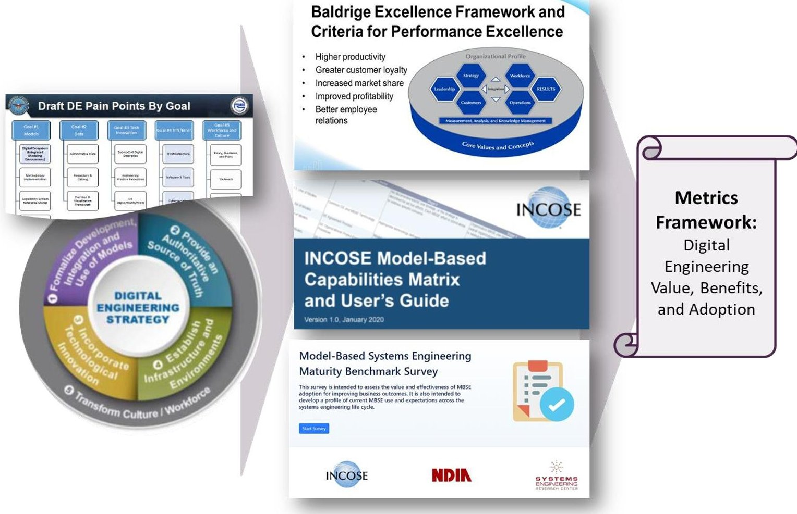

Figure 1. Data analysis flow for Development of the Metrics Framework.

The DE benefits and DE adoption frameworks were developed and linked to other established DE and general enterprise evaluation frameworks. The analysis flow is shown in Figure 1. This includes the DoD "DE Pain Points," a list of broadly stated challenges to successful DE transformation in the DoD, linked

<!-- PDF_PAGE: 8 -->

directly to the DoD DE Strategy. A published version of these is shown in the left side of Figure 1 $ ^{5} $ . The DE benefits and adoption framework also links to the recently published International Council on Systems Engineering (INCOSE) "MBSE Capabilities Matrix," an enabling framework to categorize and assess development of organizational DE/MBSE capabilities across a staged maturity model $ ^{6} $ . The MBSE Capabilities Matrix was used to develop a broad survey of the DE/MBSE community and the results of this survey form a core part of this research $ ^{7} $ . Finally, the DE benefits and adoption framework is linked to the Baldrige Criteria for Performance Excellence (CPE) $ ^{8} $ , which provides a comprehensive, holistic systems view of the DE-enabled organization by identifying a set of management sub-systems an organization must purposefully design (or redesign) and monitor in order be high-performing.

## ORGANIZATION OF THIS REPORT

This report is organized into multiple standalone sections. The sections are as follows:

1) Findings. This provides a summary of the four research goals and associated findings.

2) DE metrics. The report starts with the development and discussion of a DE metrics baseline. This section begins with background research on related digital transformation metrics and then proposes a high-level categorization of five enterprise metric areas based on the separate literature review and survey conducted as part of the research.

3) Application of DE Metrics. This section provides an example application of the DE benefits and metrics categorizations to a pilot effort. The NAVAIR "Skyzer" Surrogate Pilot effort was selected since the data and research team were available from another SERC project and since the effort simulated a full DoD acquisition process. This section links tasks that were conducted in the pilot to the associated metrics categories.

4) Literature Review on DE/MBSE Benefits. This section presents a literature review that was conducted as part of the research task on MBSE benefits. This research produced a categorization of 48 defined benefit areas from previous publications that span four of the five enterprise metric areas: quality, velocity/agility, user experience, and knowledge transfer.

5) Enterprise Adoption Framework. This section develops a separate framework for the fifth enterprise metric area, adoption, using the well-known Baldrige Criteria for Performance Excellence.

6) Extending the Acquisition Enterprise SoS Model to the Program Office Level. The body of research in the previous sections was used to update the conceptual models and narratives produced in the previous SERC report to more specific enterprise models for DE adoption, benefits, and success metrics. These are presented in this section.

<!-- PDF_PAGE: 9 -->

7) Summary and Recommended Future Research. The final section provides a discussion of where the research stands today and opportunities for further research.

Appendix C) MBSE Maturity Survey. A broad survey was executed in 2019-2020 in collaboration with the National Defense Industrial Association Systems Engineering Division (NDIA-SED) and the International Council on Systems Engineering (INCOSE) to benchmark the current state of DE and MBSE across government, industry, and academia. This section reproduces the executive summary of that survey in its entirety. The full report is published as a supporting research document to this report $ ^{9} $ .

## 1. FINDINGS

The report outcomes start with an assessment of the four guiding research questions:

What would a "Program Office Guide to Successful DE Transition" look like?

We found that 1) the DE and MBSE communities, across government, industry, and academia, are not sufficiently mature at this point in their DE transformations to standardize on best practices and formal success metrics. Pockets of excellence exist, but experience and maturity vary widely.

We found that 2) Government lags industry in maturity and should look to both their industry partners and the broader swath of commercial industry for best practices. The differing levels of DE capability across a government acquisition enterprise, prime contractors, and support contractors will be an obstacle to successful DE transformation. Programs, particularly legacy programs that have established non-digital processes, must invest effort in program-wide development and maturation of DE.

We found that 3) MBSE and the ASOT, as the core DE strategies for managing the complexity of large complex systems and systems-of-systems (SoS), lag in maturity to other DE strategies, such as Agile software development, Product Line Engineering/Product Lifecycle Management (PLM/PLE), and Integrated Supply Chain Management (ICSM). Pilot efforts that integrate MBSE and the ASOT across other more established disciplinary DE areas are necessary, but they should be executed broadly across all of these areas (many current pilots focus only on selected disciplinary areas or lifecycle stages). Lessons learned from these efforts should inform best practices and success metrics for the full DE transformation.

4) We conducted one example pilot based on SERC research task RT-195, Transforming Systems Engineering through Model-Centric Engineering $ ^{10} $ , to show how full lifecycle DE activities link to a comprehensive metrics framework. Organizations should continue to share lessons learned from their pilot efforts. This is discussed in section 3.

<!-- PDF_PAGE: 10 -->

5) We believe this research provides the first comprehensive framework to organize best practices and success metrics for DE. The community should share their implementation and measurement strategies, and future surveys should assess maturity and best practices.

6) A "Program Office Guide to Successful DE Transition" is within reach, but more effort is necessary to pilot draft guidance and to test and validate results. Next steps in this research should work with selected program offices to create and execute pilot measurement programs.

## How can the value and effectiveness of DE be described and measured?

7) The community perceives significant benefit from DE and MBSE transformation, but specific benefits have not yet been translated to organizational value drivers and success metrics. In fact, organizations appear to be searching for guidance on measuring the value and benefits of DE/MBSE usage. Based on extensive literature review and survey data, this research presents a guiding framework for benefits (section 4 MBSE Benefits) and metrics (section 2 DE Metrics). Based on this work, the DoD should provide common guidance to program offices on data collection and should track several top-level measures that are consistently used across those offices. Table 2 of this report makes recommendations based on categories of metrics most frequently reported in literature and from survey data, but further work is needed to evaluate these metrics in practice - few examples exist today.

## Are there game-changing methods and/or technologies that would make a difference?

8) Technology in the DE and MBSE ecosystem is evolving rapidly. Tools and infrastructure, based on survey data, are becoming more mature and less of an obstacle to DE success. However, enterprises must continue to focus on their unique DE innovation strategies to build successful infrastructure and practices, focus resources and people on the unique aspects of the DE infrastructure as part of the DE transformation team (not general IT), and create programs to invest in and evaluate evolving technologies and standards.

9) The transformative aspect of DE/MBSE will succeed based on how technology enables automation of SE tasks and human collaboration across all disciplines across a full model-centric engineering process. The DoD should fund research and incentivize tool vendors to introduce more automation into the DE/MBSE processes.

## Can an organizational performance model for DE transformation be described?

10) Successful DE and MBSE are inseparable from good systems engineering. DE/MBSE is just an extension of existing systems engineering roles and skills. DE presents newer roles related to the data science aspects of MBSE, particularly data management, data integration, and data analysis. Also, there is more emphasis on tool experts: roles focused exclusively on the use and maintenance of tools to support DE/MBSE. Workforce development is a critical component of DE/MBSE adoption, and this research provides an initial survey-based framework for DE roles and skills. The survey results (Appendix C) capture this framework.

11) If one were developing a "Program Office Guide to DE/MBSE Transition," a desired outcome of this research process, one would start with a high-level description of program adoption practices linked to the benefits of DE/MBSE, then use these to design a set of organizational capabilities for doing DE/MBSE, measure the performance of the organization within each of these capabilities, and use this to produce results that enable new value to the organization. This starts with leadership and strategy; is implemented across enterprise operations and workforce capabilities; and should produce customer value and

<!-- PDF_PAGE: 11 -->

enterprise-wide results. This is the core of the Baldrige Criteria for Performance Excellence. Although this research was not able to produce a "cookbook" for program office success, it does provide a set of frameworks for a program office or enterprise to evolve that guide. Section 5 - Enterprise Adoption Framework - builds the start of an enterprise assessment framework for DE.

11) Finally, there appears to be a strong top-to-bottom leadership commitment to DE transformation at this point in time, but the perception of progress and success differs greatly between leadership and the workforce using the methods, processes, and tools. In terms of the Gartner Hype Cycle $ ^{11} $ , the community is just starting up the "Slope of Enlightenment" where benefits start to crystalize and become widely understood. A strong understanding of adoption obstacles and enablers must exist and be tracked at all enterprise levels. Section 5 and the survey results in Appendix C provide a clear view of those obstacles and enablers.

The body of this report provides a rigorous analytical framework for a comprehensive DE transformation effort based on literature reviews, survey data, and discussions with selected implementers across government, industry and academia.

## 2. DE METRICS

This section of the report summarizes a set of recommendations for DE transformation metrics, and the background research collected to justify these. These metrics are focused on enterprise transformation level activities: why we should adopt DE, what value it brings, and how would we measure that. Figure 2 provides an initial guide for the metrics derivation process based on early discussions between the research team and our sponsor. The key understanding this research strives for is what is the return on investment in DE with respect to DoD program outcomes? The metrics framework in this report is not intended to suggest detailed measures at the systems/digital engineering process level but will provide a categorization that should help prioritize these measures.

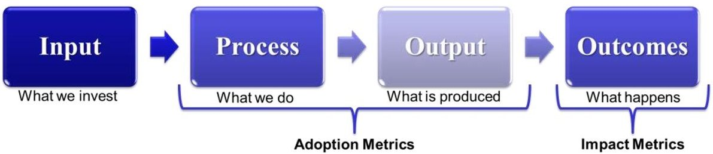

Figure 2. Enterprise Metric Definition Framework.

## ENTERPRISE METRICS CATEGORIZATION

Digital engineering is a subset of the larger aspects of enterprise digital transformation. Gartner $ ^{12} $ reported four common characteristics for good enterprise level digital transformation metrics: adoption, usability,

<!-- PDF_PAGE: 12 -->

productivity, and new value. The metrics categories in parentheses were derived as part of this work and are discussed below.

- Measure people adoption, and enterprise process adoption (adoption)

- Analyze breadth of usability, and issues with usability (user experience)

- Measure productivity indicators (velocity/agility)

- Generate new value to the enterprise (quality and knowledge transfer)

Digital transformation is a change process heavily rooted in workforce and culture, as noted by Goal 5 of the DoD Digital Engineering Strategy. The change process needs to assess both adoption of the methods and tools into the workforce in terms of number of users, resources, etc., and also the drivers of adoption that are linked to user experience with the methods and tools. To understand productivity indicators and areas of new value, the previous SERC study, Enterprise System-of-Systems Model for Digital Thread Enabled Acquisition, was used as the base digital enterprise transformation model. $ ^{13} $ This study linked digital enterprise transformation to outcomes related to improved quality, improved velocity/agility, and better knowledge transfer. Knowledge transfer is a unique value of DE/MBSE that can be distinguished from other digital enterprise transformation metrics, as a primary goal of MBSE and the ASOT is communication, sharing, and management of data, information, and knowledge.

From this background research, we created a general categorization of DE/MBSE organizational change metrics linked to quality, velocity/agility, user experience, knowledge transfer, and adoption, as shown in Figure 3. The types of underlying metrics in Figure 3 are a small sample; the full set will be discussed further in this section. The categorization in Figure 3 is supported by rigorous research detailed in the survey results and framework development sections of the report.

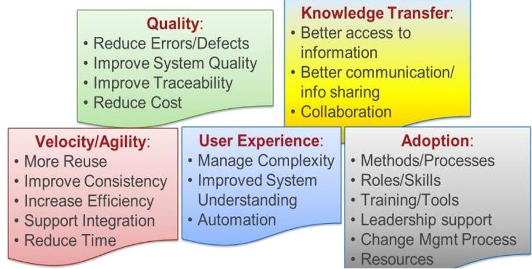

Figure 3. Top-level Metrics Framework.

Figure 4 provides a summary of the top DE benefit areas from the literature review and survey conducted in the research on DE benefits. The figure depicts the percentage of literature review papers or survey respondents citing each benefit area. This was used to define the top metric categories related to benefits of DE. Figure 5 provides a summary of the top enablers, obstacles, and areas of change based on survey data. This was used to derive the top metrics categories related to DE adoption.

<!-- PDF_PAGE: 13 -->

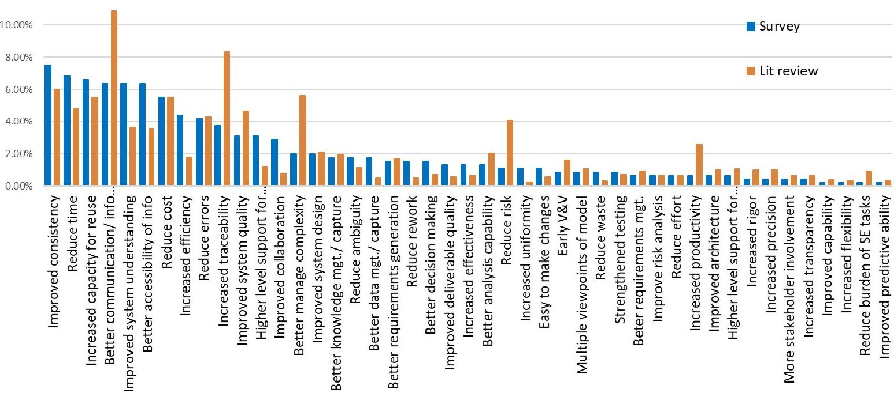

Figure 4. Top Cited DE Benefits Areas from Literature and Survey Results.

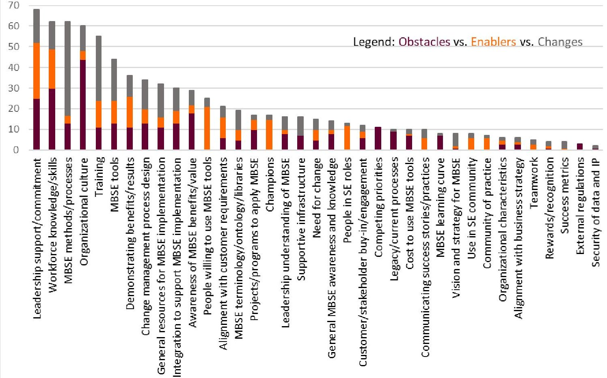

Figure 5. Obstacles, Enablers, and Changes for DE Adoption, ranked by Frequency of Mention.

<!-- PDF_PAGE: 14 -->

Table 1 provides a descriptive summary of the candidate metrics derived from the benefit categories in Figure 4 and the adoption categories in Figure 5. These are grouped into the five metrics areas of Figure 3. Note that not all of the benefits and adoption categories of Figures 4 and 5 are represented in the table, as some are not amenable to measurement or are aggregates of other categories. The table includes example descriptive phrases of each metrics categories developed in textual analysis of the literature and survey data. The table also lists examples of potential outcome metrics for metrics category. The numbers in parentheses provide a numerical ranking of the top-25 metrics categories related to DE/MBSE benefits, and the top-5 metrics categories related to enterprise adoption. However, all of the metrics categories derived as part of this research (55 total) are listed. The table is organized in order of importance based on the literature review and survey data. Quality, Agility/Velocity, User Experience, and Knowledge Transfer metrics categories are ranked together in the table; these together can be classified as DE/MBSE benefits. The metrics categories associated with Adoption are ranked separately as these provide the enabling environment for achievement of MBSE benefits.

Table 1. Descriptive summary of top cited metrics areas.

<table border="1"><tr><td>Metrics Category</td><td>Example descriptive phrases</td><td>Example outcome metrics</td></tr><tr><td colspan="3">Metric Area: Quality</td></tr><tr><td>Increased traceability(2)</td><td>requirements/ design/ information traceability</td><td>Fully digital traceability of requirements, design, test, and information; available from one source of truth</td></tr><tr><td>Reduce cost(9)</td><td>cost effective, cost savings, save money, optimize cost</td><td>Lower total cost compared to similar previous work</td></tr><tr><td>Improve system quality(11)</td><td>higher quality, quality of design, increased system quality, first time quality, improve SE quality, improve specification quality</td><td>Improved total quality(roll-up of quality measures), Improved first time quality(deployment success)</td></tr><tr><td>Reduce risk(12)</td><td>reduce development risk, reduce project risk, lower risk, reduce technology risk, reduced programmatic risk, mitigate risk, reduce design risk, reduce schedule risk, reduce risk in early design decisions</td><td>Risks are identified and risk mitigations are executed via DE enterprise processes. System modeling uncovers new risks</td></tr><tr><td>Reduce defects/errors(13)</td><td>reduce error rate, earlier error detection, reduction of failure corrections, limit human errors, early detection of issues, detect defects earlier, early detection of errors and omissions, reduced specification defects, reduce defects, remove human sources of errors, reduce requirements defects</td><td>Reduced total errors/defects in each program phase, reduce errors/defects that escape from one phase to the next, increased number of saves in each phase</td></tr><tr><td>Improved system design(17)</td><td>improved design completeness, design process, design integrity, design accuracy, streamline design process, system design maturity, design performance, better design outcomes, clarity of design</td><td>Design outcomes show improvement over similar programs,the design process is more effective compared to similar programs(rollup measure)</td></tr></table>

<!-- PDF_PAGE: 15 -->

<table border="1"><tr><td>Metrics Category</td><td>Example descriptive phrases</td><td>Example outcome metrics</td></tr><tr><td>Better requirements generation(20)</td><td>requirements definition, streamlining process of requirements generation, requirements elicitation, well-defined set of requirements, multiple methods for requirements characterization, more explicit requirements, improved requirements</td><td>Measurement of requirements quality factors in the DE process: correctness, completeness, clarity, non-ambiguity, testability, etc.</td></tr><tr><td>Improved deliverable quality(24)</td><td>improve product quality, better engineering products</td><td>Reduced deliverable defects, deliverables acceptance rate</td></tr><tr><td>Increased effectiveness(25)</td><td>effectively perform SE work, improved representation effectiveness, increased effectiveness of model, more effective processes</td><td>Effectiveness of a process is how relevant the output is to the desired objective</td></tr><tr><td>Improved risk analysis</td><td>earlier/ improved risk identification, identify risk</td><td>Risks identified at what phase</td></tr><tr><td>Better analysis capability</td><td>better analysis of system, tradespace analytics, perform tradeoffs and comparisons between alternative designs, simulation</td><td>Decisions that balance cost, schedule, risk, performance, &amp; capabilities; affordability; efficiency &amp; effectiveness of tradespace processes</td></tr><tr><td>Strengthened testing</td><td>model based test and evaluation, increased testability, improved developmental testing</td><td>Test coverage; automated tests; number of defects/ errors in each phase; number of errors found by automation versus manual means; efficiency &amp; effectiveness of test process</td></tr><tr><td>Increased rigor/Improved predictive ability</td><td>rigorous model, rigorous formalisms, more rigorous data, better predict behavior of system, predict dynamic behavior, predictive analytics</td><td>Level of difficulty/ complexity of project; number of alternatives analyzed; exhaustiveness of data collection; consistency of analysis processes; subject matter experts involved; predictive links between design &amp; capabilities</td></tr><tr><td>More stakeholder involvement</td><td>easy way to present view of system to stakeholders, better engage stakeholders, quick answers to stakeholder&#x27;s questions, share knowledge of system with stakeholders, stakeholder engagement, satisfy stakeholder needs</td><td>Process efficiency &amp; effectiveness for stakeholder involvement in modeling; number of stakeholders contributing; stakeholder access to tools, models, data</td></tr><tr><td colspan="3">Metric Area: Velocity/Agility</td></tr><tr><td>Improved consistency(3)</td><td>consistency of info, consistency of model, mitigate inconsistencies, consistent documentation, project activities consistent, data consistency, consistent between system artifacts</td><td>Processes produce consistent results from project to project; data or models from one project have consistent use in another; practitioners apply consistent work processes &amp; instructions</td></tr></table>

<!-- PDF_PAGE: 16 -->

<table border="1"><tr><td>Metrics Category</td><td>Example descriptive phrases</td><td>Example outcome metrics</td></tr><tr><td>Reduce time(4)</td><td>shorter design cycles, time savings, faster time to market, ability to meet schedule, reduce development time, time to search for info reduced, reduce product cycle time, delays reduced</td><td>Time reduction trend data: total project schedule; average across projects; total &amp; average per activity; response time to need; delays from plan</td></tr><tr><td>Increased capacity for reuse(5)</td><td>reusability of models, reuse of info/ designs</td><td>Models/datasets reused project to project; percent direct use/ modification/ change; related cost/ schedule estimation &amp; actuals</td></tr><tr><td>Increased efficiency(10)</td><td>efficient system development, higher design efficiency, more efficient product development process</td><td>Process time, resources per unit output, waste, flow</td></tr><tr><td>Increased productivity(15)</td><td>gains in productivity</td><td>Effort per unit of production</td></tr><tr><td>Reduce rework(21)</td><td>reduce rework</td><td>Number of rework cycles, percent rework, errors causing rework, size of rework effort, reduce technical debt</td></tr><tr><td>Early V&amp;V(22)</td><td>early verification and/or validation</td><td>Formal testing credited in earlier phases; formal testing done in models and simulation versus system</td></tr><tr><td>Reduce ambiguity</td><td>less ambiguous system representation, clarity, streamline content, unambiguous</td><td>Higher levels of specificity; decisions based on data; application of uncertainty quantification methods</td></tr><tr><td>Increased uniformity</td><td>uniformity</td><td>Application of standards: technical standards, process standards, work &amp; effort standards, etc.</td></tr><tr><td>Easy to make changes</td><td>easier to make design changes, increased agility in making changes, changes automatically across all items, increased changeability</td><td>Ability to implement changes, change management process automation</td></tr><tr><td>Reduce waste</td><td>reduce waste, save resources</td><td>Lean processes: waste removal and flow(pull)</td></tr><tr><td>Better requirements management</td><td>better meet requirements, provide insight into requirements, requirements explicitly associated with components, coordinate changes to requirements</td><td>Effectiveness of a process is how relevant the output is to the desired objective:# requirements, requirements volatility, requirements satisfaction, etc.</td></tr><tr><td>Higher level of support for integration</td><td>integration of information, providing a foundation to integrate diverse models, system design integration, support for virtual enterprise/ supply chain integration, integration as you go</td><td>Developmental testing credited in earlier phases; testing done in models and simulation versus system; reuse of data &amp; models in integration activities</td></tr><tr><td>Increased precision</td><td>design precision, more precise data, correctness, mitigate redundancies, accuracy</td><td>Six Sigma; reduced standard deviation</td></tr><tr><td>Increased flexibility</td><td>flexibility in design changes, increase flexibility in which design architectures are considered</td><td>Ability to incorporate new requirements in a timely and cost-effective way;sensitivity analysis to change versus a reference</td></tr></table>

<!-- PDF_PAGE: 17 -->

<table border="1"><tr><td>Metrics Category</td><td>Example descriptive phrases</td><td>Example outcome metrics</td></tr><tr><td colspan="3">Metric Area: User Experience</td></tr><tr><td>Improved system understanding(6)</td><td>reduce misunderstanding, common understanding of system, increased understanding between stakeholders, understanding of domain/ behavior/ system design/ requirements, early model understanding, increased readability, better insight of the problem, coherent</td><td>Assessments from activities like technical reviews and change processes, standard models or patterns of SE and domain, common understanding of architecture/abstractions (architectural quality/risk assessment), etc.</td></tr><tr><td>Better manage complexity(8)</td><td>simplify/ reduce complexity, understand/specify complex systems, manage complex information/design</td><td>Data/model integration &amp; management, distribute control, empowerment across data/between disciplines, ability to iterate/experiment</td></tr><tr><td>Higher level support for automation(14)</td><td>automation of design process, automatic generation of system documents, automated model configuration management</td><td>Automated versus manual activities, investment in automation, automation strategy</td></tr><tr><td>Better data management/capture(19)</td><td>representation of data, enhanced ability to capture system design data, manage data</td><td>Data management architecture, automation, reduce technical debt</td></tr><tr><td>Better decision making(23)</td><td>make early decisions, enables effective decision making, make better informed decisions</td><td>Visualizing different levels of specificity; more decisions based on data and analysis, access to and visualization of data</td></tr><tr><td>Reduce burden of SE tasks(25)</td><td>reduce complexity of engineering process</td><td>Reduce time spent on, waiting for SE artifacts</td></tr><tr><td>Reduce effort</td><td>reduce cognitive load, reduction in engineering effort, reduce formal analysis effort, streamline effort of system architecture, reduce work effort, reduce amount of human input in test scoping</td><td>Efficiency of a process is how relevant the output is to the desired objective: effort per unit of production, total effort versus similar programs, effort versus plan</td></tr><tr><td colspan="3">Metric Area: Knowledge Transfer</td></tr><tr><td>Better communication/info sharing(1)</td><td>communication with stakeholders/team/designers/developers/different engineering disciplines, information sharing, knowledge sharing, exchange of information, knowledge transfer</td><td>Processes and tools to share and jointly assess information, opportunities to share knowledge and learn in process around common tools &amp; representations</td></tr><tr><td>Better accessibility of info(7)</td><td>Ease of info availability, single source of truth, centralized/unique/ single source of info, simpler access to info, synthesize info, unified coherent model, one complete model</td><td>Tools that support access to and viewing of data/models, widely shared models, executable models</td></tr><tr><td>Improved collaboration(14)</td><td>simplify collaboration within team</td><td>Tools that support human collaboration around shared data &amp; models</td></tr><tr><td>Better knowledge management/capture(18)</td><td>knowledge capture of process, better information capture, early knowledge capture, more effective knowledge management</td><td>Tools that support wide diversity of information, integration across domains, methods to build and enter knowledge</td></tr></table>

<!-- PDF_PAGE: 18 -->

<table border="1"><tr><td>Metrics Category</td><td>Example descriptive phrases</td><td>Example outcome metrics</td></tr><tr><td>Improved architecture/Multiple viewpoints of model</td><td>help develop unambiguous architecture, rapidly define system architecture, faster architecture maturity, accurate architecture design; shared view of system, more holistic representation of system/ models, dynamically generated system views</td><td>Tools that support intuitive structuring of model views, story-telling, interface management</td></tr><tr><td colspan="3">Metric Area: Adoption (Ranked separately from the other 4 metrics areas)</td></tr><tr><td>Leadership support/Commitment(1)</td><td>Demonstrating commitment and general support for MBSE implementation by senior leaders through communication, actions, and priorities</td><td>Messaging, awareness of DE/MBSE, participation in reviews, performance management incentives, succession planning</td></tr><tr><td>Workforce knowledge/skills(2)</td><td>Developing a workforce having the knowledge, skills, and competencies needed to support MBSE adoption</td><td>Availability and maturity of MBSE competencies, refer to the INCOSE MBSE Capabilities Matrix for a full assessment</td></tr><tr><td>DE/MBSE methods and processes(3)</td><td>Developing and deploying consistent, systematic, and documented processes for MBSE throughout the relevant parts of the organization, including steps/phases, outputs, and roles/responsibilities</td><td>Availability and maturity of MBSE capabilities, refer to the INCOSE MBSE Capabilities Matrix for a full assessment</td></tr><tr><td>Training(4)</td><td>Investing in and providing the education/training required to develop the workforce knowledge/skills needed to support MBSE implementation</td><td>Appropriately trained &amp; experienced workforce, customer</td></tr><tr><td>DE/MBSE Tools(5)</td><td>Ensuring MBSE tools have sufficient quality, have sufficient maturity, are available, and are common</td><td>Availability of tools, investment in tools, experience with tools, stability of tools</td></tr><tr><td>Demonstrating benefits/results</td><td>Creating&quot;quick wins&quot; to demonstrate results (benefits and outcomes) from applying MBSE</td><td>DE/MBSE growth strategy, pilot efforts, publications, lessons learned</td></tr><tr><td>Change management process design</td><td>Defining and implementing a systematic change approach to implement MBSE, with clear actions, timeline, roles, resources needed, staged deployment steps/phases for experimentation (where relevant), and outcomes expected</td><td>Vision, mission, change strategy, engagement plan, feedback plan, etc.</td></tr><tr><td>General resources for DE/MBSE implementation</td><td>Ensuring financial and other resources are available to support MBSE implementation</td><td>Funding, IT support, training support, Internal R&amp;D. etc.</td></tr><tr><td>People willing to use DE/MBSE tools</td><td>People in SE roles across organization being willing and motivated to use MBSE tools</td><td>Models and modeling tools output communication media to all of the general users in a form they are comfortable with</td></tr><tr><td>Alignment with customer requirements</td><td>Identifying how MBSE adoption supports meeting customer needs and requirements</td><td>Customer engagement plan, customer requirements elicitation, involvement of customer, participation with customer</td></tr></table>

<!-- PDF_PAGE: 19 -->

<table border="1"><tr><td>Metrics Category</td><td>Example descriptive phrases</td><td>Example outcome metrics</td></tr><tr><td>MBSE terminology/ontology/ libraries</td><td>Clearly identifying a common terminology, ontology, and libraries to support MBSE adoption.</td><td>Investment in enterprise data development and management, shared libraries, stability of data definition and stores</td></tr><tr><td>Champions</td><td>Defining and creating the role of champion to advocate for and, using their expertise, to encourage others to use MBSE</td><td>Role of evangelist, number of evangelists, leadership support</td></tr><tr><td>People in SE roles</td><td>Quality of and support from people holding SE roles across the organization</td><td>Role definition and development plan integrating SE and DE, scope of SE teams/organization, etc.</td></tr><tr><td>Communities of Practice</td><td>Creating a community of practice within the organization to provide guidance, expertise, and other resources as MBSE is deployed</td><td>Investment in CoP, number of participants</td></tr></table>

Table 1 is a comprehensive list of potential metrics categories at different levels of project, process, and enterprise. The research team further reviewed the previous content of SERC Project RT-182 which interviewed 25 individuals across 15 visits to DoD acquisition communities. In addition, we conducted direct discussion with several DoD program offices, discussions with a set of defense industrials, and one workshop with a set of non-defense industrials. These interactions highlighted a subset of key metrics that might be considered a starting place for implementation. Table 2 below shows sample metric designs for this subset, specific to DE/MBSE implementation. Table uses the enterprise metric definition framework referred to previously in Figure 2.

Table 2. Example enterprise metric definitions

<table border="1"><tr><td>Metric Area</td><td>Metrics Category</td><td>Inputs</td><td>Ex. Processes</td><td>Ex. Outputs</td><td>Outcomes</td></tr><tr><td rowspan="2">Quality</td><td>Increased traceability</td><td>User needs and system requirements are in a modeling tool and linked to truth data &amp; models</td><td>MBSE: reqs., structure, use cases, traceability toolsASOT: all reqs. at each level are linked data</td><td>Decreasing number of requirements changes, improving requirement volatility trends</td><td>Fully digital traceability of requirements, design, test, and information; available from one source of truth</td></tr><tr><td>Reduce defects/errors</td><td>Data, models, requirements, design artifacts</td><td>Peer review and technical review in models, design automation, test automation</td><td>Defects/errors discovered and corrected earlier in development phases, less total defects/errors, error-free deployments</td><td>Reduced total errors/defects in each program phase, reduce errors/defects that escape from one phase to the next, increased number of saves in each phase</td></tr></table>

<!-- PDF_PAGE: 20 -->

<table border="1"><tr><td>Metric Area</td><td>Metrics Category</td><td>Inputs</td><td>Ex. Processes</td><td>Ex. Outputs</td><td>Outcomes</td></tr><tr><td rowspan="3">Velocity/Agility</td><td>Reduce time</td><td>Historical estimated effort, planned effort, resourced schedules, milestone schedules</td><td>Estimation processes: COCOMO, COSYSMO, etc. Schedule tracking or EVMS.</td><td>Program schedule durations are trending toward reduced total or activity times</td><td>Time reduction trend data: total project schedule; average across projects; total &amp; average per activity; response time to need; delays from plan</td></tr><tr><td>Improved consistency</td><td>Planning schedules &amp; resource loading, prioritization of needs, development &amp; delivery processes, stable resources</td><td>Move to more regular &amp; frequent development and implementation planning periods</td><td>More predictable scope and cycle time for capability releases; more consistent content &amp; schedule for production deployments</td><td>Processes produce consistent results from project to project; data or models from one project have consistent use in another; practitioners apply consistent work processes &amp; instructions</td></tr><tr><td>Increased capacity for reuse</td><td>Standards, data, models, search tools, CM tools, certifications, data/ model managers</td><td>Data &amp; functional modeling, curation, patterns, standards, CM, compliance testing</td><td>Pay once for data, reuse everywhere, standard reusable capabilities or sub-functions), compliance</td><td>Models/datasets reused project to project; percent direct use/ modification/ change; related cost/ schedule estimation &amp; actuals</td></tr><tr><td>User Experience</td><td>Higher level support for automation</td><td>Investment resources for automation, data collection, automation tools</td><td>Automated document generation, automated test, automated data search, etc.</td><td>New processes, reduced labor hours, reduced time</td><td>Automated versus manual activities, investment in automation, automation strategy</td></tr><tr><td>Knowledge Transfer</td><td>Better communication/info sharing</td><td>Investment resources for collaboration &amp; communication tools, IT infrastructure, data &amp; libraries</td><td>Teams interacting around shared data, participation in model-based reviews, data/model desktop availability</td><td>Number of employees, disciplines communicating &amp; sharing information, number of events held in the toolsets</td><td>Processes and tools to share and jointly assess information, opportunities to share knowledge and learn in process around common tools &amp; representations</td></tr></table>

<!-- PDF_PAGE: 21 -->

<table border="1"><tr><td>Metric Area</td><td>Metrics Category</td><td>Inputs</td><td>Ex. Processes</td><td>Ex. Outputs</td><td>Outcomes</td></tr><tr><td rowspan="3">Adoption</td><td>DE/MBSE methods and processes</td><td>Enterprise strategy and investment, experience with DE/MBSE</td><td>Periodic assessment via survey and scoring</td><td>Attainment of “level 4” capabilities</td><td>Availability and maturity of MBSE capabilities, refer to the INCOSE MBSE Capabilities Matrix14 for a full assessment</td></tr><tr><td>Training</td><td>Curricula, classes, mentoring, assessment</td><td>Training, learning management</td><td>Availability of training, investment in training, number trained, effectiveness of training</td><td>Appropriately trained &amp; experienced workforce, customer</td></tr><tr><td>People willing to use DE/MBSE tools</td><td>Vision/mission, leadership support, incentives, tools, methods/processes, training</td><td>Change management</td><td>Number of people actively using the tools, tool experts, number of people actively working with tool artifacts</td><td>Models &amp; tools output communication media to all general users in a form they are comfortable with</td></tr></table>

As can be seen from Tables 1 and 2, measurement of DE/MBSE can be a complex process that must be integrated with the entirety of enterprise measurement strategies across all enterprise function. DE/MBSE cannot be isolated to a small group or limited set of programs if one wants to understand and track enterprise value. Generally pilot efforts are recommended to start the adoption process, but maturity in DE/MBSE must become enterprise strategy and a component of enterprise performance measurement.

## RECOMMENDATIONS FOR METRICS IMPLEMENTATION

DE/MBSE is recommended to be part of an overall digital transformation. DE is part of a broader DoD wide SE transformation strategy to prioritize speed of delivery, continuous adaptation, and frequent modular upgrades $ ^{15} $ . Discussions with DoD program offices identified five integrated implementation strategies for overall SE transformation: DE/MBSE, Agile/DevOps methods, modular open systems approaches (MOSA), extended use of modeling & simulation at all program phases, and increased engineering rigor through design space exploration $ ^{16} $ . There is implied an underlying transformation of DoD acquisition workforce and culture away from document-based processes toward more integrated model-driven artifacts, and away from large waterfall-driven acquisition strategies toward more agile incremental capability developments.

<!-- PDF_PAGE: 22 -->

To be successful, the SE transformation must be integrated across all five SE transformation areas. Two major transformations will significantly change the DoD acquisition approach: elimination of standalone documents toward "everything in the model," and a shift in capability planning to continuous development and deployment approaches. In the long-term, these two transformations will have a significant impact on everything from acquisition workforce and culture to how programs are funded.

In discussions with DoD program offices, we found a link between DE/MBSE implementation and incorporation of Agile software development and DevOps-based deployment strategies. Reducing cycle time and increasing consistency in ability to successfully deploy capabilities provides an overarching measurement theme. DE/MBSE has the opportunity to significantly reduce waste in development and deployment processes via data all stakeholders continuously work from the same set of data and gradually increase the levels of automation in data-driven processes. As with the DevOps transformation in the software and information technology communities, automation will become a primary input measure and predictability and consistency of product deployments will be a central outcome measure.

The next section provides a case study on a Navy pilot effort that prototyped the "everything in the model" strategy. This case study provided an excellent opportunity to link the Navy program lessons learned to the metrics categories in our framework. The section provides a good narrative description of how project performance could be measured, but as we repeatedly found, actual formal identification of metrics capture of measurement data is still very immature.

Leading indicators point toward possible future trends or patterns, while lagging indicators address patterns that are in progress. The performance measurement literature and performance excellence frameworks such as the Baldrige CPE, prescribe that any organization should have a balanced set of metrics in order to define and test hypothesized causal relationships between metrics, such as between leading and lagging indicators - this provides a means to more proactively manage and create desired performance outcomes. Thus, an effective way to manage performance of programs as they undergo SE transformation is to merge the insights from backward-looking indicators (i.e., lagging indicators) with more forward-looking insights and predictions (i.e., leading indicators). For example, "reduce errors and defects" is an important metric of DE success. Number of defects and defect discovery/correction are lagging indicators. Movement of defect discovery from later to earlier phases of development is a leading indicator. Likewise, in the Agile community, automation is a leading indicator for predictability and consistency. However, at this point of maturity DE/MBSE adoption should be a primary leading metrics focus.

## 3. APPLICATION OF DE METRICS

As part of the research, the team completed an example linking the DE benefits framework and associated metrics to a DoD pilot effort. This research leveraged another ongoing SERC project, Model Centric Engineering, and specifically looked at mapping the framework to experience on the Navy Surrogate Pilot effort.

## INTRODUCTION

This section discusses an analysis to correlate DE benefit categories with lessons learned benefits observed during the NAVAIR Surrogate Pilot that applied DE methods and tools using an ASOT by creating models for everything to demonstrate the art-of-the-possible. The analysis discussed herein performed a

<!-- PDF_PAGE: 23 -->

correlated rating from 17 lesson learned categories to 22 DE benefit areas grouped into the five metrics areas (quality, agility/velocity, user experience, knowledge transfer, and adoption). This section provides a narrative derived from the correlated analysis on the benefits observed in the NAVAIR Surrogate Pilot as it supports the benefit areas.

The NAVAIR Systems Engineering Transformation (SET) under SERC Research Tasks RT-157/170/195 and WRT-1008 has focused on applying DE methods & tools in a collaborative DE environment to demonstrate a new operational paradigm for government and industry based on a SET Framework defined by leadership at the Naval Air Systems Command's (NAVAIR). This section discusses a correlated rationalization of the derived DE/MBSE benefit categories in the context of lessons learned, benefits, and recommended DE practices from the NAVAIR Surrogate Pilot project, which is documented in the SERC RT-195 Technical Report $ ^{17} $ . This section includes a summary of the analysis and approach, but more importantly provides a narrative of what happened during the pilot efforts that attempted to "model everything" in order to demonstrate the art-of-the-possible. The correlated analysis uses a rating system to correlate the strength of each key lessons learned benefit against the benefit categories. We used the lessons learned in this analysis, because they directly rely on DE practices, methods, models and tools that should enable efficiencies and contribute to productivity. The DE approach integrated methods and tools with enabling technologies: Collaborative DE Environment (DEE) supporting an ASOT not just for the Government but also for the contractor. It also required the use of DEE technology features (e.g., Project Usage [model imports], DocGen, View Editor, Digital Signoffs) and methods to accomplish those lessons learned. The efforts demonstrated a means for a new operational paradigm to work directly and continuously in a collaborative DEE to transform, for example, how Contract Data Requirement List (CDRLs) can be subsumed into the modeling process using Digital Signoff directly in the model that is accessed through a collaborative DEE.

## BACKGROUND - NAVAIR SURROGATE PILOT FOR SE TRANSFORMATION

In 2013, NAVAIR initiated research into a Vision held by NAVAIR's leadership to assess the technical feasibility of a radical transformation through a more holistic Model-Centric Engineering (MCE) approach. The expected capability of such an approach would enable mission-based analysis and engineering that reduces the typical time by at least 25 percent from what was achieved at that time for large-scale air vehicle systems using a traditional document-centric approach. The research need included the evaluation of emerging system design through computer (i.e., digital) models, which has been extended to factor in mission engineering to consider ever evolving threats $ ^{18} $ .

An evolving set of SERC research tasks RT-48/118/141/157/170/195 informed us, our sponsor, and DoD leadership that MCE is in use and adoption seems to be accelerating. The overarching timeline from the start of the research until today is:

- 2013-2015: Global scan of most holistic approaches to MCE/DE $ ^{19} $

<!-- PDF_PAGE: 24 -->

- 2015: NAVAIR leadership decides to move quickly to keep pace with other organizations that have adopted MCE by transforming, not simply evolving, in order to perform effective oversight of primes that are using modern modeling methods for mission and system engineering $ ^{20} $

- 2016: NAVAIR leadership decides to accelerate the Systems Engineering Transformation (SET) based on a new SET Framework concept $ ^{21} $

- 2017: Systematic planning develops six Functional Areas, including SERC Research $ ^{22} $

- 2018: Phase 1 of Surrogate Pilot experiments complete with mission, systems and a model for the Request for Proposal (RFP) Response from Surrogate Contractor for Surrogate Pilot experiments resulting in: $ ^{23} $

Characterized SET Framework approach to Model-based Acquisition

Provides an implementation and examples usages for an ASOT

Demonstrated art-of-the-possible doing "everything" in models using new operational paradigm between government and industry in a Collaborative ASOT

Surrogate contractor RFP response refines mission and system models with detailed design and analysis information using multi-physics and discipline-specific models

Digital Signoffs for source selection evaluation directly in RFP response model

- Phase 1 results and models provide evidence/examples of unclassified models to support workforce development and training

- 2019: Phase 2 objectives align surrogate pilot experiments with SET priorities

Align System models with NAVAIR Systems Engineering Method (NAVSEM)

Align Mission model with Integrated Capability Framework Mission Engineering schemas

Investigations to transform Contract Data Requirements Lists (CDRLs) and Data Item Descriptions (DIDs) and use Digital Signoffs in ASOT

Create models of unclassified examples for training and workforce development

Refine Model-Centric SOW language

- Investigate how to perform Airworthiness modeling for deep-dive in Surrogate Design (including competency-specific criteria)

Investigate Capability Based Test & Evaluation and Model-Based Testing Engineering modeling methods for Mission and System models

The SET team developed the plan for rolling-out SET to NAVAIR, which defined six major Functional Areas as represented in Figure 6 that includes:

- SET Research (conducted by the SERC, and discussed in this report)

$ ^{20} $ Blackburn, M. R., M. A. Bone, G. Witus, Transforming System Engineering through Model-Centric Engineering, System Engineering Research Center, Research Task 141, Technical Report SERC-2015- TR-109, November 18, 2015.

$ ^{21} $ Blackburn, M., R., R. Blake, M. Bone, D. Henry, P. Grogan, S. Hoffenson, R. Peak, S. Edwards, M. Austin, L. Petgna, Transforming Systems Engineering through Model-Centric Engineering, Research Task 157, SERC-2017-TR-101, January 2017.

22 Blackburn, M., R., M. A. Bone, J. Dzielski, P. Grogan, R. Giffin, R. Hathaway, D. Henry, S. Hoffenson, B. Kruse, R. Peak, S. Edwards, A. Baker, M. Ballard, M. Austin, M. Coelho, L. Petnga, Transforming Systems Engineering through Model-Centric Engineering, Final Technical Report SERC-2018-TR-103, RT-170 (NAVAIR), February 28, 2018.

[1] Blackburn, M., R., D. Verma, R. Giffin, R. Blake, M. A. Bone, A. Dawson, R. Dove, J. Dzielski, P. Grogan, S. Hoffenson, E. Hole, R. Jones, B. Kruse, K. Pochiraju, C. Snyder, B. Chell, K. Batra, L. Ballarinni, I. Grosse, T. Hagedorn, R. Dillon-Merrill, Transforming Systems Engineering through Model-Centric Engineering, Final Technical Report SERC-2017-TR-110, RT-168 (ARDEC), Phase II, August 8, 2018.

<!-- PDF_PAGE: 25 -->

- Workforce & Culture

- Integrated Modeling Environment

- Process & Methods

- Policy, Contracts and Legal

- SET Enterprise Deployment (and Surrogate Pilot Experiments)

NAVAIR leadership decided to conduct multi-phase surrogate pilot experiments using different use cases to simulate the execution of the new SET Framework, shown in Figure 7 as part of the SET Enterprise Deployment. The broader impacts of this research to the other sub functions of SET is also reflected by the dashed boxes. This research provides analyses into NAVAIR enterprise capability and builds on efforts for cross-domain model integration, model integrity, ontologies, semantic web technologies, multi-physics modeling, and model visualization that extend research addressing evolving needs and priorities of SET.

The Surrogate Pilot Experiments provide examples demonstrating the art-of-the-possible for many of the cross-cutting objectives of DE; this includes integrating different model types with simulations, surrogates, systems and components at different levels of abstraction and fidelity and provide an enduring ASOT across disciplines throughout the lifecycle. The surrogate experiments have "modeled everything" in order to show that the concept was possible. The team demonstrated the feasibility of using modeling methods at the mission and systems levels, and also demonstrated using models for the request for proposal (RFP), statement of work, and source selection technical evaluation. The Phase 1 surrogate contractor RFP response models link to the government mission and system models. The surrogate contractor RFP response models includes multi-physics analyses and early design models that illustrate the potential to have deep insight into the design of a proposed air vehicle system prior to contract award. The use of digital signoff directly in the model provides evidence of a new approach for transforming traditional CDRLs, documenting and linking digital signoffs directly in the models.

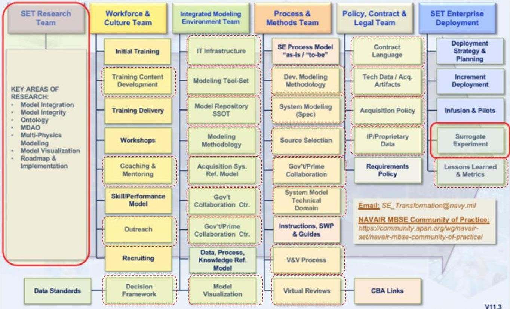

Figure 6. SET Functional Areas with Impacts on SET Research and Surrogate Pilot

<!-- PDF_PAGE: 26 -->

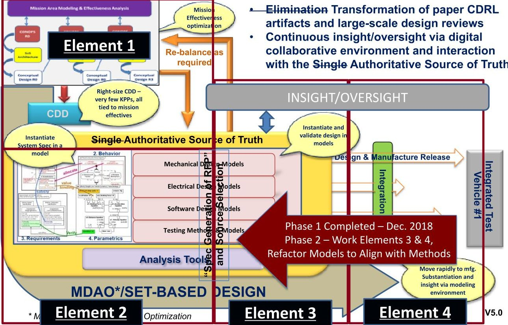

NAVAIR Public Release 2017-370. Distribution Statement A - "Approved for public release; distribution is unlimited"

Figure 7. NAVAIR Systems Engineering Transformation Framework $ ^{2 4} $

The Phase 2 efforts are updating an experimental UAV system called Skyzer, from Phase 1, for a deep dive on search and rescue mission operational scenarios and extending the mission to include a Launch and Recovery, ship-based capability to support experiments for Capability-Based Test and Evaluation (CBT&E). The Skyzer system model is being extended with a landing gear deep dive to bring in Airworthiness use cases. Phase 1 with knowledge gained during Phase 2 of these surrogate pilot experiments produced:

- Surrogate Project/Planning Model that characterizes the objectives for the surrogate pilot and research

- Systems Engineering Technical and Management Plan model

- Surrogate Mission Model for Skyzer UAV and ship-based Launch and Recovery system

- Surrogate System Model for Skyzer aligning with current state of NAVAIR Systems Engineering Method (NAVSEM)

- Surrogate Capability-Based Test & Evaluation model for Mission-Based Test Design

- Surrogate Contractor System RFP model for Skyzer

- Surrogate Contractor Design models for Skyzer to include:

Design models address aspects of multi-physics analysis and design

- Links disciplines-specific design back to Surrogate Contractor system, which traces back to Government Skyzer System and Mission models

View and Viewpoints for DocGen and other Libraries

Used in conjunction with DocGen to generate the specifications from the models based on stakeholder views

- Collaboration Environment for the ASOT

<!-- PDF_PAGE: 27 -->

The focus has been on creating models of unclassified examples for training and workforce development and demonstrating a new operational paradigm between government and industry in the execution the SET Framework. Many of the detailed facets from the surrogate pilot experiments are discussed in this report and are shared on the All Partners Network (APAN) to socialize these new operational concepts, and to solicit feedback from industry, government and academia. This includes models, presentation, reports, videos, and links to the surrogate pilot autogenerated models at the SERC Integrated Modeling Environment hosted on Amazon Web Services.

## QUANTITATIVE ANALYSIS

The analysis approach used to correlate lessons learned from the NAVAIR surrogate pilots to the DE/MBSE metrics categories is shown in Figure 8.

<table border="1"><tr><td rowspan="2"></td><td colspan="5">Quality</td><td colspan="5">Velocity/Agility</td><td colspan="3">User Experience</td><td colspan="3">Knowledge</td><td colspan="5">Other</td><td rowspan="2">Total</td></tr><tr><td>Reduce Errors/Defects</td><td>Increased Traceability</td><td>Improve System Quality</td><td>Reduce Risk</td><td>Increased Rigor</td><td>Reduce Cost</td><td>Improved Consistency</td><td>Increased Capacity for Reuse</td><td>Increased Efficiency</td><td>Increased Effectiveness</td><td>Comm/Info Sharing</td><td>Early V&amp;V</td><td>Reduce Time</td><td>Support for Automation</td><td>Reduce SE Task Burden</td><td>Manage Complexity</td><td>Increased Productivity</td><td>Imp. System Understanding</td><td>Better Access. of Info.</td><td>Better Knowledge Capture</td><td>Imp. System Design</td><td>Alignment w/Customer</td><td>Support/Commitment</td><td>DE/MBSE methods&amp;proc.</td><td>DE/MBSE Tools</td><td>Workforce Development</td></tr><tr><td>Total</td><td>58</td><td>108</td><td>87</td><td>80</td><td>95</td><td>62</td><td>117</td><td>77</td><td>91</td><td>99</td><td>111</td><td>51</td><td>60</td><td>111</td><td>59</td><td>71</td><td>91</td><td>76</td><td>101</td><td>90</td><td>79</td><td>84</td><td>62</td><td>93</td><td>116</td><td>77</td><td></td></tr><tr><td>Identify objectives for each phase of the pilot</td><td></td><td></td><td></td><td>5</td><td>5</td><td></td><td>5</td><td>5</td><td>5</td><td>5</td><td>5</td><td></td><td></td><td>5</td><td>3</td><td>9</td><td>5</td><td>3</td><td>9</td><td>9</td><td>3</td><td>9</td><td>9</td><td>5</td><td>5</td><td></td><td>109</td></tr><tr><td>Manage Versions for Tools Used to Support Migration to New Toolsets</td><td>3</td><td>3</td><td>4</td><td></td><td>3</td><td>3</td><td>9</td><td>3</td><td>5</td><td>5</td><td>5</td><td>3</td><td>5</td><td>9</td><td>3</td><td>3</td><td>5</td><td></td><td>3</td><td></td><td></td><td>5</td><td>5</td><td>5</td><td>9</td><td>3</td><td>101</td></tr><tr><td>Establish infrastructures for IME tools and AST as early as possible</td><td>3</td><td>9</td><td>9</td><td>5</td><td>5</td><td>3</td><td>9</td><td>5</td><td>5</td><td>5</td><td>9</td><td>5</td><td>5</td><td>9</td><td>5</td><td>5</td><td>9</td><td>5</td><td>9</td><td>3</td><td>9</td><td>5</td><td>5</td><td>3</td><td>9</td><td></td><td>153</td></tr><tr><td>Technically feasible to develop everything as a model</td><td>5</td><td>9</td><td>9</td><td>5</td><td>9</td><td>3</td><td>9</td><td>5</td><td>5</td><td>5</td><td>9</td><td>3</td><td>5</td><td>9</td><td>5</td><td>5</td><td>5</td><td>9</td><td>9</td><td>5</td><td>9</td><td>3</td><td>3</td><td>5</td><td>9</td><td>3</td><td>160</td></tr><tr><td>Establish model management practices early</td><td>3</td><td>5</td><td>5</td><td>3</td><td>5</td><td>5</td><td>9</td><td>5</td><td>5</td><td>5</td><td>3</td><td>3</td><td>3</td><td>3</td><td>3</td><td>5</td><td>5</td><td>5</td><td>5</td><td>3</td><td>5</td><td>9</td><td>5</td><td>9</td><td>9</td><td>5</td><td>130</td></tr><tr><td>Project Usages for Model Modularization</td><td>3</td><td>9</td><td>5</td><td>5</td><td>9</td><td>3</td><td>5</td><td>5</td><td>5</td><td>3</td><td>9</td><td>3</td><td></td><td>5</td><td></td><td>5</td><td>5</td><td>5</td><td>5</td><td>5</td><td>5</td><td>3</td><td></td><td>5</td><td>9</td><td>3</td><td>119</td></tr><tr><td>Create View and Viewpoints to provide stakeholder relevant views and leverage Viewpoint libraries</td><td>5</td><td>5</td><td>5</td><td>5</td><td>9</td><td>3</td><td>9</td><td>9</td><td>5</td><td>9</td><td>5</td><td>3</td><td>3</td><td>9</td><td>3</td><td>5</td><td>5</td><td>5</td><td>5</td><td>5</td><td>5</td><td>5</td><td>3</td><td>9</td><td>5</td><td>5</td><td>144</td></tr><tr><td>Use Digital Signoffs as a means for evolving from CDRLs</td><td>5</td><td>9</td><td>3</td><td>5</td><td>5</td><td>9</td><td>9</td><td>5</td><td>9</td><td>9</td><td>5</td><td>5</td><td>5</td><td>9</td><td>5</td><td>3</td><td>5</td><td>3</td><td>5</td><td>5</td><td>3</td><td>5</td><td>5</td><td>5</td><td>5</td><td>5</td><td>146</td></tr><tr><td>Requirement management can be done directly in models</td><td>5</td><td>9</td><td>5</td><td>5</td><td>3</td><td>3</td><td>5</td><td>3</td><td>5</td><td>5</td><td>3</td><td>3</td><td>5</td><td>5</td><td>3</td><td>1</td><td>5</td><td>3</td><td>5</td><td>5</td><td>1</td><td>5</td><td></td><td>5</td><td>5</td><td>3</td><td>105</td></tr><tr><td>Modeling provided a means to simplify SOW with emphasis in providing tool agnostic modeling information</td><td>3</td><td>3</td><td>3</td><td>5</td><td>5</td><td>5</td><td>5</td><td>3</td><td>5</td><td>9</td><td>3</td><td>5</td><td>5</td><td>3</td><td>5</td><td>1</td><td>5</td><td>1</td><td>1</td><td>9</td><td>5</td><td>9</td><td>5</td><td>5</td><td>3</td><td>116</td><td></td></tr><tr><td>MDAO being applied by Surrogate Contractor</td><td>3</td><td>3</td><td>3</td><td>5</td><td>5</td><td>3</td><td>3</td><td>3</td><td>3</td><td>3</td><td>5</td><td>1</td><td>3</td><td>9</td><td>3</td><td>5</td><td>5</td><td>5</td><td>3</td><td>5</td><td>5</td><td></td><td></td><td>5</td><td>3</td><td>5</td><td>96</td></tr><tr><td>Establish and align modeling with methods&amp; guidelines</td><td>5</td><td>9</td><td>9</td><td>5</td><td>5</td><td>5</td><td>9</td><td>5</td><td>5</td><td>9</td><td>5</td><td>5</td><td>5</td><td>5</td><td>3</td><td>3</td><td>5</td><td>5</td><td>5</td><td>5</td><td>9</td><td>5</td><td>3</td><td>9</td><td>5</td><td>9</td><td>154</td></tr><tr><td>Leverage social-media technologies for continuous communication to complement modeling in an AST</td><td>3</td><td>3</td><td>3</td><td>3</td><td>3</td><td>3</td><td>3</td><td>3</td><td>5</td><td>3</td><td>9</td><td>3</td><td>5</td><td>3</td><td>3</td><td>3</td><td>5</td><td>5</td><td>5</td><td>9</td><td>5</td><td>5</td><td>3</td><td>3</td><td>9</td><td>9</td><td>116</td></tr><tr><td>Surrogate Pilot demonstrated a new operational paradigm for collaboration in AST</td><td>3</td><td>9</td><td>5</td><td>5</td><td>9</td><td>3</td><td>9</td><td>3</td><td>5</td><td>5</td><td>9</td><td></td><td>3</td><td>9</td><td>3</td><td>5</td><td>5</td><td>9</td><td>9</td><td>5</td><td>3</td><td>3</td><td>6</td><td>6</td><td>9</td><td>149</td></tr><tr><td>Request for Information (RFI) as models useful to test new operational paradigm</td><td>3</td><td>5</td><td>5</td><td>9</td><td>5</td><td>5</td><td>5</td><td>5</td><td>5</td><td>5</td><td>9</td><td>3</td><td></td><td>5</td><td></td><td>3</td><td>3</td><td>3</td><td>5</td><td>5</td><td></td><td>9</td><td>9</td><td></td><td>5</td><td>5</td><td></td></tr><tr><td>Request for Proposal (RFP) as models is technically feasible (supported using DocGen and providing model as Government Furnished Information)</td><td>3</td><td>9</td><td>9</td><td>5</td><td>5</td><td>3</td><td>5</td><td>5</td><td>5</td><td>9</td><td>3</td><td>5</td><td>5</td><td>5</td><td>5</td><td>5</td><td>9</td><td>5</td><td>9</td><td>3</td><td>5</td><td>3</td><td>3</td><td>5</td><td>9</td><td>142</td></tr><tr><td>Technology enables collaborative capabilities in MCE</td><td>3</td><td>9</td><td>5</td><td>5</td><td>5</td><td>3</td><td>9</td><td>5</td><td>9</td><td>9</td><td>3</td><td>3</td><td>9</td><td>5</td><td>5</td><td>5</td><td>5</td><td>9</td><td>5</td><td>5</td><td>1</td><td>1</td><td>9</td><td>9</td><td>5</td><td>150</td></tr></table>

Figure 8. Correlation Matrix for Lessons Learned and DE/MBSE Benefit Metrics

<!-- PDF_PAGE: 28 -->

The rows list 17 categories of lessons learned derived from the projects and the columns list the metrics category and associated grouping categories: Quality, Velocity/ Agility, User Experience, Knowledge Transfer, and Adoption (listed as "other"). We used a scoring/weight of: blank (0), three (3), five (5), and nine (9), where 9 has a strong relationship from underlying aspects of the lesson learned/benefits to the benefits categories. We created a total weighting across the benefits categories (row 2 has the score for each measure) and similarly for each lesson learned (final column computes score for each lesson learned by row). The highest-ranking DE/MBSE benefit areas across the lessons learned are summarized below. The numbers in the parentheses reflect the rankings from Table 1.

- [Knowledge Transfer] Better Communication/Info Sharing (1)

- [Quality] Increased Traceability (2)

- [Velocity/Agility] Improved Consistency (3)

- [Knowledge Transfer] Better Accessibility of Information (7)

- [User Experience] Higher Level of Support for Automation (14)

- [Adoption] Quality and maturity of DE/MBSE Tools (Adoption #5)

These do align with the highest-ranked metrics categories in the literature review and survey. As this analysis was developed independently of the literature review and survey results, it provides at least one program validation of the rankings listed in Table 1. Of note in this example, which is more advanced than a number of other DoD acquisition pilots, is the focus on automation. Reducing workload via automation is a key aspect of User Experience in DE/MBSE implementation.

Primary lessons learned are:

- It is technically feasible to develop everything as a model

- Must establish and align modeling with methods and guidelines

- Establish infrastructures for IME tools and ASOT as early as possible

- Technology enables collaborative capabilities in model centric engineering

It is important to note the DE/MBSE are tightly coupled to quality of systems engineering methods and processes and workforce capabilities. However, the digital transformation of SE in much more tightly coupled with technology. The quality and maturity of the DE/MBSE tools, particularly integration of the Collaboration Environment and the ASOT is critical. We call this out, because it reflects on the NAVAIR senior leaderships beliefs that we have modeling technologies now as descriptive models (e.g., SysML) that can replace documents and actually provide more information than is typically provided in government document-based specification. We do know that there might be some perception that modeling takes longer, but we also know that the increased rigor leads to reduced errors/defects especially cross-domain, or level-to-level (mission to system), because all of the models are linked together (i.e., increased traceability) using enabling technologies such as Project Usage/imports. We are also able to render and edits these models in a more, "cloud-based" way, as well as being able to improve collaboration and provide better access to information directly in a "cloud-like" way. The models increase rigor using formal standardized languages (MBSE terminology/ontology/libraries) enabling higher level support for automation leading to increased productivity and increased efficiencies; these should result in reduced time. This quantitative analysis is followed by a set of narrative summaries that explain how these benefits relate to the process of a DE/MBSE transformation.

<!-- PDF_PAGE: 29 -->

## NARRATIVE ANALYSIS

The rating process made it apparent that many of the lessons learned are listed because they do exactly what DE should do - integrate several related DE elements/facets: Collaborative DE Environment supporting and ASOT, not just for the Government but also for the contractor. It was also enabled by the use of DEE technologies features (e.g., Project Usage/imports, DocGen, View Editor) and modeling methods to accomplish those lessons learned. It also produced unclassified and NAVAIR relevant examples in models for discussing the results and approaches supporting workforce development. The following are narrative summaries of each of the lessons learned.

## Model Everything in Authoritative Source of Truth

One of the best early decisions in the surrogate pilot experiments was the attempt to "model everything," not because one would normally do that, but to demonstrate the art-of-the-possible. This made everything accessible in the context of descriptive models using the system modeling language SysML. These descriptive models formalize information about the system structure, behaviors and requirement and can completely replace documents as demonstrated during Phase 1. We used OpenMBEE $ ^{25} $ , which provided collaborative access to the government team members as well as industry surrogate contractor. OpenMBEE also provided the DocGen capabilities, which permitted all stakeholders access to the model using a web browser representation of the model. DocGen creates stakeholder-relevant views extracted directly from the modeled information so that some of the SMEs that did not have any SysML model training, nor did they have a SysML authoring tool, were able to easily visualize the information in the OpenMBEE View Editor. The View Editor also allows users to edit or comment on information in the model directly from a web browser. Any edits to the model made in the View Editor can be synchronized back into the model repository with appropriate model management controls for tracking all of the changes.

We also used a modeling modularization method (through Project Usages, i.e., model imports), which facilitated an implementation of our DEE demonstrating the concept of an ASOT. The biggest finding was that modeling everything might eliminate some things done in traditional documents, reducing workload. More importantly, all models were linked together in the ASOT, which has the potential to promote collaboration/information sharing, information access, reduce errors/defects, improved consistency increased traceability, and eliminating some types of work for increased efficiency, because the work was inherently represented in and subsumed by the collaborative ASOT.

## Model using Methods for Needed Purpose

The next critical lesson learned is to establish and align modeling with appropriate methods and guidelines. Methods extend beyond processes and identify the artifacts that should be modeled in order to have sufficient and relevant information to make decisions. For example, descriptive modeling languages should include: structure (decomposition and parts), behavior, interfaces and requirements. A method also defines the types of relationships between the artifacts, which often provides information about cross-domain relationships and dependencies. Technology features that complement methods are the use of View and Viewpoints which are inputs to DocGen. A View and Viewpoint can be used to define the needed model artifacts that are associated with the desired modeling method, which is exactly the approach used on the surrogate pilot. Methods, beyond processes define the required types of artifacts, which again leads to improved consistency, improved system understanding (better understanding of

<!-- PDF_PAGE: 30 -->

the system architecture), increased effectiveness (standardization), as well as a way to more easily assess completeness (improved system design) of the generated "specification."

There are also several types of modeling methods needed for different abstraction levels such as: mission, system, contractor refinement of the system model, subsystem and discipline-specific. There are other types of methods for tradespace analysis such as Multidisciplinary Design Analysis and Optimization (MDAO), as well as model management methods that were demonstrated in the surrogate pilot. We even modeled the Statement of Work (SOW) language and RFP Technical Evaluation criteria for the mission key performance parameters. This is a broad topic that is completely related to improve system quality and improved systems understanding and needed to increase traceability. Standardization of the artifacts as specific types of model element, properties and reasoning lead to higher level of support for automation. We can automate validation rules either in the authoring client or using other approaches such as ontologies and semantic technologies, which permit cross-domain reasoning for better decision-making. In addition, our resulting models provide unclassified examples that are method compliant in collaborative environment for workforce development (training, demonstrating benefits/results).

Model management methods and practices are somewhat different from configuration management of documents, primarily because model management deals with configuration management of objects within a model vs. textual information that can be compared and merged. However, it also relates to some other types of modeling method validation rules, such as: there should only be one object representing a specific element (traced to the design), because we can use that one object in different model views (e.g., diagrams). In addition, if one uses Project Usage (i.e., model imports) that additionally avoids duplicating a representation of some entity in more than one place throughout the models, and fosters increased capacity for reuse and increased traceability.

## Establish Infrastructures for IME Tools and ASOT Early

General resources for DE/MBSE implementation and maturation of DE/MBSE Tools must be committed early. The IME/DEE must be defined and used in a way to establish a collaborative ASOT. Certain methods, as discussed in the previous narrative are necessary as well as having some tool features (e.g., Project Usages/Import, DocGen). Early efforts during Phase 1 made slow progress, until we had the DEE in place for better accessibility of information and collaboration/info sharing. However, it is important to note that tools alone are not enough; one must establish a set of model methods (DE/MBSE methods and processes) that defines the artifacts needed to produce, and View and Viewpoint/DocGen can help with this as well, as discussed in the previous narrative on modeling using methods for needed purpose.

## Technology Enables Collaborative Capabilities in DE

There are evolving technologies that need to be incorporated into the overarching approach. For example, the OpenMBEE approach was an early leader in the creating of DocGen and the Model Management System (MMS); while there are other document generation capabilities in tools, this particular approach seems to be much better than other competitors as reflected by the adoption of tool companies. The DocGen was first created by NASA/JPL to enable non-modeling subject matter experts (SMEs) to interact with the model through generated representations of the models.

Understanding Project Usage, which provide for modeling importing, supporting increased capacity for reuse, but also as an enabler for collaboration/information sharing in an ASOT and increased traceability within the ASOT from mission models, to system models, to contractor descriptive models provided as an

<!-- PDF_PAGE: 31 -->

RFP response that is discipline-specific/domain-specific. Examples are emerging for integration of descriptive models that are leveraging dynamic simulations from the SysML level with one or more discipline-specific/domain-specific engines using semantic technology approaches to tool interoperability $ ^{26} $

## Surrogate Pilot Demonstrated New Operational Paradigm for Collaboration in ASOT

Phase 1 was able to demonstrate an approach to one of the objectives of the SET Framework concept, which is to affect a new operational paradigm for collaborative information sharing in an ASOT for government and industry to better interact in order to increase efficiency during acquisition. We can also confirm that this approach has been socialized with industry a number of times and has resulted in positive responses from industry as well as written in industry-provided RFI responses. The pilot also demonstrated another SET Framework objective to enable asynchronous insight and oversight by the government (alignment with customer requirements); this was accomplished in the ASOT and the use of asynchronous reviews using Digital Signoffs through better accessibility of information. In terms of training and demonstrating benefits/results, the surrogate pilot has been one of the only means for having an open-source and unclassified example where we can talk about all of the things that were accomplished.

## Digital Signoffs for Transforming from Contract Data Requirements List (CDRLs)

Another objective of the SET Framework concept was to eliminate Contract Data Requirements List (CDRLs), which we characterized as "transform." Digital signoffs in the ASOT provided an example for how to transform CDLRs and Data Item Deliverables (DIDs) and support asynchronous reviews enabled by better communication/information sharing. Digital signoffs link criteria often required in a CDRL that is used at different program review points to be linked to model evidence. We determined an approach to use OpenMBEE View and Viewpoints as a means for placing a digital signoff directly with model information that provided the needed evidence, a clear example of reduced time and increased effectiveness. Digital signoffs are model objects that can be updated in the View Editor, with the signoff information (e.g., signoff, risk, approver, comments) added that get pushed back into the model. We also established a basis for automating digital signoff metrics that are automatically calculated in a View and Viewpoint hierarchy.

Digital signoffs for criteria that would normally be requested in CDRL can be placed directly in the model with information that provides evidence supporting the requested criteria. No additional documentation is needed, because it is created in the View and Viewpoint, which means it can also be automatically generated. The Digital Signoffs are templates, and can be tailored to incorporate one or more signoffs, and other information such as Risk of a particular signoff (if it has not been assigned a value) as well as Risk for the value assigned (i.e., certainty into the decision). Finally, if a piece of information associated with the Digital Signoff is changed, the signoff can be automatically transition to a new state.

This capability supports increased traceability for digital signoffs from high-level mission requirements to low-level discipline-specific design constraints as demonstrated in the surrogate pilot. This should reduce cost by transforming/eliminating CDRLs that take on a new form in the model providing increased

<!-- PDF_PAGE: 32 -->

efficiency, improved consistency, support for automation, and standardized DE/MBSE methods and processes.

## View and Viewpoints Provide Stakeholder Relevant Views using Viewpoint Libraries

DocGen using View and Viewpoints is a key enabling capability that provides support for allowing SMEs to understand the modeled information, without needing to know how to use a model authoring client (improved system understanding). Potentially more important is the ability to allow views to explicitly show the needed artifacts (work products) that should be produced through modeling; this can be done independent of the process, but further supports standardization of DE/MBSE methods and processes and compliance with the modeling method. It also provides a way to create different views that are relevant to different stakeholders and provides a way of rendering links to imported models to show views of the ASOT at different abstraction levels (more stakeholder involvement). The direct editing in the View Editor again provides an important DE Competencies capability for people that do not have skills (or tool license) for using model authoring tools (increases the number of people willing to use DE/MBSE tools).

The capability of View and Viewpoints provide the means for generating document-like views directly from model content (support for automation), which provide stakeholder relevant information that can be viewed in web-browser or can be exported into a document in Word or PDF (improved collaboration). The views provide a means for associating Digital Signoff with model views. An empty View and Viewpoint template provides a way to represent what modeling artifacts should be created for a modeling method. This is an important technology to improve consistency of "specifications," through support for automation. This creates increased capacity for reuse of curated Viewpoint libraries, which provides better accessibility of information in a web browser for those stakeholders that may not have access to tools, and it is a capability that provides the digital signoff mechanism.

Request for Proposal (RFP) as Models is Technically Feasible (supported using DocGen and providing model as Government Furnished Information)

This is both a technical and policy approach. Technically, we developed an approach to support the concept that the RFP response that becomes part of the ASOT by linking and increasing traceability of the contract RFP response directly to the government mission and system model that was the basis of the RFP. This again supports new concepts such as digital signoffs by government SMEs directly in a Contractor model. We also demonstrated how to represent the technical Source Selection criteria as a Digital Signoff in the RFP response model. The digital signoffs in the ASOT provided an example for how to transform CDLRs and DIDs and support asynchronous reviews enabling increased collaboration and better communication/ information sharing.

## 4. LITERATURE REVIEW ON DE/MBSE BENEFITS

This section presents the results of a literature review conducted to assess the benefits of DE and MBSE.

<!-- PDF_PAGE: 33 -->

## 1. METHODOLOGY

A systematic review process of selected systems engineering archival journals and conference proceedings was performed. The process consisted of eight steps [adapted from Denyard and Tranfield] $ ^{27} $ - (1) Formulation of research questions, (2) Selection of data sources, (3) Literature search, (4) Selection and evaluation of literature, (5) Data recording, (6) Data formatting, (7) Data analysis, and (8) Reporting of results. The methodology and /protocol are described below.

## 1.1 Research Questions

The purpose of this review was to examine the existing evidence in the literature about the benefits that MBSE supposedly provides. Two central research questions guided this study:

a. What benefits are claimed to be associated with using MBSE in the literature?

b. What type of evidence supports such MBSE benefits claims?

## 1.2 Data Sources

Twenty journals and conference proceedings from the areas of systems engineering, engineering design, and space systems engineering were selected. These areas were selected based on the following rationale:

i) MBSE is a subfield of systems engineering.

ii) Some engineering design researchers and practitioners have adopted and/or explored MBSE practices. In fact, there is a close relationship between the work performed by/in the areas of engineering design and systems engineering $ ^{28} $ . Simplistically speaking, one could argue that systems engineering has traditionally focused on systems of larger scale and engineering design on products of smaller scale.

iii) The aerospace industry has traditionally embraced the practice of systems engineering and has been an early adopter and proponent of MBSE.

The specific journal and conference proceedings employed in this literature review are listed below:

- From the field of systems engineering: Systems Engineering (1998-2019); INSIGHT (1994-2019); INCOSE International Symposium (1991-2019); Systems (2013-2019); IEEE Systems Journal (2007-2019); IEEE Transactions on Systems, Man and Cybernetics: Systems (2013-2019); Conference on Systems Engineering Research (CSER) (2012-2015, 2017-2018); IEEE International Systems Conference (2007-2019); and IEEE International Symposium on Systems Engineering (2015-2019).

- From the field of engineering design: Journal of Engineering Design (1990-2019); Design Science (2015-2019); Journal of Mechanical Design (1978-2019); Research in Engineering Design (1989-2019); International Conference on Engineering Design (1998-2019); and

<!-- PDF_PAGE: 34 -->

ASME International Design Engineering Technical Conferences and Computers and Information in Engineering Conference (2002-2019).

- From the field of space systems engineering: Acta Astronautica (2001-2019); Journal of Spacecraft and Rockets (1964-2019); Journal of Aerospace Information Systems (2004-2019); AIAA Space Conference and Exposition (2001-2019); and IEEE Aerospace Conference (2004-2019).

This selection does not likely cover all potential outlets where work in MBSE is published. However, the researchers consider these journals and conference proceedings to be the most relevant ones in the field of systems engineering, in particular with respect to its practical applications. Therefore, we contend that the selected sources provide not only a representative sample of the existing work in MBSE, but also collectively include most of the high-quality and highly relevant work in the field of MBSE.

## 1.3 Search Strategy

In order to perform a broad search of papers that could potentially address benefits of MBSE, keywords were limited to "Model-Based Systems Engineering" OR "Model Based Systems Engineering" OR "MBSE." These keywords were defined at the beginning of the study and remained unchanged throughout the review. The search was performed in two steps. In the first step, keywords were entered into the search function of the database with no limitation on where in the paper the keyword was used (that is, found anywhere as opposed to title only, for example). In the second step, the researcher used the search function within each paper to verify that at least one of the keywords was mentioned within the body of the paper itself. Only papers that fulfilled the conditions of the two steps were used for further analysis.

## 1.4 Inclusion Criteria

Mention of MBSE benefits was the only inclusion criteria for analysis. Identification of mentioning of MBSE benefits was performed by the researcher by reading through the body of the paper. Papers that did not mention benefits of MBSE in the body of the paper were excluded for further analysis. No restriction as to the type of benefit, benefit claim, or claim context was applied.

Similarly, no exclusion based on definition, understanding, or interpretation of what MBSE is was performed. We believe that the limitation of the search to the data sources listed in Section 1.2 ensures alignment between the interpretation of what MBSE is in this report and those in the papers used in the analysis.

## 1.5 Analysis Protocol

Identified benefits in the papers were categorized in two dimensions: claim type and benefit type. Four types of claims were used: measured, observed, perceived, and by reference to another source. They are defined below:

- Measured: The benefit is measured through a defined measurement methodology.

- Observed: The benefit is noticed by the authors over the course of implementation of MBSE but is not measured through any defined system of measurement.

- Perceived: The benefit is expected, predicted, or perceived to be evident by the author(s) of the paper. The claim is not based on observation or measurement that occurred within the work reported in the paper and did not have a cited reference.

<!-- PDF_PAGE: 35 -->

- Reference to another source: The benefit is cited from another paper(s).

The claim types measured and perceived were defined by the researchers before the start of the analysis. The claim types observed and reference to other sources emerged inductively after the analysis began.

Each individual benefit within a paper was coded as a single benefit. Claim type categorization was applied to each individual benefit. Therefore, one paper could have multiple benefits, with each benefit being potentially categorized with a different claim type.

Forty-eight benefit types emerged inductively from analyzing the recorded data.

## 2. RESULTS

A total of 847 papers matched the search criteria, out of which 360 cited benefits of MBSE. A total of 1,233 counts of benefits was identified.

Table 3 shows the breakdown of the number of benefits categorized according to claim type. Four papers contained benefits that did not fit into any of the four claim types and were therefore classified in a Miscellaneous category.

Table 3. Breakdown of source types across papers.

<table border="1"><tr><td>Claim Type</td><td>Number of Papers Containing Benefits</td><td>Percentage</td></tr><tr><td>Measured</td><td>2</td><td>0.6%</td></tr><tr><td>Observed</td><td>36</td><td>10.0%</td></tr><tr><td>Perceived</td><td>240</td><td>66.7%</td></tr><tr><td>Reference</td><td>109</td><td>30.3%</td></tr><tr><td>Misc.</td><td>4</td><td>1.1%</td></tr></table>

*Note: Percentage with respect to number of papers. Note that a single paper could have different types of benefit claims.

Table 4 displays a distribution of MBSE papers, papers claiming MBSE benefits, and benefit source by specific source.

Table 4: Distribution of paper, claim count, and claim type per source

<table border="1"><tr><td>Category</td><td>Publication</td><td>MBSE papers</td><td>Benefit papers</td><td>Classification Breakdown</td></tr><tr><td rowspan="2">Systems engineering</td><td>Systems Engineering</td><td>38</td><td>20</td><td>Measured:0
Observed:5
Perceived:10
Reference:7</td></tr><tr><td>INSIGHT</td><td>76</td><td>40</td><td>Measured:0
Observed:6
Perceived:25
Reference:8</td></tr></table>

<!-- PDF_PAGE: 36 -->

<table border="1"><tr><td>Category</td><td>Publication</td><td>MBSE papers</td><td>Benefit papers</td><td>Classification Breakdown</td></tr><tr><td rowspan="9"></td><td>INCOSE International Symposium</td><td>192</td><td>79</td><td>Measured:1
Observed:7
Perceived:48
Reference:25</td></tr><tr><td>Systems</td><td>18</td><td>6</td><td>Measured:0
Observed:0
Perceived:5
Reference:2</td></tr><tr><td>IEEE Systems Journal</td><td>24</td><td>6</td><td>Measured:0
Observed:0
Perceived:6
Reference:1</td></tr><tr><td>IEEE Transactions on systems, Man and Cybernetics: Systems</td><td>9</td><td>3</td><td>Measured:0
Observed:0
Perceived:2
Reference:1</td></tr><tr><td>Conference on Systems Engineering Research(CSER)</td><td>88</td><td>31</td><td>Measured:0
Observed:0
Perceived:19
Reference:15</td></tr><tr><td>IEEE International Systems Conference</td><td>96</td><td>39</td><td>Measured:0
Observed:1
Perceived:29
Reference:12</td></tr><tr><td>IEEE International Symposium in Systems Engineering</td><td>74</td><td>32</td><td>Measured:0
Observed:1
Perceived:24
Reference:7</td></tr><tr><td>Overall</td><td>615</td><td>256</td><td>Measured:1
Observed:20
Perceived:168
Reference:78</td></tr><tr><td rowspan="6">Engineering Design</td><td>Journal of Engineering Design</td><td>4</td><td>0</td><td>n/a</td></tr><tr><td>Design Science</td><td>1</td><td>1</td><td>Measured:0
Observed:0
Perceived:0
Perceived:1</td></tr><tr><td>Journal of Mechanical Design</td><td>4</td><td>0</td><td>n/a</td></tr><tr><td>Research in Engineering Design</td><td>4</td><td>1</td><td>Measured:0
Observed:0
Perceived:0
Reference:1</td></tr><tr><td>International Conference on Engineering Design</td><td>16</td><td>10</td><td>Measured:0
Observed:0
Perceived:7
Reference:5</td></tr><tr><td>ASME International Design Engineering Technical Conferences and Computers and Information in Engineering Conference</td><td>16</td><td>8</td><td>Measured:0
Observed:0
Perceived:4
Reference:4</td></tr></table>

<!-- PDF_PAGE: 37 -->

<table border="1"><tr><td>Category</td><td>Publication</td><td>MBSE papers</td><td>Benefit papers</td><td>Classification Breakdown</td></tr><tr><td></td><td>Overall</td><td>45</td><td>20</td><td>Measured:0
Observed:0
Perceived:12
Reference:9</td></tr><tr><td rowspan="6">Space Systems Engineering</td><td>Acta Astronautica</td><td>10</td><td>3</td><td>Measured:0
Observed:1
Perceived:2
Reference:1</td></tr><tr><td>Journal of Spacecraft and Rockets</td><td>1</td><td>0</td><td>n/a</td></tr><tr><td>Journal of Aerospace Information Systems</td><td>4</td><td>0</td><td>n/a</td></tr><tr><td>AIAA Space Conference and Exhibition</td><td>66</td><td>35</td><td>Measured:0
Observed:8
Perceived:26
Reference:7</td></tr><tr><td>IEEE Aerospace Conference</td><td>106</td><td>46</td><td>Measured:1
Observed:7
Perceived:32
Reference:13</td></tr><tr><td>Overall</td><td>187</td><td>84</td><td>Measured:1
Observed:9
Perceived:28
Reference:20</td></tr></table>

Table 5 shows a breakdown of each of the benefit categories and some example benefits from the surveyed papers that were aggregated into each, organized by metrics area.

Table 5. Benefit Categories and example Benefit Statements

<table border="1"><tr><td>Metrics Area</td><td>Benefit Category</td><td>Sample Phrases from Literature</td></tr><tr><td>Quality</td><td>Improved system quality</td><td>higher quality, quality of design, increased system quality, first time quality, improved SE quality, improved specification quality</td></tr><tr><td>Quality</td><td>Increased rigor</td><td>rigorous model, rigorous formalisms, more rigorous data</td></tr><tr><td>Quality</td><td>Increased traceability</td><td>requirements/ design/ information traceability</td></tr><tr><td>Quality</td><td>Reduce errors</td><td>reduce error rate, earlier error detection, reduction of failure corrections, limit human errors, early detection of issues, detect defects earlier, early detection of errors and omissions, reduced specification defects, reduce defects, reduced human sources of errors, reduced requirements defects</td></tr><tr><td>Quality</td><td>Reduce cost</td><td>cost effective, cost savings, save money, optimize cost</td></tr><tr><td>Quality</td><td>Reduce risk</td><td>reduced development risk, reduced project risk, lowered risk, reduced technology risk, reduced programmatic risk, mitigated risk, reduced design risk, reduced schedule risk, reduced risk in early design decisions</td></tr><tr><td>Quality</td><td>Improved risk analysis</td><td>earlier/ improved risk identification, identified risk</td></tr><tr><td>Quality</td><td>Improved system design</td><td>improved design completeness, design process, design integrity, design accuracy, streamline design process, system design maturity, design performance, better design outcomes, clarity of design</td></tr><tr><td>Quality</td><td>Increased effectiveness</td><td>effectively perform SE work, improved representation effectiveness, increased effectiveness of model, more effective processes</td></tr></table>

<!-- PDF_PAGE: 38 -->

<table border="1"><tr><td>Metrics Area</td><td>Benefit Category</td><td>Sample Phrases from Literature</td></tr><tr><td>Quality</td><td>Improved deliverable quality</td><td>improved product quality, better engineering products</td></tr><tr><td>Quality</td><td>Better requirements generation</td><td>requirements definition, streamlined process of requirements generation, requirements elicitation, well-defined set of requirements, multiple methods for requirements characterization, more explicit requirements, improved requirements</td></tr><tr><td>Quality</td><td>Increased accuracy of estimates</td><td>confident estimates of accuracy</td></tr><tr><td>Quality</td><td>Improved predictive ability</td><td>better predict behavior of system, predict dynamic behavior, predictive analytics</td></tr><tr><td>Quality</td><td>Better analysis capability</td><td>better analysis of system, tradespace analytics, perform tradeoffs and comparisons between alternative designs, simulation</td></tr><tr><td>Quality</td><td>Improved capability</td><td>greater system capability</td></tr><tr><td>Quality</td><td>More stakeholder involvement</td><td>easier way to present view of system to stakeholders, better engaged stakeholders, quick answers to stakeholder&#x27;s questions, shared knowledge of system with stakeholders, stakeholder engagement, satisfied stakeholder needs</td></tr><tr><td>Quality</td><td>Strengthened testing</td><td>model based test and evaluation, increased testability, improved developmental testing</td></tr><tr><td>Velocity/Agility</td><td>Reduce time</td><td>shorter design cycles, time savings, faster time to market, ability to meet schedule, reduced development time, time to search for info reduced, reduced product cycle time, delays reduced</td></tr><tr><td>Velocity/Agility</td><td>Improved consistency</td><td>consistency of info, consistency of model, mitigated inconsistencies, consistent documentation, project activities consistent, data consistency, consistency between system artifacts</td></tr><tr><td>Velocity/Agility</td><td>Increased capacity for reuse</td><td>reusability of models, reuse of info/ designs</td></tr><tr><td>Velocity/Agility</td><td>Easy to make changes</td><td>easier to make design changes, increased agility in making changes, changes automatically across all items, increased changeability</td></tr><tr><td>Velocity/Agility</td><td>Reduce rework</td><td>reduced rework</td></tr><tr><td>Velocity/Agility</td><td>Reduce waste</td><td>reduced waste, save resources</td></tr><tr><td>Velocity/Agility</td><td>Increased productivity</td><td>gains in productivity</td></tr><tr><td>Velocity/Agility</td><td>Increased efficiency</td><td>efficient system development, higher design efficiency, more efficient product development process</td></tr><tr><td>Velocity/Agility</td><td>Increased transparency</td><td>transparent design</td></tr><tr><td>Velocity/Agility</td><td>Increased confidence</td><td>higher confidence in system solution, increased confidence in system validity</td></tr><tr><td>Velocity/Agility</td><td>Increased flexibility</td><td>flexibility in design changes, increased flexibility in which design architectures are considered</td></tr><tr><td>Velocity/Agility</td><td>Better requirements management</td><td>better meet requirements, provide insight into requirements, requirements explicitly associated with components, coordinate changes to requirements</td></tr><tr><td>Velocity/Agility</td><td>Ease of design customization</td><td>ease of design customization</td></tr></table>

<!-- PDF_PAGE: 39 -->

<table border="1"><tr><td>Metrics Area</td><td>Benefit Category</td><td>Sample Phrases from Literature</td></tr><tr><td>Velocity/Agility</td><td>Higher level of support for integration</td><td>integration of information, providing a foundation to integrate diverse models, system design integration, support for virtual enterprise/ supply chain integration, integration as you go</td></tr><tr><td>Velocity/Agility</td><td>Increased uniformity</td><td>uniformity</td></tr><tr><td>Velocity/Agility</td><td>Increased precision</td><td>design precision, more precise data, correctness, mitigated redundancies, accuracy</td></tr><tr><td>Velocity/Agility</td><td>Early V&amp;V</td><td>earlier verification and/or validation</td></tr><tr><td>Velocity/Agility</td><td>Reduce ambiguity</td><td>less ambiguous system representation, clarity, streamline content, unambiguous</td></tr><tr><td>User Experience</td><td>Higher level support for automation</td><td>automation of design process, automatic generation of system documents, automated model configuration management</td></tr><tr><td>User Experience</td><td>Reduce burden of SE tasks</td><td>reduced complexity of engineering process</td></tr><tr><td>User Experience</td><td>Better manage complexity</td><td>simplify/ reduce complexity, understand/ specify complex systems, manage complex information/ design</td></tr><tr><td>User Experience</td><td>Improved system understanding</td><td>reduced misunderstanding, common understanding of system, increased understanding between stakeholders, understanding of domain/ behavior/ system design/ requirements, earlier model understanding, increased readability, better insight of the problem, coherent</td></tr><tr><td>User Experience</td><td>Reduce effort</td><td>reduced cognitive load, reduction in engineering effort, reduced formal analysis effort, streamlined effort of system architecture, reduced work effort, reduced amount of human input in test scoping</td></tr><tr><td>User Experience</td><td>Better data management/ capture</td><td>representation of data, enhanced ability to capture system design data, manage data</td></tr><tr><td>User Experience</td><td>Better decision making</td><td>make earlier decisions, more effective decision making, better informed decisions</td></tr><tr><td>Knowledge Transfer</td><td>Better accessibility of info</td><td>ease of information availability, single source of truth, centralized/unique/ single source of info, simpler access to information, synthesized information, unified coherent model, one complete model</td></tr><tr><td>Knowledge Transfer</td><td>Better knowledge management/ capture</td><td>knowledge capture of process, better information capture, earlier knowledge capture, more effective knowledge management</td></tr><tr><td>Knowledge Transfer</td><td>Improved architecture</td><td>help develop unambiguous architecture, rapidly define system architecture, faster architecture maturity, accurate architecture design</td></tr><tr><td>Knowledge Transfer</td><td>Multiple viewpoints of model</td><td>shared view of system, more holistic representation of system/ models, dynamically generated system views</td></tr><tr><td>Knowledge Transfer</td><td>Better communication/ info sharing</td><td>communication with stakeholders/ team/ designers/ developers/ different engineering disciplines, information sharing, knowledge sharing, exchange of information, knowledge transfer</td></tr><tr><td>Knowledge Transfer</td><td>Improved collaboration</td><td>simplify collaboration within team</td></tr></table>

Figures 9 through 12 show histograms of MBSE benefits for each claim type: measured, observed, perceived, and referenced. Only non-zero benefit categories for each claim type are included in these figures.

<!-- PDF_PAGE: 40 -->

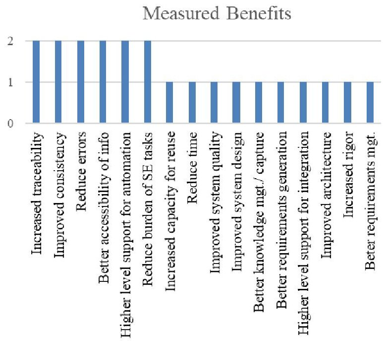

Figure 9. Benefit Categories Occurrences for the Measured Benefit Classification.

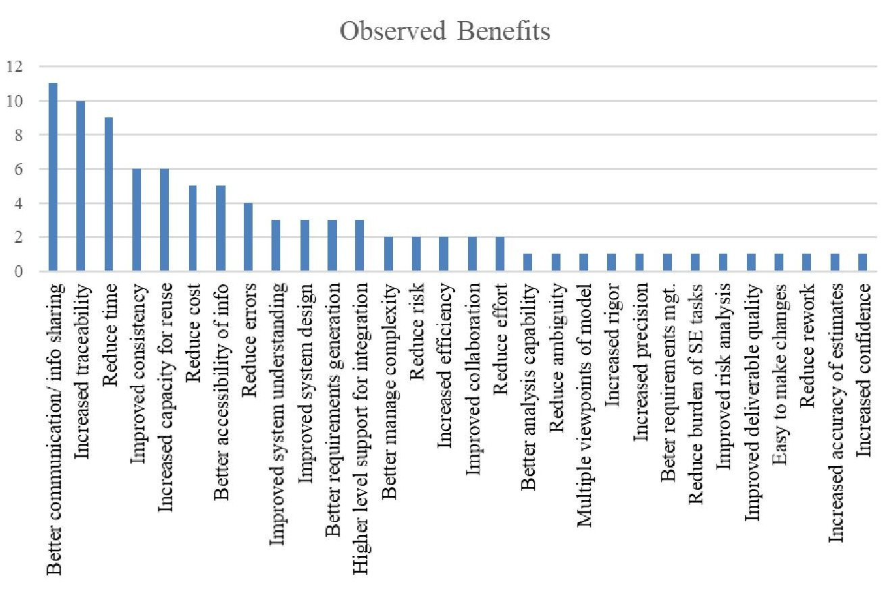

Figure 10. Benefit Categories Occurrences for the Observed Benefit Classification.

<!-- PDF_PAGE: 41 -->

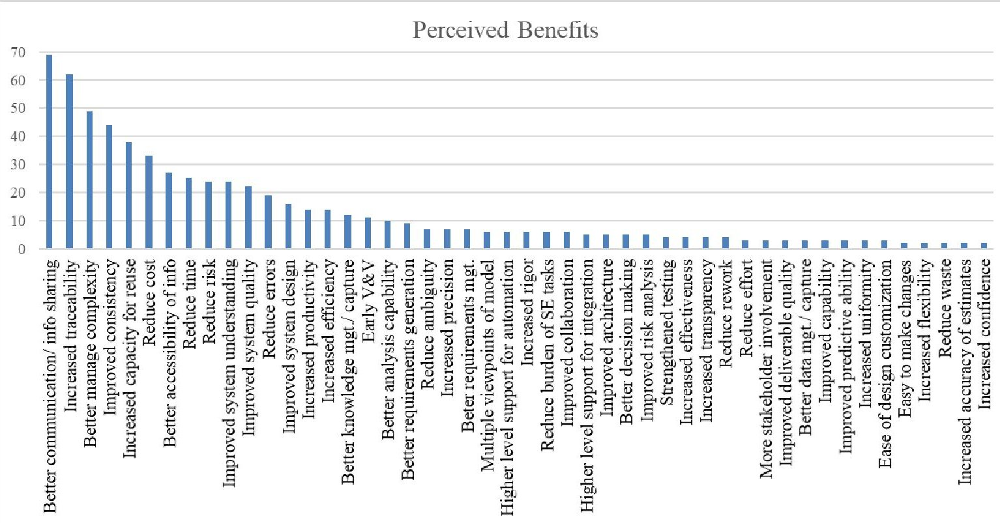

Figure 11. Benefit Categories Occurrences for the Perceived Benefit Classification.

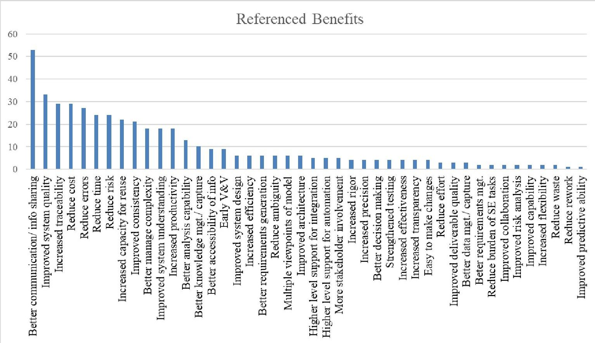

Figure 12. Benefit Categories Occurrences for the Referenced to Another Source Classification.

<!-- PDF_PAGE: 42 -->

Table 6 compares the benefits that were cited in both measured papers to the top ranked benefits in the other categories. The table shows that, although there is some variability in the order, the top benefits are fairly consistent across the claim type. Figure 13 shows all highest ranked benefits.

Table 6: Top Benefits in each Source Type.

<table border="1"><tr><td rowspan="2">Measured</td><td>Increased traceability</td><td>Improved consistency</td><td>Reduce errors</td><td>Better accessibility of info</td><td>Higher level support for automation</td><td>Reduce burden of SE tasks</td><td></td></tr><tr><td>2</td><td>2</td><td>2</td><td>2</td><td>2</td><td>2</td><td></td></tr><tr><td rowspan="2">Perceived</td><td>Better communication/info sharing</td><td>Increased traceability</td><td>Better manage complexity</td><td>Improved consistency</td><td>Increased capacity for reuse</td><td>Reduce cost</td><td>Better accessibility of info</td></tr><tr><td>69</td><td>62</td><td>49</td><td>44</td><td>38</td><td>33</td><td>27</td></tr><tr><td rowspan="2">Observed</td><td>Better communication/info sharing</td><td>Increased traceability</td><td>Reduce time</td><td>Improved consistency</td><td>Increased capacity for reuse</td><td>Reduce cost</td><td>Better accessibility of info</td></tr><tr><td>11</td><td>10</td><td>9</td><td>6</td><td>6</td><td>5</td><td>5</td></tr><tr><td rowspan="2">Referenced</td><td>Better communication/info sharing</td><td>Improved system quality</td><td>Increased traceability</td><td>Reduce cost</td><td>Reduce errors</td><td>Reduce time</td><td>Reduce risk</td></tr><tr><td>53</td><td>33</td><td>29</td><td>29</td><td>27</td><td>24</td><td>24</td></tr></table>

*Legend: Red (Perceived, not measured); Orange (Observed, not perceived); Blue (Perceived, not measured or observed); Green (Measured only); Purple (Reference only).

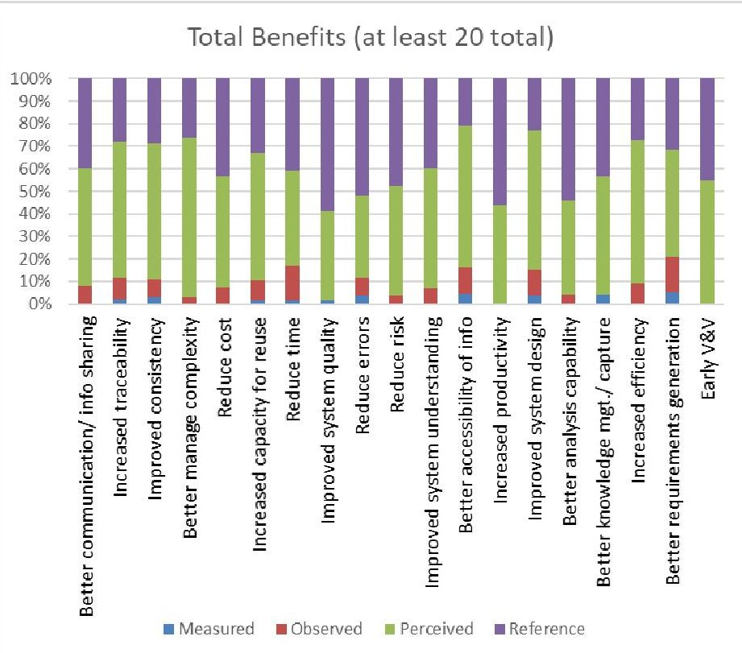

Figure 13. Benefits with Totals of at least 20 in Percentages.

<!-- PDF_PAGE: 43 -->

## 3. DISCUSSION

Overall, the disparity between the extent to which MBSE benefits have been measured or are simply perceived is large at this point. Perceived benefits emerged as the largest type of claim. In other words, two-thirds of the papers citing benefits of MBSE do so without supporting evidence. The other classifications follow with references at just over 30%, observed gains with 10%, and measured gains with less than 1% (see Table 3).

Only two papers out of 360 reviewed papers substantiated their claims about MBSE benefits with systematic measurement methods. This result indicates a notable lack of comprehensive and diverse evidence about the potential benefits of adopting and implemented MBSE. In fact, on the other side of the spectrum, 240 of the 360 papers discussed or mentioned MBSE benefits based on expectation or belief. This indicates that most authors either assume that the benefits of MBSE are common knowledge or reflect their opinion about MBSE when mentioning its benefits. However, since documented evidence of measured benefits of MBSE is lacking, as stated earlier, the common knowledge hypothesis cannot hold. Therefore, we suggest that any perceived MBSE benefit should be treated as unsubstantiated opinions of the claim's authors.

Across the different claim types (measured, perceived, observed, and reference) although there was a large difference in quantity of benefits, the benefits themselves seem to be fairly consistent. Comparing the order of the top benefits in each classification, as shown in Table 4, provides some interesting insight. First, three of the top perceived benefits (red) were not in the top measured benefits, and one of the top perceived benefits (blue) was not in the top measured or observed benefits. This shows the misalignment between what the commonly-claimed benefits are and what benefits have evidence supporting them. There is a clear need to focus efforts on developing metrics to assess if MBSE provides benefits in terms of Better communication/ info sharing, Better complexity management, Increased capacity for reuse, and Reduce cost.

Examining the perceived and observed benefits rows, the order of the top ranked benefits is identical except for the third highest ranking; Better complexity management (blue) as a perceived benefit and Reduce time (orange) as an observed benefit. The apparent alignment between observed and perceived benefits provides some support for the validity of the perceived benefits. However, since these observed benefits were not systematically measured, they are subject to observational error and different cognitive bias, such as confirmation bias.

Two of the benefits that were present in both of the measured benefits papers (green) are Higher level support for automation and Reduce burden of SE tasks. It is difficult to draw many conclusions from this with a sample size of only two papers, but it is worth noting that in a pool of 360 papers, the two that were measured found overlapping benefits. More instances of measurement of MBSE are needed to confirm the validity of these benefits.

Further examining the measurement methodology employed in the two surveyed papers that measured MBSE benefits is necessary to assess their quality as formal evidence. The first paper $ ^{29} $ characterized the benefits and cost of MBSE over Document-Based Systems Engineering (DBSE) and compared the two in

<!-- PDF_PAGE: 44 -->

the context of an actual system development project for the requirements definition and design activities. The authors measured completeness, consistency, extendibility (how easy it is to add information), readability of design information, capability of providing clear layering of the design, and benefit/cost ratio. The scores for completeness, consistency, extendibility, readability, and layering were obtained using argumentation, and the cost ratios were calculated using estimations. The units of assessments were a Systems Modeling Language (SysML) generated in the project and the generated reports as the objects for DBSE. However, the work presents several methodological weaknesses and omissions that considerably limit the strength of the provided evidence. First, scoring of the different metrics was performed via argumentation with industry experts. However, the paper does not provide any insight about how the elicitation of the scores took place. It is unknown how many experts were involved, what the demographic profiles of the experts were, which elicitation instruments were used, etc. Hence, it is not actually possible to assess if the experts were used as a measurement device or the experts responded based on observation or perception. Furthermore, it is not possible to assess if threats to validity were mitigated. Second, the benefit/cost ratio was calculated based on estimations, not on actual recordings of benefits and cost incurred during the project execution. Third, it is not evident from the paper what the source of the DBSE reports was, as well as what the characteristics of the teams using MBSE and/or DBSE were. Hence, it is not possible to really assess if, on the one hand, the comparison between both approaches is fair and meaningful, and, on the other hand, if there were significant biases in the teams performing under one or the other approach.

The second paper $ ^{30} $ takes a slightly different approach to measure MBSE benefits. This paper examined the added value of using MBSE on the Europa Clipper Mission. At a given point in the project, the team identified several SE challenges that they expected MBSE could address effectively and defined a to-be state of the project in five years' time using a scorecard method. The scorecard was organized into five overarching challenges, each containing specific issues that related to that challenge. The challenges included growing risk from unmanaged complexity, system design emerges from pieces rather than from an architected solution, knowledge and investments lost at phase boundaries, insufficient re-use of system designs, and poor technical-programmatic coupling. The to-be state descriptions were based on a retrospective study of missions at JPL and the considerations of the paper's authors about how MBSE could have helped overcoming the challenges that had emerged in those historical missions. Five years later, at the point where the to-be state was defined, the actual state of the Europa Clipper Mission was recorded, although the extent of the differences was not captured. Measurement of benefits was conducted by comparing the predicted to-be state with the actual one. Similarly to the previous paper, however, this study also presents some methodological omissions and weaknesses. As an example, the SE challenges that were used as metrics of MBSE benefits in the study had been initially defined and provided to the Europa Clipper Mission team at the beginning of the project. Therefore, the explicit declaration and establishment of such challenges in the context of the project could have easily biased the team in working towards overcoming those challenges, regardless of the engineering approach they used. Yet, the study assumes that MBSE was the only factor in achieving success, even though there is no solid evidence to claim so.

This literature review indicates that there is no empirical evidence today that supports the hypothesis that MBSE is beneficial for the development of engineered systems. This assertion does not imply that MBSE

<!-- PDF_PAGE: 45 -->

is not beneficial. $ ^{31} $ Instead, the main result of this literature review should be interpreted as a call to action for researchers to formally measure those MBSE benefits that practitioners perceive or have observed to demonstrate whether such observations are accurate and replicable (not anecdotal), as well as to assess the extent of those benefits with respect to non-MBSE practices.

## 5. ENTERPRISE ADOPTION FRAMEWORK

This section presents the results of the analysis of enterprise adoption of DE and MBSE.

Successful adoption of MBSE, like many other large-scale enterprise change initiatives, can present significant challenges for organizations. These types of initiatives require intentional focus on many aspects within an organization more than just the technical details of processes and tools associated with a particular change initiative. The Digital Engineering Working Group is a U.S. Defense Department activity that has reported on some of the most significant challenges (or "pain points") associated with implementing DE. Although these pain points do relate to technical aspects of DE such as tools, reference models, standards, and data, they also include other types of organization-level challenges such as implementation and deployment approach, IT infrastructure, and training/skills of the workforce. In the most recently conducted survey by Cloutier at the University of South Alabama, the top five inhibitors to successful adoption of MBSE were: cultural and general resistance to change, availability of skills, the MBSE learning curve, lack of perceived value of MBSE, and lack of management support. $ ^{32} $

This breadth of factors demonstrates the importance of a holistic, enterprise-wide perspective in designing and implementing a successful approach to adopt MBSE. In this work, a comprehensive set of adoption practices for MBSE have been identified based on three major sources of input: 1) the Baldrige Criteria for Performance Excellence, which is a general organizational performance excellence framework that was adapted to the context of implementing a large-scale change initiative such as MBSE; 2) empirical findings from a survey based on actual experiences with organizations implementing MBSE; and 3) elements in the INCOSE Model-Based Capabilities Matrix that define practices of organizations that have successfully adopted MBSE with varying levels of maturity. These three sources of input, described below, were integrated and synthesized to define a comprehensive set of adoption practices for MBSE. Some of these are applicable to any large-scale change initiative (such as leadership support) and some of them are unique and specific to MBSE (such as data security, tool quality, etc.). This set of MBSE adoption practices can be used to proactively plan an implementation approach for MBSE or to assess a current initiative that is underway in order to diagnose areas for improvement.

The first source of input for the set of MBSE adoption practices is the Baldrige Criteria for Performance Excellence (CPE). Examining MBSE adoption from the lens of the Baldrige CPE (Baldrige Performance Excellence Program, 2019) can generate insight to increasing the understanding of MBSE adoption its success or lack thereof. The CPE provide a comprehensive, holistic, systems view of an organization by identifying a set of management sub-systems an organization must purposefully design (or redesign) and

<!-- PDF_PAGE: 46 -->

monitor in order be a high-performing organization. $ ^{33} $ The CPE prescribe what key management subsystems and processes must be in place for an effective organization but do not prescribe how they must be designed, as this must fit a given organization's context and environment (see below). The Baldrige CPE and framework are commonly used by organizations for assessing and diagnosing the maturity of their management sub-systems and processes (although this framework is also used to evaluate and determine formal awards as part of the Malcolm Baldrige National Quality Award program). A brief summary of the overall categories is provided below, along with the key questions associated with each:

1. Leadership: How do you share your vision and lead your organization? How do you ensure good governance?

2. Strategy: How do you prepare for the future?

3. Customers: How do you listen to, satisfy, and engage your customers?

4. Measurement, analysis, and knowledge management: How do you use reliable data and information to make decisions?

5. Workforce: How do you engage and empower your people?

6. Operations: How do you ensure efficient and effective operations that deliver customer value?

7. Results: How well are you doing?

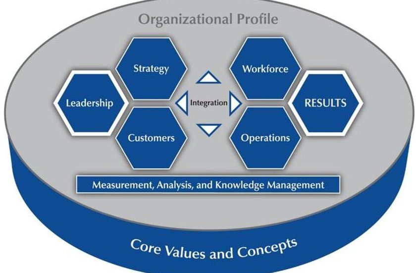

Figure 14. Baldrige Criteria for Performance Excellence.

Core Values and Concepts underlie the management sub-systems in the CPE categories and reflect the organizational culture. The Organizational Profile defines key characteristics of the organization's environment (such as customers, regulatory environment, competitors, etc.). Within the Baldrige CPE, the seven categories are broken down into more specific items and areas that define important elements for organizational maturity.

In addition to serving as a diagnostic framework for assessing an organization's current state, the Baldrige CPE can also serve as a useful framework within the context of enterprise-wide change initiatives, such as the adoption of MBSE, to proactively design a change initiative more likely to be successful (because no key management sub-system is neglected in the change approach) or to assess current progress in

<!-- PDF_PAGE: 47 -->

implementing a change initiative. The Baldrige CPE do not represent a change initiative in and of itself rather, it can inform the design or assessment of any major change initiative by identifying key success factors to pay attention to in an implementation and deployment approach to the initiative. In this sense, the CPE can be adapted to develop a set of practices associated with a particular change initiative that reflects not only the common issues experienced in any large-scale change initiative but also the ones specific to a particular change initiative. Thus, the Baldrige CPE is used in this work as an enterprise framework to inform the development of a comprehensive set of practices for MBSE adoption.

A second source of input for the set of MBSE adoption practices is empirical findings from analyzing results of the survey conducted as part of this work in partnership with INCOSE and NDIA. These findings (which were documented in an earlier report $ ^{34} $ ) were used to identify a set of factors influencing MBSE implementation. In particular, a structured qualitative analysis was conducted on responses to the following open-ended questions in the survey:

- The most challenging obstacles to implementing MBSE in our organization are:

- The best enablers for MBSE in our organization are:

In the organizational change literature, it is quite prevalent to study adoption/implementation of a particular change initiative from the perspective of obstacles (i.e., negative experiences) and enablers (i.e., positive experiences). This "polar opposite" approach involves asking respondents who have experienced a change initiative both questions in order to elicit a more comprehensive picture of the factors that may be associated with successful adoption. In this sense, one can identify a more robust and comprehensive list of success factors, regardless of whether they were experienced as an obstacle (or barrier, impediment, etc.) or enabler. Thus, these empirical findings based on actual experiences of organizations responding to the survey can inform the development of a general set of adoption practices. Figure 15 shows the most frequently reported factors (i.e., obstacles and enablers) from the survey.

<!-- PDF_PAGE: 48 -->

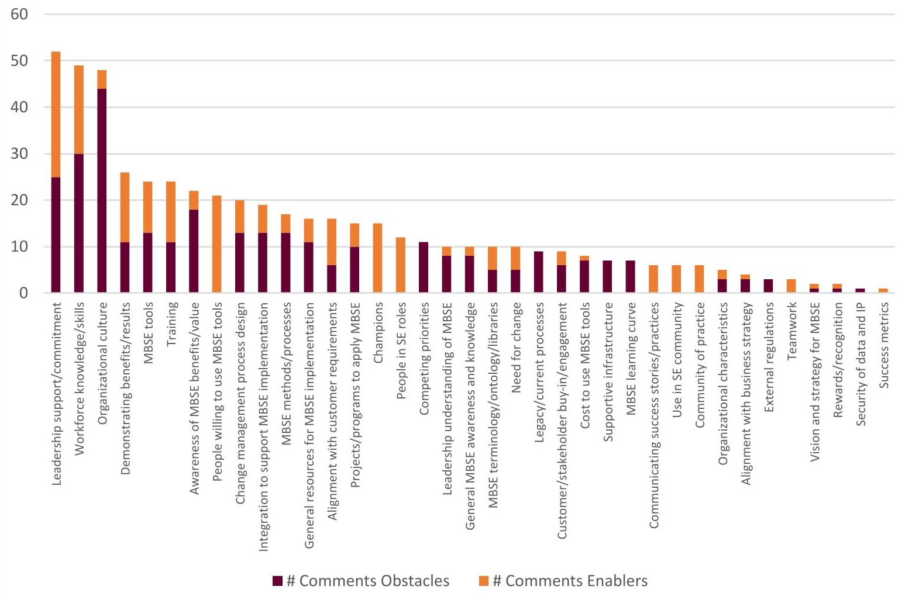

Figure 15. Most Frequently Reported Success Factors from the Survey of MBSE Adoption.

The third source of input to defining a set of MBSE adoption practices was the elements defined within the INCOSE Model-Based Capabilities Matrix $ ^{35} $ . The matrix identifies practices that inform four different levels of maturity in the adoption of forty-five MBSE capabilities in the areas of Workforce/culture, SE Processes/Methodology, Program/Project Processes Methodology, Model Based Effectiveness, Information Technology, Modeling Tool Construction, Model Use, and Modeling Policy. The capabilities of the matrix also relate to the DoD DE Strategy, covering the goals related to Use of Models, Authoritative Source of Truth (ASOT), Innovation, Establish Environments, and Workforce Transformation.

Table 7 shows the integrated set of adoption practices for MBSE. In the table, 37 practices relating to each unique success factor are defined as statements aimed to describe the state of an organization's MBSE implementation efforts. In the statements, the term "organization" is used to refer to the organizational unit adopting MBSE (which may be the overall company, a division, a business unit, a program, etc.). The practices are organized into nine categories listed in an order as they relate to the Baldrige CPE categories, with some differences for adaptation in this work. For example, Communication is not explicitly one of the Baldrige categories (but is an element within the Leadership category) but is defined in the table as a separate category encompassing multiple factors, given its prevalence in the survey findings. In addition, the core operational work processes of the organization (Category 5 in the Baldrige CPE) are reflected as "MBSE Processes" for the purposes of this work to reflect the key processes of interest within an MBSE

<!-- PDF_PAGE: 49 -->

implementation effort. Additional adaptations were made in wording and framing of the categories based on the unique aspects associated with MBSE adoption and as reported in the survey findings.

Table 7. Practices for Successful MBSE Adoption.

<table border="1"><tr><td>Category</td><td>Success Factor</td><td>Enterprise Adoption Practice</td></tr><tr><td rowspan="2">Leadership</td><td>Leadership support/commitment</td><td>Senior leaders in the organization are committed to and supportive of MBSE.</td></tr><tr><td>Leadership understanding of MBSE</td><td>Senior leaders in the organization understand what MBSE is and how it will impact the organization.</td></tr><tr><td rowspan="3">Communication</td><td>Awareness of MBSE benefits/value</td><td>People in the organization are aware of MBSE and the value and benefits associated with it.</td></tr><tr><td>Communicating success stories/practices</td><td>MBSE success stories, examples, and potential best practices are communicated throughout the organization.</td></tr><tr><td>Need for change</td><td>Senior leaders communicate a clear reason for why the organization needs to change and how adopting MBSE will help us improve.</td></tr><tr><td rowspan="2">Strategy and Vision</td><td>Vision and strategy for MBSE</td><td>Implementation of MBSE aligns with the organization&#x27;s vision and priorities.</td></tr><tr><td>Alignment with business strategy</td><td>Implementation of MBSE is aligned with our organization&#x27;s overall business strategy.</td></tr><tr><td rowspan="7">Change Strategy</td><td>Change management process design</td><td>There is a clear implementation and deployment strategy defining a roadmap for how MBSE will be implemented with actions, timeline, and roles.</td></tr><tr><td>Legacy/current processes</td><td>The MBSE implementation strategy addresses how current (legacy) processes need to change to align with MBSE.</td></tr><tr><td>Champions</td><td>There are internal champions in the organization with MBSE expertise who advocate for MBSE use.</td></tr><tr><td>Community of practice</td><td>There are people within the organization using MBSE who can provide guidance and expertise as MBSE is deployed.</td></tr><tr><td>Competing priorities</td><td>People in the organization are able to devote time and resources to apply MBSE without interference from other competing priorities.</td></tr><tr><td>General resources for MBSE implementation</td><td>Our organization allocates sufficient resources to support MBSE implementation.</td></tr><tr><td>Demonstrating benefits/results</td><td>We achieve and communicate internally across the organization &quot;quick wins&quot; that demonstrate the benefits and outcomes from MBSE.</td></tr><tr><td rowspan="2">Customers</td><td>Alignment with customer requirements</td><td>Use of MBSE aligns with the needs and requirements of our organization&#x27;s customers.</td></tr><tr><td>Customer/stakeholder buy-in/engagement</td><td>Our organization&#x27;s customers and stakeholders buy-in to MBSE and its use in our organization.</td></tr></table>

<!-- PDF_PAGE: 50 -->

<table border="1"><tr><td>Category</td><td>Success Factor</td><td>Enterprise Adoption Practice</td></tr><tr><td rowspan="2">Measurement, Data, and Knowledge</td><td>Success metrics</td><td>The organization uses performance metrics to track the outcomes and success of implementing MBSE.</td></tr><tr><td>Supportive infrastructure</td><td>The organization&#x27;s IT infrastructure supports the use of MBSE.</td></tr><tr><td rowspan="9">Workforce</td><td>General MBSE awareness and knowledge</td><td>People in the organization have a general awareness and understanding of MBSE, including differences to traditional SE processes.</td></tr><tr><td>Workforce knowledge/skills</td><td>People in the organization expected to use MBSE have the necessary knowledge, skills, and competencies to support MBSE adoption.</td></tr><tr><td>Training</td><td>Sufficient quality and quantity of training opportunities are available to people expected to learn MBSE processes and tools.</td></tr><tr><td>MBSE learning curve</td><td>The learning curve associated with using MBSE tools is taken into account in the implementation strategy and expectations.</td></tr><tr><td>People in SE roles</td><td>People with strong SE skills and initiative to support others are placed in SE roles expected to adopt MBSE.</td></tr><tr><td>People willing to use MBSE tools</td><td>People in SE roles in the organization are willing and motivated to use MBSE tools.</td></tr><tr><td>Teamwork</td><td>People in the organization exhibit teamwork to use MBSE within and across project teams.</td></tr><tr><td>Organizational culture</td><td>The organizational culture, including shared values/beliefs and prevailing policies/procedures, is aligned with the use of MBSE.</td></tr><tr><td>Rewards/recognition</td><td>People and teams are recognized/rewarded for utilizing MBSE processes and tools.</td></tr><tr><td rowspan="7">MBSE Processes</td><td>MBSE methods/processes</td><td>Our organization has defined, systematic processes for applying MBSE throughout the relevant parts of the organization including activities, outputs, and roles/responsibilities.</td></tr><tr><td>MBSE terminology/ontology/libraries</td><td>We use terminology, ontologies, and libraries consistently when applying MBSE.</td></tr><tr><td>MBSE tools</td><td>We use MBSE tools that are consistent, have sufficient quality and maturity, and are accessible to people needing to use them.</td></tr><tr><td>Projects/programs to apply MBSE</td><td>We are applying MBSE within the organization to the right types of projects and programs.</td></tr><tr><td>MBSE integration</td><td>MBSE processes and data used in MBSE activities are integrated across disciplines and units within the organization.</td></tr><tr><td>Security of data and IP</td><td>We continuously identify and mitigate the data security and intellectual property protection risks of our MBSE processes and implementation.</td></tr><tr><td>Cost to use MBSE tools</td><td>We monitor the total ownership costs of MBSE tools and maintain a positive benefit to cost balance.</td></tr><tr><td>Organizational and External Environment</td><td>Organizational characteristics</td><td>The MBSE implementation strategy takes into account any unique characteristics of our organization to increase the likelihood of success.</td></tr></table>

<!-- PDF_PAGE: 51 -->

<table border="1"><tr><td>Category</td><td>Success Factor</td><td>Enterprise Adoption Practice</td></tr><tr><td rowspan="2"></td><td>External regulations</td><td>Our organization&#x27;s adoption of MBSE is aligned with external regulations and requirements.</td></tr><tr><td>Use in SE community</td><td>Our organization leverages the use of MBSE in the broader Systems Engineering community to support our implementation.</td></tr></table>

Several overall points about the set of practices defined in the table are worth noting here. First, as noted briefly earlier, some practices relate to any type of large-scale change initiative, such as leadership support/commitment, organizational culture, and training. Other practices are more unique to MBSE, such as MBSE terminology and ontologies and security of data. In this regard, this set of practices should provide a more comprehensive basis for defining key elements an organization must pay attention to in transitioning to using MBSE.

Second, some practices were reflected in multiple sources of input - for example, workforce training and alignment with overall business strategy were present in all three sources of input. However, a number of practices were reflected only in one or two sources - for example, the INCOSE Model-Based Capabilities Matrix identifies many specific practices unique to MBSE as a change initiative, including many technical aspects of implementation that are of course not defined in the Baldrige categories, which is a more general framework. The survey findings also revealed a number of factors (either identified as obstacles or enablers) that are also unique to MBSE. It is logical that the INCOSE Model-Based Capabilities Matrix would identify many specific practices related to technical aspects of MBSE implementation that would not be reflected in more general frameworks. As documented in an earlier report on this work $ ^{36} $ and illustrated in Figure 15, the factors having by far the most occurrences in survey findings were leadership support/commitment, organizational culture, and workforce knowledge/skills. Although workforce knowledge/skills is indeed reflected in the current INCOSE Model-Based Capabilities Matrix, leadership support/commitment and organizational culture are not explicitly represented in this matrix. This point demonstrates the need for a more comprehensive set of adoption practices, such as that defined in this work.

This set of enterprise adoption practices can be used by organizations as they plan an MBSE implementation initiative to ensure that no important factor is neglected or ignored in the implementation strategy. They can also be used to assess an MBSE initiative that is in-process, for example, by documenting the extent to which each statement reflects the current situation in the organization in order to diagnose areas for improvement. In this sense, the set of practices can be used as an assessment tool for ongoing MBSE efforts.

The practices may also be used by researchers to study MBSE implementation efforts and identify which practices are more strongly associated with successful MBSE adoption. Such research efforts would require developing a measure to characterize the outcomes (or perceived success) associated with MBSE. This type of insight could greatly benefit organizations seeking to implement MBSE by identifying a more focused set of practices, of those identified here, to ensure more successful MBSE implementation.

<!-- PDF_PAGE: 52 -->

Insight from analysis of both obstacles and enablers, mapped to the Baldrige CPE, was used to define a preliminary set of adoption practices for achieving maturity in MBSE:

## Leadership Support/Commitment:

Leaders communicate a clear reason and need for DE adoption

Leaders understand DE

Leaders support and are committed to DE (commanders' intent)

People understand the benefits of DE (messaging)

- DE/MBSE Methods and Processes:

DE is aligned with the overall business strategy

O DE is used for the right projects/programs

DE adoption is aligned with what customers need/require

Customers and stakeholders buy-in to DE

Data management processes support DE

Clear metrics are defined to track results and progress of MBSE

- Workforce & Culture:

Systems engineers have the skills needed to support DE/MBSE use

Training is provided to develop needed skills

People are rewarded/recognized for using DE/MBSE methods & processes

The organizational culture is aligned with DE/MBSE use

People are willing to use DE/MBSE tools

These statements provide a starting point for a Program Office's commitment to DE transformation. These basic adoption practices appear consistently across all of the data collected in this and previous SERC research. As an example, Figure 16 revisits the systemigram diagram from SERC project RT-182 that discussed the workforce and culture aspects of DE transformation. In this section of that systemigram model, the top metrics have been added into the discussion. In the figure, metrics are shown in the rectangular boxes, and the remainder of the diagram is unchanged from the previous report $ ^{37} $ . The consistency of the top metrics categorization to the interview data in that project is quite strong. We have found in this research that, although the potential number of metrics categories is quite large, the agreement on the top few most meaningful metrics is consistently discussed. The general process a Program Office should follow is:

- Make the commitment to DE transformation

- Develop the DE/MBSE methods, processes, and tools

- Train all of the workforce

- Focus the initial development efforts on increased traceability - government concept of operations and requirements specifications to contractor requirements and design

- Build and use cross-program communication and information-sharing methods and tools

- Create a majority of people willing to use DE/MBSE tools

<!-- PDF_PAGE: 53 -->

- Measure performance of the process in terms of reduced time and increased consistency of technical interchange and review processes, as well as reduced errors and defects that escape between design phases

- Gradually increase reuse of data and models across and between programs

- Continually invest in automation of processes and resulting SE artifacts as the process matures.

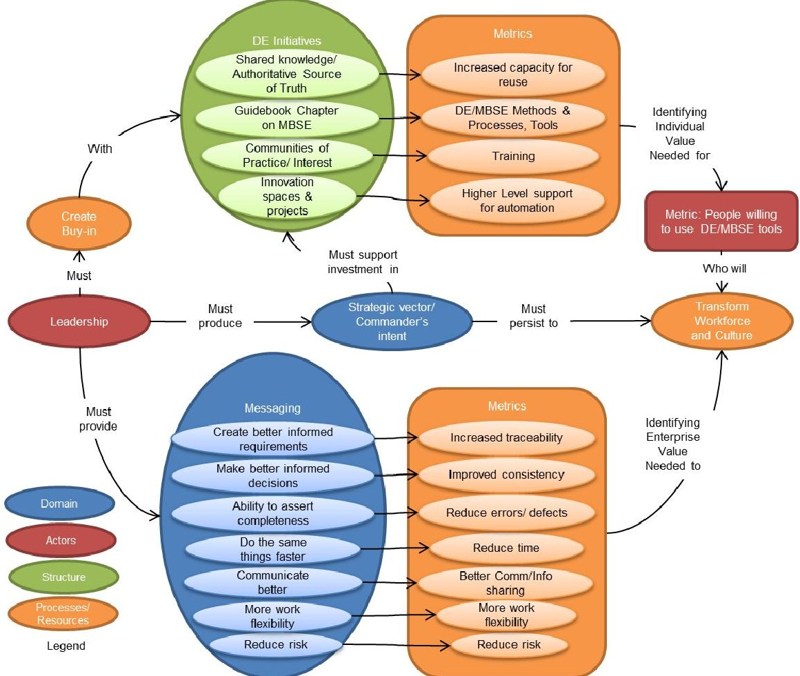

Figure 16. Updated RT-182 Workforce & Culture Systemigram (partial).

We linked the results of this research to a summary of the DoD DE pain points tracking. Pain points generally relate to obstacles in the enterprise adoption framework and survey results, although this tracking is more specific to DoD programs. Table 8 provides a summary of pain points and a recommended linkage to both applicable DE value/benefit categories and to adoption approaches. This tracking is a work-in-progress and this should not be considered as an official list. However, it does provide some additional insight on where the frameworks established by this research might be applied.

<!-- PDF_PAGE: 54 -->

Table 8. Linkage to DoD DE Pain Points.

<table border="1"><tr><td>DE Area</td><td>Pain Point Title</td><td>Pain Point</td><td>Recommendation</td></tr><tr><td rowspan="3">Goal 1: Use of Models</td><td>Standards</td><td>Models are not consistently planned, developed or used across Services, engineering disciplines, domains, lifecycle phases, or programs</td><td>Value: improved consistency.
Adoption: promote standard methods and tools. Link standards efforts such as MOSA and Program Protection to MBSE tools. Adopt Agile processes. Focus on technology that promotes collaboration/info sharing and traceability across the ASOT.</td></tr><tr><td>Reference Models/Reference Architectures</td><td>DoD lacks a concept of operations, reference models/architectures to guide Digital Engineering implementation</td><td>Value: increased traceability, increased support for reuse.
Adoption: common terminology/ontology/libraries, People in SE roles, Communities of Practice.</td></tr><tr><td>Modeling Practice</td><td>DoD lacks methodologies to use model-based approaches to perform lifecycle activities</td><td>Value: information access and collaboration/ information sharing, increased traceability, improved consistency, and reduced error/defects.
Adoption: Use a “model everything” approach. Link all acquisition processes together in the ASOT.</td></tr><tr><td rowspan="3">Goal 2: Data &amp; ASOT</td><td>Data Exchange</td><td>The DoD lacks digital representations providing alternative views to access, visualize, communicate and deliver data, information, and knowledge to stakeholders</td><td>Value: increased traceability.
Adoption: establish enterprise MBSE terminology, ontologies, libraries. Focus on digital signoff methods, processes, and tools.</td></tr><tr><td>Authoritative Data</td><td>DoD lacks authoritative data sources that are accessible, understandable and trustworthy</td><td>Value: access to information.
Adoption: this will be an evolutionary process enabled by the other adoption processes. The cost of DE will be higher up front as these assets are created, immediate reductions in cost should not be expected.</td></tr><tr><td>Decision &amp; Visualization Framework</td><td>The DoD lacks a decision and visualization framework to communicate across decision makers and stakeholders.</td><td>Value: improved system understanding.
Adoption: use model-based views &amp; viewpoints that allow stakeholders to understand the modeled information without needing to know how to use model authoring tools.</td></tr><tr><td>Goal 3: Technology Innovation</td><td>Digital Enterprise</td><td>The DoD lacks an established digital engineering capability to develop and deploy digital engineering models for use in the defense acquisition process</td><td>Value: better data management/capture, increased productivity, improved collaboration.
Adoption: leadership support &amp; commitment, communities of practice, and DE/MBSE tools.</td></tr></table>

<!-- PDF_PAGE: 55 -->

<table border="1"><tr><td>DE Area</td><td>Pain Point Title</td><td>Pain Point</td><td>Recommendation</td></tr><tr><td rowspan="2"></td><td>Engineering Practice Innovation</td><td>The DoD lacks mechanisms to implement Digital Engineering across R&amp;E</td><td>Value: higher level of support for automation.
Adoption: technology enables collaborative capabilities in DE. Victory should not be announced too quickly. Early adopters should be provided a safe space. Resources for innovation should be provided.</td></tr><tr><td>Pilots</td><td>The DoD lacks mechanisms to innovate rapidly, and to infuse advancements in technology to improve the engineering practice</td><td>Value: improve system quality, reduce time.
Adoption: “model everything” approach should be used, along with champions. Change management processes should be purposefully designed.</td></tr><tr><td rowspan="3">Goal 4: Infrastructure and Environments</td><td>Digital Ecosystem (Integrated Modeling Environment)</td><td>An ecosystem does not exist to digitally collaborate across organizations, engineering disciplines, and lifecycle phases to rapidly discover, manage, and exchange models and data</td><td rowspan="3">Value: better requirements generation, increase effectiveness, increased efficiency, increased productivity, better knowledge Management/ capture.
Adoption: DE/MBSE tools, training, tool experts and dedicated IT backend support to DE/MBSE.</td></tr><tr><td>IT Infrastructure</td><td>The existing infrastructures were not designed for complex digital model-based engineering activities</td></tr><tr><td>SW &amp; Tools</td><td>The DoD lacks access to DE software and tools across the Enterprise</td></tr><tr><td rowspan="4">Goal 5: Culture and Workforce</td><td>Policy, Guidance, and Plans</td><td>The DoD lacks comprehensive policies, guidance, and plans.</td><td>Value: more stakeholder involvement, increased consistency, increased capacity for reuse.
Adoption: Leadership support/commitment embodied in policies and guidance to programs. General resources should be made available.</td></tr><tr><td>Talent Management</td><td>The DoD lacks recruiting, hiring and retention strategies for Digital Engineering.</td><td>Value: better decision making, reduced effort, improved collaboration
Adoption: strategies to develop workforce knowledge and skills, demonstrating benefits and results.</td></tr><tr><td>Leadership &amp; Communication</td><td>The DoD lacks enterprise expectations, strategic direction, and prioritized investments across the enterprise</td><td>Adoption: consistent messaging, expectations, direction, and funding.</td></tr><tr><td>Change Management</td><td>The DoD lacks enterprise accountability to measure, demonstrate and improve tangible results</td><td>Adoption: success stories, change/success guidance, and metrics.</td></tr></table>

<!-- PDF_PAGE: 56 -->

As stated up front, the goal of this research was to identify and document best practices across the DoD, defense industry, and other industries related to measurement of the DE enterprise transformation, metrics for success, and standard success guidance. As the transformation process is not yet mature enough across the community to standardize best practices and success metrics, the research shifted to a set of efforts to define a comprehensive framework for DE benefits and expected value linked to the ongoing development of DE enterprise capabilities and experienced transformation "pain points," enablers, obstacles, and change strategies.

A key result of this research is the development and definition of two frameworks: a DE benefits framework and an enterprise adoption framework which can be universally applied to a formal enterprise change strategy and associated performance measurement activities. From these we derived an additional metrics framework and captured, at this point, 10 primary categories of metrics around which to start a measurement program. The primary value of this research is in these comprehensive frameworks.

Three recommendations for future research are included:

1. Conduct additional DE/MBSE maturity surveys: this applies to both targeted surveys and additional surveys over time. Because the initial survey was targeted at the systems engineering community, it may have missed broader insights from the domains of product line management, operations research, software, modeling & simulation, manufacturing, etc. Each of these communities recognizes the terms Digital Engineering and Model-Based Systems Engineering as specific to their domains. Follow-up surveys across these communities are recommended, as well as survey updates over time to track progress and trends.

2. Develop an enterprise quality assessment framework specific to DE. Future research should extend the initial DE benefits and adoption frameworks out toward an enterprise assessment toolset, based on the Baldrige Criteria for Performance Excellence. The INCOSE MBSE Capabilities Matrix provides a self-assessment tool to track maturity of MBSE enterprise capabilities $ ^{38} $ . A formal assessment framework for the larger DE transformation is feasible given the results of this project. This activity would complete the framework and develop an initial assessment tool and approach.

3. Partner with selected DoD program offices to support development of their enterprise change plans and assessment programs. A set of targeted activities with real program offices would apply the frameworks developed in this research and lead to capture of best practices. As noted in the research, performance measurement of DE is very limited across the community. This work would lead to more standard assessment capabilities.

<!-- PDF_PAGE: 57 -->

## 1. What is the long-term transition goal for the research if continued?

DoD program offices and potentially all enterprises are struggling at this point to define the value of Digital Engineering in a measurable way. Because the artifacts of DE are digitally captured in standard sources of truth data, the opportunities to better measure systems development processes with DE should be at hand. However, little progress in this area has been made to date. This is the first research to attempt to classify a set of metrics for DE. As with other digital transformation activities, standard best practice metrics will evolve over time. This research should be used to guide that evolution. Additional efforts should use this research to accelerate program/enterprise DE adoption (see recommended future research).

2. List the potential tools, guides, educational units, or other artifacts that resulted from this research that might be used by external sponsors if the long-term transition goals are met?

The metrics framework of this report and the associated survey supplemental report provide an essential resource for organizations undergoing DE transformation. The hope in future research is to create an organizational assessment tool.

3. Did you identify any transition partners? Are there other advocates or potential adopters of this research?

The research team worked extensively with our OUSD sponsor, INCOSE, and NDIA on this research. All could be considered advocates.

4. Was the research piloted with a potential transition partner? Are there others who would conduct pilot use of the research if fully funded?

The resources were not available in this task to pilot the research with a transition partner. Future opportunities exist. Help is requested in finding a transition partner (DoD program office).

<!-- PDF_PAGE: 58 -->

Research Team:

<table border="1"><tr><td>Name</td><td>Organization</td><td>Labor Category</td><td>Email</td></tr><tr><td>Tom McDermott</td><td>Stevens Institute</td><td>Principal Investigator</td><td>tmcdermo@stevens.edu</td></tr><tr><td>Eileen Van Aken</td><td>Virginia Tech</td><td>Co-Principal Investigator</td><td>evanaken@vt.edu</td></tr><tr><td>Nicole Hutchinson</td><td>Stevens Institute</td><td>Research Engineer</td><td>nlong@stevens.edu</td></tr><tr><td>Kara Pepe</td><td>Stevens Institute</td><td>Research Engineer</td><td>kpepe@stevens.edu</td></tr><tr><td>Mark Blackburn</td><td>Stevens Institute</td><td>Subject Matter Expert</td><td>mblackburn@stevens.edu</td></tr><tr><td>Zhongyuan(Annie)Yu</td><td>Stevens Institute</td><td>Research Engineer</td><td>zyu7@stevens.edu</td></tr><tr><td>Xinyu(Neal)Chen</td><td>Stevens Institute</td><td>Student Assistant</td><td>xchen122@stevens.edu</td></tr><tr><td>Alejandro Salado</td><td>Virginia Tech</td><td>Research Engineer</td><td>asalado@vt.edu</td></tr><tr><td>Kaitlin Henderson</td><td>Virginia Tech</td><td>Graduate Student</td><td>karj1@vt.edu</td></tr></table>

<!-- PDF_PAGE: 59 -->

McDermott T, Van Aken E, Hutchison N, Salado A, Henderson K, and Clifford M. (2020), Technical Report SERC-2020-SR-001, Benchmarking the Benefits and Current Maturity of Model-Based Systems Engineering Across the Enterprise: Results of the MBSE Maturity Survey, March 19, 2020. https://sercuarc.org/results-of-the-serc-incose-ndia-mbse-maturity-survey-are-in/

## APPENDIX B: CITED AND RELATED REFERENCES

Department of Defense. 2018. Digital Engineering Strategy. Washington, DC: US Department of Defense. June 2018.

Digital Engineering Working Group Meeting, February 4, 2020..

Systems Engineering Research Center, Technical Report SERC-2018-TR-109, Enterprise System-of-Systems Model for Digital Thread Enabled Acquisition, July 13, 2018.

INCOSE Model-Based Enterprise Capability Matrix and User's Guide, Version 1.0, January 2020.

McDermott T, Van Aken E, Hutchison N, Salado A, Henderson K, and Clifford M. (2020), Technical Report SERC-2020-SR-001, Benchmarking the Benefits and Current Maturity of Model-Based Systems Engineering Across the Enterprise: Results of the MBSE Maturity Survey, March 19, 2020.

Baldrige Performance Excellence Program, 2019. 2019-2020 Baldrige Excellence Framework: Proven Leadership and Management Practices for High Performance. Gaithersburg, MD: U.S. Department of Commerce, National Institute of Standards and Technology. https://www.nist.gov/baldrige.

Blackburn, M. R., M. A. Bone, J. Dzielski, B. Kruse, R. Peak, S. Edwards, A. Baker, M. Ballard, M. Austin, M. Coelho, Transforming Systems Engineering through Model-Centric Engineering, Research Task-195 (NAVAIR), Final Technical Report SERC-2019-TR-103, May 28, 2019

https://www.gartner.com/en/research/methodologies/gartner-hype-cycle

https://www.gartner.com/smarterwithgartner/how-to-measure-digital-transformation-progress/

Systems Engineering Research Center, Technical Report SERC-2018-TR-109, Enterprise System-of-Systems Model for Digital Thread Enabled Acquisition, July 13, 2018.

Zimmerman, P. Digital Engineering Strategy & Implementation Status, National Defense Industries Association, June 2019.

Blackburn, M. R., M. A. Bone, J. Dzielski, B. Kruse, R. Peak, S. Edwards, A. Baker, M. Ballard, M. Austin, M. Coelho, Transforming Systems Engineering through Model-Centric Engineering, Research Task-195 (NAVAIR), Final Technical Report SERC-2019-TR-103, May 28, 2019.

Bone, M. A., M. R. Blackburn, D. Rhodes, D. Cohen, J. Guerrero, Transforming Systems Engineering through Digital Engineering, Journal of Defense Modeling and Simulation, 2017.

<!-- PDF_PAGE: 60 -->

Blackburn, M. R., R. Cloutier, E. Hole, G. Witus, M. Bone, Transforming System Engineering through Model Centric Engineering, Final Technical Report, Systems Engineering Research Center Research Task 118, January 31, 2015

Blackburn, M. R., M. A. Bone, G. Witus, Transforming System Engineering through Model-Centric Engineering, System Engineering Research Center, Research Task 141, Technical Report SERC-2015-TR 109, November 18, 2015.

Blackburn, M., R., R. Blake, M. Bone, D. Henry, P. Grogan, S. Hoffenson, R. Peak, S. Edwards, M. Austin, L. Petgna, Transforming Systems Engineering through Model-Centric Engineering, Research Task 157, SERC 2017-TR-101, January 2017.

Blackburn, M., R., M. A. Bone, J. Dzielski, P. Grogan, R. Giffin, R. Hathaway, D. Henry, S. Hoffenson, B. Kruse, R. Peak, S. Edwards, A. Baker, M. Ballard, M. Austin, M. Coelho, L. Petnga, Transforming Systems Engineering through Model-Centric Engineering, Final Technical Report SERC-2018-TR-103, RT-170 (NAVAIR), February 28, 2018.

Blackburn, M., R., D. Verma, R. Giffin, R. Blake, M. A. Bone, A. Dawson, R. Dove, J. Dzielski, P. Grogan, S. Hoffenson, E. Hole, R. Jones, B. Kruse, K. Pochiraju, C. Snyder, B. Chell, K. Batra, L. Ballarinni, I. Grosse, T. Hagedorn, R. Dillon-Merrill, Transforming Systems Engineering through Model-Centric Engineering, Final Technical Report SERC-2017-TR-110, RT-168 (ARDEC), Phase II, August 8, 2018.

OpenMBEE, http://www.openmbee.org

Hagedorn, T., M. Bone, B. Kruse, I. Grosse, M. Blackburn, Knowledge Representation with Ontologies and Semantic Web Technologies to Promote Augmented and Artificial Intelligence in Systems Engineering, Special Article in INCOSE INSIGHT, March 2020.

Denyer, D. and D. Tranfield, Producing a systematic review. 2009.

Maurandy, J., Helm, A., Gill, E., & Stalford, R. (2012, July). 11.5. 3 Cost-Benefit Analysis of SysML Modelling for the Atomic Clock Ensemble in Space (ACES) Simulator. In INCOSE International Symposium (Vol. 22, No. 1, pp. 1726-1745).

Bayer, Todd. "Is MBSE helping? Measuring value on Europa Clipper." In 2018 IEEE Aerospace Conference, pp. 1-13. IEEE, 2018.

Cloutier, R. (2019). Model Based Systems Engineering Survey, conducted December 2018, presented January 2019.

J. Hale, A. Hoheb. INCOSE Model-Based Capabilities Matrix and User's Guide. International Council on Systems Engineering (INCOSE). INCOSE-MBCM-2020-001.1, Jan 1, 2020.

Aerospace Corporation MBCA self-assessment tool https://aerospace.org/mbca

<!-- PDF_PAGE: 61 -->

In 2019-2020, the National Defense Industrial Association Systems Engineering Division (NDIA-SED) and the International Council on Systems Engineering (INCOSE) collaborated with the Systems Engineering Research Center (SERC) at the Stevens Institute of Technology to benchmark the current state of Digital Engineering (DE) and Model-Based Systems Engineering (MBSE) across government, industry, and academia. The team developed and executed a survey of the systems engineering community to broadly assess the maturity of system engineering's "digital transformation", identify specific benefits of MBSE and associated metrics, identify enablers and obstacles to DE and MBSE adoption across the enterprise, and understand evolving and necessary shifts in the systems engineering (SE) workforce.

MBSE has been a popular topic in the SE community for over a decade, but the level of movement toward implementation has not always been clear. Differences in terminology and approaches sometimes make understanding the true state of MBSE or DE difficult. To address these issues and improve current insight to the community, as well as to enable understanding of changes related to DE/MBSE, the survey was developed around four sets of questions:

1. Where are we as organizations and as an industry in our progress to DE/MBSE capabilities building and using models, and applying what we have learned?

2. Can we assess the value and effectiveness of DE/MBSE adoption for improving business outcomes? What are the benefits of DE/MBSE versus traditional SE methods? Can we infer profiles of DE/MBSE use and related outcomes across system lifecycles?

3. What are the obstacles, enablers, and needed changes to guide successful adoption of DE/MBSE? Can we help adopters to conduct a qualitative or quantitative assessment of their progress against MBSE best practices and provide guidance on developing an improvement roadmap?

4. What old and new roles and skills are being created, modified, or amplified in the adoption of DE/MBSE?

The survey was designed using the INCOSE Model-Based Enterprise Capability Matrix (now published as an INCOSE product and referred to simply as the "Capability Matrix" in this report). $ ^{39} $ The Capability Matrix was developed to help organizations that have already made the decision to implement DE/MBSE capabilities assess and grow these capabilities in a comprehensive and coherent manner. The matrix was developed by a team of individuals across various government and industry organizations and was socialized at five systems engineering community events in 2018 and 2019. The Capability Matrix is comprised of 42 individual capabilities across 8 areas with 5 different stages of maturity defined for each capability. This survey consisted of 23 rated questions linked to the 42 capabilities in the Capability Matrix, another 12 free-text questions, as well as a set of demographic questions. The 23 rated questions were scored by participants using a 4-point Likert agreement scale. The survey was fully anonymous, as no personal information from respondents was collected. A full list of survey questions and relevant Capability Matrix descriptions are included in section 2 of this report. A total of 240 respondents participated in the survey between 18 November 2019 and 31 January 2020. A summarization of the survey questions in Figure E-1.

<!-- PDF_PAGE: 62 -->

<table border="1"><tr><td>Topics</td><td>Summary of Survey Questions</td><td>Topics</td><td>Summary of Survey Questions</td></tr><tr><td>1. MBSE Usage</td><td>1. MBSE strategy is integrated with product strategy at the enterprise level2. MBSE processes &amp; tools are integrated with product-level processes and tools3. Most important reasons for integrating MBSE</td><td>7. Model Sharing and Reuse</td><td>19. Support model libraries for reuse20. Have interfaces around models for stakeholder use21. Shared models are used to consistently manage programs across lifecycle22. Identify practices for data/model discovery, reuse?</td></tr><tr><td>2. Model Management</td><td>4. Have a taxonomy for modeling across organization5. Have defined processes/tools for model management6. Have standard guidance for model management/tools7. Identify business value from consistent model management</td><td>8. Modeling Environments</td><td>23. Our modeling environment is secure24. Our modeling environment protects IP25. Have defined processes for tools, data interoperability26. Identify benefits from collaborating on models across disciplines</td></tr><tr><td>3. Technical Management</td><td>8. Use modeling as the basis for technical processes9. MBSE process supports our technical review process10. Identify benefits or challenges of MBSE in technical reviews</td><td>9. Organizational Implementation</td><td>27. Identify most challenging org obstacles for MBSE28. Identify best organizational enablers for MBSE29. Identify biggest changes our org needs for MBSE</td></tr><tr><td>4. Metrics</td><td>11. Modeling provides measurable improvement across projects12. Have consistent metrics across programs/enterprise13. Identify any metrics that have proven useful</td><td>10. Workforce</td><td>30. Have defined critical roles to support MBSE31. Identify top MBSE roles in your organization32. Have sufficient staffing to fill MBSE-related roles</td></tr><tr><td>5. Model Quality</td><td>14. Have defined processes/tools for V&amp;V of models15. Have defined processes/tools for data/model quality assurance</td><td>11. MBSE Skills</td><td>33. Have defined critical skills for MBSE34. Identify the most critical skills for MBSE</td></tr><tr><td>6. Data Management</td><td>16. Have effective approaches for managing the data interface between tools17. Data is managed independent of tools for portability18. Identify new data management roles/processes</td><td colspan="2">*Questions in italics elicit free text responses</td></tr></table>

Figure E-1. Summary of the survey questions.

The full report contains two major types of analyses: quantitative analysis of the scored questions and qualitative analysis of the responses to free-text questions. Section 3 of the full report provides the detailed analysis of all survey data and is divided into six subsections:

3. 1 Survey Period and Responses provides an overview of the survey.

3. 2 Survey Demographic Information provides a breakdown of the survey sample according to the reported demographic information.

3. 3 Maturity Analysis, Participant Reported Ratings provides the quantitative analysis of the Likert-scale responses to rated questions, including breakdown by demographics.

3. 4 Analysis of Text Responses, MBSE Benefits and Metrics provides a qualitative analysis of responses to free-text questions using a framework centered on value, benefits, and metrics.

3. 5 Analysis of Text Responses, Enterprise Adoption provides a qualitative analysis of responses to free-text questions using a framework centered on organizational performance excellence.

3. 6 Analysis of Text Responses, Workforce Development provides a qualitative analysis of responses to free-text questions using a framework centered on roles, skills, and associated processes.

The following executive summary represents key findings of the survey, with references to full report sections.

## SURVEY DEMOGRAPHIC INFORMATION

Section 3.2 presents the full survey demographic information. $ ^{40} $ Basic demographic information was collected from survey participants, to include organization type, size, and experience implementing DE/MBSE (in years), market segments of the participants (if reported), and the organizational role of

<!-- PDF_PAGE: 63 -->

participants. Survey participants included 109 from industry, 48 from government, and 11 from academia. With respect to organization size, 39 participants reported less than 500 employees, 21 reported 501- 2,000, 48 reported 2001-10,000, and 62 reported greater than 10,000. For experience in using MBSE, 17 participants reported less than 1 year, 48 reported 1-3 years, 35 reported 4-6 years, and 63 reported greater than 6 years. Figure E-2 shows the demographic results by type, size and experience. Figure E-3 shows the survey respondents reported market areas and roles for those who provided this information.

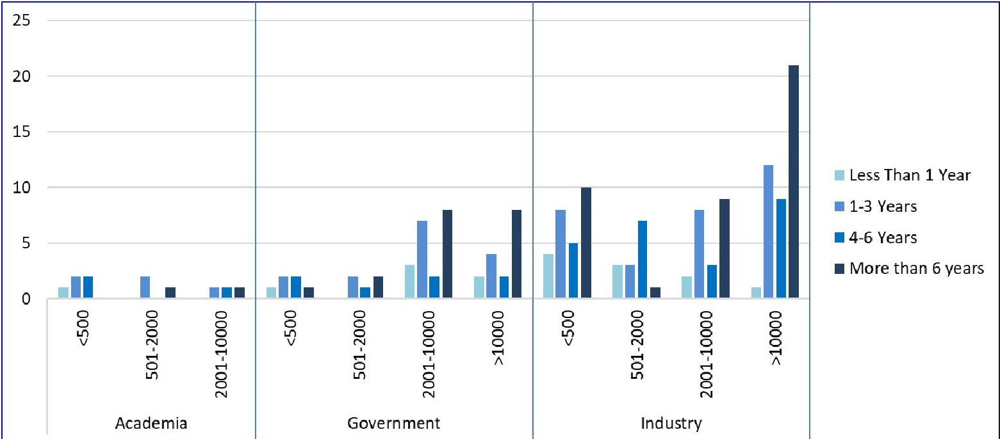

Figure E-2. Respondent's reported organizational type, size, and years' experience.

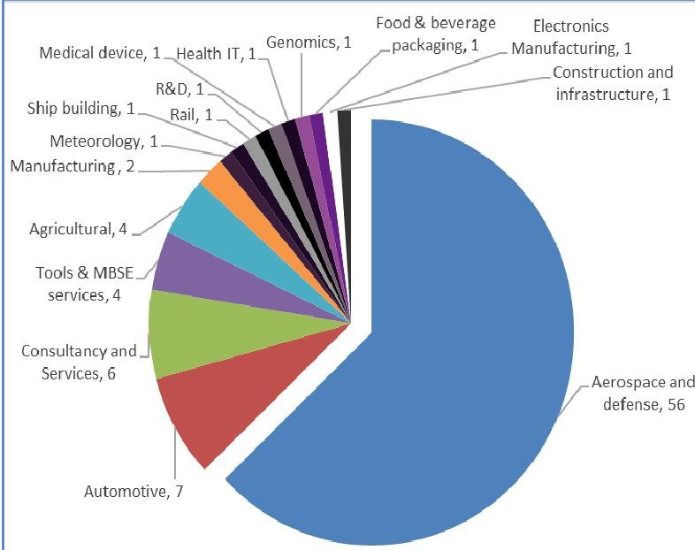

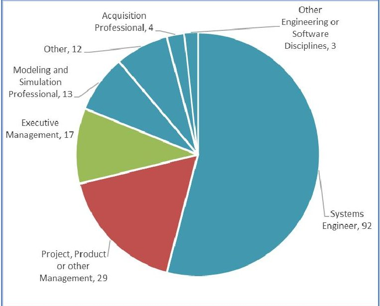

Figure E-3. Reported Market Areas for Industry Respondents.

Figure E-4. Reported Respondent Organizational Roles.

The use of DE/MBSE continues to be dominated by the aerospace and defense community, but the survey responses also represented other industries. Reported participant roles included Executive Management (17 respondents), Project/Project/other Management (29 respondents), and Systems Engineering/Other related disciplines (124 respondents). Section 3.3 analyzes the demographic trends in survey response

<!-- PDF_PAGE: 64 -->

data. Responses did vary by role - respondents identifying their role as Executive Management agree or strongly agree with 18 of the 23 Capability statements, while Program/Project/Other Management agree with 7 of the 23, and other System Engineering-related roles only agree with 5 of the 23 (this is discussed further in section 3.3 of the full report). There is a disagreement between Executive Management and other respondents on the relative maturity of their capabilities, which can be related to findings in the MBSE benefits and enterprise adoption analyses in sections 3.4 and 3.5.

## MATURITY ANALYSIS, PARTICIPANT REPORTED RATINGS

Section 3.3 of the full report presents the quantitative analysis of responses to scored questions rated on a Likert-type agreement scale (strongly agree, agree, disagree, or strongly disagree). Participants were not given an option for a neutral response, forcing them to choose agreement or disagreement to some degree. The graph below summarizes a weighted scoring for each scored question. The positive (green) scores represent aggregate results in agreement with the Capability statement, while the negative (red) scores indicate disagreement. The responses to each statement are analyzed in detail in section 3.3.

<table border="1"><tr><td>250</td><td>-150</td><td>-50</td><td>50</td><td>150</td><td>250</td><td></td></tr><tr><td></td><td>-29</td><td></td><td></td><td></td><td></td><td>1. Mature use strategy</td><td>MBSE Usage</td></tr><tr><td></td><td>-63</td><td></td><td></td><td></td><td></td><td>2. Mature process/tool strategies</td><td></td></tr><tr><td></td><td>-86</td><td></td><td></td><td></td><td></td><td>4. Consistent lexicon&amp; taxonomy across enterprise</td><td>Model Management</td></tr><tr><td></td><td>-98</td><td></td><td></td><td></td><td></td><td>5. Mature model management processes</td><td></td></tr><tr><td></td><td>-92</td><td></td><td></td><td></td><td></td><td>6. Standard program&amp; business guidance for models</td><td></td></tr><tr><td></td><td>-118</td><td></td><td></td><td></td><td></td><td>8. Models are the basis for technical processes</td><td>Technical Management</td></tr><tr><td></td><td>-77</td><td></td><td></td><td></td><td></td><td>9. MBSE is the basis for Technical Reviews</td><td></td></tr><tr><td></td><td></td><td>30</td><td></td><td></td><td></td><td>11. Modeling provides measurable improvements</td><td>Metrics</td></tr><tr><td></td><td>-153</td><td></td><td></td><td></td><td></td><td>12. Have consistent metrics across enterprise</td><td></td></tr><tr><td></td><td>-61</td><td></td><td></td><td></td><td></td><td>14. Consistent data/model V&amp;V processes</td><td>Model Quality</td></tr><tr><td></td><td>-73</td><td></td><td></td><td></td><td></td><td>15. Consistent data/model quality assurance processes</td><td></td></tr><tr><td></td><td>-91</td><td></td><td></td><td></td><td></td><td>16. Processes to manage data interface between tools</td><td>Data Management</td></tr><tr><td></td><td>-111</td><td></td><td></td><td></td><td></td><td>17. Data is portable across organizations&amp; tools</td><td></td></tr><tr><td></td><td></td><td>18</td><td></td><td></td><td></td><td>19. Support model libraries for model reuse</td><td>Model Sharing&amp; Reuse</td></tr><tr><td></td><td>-85</td><td></td><td></td><td></td><td></td><td>20. Libraries support discoverable knowledge</td><td></td></tr><tr><td></td><td>-107</td><td></td><td></td><td></td><td></td><td>21. Consistent use of shared models</td><td></td></tr><tr><td></td><td></td><td></td><td>243</td><td></td><td></td><td>23. Trust that environment is secure</td><td></td></tr><tr><td></td><td></td><td></td><td>195</td><td></td><td></td><td>24. Trust that environment protects IP</td><td>Modeling Environment</td></tr><tr><td></td><td>-10</td><td></td><td></td><td></td><td></td><td>25. Have processes and tool selection&amp; interoperability</td><td></td></tr><tr><td></td><td>-70</td><td></td><td></td><td></td><td></td><td>30. Have clearly defined roles supporting MBSE</td><td>Workforce</td></tr><tr><td></td><td>-165</td><td></td><td></td><td></td><td></td><td>32. Have sufficient staffing for all roles</td><td></td></tr><tr><td></td><td>-53</td><td></td><td></td><td></td><td></td><td>33. Have defined critical skills supporting MBSE</td><td></td></tr><tr><td></td><td>-24</td><td></td><td></td><td></td><td></td><td>35. Training is linked to critical skills</td><td>MBSE Skills</td></tr><tr><td colspan="8">DISAGREE AGREE</td></tr></table>

Figure E-5. Overall Capability Maturity Scorecard by Question.

As can be seen in Figure E-5, responses associated with maturity of their capabilities mostly disagreed with the statements, with a few exceptions. In most questions, government lagged industry and academia in their agreement scores. Also, organization size and years of experience had varying effect on the responses, as scores did not always improve with size of organization or years of experience with MBSE. In fact, there is evidence in the survey results from many of the question categories that smaller organizations are finding adoption to be easier than larger organizations, indicating cultural challenges are at play. For a complete analysis see the detailed analyses of each question in section 3.3 of the full

<!-- PDF_PAGE: 65 -->

report. In the section "Analysis of Free-text Responses, Enterprise Adoption" free-text questions are used to infer enterprise enablers and obstacles to DE/MBSE adoption. This section provides additional insight on the likely reasons for organizational size and experience variations (refer to section 3.5 of the full report).

MBSE Usage, Model Management, and Technical Management relate to the enterprise-wide use of DE/MBSE methods, processes, and tools. Enterprise strategies for MBSE Usage are leading actual Model Management practices and associated Technical Management practices in capability maturity scores as might be expected. Overall, there was moderate disagreement from respondents that these capabilities are mature. There was agreement that the capabilities increase with years of experience. However, the survey results for each of these three areas indicate that smaller organizations have stronger agreement than larger organizations (see the detailed analyses of each question in section 3.3 of the full report). It is possible that smaller organizations are finding adoption to be easier than larger organizations, indicating leadership and cultural challenges are at play.

In the Technical Management area, additional concerns related to organization adoption were provided in the free-text question: "Please identify any benefits or challenges your organization has found in the use of MBSE (or 'digital engineering') in the technical review process." Section 3.4.6 of the full report discusses these findings in more detail. Figure E-6 provides a preview of the full analysis of benefits and adoption metrics in section 3.4 and 3.5, focused just on survey responses related to the technical review process. As can be seen in the figure, obstacles to adoption lead enablers to benefits by a large margin in survey responses. Also different factors can be both enablers and obstacles to DE/MBSE transformation.

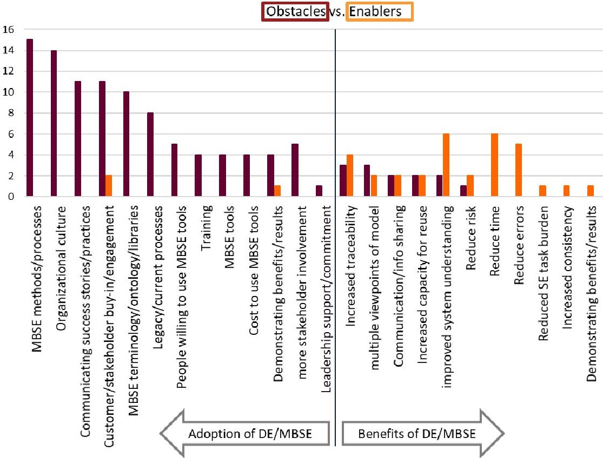

Figure E-6. Comparing Obstacles and Enablers in the Technical Review Process.

The Metrics category returned a dichotomy of scores from respondents. For detailed analysis refer to sections 3.3.4 and 3.4.4 of the full report. Respondents moderately agree that modeling provides

<!-- PDF_PAGE: 66 -->

measurable improvements, but looking more broadly across the DE enterprise, they strongly disagree that they have mature measurement capabilities. DE/MBSE benefits at this point are more perceived than measured. Organizations appear to be searching for guidance on measuring the value and benefits of DE/MBSE usage. In the section "Analysis of Free-text Responses, MBSE Benefits and Metrics" free-text questions are used to analyze top reported metrics.

Generally, agreement scores increased (i.e., higher levels of agreement) with years of experience. Most responses to the Likert scale questions showed a general increase in agree or strongly agree scores with increasing years of experience. Exception were the "Metrics" category (discussed in section 3.3.4), the "Data Management" category (discussed in section 3.3.6), the "Model Sharing and Reuse" category (discussed in section 3.3.7), and the "Workforce" category (discussed in section 3.3.10). These areas did not show much of an in agreement scores with years of experience. This may indicate there are some areas where the community is still not making much progress in maturing their capabilities. Analysis of free-text responses provides additional insight on the likely reasons for this (discussed in sections 3.4-3.6).

The Model Quality, Data Management, and Model Sharing and Reuse categories relate to enterprise management of data and models. Across these areas, respondents generally agree that they have enterprise capabilities for maintaining model libraries and achieving model reuse (a key value of DE/MBSE), but disagree or strongly disagree that other enterprise capabilities for managing, using, and validating data and models are mature. Most of these issues also appear to be related to workforce, culture, and change management concerns, which are further discussed in the enterprise adoption analysis in section 3.5 of the full report. In fact, responses from smaller organizations reflect more agreement than larger organizations on mature capabilities across these areas, likely because they are able to realize the necessary cultural changes more quickly.

The maturity of capabilities related to Modeling Environment was the only category to see broad agreement across the survey respondents, indicating that basic tools and processes are reaching a more mature state.

In the Workforce and Skills categories, responses reflected weak disagreement on effectiveness of training, moderate disagreement on maturity of organizational roles and skills, and strong disagreement with respect to availability of staffing. Roles, skills, and training are analyzed in section 3.6 of the full report.

## ANALYSIS OF TEXT RESPONSES, MBSE BENEFITS AND METRICS

Section 3.4 of the full report provides a detailed analysis of free-text responses based on MBSE benefits and metrics. Per agreement with the survey sponsors, a separate SERC research project using literature review supported development of a framework for defining and categorizing metrics, which was used to analyze the survey results. This research identified 48 categories of benefits across 4 broad digital enterprise transformation categories. The survey results correlated closely to the literature review; survey participants cited 45 of the 48 benefit categories identified from literature review. This framework is shown in Table E-1.

<!-- PDF_PAGE: 67 -->

Table E-1. List of DE/MBSE benefit categories from the literature review.

<table border="1"><tr><td>Category</td><td></td><td colspan="2">List of Benefits</td></tr><tr><td rowspan="6">Quality</td><td>Reduce errors/ defects</td><td>Improved risk analysis</td><td>Improved capability</td></tr><tr><td>Improved traceability</td><td>Improved system design</td><td>More stakeholder involvement</td></tr><tr><td>Improved system quality</td><td>Better requirements generation</td><td>Strengthened testing</td></tr><tr><td>Reduce risk</td><td>Increased accuracy of estimates</td><td>Reduce cost</td></tr><tr><td>Increased rigor</td><td>Improved predictive ability</td><td>Better analysis capability</td></tr><tr><td>Increased effectiveness</td><td>Improved deliverable quality</td><td></td></tr><tr><td rowspan="6">Velocity/Agility</td><td>Improved consistency</td><td>Increased productivity</td><td>Higher level support for integration</td></tr><tr><td>Increased capacity for reuse</td><td>Increased transparency</td><td>Increased uniformity</td></tr><tr><td>Increased efficiency</td><td>Increased confidence</td><td>Increased precision</td></tr><tr><td>Reduce rework</td><td>Increased flexibility</td><td>Early V&amp;V</td></tr><tr><td>Reduce time</td><td>Better requirements management</td><td>Reduce ambiguity</td></tr><tr><td>Reduce waste</td><td>Ease of design customization</td><td>Easy to make changes</td></tr><tr><td rowspan="3">User Experience</td><td>Higher level support for automation</td><td>Improved system understanding</td><td>Reduce effort</td></tr><tr><td>Reduce burden of SE tasks</td><td>Better data management/capture</td><td></td></tr><tr><td>Better manage complexity</td><td>Better decision making</td><td></td></tr><tr><td rowspan="2">Knowledge Transfer</td><td>Better accessibility of info</td><td>Improved architecture</td><td>Improved collaboration</td></tr><tr><td>Better knowledge management/capture</td><td>Better communication/info sharing</td><td>Multiple viewpoints of model</td></tr></table>

The three survey questions related to benefits are:

Q3. What do you see as the most important reasons for integrating MBSE processes with program and business management processes,

Q7. Please provide one or more descriptions of the business value you are realizing from consistent model management processes and tools, and

Q26. Please identify any additional benefits you find from collaborating on models across disciplines.

The three survey questions are categorized as relating to integration benefits, model management benefits, and collaboration benefits, as shown in Table E-2. The top 8 benefit categories based on frequency of citation in the free-text questions associated with benefits are shown below. Although the top 8 responses were consistent, they varied by type of benefit.

<!-- PDF_PAGE: 68 -->

Table E-2. Top 8 stated benefits of DE/MBSE by question.

<table border="1"><tr><td>Q3 Reason for Integrating MBSE</td><td>Q7 Value from Consistent Model Management</td><td>Q26 Benefit from Collaboration</td></tr><tr><td>Reduce cost(17)</td><td>Increased capacity for reuse(18)</td><td>Better communication/information sharing(13)</td></tr><tr><td>Reduce time(17)</td><td>Improved consistency(16)</td><td>Improved system understanding(10)</td></tr><tr><td>Better accessibility of info(16)</td><td>Improved system understanding(9)</td><td>Better accessibility of info(6)</td></tr><tr><td>Increased efficiency(14)</td><td>Reduce time(9)</td><td>Improved consistency(5)</td></tr><tr><td>Improved consistency(13)</td><td>Better communication/information sharing(7)</td><td>Reduce errors(5)</td></tr><tr><td>Increased traceability(11)</td><td>Better accessibility of info(7)</td><td>Reduce time(5)</td></tr><tr><td>Improved system understanding(10)</td><td>Reduce cost(7)</td><td>Increased capacity for reuse(5)</td></tr></table>

An additional free-text question related to metrics was included to define specific metrics respondents have found useful in their organization: Q13. Please identify any metrics that have proven to be useful for measuring the performance of your MBSE activities. The literature review found that most benefits described in papers were either perceived to accrue with DE/MBSE or have been observed, versus being explicitly measured through formal metrics. The survey did not ask participants about specific measurement processes. As discussed previously, organizations appear to be searching for guidance on measuring the value and benefits of DE/MBSE usage. This may be due to the lack of a good measurement framework. Section 3.4 of this report provides a suggested framework for DE/MBSE metrics linked to the 48 benefit categories. Section 3.5 provides a framework additionally to assess enterprise adoption metrics. The most frequently cited metrics from the survey were coded by our benefits framework and are listed in Table E-3 in the left-hand columns, with number of citations in parentheses. For comparison the related benefits total citation numbers are included in the right-hand columns.

Table E-3. Most cited benefits and metrics categories from survey data.

<table border="1"><tr><td colspan="2">Top survey response metrics(Q13 only)</td><td colspan="2">Survey response benefits(Q3,Q7,andQ26)</td></tr><tr><td>Better requirements generation</td><td>7</td><td>Better requirements generation</td><td>7</td></tr><tr><td>Reduce errors</td><td>7</td><td>Reduce errors</td><td>19</td></tr><tr><td>Increased traceability</td><td>6</td><td>Increased traceability</td><td>17</td></tr><tr><td>Better requirements mgt.</td><td>6</td><td>Better requirements mgt.</td><td>3</td></tr><tr><td>Improved system design</td><td>5</td><td>Improved system design</td><td>9</td></tr><tr><td>Reduce cost</td><td>5</td><td>Reduce cost</td><td>25</td></tr><tr><td>Reduce time</td><td>5</td><td>Reduce time</td><td>31</td></tr><tr><td>Increased capacity for reuse</td><td>5</td><td>Increased capacity for reuse</td><td>30</td></tr><tr><td>Better analysis capability</td><td>4</td><td>Better analysis capability</td><td>6</td></tr><tr><td>Improved system quality</td><td>2</td><td>Improved system quality</td><td>14</td></tr><tr><td>Increased effectiveness</td><td>2</td><td>Increased effectiveness</td><td>6</td></tr><tr><td>Higher level support for automation</td><td>2</td><td>Higher level support for automation</td><td>3</td></tr><tr><td>Higher level support for integration</td><td>2</td><td>Higher level support for integration</td><td>14</td></tr></table>

<!-- PDF_PAGE: 69 -->

The Quality, Velocity/Agility, User Experience, and Knowledge Transfer categories relate to the analysis of benefits in section 3.4. Figure E-7 shows the full survey result with respect to benefits.

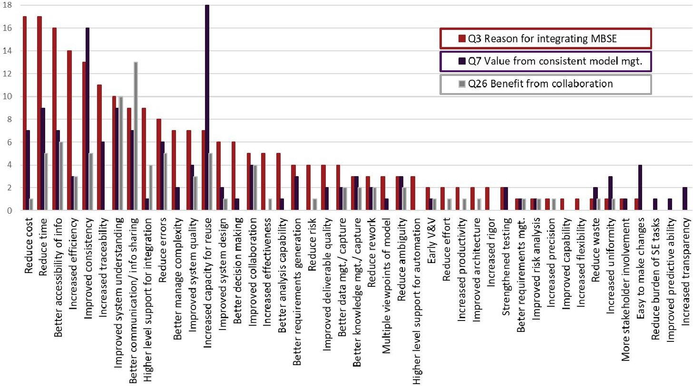

Figure E-7. Results for All Q3/Q7/Q26 Survey Questions on Benefits.

Respondents also cited numerous obstacles that have had a negative effect on successful enterprise adoption, related to the analysis of Enterprise Adoption in section 3.5. On the positive side, a number of enablers and changes to aid adoption were also cited by survey respondents.

## ANALYSIS OF TEXT RESPONSES, ENTERPRISE ADOPTION

Section 3.5 of the full report analyzes three survey questions related to adoption:

Q27. The most challenging obstacles to implementing MBSE in our organization are:

Q28. The best enablers for MBSE in our organization are:

Q29. Going forward, the biggest changes our organization needs to make to improve our implementation of MBSE are:

Qualitative analysis of questions 27 and 28 examines MBSE adoption from the opposites of obstacles and enablers in order to identify a more robust and comprehensive list of "success factors" framed in a neutral way, i.e., regardless of whether they were experienced as an obstacle (barrier, impediment, etc.) or enabler. Analysis of question 29 explores changes needed within the organization to increase the likelihood of success. A total of 37 unique success factors were identified based on survey responses, which related to 8 categories: Leadership, Communication, Resources, Workforce, Change Processes, MBSE Processes, Organizational Environment, and External Environment. These are listed in Table E-4.

<!-- PDF_PAGE: 70 -->

Table E-4. List of enterprise success factors from the survey analysis.

<table border="1"><tr><td>Category</td><td></td><td>List of Success Factors</td><td></td></tr><tr><td>Leadership</td><td>Leadership support/commitment</td><td>Leadership understanding of MBSE</td><td></td></tr><tr><td>Communication</td><td>Awareness of MBSE benefits/value</td><td>Communicating success stories/practices</td><td>Need for change</td></tr><tr><td>Resources</td><td>Cost to use MBSE tools</td><td>General resources for MBSE implementation</td><td></td></tr><tr><td rowspan="3">Workforce</td><td>General MBSE awareness and knowledge</td><td>People willing to use MBSE tools</td><td>Teamwork</td></tr><tr><td>MBSE learning curve</td><td>People in SE roles</td><td>Training</td></tr><tr><td>Workforce knowledge/skills</td><td></td><td></td></tr><tr><td rowspan="3">Change Processes</td><td>Champions</td><td>Competing priorities</td><td>Legacy/current processes</td></tr><tr><td>Change management process design</td><td>Integration to support MBSE implementation</td><td>Vision and strategy for MBSE</td></tr><tr><td>Community of practice</td><td>Demonstrating benefits/results</td><td></td></tr><tr><td rowspan="2">MBSE Processes</td><td>MBSE methods/processes</td><td>MBSE tools</td><td>Security of data and IP</td></tr><tr><td>MBSE terminology/ontology/libraries</td><td>Projects/programs to apply MBSE</td><td></td></tr><tr><td rowspan="2">Organizational Environment</td><td>Alignment with business strategy</td><td>Organizational culture</td><td>Success metrics</td></tr><tr><td>Organizational characteristics</td><td>Rewards/recognition</td><td>Supportive infrastructure</td></tr><tr><td rowspan="2">External Environment</td><td>Alignment with customer requirements</td><td>Customer/stakeholder buy-in/engagement</td><td></td></tr><tr><td>External regulations</td><td>Use in SE community</td><td></td></tr></table>

These categories aid in examining MBSE adoption from the lens of the Baldrige Criteria for Performance Excellence (CPE) $ ^{41} $ , which provides a comprehensive, holistic, systems view of an organization by identifying a set of management sub-systems an organization must purposefully design (or redesign) and monitor in order be high-performing $ ^{42} $ . Figure E-8 shows the full survey results for the most frequently-reported obstacles, enablers, and changes, with detailed analyses of each in section 3.5 of the full report.

<!-- PDF_PAGE: 71 -->

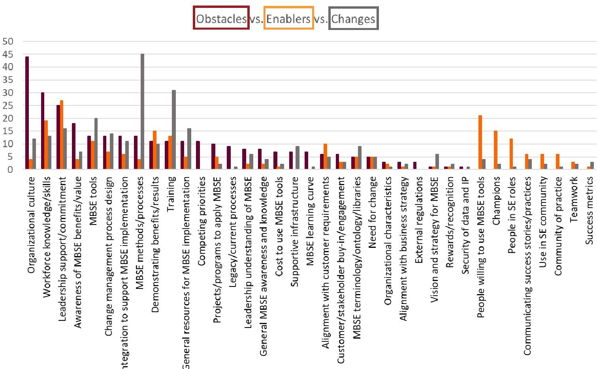

Figure E-8. Summary of Obstacles, Enablers, and Changes to DE/MBSE adoption.

The most frequently reported obstacles to MBSE adoption, as shown in the figure, were organizational culture, workforce knowledge/skills, leadership support/commitment, awareness of MBSE benefits and value, MBSE tools, and change management process design. The most frequently-reported enablers also included leadership support/commitment and workforce knowledge/skills, as well as people willing to use MBSE tools, champions, people in systems engineering roles, training, and demonstrating benefits and results. MBSE methods and processes, tools, training, resources, and leadership support and commitment were the most frequently reported changes necessary to improve MBSE implementation.

Insight from analysis of both obstacles and enablers, mapped to the Baldrige CPE, was used to define a preliminary set of adoption practices for achieving maturity in MBSE:

1. Leaders communicate a clear reason and need for MBSE adoption

2. Leaders understand MBSE

3. Leaders support and are committed to MBSE

4. People understand the benefits of MBSE

5. MBSE is aligned with the overall business strategy

6. MBSE is used for the right projects/programs

7. MBSE adoption is aligned with what customers need/require

8. Customers and stakeholders buy-in to MBSE

9. Data management processes support MBSE

10. The IT infrastructure supports MBSE use

11. Clear metrics are defined to track results and progress of MBSE

12. Systems engineers have the skills needed to support MBSE use

13. Training is provided to develop needed skills

14. People are rewarded/recognized for using MBSE

15. The organizational culture is aligned with MBSE use

<!-- PDF_PAGE: 72 -->

ANALYSIS OF TEXT RESPONSES, WORKFORCE DEVELOPMENT

Section 3.6 of the full report analyzes three survey questions related to the workforce:

Q18. Please identify any new data management roles and processes you have created.

Q31. The top MBSE role(s) in my organization are:

Q34. The most critical skills for MBSE are:

The workforce questions generally found that DE/MBSE was just an extension of existing systems engineering roles and skills. In other words, mature SE capabilities are essential to DE/MBSE success. Top DE/MBSE roles include SE, modeling, and organizational and technical leadership. Digital engineering presents newer roles related to the data science aspects of MBSE, particularly data management, data integration, and data analysis. Also, there is more emphasis on tool experts: roles focused exclusively on the use and maintenance of tools to support MBSE. Top DE related roles include data architect, data manager, model curator, and change manager.

The most critical skills for DE/MBSE favored system architecture and systems thinking, along with requirements engineering, domain knowledge, and SE process skills. Added to these were "digital skills" relating to modeling, data science, simulation, data/tools environment, and model governance.

The most commonly cited challenges were creation of DE/MBSE processes and issues with tool integration, along with staffing. The survey reinforces that the critical skills for a good systems engineer are the same as those for a good model-based systems engineer. The critical differences are the addition of the utilization of specific tools, an understanding of modeling language, and the "digital engineering" skills, which in this survey focus around the skillsets of data management and utilization and general modeling and simulation skills. These were linked in the section to the HELIX Atlas systems engineering proficiency model $ ^{43} $

The remainder of the report provides the details of the survey method, results, and analyses. A key aspect of the survey details is the presentation of four frameworks related to DE/MBSE success:

- the INCOSE Capability Maturity Matrix which supports assessment of enterprise-level capabilities,

- a DE/MBSE Value/Benefits Framework developed from this survey and a literature review which defines four categories for DE metrics: Quality, Velocity/Agility, User Experience, and Knowledge Transfer,

- a DE/MBSE Adoption Framework developed from the Baldrige CPE Framework which addresses organizational adoption and change management, and

- a workforce competency framework linked to the HELIX Atlas model.

This completes the executive Summary portion of the report. The full survey methodology and analysis of survey results are providing in supporting report SERC-SR-2020-0001.