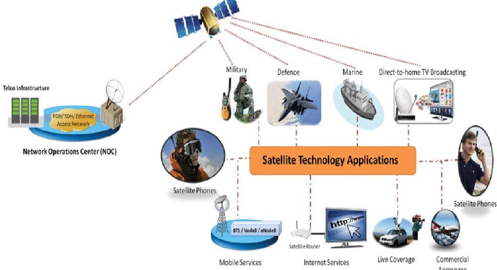
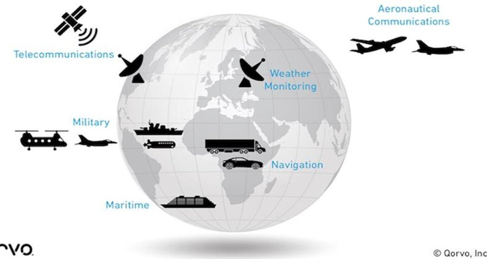
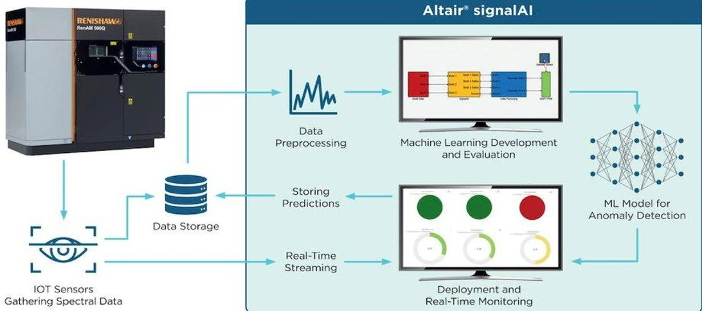

<!-- PDF_PAGE: 1 -->

ISSN: 2394-658X

# Digital Satellite Technology: Innovations and Applications in the Modern Era

Iqtiar Md Siddique

Department of Mechanical Engineering, the University of Texas at El Paso, USA Email id - iqtiar.siddique@gmail.com.

## ABSTRACT

Digital satellite technology has undergone profound evolution, transitioning from analog to advanced digital systems that revolutionize communication, broadcasting, and remote sensing applications. Innovations in signal processing, modulation techniques, and encoding standards have significantly boosted data transmission rates, signal quality, and reliability in satellite communications. This evolution has facilitated the integration of multimedia services like high-definition television (HDTV), internet access, and mobile broadcasting, expanding the scope and efficiency of satellite-based networks globally. In communication, digital satellites serve critical roles in providing voice, data, and multimedia services to remote and underserved areas, supporting telecommunications infrastructure, disaster recovery, and emergency response efforts where terrestrial networks are lacking. Moreover, digital satellite systems play a vital role in broadcasting, delivering television and radio programming to diverse regions, and ensuring widespread access to entertainment, news, and educational content. Beyond communication, digital satellites enhance Earth observation and remote sensing capabilities with advanced imaging sensors and radar systems, facilitating high-resolution imagery for environmental monitoring, agriculture, urban planning, and disaster management. Looking forward, ongoing advancements in artificial intelligence, machine learning, and autonomous operations promise to further elevate the capabilities and efficiency of digital satellite technology, paving the way for enhanced data analytics, predictive modeling, and real-time applications across various sectors globally.

## Key words: communication, satellite technology, Earth observation, digital satellites, global connectivity

## INTRODUCTION

Digital satellite technology has undergone a transformative journey from its analog origins to becoming a cornerstone of modern telecommunications, broadcasting, and Earth observation systems. This evolution represents a leap in data transmission capabilities, leveraging advancements in digital modulation techniques and encoding standards to enhance signal fidelity and spectral efficiency. These technologies have not only expanded the reach of satellite communications, offering vital connectivity solutions in remote and underserved regions, but have also revolutionized broadcasting with the delivery of high-definition television (HDTV), multimedia content, and interactive services globally [1]. Digital satellite technology stands at the forefront of modern telecommunications, offering transformative capabilities that have revolutionized global connectivity and data transmission. From their inception, satellites have evolved from simple communication relays to sophisticated platforms enabling a myriad of applications across various industries. This introduction explores the innovative advancements and diverse applications of digital satellite technology in today's era.

Since the launch of the first artificial satellite, Sputnik 1, in 1957, satellite technology has undergone remarkable evolution. Early satellites focused primarily on telecommunications, enabling long-distance communication across continents and oceans. Over the decades, advancements in electronics, miniaturization, and propulsion have propelled satellites into more complex roles, including Earth observation, navigation, scientific research, and space exploration. Modern digital satellites are equipped with advanced features such as high-resolution imaging sensors, onboard data processing capabilities, and sophisticated communication payloads. These capabilities enable real-time monitoring of the Earth's surface for environmental management, disaster response, and urban planning. Satellites also play a pivotal role in global navigation systems, facilitating precise positioning for navigation and timing applications worldwide. The applications of digital satellite technology span diverse industries. In telecommunications, satellites serve as backbone infrastructure for global connectivity, delivering broadband internet access to remote and underserved regions. They also support broadcasting and multimedia distribution, ensuring widespread dissemination of information and entertainment.

<!-- PDF_PAGE: 2 -->

In the realm of Earth observation, satellites provide critical data for weather forecasting, climate monitoring, agriculture management, and natural resource exploration. Scientific satellites contribute to space exploration missions, astronomical observations, and fundamental research in physics and astronomy.

Looking ahead, the future of digital satellite technology promises even greater advancements. Innovations in satellite miniaturization, constellation deployments, and artificial intelligence will enhance data processing capabilities, reduce launch costs, and enable new applications in areas such as autonomous satellite operations and inter-satellite communication networks. Saha et al and Sunny (2024) describes sensors fiber and environmental issues which are useful for our future research and extension of this current research [34-42].

Beyond communication and broadcasting, digital satellites have become indispensable tools in Earth observation and remote sensing. Equipped with advanced imaging sensors, synthetic aperture radar (SAR), and hyperspectral scanners, satellites capture high-resolution imagery and spatial data critical for monitoring environmental changes, managing natural disasters, and supporting sustainable development initiatives [3]. This capability enables realtime surveillance of climate patterns, deforestation rates, urban growth, and disaster response efforts, empowering decision-makers with actionable insights at local, national, and international scales [2].

Looking forward, the future of digital satellite technology holds promising advancements in several key areas. The emergence of small satellites and satellite constellations promises increased agility and coverage for a range of applications, from global broadband services to precision agriculture and environmental monitoring. Artificial intelligence (AI) and machine learning are driving autonomous satellite operations and intelligent data analytics, optimizing satellite performance and enhancing operational efficiency in orbit. Moreover, integrated space systems and cross-domain applications, such as satellite-enabled 5G networks and space-based internet services, are poised to reshape global connectivity and digital infrastructure.

In conclusion, digital satellite technology stands at the forefront of innovation, continuously evolving to meet the growing demands of our interconnected world. As these technologies advance, they not only enhance communication and observation capabilities but also play a pivotal role in addressing global challenges and advancing sustainable development goals. This extended introduction sets the stage for exploring the multifaceted impacts and future potentials of digital satellite technology in shaping the modern era of data-driven societies and interconnected economies [4].

Figure 1: Satellite Communications - Applications, Testing and Test Tools [6]

METHODOLOGY

The methodology employed in this study leverages a systematic approach to comprehensively analyze and evaluate the various facets of digital satellite technology. The research methodology encompasses several key components aimed at ensuring robustness, reliability, and relevance in the study's findings. Research in space assembly focuses on automating tasks with large robotic arms, utilizing swarm robots for assembly and exploring self-assembling structures. Specialized structures, including those for agricultural space farms and space hotels, require advanced automation and sensing systems. Key research directions include assessing the feasibility and efficiency of assembling structures in space using large robotic arms versus swarm robot assemblies. Additionally, designing specialized space structures parallels developments in specialized buildings on Earth, aiming to optimize functionality and adaptability to extraterrestrial environments [30,31,32,33].

## DATA COLLECTION

Initially, a thorough literature review was conducted to gather foundational knowledge and insights into digital satellite technology. This review included peer-reviewed journals, conference proceedings, technical reports, and relevant publications from reputable sources in the field. The primary objective was to establish a comprehensive

<!-- PDF_PAGE: 3 -->

understanding of the historical evolution, technological advancements, current trends, and emerging applications of digital satellite systems.

## A. Data Sources and Selection Criteria:

Data collection involved gathering empirical data, statistics, and case studies from diverse sources, including satellite operators, industry reports, governmental agencies, and international organizations. The selection criteria prioritized recent and relevant data sets that align with the study's focus on technological innovations, market trends, operational capabilities, and socioeconomic impacts of digital satellite technology.

## B. Research Framework and Analytical Approach:

A conceptual framework was developed to guide the analysis and interpretation of the collected data. This framework incorporates key dimensions such as technological innovation, market dynamics, regulatory environments, and societal impacts to provide a holistic assessment of digital satellite technology's ecosystem. Analytical methods include qualitative analysis of case studies, quantitative assessments of data trends, and comparative evaluations of technological platforms and operational models [5,6]. Fifth generation (5G) mobile technology offers enhanced bandwidth, reduced latency, and improved reliability, making it ideal for time-sensitive IoT applications. As global mobile service providers deploy 5G networks, academia and industry are already planning for the sixth generation (6G), expected to be standardized and operational within the next decade. 6G aims to achieve data rates surpassing 1Tbps and ultra-low latency of less than a millisecond across expansive three-dimensional coverage areas [22,23,24,25,26,27]. Ground and aerial networks will collaborate to meet these performance targets, with Low Earth Orbit (LEO) satellites and CubeSats supplementing coverage in rural and remote areas [28].

A primary research focus for 5G and beyond networks involves fully integrating ground, aerial, and satellite communication networks. Researchers are exploring techniques and architectures to seamlessly integrate satellite communication into 5G networks to support emerging IoT services. For instance, Gineste et al. conducted an initial study on integrating satellites and High-Altitude Platforms (HAPs) into 5G networks [29]. They outlined necessary adaptations for HAPs to operate within 5G systems using Narrowband-IoT (NB-IoT), demonstrating how these systems can maintain low-bitrate satellite connectivity with minimal configuration updates. This integration enhances service continuity while complementing terrestrial infrastructure for NB-IoT applications.

## C. Case Studies and Comparative Analysis:

The methodology includes detailed case studies of prominent digital satellite systems and applications across different sectors, including telecommunications, broadcasting, Earth observation, and scientific research. These case studies serve to illustrate best practices, challenges, and success factors in implementing digital satellite solutions. Comparative analysis across diverse geographic regions and market segments enhances understanding of global trends and regional variations in satellite technology adoption and deployment [8]. Satellite-enabled Internet at Low Earth Orbit (LEO), also known as Satellite Terrestrial Network (STN), aims to enhance global Internet access, particularly in underserved areas lacking terrestrial infrastructure such as remote regions, and for users in aeronautical and maritime environments [21]. A key distinction between fog/edge computing via STNs and conventional fog/edge computing lies in the distribution of mobile users. In conventional setups, mobile users are densely clustered, whereas STN fog/edge computing scenarios often involve sparsely distributed users accessing the Internet via small terminals with limited computation and storage capacities. Deploying a satellite-based edge/fog server for such scenarios is economically challenging due to the small user base, as discussed in [22].

The article explores methods to enhance Quality of Service (QoS) for STN mobile users through edge computing. Computation offloading can occur through Proximal Terrestrial Offloading (PTO), where tasks are offloaded to edge servers at terrestrial stations to avoid backhaul transmission to satellites. Satellite-Borne Offloading (SBO) equips LEO satellites with edge computing capabilities, reducing the need for communication with remote clouds and minimizing traffic between satellite and terrestrial networks. Remote Terrestrial Offloading (RTO) involves deploying edge servers at terrestrial backbone network gateways. While PTO offers the highest latency reduction, followed by SBO and then RTO, practical constraints such as hardware costs and energy consumption must be considered. In [22], an alternative strategy is proposed involving the collaboration of multiple Mobile Edge Computing (MEC) servers within a LEO satellite's coverage area. This approach utilizes dynamic Network Function Virtualization (NFV) to centrally manage task offloading. MEC servers employ cooperative offloading schemes to handle user tasks, resulting in reduced perceived delay and energy consumption based on simulation results.

## D. Ethical Considerations and Limitations:

Ethical considerations were carefully addressed throughout the research process, ensuring adherence to data privacy regulations, intellectual property rights, and ethical standards in data collection and analysis. Limitations of the study include potential biases in data sources, constraints in access to proprietary information, and the dynamic nature of technological advancements, which may influence the accuracy and generalizability of findings.

<!-- PDF_PAGE: 4 -->

# Satellite Communication Applications

Figure 2: Ka-Band Satcom Trends and Power Amplification Challenges [7]

## RESULTS AND DISCUSSIONS

## A. Telecommunications and Global Connectivity:

Digital satellite technology has revolutionized telecommunications by bridging the digital divide and enabling global connectivity. Satellites facilitate voice communication, data transfer, and internet access to remote and underserved regions where terrestrial infrastructure is lacking or inadequate. This capability is crucial for supporting emergency communications during disasters and enhancing socio-economic development by enabling access to educational resources, healthcare services, and e-commerce platforms in remote communities. The integration of satellite-based 5G networks and broadband services promises to deliver higher speeds and reliability, meeting the growing demand for high-bandwidth applications worldwide.

## B. Broadcasting and Multimedia Services:

In broadcasting, digital satellites have democratized access to multimedia content, including television programming, radio broadcasts, and interactive services. Satellite broadcasting enables seamless distribution of high-definition (HD) and ultra-high-definition (UHD) content to diverse audiences across vast geographic areas. This capability is essential for delivering news updates, entertainment, sports events, and cultural programming globally. Moreover, digital satellites support direct-to-home (DTH) broadcasting, enabling viewers to access a wide range of channels without relying on terrestrial networks, thereby enhancing media accessibility and viewer choice [9].

## C. Earth Observation and Environmental Monitoring:

Satellite-based Earth observation plays a critical role in monitoring environmental changes, natural disasters, and climate patterns. Advanced satellite sensors capture high-resolution imagery and collect valuable data on land use, deforestation rates, urban expansion, and agricultural productivity. These observations are essential for informing policy decisions, disaster preparedness, and sustainable resource management. For instance, satellite data aids in assessing the impact of climate change on ecosystems, facilitating early warning systems for natural hazards, and supporting international efforts to conserve biodiversity and mitigate environmental degradation. Beyond technological considerations lie essential questions about human culture, ethics, and social-psychological factors crucial for survival on a new planet [18,19,20]. For instance, fostering deep altruism and cultivating a suitable cultural environment are imperative. These aspects could be supported by appropriate technologies, such as ethical frameworks for law enforcement and monitoring, ensuring responsible behavior within ethical boundaries. Achieving harmony between technological advancements and socio-cultural readiness is pivotal for sustainable human habitation and successful colonization efforts beyond Earth.

## D. Emerging Technologies and Future Trends:

Looking ahead, ongoing advancements in digital satellite technology are poised to introduce transformative innovations. Small satellite constellations, comprising miniaturized satellites in coordinated orbits, promise enhanced coverage, agility, and cost-effectiveness for a range of applications. Artificial intelligence (AI) and machine learning algorithms are driving autonomous satellite operations, optimizing mission planning, data acquisition, and satellite maintenance. Additionally, the integration of satellite systems with emerging technologies such as blockchain for secure data transactions and quantum computing for enhanced data processing capabilities holds promise for revolutionizing space-based applications and expanding the frontiers of digital satellite technology.

<!-- PDF_PAGE: 5 -->

Figure 3: Using machine learning for manufacturing process improvement [10]

## FUTURE RECOMMENDATIONS

Digital satellite technology continues to evolve rapidly, driven by advancements in satellite design, communication protocols, and data processing capabilities. Looking forward, several key trends and developments are shaping the future landscape of satellite technology:

## A. Next-Generation Satellite Constellations:

The deployment of next-generation satellite constellations, comprising hundreds or even thousands of small satellites in low Earth orbit (LEO), is poised to revolutionize satellite communications and Earth observation. These constellations offer enhanced coverage, reduced latency, and increased data throughput compared to traditional geostationary satellites. Companies like SpaceX with their Starlink constellation and OneWeb are leading the charge in providing global broadband internet coverage and connectivity solutions for remote regions [11].

## B. Advancements in Satellite Imaging and Remote Sensing:

Advances in satellite imaging technologies, including higher-resolution sensors and enhanced spectral capabilities, are improving the accuracy and detail of Earth observation data. Future satellites will enable more precise monitoring of environmental changes, urban development, agricultural productivity, and natural disasters. This data is invaluable for decision-makers in government, industry, and academia for informed planning, disaster response, and environmental management.

## C. Artificial Intelligence and Autonomous Operations:

Integration of artificial intelligence (AI) and machine learning (ML) algorithms into satellite systems is revolutionizing autonomous operations. AI-powered satellites can autonomously process and analyze vast amounts of data in real-time, optimizing mission planning, resource allocation, and anomaly detection. This capability enhances the efficiency, reliability, and responsiveness of satellite operations, reducing dependence on ground control and enabling adaptive responses to changing mission objectives and environmental conditions. Emerging business opportunities for IoT include its application in space exploration and related use cases. The integration of IoT connectivity with advanced computing and data processing capabilities driven by Artificial Intelligence (AI) and Machine Learning (ML) is a burgeoning focus of research and development [12,13,14,15,16,17]. This convergence promises to enhance capabilities in space-based operations by enabling real-time data collection, analysis, and decision-making, thereby opening new avenues for innovation and efficiency in satellite-based applications.

## D. Satellite-Based Internet of Things (IoT) and 5G Connectivity:

Satellite networks are increasingly integrated with terrestrial technologies to support IoT applications and enable seamless connectivity for 5G networks. Satellite IoT networks facilitate global asset tracking, environmental monitoring, and remote sensing applications across diverse industries such as agriculture, logistics, and environmental management. Satellite-enabled 5G networks promise to deliver high-speed, low-latency connectivity to underserved areas and support emerging technologies like autonomous vehicles, smart cities, and telemedicine.

## E. Space Tourism and Commercial Spaceflight:

The burgeoning commercial space industry is expanding opportunities for space tourism, scientific research, and commercial spaceflight. Companies like SpaceX, Blue Origin, and Virgin Galactic are developing reusable rockets and spacecraft to reduce launch costs and increase access to space. Digital satellite technology supports these endeavors by providing critical communication, navigation, and remote sensing capabilities for space missions, satellite launches, and space tourism operations.

<!-- PDF_PAGE: 6 -->

## CONCLUSION AND DISCUSSION

Digital satellite technology represents a cornerstone of modern telecommunications, broadcasting, and Earth observation, driving unprecedented advancements in global connectivity, data acquisition, and space exploration. Throughout this study, we have explored the evolution, applications, challenges, and prospects of digital satellite systems. Digital satellites have revolutionized telecommunications by providing essential connectivity solutions to remote and underserved regions worldwide. These satellites enable voice communication, internet access, and broadband services, bridging digital divides and supporting socio-economic development. The integration of satellite-based 5G networks and broadband internet services promises enhanced connectivity for IoT applications, autonomous systems, and emerging technologies. In broadcasting, digital satellite platforms deliver a diverse array of high-definition multimedia content to global audiences, fostering cultural exchange, education, and entertainment. Satellite broadcasting plays a crucial role in delivering timely news updates, sports events, and educational programming, enriching the lives of millions worldwide. Earth observation capabilities facilitated by digital satellites provide critical data for environmental monitoring, disaster management, and resource conservation. Advanced imaging sensors and radar technologies capture high-resolution imagery, enabling precise monitoring of climate change impacts, urbanization trends, and natural disasters. These observations support informed decision-making in environmental policy, agriculture, and urban planning. The future of digital satellite technology holds promising opportunities with the advent of small satellite constellations, AI-driven autonomous operations, and satellite-enabled 5G networks. Next-generation satellite constellations promise expanded coverage, reduced latency, and increased data throughput, enhancing global connectivity and supporting innovative applications in telecommunication, navigation, and remote sensing. In conclusion, digital satellite technology continues to evolve and expand its role in shaping the modern era of interconnected societies and digital economies. As advancements in satellite design, communication protocols, and data analytics accelerate, so will the capabilities and applications of satellite systems. The integration of AI, machine learning, and emerging technologies will drive autonomous satellite operations, optimize data processing, and expand the frontiers of space exploration and satellite-enabled services. To realize the full potential of digital satellite technology, continued investments in research, development, and international collaboration are essential. These efforts will drive innovation, improve satellite performance, and address challenges related to spectrum allocation, orbital debris management, and regulatory frameworks. By leveraging the transformative power of digital satellite technology, we can address global challenges, advance scientific discovery, and foster sustainable development for future generations.

Digital satellite technology also plays a crucial role in scientific research and exploration beyond Earth. Satellites contribute to space exploration missions by providing communication links, navigation assistance, and scientific data collection capabilities. They enable researchers to study celestial bodies, monitor space weather, and conduct experiments in microgravity environments. The collaboration between space agencies, private companies, and academic institutions continues to drive innovation in satellite technology, pushing the boundaries of human knowledge and exploration. Moreover, digital satellites contribute to global security and defense through reconnaissance, surveillance, and intelligence-gathering capabilities. Military and governmental agencies utilize satellite imagery, communication networks, and GPS navigation for strategic planning, disaster response, and national security operations. The secure and reliable communication channels provided by satellite systems ensure rapid and effective coordination during emergencies and military missions, enhancing operational efficiency and situational awareness.

In conclusion, digital satellite technology stands as a testament to human ingenuity and innovation, offering unparalleled capabilities in communication, broadcasting, Earth observation, and space exploration. As we look towards the future, advancements in satellite technology will continue to reshape industries, improve global connectivity, and address pressing challenges facing our planet. The ongoing evolution of digital satellites, coupled with advancements in AI, machine learning, and quantum computing, holds promise for unlocking new opportunities in areas such as healthcare, agriculture, climate monitoring, and disaster resilience. To capitalize on these opportunities, it is imperative to foster international collaboration, invest in research and development, and ensure sustainable practices in satellite deployment and operation. By harnessing the transformative power of digital satellite technology responsibly, we can pave the way toward a more connected, informed, and resilient global community, where the benefits of space-based innovations are accessible to all.

## REFERENCES

[1]. Rodrigues, L. M., Carvalho, L. F. D. C. E. S., Bonnier, F., Anbinder, A. L., Martinho, H. D. S., & Almeida, J. D. (2018). Evaluation of inflammatory processes by FTIR spectroscopy. Journal of Medical Engineering & Technology, 42(3), 228-235.

[2]. Kumar, S., Chaudhary, S., & Jain, D. C. (2014). Vibrational studies of different human body disorders using ftir spectroscopy. Open Journal of Applied Sciences, 2014.

<!-- PDF_PAGE: 7 -->

[3]. Baker, M. J., Gazi, E., Brown, M. D., Shanks, J. H., Gardner, P., & Clarke, N. W. (2008). FTIR-based spectroscopic analysis in the identification of clinically aggressive prostate cancer. British journal of cancer, 99(11), 1859-1866.

[4]. Guerrero-Perez, M. O., & Patience, G. S. (2020). Experimental methods in chemical engineering: Fourier transform infrared spectroscopy—FTIR. The Canadian Journal of Chemical Engineering, 98(1), 25-33.

[5]. Christou, C., Agapiou, A., & Kokkinofta, R. (2018). Use of FTIR spectroscopy and chemometrics for the classification of carobs origin. Journal of Advanced Research, 10, 1-8.

[6]. Chen, Y., Zou, C., Mastalerz, M., Hu, S., Gasaway, C., & Tao, X. (2015). Applications of micro-fourier transform infrared spectroscopy (FTIR) in the geological sciences—a review. International journal of molecular sciences, 16(12), 30223-30250.

[7]. Nivitha, M. R., Prasad, E., & Krishnan, J. M. (2016). Ageing in modified bitumen using FTIR spectroscopy. International Journal of Pavement Engineering, 17(7), 565-577.

[8]. D'Souza, L., Devi, P., Divya Shridhar, M. P., & Naik, C. G. (2008). Use of Fourier Transform Infrared (FTIR) spectroscopy to study cadmium-induced changes in Padina tetrasromatica (Hauck). Analytical Chemistry Insights, 3, 117739010800300001.

[9]. Hospodarova, V., Singovszka, E., & Stevulova, N. (2018). Characterization of cellulosic fibers by FTIR spectroscopy for their further implementation to building materials. American journal of analytical chemistry, 9(6), 303-310.

[10]. Wenning, M., Breitenwieser, F., Konrad, R., Huber, I., Busch, U., & Scherer, S. (2014). Identification and differentiation of food-related bacteria: A comparison of FTIR spectroscopy and MALDI-TOF mass spectrometry. Journal of microbiological methods, 103, 44-52.

[11]. Fadlelmoula, A., Pinho, D., Carvalho, V. H., Catarino, S. O., & Minas, G. (2022). Fourier transforms infrared (FTIR) spectroscopy to analyse human blood over the last 20 years: a review towards lab-on-a chip devices. Micromachines, 13(2), 187.

[12]. Aglietti, G.S. Current Challenges and Opportunities for Space Technologies. Front. Space Technol. 2020, 1, 1.

[13]. Li, S.; Da Xu, L.; Zhao, S. The internet of things: A survey. Inf. Syst. Front. 2015, 17, 243-259.

[14]. Atzori, L.; Iera, A.; Morabito, G. The internet of things: A survey. Comput. Netw. 2010, 54, 2787-2805.

[15]. Al-Fuqaha, A.; Guizani, M.; Mohammadi, M.; Aledhari, M.; Ayyash, M. Internet of things: A survey on enabling technologies, protocols, and applications. IEEE Commun. Surv. Tutor. 2015, 17, 2347-2376.

[16]. Ai, Y.; Peng, M.; Zhang, K. Edge computing technologies for Internet of Things: A primer. Digit. Commun. Netw. 2018, 4, 77-86.

[17]. Salman, O.; Elhajj, I.; Kayssi, A.; Chehab, A. Edge computing enabling the Internet of Things. In Proceedings of the 2015 IEEE 2nd World Forum on Internet of Things (WF-IoT), Milan, Italy, 14-16 December 2015; pp. 603-608.

[18]. Szocik, K.; Abood, S.; Impey, C.; Shelhamer, M.; Haqq-Misra, J.; Persson, E.; Oviedo, L.; Capova, K.A.; Braddock, M.; Rappaport, M.B.; et al. Visions of a Martian future. Futures 2020, 117, 102514

[19]. Szocik, K.; Wojtowicz, T.; Braddock, M. The Martian: Possible Scenarios for a Future Human Society on Mars. Space Policy 2020, 54, 101388.

[20]. Levchenko, I.; Xu, S.; Mazouffre, S.; Keidar, M.; Bazaka, K. Mars Colonization: Beyond Getting There. Glob. Chall. 2019, 3, 1800062.

[21]. Hu, Y.; Li, V.O. Satellite-based internet: A tutorial. IEEE Commun. Mag. 2001, 39, 154-162.

[22]. Zhang, Z.; Zhang, W.; Tseng, F.H. Satellite mobile edge computing: Improving QoS of high-speed satellite-terrestrial networks using edge computing techniques. IEEE Netw. 2019, 33, 70-76.

[23]. Saad, W.; Bennis, M.; Chen, M. A Vision of 6G Wireless Systems: Applications, Trends, Technologies, and Open Research Problems. IEEE Netw. 2020, 34, 134-142.

[24]. Nayak, S.; Patgiri, R. 6G: Envisioning the key issues and challenges. arXiv 2020, arXiv:2004.04024.

[25]. Yang, P.; Xiao, Y.; Xiao, M.; Li, S. 6G wireless communications: Vision and potential techniques. IEEE Netw. 2019, 33, 70-75.

[26]. Dang, S.; Amin, O.; Shihada, B.; Alouini, M.S. What should 6G be? Nat. Electron. 2020, 3, 20-29.

[27]. Giordani, M.; Polese, M.; Mezzavilla, M.; Rangan, S.; Zorzi, M. Toward 6G networks: Use cases and technologies. IEEE Commun. Mag. 2020, 58, 55-61

[28]. Strinati, E.C.; Barbarossa, S.; Gonzalez-Jimenez, J.L.; Ktenas, D.; Cassiau, N.; Maret, L.; Dehos, C. 6G: The next frontier: From holographic messaging to artificial intelligence using subterahertz and visible light communication. IEEE Veh. Technol. Mag. 2019, 14, 42-50.

[29]. Cao, Y.; Guo, H.; Liu, J.; Kato, N. Optimal satellite gateway placement in space-ground integrated networks. IEEE Netw. 2018, 32, 32-37.

[30]. Nagpal, R. Programmable Self-Assembly Using Biologically-Inspired Multiagent Control. In Proceedings of the First International Joint Conference on Autonomous Agents and Multiagent Systems: Part 1,

<!-- PDF_PAGE: 8 -->

AAMAS'02, Bologna, Italy, 15-19 July 2002; Association for Computing Machinery: New York, NY, USA, 2002; pp. 418-425.

[31]. Chandler, D.L. Assembler Robots Make Large Structures from Little Pieces. 2019. Available online: https://news.mit.edu/2019/robots-large-structures-little-pieces-1016 (accessed on 2 December 2021).

[32]. Ekblaw, A.; Paradiso, J. TESSERAE: Self-assembling shell structures for space exploration. In Proceedings of the Annual Symposium of the International Association of Shell and Spatial Structures: Extra Planetary Architecture, 2018, MIT, Boston, MA, USA, 16-20 July 2018.

[33]. Ekblaw, A.; Paradiso, J. Self-Assembling Space Structures: Buckminsterfullerene sensor nodes. In Proceedings of the 2018 AIAA SciTech/AHS Adaptive Structures Conference, Kissimmee, FL, USA, 8-12 January 2018.

[34]. Sunny, M. A. U. (2024). Effects of Recycled Aggregate on the Mechanical Properties and Durability of Concrete: A Comparative Study. Journal of Civil and Construction Engineering, 7-14.

[35]. Sunny, M. A. U. (2024). Eco-Friendly Approach: Affordable Bio-Crude Isolation from Faecal Sludge Liquefied Product. Journal of Scientific and Engineering Research, 11(5), 18-25.

[36]. E. B. Snider, R. K. Saha, C. Dominguez, J. Huang, and D. A. Bristow, "Embedding Fiber Optic Sensors in Metal Components via Direct Energy Deposition," in 34th Annual International Solid Freeform Fabrication Symposium - An Additive Manufacturing Conference, 2023, pp. 1070-1079.

[37]. Y. R. Mekala et al., "Enhanced Bottom Anode Monitoring in DC Electric Arc Furnaces Using Fiber-Optic Sensors," in AISTech 2024 Proceedings of the Iron & Steel Technology Conference, 2024, doi: 10.33313/388/238.

[38]. R. K. Saha. Muhammad A. Nazim, M. Buchely, R. O'Malley, J. Huang, and A. Emdadi, "A Lab-Scale Mold Simulator Employing an Optical-Fiber-Instrumented Mold to Characterize Initial Steel Shell Growth Phenomena," in AISTech 2024 — Proceedings of the Iron & Steel Technology Conference, 2024, doi: 10.33313/388/100.

[39]. Y. R. Mekala et al., "Improved Monitoring of the Water-Cooled Upper Shell of an Electric Arc Furnace Using Fiber-Optic Sensors," in AISTech 2024 Proceedings of the Iron & Steel Technology Conference, 2024, doi: 10.33313/388/053.

[40]. Ogbole Collins Inalegwu et al., "Femtosecond Laser Inscribed Fiber Bragg Grating Sensors: Enabling Distributed High-Temperature Measurements and Strain Monitoring in Steelmaking and Foundry Applications," in AISTech 2024 — Proceedings of the Iron & Steel Technology Conference, 2024.

[41]. K. Dey et al., "Releasing Residual Stress in Metal-Coated Fibers Through Heat Treatment Process for Distributed High-Temperature Sensing Applications," in 2024 Conference on Lasers and Electro-Optics (CLEO), 2024, pp. 1-2.

[42]. Sunny, M. A. U. (2024). Sustainable Water Management in Urban Environments. European Journal of Advances in Engineering and Technology, 11(4), 88-95.