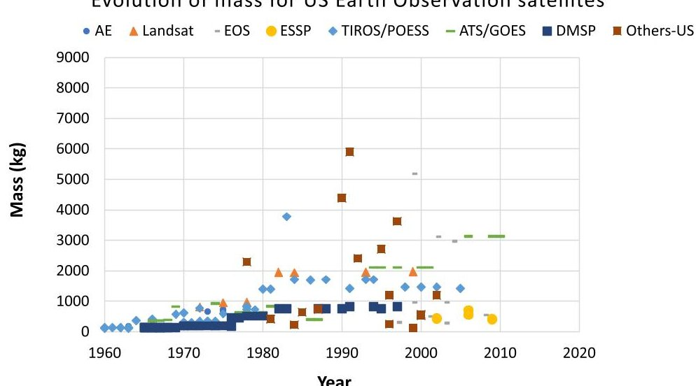
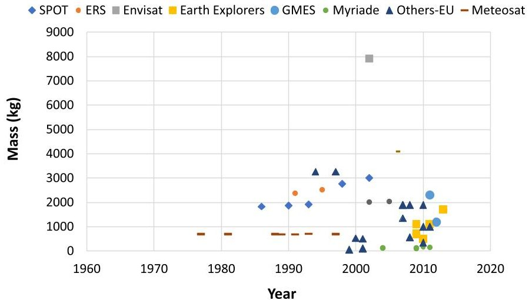
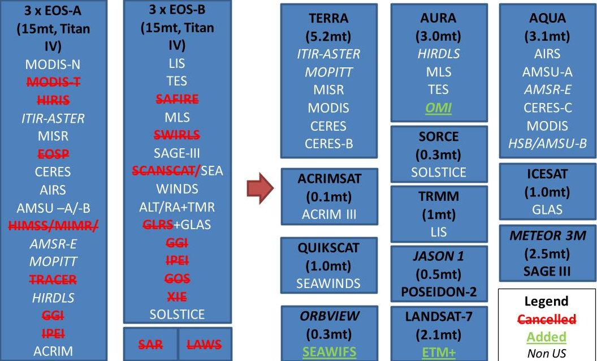

<!-- PDF_PAGE: 1 -->

# Distributed Earth Satellite Systems: What Is Needed to Move Forward?

Daniel Selva

Cornell University, Ithaca, New York 14850

Alessandro Golkar, Olga Korobova, and Ignasi Lluch i Cruz

Skolkovo Institute of Science and Technology, 143026, Moscow, Russia

Paul Collopy

University of Alabama in Huntsville, Huntsville, Alabama 35899

Olivier L. de Weck

Massachusetts Institute of Technology, Cambridge, Massachusetts 02139

and

DOI: 10.2514/1.I010497

## I. Introduction

EARTH-CENTRIC spacecraft have been designed for decades as monolithic systems, which are highly integrated systems conceived to fulfill a set of goals satisfying certain user needs. Such systems include dedicated space and ground segments that may go unused or be decommissioned after the end of the mission. As space missions have been traditionally designed as highly tailored projects, engineers always worked to conceive their systems as "stovepipe" craft (i.e., systems that do not share data with other spacecraft). However, the space industry nowadays is looking at concepts involving distributed satellite systems (DSS) that, for the purposes of this paper, we define as a space system allocating functionality among multiple spacecraft that interact in order to achieve desired goals. This definition is consistent with others in the

Daniel Selva is an Assistant Professor of Mechanical and Aerospace Engineering and Systems Engineering at Cornell University. His research interests are on the development of intelligent systems for space systems engineering and architecture, including aspects of knowledge engineering, global optimization, machine learning, and humancomputer interaction. Daniel has a dual background in electrical engineering and aerospace engineering, with M.S. degrees from the Barcelona School of Telecommunications Engineering and Institut Superieur de l'Aeronautique et de l'Espace (2004), and a Ph.D. degree in space systems from the Massachusetts Institute of Technology (2012). Between 2004 and 2008, Daniel worked in French Guiana as an Avionics Specialist in the Ariane 5 launch team.

Alessandro Golkar is an Associate Professor at the Skolkovo Institute of Science and Technology and the Interim Director of the Space Center of the Institute. Alessandro served as a Consultant for the ESA and was a Research Fellow and Visiting Independent Advisor at the NASA Jet Propulsion Laboratory. He pursued B.S. and M.S. degrees in aerospace engineering from the University of Rome "La Sapienza", and a Ph.D. degree in aeronautics and astronautics from the Massachusetts Institute of Technology. His previous work includes collaboration with NASA Headquarters, NASA Jet Propulsion Laboratory, the ESA (European Space Research and Technology Centre and European Space Research Institute), and BP, plc. He is a Federal Aviation Administration licensed private pilot and a Senior Member of the AIAA.

Olga Korobova works as a Research Engineer at Skolkovo Institute of Science and Technology (Skoltech), extending federated satellite systems with data authentication, integrity, and confidentiality mechanisms. Olga graduated from the University of Massachusetts-Amherst with a B.S. degree in computer science, security, and privacy subplan. She joined the Internet Technology (IT)-Security M.S. program at the Ruhr-Universität Bochum before she transferred to Skoltech, where she graduated with a M.S. degree in IT. Olga studied the security of nearfield communication (NFC) contactless payment systems, and she worked on a transferrable electronic-cash implementation for smartphones and privacy-preserving NFC payments for electromobility.

<!-- PDF_PAGE: 2 -->

literature, such as Maessen [1], D'Amico et al. [2], or Mosleh et al. [3]. This definition includes a wide range of concepts that allocate programlevel, mission-level, or spacecraft-level functionality to different units, which may be owned and operated by one or more organizations, such as swarms, constellations, clusters, trains, fractionated spacecraft, and federated systems.

DSS are certainly not new, and they have been proposed and studied since the beginning of the space age: for example, in the context of satellite constellations that would provide continuous Earth coverage [4]. However, these concepts have recently gained renewed attention from industry and academia, as witnessed (for example) by several announcements for large constellations of spacecraft in low Earth orbit (LEO) to provide imagery and communications services [5].

This paper is motivated by the general question of whether the time is ripe for this architectural paradigm to emerge as dominant, or whether the industry still faces the conditions that led similar concepts to fail as business propositions in the late 1990s and early 2000s [6]. Although this is a challenging question to address in any single paper, this paper contributes to addressing that question by means of a critical survey that attempts to describe the state of the art in DSS technology and identify the nature of any potential technical and nontechnical barriers for the implementation of such concepts.

Specifically, the goals of the paper are 1) to provide a historic review perspective of how different DSS concepts came about; 2) to provide a taxonomy of DSS concepts, demonstrated in flight or proposed, based on morphological analysis; 3) to provide a comprehensive assessment of modern concepts and technologies of distributed functionality in space, including ones that have been recently proposed but never demonstrated, such as fractionated and federated spacecraft; 4) based on the analysis of the historical review and the state of the art of technical and nontechnical aspects of DSS, to conclude on the current barriers to DSS implementation; and 5) to propose a research agenda on DSS that addresses some of these barriers.

This paper focuses primarily on Earth satellite systems for observation, communications, and navigation, rather than interplanetary spacecraft and space exploration. This is because, although there are certainly examples of DSS for space exploration, most DSS to date have been Earthcentric systems. In addition, Earth-centric systems have more mature markets that introduce interesting forces in the system architecture process. That being said, a few planetary missions are also mentioned when appropriate, and the survey of the state of the art of the technologies relevant for DSS applies for space exploration as well. For a recent review of DSS concepts for space exploration, the reader is referred to [7].

The remainder of this survey paper is structured as follows: Sec. II provides a historical perspective on DSS. Section III proposes a classification of DSS, unifying the different concepts presented. Section IV identifies key enabling technologies for DSS, reviewing accomplishments and challenges for each of them. Section V discusses nontechnical barriers to the implementation of DSS, and it reviews work in this area. Section VI outlines an agenda for future research and developments in the field, and Sec. VII draws conclusions from the review.

Ignasi Lluch I Cruz is a Ph.D. Candidate and Assistant Researcher at Skolkovo Institute of Science and Technology. In 2011, Ignasi received his degree in aerospace engineering from the Technical University of Catalonia. He developed his M.S. Thesis on novel satellite navigation systems while working at GMV Aerospace Barcelona. Afterward, he joined the ESA at European Space Research and Technology Centre to work in the Galileo Evolutions Team. His research interests include advanced satellite navigation systems, intersatellite link technologies, constellation design, and federated and fractionated systems.

Olivier de Weck is a Full Professor at Massachusetts Institute of Technology (MIT) and Senior Vice President at Airbus. His main field of research is Engineering Systems. He focuses on how complex man-made systems such as aircraft, spacecraft, consumer products and critical infrastructures are designed, manufactured and operated and how they evolve over time. His main emphasis is the strategic properties of these systems that have the potential to maximize lifecycle value. His research group has developed quantitative methods and tools that explicitly consider manufacturability, flexibility, and sustainability among other characteristics. Significant results include the Adaptive Weighted Sum method for resolving tradeoffs amongst competing objectives, the Delta-Design Structure Matrix for technology infusion analysis, Time-Expanded Decision Networks and the SpaceNet and HabNet simulation environments. These methods have impacted decision-making for complex systems in space exploration (NASA, JPL), terrestrial exploration (BP) as well as electro-mechanical products (e.g. Xerox, Pratt & Whitney, Defense Advanced Research Projects Agency). He has co-authored three books and over 300 peer-reviewed papers to date, and has received 10 best paper or best poster awards since 2004. His book Engineering Systems: Meeting Human Needs in a Complex Technological World was the bestseller at the MIT Press Bookstore in 2012 and has been translated to Japanese. He is a Fellow of the International Council on Systems Engineering and an Associate Fellow of AIAA. From 2011 to 2013 he served as Executive Director of the MIT Production in the Innovation Economy study. Since January 2013 he serves as Editor-in-Chief of the journal Systems Engineering and director of the MIT-Switzerland program.

Paul Collopy was appointed Professor and Chair of the Industrial and Systems Engineering and Engineering Management Department at the University of Alabama in Huntsville (UAH) in 2013. In addition to his work in academia, his career background includes leadership roles with the National Science Foundation and the ValueDriven Design Institute, as well as engineering positions with Procter & Gamble, Morton Thiokol, and GE Aircraft Engines. Dr. Collopy is credited as the original developer of economic-based technology value models, and he served as the Lead Advisor to the Defense Advanced Research Projects Agency System F6 program for its value-centric design for adaptability technology pillar. He is the co-inventor on two patents, and his is the author of more than 40 papers. Dr. Collopy speaks around the world about the design of large complex systems. He has been licensed as a Professional Engineer since 1981. Dr. Collopy served as Technical Program Chair of the 14th Conference on Systems Engineering Research, which was hosted by the UAH Industrial and Systems Engineering and Engineering Management Department in March 2016.

<!-- PDF_PAGE: 3 -->

## II. Review of the History of Distributed, Fractionated, and Federated Systems

We start this literature review with a historical look at space system architectures and the factors that led to the emergence of distributed architectures. Although the focus of the paper is distributed architectures, several monolithic systems are mentioned in this section for contrast and historical completeness. The review is organized in loose chronological order, as opposed to by application (e.g., Earth observation, communications), so we jump from application to application as needed. Of note, although many missions are mentioned and discussed in this section, the goal of this section is not to provide an exhaustive list of all the DSS missions ever flown, which would be a daunting task for any single paper. The goal is rather to discuss some of the main missions that tell the major stories of how different types of DSS came about. The interested reader is referred to other recent surveys of distributed satellite systems, such as [8]. Definitions for monolithic systems and specific DSS concepts are introduced as needed, although more precise definitions are derived from the taxonomy introduced in Sec. III.

## A. Era of Capability Demonstration (1950-1960s)

The history of space systems starts with small monolithic systems focusing on demonstrating capability (e.g., access to space). For the purposes of this paper, we will define a monolithic system as one that embeds every space segment function required to achieve mission goals in a single spacecraft, with little or no sharing of resources foreseen among multiple spacecraft. The first phase of exploration of near-Earth space was indeed focused on testing various space technologies and demonstrating the capability of nations to access space. This was the era of Sputnik and the Explorer satellite missions, in the late 1950s and the early 1960s. Monolithic architectures made sense at the time: those goals could be achieved with relatively small assets, so there was no engineering incentive to add functionality or break it down across multiple spacecraft. Moreover, those goals did not require coordination or interoperability between multiple spacecraft.

## B. Resource Sharing Begins in the Ground (1950-1960s)

A key idea behind modern DSS is resource sharing across multiple assets. Interestingly, the first resource-sharing efforts appeared in the ground segment as opposed to the space segment. Although spacecraft were designed to operate as stovepipe systems, the space industry started addressing the question of interoperating spacecraft at the ground segment level since its early days, in order to exploit the benefits associated with coordinated observations and reuse of ground segment infrastructure across space missions. This led, for example, to the creation of Minitrack by the Naval Research Laboratory [9] (later renamed as Satellite Tracking and Data Acquisition Network, or STADAN, by NASA) and the NASA Deep Space Network in 1958 [10]. As the industry evolved, agencies put even stronger emphasis on organizing their projects to have ground segments (both receiving stations and data-processing and storage facilities) shared by multiple missions, in light of technical synergies as well as cost and schedule savings achieved in this way.

This trend continued until the present day. Indeed, a few ground networks around the world currently operate most NASA spacecraft. NASA's Space Communication and Navigation System features three different ground systems: the Deep Space Network, consisting of three sites with 34-70 m parabolic antennas in Goldstone, Madrid, and Canberra, primarily for interplanetary spacecraft; the Near Earth Network, which is a set of a dozen or so ground stations scattered around the world with 10-15 m parabolic antennas primarily for Earth observation spacecraft; and the Space Network (started in the 1980s), which is a set of ground stations in White Sands and Guam devoted to communication with the Tracking and Data Relay Satellite System in geostationary Earth orbit (GEO), and which supports human spaceflight among other missions. Similarly, the European Space Agency (ESA) established the European Space Operations Center in 1967, and their deep space tracking system (Estrack) in 1975. Estrack is a network of 10 ground stations with 35, 15, and 4.5 m parabolic antennas spread out around the world [11].

## C. Predecessors of Distributed Satellite Systems (1960s)

Another key idea in DSS is the tradeoff between the number of assets and the complexity of each asset. A few missions that exploited this idea early on, and thus could be considered predecessors of DSS, emerged early in the 1960s. In 1961, the United States launched Project West Ford [12], which was a set of 480 million femtosatellites (1.78 cm long each) to attempt to provide an artificial ionosphere, which would be used to facilitate ground communications between the military. This is similar in nature to current efforts in femtosatellite exploration. Another example, also with very simple assets but a much lower number of satellites, involved the Calsphere (calibration sphere) missions, which were a set of four satellites launched in the 1960s that were used as reflectors to calibrate ground radars [13]. Although both systems consisted of several spacecraft, their functionalities were extremely limited, and there was no coordination or communication between those spacecraft.

Another set of missions that could be considered DSS predecessors was the manned space program. Indeed, the Gemini program demonstrated the first instances of rendezvous (Gemini 6-7) and docking maneuvers (Gemini 8); and the architecture chosen for the Apollo program was based on several vehicles (service/command module and lunar module) as opposed to a single one [14].

Also around this time, researchers started to realize that launching sets of satellites following certain orbital patterns (constellations) could lead to improved capabilities such as continuous coverage [4], although this work remained mostly theoretical, as the first (civil) constellations would not be launched until the 1970s.

## D. Satellite Series in Earth Observation (1960s-1990s)

As the space industry transitioned from a pioneering phase to a more mature exploitation phase, requirements started to grow, and spacecraft evolved quickly from simple single-instrument systems with short design lifetimes to more complex multi-instrument platforms with lifetimes surpassing 10 years. Weather forecasting was an area of particularly fast development early on, as several series of incrementally improved satellites were launched in short periods of time. These series could be considered as predecessors of modern constellations because the lifetime of some of those assets overlapped. The first of these series was the Television Infrared Observation Satellite (TIROS) Program. TIROS-1 was the first U.S. Earth civil observing satellite, carrying a single payload (two black-and-white television cameras). Nine other TIROS first-generation satellites ( $ \sim120 $ kg) were launched between 1960 and 1965. Several other series followed TIROS. Nine second-generation (also known as TIROS Operational System/Environmental Science Services Administration) satellites followed between 1966 and 1969 ( $ \sim140 $ kg) as, gradually, additional equipment such as microwave and infrared radiometers and sounders were added to the payload. Nine third-generation (also known as Improved TIROS Operational System) satellites ( $ \sim340 $ kg) were launched between 1970 and 1976, continuing the incremental improvements; and lastly, 11 fourth-generation (also known as advanced TIROS) satellites ( $ \sim1700 $ kg, with some exception) were deployed between 1978 and 1994 [15]: these are the direct predecessors of the current constellation of U.S. weather polar satellites (National Oceanic and Atmospheric Administration). In the military domain, the Defense Meteorological Satellite Program (DMSP) has maintained a constellation of satellites in sunsynchronous orbits since the early 1960s, with over 50 satellites launched.

<!-- PDF_PAGE: 4 -->

## E. Satellite Constellations for Navigation and Communication Services (1970s-1990s)

As mentioned, satellite series are precursors to constellations, which appeared a few years later and have become quite popular these days. The idea of satellite constellations was developed in the 1940-1960s: to deploy multiple satellite units into coordinated orbits and operate them to achieve a common goal, typically related to providing global coverage, low latency, or low revisit time communications or imaging services [4,16]. The satellite series listed in the last section could be considered to fit this definition because multiple satellites did have some overlap in mission lifetime, and that overlap was intentional to improve coverage and revisit time. However, the full power of constellations, coming from large numbers of satellites, did not appear until the 1970s, with the first constellations for navigation purposes, and reached maturity in the satellite communications industry.

The first eight satellites of the Global Positioning System (GPS) constellation, weighing about 700 kg each, were launched into an inclined (55 deg inclination) $ \sim 2 0, 0 0 0 $ km orbit between February 1978 and April 1980 [17]. Of note, GPS satellites were still launched individually, but the requirement to have a large number of satellites in orbit simultaneously is an important difference with respect to satellite series. The GPS program currently maintains a constellation of 24-32 satellites generating signals at multiple frequencies in the L band. The Russian Global Navigation Satellite System (GLONASS) was launched a few years later (first launch in 1982), with similar parameters (24 satellites, $ \sim 1 9, 0 0 0 $ km, L band, 750 kg for the third-generation satellites), except for the inclination, which was set to 64.8 deg to provide better coverage of high-latitude regions [18]. The European Galileo was designed several years after GPS and GLONASS, but the parameters were also quite similar (23,616 km, 56 deg inclination, 625 kg, L band) [19]. Designed to consist of 30 satellites, Galileo is currently being deployed, and 13 satellites are currently operational. As discussed in Sec. IV, these constellations are the basis for the navigation systems of many, if not most, DSS and other space systems.

Although the design of most navigation constellations converged on an optimal value of 20-30 satellites in medium Earth orbits (MEOs), some designs of constellations for communications purposes in low Earth orbit often had many more. Indeed, although small constellations of satellites in geostationary orbit for communications purposes, such as the Tracking and Data Relay Satellite System relay satellite system [20], had existed since the 1960s, more distributed concepts based on large constellations of satellites in LEO started being explored around the 1980s because they offered advantages in terms of power requirements and latency. The first LEO constellations for communications purposes, Iridium [21] and Globalstar [22], consisted of 66 and 48 satellites, respectively, and they were deployed 20 years after the first GPS launch, as Iridium launched its first satellites in 1997 and Globalstar in 1998. Besides Globalstar (48 satellites in LEO) and Iridium (66 satellites in LEO), a similar example is the Orbcomm satellite constellation (50 satellites in LEO) [23].

After Iridium and Globalstar, many more constellations were proposed. Some of them were designed with intersatellite links, some with internetworked ground segments and some with both: the decision depending on a tradeoff between system performance, cost, and the allocation of technical complexity between the space and ground segments.

Interestingly, despite the fact that all of these constellations were technical successes, many of them failed to achieve the business goals they set for themselves due, for example, to parallel developments in terrestrial infrastructure competing in cost and user penetration with the satellite communications market. Table 1 (adapted from [24]) shows a list of all non-GEO communications constellations proposed in the 1990s; indeed, many of them remained at the proposal stage due to a failed value proposition or a failure to close their business cases [6]. The number of satellites in these proposed constellations varied between 2 and 840 (Teledesic). It is noteworthy that some constellations changed the number of operational satellites between their initial Federal Communications Commission (FCC) filing and the ultimate deployment. For example, the Iridium constellation [25] went from 77 operational satellites (also the atomic number of the element Iridium) to 66 satellites by choosing a higher altitude.

## F. Faster, Better, Cheaper, and the Small-Satellite Revolution (1990-2010s)

If the development of constellations followed a desire to improve coverage and revisit time, another driver of distribution in Earth observing systems came from engineering and programmatic considerations.

Increasingly stringent measurement requirements in the 1980s led to a trend to pack more functionality, and thus mass, on each satellite. In addition, placing many instruments on the same spacecraft facilitated cross-registration of datasets obtained by all the instruments on board, which increased satellite mass even further. This trend culminated with the launch of Upper Atmosphere Research Satellite (UARS) in the United States (1991) and Envisat in Europe (2002). Envisat is still the largest civil Earth observing satellite ever built, with 10 instruments and 8 t of launch mass. UARS and Envisat were not alone in this trend: several other large observatories were conceptualized during the 1980s and developed in the 1990s. This is illustrated in Fig. 1, which shows the evolution of the mass of Earth observation spacecraft in Europe and the United States between 1960 and 2010.

Some notable examples of large observatories in the United States are UARS (5902 kg), Terra (5190 kg), CRRES (Combined Release and Radiation Effects Satellite, 4383 kg), Aqua (3117 kg), and Aura (2970 kg). It is also important to note that early concepts for both the ESA's Envisat and the NASA EOS (primarily Terra, Aqua, and Aura) were based on even larger observatories. For example, early concepts for the NASA EOS were based on two 15 mt observatories carrying a total of 37 instruments [26-28].

As Earth observation and spacecraft engineering matured, the community realized that distributed systems could still satisfy some of the data cross-registration requirements while substantially reducing engineering efforts driven by the large sizes of platforms and the negative interactions between instruments [29]. There was also some concern about launch risk and program robustness, as a single launch failure would have an enormous impact on the program. The history of the descoping process of the NASA EOS is testimony to this trend. As Fig. 2 shows, although the first concepts for EOS were based on two 15 mt satellites, the implemented concept allocated instruments to three large but more reasonable platforms of Terra (1999), Aqua (2002), and Aura (2004), in addition to a number of smaller free fliers, including TRMM (Tropical Rainfall Measuring Mission, 1997), the Active Cavity Radiometer Irradiance Monitor (ACRIM) satellite (ACRIMSAT; 1999), QuikSCAT (Quick Scatterometer, 1999), Jason 1 (2001), the Solar Radiation and Climate Experiment (SORCE; 2003), and the Ice, Cloud, and Land Elevation Satellite (or ICESat; 2003), among others [30].

Similarly, following the all-encompassing 8 mt Envisat mission, which cost over 2 billion Euros [31], the ESA started their Earth Explorers program, based on smaller spacecraft with more focused scientific objectives and stringent cost limits. For example, 1) GOCE (Gravity field and steady-state Ocean Circulation Explorer, 2009, 350 M€ (million-euro)) is a 1100 kg spacecraft focusing on measuring variations in the Earth's gravity field; 2) SMOS (Soil Moisture and Ocean Salinity, 2009, 315M€) is a 683 kg spacecraft focusing on soil moisture and ocean salinity measurements; and 3) CryoSat-2 (2010, 140M€) is a 711 kg mission focusing on cryospheric measurements.

Thus, during the 2000s and 2010s, space systems started to shrink in size, leaving behind the "engineering nightmares" of the extra-large platforms. Indeed, one can see that the envelope of Fig. 1 peaks around the 2000s with Envisat, UARS, Terra, etc.; and then it steadily decreases. This reverse in trend is sometimes referred to as the small satellite (or smallsat) revolution: a term coined in the 1990s [32]. It was also around this time that Goldin, McCurdy, and others advocated for a "faster, better, cheaper" approach for the U.S. space program [33]. Specifically, Goldin called for a "focus on smaller missions" and to "stop putting all of our eggs in one basket [34]." This more distributed architecture presented several other advantages, including shorter development time and time to science, decreased risk of obsolescence, and decreased overhead costs, among

<!-- PDF_PAGE: 5 -->

Table 1 Non-geosynchronous orbit (NGSO) communications satellite systems: dataset extracted from FCC filings from February 1990 to May $ 1999^{a} $

<table border="1"><tr><td>System</td><td>Filing date</td><td>No. of satellites</td><td>Tlife,years</td><td>Altitude,km</td><td>Mwet,kg</td><td>Pbol,W</td></tr><tr><td>@contact</td><td>May1999</td><td>20</td><td>12</td><td>10,400</td><td>3,412</td><td>——</td></tr><tr><td>AMSC NGSO</td><td>November1994</td><td>10</td><td>10</td><td>10,355</td><td>3,050</td><td>——</td></tr><tr><td>Boeing NGSO</td><td>January1999</td><td>20</td><td>12</td><td>20,182</td><td>3,861</td><td>14,201</td></tr><tr><td>Celestri</td><td>June1997</td><td>63</td><td>8</td><td>1,400</td><td>3,100</td><td>13,600</td></tr><tr><td>Constellation</td><td>June1991</td><td>48</td><td>5</td><td>1,018.6</td><td>124.7</td><td>250</td></tr><tr><td>Ellipso</td><td>November1990</td><td>24</td><td>5</td><td>875</td><td>68</td><td>360</td></tr><tr><td>E-Sat</td><td>November1994</td><td>6</td><td>10</td><td>1,261</td><td>114</td><td>——</td></tr><tr><td>Final Analysis</td><td>November1994</td><td>24</td><td>7</td><td>1,000</td><td>98.5</td><td>59</td></tr><tr><td>GE LEO</td><td>November1994</td><td>24</td><td>5</td><td>800</td><td>13</td><td>10.56</td></tr><tr><td>GEMnet</td><td>November1994</td><td>38</td><td>5</td><td>1,000</td><td>45</td><td>——</td></tr><tr><td>Globalstar</td><td>June91</td><td>48</td><td>7.5</td><td>1,389</td><td>262</td><td>875</td></tr><tr><td>Globalstar2GHz</td><td>September1997</td><td>64</td><td>7.5</td><td>1,420</td><td>832</td><td>3,000</td></tr><tr><td>GlobalstarGS40</td><td>September1997</td><td>80</td><td>7.5</td><td>1,440</td><td>1,226</td><td>4,500</td></tr><tr><td>HughesLINK</td><td>January1999</td><td>22</td><td>12</td><td>15,000</td><td>2,940</td><td>10,500</td></tr><tr><td>HughesNET</td><td>January1999</td><td>70</td><td>10</td><td>1,490</td><td>2,050</td><td>8,200</td></tr><tr><td>ICO</td><td>September1997</td><td>10</td><td>12</td><td>10,355</td><td>2,750</td><td>——</td></tr><tr><td>Iridium</td><td>December1990</td><td>77</td><td>5</td><td>765</td><td>340.7</td><td>——</td></tr><tr><td>IridiumMcell</td><td>September1997</td><td>96</td><td>7.5</td><td>853</td><td>1,713</td><td>7,300</td></tr><tr><td>LeoOne</td><td>September1994</td><td>48</td><td>5</td><td>950</td><td>154</td><td>——</td></tr><tr><td>LM MEO</td><td>December1997</td><td>32</td><td>10</td><td>10,352</td><td>2,171</td><td>——</td></tr><tr><td>M Star</td><td>September1996</td><td>72</td><td>8</td><td>1,350</td><td>2,535</td><td>3,100</td></tr><tr><td>Odyssey</td><td>May1991</td><td>12</td><td>10</td><td>10,371</td><td>2,500</td><td>——</td></tr><tr><td>Orbcomm</td><td>February1990</td><td>20</td><td>7</td><td>970</td><td>150</td><td>450</td></tr><tr><td>Orblink</td><td>September1997</td><td>7</td><td>7</td><td>9,000</td><td>2,010</td><td>——</td></tr><tr><td>Pentriad</td><td>September1997</td><td>13</td><td>-</td><td>High Earth orbit</td><td>2,139</td><td>10,247</td></tr><tr><td>SkyBridge</td><td>September1997</td><td>64</td><td>8</td><td>1,457</td><td>800</td><td>——</td></tr><tr><td>SkyBridgeII</td><td>September1997</td><td>96</td><td>10</td><td>1,468</td><td>2,650</td><td>——</td></tr><tr><td>Spaceway</td><td>September1997</td><td>20</td><td>12</td><td>10,352</td><td>2,850</td><td>——</td></tr><tr><td>StarLynx</td><td>September1997</td><td>20</td><td>12</td><td>10,352</td><td>3,500</td><td>17,000</td></tr><tr><td>StarSys</td><td>May1990</td><td>24</td><td>5</td><td>1,300</td><td>112</td><td>——</td></tr><tr><td>Teledesic</td><td>March1994</td><td>840</td><td>10</td><td>700</td><td>795</td><td>11,595</td></tr><tr><td>TeledesicKu</td><td>January1999</td><td>30</td><td>7</td><td>10,320</td><td>1,324</td><td>6,500</td></tr><tr><td>TeledesicV</td><td>September1997</td><td>72</td><td>7</td><td>1,375</td><td>614</td><td>5,000</td></tr><tr><td>TRW EHF</td><td>September1997</td><td>15</td><td>15</td><td>10,355</td><td>5,934</td><td>——</td></tr><tr><td>Virgo</td><td>January1999</td><td>15</td><td>12</td><td>20,281</td><td>3,030</td><td>——</td></tr><tr><td>VITA</td><td>September1990</td><td>2</td><td>5</td><td>805.5</td><td>45.5</td><td>42</td></tr></table>

$ ^{a}T_{\mathrm{life}} = \mathrm{design lifetime}, M_{\mathrm{wet}} = \mathrm{launch mass}, $ and $ P_{\mathrm{bol}} = \mathrm{power at beginning of life (adapted from [24])}. $ Many satellite constellation projects were proposed in the 1990s, but most were cancelled.

other things [35]. The Surrey Space Centre was an important actor early on in the smallsat revolution, as they demonstrated that their disaster monitoring constellation [36] could achieve significant performance with a spacecraft launch mass of 88 kg, which was an order of magnitude less than other similar imaging spacecraft such as Landsat or Spot.

Although satellite constellations such as the GPS can certainly be considered DSS, one could argue that the idea of allocating program goals across a set of smaller heterogeneous satellites in the 1990s and 2000s represented another important step for distributed satellite systems, going beyond just coverage considerations. Indeed, for the purposes of this paper, distributed satellite systems are broadly defined as systems where the functionality needed to achieve a common set of goals is distributed among different spacecraft, which includes for example the case of NASA EOS, where a set of instruments required to satisfy the program's goals were allocated to several platforms.

## G. New DSS Concepts and the Advent of Formation Flying (2000s-2010s)

As spacecraft technologies evolved, advanced space system concepts such as trains, clusters, and swarms, calling for greater distribution of functionality, began to emerge in Earth observation, driven by the need to acquire and compare measurements obtained with different types of diversity (e.g., range, view angle, spectral content). A coarse timeline of these concepts is shown in Fig. 3.

A few years into the NASA EOS program, in the early 2000s, the concept of the NASA Afternoon constellation (known as A-Train) was developed, in which Earth observing satellites with synergistic measurements, related mostly to atmospheric parameters, were all launched into a 700 km sun-synchronous orbit with a local time of the ascending node around 1330 hrs and with small differences in mean anomaly (seconds to minutes), thus facilitating the cross-registration of measurements from all satellites in the train [37]. At the time of writing, the A-Train consisted of six spacecraft (Orbiting Carbon Observatory-2 or OCO-2, Global Change Observation Mission 1st—Water or GCOM-W1, Aqua, Calipso, CloudSat, and Aura), which combined carry 16 remote sensing instruments covering large portions of the infrared and microwave spectrum. PARASOL (Polarization and Anisotropy of Reflectances for Atmospheric Sciences coupled with Observations from a Lidar), a French mission carrying an infrared polarimeter, was part of the A-Train for 10 years but exited the constellation in 2013. Terra, Landsat-7, EO-1 (Earth observing 1), and SAC-C (Scientific Application Satellite-C) are all part of the so-called morning constellation, which is also a train, as all those satellites share a common orbit with small differences in mean anomaly (although slightly larger than for the A-train).

A key idea behind many DSS concepts shown in Fig. 3 is formation flying, in which spacecraft states are dynamically coupled (e.g., they maintain relative positions and/or attitudes within a certain control window). In a comprehensive survey, Scharf et al. defined formation flying as "a set of more than one spacecraft whose dynamic states are coupled through a common control law" [38]. One of the first experiments with formation flying was that of Landsat 7 and EO-1 within this A-Train. The two satellites were flown, maintaining a constant 60 s (or 450 km) separation between them and observing the same ground track with an accuracy of 45 km.

Formation flying has been traditionally of interest to astronomy and Earth observation due to the opportunity of a higher spatial and temporal resolution by the virtue of interferometric and other distributed observation techniques. Several missions based on formation-flying approaches

<!-- PDF_PAGE: 6 -->

Evolution of mass for US Earth Observation satellites

AE=Atmosphere Explorer, ESSP=Earth System Science Pathfinder, POESS=Polar Operational Environmental Satellite System, ATS=Applications Technology Satellite, GOES = Geostationary Operational Environmental Satellite, DMSP=Defense Meteorological Satellite Program.

Evolution of mass for EU Earth Observation satellites

SPOT=Satellite Pour l'Observation de la Terre, ERS = European Remote-Sensing Satellite, GMES = Global Monitoring for Environmental Security, MSG=Meteosat Second Generation, MetOp=Meteorological Operational.

Fig.1 Evolution of mass for US (top) and EU (bottom) Earth observing satellites.

such as large space interferometers have been proposed since the early 2000s [39] as well as onorbit servicing missions for large inorbit telescope arrays [40,41] , yet many of the envisioned large interferometric missions have not been launched to date. Early formation-flying missions include GRACE (2002, gravimetry) [42], TanDEM-X (TerraSAR-X—Synthetic Aperture Radar—Add-On for Digital Elevation Measurement, 2010, radar interferometry) [43,44] and the Laser Interferometry Space Antenna (LISA; 2015, gravity wave detection). GRACE consists of two spacecraft keeping the distance between them within $ 2 2 0 \pm 5 0 $ km. Microwave range measurements between the two spacecraft, combined with precise orbit perturbation models, allow GRACE scientists to infer precise information about the Earth's gravitational field. This is an example of a unique scientific application of DSS that has had substantial scientific impact by any reasonable measure, as hundreds of papers have been written across many scientific disciplines, including (of course) gravimetry but also hydrology and oceanography among others. A follow-up mission using laser ranging (GRACE-2) and a gap-filler mission with improved microwave ranging (GRACE Follow-On or GRACE-FO, to be launched in 2017) are currently planned for launch in the next few years.

TanDEM-X also consists of two spacecraft (TerraSAR-X and a second master spacecraft named after the TanDEM-X mission). The concept is a completely different Earth observation application of DSS; the goal is to produce global digital elevation maps using synthetic aperture radar interferometry. In this case, the distance between the spacecraft can be changed, thus allowing for different baselines and imaging modes.

Another example of a unique scientific application of DSS is the LISA mission, for which a pathfinder mission was launched in December 2015. LISA consists of three spacecraft, each carrying an interferometer and flying in a triangular formation with a long baseline of 5 million km. Like the very long base interferometry networks on ground, the purpose of this very long baseline is to achieve very high angular resolution, as angular resolution in an interferometer is directly proportional to the ratio of the wavelength and the baseline. LISA will use this concept to measure gravitational waves.

Other notable formation-flying missions are the Swedish-led PRISMA (technology demonstration mission launched in 2010), as well as the Cluster and Swarm missions, both in the domain of Earth's magnetospheric science. The Cluster II mission [45] includes four spacecraft flying in tetrahedral formation and interspacecraft distances ranging between tens and thousands of kilometers. The Swarm mission consists of three identical spacecraft: two of them fly in a 87.4 deg inclined orbit at a mean altitude of 450 km, with an east-west separation of 1.0-1.5 deg, and a relative delay in the orbit of 10 s; and the third one flies in a 88 deg inclined orbit at a mean altitude of 530 km [46]. The three satellites take coordinated measurements of the Earth's magnetic field with identical instruments. Similarly, the American MMS (Magnetospheric MultiScale mission) mission to study the magnetosphere consists of four spinning spacecraft with deployable booms flying in an adjustable pyramidal

<!-- PDF_PAGE: 7 -->

Acronyms: MODIS=Moderate Resolution Imaging Spectroradiometer, HIRIS=High-Resolution Imaging Spectrometer, ITIR=, ASTER=Advanced Spaceborne Thermal Emission and Reflection Radiometer, MISR=Multiangle Imaging Spectroradiometer, EOSP=Earth Observing Scanning Polarimeter, CERES=Clouds and the Earth's Radiant Energy System, AIRS=Advanced InfraRed Sounder, AMSU=Advanced Microwave Sounding Unit, HIMSS=High resolution microwave spectrometer sounder, MIMR=Multifrequency Imaging Microwave Radiometer, AMSR-E=Advanced Microwave Scanning Radiometer - Earth Observing System, MOPITT=Measurement of Pollution in the Troposphere, TRACER=Tropospheric Radiometer for Atmospheric Chemistry and Environmental Research, HIRDLS=High Resolution Dynamics Limb Sounder, GGI=GPS Geoscience Instrument, IPEI=Ionospheric Plasma and Electrodynamics Instrument, ACRIM= Active Cavity Radiometer Irradiance Monitor, LIS=Lightning Imaging Sensor, TES=Tropospheric Emission Spectrometer, SAFIRE=Spectroscopy of the Atmosphere using Far Infrared Emission, MLS=Microwave Limb Sounder, SWIRLS=Stratospheric Wind Infrared Limb Sounder, SAGE-III=Stratospheric Aerosol and Gas Experiment III, RA=Radar Altimeter, TMR=TOPEX/Poseidon Microwave Radiometer, GLRS=Geoscience Laser Ranging System, GLAS=Geoscience Laser Altimeter System, GOS=Geomagnetic Observing System, XIE=X-Ray Imaging Radar, SOLSTICE = Solar Stellar Irradiance Comparison Experiment, OMI = Ozone Monitoring Instrument, ETM+=Enhanced Thematic Mapper+.

Fig. 2 Evolution of NASA EOS program architecture. Left: Original concept. Right: Implemented concept.

'60 '61 '62 ... '77 '78 '79 '80 '81 '82 ... '94 '95 '96 '97 '98 '99 '00 '01 '02 '03 '04 '05 '06 '07 '08 '09 '10 '11 '12 '13 '14 '15 '16 '17 '18 '19 '20

<table border="1"><tr><td></td><td>60</td><td>61</td><td>62</td><td>...</td><td>77</td><td>78</td><td>79</td><td>80</td><td>81</td><td>82</td><td>...</td><td>94</td><td>95</td><td>96</td><td>97</td><td>98</td><td>99</td><td>00</td><td>01</td><td>02</td><td>03</td><td>04</td><td>05</td><td>06</td><td>07</td><td>08</td><td>09</td><td>10</td><td>11</td><td>12</td><td>13</td><td>14</td><td>15</td><td>16</td><td>17</td><td>18</td><td>19</td><td>20</td></tr><tr><td>Series/constellations</td><td>TIROS</td><td>...</td><td></td><td>GPS block-I</td><td>...</td><td></td><td></td><td></td><td></td><td></td><td></td><td>Iridium</td><td></td><td>

Fig. 3 Coarse timeline of some distributed satellite systems.

formation, which enables measurement of the three-dimensional structure of magnetic interactions [47]. The Terrestrial Planet Finder would have been another interesting formation-flying mission with the goal of finding and charactering Earth-like planets orbiting distant stars, but it was cancelled in 2011 [48]. Other examples of formation-flying missions included PROBA-3, Darwin, JC2Sat (Japan-Canada Joint Collaboration Satellites), the MAXIM (Micro-Arcsecond X-Ray Imaging Mission), and Planet Imager [1]. Many more formation-flying missions have been flown so far, but it is out of the scope of this paper to provide a complete review of those missions. The interested reader is referred to Maessen (2014) [1] and Bandyopadhyay et al. (2016) [49] for a more exhaustive review of these missions (the latter focusing on nanosatellites).

Although the terms cluster and swarm have been used by the ESA to name two Earth science missions in the past, they refer more generally to two broader classes of DSS concepts. The term cluster has been used since the 1980s [50] to define a set of spacecraft flying in close proximity to perform a common mission. An example of a recently proposed cluster mission is aimed at instantaneous multiangular measurements of the Earth's albedo (bidirectional reflectance distribution function) to better characterize the amount of incident radiation reflected back to space, which is a critical quantity for climate change modeling [51,52].

Swarms are biologically inspired DSS that feature self-organization among a large set of identical spacecraft [53]. Self-organization refers to autonomously readjusting orbital geometries [54] and task allocations within the swarm in response to policy and goal changes [55]. This adjustment is reached by deliberation processes among the spacecraft in the swarm, allowing them to operate in dynamic contexts with minimal supervision. This concept can be applied to planetary and asteroid science missions [55] where a swarm could explore large areas of a planetary body or an asteroid belt and, as promising data are sensed, dispatch teams of spacecraft to areas of interest. NASA has shown significant interest in swarm architectures for planetary exploration in the past 15 years. For example, Curtis et al. proposed the Autonomous Nanotechnology Swarm (ANTS) in 2003 [56], and they envisaged an asteroid prospecting mission called the Prospecting ANTS Mission for the 2020-2025 timeframe. This kind of architecture offers opportunities for new kinds of interactions between humans and spacecraft in the context of human space exploration. Some of the challenges of this architecture are related to the high-degree autonomy of the onboard software [57]; in fact, the term of autonomic systems was coined to refer to systems that are "self-protecting, self-healing, self-optimizing, and self-configuring" [58]. In [58], Hinchey and Paquet studied this problem and proposed a formal framework to specify and generate this kind of autonomic systems.

<!-- PDF_PAGE: 8 -->

## H. CubeSat Revolution (2000-2010s)

In 1999, Puig Suari and Twiggs developed the CubeSat standard [59], which is a set of specifications intended to standardize the form factor of small satellites weighing just a few kilograms, with the hope that the standard would lead to increased opportunities and reduced costs for universities and other organizations to develop and launch their small spacecraft.

Almost 20 years later, hundreds of CubeSats have been launched into space by universities, private companies, and even space organizations such as NASA. A list of all CubeSat launches can be found in Michael Swartwout's CubeSat Database. $ ^{+} $ A notable member of this database is Planet, formerly Planet Labs, which at the current pace will soon have launched more CubeSats into space than all other civil organizations in the world combined [as of 12 November 2016, it has launched 182 out of 486 CubeSats (i.e., more than one-third of all CubeSats ever launched, and 32 out of 49 (or approximately two-thirds) of the CubeSats launched so far in 2016].

The addition of the 3U (3 Units) and 6U specifications to the CubeSat standard have considerably increased the capabilities of CubeSats, which are now being considered to be part of the NASA flight systems to go to the moon and Europa or for Earth observation. An excellent example of the latter is the decision by NASA to select TROPICS (Time-Resolved Observations of Precipitation structure and storm Intensity with a Constellation of Smallsats), which is a constellation of 12 3U CubeSats for tropical storm monitoring, as an EVI-3 (Earth Venture Instrument 3) mission. There are several other NASA CubeSat missions under development, including IceCube [60] and Raincube, among others [61].

The CubeSat revolution has also spurred interest in formation-flying concepts based on nanosatellites. AeroCube-4 demonstrated formation flying using differential drag techniques. CanX-4 and CanX-5 demonstrated submeter formation control within distances ranging from tens of meters to a kilometer. AeroCube 7 A-B-C will demonstrate proximity operations using laser ranging to maintain distances of a few hundreds of meters between spacecraft. Other planned nanosatellite missions to demonstrate formation flying include CPOD (Cubesat proximity operations demonstration) [62], mDOT (miniaturized distributed occulter/telescope) [63], SAMSON (satellite mission for swarming and geolocation), TW-1 (Tian Wang 1), DELFFI (Delft formation flight), Swift, QUEST (Kyushu/U.S. Experimental Satellite Tether), CANYVAL (CubeSat Astronomy by NASA and Yonsei using Virtual Telescope Alignment), and others.

## I. Current and Future DSS Trends and Concepts (2010s-Future)

We note three primary trends for current and future DSS: a substantial increase in the number of elements in space systems, the distribution of functions at the spacecraft level as opposed to the program level, and the decentralization of ownership and operations. Each of these trends is discussed in the following, together with the corresponding concepts (ultralarge constellations, fractionated systems, and federated systems, respectively).

## 1. Very Large Constellations

The combination of the CubeSat revolution, advances in miniaturization of space technology, and the appearance of new actors in the space industry, have resulted in an increase in interest in concepts based on very large constellations of tens to hundreds of satellites. Indeed, the ability to build and launch a satellite for less than a 1M U.S. dollars (USD) in some cases has led many organizations to consider distributed architectures based on large constellations for both communications and Earth observation. A list of satellite constellations currently being planned or developed is shown in Table 2 [64-73].

Taking the idea of large constellations to the limit, and perhaps inspired by some of the early DSS predecessors mentioned here, Manchester et al. proposed femtosatellite-based stochastic exploration, i.e., the use of thousands of satellites each weighing only a few grams to do space exploration [74]. These tiny spacecraft have severe limitations in their ability to control their position and attitude (or even just to communicate with other spacecraft or with the ground), hence the term "stochastic" exploration. They also pose interesting dynamics challenges, especially near irregular bodies such as asteroids, as discussed in the work of Weis and Peck [75].

## 2. Fractionated Systems

Fractionated space systems are a notional concept in which the traditional functionality of a monolithic spacecraft (i.e., taking measurements, providing power, communication services, data processing services, or navigation services among others) is divided into a set of smaller units or fractions interoperated to achieve coordinated mission goals. This is thus a much deeper level of distribution of functionality across different assets than that of the A-Train, since in the former case is spacecraft-level functions are distributed, whereas in the latter case program-level functions are distributed. Fractionation was spearheaded by the Defense Advanced Research Projects Agency (DARPA) F6 project [76], which developed underlying concepts and enabling technologies (such as encryption) but did not bring a demonstration mission to orbit.

## 3. Decentralization of Ownership

Several new DSS concepts have been proposed in the last few years but not yet implemented, such as fractionated systems and federated systems. Although fractionated systems clearly require strong coordination and resource sharing between assets, a single organization still retains ownership of the entire system. Some new DSS concepts are instead based on the idea of decentralizing ownership. This is a defining characteristic of a system of systems, in which different assets are owned and operated by different organizations [77]. By giving up control over some of the assets and sharing resources, organizations can achieve their goals in a more cost-effective way. Satellite missions have been loosely designed as systems of systems, such as the case of Europe's Copernicus earth observation infrastructure including satellites, air, and ground measurements [78].

Another example of decentralization of ownership is hosted payloads, in which customers fly their payloads on a host organization's spacecraft, paying for resources consumed on board a host spacecraft (mass, volume, power, data rate). An example of this is the Iridium Next program [79], in which Iridium is selling hosted payload slots in each of the 66 satellites of their next-generation communications constellation. GEOScan is an example of potential use for some of these hosted payload opportunities to do Earth observation [80,81].

Similar to systems-of-systems and hosted payloads, a more recent DSS proposal is that of federated satellite systems (FSSs), which include the idea of sharing unused capacity among spacecraft in a cloud-computing network in orbit [82]. An FSS seeks opportunistic resource sharing among participating spacecraft, where satellites act either as customers or suppliers of resources (being able to switch their roles at different times) based on opportunity cost calculations and desired user requirements in terms of performance and cost for their missions. Resources that could be shared in a federation include data processing power, data storage, link time to the ground, instrument time, and others. The idea of FSSs can be thought of as a transposition of the ideas of the sharing economy and cloud computing to upstream space applications. Satellites acting as suppliers in a federated network can generate side revenues thanks to the exploitation of unused resources, whereas customer satellites can leverage additional resources that are not available to them. In doing so, the network as a whole is used in a more efficient fashion; furthermore, FSS networks allow the deployment of short-term satellite services, lowering the access barrier to the exploitation of space resources to the downstream community. As

<!-- PDF_PAGE: 9 -->

Table 2 Future satellite constellations and ongoing developments (2015 to date) $ ^{a} $

<table border="1"><tr><td>Constellation name</td><td>Status</td><td>Service characteristics</td><td>No. of spacecraft</td></tr><tr><td>OneWeb [64]</td><td>Under development</td><td>Space Internet Global internet broadband services Latency(round trip):50msLaunch mass:200kgOrbital altitude:1200km Orbital inclination:not availableManufacturer:Airbus Defence and Space(as of October 2015)</td><td>648</td></tr><tr><td>Iridium NEXT [65]</td><td>Under development</td><td>Iridium first-generation replenishment:mobile services phone/dataLaunch mass:860kgOrbital altitude:780km Orbital inclination:90deg(polar)Manufacturer:Thales Alenia Space</td><td>66</td></tr><tr><td>O3b [66]</td><td>Operational</td><td>Space internet Latency(round trip):280msLaunch mass:700kgOrbital altitude:8063km Orbital inclination:less than0.1deg(equatorial)Manufacturer:Thales Alenia Space/Operatore SES Luxembourg</td><td>12</td></tr><tr><td>LeoSat [67]</td><td>Under development</td><td>High-throughput space internet Latency(round trip):less than50msUser throughput:1.2Gbps4th Generation backhaul complying with Long Term Evolution standardsLaunch mass:not availableOrbital altitude:not available Orbital inclination:not availableManufacturer:Thales Alenia Space</td><td>78-108</td></tr><tr><td>Skybox [68]</td><td>Under development</td><td>High-resolution high revisit time,visible imagingLaunch mass:120kgOrbital altitude:not available Orbital inclination:not availableManufacturer:Space System Loral</td><td>13</td></tr><tr><td>SpaceX satellite constellation(name TBD)[69]</td><td>Proposed</td><td>Space internetLaunch mass:not availableOrbital altitude:not available Orbital inclination:not availableManufacturer:SpaceX</td><td>4025</td></tr><tr><td>Samsung satellite constellation(name TBD)[70]</td><td>Proposed [71]</td><td>Space internet“Zetabyte/month capacity,which is equivalent to200GB/month to5 billion users worldwide.”[71]Individual satellite capacity:“Terabit/s data rates with signal latencies better than or equal to ground-based systems”[71]</td><td></td></tr><tr><td>Blacksky [72]</td><td>Proposed</td><td>High-resolution high revisit time,visible imaging1m resolution Launch mass:50kg Orbital altitude:450km Manufacturer:Spaceflight Industries</td><td>60</td></tr><tr><td>Planet [73]</td><td>Operational</td><td>High revisit time,visible imaging3-5m resolution Launch mass:4kg Orbital altitude:400-700km</td><td>113-250</td></tr></table>

aTBD denotes "to be determined."

a result of implementing FSSs in space operations, satellite services and custom-defined remote sensing data become commodities. Consequently, the exploitation of satellite assets becomes more accessible to a wider community of users.

## III. Classification of Distributed Satellite Systems

Different types of DSS have been proposed to date, including constellations, clusters, swarms, trains, fractionated spacecraft, and federated satellites, among others. From the point of view of system architecture, these concepts vary across different dimensions, such as the number of assets, homogeneity of the assets, physical separation between the assets, and so forth. This section applies a morphological analysis [83] to propose a new taxonomy to classify DSS from the system architecture standpoint.

A morphological analysis is a general problem-solving methodology developed by Zwicky in the 1960s to structure and investigate the total set of relationships contained in multidimensional, nonquantifiable, complex problems [83]. The method is often used in systems architecture and conceptual design because of its simplicity and ability to systematically explore a set of alternatives [84]. Here, we use it to understand the structure of DSS architectural decisions and to explore potential new concepts.

Several taxonomies have been proposed in the past to classify DSS with different purposes [7,85]. A popular classification is based on application: Earth science, planetary science, astronomy, onorbit servicing, space situational awareness, etc. Shaw et al. described a general classification of satellite systems based on their level of distribution (cluster size), level of coordination between satellites (collaborative vs symbiotic), architectural homogeneity, and operational characteristics [86]. Maessen distinguished between formations and constellations based on whether a relative or absolute spacecraft state (position, velocity) is controlled [1]. Sullivan et al. categorized relative motion dynamics models by their state representation (e.g., relative position/velocity, orbital elements), orbit type, and linearity assumptions of the model [87]. Instead of providing a classification of DSS themselves, Corbin developed a taxonomy of the unique emergent capabilities that DSS can have. This taxonomy included shared sampling (multiple assets taking the same measurement to increase coverage metrics), simultaneous sampling (multiple assets taking measurements of the same observable from different locations, such as in stereoscopic imaging), self-sampling (some of the assets generating signals and others receiving those signals, such as in bistatic radar, or in missions where relative position/velocity measurements are done, such as with GRACE), census sampling (multiple assets conducting multiple measurements of an observable with the goal of reducing uncertainty in the estimation of the property of interest), stacked sampling (heterogeneous assets taking measurements of the same observable using different and complementary techniques, such as infrared and microwave sounding), spaced sampling (additional assets being deployed after gaining knowledge by the first assets), and sacrifice sampling (a large number of assets being deployed into a harsh environment with the hopes that at least some of them will survive) [7].

Scharf et al. characterized formations according to their size (e.g., the number of spacecraft N), precision requirements, and ambient dynamic environment [38]. They considered "small" formations as those with $ N\leq 5 $ and "large" as those for which $ N\geq 20 $ . Although this survey is by now more than a decade old, no large formations have yet been realized in space, whereas demonstrations of small formations (in particular, two-spacecraft formations) have been flown several times, as discussed previously. The survey further classified high-precision formations as those that require relative precisions of centimeters per arcminute or smaller, and low-precision formations as those that have precision requirements

<!-- PDF_PAGE: 10 -->

Table 3 Taxonomy of distributed satellite systems based on morphological analysis with five binary attributes (H: high, L: low)

<table border="1"><tr><td>Concept no.</td><td>Concept name</td><td>Homogeneity</td><td>Size</td><td>Spatial separation</td><td>Functional interdependence</td><td>Operational independence</td></tr><tr><td>1</td><td>——</td><td>H</td><td>H</td><td>H</td><td>H</td><td>H</td></tr><tr><td>2</td><td>——</td><td>L</td><td>H</td><td>H</td><td>H</td><td>H</td></tr><tr><td>3</td><td>——</td><td>H</td><td>L</td><td>H</td><td>H</td><td>H</td></tr><tr><td>4</td><td>——</td><td>L</td><td>L</td><td>H</td><td>H</td><td>H</td></tr><tr><td>5</td><td>——</td><td>H</td><td>H</td><td>L</td><td>H</td><td>H</td></tr><tr><td>6</td><td>——</td><td>L</td><td>H</td><td>L</td><td>H</td><td>H</td></tr><tr><td>7</td><td>——</td><td>H</td><td>L</td><td>L</td><td>H</td><td>H</td></tr><tr><td>8</td><td>——</td><td>L</td><td>L</td><td>L</td><td>H</td><td>H</td></tr><tr><td>9</td><td>——</td><td>H</td><td>H</td><td>H</td><td>L</td><td>H</td></tr><tr><td>10</td><td>Federated</td><td>L</td><td>H</td><td>H</td><td>L</td><td>H</td></tr><tr><td>11</td><td>——</td><td>H</td><td>L</td><td>H</td><td>L</td><td>H</td></tr><tr><td>12</td><td>——</td><td>L</td><td>L</td><td>H</td><td>L</td><td>H</td></tr><tr><td>13</td><td>——</td><td>H</td><td>H</td><td>L</td><td>L</td><td>H</td></tr><tr><td>14</td><td>——</td><td>L</td><td>H</td><td>L</td><td>L</td><td>H</td></tr><tr><td>15</td><td>——</td><td>H</td><td>L</td><td>L</td><td>L</td><td>H</td></tr><tr><td>16</td><td>Trains</td><td>L</td><td>L</td><td>L</td><td>L</td><td>H</td></tr><tr><td>17</td><td>——</td><td>H</td><td>H</td><td>H</td><td>H</td><td>L</td></tr><tr><td>18</td><td>——</td><td>L</td><td>H</td><td>H</td><td>H</td><td>L</td></tr><tr><td>19</td><td>——</td><td>H</td><td>L</td><td>H</td><td>H</td><td>L</td></tr><tr><td>20</td><td>——</td><td>L</td><td>L</td><td>H</td><td>H</td><td>L</td></tr><tr><td>21</td><td>——</td><td>H</td><td>H</td><td>L</td><td>H</td><td>L</td></tr><tr><td>22</td><td>——</td><td>L</td><td>H</td><td>L</td><td>H</td><td>L</td></tr><tr><td>23</td><td>Clusters</td><td>H</td><td>L</td><td>L</td><td>H</td><td>L</td></tr><tr><td>24</td><td>Fractionated</td><td>L</td><td>L</td><td>L</td><td>H</td><td>L</td></tr><tr><td>25</td><td>Constellations</td><td>H</td><td>H</td><td>H</td><td>L</td><td>L</td></tr><tr><td>26</td><td>——</td><td>L</td><td>H</td><td>H</td><td>L</td><td>L</td></tr><tr><td>27</td><td>——</td><td>H</td><td>L</td><td>H</td><td>L</td><td>L</td></tr><tr><td>28</td><td>——</td><td>L</td><td>L</td><td>H</td><td>L</td><td>L</td></tr><tr><td>29</td><td>Swarms</td><td>H</td><td>H</td><td>L</td><td>L</td><td>L</td></tr><tr><td>30</td><td>——</td><td>L</td><td>H</td><td>L</td><td>L</td><td>L</td></tr><tr><td>31</td><td>——</td><td>H</td><td>L</td><td>L</td><td>L</td><td>L</td></tr><tr><td>32</td><td>——</td><td>L</td><td>L</td><td>L</td><td>L</td><td>L</td></tr></table>

greater than 1 m/deg. Scharf et al. also distinguished two relevant environment categories for formation flying: one related to deep space missions; and the other related to planetary orbit environments, with the latter being the more frequent and the only ones for which missions have been demonstrated in orbit. The distinguishing factor between the two categories is the disturbance environment encountered by the mission. In deep space, as expected, disturbances are minimal and formation flying reduces to a problem of relative spacecraft dynamics in double integrator form [88]. On the other hand, in planetary orbit environments, as in the case of Earth formation-flying missions, a more complex relative formation-flying problem is present due to the orbital dynamics and environmental disturbances. Complexity is induced by the need of ensuring adequate performance in terms of relative positioning while minimizing fuel consumption to meet spacecraft resource constraints.

Although the previous taxonomies are useful in their own contexts, they are not ideally suited to discuss architectural differences between current and future DSS concepts. Table 3 shows our proposed taxonomy, based on a morphological analysis of DSS concepts. The purpose of this new taxonomy is to provide a unified framework to describe different DSS architectures, regardless of the nature of the mission they perform. For example, the proposed taxonomy does not include considerations related to the application or the temporal or spectral distribution of the measurements done by the DSS.

A DSS consists of multiple units, which are individual spacecraft or fractions that are physically separated in space. The taxonomy is based on five factors, each of which can take two levels (high/low): degree of homogeneity, DSS size, degree of spatial separation, degree of functional interdependence, and operational/ownership independence. The degree of homogeneity is defined as the degree of structural similarity of the units (e.g., high for constellations of identical satellites such as Iridium, and low for fractionated spacecraft). The DSS size is defined as the number of units participating in the DSS (low if $ \sim10 $ units or less, and high if more). The degree of spatial separation is defined as the maximum physical distance between units in the DSS (low if less than $ \sim100 $ km, and high otherwise). The degree of functional interdependence is defined as the degree to which each unit in the DSS relies on other units to perform basic functions, which is high (for example) for fractionated spacecraft but low for swarms and federated spacecraft. The operational/ownership independence is defined as the degree to which each unit is operated and/or owned by different organizations, which is high in the case of FSSs (for example) but low in the case of constellations.

Therefore, according to Table 3, a constellation such as Iridium is defined as a DSS with a high degree of homogeneity, a high DSS size, a high degree of spatial separation, a low degree of functional interdependence, and low operational/ownership independence. On the other hand, a cluster is defined as a DSS with a high level of homogeneity, a low DSS size, a low degree of spatial separation, a high degree of functional interdependence, and a low operational/ownership independence. The spacecraft swarms literature defines them as featuring a large number of identical units and low functional interdependence.

One of the strengths of morphological analysis is that it implicitly enumerates a large number of alternatives, namely, the Cartesian product of the sets of options for each attribute. Some of these alternatives may be infeasible or nonsensical (e.g., it is unclear that it makes sense to have high spatial separation and high functional interdependence at the same time), and some may already be known, but some may also lead to new concepts. Indeed, note that Table 3 does not contain all possible types of DSS; the table explicitly enumerates a space of $ 2^{5}=3 2 $ possible DSS architectures. Some of these combinations have already been proposed by other researchers, such as clustellations (a mix of clusters and constellations [85]) or the use of heterogeneous hosted payloads on commercial constellations (e.g., GEOSCAN program [89]). Some could be new, such as concept 8, which is a DSS that is both fractionated and federated (small system of heterogeneous assets in close proximity where the assets are functionally interdependent but owned/operated by different organizations).

<!-- PDF_PAGE: 11 -->

## IV. Enabling Technologies

One of the most important factors that has hindered the development of DSS so far is the maturity of key enabling technologies. In this section, we provide an updated state of the art of the key technologies, with the goal of identifying any major gaps preventing the development of DSS. We distinguish between subsystem-level technologies (such as high-accuracy attitude control systems, high-bandwidth communication systems, or high-throughput computing systems), and system-level capabilities (such as formation flying, autonomous and collaborative onboard decisionmaking, intersatellite networking services, or cybersecurity services). Note that system-level capabilities require the integration of several subsystem-level technologies.

## A. Subsystem-Level Technologies

The key subsystem-level technologies related to the development of DSS are attitude determination and control systems, propulsion, communications, and onboard data processing.

## 1. High-Precision Attitude Determination and Control

High-precision attitude determination and control are needed in many DSS concepts in order to maintain the relative attitude of the units during communications, observations, or resource exchanges. For example, spacecraft in a train must be able to simultaneously point to the same targets.

Other reasons for high-precision attitude control might be avoiding errors due to geolocation and pointing losses in very high-gain apertures (antennas and telescopes) with narrow beamwidths. In the case of observing systems, it is often desirable to have attitude determination and control subsystem (ADCS) requirements that are consistent with the diffraction-limited angular resolution (given by the ratio of wavelength over aperture). Similarly, for communication systems, it is desirable to limit pointing losses that the ADCS control requirement is consistent with the antenna beamwidth. The antenna gain and beamwidth are inversely proportional; for instance, for antennas with small beamwidths, the relationship between the gain $ G $ and the beamwidth $ \theta $ can be approximated by assuming a narrow conical beam as $ G\approx 16 / \theta^{2} $ ,where $ \theta $ is the beamwidth in radians, so an antenna with 40 dB of gain has a beamwidth of $ \sim 2 $ deg, and the attitude must be controlled to a fraction of the beamwidth to avoid losses. Finally, ADCS requirements also depend on the orbit because the orbit altitude, inclination, and eccentricity largely determine orbit perturbations, disturbance torques, illumination conditions, etc.

State-of-the-art ADCS systems for large satellites are capable of providing arcsecond-level control of the attitude of satellites using star trackers and reaction wheels or control moment gyroscopes, for example. Although commercial-off-the-shelf ADCS technology used in smaller satellites has so far been primarily limited to 0.1-1 deg accuracy systems, CubeSat vendors such as Blue Canyon are already offering ADCS systems with accuracies of $ \sim 10 $ arcsec and stabilities better than 1 arcsec/s (see FleXible ADCS Cubesat Technology or XACT system [90]). Systems with even better accuracies on the order of $ \sim 1 $ arcsec are currently under development (see the Exoplanet Satellite Mission as an example [91]). These capabilities should be enough to enable a wide variety of DSS missions.

## 2. High-Precision Thrusting

Several distributed missions (in particular, those concerned with high-resolution interferometry) will require very precise relative positioning of satellites. For example, if a payload distribution mechanism is present based on the coherent combination of signals coming from receivers located in different units, it is important to know (and, sometimes, control) the relative distance between units very precisely because an error on the order of $ \lambda/4 $ can already be unacceptable, and the wavelength $ \lambda $ can be very small (e.g., from centimeters to millimeters in the microwave region, and to micrometers in the optical region). Several space-based interferometry mission concepts have been proposed, such as the Terrestrial Planet Finder (TPF) [92] (now cancelled), the Evolved Laser Interferometry Space Antenna [93], the Micro-Arcsecond X-Ray Imaging Mission [94], and others.

A recent review paper provided a comprehensive survey of all formation-flying missions, including those requiring precision thrusting [95]. Candidate precision thrusting technology required to support these missions included miniature cold-gas thrusters [96], colloid thrusters [97], field emission electrostatic propulsion thrusters [98], and pulsed plasma thrusters [99]. Electromagnetic formation flying using supermagnetic conductors has also been proposed [100]. Precision requirements imposed on these technologies are unprecedented if compared to those observed in the design of "monolithic" space missions. We also note that knowledge and control requirements may differ. As an example, the TPF was reported to require a relative position knowledge of up to $ \pm1 $ cm, a relative velocity determination of up to $ \pm0.1 $ mm/s, attitude knowledge of $ \pm1 $ arcmin, and a position control requirement of $ \pm5 $ cm [101]. Reference [102] provides a comprehensive overview of these requirements that, although not fresh (it dates back to 2001), can still be deemed as current on requirement values and technology capability specifications of precision propulsion systems.

In addition to thrusting, relative navigation requires accurate measurements of the relative positions of assets in the DSS. Several sensors are used for this, including active and passive optical and microwave sensors. One of the most popular approaches for proximity operations is currently the carrier phase differential GPS (CDGPS), in which the phase difference between the global navigation satellite system (GNSS) signals received at two receivers in close proximity is used to infer relative positions. The CDGPS has been used or is being considered for a number of missions, including TanDEM-X and PRISMA among others [103].

## 3. High-Bandwidth Communications

High-bandwidth communication is an essential enabling technology for all DSS concepts that rely on real-time sharing of large amounts of data. Looking at traditional radio-frequency systems, the performance of communication systems is usually expressed in terms of a data rate that can be closed through a given channel with sufficient margin to guarantee a bit error rate (BER) smaller than some threshold [e.g., a BER $ \leq 1 0^{-5} $ requires $ E_{b} / N_{0}\geq 9.6 $ dB using quadrature phase-shift keying (QPSK) modulation]. This limit is given by two inequalities, namely, the link budget equation and the combination of the spectral efficiency of the modulation and the availability of bandwidth at the frequency of interest:

$$
\frac {E _ {b}}{N _ {0}} = \frac {P _ {t} G _ {t} G _ {r} L _ {a} L _ {l} \lambda^ {2}}{(4 \pi R) ^ {2} k T R _ {b}} > \frac {E _ {b}}{N _ {0 \min }} (\mathrm {B E R}, \mathrm {m o d})
$$

$$
B = \frac {R _ {b}}{1 + \eta (\mathrm {m o d})} \leq B _ {\max } (f)
$$

where $ E_{b} $ is the energy per bit in joules per bit; $ N_{0} $ is the noise spectral density in joules; $ P_{t} $ is the power radiated by the transmitter in watts; $ G_{t} $ is the gain of the transmitter antenna; $ L_{a} $ are the losses due to the atmosphere (if applicable), including absorption by water vapor, oxygen, and other gases,

<!-- PDF_PAGE: 12 -->

as well as precipitation and aerosols; $ L_{l} $ are the line losses in the transmitter and receiver; $ \lambda $ is the wavelength in meters; $ f $ is the frequency in hertz $ (\lambda f=c=3\cdot10^{8}\mathrm{m/s}) $ ; $ R $ is the distance between the transmitter and the receiver in meters; $ k $ is the Boltzmann constant; $ T $ is the system noise temperature of the receiver in kelvins; $ R_{b} $ is the data rate in bits per second; BER is the bit error rate, mod is the combination of the modulation and coding scheme [e.g., QPSK/binary phase-shift keying (BPSK), convolutional/polynomial codes]; $ B $ is the bandwidth in hertz; and $ \eta $ is the spectral efficiency of the modulation. $ P_{t}G_{t}\equiv $ EIRP is the equivalent isotropic radiated power (or EIRP) in decibels per watt, which is commonly used as a figure of merit for the transceiver; and $ G_{r}/T $ is the G over T ratio in decibels per kelvin, which is commonly used as a figure of merit for the receiver. A more fundamental limit for the data rate is provided by the Shannon-Hartley theorem, which states that the maximum data rate achievable over a channel with a certain bandwidth (i.e., the maximum spectral efficiency) and with a signal-to-noise ratio is given by the following:

$$
\frac {R _ {b}}{B} \leq \log_ {2} \left(1 + \frac {E _ {b}}{N _ {0}} \cdot \frac {R _ {b}}{B}\right)
$$

Modern coding schemes (e.g., turbocodes, LDPC) implemented on large satellites achieve spectral efficiencies within 1-3 dB of this limit; although, admittedly, this is not the case for very small or university-class satellites.

State-of-the-art satellite communication systems in the Ka band exceed 40 dB/W of EIRP, thus easily achieving greater than 1 Gbps data rates in LEO, even with conservative assumptions for the space-to-ground link $ G_{r} / T\sim 30 $ dB/K. Hence, downlinks for most large satellites are often limited by the availability of bandwidth and ground stations rather than by antenna size. For the case of crosslinks or intersatellite links, smaller $ G_{r} / T\sim 15 $ dB/K are possible, resulting in data rates on the order of 50 Mbps at 5000 km. For smaller satellites, such as CubeSats, smaller antenna sizes must be used, less power is available for RF transmission, and therefore crosslinks are limited by current technologies to a few 100 kbps at 5000 km (assuming 25 cm dishes on both sides. Because the ratio between the gain and the aperture of an antenna is proportional to $ f^{2} $ , increasing the frequency provides higher gains for the same antenna size, which explains current efforts to develop Ka band and optical communications systems for CubeSats. Indeed, miniature 0.5 m deployable antennas in a Ka band compatible with the CubeSat standard are currently under development that could solve this problem for nanosatellites [104]. A transponder called Iris is also being developed by the Jet Propulsion Laboratory (JPL) to enable CubeSat-based deep space missions to communication with the Deep Space Network using the X band [105]. An alternative to radio-frequency-based communications is given by free-space optical links [106,107]. Laser communications have smaller wavelengths and are advantageous in mass and power consumption as compared to their radio-frequency analogs while allowing for more secure communications due to the inherent difficulty of jamming or interfering with the laser link. Laser communications are of high interest to the DSS community due to the possibility of coordinating multiple satellites and allowing intersatellite links at high performance while minimizing interference issues between fractions. Laser communications have been traditionally employed in space applications for high-performance applications in establishing GEO-to-LEO links between geostationary data relays (such as the European Artemis mission [108]) and large Earth observation LEO spacecraft (such as the laser communication terminal, or LCT, on the European Sentinel-1 and Sentinel-2 missions [109]). Laser technology allows for very high data rates on the order of approximately billions of bits per second. However, they require tight pointing accuracy capability (on the order of arcseconds) in order to allow for the optical link to be established. "Low-cost laser terminals" are currently being developed that compete with radio-frequency terminals in reliability, mass, and power while achieving similar performance in terms of data rate (i.e., megabits per second class links) [110-112]. This would allow for low-cost laser links to be established, making small-satellite platform implementations possible due to more relaxed attitude pointing requirements. Laser technologies could thus effectively be used both as carriers of data between fractions (also allowing for complex intersatellite networks to take place) and as enablers of laser-based guidance, navigation, and control systems coordinating the flight of distributed satellite platforms.

Summarizing, for DSS that rely on the use of small units, crosslink capacity will be a bottlenecked until high-gain RF antennas or intersatellite optical terminals for small satellites have been fully developed and demonstrated in space.

## 4. High Throughput Onboard Data Processing

Many DSS concepts rely on the ability of units to process large quantities of data very quickly. Throughput is traditionally measured in a controversial figure of merit called MIPS, i.e., millions of instructions per second. This metric counts the number of low-level instructions that the CPU can execute per second. However, because different CPUs have different instruction sets that may be a lower or higher level, a CPU with a lower MIPS rating may actually outperform a CPU with a higher MIPS rating on a given task. Other benchmarks exist, such as the millions of full word multiply operations per second (or MFLOPS), which may be more objective; but, unfortunately, many specification sheets for flight computers still report MIPS as their primary measure of performance.

Regardless of the performance benchmark used, the requirement for computing throughput in a spacecraft comes from the tasks and applications that the computer must run during operation. In a traditional flight computer, multiple tasks and applications may be running in parallel threads (e.g., command and telemetry processing, navigation filters, power management, thermal control, or fault detection), each with its own typical execution frequency, throughput, and memory requirements. The parameters of each task depend on mission requirements such as the amount of data produced by the payloads, the attitude determination and control requirement, the thermal control requirements, and so on. Thus, for instance, Earth observing missions carrying instruments that produce huge amounts of data, such as hyperspectral imagers or synthetic aperture radars, will require higher-throughput onboard computers.

DSS missions often have increased total throughput requirements due to several facts:

1) Requirements related to formation flying and ADCS may impose high execution frequencies for some tasks.

2) New tasks and applications must be run on the computers related to the need to perform autonomous decisions concerning imaging scheduling, optimal routing to relay data, whether or not to sell/buy resources from other spacecraft in a federation, and others.

Throughput requirements for typical missions are on other order of tens to hundreds of MIPS, which are well handled by available spacecraft computers such as the 32 bit RAD750 with up to 300 MIPS or its successor, the 64 bit RAD5500 with up to 700 MIPS [113]. However, such computers are relatively large and power-consuming (25 W for the RAD750 [114]], which may make them unsuitable for distributed architectures relying on nanosatellites, for which power generation is an active constraint. Most CubeSats launched so far have actually used commercial-off-the-shelf (COTS) microcontrollers such as the 8 bit peripheral interface controller and the 16 or 32 bit advanced reduced instruction set computer machine (ARM) microcontrollers (e.g., ARM9-based Atmel 400 MHz chip) with various levels of radiation testing. More recent microprocessors have been developed with the goal of providing high throughputs without sacrificing power consumption. For instance, AAC MicroTec's Sirius 130 g onboard computer runs a 32 bit, 50 MHz processor and is qualified >30,000 rad (300 Gray), and SpaceMicro's Proton 200k has a 4000 MIPS throughput while only consuming 5-10 W, and its smaller version, the Proton 200k-Lite, achieves similar performance while consuming about 1.5 W [115]. Finally, some CubeSats are being equipped with graphics processing units [116]. These new developments should enable some degree of formation flight and onboard autonomy, even in distributed architectures based on very small units.

<!-- PDF_PAGE: 13 -->

## B. System-Level Capabilities

In addition to subsystem-level technologies, several system-level properties and capabilities must also be developed and demonstrated in order to enable some of the DSS architectures of interest in this paper. These properties and capabilities include standard interfaces, modular architectures, formation flying, onboard autonomous decision making, intersatellite networks, and cybersecurity. Each of these capabilities is discussed in this section, with special attention to cybersecurity, which is a crosscutting issue that was identified as a key barrier for the adoption of some of these new architecture paradigms.

## 1. Standard Interfaces

Distributed satellite missions require tight interactions between participating spacecraft. These are realized through interfaces, which may reside at component, subsystem, spacecraft, and mission levels; and they may be of different types: software (data or logic) and hardware (mechanical, fluidic, and electric). Standardized interfaces are commonly used to enable interoperability of hardware and missions developed by different agencies. The SpaceWire standard is an example of a component-level and subsystem-level interface standard in the space industry, easing the interconnection of sensors, storage, processing, and telemetry subsystems [117].

a. Communication Interfaces (Frequency, Protocols, Software-Defined Radio). Elements in a distributed system must communicate with each other in order to coordinate themselves and achieve individual and common goals. This is achieved through space-to-ground links and intersatellite links. As explained in the previous section, the capabilities of communications subsystems in terms of data rate are growing steadily, but they are still a limiting factor for small spacecraft such as CubeSats. In addition to antennas and transceiver technologies, there are also important considerations at the system level, such as the standardization of interfaces including choice of frequency bands and communication protocols.

Current space systems primarily use uhf/vhf (e.g., most CubeSats), S band (e.g., smaller spacecraft or larger spacecraft for TT&C only), X band (e.g., missions supported by the NASA Near Earth Network), and Ka band (more modern missions). The use of higher frequencies (50-100 GHz, e.g., V band) is difficult for space-to-ground links due to very high atmospheric and rain losses, but it has been proposed for crosslinks. The primary reason has to do with the $ f^{2} $ factor in the link budget equation when considering the combination of antenna gains and free-space losses:

$$
\frac {E _ {b} / N _ {0} \left(f _ {2}\right)}{E _ {b} / N _ {0} \left(f _ {1}\right)} = \left(\frac {f _ {2}}{f _ {1}}\right) ^ {2} \cdot \frac {T _ {A} + T _ {1}}{T _ {A} + T _ {2}} \cdot \frac {L _ {2}}{L _ {1}}
$$

where $ f_{1,2} $ is the frequency; $ T_{A} $ is the antenna noise temperature; $ T_{1,2} $ is the receiver noise temperature, which depends on the frequency because it is harder to manufacture high-quality electronics (i.e., small noise factors) at higher frequencies; and $ L_{1,2} $ are the combined atmospheric, rain, and circuit losses, which strongly depend on frequency. For intersatellite links, $ L_{1,2} $ reduce to circuit losses, which are generally much smaller than atmospheric or rain losses for higher frequencies. For a more thorough description of the dependence of the different terms in the link budget equation on frequency in these bands, the reader is referred to [118]. Furthermore, because atmospheric and rain losses are so large in these frequencies (e.g., V band is very close to an $ \mathrm{O}_{2} $ absorption band), this provides a natural protection against potential attacks from Earth. For these reasons, the military strategic and tactical relay satellites (Milstar 1 and 2) used the V band for their crosslinks [119].

Concerning modulations, the wide majority of spacecraft missions use either BPSK or QPSK, due to their simplicity and low $ E_{b} / N_{0} $ requirements for a given bit error rate. Higher-order amplitude and phase modulations, such as 16 amplitude and phase-shift keying, are used in applications where spectral efficiency is important due to very stringent bandwidth requirements, such as in commercial telecommunications services (e.g., Eutelsat KA-SAT [120]).

Channel coding techniques, such as Reed-Solomon, and convolutional codes are routinely used to provide error detection and correction through the use of redundant bits, which may lead to coding gains of several decibels in the link budget equation through modest complexity and cost increases. More recently, the use of turbocodes and low-density parity check codes makes it possible to approach the Shannon limit, as mentioned earlier.

Most spacecraft also use higher-level protocols to encode their messages in data frames. The Consultative Committee for Space Data Systems (CCSDS) is the organization in charge of defining standard communication protocols for space communications, including voice services (CCSDS Informational Report 706.2-G-1 [121]), video and imagery services (CCSDS Informational Report 706.1 [122]), Internet protocol (IP) services (CCSDS Informational Report 702.1 [123]), file transfer services (CCSDS Informational Report 720.1-G-3 [124]), and others.

Given the current diversity in frequency bands, modulations, coding schemes, and other protocols, it seems unlikely that a single standard will be adopted by all missions in the future. Therefore, flexible components that can interpret and translate between different bands, modulations, and protocols will be extremely useful for DSS. An example of such type of flexible component is the software-defined radio (SDR) [125], in which most of the communication functions (filtering, mixing, modulation, coding) are done by computer programs as opposed to hardware components. This enables extreme flexibility and reconfigurability, which can help establish communications between heterogeneous satellites in a constellation or federation. On the other hand, SDR systems tend to have more stringent requirements than traditional radios in terms of computation and power consumption.

An SDR consists of a digital signal processing (DSP) component and an RF front end. An analog-to-digital converter allows for most operations to be performed on the digital domain. The DSP is typically performed on a field-programmable gate array (FPGA), which is the key to the radio's flexibility. Some hobbyist applications are possible by just adding an RF front end to a PC sound card, including receiving satellite downlinks [126]. The flexibility of an SDR is limited by the radio front end, especially on the antenna side, where only a limited range of frequencies, usually within a single band, is available. Solutions to this problem can include more complex systems with multiple or reconfigurable antennas.

The first SDRs appeared in the 1990s for military use [127], and they have progressively made their way into the commercial world. Popular COTS SDRs include the ZeptoSDR, the USRP N210, the HackRF and the BladeRF [128]. Due their low cost, ease of use and flexibility, COTS SDRs hold promise for small satellites, and have been used as flexible ground receivers to track and command several missions [126]. As on-board equipment, COTS SDRs such as the BladeRF have been already used for networking experiments in federated systems [128]. Moreover, industrial-grade terrestrial SDRs have been proposed for space applications aiming for low-cost and quick development [129]. These COTS SDRs are usually programmed using the GNU Radio Toolkit [128].

In addition, dedicated SDRs for space applications have been developed. The most notable are NASA's testbed for Space Communications and Navigation (SCaN) in the International Space Station (ISS) [130], the frontier radio [131], and the SDR developed for the Aerospace Corporation's Aerocube-7 [132]. SDRs are currently being considered as a key element of NASA's future SCaN communications network, as demonstrated by their current ISS testbed efforts. The testbed aims are to advance SDR platforms, waveforms, software, and firmware to technology readiness level (TRL) 7 [130] to test the reliability of these platforms, as well as to validate future mission capabilities in networking and navigation. The testbed consists of three SDRs in S, L, and Ka bands mounted on an external truss in the ISS. The transmission speeds are on

<!-- PDF_PAGE: 14 -->

the order of 10,10, and 100 Mbps, respectively. This testbed is open for universities and research institutions for experimentation in delay-tolerant networking, adaptive routing, spectrum-efficient techniques, and adaptive waveforms, which are techniques of interest themselves for future space distributed systems. The frontier radio is another SDR for space applications, at TRLs 6-7, targeted to deep space missions. It was flown on the Radiation Belt Storm Probes in 2012 [133]. It can operate in S and Ka bands with several modulation schemes, up to 2 Mbps, and its mass is below 2 kg. Finally, another notable space SDR developed for CubeSats is the Aerocube's SDR radio. It supports a variety of modulations and coding schemes, consumes about 2.5 W when transmitting, and fits within a 3U CubeSat.

Both COTS and radiation-hardened SDRs require more experimentation and flight heritage for space applications, but steps are being taken to bring this technology to full use. In the context of DSS, the issues of band congestion and routing problems can be alleviated by reconfiguring radios on the fly, adopting the ideas behind cognitive radios [134]. Moreover, SDRs can provide some degree of backward compatibility, making it possible for new missions to interface with existing missions that do not include dedicated intersatellite link interfaces. This has been proposed for FSSs in [135].

b. Mechanical Interfaces: Docking (DARPA Satlet, Universal Docking Ports). Mechanical interfaces are required for DSS concepts involving physical contact between interacting spacecraft, such as in the case of onorbit refueling, onorbit servicing, or modular architectures such as DARPA's satlet concept [136]. The idea behind standardized mechanical interfaces is to define common mechanical elements that could be used to facilitate physical interaction and efficiently transfer mechanical loads during resource exchanges including heat transfer, data transfer, power transfer, or fluid transfer. Two examples of standardized mechanical interfaces include the universal interface for modular spacecraft developed by Rodgers et al. at the Massachusetts Institute of Technology (MIT) [137] and the user-defined adapter plate developed by NovaWurks for the DARPA Satlet development program [136]. Design considerations to be accounted for in the mechanical interface design for DSS include the couplings with other subsystems, such as alignment errors during docking, which need to be accommodated by flexible and error-robust mechanical ports. Mechanical interfaces entail overheads in terms of mass and complexity in the overall spacecraft design. Typical tradeoffs involve the definition of the number and type of mechanical interfaces with the performance and cost overheads involved versus the added functionalities and flexibility added.

c. Logical (Data) Interfaces. Perhaps the most important kinds of interfaces in DSS are logical interfaces defining data exchanges between spacecraft. This encompasses multiple issues such as synchronization, relative attitude and position determination, data registration, and data fusion. Because most LEO satellites today have GNSS receivers on board that provide a standard time, precise synchronization can be achieved as long as different sources of error (e.g., multipath, atmospheric effects if applicable, relativistic time dilation) are corrected for. As mentioned in the previous subsection, differential GNSS and/or input from star trackers, ranging systems, and other sensors can be used for relative attitude and position determination. Datasets coming from different spacecraft can be spatially and temporally aligned. Then, a single dataset fusing all data sources can be obtained using interpolation and/or other more sophisticated estimation techniques. To facilitate data registration, it is desired that images be consistent temporally and spatially according to the respective correlation time $ [ T $ such that $ E\{f(t)\cdot f(t+T)\}\approx 1] $ and correlation length $ [ L $ such that $ E\{f(x)\cdot f(x+L)\}\approx 1] $ , where $ f(\cdot) $ is a stochastic process representing the random variable being measured (e.g., temperature) and $ E\{\cdot\} $ is the expectation operator. Note that the data registration process may be done on board or on the ground. The major tradeoff is that of onboard simplicity (and ultimately savings in space segment cost) when most of the processing is done on the ground vs improved autonomy when some of the processing is done on board. In addition, ground-based processing requires more communication bandwidth to download the relevant information.

d. Other Relevant Standards. In addition to the CCSDS standards, there are other military standards (MIL-STDs), IEEE standards, and other guidelines and recommendations (e.g., CubeSat specification) that apply to DSS the same way they apply to other space systems. These include, for example, the MIL-STD-1553 bus for onboard data handling protocols [138], the ISO/IEC (International Organization for Standardization/ International Electrotechnical Commission) 15288 for systems engineering processes [139], and the MIL-STD-1540 for verification tests [140].

## 2. Modularity

Spacecraft have been traditionally designed as highly integrated, stovepipe systems. As DSS emerged, concepts involving system modularity were introduced in spacecraft design. Modularity is a system property wherein functionality and interfaces are defined in modules: that is, interconnected units that relate to each other through mechanical and electrical interfaces, that can be added and removed to upgrade system functionality, or facilitate repairing in case of component failures. Modularity can be introduced at different levels of a system's hierarchy. Decisions about modularity, as with other system—ilities (a term used to refer to maintainability, affordability, flexibility, and so forth), entail key tradeoffs in distributed spacecraft design [141]. Different degrees of modularity are suited for different designs, depending on spacecraft size, the number of interfaces, purpose, and so forth: in a sense, "no size fits all" [142]. For instance, such tradeoffs have been studied recently in the architecture of large space telescope arrays [40]. In this particular context and study, an optimal degree of modularity is found; after which, the benefits of modularity are outweighed by its overheads in performance and cost. Modular spacecraft range from extremely modular configurations (i.e., DARPA satlets) to more traditional platform-level modularity (i.e., Boeing's BSS 601 modular satellite platform) and component-level modularity. The impact of modularity in the DSS design is high, as concepts such as fractionation and federation may benefit from the development of standardized modules that provide generic services (e.g., storage, processing power, power, and so forth) and may be replaced in orbit to ensure continuity of service. Nevertheless, as in the case of large telescope arrays, the implementation of modularity requires a conscious consideration of associated benefits and costs, which are tailored to the specific development program at hand.

## 3. Formation Flying

As stated in the previous section, many DSS concepts rely on the ability of the units to maintain relative positions and/or attitudes within certain boxes. At the system level, this enables the spacecraft to "fly in formation." For instance, the fractionated spacecraft concept as envisioned by the DARPA F6 project requires the spacecraft subsystems to fly in close formation in order to minimize distances (large distance would render power beaming and, to some lesser extent, crosslinks impossible) while avoiding collisions.

Section II has already reviewed some of the most notable formation-flying missions currently in operation or development, including the MIT Spheres in the ISS [143], PRISMA [144,145], and TanDEM-X [44,146]. This section focuses on current efforts and developments. Precise formation flying will be demonstrated by the European PROBA-3 mission [147], which is planned for launch in 2019 at the time of writing. As noted in Sec. II, formation flying has also gained traction in nanosatellite applications. In 2000, a first demonstration of in-space formation flying of nanosatellites was attempted by SNAP-1 (Surrey Nanosatellite Applications Program)/Tsinghua-1, as well as the CanX-4 and CanX-5 missions [148]. In 2015, Aerocubes 8A and 8B were launched to demonstrate ion-electrospray propulsion as (among other uses) fuel-efficient means for formation flying [149]. More recently, nanosatellite formations have likewise been proposed for telecommunications applications as a

<!-- PDF_PAGE: 15 -->

means to provide cost-effective communication links at low bandwidth [150]. Recent experiments in autonomous formation flying include SAFE (Spaceborne Autonomous Formation-Flying Experiment) [145], TAFF (TanDEM-X Autonomous Formation Flying) [151], and AVANTI (Autonomous Vision Approach Navigation and Target Identification) [152], among others. For a more exhaustive list of formation-flying missions, the reader is referred to [95].

Different formation-flying concepts are currently being studied. As a means to achieve fuel-consumption minimization, Scharf et al. [38] emphasized passive relative orbits (PROs) as of particular interest in formation-flying missions operating in planetary environments. Most of the PROs identified in the literature are based on solutions of the notable Hill-Clohessy-Wiltshire (HCW) equations [153]. Novel mission concepts of interest arose in recent years from the solution of the HCW equations, such as a proposed constellation of nanosatellites to measure the bidirectional reflectance distribution function of the Earth's surface [154]. However, Scharf et al. noted that the usefulness of PROs depends on the fidelity of the model used in their design [38] because minimal disturbances prolonged over the mission lifetime affect formation keeping, and thus hinder the functions enabled by precise relative positioning.

Different degrees of precision induce different requirements in terms of sophistication of the related control strategies [155]. Several approaches have been proposed for fuel-efficient formation flying, as in the case of nanosatellites [149]. As an alternative to PROs, yet constrained by the abovementioned limitations of fuel consumption, Scharf et al. mentioned active relative orbits (AROs), which have also been considered as open-loop optimal control problems [38]. AROs have been studied using a variety of approaches, and they have been characterized for their stability and robustness in the presence of disturbances. A comprehensive overview of such approaches was described in [38,155].

Another current concept of interest in formation flight is that of reconfigurations [38]. Reconfigurations are reassignments of spacecraft positions in a formation, and they can be used to retarget the formation or to perform fuel balancing in rotating formations [38]. The characterization of reconfigurations and the associated impact to spacecraft design are functions of the control topology of the formation. Smith and Hadaegh distinguished between centralized and decentralized topologies [156]. Centralized topologies are defined as those for which the control is realized with a global knowledge of all formation variables. Decentralized topologies are defined as those where individual spacecraft have only partial knowledge of the attitude and relative position of other units in the formation. The choice of control topology induces different tradeoffs in terms of communication bandwidth, synchronization constraints, and sensor capabilities according to the degree of autonomy required, which increases with an increasing decentralization of the formation [156].

In conclusion, formation flying is developing fast and must continue to do so to enable DSS concepts.

## 4. Autonomous Decision Making

Most operational decisions in current space systems are made on the ground and are then sent to spacecraft through commands, even for distant missions such as Mars rovers. This is due to 1) the relatively high cost of onboard data processing vs ground data processing; 2) the relatively immature state of the art of aerospace intelligent systems technologies; and 3) risk aversion of spacecraft operators. However, this is likely to change in the near future, and some degree of autonomous decision making is absolutely essential to enable DSS concepts. For example, units could generate data products (at least partially) on board, coordinate their schedules to observe interesting targets simultaneously, tune their instruments in coordination to look at these targets from complementary angles or spectral bands, or sell/buy resources to/from each other in real time.

A rapidly growing field with high applicability to future autonomous DSS is that of decision making in autonomous vehicles [157]. Autonomous vehicles are designed using intelligent agent architectures that are able to reliably and autonomously conduct critical tasks such as navigation, path planning, path following control, and communications [157]. Such tasks may be performed by individual agents or by several agents sharing information in collaborative efforts [158]. Integrity is a critical issue in autonomous decision making [159], especially in space applications, where reliability of key critical systems must be assured. Veres et al. identified four key areas of improvement in autonomous vehicle control decision making:

1) There is a need to reconcile decision making architectures, as a plethora of methods exist for a relatively limited number of autonomous vehicles built to date.

2) It is recognized that the ability of learning in intelligent agents is difficult to reconcile with provable performance.

3) There is a need to define a systematic approach to agent knowledge engineering.

4) High-quality sensor systems and mechanisms for self-localization and mapping are needed to ensure reliability and safety of autonomous agents [157].

The advances in terms of microprocessors described in the onboard data processing section (IV.A.4) are helping in the achievement of this system-level capability, and we now have several examples of missions with advanced onboard data processing and decision-making capabilities. For instance, the Intelligent Payload Experiment [160] is a CubeSat mission in collaboration between the JPL and the California Polytechnic State University that will test data product generation capabilities for the decadal Hyperspectral Infrared Imager mission. Although this mission mostly demonstrates data processing as opposed to decision-making capabilities, there is some basic decision making involved, such as activity planning based on spacecraft status (e.g., available power) or the image change detection algorithms.

Overall, this is still an area of active development that requires improvements to enable future DSS.

## 5. Intersatellite Networks

Most, if not all, of the DSS architectures in this paper depend on the ability of system units to communicate with each other for the purposes of sharing payload data in real time, sending commands or telemetry to each other, or negotiating transactions of resources in a federation.

The idea of intersatellite networks has been around for a long time, with concepts such as the space internet being proposed and seriously studied in the 1990s [161,162]. The space internet concept attempts to extend the current dominating architecture for ground communications data networks to space, based on the transmission control protocol (TCP)/IP stack. This is desirable in order to ease the interoperability with terrestrial networks, as well as to take advantage of synergies with all research and products developed for TCP/IP.

The primary challenges for this adaptation are related to the dynamic nature of the network topology and the effect on signal strengths and delays in the transmission of data packets. Ground data networks usually have relatively static network topologies where the positions of and distances between nodes are relatively fixed. On the other hand, the kinds of space networks needed to enable some of the distributed architectures discussed in this paper (in particular, those operating LEO-to-LEO intersatellite networks) have very dynamic network topologies: nodes (satellites) continuously lose and recover line of sight due to orbital dynamics, and the path lengths between nodes also vary quickly. This impacts the received signal power (and thus the BER) as well as communication delays. Indeed, delays can be on the order of a few tens of milliseconds for near-Earth orbiting systems and seconds to minutes, or even hours, for missions further away in the solar system. Variability of the BER results in more frequent retransmissions, and thus reduced network efficiency. Variability in delays may lead to more frequent timeouts, and thus degrade

<!-- PDF_PAGE: 16 -->

the performance of the TCP. Although the conventional TCP is not effective for satellite networks, much research aims to adapt it to space environments. This motivates the literature in disruption tolerant and delay-tolerant space networking (DTN) [163].

DTN is an overlay or a bundle protocol containing techniques to solve the delay and disruption problems, which can be then run on top of the TCP or user datagram protocol (UDP), and also it is combined with lower-layer protocols. The strategies proposed by DTN researchers at the transport layer level include reducing the handshake and acknowledgement overhead in the network by using selective (positive or negative) acknowledgements, the use of store-carry and forward principles, and relaxing congestion control mechanisms. Notable DTN protocols include Saratoga [164], the Space Communications Protocol Specifications (SCPSs)-TP [165], and the TCP-Planet [166].

Disruption-tolerant protocols have been demonstrated on the Disaster Monitoring Constellation (DMC) [36] and on the ISS [167-169]. The Saratoga protocol has been successfully implemented in the DMC. Saratoga uses UDP and does not have any specific congestion control or timeout mechanisms in order to allow for file transfers to be completed as fast as possible when a communication window is available and to cope with potential disruptions. By using selective negative acknowledgment (SNACK) and hole-to-fill requests, any missing data sections can be retransferred. Although Saratoga is only in use for space-to-ground communications, its features make it an interesting candidate for intersatellite link scenarios.

Similarly, the SCPSs-TP has been developed in compliance with CCSDS and includes adjustable windows and timeouts for longer delays and SNACK techniques [165].

The dynamic topology of satellite networks, and specifically of some of the novel DSS concepts reviewed in this paper, poses significant problems: not only at the transport layer but also at the routing level [170]. In FSSs, fractionated spacecraft, swarms, or large clusters, the availability and positions of the nodes can quickly change. Conventional IP routing mechanisms are not suited to deal with these dynamic links, where maintaining a complete and updated link status information at each node is difficult. The network routing problems caused by node mobility alone can be solved by using snapshot topology routing or logical positions [91], taking advantage of the predictability of orbital node positions. However, the problem of link unavailability caused by intermittent connectivity when ad hoc connections are encouraged, such as in FSSs, cannot be anticipated. To address this issue, we can turn to routing procedures drawn from mobile ad hoc networking (MANET) [171], e.g., optimized link state routing (OSLR) [172] and BATMAN (Better Approach To Mobile Adhoc Networking) [173]. MANET routing techniques have their origin in terrestrial, highly dynamic networks such as the ones between vehicles or smartphones. Routing protocols in MANET are designed to work with incomplete information about the network, and they perform network discovery on a changing environment. Routing in MANET is an iterative process where nodes only attempt to send the packet in the right direction for the first hop, instead of prescribing a full route that could be later unavailable. In both OSLR and BATMAN, nodes send information of their status to one- or two-hop neighbors, maintaining only partial network information instead of a full routing table.

However, MANET routing techniques also require some adaptation for space applications, e.g., to avoid flooding the network with status information messages. Some MANET routing mechanisms use periodic message flooding to update the link availability status. This could be problematic in space due to the limited power available for computing and broadcasting of the nodes, and to the limited number of links available. A version of a MANET-type protocol without network message flooding for FSSs was developed in [174].

Besides the transport and network layers of the network protocol, the possibilities of adapting terrestrial standards on the physical and media access layers have also been discussed. For close-range intersatellite links (e.g., in fractionated spacecraft, clusters, or swarms), researchers have examined using the IEEE 802.11 (WiFi) [175], International Telecommunications Union (ITU) WCDMA (Wideband Code Division Multiple Access, i.e., 3rd generation mobile communications or 3G) [176], and IEEE 802.15.4 (Zigbee) [177] standards [178]. After enhancing the transmitted power to take into account spacecraft constraints, the WiFi standard would appear to work at close distances (less than 100 km), where it can support peer-to-peer and star topologies at high data rates (5 Mbps). WiFi can also readily support TCP/IP. In contrast, the 3G standard can support intersatellite communications at a larger range (1000 km) and lower data rate. The results on the Zigbee protocol are promising for complex ad hoc networks because tree topologies can be supported. Moreover, the Zigbee protocol is appealing to small satellites due its limited power footprint.

Several CubeSats have been flown, demonstrating different crosslink capabilities among nanosatellites, including AeroCube 6 [179], Velox-1 [180], EDSN (Edison Demonstration of Smallsat Networks) [181], and TW-1 [182]. However, the capability to form large and dynamic intersatellite networks is still to be fully demonstrated.

## 6. Cybersecurity

Cybersecurity is of paramount importance for successful operation of DSS. This is particularly true for commercial or military applications where data and spacecraft capab{Warner, 2003 #1}ilities are owned by multiple stakeholders and are shared in a network, such as in FSSs. Satellite operators will be reluctant to join satellite federations or other DSS unless there is a guarantee of the security and privacy of data transacting in the network. Likewise, operators will not be willing to provide access to their spacecraft unless there are mechanisms that ensure system integrity against malicious users. Research in satellite security and data privacy has not been extensively reported in the open domain, perhaps due to the sensitivity of the issues that are considered.

Reliability and robustness against attacks and failures define the quality of service from a cybersecurity standpoint. Warner and Johnston [183] demonstrated that the GPS is vulnerable to blocking, jamming, spoofing, and physical attacks. The authors noted that, even though countermeasures are simple and inexpensive, they are not implemented; and they are likely to not be implemented until future generations of the system [184].

A brief overview of security services (e.g., confidentiality, integrity, authentication, nonrepudiation, and access control) required in satellites and an onboard security architecture [with the recommendation of Advanced Encryption Standard (AES) as the standard encryption algorithm] was provided in [185]. Vladimirova et al. summarized the use of encryption in current commercial satellite missions (e.g., Space Technology Research Vehicle $ 1 c / d $ , MeteoSat Second Generation) and noted that the encryption mechanisms were outdated if at all implemented.

Security in DSS can be addressed at the spacecraft level (e.g., by moving toward laser communications that "make eavesdropping and jamming nearly impossible" [186]), at the architecture level (e.g., by ensuring the isolation of applications on shared software platforms), and at the data level (e.g., by encrypting uplink and downlink communication).

Shah et al. [187] discussed authenticated key-exchange protocols that could establish secure channels between spacecraft and discussed how Internet protocol security, transport layer security, and transmission control protocol caused performance degradation when applied to satellite networks. They also listed research directions such as selective retransmission with user datagram protocol that contributed to protocol performance optimization [187]. The distributed denial of service attacks, its classification, and detection were discussed as one of the most harmful attacks in satellite communication networks; furthermore, an overview of the command link protection system deployed by the American Satellite Company was given [187].

<!-- PDF_PAGE: 17 -->

The security of satellite networks has been actively researched in relation to mobile satellite communication, and it focused on efficient authentication, encryption, and key update mechanisms, as discussed in [188-190]. Those works focused on minimizing the computational and architectural overhead caused by the introduction of a public key infrastructure and asymmetric cryptography.

Security parameters such as fault management [191,192] and multilevel security [191-193] across applications have defined a novel set of capabilities for fractionated spacecraft and spacecraft clusters. Spatial and temporal isolation between missions and shared resources in DSS are achieved by running applications in isolated partitions [192,194], fault isolation among applications [195], data isolation between different stakeholders based on security label checking, and constrained information flow [192,196].

Fault-tolerant models and hardware implementations of cryptographic algorithms are other approaches toward enabling spacecraft to recover from failures and targeted attacks. Developing cryptographic primitives for a harsh space environment is challenging due to the increased probability of single-event upsets (SEUs). Juliato [197] addressed fault-tolerant cryptographic primitives for onboard security in spacecraft (e.g., SEU recovery techniques [198] or SEU-resistant SHA-256 design [199]). A fault-tolerant model of the AES was introduced by [185], and a SEU-resistant FPGA-based implementation of the substitution transformation in the AES was provided in [200].

A topic that receives increasing attention within the space cybersecurity domain is satellite collision avoidance. A research report titled "Achieving Higher-Fidelity Conjunction Analyses Using Cryptography to Improve Information Sharing" [201] from the RAND Corporation proposed using multiparty computation (MPC) technology to allow satellite operators to compute a collision probability (conjunction analysis) while maintaining the privacy of each operator's orbital information. It is believed that MPC could improve space situational awareness when privacy concerns prevent satellite operators from sharing private data: according to the report "[g]overnments view such orbital information as state secrets because it could provide adversaries with insight on future intentions [. . .]" and "[p]rivate corporations view their active tracking data as proprietary information, and they fear that revealing these data would provide an advantage to their competitors" [201].

Multiparty computation, which is a subfield of cryptography that aims to enable parties to jointly compute a function over their inputs while keeping those inputs confidential, has been applied to the satellite collision probabilities' calculations [201,202]. The authors state that, in order to prevent future satellite collisions, satellite operators have to collaborate and share precise trajectories of their onorbit assets: the Space Surveillance Network tracking data are of too low of fidelity to calculate a useful probability that two active satellites will collide [202]. Some operators prefer to keep their high-fidelity orbital information private and choose to contract trusted third-party services (e.g., AGI), with which operators share their private data to calculate conjunction analyses [202]. As many operators cannot agree on a single trusted party and the price of such services is high, the authors propose an alternative: MPC protocols that allow a pair of satellite operators to compute the probability that their satellites will collide without sharing their private orbital information from onboard instrumentation [201,202].

Reports from the Aerospace Corporation and U.S. Air Force Research Laboratory [203] suggest that the satellite collision avoidance topic has received increased attention (and U.S. Air Force consideration of regular "all vs all" collision avoidance screening) after the Iridium-Kosmos collision in 2009. The authors presented a quantitative comparison of six satellite conjunction analysis screening tools [203]. The discussion of collision avoidance goes beyond cybersecurity implications; it extends to legal and regulatory issues, as well as coordination issues between users and operators, among others. Further discussion of this issue is out of the scope of the present review.

A report [204] from the World Economic Forum defined "integrity, availability and security of data, networks and connected devices" as values at risk. The proposed responses to cyberthreats included a traditional approach (adoption of policies and regulations), a community-based approach (stakeholders' coordinated action), and a systematic approach (a new model for security assurance) [204]. Technological responses included the approach of security by design and the enforcement of a notion of identity online as well as in space [204].

The European Space Agency recognizes that space systems are not immune against growing threats of high-magnitude cyberattacks on critical systems, such as those that shut down 30 energy substations in the Ukraine in 2015 or those that resulted in 81 million USD losses for the central bank of Bangladesh in 2016 [5]. The ESA, with the support of Belgium (RHEA Group), features the first cyber-range project for protecting space operations and systems, and it plans to deliver the ESA cyber-range infrastructure [205].

Despite the large body of work in this area, cybersecurity remains one of the most important challenges for the success of DSS.

## V. Economic and Regulatory Challenges

Several of the barriers to the implementation of DSS concepts are not technical in nature but rather economic or regulatory among others. For example, the historical review in Sec. II has already revealed some of the economic barriers to the implementations of constellations. More generally, studies have shown that, in many cases, DSS are superior to monolithic alternatives only if we consider and adequately value the system's performance over a relatively long-time horizon and incorporate uncertainty into the analysis [84]. This economic consideration has been a barrier for several DSS concepts, including fractionated spacecraft and federated systems.

International policy also plays a significant role in the development of DSS. Some of the legal issues are known, whereas others have yet to be faced by policymakers, as several of the concepts discussed in this paper are yet to be demonstrated in space. The issues encountered here are similar to those faced by cloud computing; we therefore survey the fundamental issues, and we leave a more detailed discussion to the existing literature already available on the topic [206]. Three important legal issues include increasing constraints in spectrum utilization, the need of policy for intellectual property rights, and the regulation of claims and warranties for operating space services within shared-use systems. The issue of spectrum utilization is aggravated by the increasing number of intersatellite links and the increasing number of assets being operated in space. Operations in a DSS are also challenging the traditional notion of telecommunications, where networks are used to transport data between a sender and a receiver. In federated operations, similar to what has been observed in cloud computing, not only data are transported but also the instructions concerning the operations of the data [207]. Intellectual property rights issues arise with the deployment of innovations delivered by space services operated on shared third-party assets (as in the case of several DSS concepts surveyed here). Those need to be regulated for commercial DSS services to emerge. Similarly, claims and warranties need to be discussed within new paradigms of space operations, such as determining policies for liability associated with DSS service outages within multiparty systems.

Fractionation is an example of a distribution decision that appears to be technically feasible and strategically superior in the presence of uncertainty, assuming that the decision maker is willing to pay for those lifecycle properties provided by the fractionated system, such as robustness, scalability, survivability, and graceful degradation, among others [208]. However, no fractionated systems have been developed to date. Possible explanations for this are the following:

1) The community has struggled to articulate the value of fractionation, despite multiple attempts.

2) Cognitive biases and other limitations of human decision making prevent us from making the right decision.

3) The value proposition is simply not there once we factor in the human aspects of decision making: particularly, risk aversion in decision making under uncertainty.

4) Decision makers may have been prevented from developing fractionated systems for which the constituting components were owned by multiple stakeholders, due to reputation fate-sharing externalities [209].

<!-- PDF_PAGE: 18 -->

Recently, substantial work has been done on nontechnical barriers related to the implementation of federated systems. This body of work includes a business case evaluation of federated satellite networks (assuming as a case study the role of the International Space Station as a supplier of in-space resources); satellites in low Earth orbit as potential customers [82]; a systems engineering evaluation of the tradeoffs entailed in the participation by satellite operators in federated satellite networks and the assessment of the related impact in spacecraft design [210]; the evaluation of short-term services by FSS-enabled virtual satellite missions [211]; the development of ad hoc communication protocols to operate the network [212]; the study of macroeconomic factors and pricing policies as regulators of federated satellite networks [213]; and, lastly, the behavioral study of players in a federated network using a game-theoretic approach [214].

The concept of FSSs has recently gained traction in the broader industrial research and development community, with the establishment of the European Union (EU)-funded Operational Network of Individual Observation Nodes (ONION) Consortium for the assessment of federated and fractionated satellite system concepts for competitive Earth imaging from space. $ ^{+} $ The Consortium has recently delivered a comprehensive user needs analysis to identify the Earth observation services (with a primary emphasis on the European context) that would benefit from the deployment of fractionated and federated satellite system concepts [215]. Additional results from the ONION Consortium are expected to be disseminated in 2019-2020.

## VI. Research Agenda for Distributed Satellite Systems

This section proposes a research agenda structured around technical, economic, strategic, and legal gaps related to DSS. We also discuss some potential new mission concepts based on distributed and federated systems.

## A. Technical

Although there remain technical challenges to the implementation of DSS, especially at the level of integrating subsystem technologies into system-level capabilities, the authors believe that technology is not the most critical gap to be filled as compared to other areas. The majority of technical advancements required for DSS in the future lies in the area of communications, spacecraft pointing and control, and data processing technology. Efforts will be required to develop unified communication and encryption interfaces and protocols to allow for the interoperability and data exchange foreseen in many of the DSS concepts. Promising technologies in this area include software-defined radio and cognitive radio concepts that could play pivotal roles in allowing intersatellite communications among heterogeneous spacecraft. Free-space optical communications technology will also likely be needed for a significant increase in data rates; yet, this will entail research and development in more accurate, agile yet low-cost attitude control systems for the small satellite systems that will likely be central to future DSS concepts. DSS will involve more advanced communication architectures than those implemented at present. LEO-to-LEO communications will call for more agile communication payloads, featuring fast communication handoffs between nodes (possibly on the order of seconds) and very dynamic network topologies with uncertain capacity demands. One critical area is the development of high-precision laser communication terminals for small LEO spacecraft (e.g., see Kingsbury et al.'s recent work at the MIT Space Telecommunications, Astronomy and Radiation Laboratory [112]). Internetlike delay-tolerant protocols will need to be developed to allow agile operations of the DSS of the future. Advanced communication architectures will likely call for more sophisticated onboard processing capabilities, for which new developments in low-cost low-power high-throughput avionics technology will be beneficial. Cybersecurity will be critical to convince multiple owners to share their assets in orbits; to this end, research in data integrity, encryption, and in-space network resilience will be needed. Spillover effects of such technology development efforts are foreseen outside of the DSS arena as well, providing for higher performance, higher capability, and more secure in-space communications for stovepipe satellite systems as well.

## B. Economic

New DSS concepts such as FSSs will open new opportunities for the development of the space economy. Resource sharing in orbit will allow for the development of a commercial market of spare capacity, in the same way that Uber and Airbnb revolutionized the urban transportation and short-term residential rental markets on Earth. DSS will allow thinking of payload observation time, storage capacity, or inorbit processing as space commodities that could be rented for limited periods of time to accommodate varying mission needs. The rise of inorbit markets of space commodities will require the development of economic mechanisms to regulate transactions between suppliers and customers of services in the same way energy is transacted and managed in smart energy grids on Earth. Dynamic pricing schemes, similar to those adopted in smart grid operations but adapted to the specificities of orbital mechanics and spacecraft operations, will need to be developed. Research will also be needed to develop guidelines for in-space customers and suppliers within a DSS for choosing between different contracting schemes, ranging from spot pricing to long-term fixed-price contracts regulating resource transactions. When Amazon pioneered cloud-based Internet technology services on Earth starting in 2006 to better amortize its large server farms that were underused for most of the year, little did they know that it would become such a successful venture and a whole new business in its own right. What is essential to make cloud-based services work in general, and in space in particular, is to have stochastic demand and spare capacity in the system (e.g., for sensors and transponders, onboard data storage, data processing, or extra up- and downlink capabilities). It is this stochasticity that is at the core of the value proposition of DSS and, in particular, of concepts making use of heterogeneous assets such as FSSs.

The economics of new space will particularly benefit federated and fractionated satellite systems, providing the economics of spacecraft design are able to respond appropriately. Brown and Eremenko explained the "death spiral" of the rising cost and complexity that have led to the current state of large expensive spacecraft [216]. The spiral starts with very expensive launch vehicles. When launch is expensive, only the most highvalue missions can afford a ride to space. Because getting to space is so costly, these missions cannot afford to fail on orbit, so they are designed for extreme reliability. This means redundant components and complex failure management systems; but, redundancy increases mass even more, driving up launch costs, and therefore driving up the cost of failure. The result is large, complex, expensive spacecraft. Even fewer missions can justify the cost, which means no economies of scale, which further drives up cost. The death spiral ensues.

The reusable Falcon 9 launcher will drive launch costs down to one-tenth of Atlas V and Delta IV per-kilogram costs to LEO. This may be a dramatic enough change to reverse the spiral. That is, lowering the launch cost by a factor of 10 substantially increases the number of economically feasible missions. A lower launch cost also lowers the penalty for inorbit failures, correspondingly decreasing the benefit for redundancy and complex failure management schemes (a failed spacecraft can simply be replaced). Simpler, nonredundant spacecraft are less expensive to manufacture and less expensive to launch. Reducing the costs of missions will correspondingly increase the number of affordable missions. The greater volume of missions will lead to a greater volume of launches and increased manufacturing of spacecraft, which will further reduce individual mission cost through a larger base for overhead costs, economies of scale, and learning curve effects. This virtuous spiral can quickly lead to tens of

<!-- PDF_PAGE: 19 -->

thousands of spacecraft in orbit [217]. Reduced cost and greater numbers of spacecraft greatly increase the benefits of all forms of DSS [218]. Exploring how spacecraft configurations are more or less adapted to changing industry cost structures is a fruitful area for future research.

## C. Strategic

DSS will form complex infrastructures that will operate in orbit, possibly for decades. During such long periods of time, spacecraft units within the DSS will fail, either because of a nominal end of their lifetime or prematurely due to space radiation, space debris, or other events. Satellites will become obsolete as new technology is introduced into the market. Therefore, the authors foresee the need for research on strategic management of DSS infrastructure, where technology upgrades and the explicit consideration of system lifecycle properties such as reconfigurability, robustness, and flexibility will play a pivotal role to ensure the success of the DSS of the future.

Research into satellite system reconfigurability in particular is a promising of area of research that has been active for about a decade. Key concepts such as staged deployment of constellations over time [219], satellites bidding for open slots using auction algorithms [220], and dynamic orbital reconfigurations using a mix of circular and elliptic orbits [221] will be critical for future development of DSS.

## D. Legal

The authors believe that the legal arena is probably among the most challenging issues to be overcome to enable many of the DSS concepts described in this paper. Legal and regulatory questions are at the heart of stakeholder acceptance of future federated space system infrastructure. Regulatory bodies will have new questions to solve in terms of liability, privacy, security, and trust. They will also need to give answers to known problems, such as how to regulate a more intense spectrum utilization in space. DSS will exponentially increase the volume of intersatellite communication operations in orbit. The radio-frequency spectrum is a scarce resource, and its use is thus regulated at a worldwide level. By increasing communication activity between spacecraft, frequency licensing becomes a higher concern. This alone may require new schemes for dynamic allocation of radio communication frequencies, and it may spur the development of analog regulations for laser communication operations (which are not regulated at the moment of writing this paper). Satellite federations and very large constellations offer among the most challenging issues in this respect.

When operating in a federated environment, stakeholders will want to ensure that their operations are not put at risk. Once multiple operators start sharing satellite capacity in orbit, regulations and implications for claims and warranties (not existing today) will need to be developed. The reliance from operators on space services provided by a satellite federation implies a risk in terms of data loss, which is associated with the reliability of the federated system. Critical events may lead to service downtime, which could potentially be disastrous for missions in which reliability is critical. As a result, new insurance schemes may be needed for federated satellites, where insurers would cover such risks for a premium. In such a scenario, root causes and blame for failures or simply nonperformance might be difficult to pinpoint.

Failure investigations may as well be prevented by the distributed nature of the system, as no worldwide governance body of spacecraft operations would be able to guarantee access to telemetry data at the federation level. The issue is further amplified by the heterogeneous nature of "pure" satellite federations. Satellites may be owned and operated by entities residing in different legislations, with changing regulatory requirements posing different constraints in terms of privacy and anonymity in service provisioning.

Users may also be concerned about the privacy and anonymity of their operations in the federation, which may be used for business intelligence purposes by competitors. Conversely, resource suppliers in a federation would likely be concerned of the legal consequences associated with the execution of tasks on behalf of customers, without having full knowledge of the nature of the operations involved. Because of those concerns, it is foreseen that the first satellite federations will likely be owned by a single organization (e.g., a space agency) seeking to improve the efficiency of utilization of its own multiple assets. Access and usage restrictions of satellite federation resources may as well likely come from export control legislation (such as the International Traffic in Arms Regulations [222]).

Finally, it is reasonable to assume that an issue similar to network neutrality [223] from cloud computing will arise in federated satellite operations. The operations of satellite federations rely on consistent and reliable access to space assets, which is provided by ground stations. If network neutrality is not guaranteed (or enforced by regulatory bodies), ground station providers may charge excessive premiums to in-space service suppliers, thus cancelling any benefit and incentive to participate in federated satellite system operations. The commercial viability of satellite federations therefore depends on the effective management of ownership and the pricing rights of ground stations.

In summary, will cloud-based federated satellite services in space work, and will they be profitable? The authors believe that the answer to that question is most probably "Yes." Will DSS completely replace traditional monolithic or stovepipe systems? Here, we believe the answer is probably "No." Just like on Earth, where many organizations are struggling with the decision as to what part of their vast data and business processes to transition to the cloud and what part to maintain in house under their own control in secure and climate-controlled server farms, the industry will probably see a hybrid landscape where, for some applications, DSS (especially federated satellites) will be very competitive, whereas for others, traditional closed and special-purpose systems will remain. Finding the sweet spot for DSS applications is one of the main goals of the research ahead of the DSS community.

## E. Mission Concepts

Several opportunities for further advancements in FSS research are foreseen: in particular, in more detailed characterization of all relevant ilities in FSS deployment and operations (such as reliability, maintainability, survivability, sustainability, and so forth), as well as in the deployment and launch of an in-flight demonstration of the concept. Hardware demonstrations will help to clarify the research, development, and technology roadmap needed for widespread adoption of the concept within industry-scale missions in Earth observation, telecommunications, and science. On the operations research side, research will need to further address the question of incentive mechanism design to stimulate the participation of players in federated satellite networks, as well as fostering the snowball effect needed to enable widespread adoption of the concept within commercial and government-led missions.

FSS missions have not been flown to date, although missions having elements in common with the federated approach to spacecraft design are starting to appear in orbit. In 2017, Inmarsat unveiled a secret testing plan of an intersatellite data relay service (IDRS) for small satellites in low Earth orbit. The IDRS is an example of an infrastructure that could be virtualized in a federated infrastructure, networking the unused capacity of heterogeneous satellites, as suggested in the FSS paradigm. Stakeholders will have different reasons to join federated network architectures. Table 4 shows some of the envisioned benefits for three example stakeholders: small platform developers, large platform developers, and final users.

The authors foresee a range of applications for distributed and federated satellite systems. The following sections survey a range of possibilities, outlining major features, benefits, as well as risks and opportunities for future research.

<!-- PDF_PAGE: 20 -->

Table 4 Examples of envisioned FSS benefits for small-platform and large-platform developers

<table border="1"><tr><td>Small platform(&lt;100kg) developers</td><td>Large platform(&gt;100kg) developers</td><td>Users</td></tr><tr><td>Able to scale capacity on demand to meet short-term needs.</td><td>Able to amortize large capital investment, finding“side jobs”for unused capacity.</td><td>Able to exploit space assets with minimum barrier to access.</td></tr><tr><td>Able to overcome power and other platform resource constraints through use of FSS resources.</td><td>Able to reduce marginal cost of resource supply to(nearly) zero due to economies of scale and embedded system margins.</td><td>Able to convert fixed costs of a space mission to variable costs.</td></tr><tr><td>(Potentially) able to deploy simplified system architectures(e.g.,ground stationless missions).</td><td>The ability to have the option,but not the obligation,to repurpose missions beyond their useful lifetime and originally intended primary purpose.</td><td>Able to deploy short-term virtual missions to meet opportunistic and short-term needs.</td></tr></table>

## 1. Virtual Satellite Missions

The concept of virtual satellite missions (VSMs) consists of the possibility of deploying "short-term" satellite rental services to users in a similar fashion to car sharing. In VSMs, users are allowed to design a satellite application or service, based on customized data obtained by spacecraft operating within a satellite federation. By selecting spacecraft and instruments within the federation, users are allowed to operate "virtual constellations," achieving their desired levels of performance, under different pricing schemes, such as pay-per-use and pay-per-month policies, or by auctioning scarce resources. The level of performance achievable is bounded by the maximum virtual capacity of the federation at any given time during operations. For example, users can request image gathering over a selected portion of the Earth, at certain desired spectral bands, and with predefined illumination and cloud-cover condition thresholds, within a given latency (where latency here is meant as time to access the data). Tasking selected spacecraft within the federation, while accounting for all possible constraints on availability, can be done, for instance, through use of a scheduling algorithm [211]. Federations will eventually include spacecraft serving all purposes: from Earth observation to telecommunications. Such spacecraft will be tasked and coordinated to serve the purpose of the VSM, provided the availability of their spare capacity, along with participating ground stations.

VSMs open new markets to the satellite industry: for instance, to those scientific communities for which the needs are not satisfied by the current provisioning of satellite services (either for product specification discrepancies or reasons connected to timeliness of product delivery). VSMs operate under similar principles to car-sharing and analog collaborative consumption architectures on Earth, and they are financially justified by typical rent-versus-buy assessments. VSMs are likely to be attractive to users in short-term needs, whereas users in need of asset exclusivity or long-term service provisioning will find ti more attractive to develop, launch, operate, and maintain their own satellite assets. The determination of the break-even point is done by a traditional net present value (NPV) analysis. The NPV analysis accounts for the specific characteristics of both supply (federation-side) and demand (user-side), as well as related regulating policies, in order to determine optimal development strategies for the stakeholders. The pricing policy of federated services and the incentive mechanisms regulating operations shall be analyzed and considered in future work.

## 2. In-Space Service Infrastructure

Another relevant opportunity for satellite federations is the possibility of deploying dedicated spacecraft to supply generic inorbit services to customers. Instead of operating only unused capacity, service infrastructure can be fully dedicated to satellite federations. They can be thought of as backbones for the deployment of federated services. The aforementioned IDRS is an example of service infrastructure, which is an instance of the concept of Earth-orbiting support systems [224]. The architecture and design of inorbit service infrastructure depends on the type and volume of service being provisioned. Example services include data uplink and downlink, data processing, service data storage, data relay, and "latency on demand," as well as inorbit machine learning, data fusion, and data processing services. The possibilities enabled by in-space services are largely uncovered, as the majority of those services do not exist at the time of the writing of this paper.

A crucial issue in determining the success and sustainability of future satellite federations is the availability of capable, reliable, and secure in space services. Korobova and Golkar explored the issue of security and proposed the use of conventional public key infrastructure within the operations of a federation [225]. However, as the authors suggest, the issue of security hinges on the establishment of a FSS central authority that is in charge of issuing and maintaining records of FSS participating spacecraft and related security credentials. The issue is also of legal and policy interest. Such an analysis goes beyond the scope of this survey.

## 3. Ground Stationless Small Satellites

An opportunity enabled by federated satellites is the idea of deploying small satellite systems without any downlink capability. For those systems, connectivity can be provided via intersatellite links, either via opportunistic contacts through a federation or via a commercial Intersatellite Data Relay System (IDRS)/Earth Orbiting Support Systems (EOSS) infrastructure. Intersatellite connectivity can be provided via low-cost low-power WiFi services through delay-+tolerant IP routing protocols [226]. From a design standpoint, ground stationless platforms relax the requirements on the link budget, and they allow for reallocating the freed capacity to other subsystems (such as instrumentation). From a market standpoint, such platforms are particularly interesting for the scientific community because they allow for quick development of small instrument payloads. Such probes can have variable levels of data access timeliness that can be scaled upward and downward through services delivered by onorbit federations. Such services could be conceived as well for other resources such as data volume. The economies of scale of large federated suppliers are such that the marginal cost of supply of the downlink capacity will be substantially lower than the marginal cost of dedicated downlinks. This represents, one more time, a rent-versus-buy decision for the users. A system-level analysis accounting for marginal costs, the economy of scale factors, and specific user needs (e.g., in terms of data volume and latency needs) reveals the break-even point for each mission between ground stationless and traditional spacecraft designs. However, it remains clear that the use of ground station-less platforms introduces a risk to users. That is, the success of their mission becomes a function of the availability and trustworthiness of the federated services they use. This aspect relates once again to the issues of trust and security, as well as other economic and policy implications that go beyond the scopes of this survey.

## 4. Event-Scouting Services

Federated systems can allow for the deployment of event-scouting services, enhancing the ability of large platforms to optimize the effectiveness of their operations. Consider the following scenario. Small satellite platforms carrying optical or microwave observation systems can be hired on demand as scouts to perform rapid scans of a region of interest. The data are relayed to an inorbit EOSS that performs feature

<!-- PDF_PAGE: 21 -->

recognition or other processing on the data to identify targets of interest for further investigation. Following processing, commands are sent to large platforms (potential customers of the event-scouting service in this scenario) to inform high-resolution data acquisitions during following orbital passes. In this scenario, small satellites are used to enhance the responsiveness of large platforms, as an example of a scouting service enabled by federated platforms.

## 5. Satellite-to-Satellite Debris Monitoring and Collision Avoidance

The issue of space situational awareness (SSA) is becoming a priority for satellite operators and policy makers [227]. It is expected that the density of object population in orbit is going to increase exponentially as the number of small satellites and other platforms increases, together with the number of debris in orbit. Federated satellites are well positioned to offer a solution to the need of enhanced SSA. Future satellites may carry onboard small payloads (of different natures) to detect and track, as well determine the orbit, of neighboring threatening objects or debris. Once the information is acquired, it can be broadcast to other satellites through a federated service infrastructure. Likewise, satellites can determine their own orbit through different means, and they can broadcast the information through federations. This can be thought of as a traffic collision-avoidance system, which si similar to what is available in aviation. Nevertheless, the issue of security is once again of primary importance for successful delivery of this service. In this context (as also surveyed later in this section) the implementation of blockchains could play a pivotal role.

## 6. FSS Negotiators

One of the main issues to the successful deployment of FSSs is the availability of the initial operating capacity to make the service attractive to prospective users, as well as to incentivize them to implement federated connectivity in their spacecraft design. In colloquial terms, no one would purchase a telephone when there was no other telephone user with whom to talk. A potential solution to this issue is the ability of networking existing satellites already flying in space, with no hardware intervention required. A possible approach to this challenge is the deployment in orbit of FSS negotiators that are able to mimic terrestrial ground stations and relay data among heterogeneous satellites. Key enabling technologies to this end are software-defined radios [228] and software-defined laser communications. Negotiators will likely need to embed tracking capabilities as well as carry different antennas on board to communicate at different frequencies. Also, multiple protocols need to be supported to allow translating the data between multiple spacecraft, in a bent-pipe fashion (with or without regeneration). The authors believe negotiators to be feasible and worth further study, despite the fact that high technical challenges and complexity are expected.

## 7. Distributed Transaction Regulation Through Blockchains

Blockchains are decentralized, immutable, trustless public ledgers that maintain records of resource transactions [229]. Blockchains are based on the concept of cryptographic proof as opposed to trust. Blockchains have been developed in the field of cryptocurrencies as a means to ensure trustworthiness and security in distributed transactions [230]. A comprehensive survey of blockchains can be found in [231]. Although the use of blockchains in DSS operations has not yet been documented in the open literature, the authors believe that blockchain technology will play a pivotal role in the development of FSSs, and DSS in general. Blockchains could be used to record and monitor resource transactions within a FSS network, without having to rely on central authorities. Potential technical limitations to the use of blockchain technology in space are the need for storing the blockchain in all participating nodes, as well as the need for the computational power needed to validate transactions in the network, such as the hash-based proofs of work implemented in blockchain systems such as Bitcoin [231]. Proofs of work are, by design, computationally intensive in order to ensure security of the system and to prevent any agent in the network to take control over the blockchain. However, this is at odds with the scarcity of computational power available in space; the study of computational power needs and possible solutions to implement blockchains in space appears to be a promising avenue for future research.

Furthermore, a known limitation of blockchains is the scalability of the system because the blockchain grows in size over time as new blocks are added to incorporate new transactions [232]. Finally, blockchains are at odds with the privacy needs of users in a FSS network. Blockchains are distributed ledgers that are recorded in multiple copies to all participants in the network. All participants can therefore be aware, in principle, of all transactions having occurred within the federated network. Finding possible solutions to privacy needs in blockchains is an open field in the blockchain research community [233]. Blockchains potentially provide a solution to the trustworthiness and security issues in FSSs. Once a viable implementation of blockchains in space is found, and implemented in federated satellite networks, blockchains could be used to regulate in-space resource transactions, execute smart contracts between federated nodes, regulate satellite operations and service requests in virtual satellite missions, and so on. This field will likely be the subject of further study by the community and will enable commercial deployment of FSS service infrastructures.

## 8. Mission Repurposing (Extending Useful Lifetime of Space Missions)

A promising application of FSSs is the repurposing of existing missions for which the primary purpose has changed or has been terminated by either critical component failure (e.g., payload failure) or by other technical and programmatic reasons. Consider the case of the reaction wheel failure in the Kepler mission [234]. Kepler is a space telescope launched by NASA to discover Earth-sized exoplanets [235]. The mission, launched in 2009, was expected to be operated up to 2016, pending a mission extension in 2012. However, due to two reaction wheel failures in 2013, the original mission had to be repurposed due to the impossibility of meeting the strict pointing requirements entailed by the original mission goal. Although the mission has been operated for other purposes in exoplanetary research, it could also have served as a data processing and storage hub in a federated infrastructure serving other interplanetary missions, thanks to its favorable heliocentric orbit. Similar actions could have been taken for the Herschel telescope, which is a space observatory launched by the ESA in 2009, for which the life was limited by the helium reservoir needed to maintain the observing instrument in cryogenic conditions. Although the useful scientific life of the mission ended in 2013, the spacecraft could have been repurposed as a resource supplier in a FSS network, given that all platform subsystems were operational at end of life.

Other examples could likewise be made. FSS networks can give missions new life, provided that those are outfitted from launch to operate in opportunistic federated networks or are willing (and able) to operate in FSSs through the use of a FSS negotiator. Golkar and Lluch I Cruz [82] identified key enabling technologies to this purpose. A "FSS plug-in" can be conceived to allow spacecraft connectivity, in a similar way as the first Personal Computer Memory Card International Association cards helped to introduce WiFi connectivity to computer laptops in the 1990s. Further work on this topic shall identify additional opportunities of mission repurposing in the FSS service infrastructure.

## VII. Conclusions

This paper has provided a survey of the state of the art in distributed satellite systems, framing DSS in their historic context and reviewing past research and development efforts in the area. Distributed satellite concepts have been identified and classified according to a new taxonomy with the purpose of providing a unified framework describing different DSS architectures, regardless of their mission context. The paper reviewed

<!-- PDF_PAGE: 22 -->

enabling subsystem-level technologies and system-level capabilities associated with distributed satellite concepts, as well as nontechnical issues including economic and regulatory challenges. Based on this review of the state of the art, several technical and nontechnical gaps have been identified that need to be filled before new DSS concepts can come to full fruition.

## References

[1] Maessen, D. C., "Autonomous Relative Navigation for Small Spacecraft," Ph.D. Dissertation, TU Munich, Munich, 2014.

[2] D'Amico, S., Pavone, M., Saraf, S., Alhussien, A., Al-Saud, T., Buchman, S., Byer, R., and Farhat, C., "Miniaturized Autonomous Distributed Space System for Future Science and Exploration," International Workshop on Satellite Constellations and Formation Flying, TU Delft, Delft, The Netherlands, 2015, pp. 1-20.

[3] Mosleh, M., Dalili, K., and Heydari, B., "Distributed or Monolithic? A Computational Architecture Decision Framework," IEEE Systems Journal, Vol. PP, No. 99, 2016, pp. 1-12.

[4] Luders, R. D., "Satellite Networks for Continuous Zonal Coverage," ARS Journal, Vol. 31, 1961, pp. 179-184.

[5] Hanson, W., "A Global Internet: The Next Four Billion Users," New Space, Vol. 3, 2015, pp. 204-207.

[6] Finkelstein, S., and Sanford, S. H., "Learning from Corporate Mistakes: The Rise and Fall of Iridium," Organizational Dynamics, Vol. 29, No. 2, 2000, pp. 138-148.

[7] Corbin, B. A., "The Value Proposition of Distributed Satellite Systems for Space Science Missions," Ph.D. Dissertation, Aeronautics and Astronautics, Massachusetts Inst. of Technology, 2015.

[8] Graziano, M. D., "Overview of Distributed Missions," Distributed Space Missions for Earth System Monitoring, edited by M. D'Errico, Springer, New York, 2013, pp. 375-386.

[9] Mengel, J. T., "Tracking the Earth Satellite, and Data Transmission, by Radio," Proceedings of the IRE, Vol. 44, No. 6, 1956, pp. 755-760.

[10] Mudgway, D. J., and Launius, R., Uplink-Downlink: A History of the Deep Space Network, 1957-1997, NASA, Washington, D.C., 2001.

[11] Heinen, W., and Unal, M., "Scheduling Tool for ESTRACK Ground Station Management," The SpaceOps 2010 Conference, AIAA, Reston, VA, 2010, pp. 1-7.

[12] Overhage, C. F. J., and Radford, W. H., "The Lincoln Laboratory West Ford Program—An Historical Perspective," Proceedings of the IEEE, Vol. 52, No. 5, 1964, pp. 452-454.

[13] Zirm, R. R., "The Triple Calibration Sphere (CALSPHERE) Experiment," Proceedings of the IEEE, Vol. 59, No. 12, 1971, pp. 1725-1726.

[14] Simmons, W. L., Koo, B. H. Y., and Crawley, E. F., "Architecture Generation for Moon-Mars Exploration Using an Executable Meta-Language," AIAA Space 2005 Conference and Exhibition, AIAA Paper 2005-6726, 2005.

[15] Kramer, H. J., Observation of the Earth and Its Environment: Survey of Missions and Sensors, 4th ed., Springer-Verlag, Berlin, 2002.

[16] Whalen, D. J., The Origins of Satellite Communications, 1945-1965 (Smithsonian History of Aviation and Spaceflight Series), Smithsonian Inst. Press, Washington D.C., 2002.

[17] Jorgensen, P. S., "Navstar/Global Positioning System 18-Satellite Constellations," Navigation, Vol. 27, No. 2, 1980, pp. 89-100.

[18] Ivanov, N., and Salischev, V., "The GLONASS System—An Overview," Journal of Navigation, Vol. 45, No. 2, 1992, pp. 175-182.

[19] Trautenberg, H. L., Weber, T., and Schäfer, C., "GALILEO System Overview," Acta Astronautica, Vol. 55, No. 3, 2004, pp. 643-647.

[20] Teles, J., Samii, M., and Doll, C., "Overview of TDRSS," Advances in Space Research, Vol. 16, No. 12, 1995, pp. 67-76.

[21] Fossa, C. E., and Raines, R. A., "An Overview of the IRIDIUM Low Earth Orbit (LEO) Satellite System," Proceedings of the IEEE 1998 National Aerospace and Electronics Conference, 1998. NAECON 1998, IEEE Publ., Piscataway, NJ, 1998, pp. 152-159.

[22] Dietrich, F. J., Member, L. S., Metzen, P., and Monte, P., "The Globalstar Cellular Satellite System," IEEE Transactions on Antennas and Propagation, Vol. 46, No. 6, 1998, pp. 935-942.

[23] Evans, M. J., and Maclay, T. D., "Mission Design of the ORBCOMM Constellation," Mission Design and Implementation of Satellite Constellations, Springer, New York, 1998, pp. 103-112.

[24] Springmann, P. N., and De Weck, O. L., "Parametric Scaling Model for Nongeosynchronous Communications Satellites," Journal of Spacecraft and Rockets, Vol. 41, No. 3, 2004, pp. 472-477.

[25] De Weck, O., and Chang, D., "Architecture Trade Methodology for LEO Personal Communication Systems," AIAA 20th International Communication Satellite Systems Conference, AIAA Paper 2002-1866, 2002.

[26] Bostock, P. J., "A Brief History of POEM (Polar Orbiting Earth Mission)," British Interplanetary Society, Journal, Vol. 46, No. 6, 1993, pp. 230-231.

[27] Wilson, W. S., and Dozier, J., "The Earth Observing System," Proceedings of SPIE, Vol. 1491, No. 1, 1991, pp. 117-124.

[28] Dozier, J., "Planned EOS Observations of the Land, Ocean and Atmosphere," Atmospheric Research, Vol. 31, No. 4, 1994, pp. 329-357.

[29] Selva, D., and Crawley, E. F., "Integrated Assessment of Packaging Architectures in Earth Observing Programs," IEEE Aerospace Conference Proceedings, IEEE Publ., Piscataway, NJ, 2010, pp. 1-17.

[30] King, M. D., and Greenstone, R., "1999 EOS Reference Handbook: A Guide to NASA's Earth Science Enterprise and the Earth Observing System," Greenbelt, MD, 1999.

[31] Ruggieri, M., and Galati, G., "The Space Systems Technical Panel," IEEE Aerospace and Electronic Systems Magazine, Vol. 17, No. 9, 2002, pp. 3-11.

[32] Sadin, S. R., and Davis, R. W., "The Smallsat Revolution . . . Back to the Future?" Acta Astronautica, Vol. 34, Oct. 1994, pp. 109-122.

[33] McCurdy, H. E., Faster, Better, Cheaper: Low-Cost Innovation in the U.S. Space Program (New Series in NASA History), Johns Hopkins Univ. Press, Baltimore, MD, 2001, pp. 1-173.

[34] Spear, T., NASA Faster, Better, Cheaper Task Final Rept., NASA Headquarters, Washington, D.C., 2000, http://mars.nasa.gov/msp98/misc/fbctask.pdf [accessed 28 July 2017].

[35] Selva, D., and Crawley, E., "Integrated Assessment of Packaging Architectures in Earth Observing Programs," 2010 IEEE Aerospace Conference, IEEE Publ., Piscataway, NJ, 2010, pp. 3-12.

[36] da Silva Curiel, A., Boland, L., Cooksley, J., Bekhti, M., Stephens, P., Sun, W., and Sweeting, M., "First Results from the Disaster Monitoring Constellation (DMC)," Acta Astronautica, Vol. 56, Nos. 1-2, 2005, pp. 261-271.

[37] Schoeberl, M. R., "The Afternoon Constellation: A Formation of Earth Observing Systems for the Atmosphere and Hydrosphere," 2002 IEEE International Geoscience and Remote Sensing Symposium, 2002. IGARSS'02, Vol. 1, IEEE Publ., Piscataway, NJ, 2002, pp. 354-356.

[38] Scharf, D. P., Hadaegh, F. Y., and Ploen, S. R., "A Survey of Spacecraft Formation Flying Guidance and Control (Part 1): Guidance," Proceedings of the American Control Conference, Vol. 2, 2003, pp. 1733-1739.

[39] John, B., David, F., and Kate, H., "A Formation Flying Technology Vision," Space 2000 Conference and Exposition, AIAA Paper 2000-5194, 2000.

[40] Karlow, B., Jewison, C., Sternberg, D., Hall, S., and Golkar, A., "Tradespace Investigation of Strategic Design Factors for Large Space Telescopes," Journal of Astronomical Telescopes, Instruments, and Systems, Vol. 1, No. 2, April 2015, Paper 027003.

[41] Lee, N., Backes, P., Burdick, J., Pellegrino, S., Fuller, C., and Hogstrom, K., et al., "Architecture for In-Space Robotic Assembly of a Modular Space Telescope," Journal of Astronomical Telescopes, Instruments, and Systems, Vol. 2, No. 4, 2016, Paper 041207.

[42] Foerste, C., Flechtner, F., Schmidt, R., Meyer, U., Stubenvoll, R., and Barthelmes, F., et al., "A New High Resolution Global Gravity Field Model from the Combination of GRACE Satellite Mission and Altimetry/Gravimetry Surface Gravity Data," Geophysical Research Abstracts, Vol. 7, 2005, Paper 04561.

[43] D'Errico, M., Distributed Space Missions for Earth System Monitoring, Vol. 31, Space Technology Library, Springer-Verlag, New York, 2012, pp. XXII-678.

[44] Krieger, G., Moreira, A., Fiedler, H., Hajnsek, I., Werner, M., and Younis, M., et al., "TanDEM-X: A Satellite Formation for High-Resolution SAR Interferometry," IEEE Transactions on Geoscience and Remote Sensing, Vol. 45, No. 11, 2007, pp. 3317-3341.

<!-- PDF_PAGE: 23 -->

[45] Escoubet, C. P., Fehringer, M., and Goldstein, M., "The Cluster Mission." Annales Geophysicae, Vol. 19, 2001, pp. 1197-1200.

[46] Friis-Christensen, E., Lühr, H., and Hulot, G., "Swarm: A Constellation to Study the Earth's Magnetic Field," Earth, Planets and Space, Vol. 58, 2006, pp. 351-358.

[47] Sharma, A., and Curtis, S. A., "Magnetospheric Multiscale Mission," Nonequilibrium Phenomena in Plasmas, Springer, New York, 2005, pp. 179-195.

[48] Aung, M., Ahmed, A., Wette, M., Scharf, D., Tien, J., Purcell, G., Regehr, M., and Landin, B., et al., "An Overview of Formation Flying Technology Development for the Terrestrial Planet Finder Mission," Vol. 4, IEEE Publ., Piscataway, NJ, 2004, pp. 2667-2679.

[49] Bandyopadhyay, S., Foust, R., Subramanian, G. P., Chung, S.-J., and Hadaegh, F. Y., "Review of Formation Flying and Constellation Missions Using Nanosatellites," Journal of Spacecraft and Rockets, Vol. 53, No. 3, 2016, pp. 567-578.

[50] Renner, U., and Nauck, J., "Development Trends in Europe on Satellite Clusters and Geostationary Platforms," 10th Communications Satellite Systems Conference and Technical Display, AIAA, New York, 1984, pp. 622-628.

[51] Nag, S., Gatebe, C. K., and de Weck, O., "Observing System Simulations for Small Satellite Formations Estimating Bidirectional Reflectance," International Journal of Applied Earth Observation and Geoinformation, Vol. 43, 2015, pp. 102-118.

[52] Nag, S., Gatebe, C. K., Miller, D. W., and de Weck, O. L., "Effect of Satellite Formations and Imaging Modes on Global Albedo Estimation," Acta Astronautica, Vol. 126, 2016, pp. 77-97.

[53] Engelen, S., Gill, E. K., and Verhoeven, C. J., "Systems Engineering Challenges for Satellite Swarms," 2011, pp. 1-8.

[54] Izzo, D., and Pettazzi, L., "Autonomous and Distributed Motion Planning for Satellite Swarm," Journal of Guidance, Control, and Dynamics, Vol. 30, No. 2, 2007, pp. 449-459.

[55] Truszkowski, W., Rash, J., Rouff, C., and Hinchey, M., "Asteroid Exploration with Autonomic Systems," Proceedings of the 11th IEEE International Conference and Workshop on the Engineering of Computer-Based Systems, IEEE Publ., Piscataway, NJ, 2004, pp. 484-489.

[56] Curtis, S. a., Truszkowski, W., Rilee, M. L., and Clark, P. E., "ANTS for Human Exploration and Development of Space," 2003 IEEE Aerospace Conference Proceedings (Cat. No. 03TH8652), Vol. 1, IEEE Publ., Piscataway, NJ, 2003, pp. 1-261.

[57] Truszkowski, W., Hinchey, M., and Rash, J., "NASA's Swarm Missions: The Challenge of Building Autonomous Software," IT Professional, Vol. 6, No. 5, 2004, pp. 47-52.

[58] Hinchey, M., and Paquet, J., "Towards an ASSL Specification Model for NASA Swarm-Based Exploration Missions," Proceedings of the 2008 ACM Symposium on Applied Computing, Association for Computing Machinery, New York, 2008, pp. 1652-1657.

[59] Heidt, H., Puig-Suari, J., Moore, A., Nakasuka, S., and Twiggs, R., "CubeSat: A New Generation of Picosatellite for Education and Industry Low-Cost Space Experimentation," Small Satellite Conference, Logan, UT, 2000.

[60] Bryerton, E. W., Hesler, J. L., Retzloff, S. A., and Crowe, T. W., "874-GHz Heterodyne CubeSat Receiver for Cloud Ice Measurements—Flight Model Data," 2016 IEEE International Geoscience and Remote Sensing Symposium (IGARSS), IEEE Publ., Piscataway, NJ, 2016, pp. 5553-5555.

[61] Peral, E., Tanelli, S., Haddad, Z., Sy, O., Stephens, G., and Im, E., "Raincube: A Proposed Constellation of Precipitation Profiling Radars in CubeSat," IEEE International Geoscience and Remote Sensing Symposium (IGARSS), IEEE Publ., Piscataway, NJ, 2015, pp. 1261-1264.

[62] Bowen, J., Tsuda, A., Abel, J., and Villa, M., "CubeSat Proximity Operations Demonstration (CPOD) Mission Update," 2015 Aerospace Conference, IEEE Publ., Piscataway, NJ, 2015, pp. 1-8.

[63] Kolmas, J., Banazadeh, P., Koenig, A. W., Macintosh, B., and D'Amico, S., "System Design of a Miniaturized Distributed Occulter/Telescope for Direct Imaging of Star Vicinity," IEEE Aerospace Conference Proceedings, IEEE Publ., Piscataway, NJ, 2016, pp. 1-11.

[64] Winkler, R., "Greg Wyler's OneWeb Satellite-Internet Company Secures Funding," Wall Street Journal, Dow Jones & Company, Inc., 2015.

[65] Gupta, O., "Iridium NEXT Partnership for Earth Observation," Proceedings of the SPIE, The International Society for Optics and Photonics, Bellingham, WA, Aug. 2008.

[66] Blumenthal, S. H., "Medium Earth Orbit Ka Band Satellite Communications System," MILCOM 2013-2013 Military Communications Conference, IEEE Publ., Piscataway, NJ, 2013, pp. 273-277.

[67] de Selding, P. B., "Never Mind the Unconnected Masses, LeoSat's Broadband Constellation is Strictly Business," SpaceNews, Nov. 2015.

[68] Lunden, I., "Google Confirms Purchase of Satellite Startup Skybox Imaging from $500M," TechCrunch, AOL, Inc., 2014.

[69] de Selding, P. B., SpaceX to Build 4,000 Broadband Satellites in Seattle, Space News, 2013.

[70] Finley, K., "Samsung Looks to Join the Satellite Internet Space Race," Wired.com, Condé Nast, 2015.

[71] Khan, F., "Mobile Internet from the Heavens," Aug. 2015, https://arxiv.org/abs/1508.02383 [accessed 28 July 2017].

[72] Nagendra, N. P., "An Analysis of the Applicability of Space Debris Mitigation Guidelines to the Commercial Small-Satellite Industry."

[73] Belward, A. S., and Skøien, J. O., "Who Launched What, When and Why; Trends in Global Land-Cover Observation Capacity from Civilian Earth Observation Satellites," ISPRS Journal of Photogrammetry and Remote Sensing, Vol. 103, 2015, pp. 115-128.

[74] Manchester, Z., Peck, M., and Filo, A., "KickSat: A Crowd-Funded Mission to Demonstrate the World's Smallest Spacecraft," Annual AIAA/USU Conference on Small Satellites, Logan, UT, 2013.

[75] Weis, L. M., and Peck, M. A., "Dynamics of Chip-Scale Spacecraft Swarms near Irregular Bodies," 54th AIAA Aerospace Sciences Meeting, AIAA Paper 2016-1468, 2016.

[76] Brown, O. C., Eremenko, P., and Collopy, P. D., "Value-Centric Design Methodologies for Fractionated Spacecraft: Progress Summary from Phase 1 of the DARPA System F6 Program," AIAA SPACE 2009 Conference & Exposition, AIAA Paper 2009-6540, 2009.

[77] Maier, M. W., "Architecting Principles for Systems-of-Systems," Systems Engineering, Vol. 1, No. 4, 1998, pp. 267-284.

[78] Aschbacher, J., "Copernicus: A Quantum Leap in Earth Observation," EGU General Assembly Conference Abstracts, Vol. 17, 2015, Paper 15603.

[79] Gupta, O. P., and Fish, C. S., "Iridium NEXT: A Global Access for Your Sensor Needs," AGU Fall Meetings, 2010.

[80] Dyrud, L., Fentzke, J., Bust, G., Erlandson, B., Whitely, S., and Bauer, B., et al., "GEOScan: A Global, Real-Time Geoscience Facility," IEEE Aerospace Conference Proceedings, IEEE Publ., Piscataway, NJ, 2013, pp. 1-13.

[81] Dyrud, L. P., Fentzke, J. T., Bust, G., Erlandson, B., Bauer, B., and Rogers, A. Q., et al., "GEOScan: A GEOScience Facility From Space," 26th Annual AIAA/ USU Conference on Small Satellites, Utah State Univ., Logan, UT, 2012.

[82] Golkar, A., and Lluch i Cruz, I., "The Federated Satellite Systems paradigm: Concept and Business Case Evaluation," Acta Astronautica, Vol. 111, July 2015, pp. 230-248.

[83] Zwicky, F., Discovery, Invention, Research Through the Morphological Approach, Macmillan Publishing Company, New York, 1969, pp. 1-276.

[84] Crawley, E., Cameron, B., and Selva, D., Systems Architecture: Strategy and Product Development for Complex Systems, Prentice Hall, Upper Saddle River, NJ, 2015, pp. 1-480.

[85] Shaw, G. B., "The Generalized Information Network Analysis Methodology for Distributed Satellite Systems," Sc.D. Dissertation, Aeronautics and Astronautics, Massachusetts Inst. of Technology, Cambridge MA, 1999.

[86] Shaw, G. B., Hastings, D. E., and Miller, D. W., "Generalized Characteristics of Communication, Sensing, and Navigation Satellite Systems," Journal of Spacecraft and Rockets, Vol. 37, No. 6, 2000, pp. 801-811.

[87] Sullivan, J., Grimberg, S., and D'Amico, S., "Comprehensive Survey and Assessment of Spacecraft Relative Motion Dynamics Models," Journal of Guidance, Control, and Dynamics, Vol. 40, No. 8, 2017, pp. 1837-1859.

[88] Kang, B. H., Hadaegh, F. Y., and Scharf, D. P., "On the Validity of the Double Integrator Approximation in Deep Space Formation Flying," International Symposium on Formation Flying Missions, Jet Propulsion Lab., Pasadena, CA, 2002.

[89] Dyrud, L., Fentzke, J., Bust, G., Erlandson, B., Whitely, S., and Bauer, B., et al., "GEOScan: A Global, Real-Time Geoscience Facility," 2013 Aerospace Conference, IEEE Publ., Piscataway, NJ, 2013, pp. 1-13.

[90] Korendyke, C., Chua, D., Howard, R. A., Plunkett, S., Socker, D., and Thernisien, A., et al., "MiniCOR: A Miniature Coronagraph for Interplanetary CubeSat," Small Satellite Conference (SSC15-XII-6), Logan, UT, 2015.

<!-- PDF_PAGE: 24 -->

[91] Pong, C. M., Lim, S., Smith, M. W., Miller, D. W., Villasenor, J. S., and Seager, S., "Achieving High-Precision Pointing on ExoplanetSat: Initial Feasibility Analysis," SPIE Astronomical Telescopes+Instrumentation, International Soc. for Optics and Photonics, Bellingham, WA, 2010, Paper 77311V.

[92] Beichman, C. A., Woolf, N., and Lindensmith, C., "The Terrestrial Planet Finder (TPF): A NASA Origins Program to Search for Habitable Planets," The Terrestrial Planet Finder (TPF): A NASA Origins Program to Search for Habitable Planets/The TPF Science Working Group, edited by C. A. Beichman, N. J. Woolf, and C. A. Lindensmith, Jet Propulsion Lab., California Institute of Technology, JPL Publication 99-3, Vol. 1, Pasadena, CA, 1999.

[93] Gair, J. R., and Porter, E. K., "Observing Extreme-Mass-Ratio Inspirals with eLISA/NGO," Proceedings of 9th LISA Symposium, edited by G. Auger, P. Binétruy, and E. Plagnol, Vol. 467, Astronomical Soc. of the Pacific, 2012.

[94] Gendreau, K. C., Cash, W. C., Shipley, A. F., and White, N., "MAXIM Pathfinder x-Ray Interferometry Mission," Astronomical Telescopes and Instrumentation, International Soc. for Optics and Photonics, 2003, pp. 353-364.

[95] Saptarshi, B., Giri, P. S., Rebecca, F., Daniel, M., Soon-Jo, C., and Fred, H., "A Review of Impending Small Satellite Formation Flying Missions," 53rd AIAA Aerospace Sciences Meeting, AIAA Paper 2015-1623, 2015.

[96] Kohler, J., Bejhed, J., Kratz, H., Bruhn, F., Lindberg, U., and Hjort, K., et al., "A Hybrid Cold Gas Microthruster System for Spacecraft," Sensors and Actuators A: Physical, Vol. 97, 2002, pp. 587-598.

[97] Xiong, J., Zhou, Z., Sun, D., and Ye, X., "Development of a MEMS Based Colloid Thruster with Sandwich Structure," Sensors and Actuators A: Physical, Vol. 117, No. 1, 2005, pp. 168-172.

[98] Marcuccio, S., Genovese, A., and Andrenucci, M., "Experimental Performance of Field Emission Microthrusters," Journal of Propulsion and Power, Vol. 14, No. 5, 1998, pp. 774-781.

[99] Cassady, R. J., Hoskins, W. A., Campbell, M., and Rayburn, C., "A Micro Pulsed Plasma Thruster (PPT) for the "Dawgstar" Spacecraft," 2000 Aerospace Conference Proceedings, Vol. 4, IEEE Publ., Piscataway, NJ, 2000, pp. 7-14.

[100] Sakaguchi, A., Micro-Electromagnetic Formation Flight of Satellite Systems, Massachusetts Inst. of Technology, Cambridge, MA, 2007.

[101] Aung, M., Ahmed, A., Wette, M., Scharf, D., Tien, J., and Purcell, G., et al., "An Overview of Formation Flying Technology Development for the Terrestrial Planet Finder Mission," 2004 Aerospace Conference Proceedings, Vol. 4, IEEE Publ., Piscataway, NJ, 2004, pp. 2667-2679.

[102] Reichbach, J., Sedwick, R. J., and Martinez-Sanchez, M., "Micropropulsion System Selection for Precision Formation Flying Satellites," 37th Joint Propulsion Conference and Exhibit, AIAA, Reston, VA, 2001.

[103] D'Amico, S., and Montenbruck, O., "Differential GPS: An Enabling Technology for Formation Flying Satellites," Small Satellite Missions for Earth Observation, Springer, New York, 2010, pp. 457-465.

[104] Sauder, J., Chahat, N., Thomson, M., Hodges, R., and Rahmat-Samii, Y., "Ultra-Compact Ka-Band Parabolic Deployable Antenna for CubeSats," 4th Interplanetary CubeSat Workshop, Jet Propulsion Lab., Pasadena, CA, 2015.

[105] Florio, M. A., Fisher, S. J., Mittal, S., Yaghmour, S., Jansson, G., Heuser, D., Murray, P. L., Worthen, A. P., and Cuevas, E. G., "Internet Routing in Space: Prospects and Challenges of the IRIS JCTD," Military Communications Conference (MILCOM 2007), IEEE Publ., Piscataway, NJ, 2007, pp. 1-6.

[106] Hemmati, H., Deep Space Optical Communications, Wiley, Hoboken, NJ, 2006, pp. 1-736.

[107] Toyoshima, M., "Trends in Satellite Communications and the Role of Optical Free-Space Communications [Invited]," Journal of Optical Networking, Vol. 4, No. 6, 2005, pp. 300-311.

[108] Böhmer, K., Gregory, M., Heine, F., Kämpfner, H., Lange, R., and Lutzer, M., et al., "Laser Communication Terminals for the European Data Relay System," SPIE LASE, International Soc. for Optics and Photonics, 2012, Paper 82460D.

[109] Zech, H., Heine, F., Trondle, D., Seel, S., Motzigemba, M., and Meyer, R., et al., "LCT for EDRS: LEO to GEO Optical Communications at 1, 8 Gbps Between Alphasat and Sentinel 1a," SPIE Security+Defence, International Soc. for Optics and Photonics, 2015, Paper 96470J.

[110] Kingsbury, R., Caplan, D., and Cahoy, K., "Compact Optical Transmitters for CubeSat Free-Space Optical Communications," Proceedings of SPIE, Bellingham, WA, 2015, Paper 93540S.

[111] Kingsbury, R., Riesing, K., and Cahoy, K., "Design of a Free-Space Optical Communication Module for Small Satellites," Small Satellite Conference (SSC14-IX-6), Logan, UT, 2014.

[112] Kingsbury, R. W., Caplan, D. O., and Cahoy, K. L., "Implementation and Validation of a CubeSat Laser Transmitter," 2016, Paper 973905.

[113] Marshall, J. R., Bear, M., Hollinden, L., and Lapihuska, R., "Emergence of a High Performance Tiled Rad-Hard Digital Signal Processor for Spaceborne Applications," AIAA Infotech@ Aerospace (I@A) Conference, AIAA Paper 2013-4728, 2013.

[114] Flatley, T. P., "SpaceCube: A Family of Reconfigurable Hybrid On-Board Science Data Processors," 2015, https://ntrs.nasa.gov/archive/nasa/casi.ntrs.nasa.gov/20150011474.pdf [accessed 29 July 2017].

[115] Rajkowski, T., Graczyk, R., Palau, M., and Orleański, P., "Low Cost and High Performance On-Board Computer for Picosatellite," Photonics Applications in Astronomy, Communications, Industry, and High-Energy Physics Experiments 2012, International Soc. for Optics and Photonics, 2012, Paper 84540J.

[116] Ludtke, D., Westerdorff, K., Stohlmann, K., Borner, A., Maibaum, O., Peng, T., Weps, B., Fey, G., and Gerndt, A., "OBC-NG: Towards a Reconfigurable OnBoard Computing Architecture for Spacecraft," Aerospace Conference, IEEE Publ., Piscataway, NJ, 2014, pp. 1-13.

[117] Parkes, S., and Armbruster, P., "SpaceWire: A Spacecraft Onboard Network for Real-Time Communications," 14th IEEE-NPSS Real Time Conference, 2005, IEEE Publ., Piscataway, NJ, 2005, pp. 6-10.

[118] Cianca, E., Rossi, T., Yahalom, A., Pinhasi, Y., Farserotu, J., and Sacchi, C., "EHF for Satellite Communications: The New Broadband Frontier," Proceedings of the IEEE, Vol. 99, No. 11, 2011, pp. 1858-1881.

[119] Choung, Y. H., "V-Band Crosslink Antenna," 2005 IEEE Antennas and Propagation Society International Symposium, IEEE Publ., Piscataway, NJ, 2005, pp. 387-390.

[120] Fenech, H., "KA-SAT and Future HTS Systems," 2013 IEEE 14th International Vacuum Electronics Conference (IVEC), IEEE Publ., Piscataway, NJ, 2013, pp. 1-2.

[121] "Voice Communications," Consultative Committee for Space Data Systems "Informational Rept. CCSDS 706.2-G-1," Washington, D.C., 2010.

[122] "Motion Imagery and Applications," Consultative Committee for Space Data Systems "Informational Rept. CCSDS 706.1-G-2," Washington, D.C., 2015.

[123] "IP over CCSDS Space Links," Consultative Committee for Space Data Systems "Informational Rept. CCSDS 702.1-B-1," Washington, D.C., 2012.

[124] "CCSDS File Delivery Protocol (CFDP)—Part 1: Introduction and Overview," Consultative Committee for Space Data Systems "Informational Rept." CCSDS "720.1-G-3," Washington, D.C., 2007.

[125] Jondral, F. K., "Software-Defined Radio: Basics and Evolution to Cognitive Radio," EURASIP Journal on Wireless Communications and Networking, Vol. 3, 2005, pp. 275-283.

[126] Maheshwarappa, M. R., Bowyer, M., and Bridges, C. P., "Software Defined Radio (SDR) Architecture to Support Multi-Satellite Communications," 2015 IEEE Aerospace Conference, IEEE Publ., Piscataway, NJ, 2015, pp. 1-10.

[127] Mitola, J., "Software Radios: Survey, Critical Evaluation and Future Directions," IEEE Aerospace and Electronic Systems Magazine, Vol. 8, No. 4, 1993, pp. 25-36.

[128] Akhtyamov, R., Cruz, I. L. i., Matevosyan, H., Knoll, D., Pica, U., and Lisi, M., et al., "An Implementation of Software Defined Radios for Federated Aerospace Networks: Informing Satellite Implementations Using an Inter-Balloon Communications Experiment," Acta Astronautica, Vol. 123, 2016, pp. 470-478.

[129] Karvinen, K., Tikka, T., and Praks, J., "Using Hobby Prototyping Boards and Commercial-Off-The-Shelf (Cots) Components for Developing Low-Cost, Fast-Delivery Satellite Subsystems," Journal of Small Satellites (JoSS), Vol. 4, No. 1, 2015, pp. 301-314.

[130] Reinhart, R. C., "Space Communication and Navigation SDR Testbed, Overview and Opportunity for Experiments," SDR WinnComm Technical Conference, Washington, D.C., 2013.

[131] Crowne, M. J., Haskins, C. B., Wallis, R. E., and Royster, D. W., "Demonstrating TRL-6 on the JHU/APL Frontier Radio for the Radiation Belt Storm Probe Mission," 2011 IEEE Aerospace Conference, 2011, IEEE Publ., Piscataway, NJ, pp. 1-8.

<!-- PDF_PAGE: 25 -->

[132] Grayver, E., Chin, A., Hsu, J., Stanev, S., Kun, D., and Parower, A., "Software Defined Radio for Small Satellites," 2015 IEEE Aerospace Conference, IEEE Publ., Piscataway, NJ, 2015, pp. 1-9.

[133] Srinivasan, D. K., Artis, D., Baker, B., Stilwell, R., and Wallis, R., "RF Communications Subsystem for the Radiation Belt Storm Probes Mission," Acta Astronautica, Vol. 65, Nos. 11-12, 2009, pp. 1639-1649.

[134] Mitola, J., and Maguire, G. Q., "Cognitive Radio: Making Software Radios More Personal," IEEE Personal Communications, Vol. 6, No. 4, 1999, pp. 13-18. [135] Lluch, I., and Golkar, A., "Adopting the Federated Satellite Systems Paradigm for Earth Observation: an Architecting Framework," International Astronautical Congress, International Astronautical Federation, Paris, 2015.

[136] Pamela, M., Lisa, H., Erin, E. F., Roger, H., James, E., Brook, R. S., Peter, W., and Jeremy, P., "DARPA Phoenix Satlets: Progress Towards Satellite Cellularization," AIAA SPACE 2015 Conference and Exposition, AIAA Paper 2015-4487, 2015.

[137] Rodgers, L., Hoff, N., Jordan, E., Heiman, M., and Miller, D., "A Universal Interface for Modular Spacecraft," Small Satellite Conference, Logan, UT, 2005.

[138] Digital Time Division Command/Response Multiplex Data Bus, United States Department of Defense, MIL-ST

[139] Systems and Software Engineering—System Life Cycle Processes, ISO/IEC/IEEE 15288:2015, 2015.

[140] Product Verification Requirements for Launch, Upper Stage, and Space Vehicles, MIL-STD-1540D, United States Dept. of Defense, 1999.

[141] Holtta, K. M. M., Suh, E. S., and de Weck, O. L., "Tradeoff Between Modularity and Performance for Engineered Systems and Products," International Conference on Engineering Design, The Design Soc., Bristol, U.K., 2005, pp. 1-14.

[143] Saenz-Otero, A., and Miller, D. W., "SPHERES: A Platform for Formation-Flight Research," Optics and Photonics 2005, International Soc. for Optics and Photonics, 2005, Paper 58990O.

[144] D'Amico, S., Ardaens, J.-S., and De Florio, S., "Autonomous Formation Flying Based on GPS—PRISMA Flight Results," Acta Astronautica, Vol. 82, No. 1, 2013, pp. 69-79.

[145] D'Amico, S., Ardaens, J. S., and Larsson, R., "Spaceborne Autonomous Formation-Flying Experiment on the PRISMA Mission," Journal of Guidance, Control, and Dynamics, Vol. 35, No. 3, 2012, pp. 834-850.

[146] Krieger, G., Zink, M., Bachmann, M., Bräutigam, B., Schulze, D., and Martone, M., et al., "TanDEM-X: A Radar Interferometer with Two Formation-Flying Satellites," Acta Astronautica, Vol. 89, Aug. 2013, pp. 83-98.

[147] Lamy, P., Vivès, S., Damé, L., and Koutchmy, S., "New Perspectives in Solar Coronagraphy Offered by Formation Flying: From PROBA-3 to Cosmic Vision," Proceedings of SPIE, Vol. 7010, 2008, Paper 70101H.

[148] Gill, E., Sundaramoorthy, P., Bouwmeester, J., Zandbergen, B., and Reinhard, R., "Formation Flying Within a Constellation of Nano-Satellites: The QB50 Mission," Acta Astronautica, Vol. 82, No. 1, 2013, pp. 110-117.

[149] Haghighi, R., and Pang, C. K., "Distributed Optimal Formation Flying Control of a Group of Nanosatellites," 2016 12th IEEE International Conference on Control and Automation (ICCA), IEEE Publ., Piscataway, NJ, 2016, pp. 1020-1025.

[150] Schilling, K., "Networked Distributed Pico-Satellite Systems for Earth Observation and Telecommunication Applications," IFAC Workshop Aerospace Guidance, Navigation and Flight Control Systems (AGNFCS), Samara, Russia, 2009.

[151] Ardaens, J.-S., Kahle, R., and Schulze, D., "In-Flight Performance Validation of the TanDEM-X Autonomous Formation Flying System," International Journal of Space Science and Engineering 5, Vol. 2, No. 2, 2014, pp. 157-170.

[152] Gaias, G., Ardaens, J.-S., and D'Amico, S., "The Autonomous Vision Approach Navigation and Target Identification (AVANTI) Experiment: Objectives and Design," 9th International ESA Conference on Guidance, Navigation & Control Systems, Porto, Portugal, 2014.

[153] Clohessy, W. H., "Terminal Guidance System for Satellite Rendezvous," Journal of the Aerospace Sciences, Vol. 27, No. 9, 1960, pp. 653-658.

[154] Nag, S., Gatebe, C. K., and de Weck, O., "Observing System Simulations for Small Satellite Formations Estimating Bidirectional Reflectance," International Journal of Applied Earth Observation and Geoinformation, Vol. 43, No. 2015, 2015, pp. 102-118.

[155] Scharf, D. P., Hadaegh, F. Y., and Ploen, S. R., "A Survey of Spacecraft Formation Flying Guidance and Control. Part II: Control," Proceedings of the 2004 American Control Conference, Vol. 4, 2004, pp. 2976-2985.

[156] Smith, R. S., and Hadaegh, F. Y., "Control Topologies for Deep Space Formation Flying Spacecraft," Proceedings of the 2002 American Control Conference (IEEE Cat. No.CH37301), Vol. 4, IEEE Publ., Piscataway, NJ, 2002, pp. 2836-2841.

[157] Veres, S. M., Molnar, L., Lincoln, N. K., and Morice, C. P., "Autonomous Vehicle Control Systems-A Review of Decision Making," Journal of Systems and Control Engineering, Vol. 225, No. 2, March 2011, pp. 155-195.

[158] Kim, S. W., Liu, W., Ang, M. H., Frazzoli, E., and Rus, D., "The Impact of Cooperative Perception on Decision Making and Planning of Autonomous Vehicles," IEEE Intelligent Transportation Systems Magazine, Vol. 7, No. 3, 2015, pp. 39-50.

[159] Wörner, M., Schuster, F., Dölitzscher, F., Keller, C. G., Haueis, M., and Dietmayer, K., "Integrity for Autonomous Driving: A Survey," 2016 IEEE/ION Position, Location and Navigation Symposium (PLANS), 2016, pp. 666-671.

[160] Chien, S., Doubleday, J., Thompson, D., Wagstaff, K., Bellardo, J., and Francis, C., et al., "Onboard Autonomy on the Intelligent Payload Experiment CubeSat Mission," Journal of Aerospace Information Systems, Vol. 14, No. 6, 2017, pp. 307-315.

[161] Bhasin, K., DePaula, R., and Edwards, C., "Internet Technologies for Space-Based Communications: State of the Art and Challenges," 18th AIAA International Communication Satellite Systems Conference and Exhibition, AIAA Paper 2000-1170, 2000.

[162] Bhasin, K., and Hayden, J. L., "Space Internet Architectures and Technologies for NASA Enterprises," International Journal of Satellite Communications, Vol. 20, 2002, pp. 311-332.

[163] Caini, C., Cruickshank, H., Farrell, S., and Marchese, M., "Delay- and Disruption-Tolerant Networking (DTN): An Alternative Solution for Future Satellite Networking Applications," Proceedings of the IEEE, Vol. 99, No. 11, 2011, pp. 1980-1997.

[164] Wood, L., Eddy, W. M., Ivancic, W., McKim, J., and Jackson, C., "Saratoga: A Delay-Tolerant Networking Convergence Layer with Efficient Link Utilization," International Workshop on Satellite and Space Communications, IEEE Publ., Piscataway, NJ, 2007, pp. 168-172.

[165] Jiang, L.-z., Meng, X., Liu, S.-q., Zhang, S.-l., and Li, Z.-l., "TCP and SCPS over Space Networks," Second International Symposium on Intelligent Information Technology Application, Vol. 3, 2008, pp. 675-678.

[166] Yu, X., Yu, F., Hou, W., and Wang, X., "State-of-the-Art of Transmission Protocols for Deep Space Communication Networks," 2010 First International Conference on Networking and Distributed Computing, 2010, pp. 123-127.

[167] Farrell, S., Cahill, V., Geraghty, D., Humphreys, I., and McDonald, P., "When TCP Breaks: Delay- and Disruption-Tolerant Networking," IEEE Internet Computing, Vol. 10, No. 4, 2006, pp. 72-78.

[168] Jenkins, A., Kuzminsky, S., Gifford, K. K., Pitts, R. L., and Nichols, K., "Delay/Disruption-Tolerant Networking: Flight Test Results from the International Space Station," 2010 IEEE Aerospace Conference, IEEE Publ., Piscataway, NJ, 2010, pp. 1-8.

[169] Psaras, I., Wood, L., and Tafazolli, R., "Delay-/Disruption-Tolerant Networking: State of the Art and Future Challenges," Univ. of Surrey, TR, Guildford, England, U.K., 2010.

[170] Zimmermann, H., "OSI Reference Model—The ISO Model of Architecture for Open Systems Interconnection," IEEE Transactions on Communications, Vol. 28, No. 4, 1980, pp. 425-432.

[171] Hoebeke, J., Moerman, I., Dhoedt, B., and Demeester, P., "An Overview of Mobile ad hoc Networks: Applications and Challenges," Journal of the Communications Network, Vol. 3, No. 3, 2004, pp. 60-66.

[172] Jacquet, P., Muhlethaler, P., Clausen, T., Laouiti, A., Qayyum, A., and Viennot, L., "Optimized Link State Routing Protocol for ad hoc Networks," Proceedings of IEEE International Multi Topic Conference, 2001. IEEE INMIC 2001. Technology for the 21st Century, IEEE Publ., Piscataway, NJ, 2001, pp. 62-68.

[173] Delosieres, L., and Nadjm-Tehrani, S., "BATMAN Store-and-Forward: The Best of the Two Worlds," 2012 IEEE International Conference on Pervasive Computing and Communications Workshops (PERCOM Workshops), IEEE Publ., Piscataway, NJ, 2012, pp. 721-727.

<!-- PDF_PAGE: 26 -->

[174] Lluch, I., Grogan, P. T., Pica, U., and Golkar, A., "Simulating a Proactive ad-hoc Network Protocol for Federated Satellite Systems," 2015 IEEE Aerospace Conference, IEEE Publ., Piscataway, NJ, 2015, pp. 1-16.

[175] Crow, B. P., Widjaja, I., Kim, J. G., and Sakai, P. T., "IEEE 802.11 wireless local area networks," IEEE Communications Magazine, Vol. 35, No. 9, 1997, pp. 116-126.

[176] Dahlman, E., Gudmundson, B., Nilsson, M., and Skold, A., "UMTS/IMT-2000 Based on Wideband CDMA," IEEE Communications Magazine, Vol. 36, No. 9, 1998, pp. 70-80.

[177] Molisch, A. F., Balakrishnan, K., Chong, C. C., Emami, S., Fort, A., Karedal, J., Kunisch, J., Schantz, H., Schuster, U., and Siwiak, K., "IEEE 802.15.4a Channel Model-Final Report," IEEE P802, Vol. 15, No. 04, 2004, p. 0662.

[178] Alena, R., Nakamura, Y., Faber, N., and Mauro, D., "Heterogeneous Spacecraft Networks: Wireless Network Technology Assessment," IEEE Publ., Piscataway, NJ, 2014, pp. 1-13.

[179] Janson, S. W., and Welle, R. P., "The NASA Optical Communication and Sensor Demonstration Program: An Update," Proceedings of the 28th Annual AIAA/USU Conference on Small Satellites, Next on the Pad, SSC14-VI, Vol. 1, 2014.

[180] Xie, S., Lee, G. X., Low, K.-S., and Gunawan, E., "Wireless Sensor Network for Satellite Applications: A Survey and Case Study," Unmanned Systems, Vol. 2, No. 3, 2014, pp. 261-277.

[181] Cockrell, J., Alena, R., Mayer, D., Sanchez, H., Luzod, T., and Yost, B., et al., "EDSN: A Large Swarm of Advanced Yet Very Affordable, COTS-Based NanoSats that Enable Multipoint Physics and Open Source Apps," Small Satellite Conference, Logan, UT, 2012.

[182] Wu, S., Chen, W., Zhang, Y., Baan, W., and An, T., "SULFRO: A Swarm of Nano-/Micro-Satellite at SE L2 for Space Ultra-Low Frequency Radio Observatory," Small Satellite Conference, Logan, UT, 2014.

[183] Warner, J. S., and Johnston, R. G., "GPS Spoofing Countermeasures," Homeland Security Journal, Vol. 25, No. 2, 2003, pp. 19-26.

[184] Johnston, R. G., and Warner, J. S., "Think GPS Offers High Security? Think Again," U.S. Dept. of Energy, Washington, D.C., 2004.

[185] Vladimirova, T., Banu, R., and Sweeting, M., "On-Board Security Services in Small Satellites," Military and Aerospace Programmable Logic Device (MAPLD) Proceedings, NASA, Washington, D.C., 2005.

[186] Kedar, D., and Arnon, S., "Urban Optical Wireless Communication Networks: The Main Challenges and Possible Solutions," IEEE Communications Magazine, Vol. 42, No. 5, 2004, pp. S2-S7.

[187] Shah, S. M. J., Nasir, A., and Ahmed, H., "A Survey Paper on Security Issues in Satellite Communication Network Infrastructure," International Journal of Engineering Research and General Science, Vol. 2, No. 6, 2014, pp. 887-900.

[188] Chang, Y.-F., and Chang, C.-C., "An Efficient Authentication Protocol for Mobile Satellite Communication Systems," ACM SIGOPS Operating Systems Review, Vol. 39, No. 1, 2005, pp. 70-84.

[189] Achenbach, J., "NASA's Trajectory Unrealistic, Panel Says," Washington Post, Vol. 14, 2009.

[190] Cruickshank, H., "A Security System for Satellite Networks," IET Conference Proceedings, Inst. of Engineering and Technology, 1996, pp. 187-190.

[191] Otte, W. R., Dubey, A., Pradhan, S., Patil, P., Gokhale, A., and Karsai, G., et al., "F6com: A Component Model for Resource-Constrained and Dynamic Space-Based Computing Environments," Object/Component/Service-Oriented Real-Time Distributed Computing (ISORC), IEEE Publ., Piscataway, NJ, 2013, pp. 1-8.

[192] Levendovszky, T., Dubey, A., Otte, W. R., Balasubramanian, D., Coglio, A., and Nyako, S., et al., "Distributed Real-Time Managed Systems: A Model-Driven Distributed Secure Information Architecture Platform for Managed Embedded Systems," IEEE Software, Vol. 31, No. 2, 2014, pp. 62-69.

[193] Otte, W. R., Dubey, A., and Karsai, G., "A Resilient and Secure Software Platform and Architecture for Distributed Spacecraft," SPIE Defense+Security, SPIE Paper 90850J, International Soc. for Optics and Photonics, Bellingham, WA, 2014.

[194] Partridge, C., Walsh, R., Gillen, M., Lauer, G., Lowry, J., and Strayer, W. T., et al., "A Secure Content Network in Space," Proceedings of the Seventh ACM International Workshop on Challenged Networks, Association for Computer Machinery, New York, 2012, pp. 43-50.

[195] Dubey, A., Emfinger, W., Gokhale, A., Karsai, G., Otte, W. R., and Parsons, J., et al., "A Software Platform for Fractionated Spacecraft," 2012 IEEE Aerospace Conference, IEEE Publ., Piscataway, NJ, 2012, pp. 1-20.

[196] Dubey, A., Gokhale, A., Karsai, G., Otte, W. R., and Willemsen, J., "A Model-Driven Software Component Framework for Fractionated Spacecraft," Proceedings of the 5th International Conference on Spacecraft Formation Flying Missions and Technologies (SFFMT), IEEE Publ., Piscataway, NJ, 2013.

[197] Juliato, M., "Fault Tolerant Cryptographic Primitives for Space Applications," Ph.D. Thesis, Electrical and Computer Engineering, Univ. of Waterloo, Waterloo, ON, Canada, 2011.

[198] Juliato, M., and Gebotys, C., "An Approach for Recovering Satellites and their Cryptographic Capabilities in the Presence of SEUs and Attacks," NASA/ESA Conference on Adaptive Hardware and Systems, 2008. AHS'08, IEEE Publ., Piscataway, NJ, 2008, pp. 101-108.

[199] Juliato, M., and Gebotys, C., "SEU-Resistant SHA-256 Design for Security in Satellites," 10th International Workshop on Signal Processing for Space Communications, 2008. SPSC 2008, IEEE Publ., Piscataway, NJ, 2008, pp. 1-7.

[200] Ghaznavi, S., and Gebotys, C., "A SEU-Resistant, FPGA-Based Implementation of the Substitution Transformation in AES for Security on Satellites," 10th International Workshop on Signal Processing for Space Communications, 2008. SPSC 2008, IEEE Publ., Piscataway, NJ, 2008, pp. 1-5.

[201] Hemenway, B., Welser, W., and Baiocchi, D., "Achieving Higher-Fidelity Conjunction Analyses Using Cryptography to Improve Information Sharing," RAND Corp. Research Rept., Santa Monica, CA, 2014.

[202] Hemenway, B., Lu, S., Ostrovsky, R., and Welser, W., "High-Precision Secure Computation of Satellite Collision Probabilities," International Conference on Security and Cryptography for Networks, Springer International Publ., pp. 169-187.

[203] George, E., and Harvey, S., "A Comparison of Satellite Conjunction Analysis Screening Tools," Advanced Maui Optical and Space Surveillance Technologies Conference, Curran Associates, Inc., Red Hook, NY, 2011.

[204] Daniel, S., and Bentin, S., "Age-Related Changes in Processing Faces from Detection to Identification: ERP Evidence," Neurobiology of Aging, Vol. 33, No. 1, Jan. 2012 (in English).

[205] Douglas, W., and Simon, R., "Applying Secure Software Engineering (SSE) Practices to Critical Space System Infrastructure Development," SpaceOps 2016 Conference, AIAA Paper 2016-2392, 2016.

[206] Pearson, S., and Benameur, A., "Privacy, Security and Trust Issues Arising from Cloud Computing," 2010 IEEE Second International Conference on Cloud Computing Technology and Science, IEEE Publ., Piscataway, NJ, 2010, pp. 693-702.

[207] Jaeger, P. T., Lin, J., and Grimes, J. M., "Cloud Computing and Information Policy: Computing in a Policy Cloud?" Journal of Information Technology and Politics, Vol. 5, No. 3, 2008, pp. 269-283.

[208] O'Neill, M. G., and Weigel, A. L., "Assessing Fractionated Spacecraft Value Propositions for Earth Imaging Space Missions," Journal of Spacecraft and Rockets, Vol. 48, No. 6, 2011, pp. 974-986.

[209] Armbrust, M., Fox, A., Griffith, R., Joseph, A. D., Katz, R., and Konwinski, A., et al., "A View of Cloud Computing," Communications of the ACM, Vol. 53, No. 4, 2010, pp. 50-58.

[211] Matevosyan, H., Taylor, C., and Golkar, A., "Evaluating Virtual Satellite Mission Opportunities," AIAA SPACE 2015 Conference and Exposition, AIAA Paper 2015-4674, 2015.

[212] Lluch, I., and Golkar, A., "Simulating a Proactive Ad-Hoc Network Protocol for Federated Satellite Systems," Aerospace Conference, IEEE Publ., Piscataway, NJ, 2015.

[213] Pica, U., and Golkar, A., "Sealed-Bid Reverse Auction Pricing Mechanisms for Sharing Economy Systems," Systems Engineering (accepted for publication). [214] Grogan, P. T., Ho, K., Golkar, A., and Weck, O. L. d., "Multi-Actor Value Modeling for Federated Systems," IEEE Systems Journal, Vol. PP, No. 99, 2016, pp. 1-10.

<!-- PDF_PAGE: 27 -->

[215] Matevosyan, H., Lluch i Cruz, I., Poghosyan, A., Golkar, A., Moreno, C. A., and Lamb, A., et al., "Operational Network of Individual User Observation Nodes (ONION) User Needs Analysis," 4th International Federated and Fractionated Satellite Systems Workshop, Rome, Italy, 2016.

[216] Owen, B., and Paul, E., "The Value Proposition for Fractionated Space Architectures," SPACE Conferences & Exposition (Space 2006), AIAA Paper 2006- 7506, 2006.

[217] Componation, P., and Collopy, P., "Systems Engineering Theory: Addressing Complexity and Uncertainty in Space System Architecting," AIAA SPACE 2012 Conference & Exposition, AIAA Paper 2012-5278, 2012.

[218] Brown, O., and Eremenko, P., "Application of Value-Centric Design to Space Architectures: The Case of Fractionated Spacecraft," AIAA Paper 2008-7869, 2008.

[219] De Weck, O., De Neufville, R., and Chaize, M., "Staged Deployment of Communications Satellite Constellations in Low Earth Orbit," Journal of Aerospace Computing, Information, and Communication, Vol. 1, No. 3, 2004, pp. 119-136.

[220] De Weck, O. L., Scialom, U., and Siddiqi, A., "Optimal Reconfiguration of Satellite Constellations with the Auction Algorithm," Acta Astronautica, Vol. 62, No. 2, 2008, pp. 112-130.

[221] Chan, S., Samuels, A. T., Shah, N. B., Underwood, J. E., and De Weck, O. L., "Optimization of Hybrid Satellite Constellations Using Multiple Layers and Mixed Circular-Elliptical Orbits," 22nd AIAA International Communications Satellite Systems Conference and Exhibit, AIAA Paper 2004-3205, 2004, pp. 9-12.

[222] Department of State, "International Traffic in Arms Regulations," ITAR, 22 CFR 120-130.

[223] Wu, T., "Network Neutrality, Broadband Discrimination," Journal of Telecommunications and High Technology Law, Vol. 2, 2003, p. 141.

[224] Palermo, G., Golkar, A., and Gaudenzi, P., "Earth Orbiting Support Systems for Commercial Low Earth Orbit Data Relay: Assessing Architectures Through Tradespace Exploration," Acta Astronautica, Vol. 111, 2015, pp. 48-60.

[225] Korobova, O. G., and Golkar, A., "Data Authentication, Integrity and Confidentiality Mechanisms for Federated Satellite Systems," International Astronautical Congress, Paper IAC-16,B4,7,3,x35767, Guadalajara, Mexico, 2016.

[226] Wood, L., Clerget, A., Andrikopoulos, I., Pavlou, G., and Dabbous, W., "IP Routing Issues in Satellite Constellation Networks," International Journal of Satellite Communications, Vol. 19, No. 1, 2001, pp. 69-92.

[227] Bobrinsky, N., and Del Monte, L., "The Space Situational Awareness Program of the European Space Agency," Cosmic Research, Vol. 48, No. 5, 2010, pp. 392-398.

[228] Arslan, H., Cognitive Radio, Software Defined Radio, and Adaptive Wireless Systems (Signals and Communication Technology), Vol. 10, Springer, New York, 2007, pp. XVII-469.

[229] Zyskind, G., Nathan, O., and Pentland, A., "Decentralizing Privacy: Using Blockchain to Protect Personal Data," 2015 IEEE Security and Privacy Workshops, IEEE Publ., Piscataway, NJ, 2015, pp. 180-184.

[230] Bohme, R., Christin, N., Edelman, B., and Moore, T., "Bitcoin: Economics, Technology, and Governance," Journal of Economic Perspectives, Vol. 29, No. 2, 2015, pp. 213-238.

[231] Tschorsch, F., and Scheuermann, B., "Bitcoin and Beyond: A Technical Survey on Decentralized Digital Currencies," IEEE Communications Surveys and Tutorials, Vol. 18, No. 3, 2016, pp. 2084-2123.

[232] Vukolić, M., "The Quest for Scalable Blockchain Fabric: Proof-of-Work vs. BFT Replication," Open Problems in Network Security: IFIP WG 11.4 International Workshop, iNetSec 2015, Zurich, Switzerland, October 29, 2015, Revised Selected Papers, edited by J. Camenisch, and D. Kesdoğan, Springer International Publ., Cham, Switzerland, 2016, pp. 112-125.

[233] De Filippi, P., "The Interplay Between Decentralization and Privacy: The Case of Blockchain Technologies," Journal of Peer Production, Vol. 9, Alternative Internets, 2016, pp. 1-18.

[234] "NASA Ends Attempts to Fully Recover Kepler Spacecraft, Potential New Missions Considered," NASA, Washington, D.C., Aug. 2013, https://www.nasa.gov/press/2013/august/nasa-ends-attempts-to-fully-recover-kepler-spacecraft-potential-new-missions/#.WXhoHoh97ic [accessed 29 July 2017].

[235] Borucki, W. J., Koch, D., Basri, G., Batalha, N., Brown, T., and Caldwell, D., et al., "Kepler Planet-Detection Mission: Introduction and First Results," Science, Vol. 327, No. 5968, 2010, pp. 977-980.

M. J. Kochenderfer Associate Editor