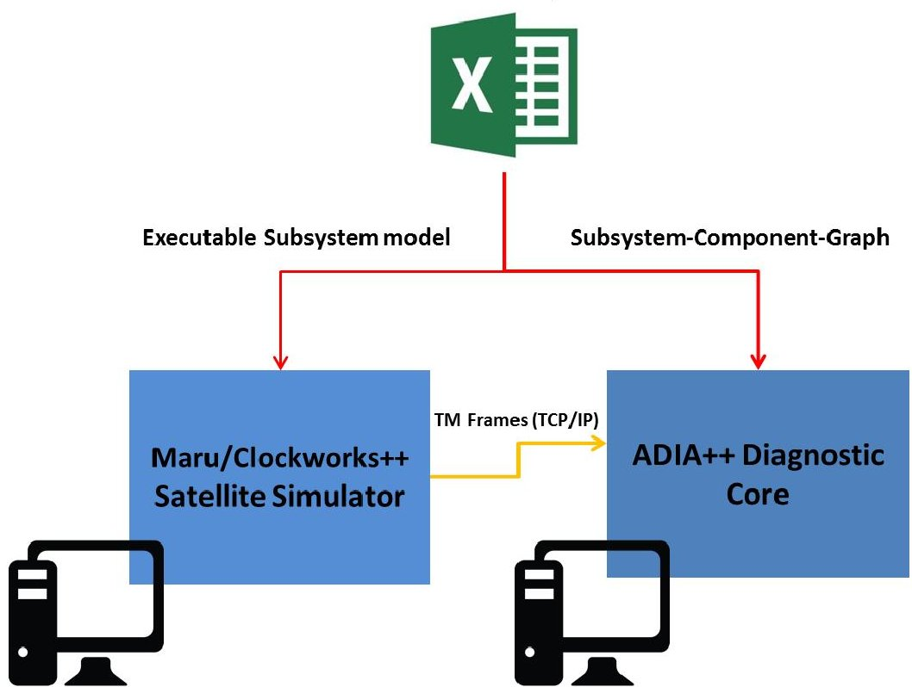
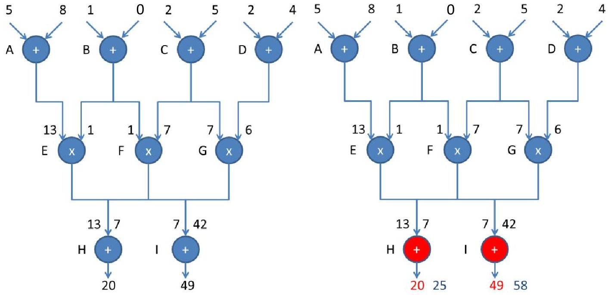
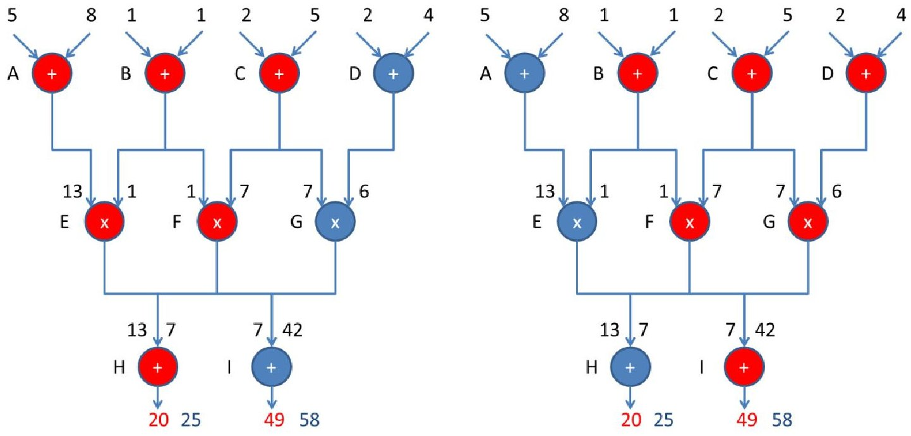
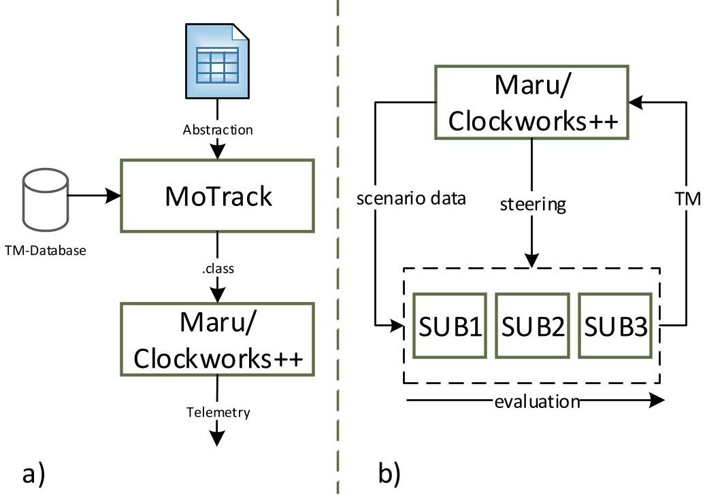

<!-- PDF_PAGE: 1 -->

# ADIA++: An Autonomous Onboard Diagnostic System for Nanosatellites

Gerhard Fellinger, Dipl.-Inf., University of Würzburg

gerhard.fellinger { at } uni-wuerzburg.de

Kirill Djebko, B.Sc., University of Würzburg

kirill.djebko { at } stud-mail.uni-wuerzburg.de

Eric Jager, University of Wurzburg

eric.jaeger { at } stud-mail.uni-wuerzburg.de

Hakan Kayal, Prof. Dr.-Ing., University of Würzburg

hakan.kayal { at } uni-wuerzburg.de

Frank Puppe, Prof. Dr. rer. nat., University of Würzburg

puppe { at } informatik.uni-wuerzburg.de

Simon Stier, University of Würzburg

simon.b.stier { at } stud-mail.uni-wuerzburg.de

Contact main author at:

Gerhard Fellinger Informatik VIII Hubland-Sued

Universitaet Wuerzburg 97074 Wuerzburg Germany

Phone: +49 931 31-85144

<!-- PDF_PAGE: 2 -->

## Introduction

Whenever on-orbit failures occur during the operational phase of a satellite mission, corrective measures should be taken as quickly as possible, lest vital components degrade further or the mission be lost altogether. This is especially true for small-satellite operations in an academic environment where all activities are carried out small research teams who all-too-often only have a single ground station available and average daily contact durations sum up to a mere 30 minutes in a typical LEO scenario, meaning that people usually have little or no idea how their spacecraft is doing during the other 23 and a half hours of the day. Thus, since interpreting housekeeping data from a faulty subsystem can be difficult and time-consuming (especially if the root cause of the error is not of the obvious kind), a system able of tackling the task of autonomous diagnosis (preferrably onboard if we take the future of deep space missions and autonomous onboard mission planning systems into account) would be highly desirable. Although both conventional FDIR systems which direct the satellite to take simple actions such as switching to sun-pointing mode after a hard-coded set of fault-critical sensor observations have been made (e.g. [Witt 2016]) and somewhat more advanced concepts have been tested in simulated operational scenarios in the past such as NASA's Livingstone (see [Hayden et al. 2004]), a more generic, easily adaptable diagnostic system for on-orbit and possibly deep space usage is currently nowhere to be found.

ADIA++ is such a system currently in the making. It is the continuation of its predecessor ADIA (short for Autonomous Diagnostic System for Nanosatellites) which are both developed as a common effort between the Professorship of Space Technology, Chair of Computer Science VIII and the Chair of Artificial Intelligence at the University of Wurzburg, Germany. The goal of ADIA++ is to provide for an automated, generic procedure for the generation of diagnostic knowledge (symptoms with associated diagnoses) as well as to lay the basis for greater scalability (i.e. the possibility to analyze faults occuring during the operation of large satellites or interplanetary probes with a large amount of telemetry data on the order of $ 1 0^{5} $ parameters) in the future. In contrast to the first ADIA system, diagnostic knowledge no longer has to be provided by hand as fixed, hard-coded sets of symptoms (represented as arithmetic expressions involving numerical measurements of various onboard sensors) mapped onto a finite set of equally handcoded corresponding diagnoses, but is instead automatically parsed from a software-based model of the satellite under scrutiny.

ADIA++ is currently in the implementation and testing phase and will be verified aboard the nanosatellite SONATE [Balagurin et al. 2016a] currently in phase A/0 development at the Professorship of Space Technology (with a launch date currently set for the first quarter of 2019).

## System Overview

ADIA++ processes regular housekeeping frames (i.e. the most current sensor data) generated by the spacecraft's OBC in order to determine whether a) a fault has actually occurred and b) what its root cause likely is. The former is accomplished by comparing actual telemetry parameter values to expected, simulated ones. The latter is achieved through a backtracing routine operating on a

<!-- PDF_PAGE: 3 -->

topological model of the satellite which is built from the same model which is used for the computation of the expected telemetry frames in the symptom evaluation step.

The development process of ADIA++ is strongly centered on the design, implementation and parsing of such quantitative models of the spacecraft to be analyzed lateron during actual mission operations by the diagnostic core. Thus, a combined mission scenario/subsystem simulator (an in-house development named Maru/Clockworks++) generating artificial telemetry frames based on detailed subsystem models is used both for testing purposes and the generation of the diagnostic knowledge itself (the model itself can be defined in a predefined Excel spreadsheet template which is then parsed by a code-building tool to generate executable surce code for the simulator and the diagnostic core):

Quantitative Subsytem Model

Figure 1: General outline of diagnostic knowledge generation and development flow.

On the ground, the diagnostic core is integrated into an ordinary PC-based software client as it is commonly used for the display of incoming telemetry frames. Thus, it is possible to run ADIA++'s diagnostic capabilities entirely without any space-segment-based component such as a software module running on the OBC or a dedicated hardware module connected to the former. In this scenario, ADIA++ would simply analyze all the frames the spacecraft transmits to the ground station and decide for each frame (both online and offline ones) individually whether it is suspicious or not (batch processing of offline telemetry data), displaying the result of each frame analysis in several dedicated areas of the client software's GUI.

In the case of operations with a spaceborne ADIA++ component, symptom detection and diagnosis are executed onboard the spacecraft, and the results of this process are then sent to the ground station in the form of specially formatted housekeeping frames delivered upon the operator's explicit request. The augmented telemetry client's function is then simply to display these results as a special form of telemetry and inform the operator about any anomalies detected although duplicate processing of incoming housekeeping frames by means of the client's (identical) diagnostic core is

<!-- PDF_PAGE: 4 -->

possible as well, e.g. for the sake of independent verification of diagnoses arrived at by the satellite's ADIA++ module. Currently, the design of the embedded spcacraft-based diagnostic software is built around a dedicated application for the RODOS middleware, a versatile, Linux-derived rump operating system specifically designed for space applications and data routing from a variety of available hardware buses for different sensor sources which has originally been developed at the German Aerospace Center (DLR) (see e.g. [Montenegro & Dannemann 2009] for further details).

## Diagnostic Core

Since in the authors' experience the manual formulation of rules of the kind "if <symptoms> then <diagnosis>" is a lengthy and error-prone process (making the task for large spacecrafts with thousands of telemetry parameters intractable), as an alternate strategy, the extraction of such knowledge from a model of a given spacecraft with all its subsystems and failure modes of their components will be used. Therefore the aforementioned simulation model is converted into a diagnostic model and optionally augmented with a priori heuristic knowledge, like failure probability of single components, low and high limits for output values and knowledge about the interaction of multiple components. Such heuristic knowledge involving multiple components describes a voting system, i.e. "if one output of either A, B or C diverges from the output of the other components then mark the diverging component as a symptom". With this diagnostic model, diagnoses are derived. For the following section we use the formalism first introduced in [de Kleer and Williams 1987], describing the system to be diagnosed. A system is a triple (SD, COMPS, OBS), where SD is the system description (split into the topology of the system and the behavior descriptions of the components), COMPS, the set of systems components and OBS, the set of observations (the telemetry data generated by the OBC). The definition of diagnosis is built up from the notion of abnormal. Therefore each component description contains a quantitative expression describing (TODO wiederholung) its fault free behavior. If a component's simulated output value diverges from the actual observed value during simulation or if the observed value violates a predefined limit, the component is being marked as a symptom component s or short symptom. A diagnosis D is a set of components c $ \in $ COMPS, whose simultaneous failure would explain all symptoms. A minimal cardinality diagnosis MCD is a diagnosis so that there exists no d $ \in $ MCD so that d $ \in $ D. A minimal diagnosis MD is a diagnosis with maximal diagnosis probability (product of the failure probabilities of the contained components) among all possible diagnoses.

To derive a diagnosis from a system (SD, COMPS, OBS) the system is being simulated according to SD and component outputs are being generated. In the next step the observed output values OBS are checked and every component whose output value violates a limit is marked as a symptom. Following this, the simulated values are compared to the observed ones. Every component whose simulated value diverges from its observed value (within an acceptance interval) is marked as a symptom. Then heuristic knowledge is used to compare the observed outputs of multiple components and mark components as symptoms. For each symptom, it 's so called conflict set CS is determined. The conflict set of a symptom component s is the set of all components upon which s is dependent, including s itself. A conflict set can be seen as a logical clause whose literals correspond to components. From these conflict sets, hitting sets HS are computed. A hitting set is a set of components, such that it contains at least one component from every conflict set. A hitting set can be seen as a solution to the Boolean satisfiability problem to the Boolean formula that is the conjunction of all CS. Every hitting set corresponds to one diagnosis. To derive the MCD's logical absorption is used to rule out non-minimal diagnoses. The resulting diagnoses are then sorted by

<!-- PDF_PAGE: 5 -->

their probability, thus making the output of the diagnostic system a sorted set of diagnoses with their corresponding probabilities.

The following example illustrates the diagnostic process. The example system consists of nine components, six of them being adders and three multipliers. Formally the system can be described as a triple (SD, COMPS, OBS), with:

- COMPS = {A,B,C,D,E,F,G,H,I)

- $ SD=\{(A,output=input_{1}+input_{2},probability=0.2,low=12,high= 29,tolerance=5\% ,A.output is connected with E.input_{1}) ,...\} $

- OBS = {H.output = 25, I.output = 58}

Figure 2: Example system after the simulation (left) and after symptom calculation

Figure 1 shows the system after the simulation and computation of the symptoms has finished. Since the observed values diverge from the simulated ones, component H and I are marked as symptoms.

<!-- PDF_PAGE: 6 -->

Figure 3: Conflict set of component H (left) and conflict set of component I (right)

The CS of symptom H can then be written as （H $ \vee $ E $ \vee $ F $ \vee $ A $ \vee $ B $ \vee $ C）and the CS of symptom I a （I $ \vee $ F $ \vee $ G $ \vee $ B $ \vee $ C $ \vee $ D). The HS are solutions to the Boolean formula （H $ \vee $ E $ \vee $ F $ \vee $ A $ \vee $ B $ \vee $ C） $ \land $ （I $ \vee $ F $ \vee $ G $ \vee $ B $ \vee $ C $ \vee $ D). In this case the HS $ \{ $ H,E,F,A,B,C,I,F,G,B,C,D}, $ \{ $ H,I} and $ \{ $ F} are valid diagnoses, but not minimal ones. The MCD's for this example are

{B}, {C}, {F}, {E,G}, {E,I}, {G,H}, {H,I}. Assuming the failure probability for each component is 0.2, the output of the diagnostic system would be

{({B},0.2),({C},0.2),({F},0.2),({E,G},0.04),({E,I},0.04),({G,H},0.04),({H,I},0.04). While a simultaneous failure of H and I would explain the symptoms a failure of F would also explain both symptoms, but would be more likely. If one would have observed the values of E and G as being in accordance with their simulated values one could rule out all diagnoses expect for ( {F},0.2) and ( {H,I},0.04).

## Simulator Component

The simulation component of ADIA++ consists of three different subcomponents: An Excel spreadsheet with a predefined format for the description of the system, a tool for source code export/syntax check (MoTrack) and a scenario simulator (Maru, a pre-existing in-house development based on the eclipse RCP-Framework) which propagates the model satellite's orbit and, in conjunction with Clockworks++, evaluates the defined subsystem model and generates telemetry data.

To enable users with limited programming experience to design executable quantitative models for the simulation, a predefined Excel spreadsheet template is provided as a basis for the entire subsystem simulation. In order to use it, it is required to comply with a strict structure of a satellite model which consists of subsystems and components. System inputs as defined in the spreadsheet can be declared as so-called steering parameters which can then be changed manually by the user from within the Maru scenario simulator's GUI during evaluation. This allows for the triggering of various malfunctions and defects necessary to verify the diagnostic component. Furthermore, each

<!-- PDF_PAGE: 7 -->

Clockworks++ output can be declared as a telemetry parameter in order to be contained within after each evaluation. The user also has several types of parameters externally generated by Maru at his disposal. Each of them can be accessed directly from the spreadsheet. As an example, it is possible to use the provided position of a satellite in ECI or the current simulation time from within the spreadsheet without writing any additional line of code.

Figure 4: a): Workflow b): Simplified evaluation process

By using Jython (a Java implementation of the popular scripting language Python) as the interpreter for the evaluation of the subsystems, the user can is able to access plenty of mathematical expressions and functions (C Standard). Additionally, it is possible to access user-defined Java methods implemented in the Maru scenario simulator from within the spreadsheet.

MoTrack is the connecting link between the spreadsheet format of the model and the scenario simulation. It abstracts the spreadsheet and generates a file (.class -Java bytecode) which encapsulates the model. With a mandatory connection to a valid telemetry database it is ensured that from the beginning, the telemetry parameters used in the spreadsheet are consistent with those of the real satellite lateron. After export, the model can be loaded into the Maru scenario simulator. The mission simulator has been augmented to enable it to evaluate these exported models. In each simulation step it computes the output of all the subsystems in a specific order which must be defined by the user in the spreadsheet. Every time it evaluates a subsystem, all scenario data as well as steering parameters are delivered to the model. At the end of each simulation step, the generated telemetry data is read and distributed to the listeners of the clockworks plugin which then generate housekeeping frames that are distributed via TCP/IP, RS232 or ordinary file output.

<!-- PDF_PAGE: 8 -->

# Preliminary Operational Concept

As mentioned, ADIA++ is slated for on-orbit verification aboard SONATE, a triple cubesat mission intended as a verification platform for a set of novel components currently under development at the Professorship of Space Technology of the University of Wurzburg. Among them are core components of both ASAP (Autonomous Sensing, Autonomous Planning, an advanced image sensor for the detection of unpredictable, short-lived visual phenomena in the upper atmosphere which is also capable of planning future activities of the spacecraft depending on observations made) [Wojtkowiak et al. 2014] and ADIA++ as well as AROS, a family of star sensors which are the result of an autonomous design process [Balagurin et al. 2016b]. The intended mission duration is one year after launch (Q1 of 2019) with a preferably sun-synchronous orbit between 450 and 800 km of altitude (with the exact details naturally depending on available launchers). The project is currently nearing completion of phase A/0 with phase B's design process beginning after the preliminary requirements review in the fall of 2016.

In order to enable the diagnostic core to function in accordance with SONATE's design, a full quantitative model of the satellite will be formulated and constantly improved as the design of SONATE itself progresses in phases B and C. This model will then serve as a basis for the topological model as well as the symptom-generating one-step simulator which are essential to ADIA++ as mentioned in the preceding section of this paper.

As for ADIA++, it is currently foreseen that probably not all of the system's diagnostic components will be able to run aboard SONATE in their entirety. Due to various constraints such as available power and volume for dedicated hardware, an operational concept attaining the originally envisioned one as closely as possible has been drawn up. Pending the final design of ADIA++'s hardware configuration (both a scenario where the diagnostic core is simply another piece of software running on the OBC as well as a dedicated, separate hardware entity are possible) as well as detailed benchmarks, we are taking the cautionary route where computational load on ADIA++ (and thus power consumption vis-à-vis the entire satellite) is somewhat less demanding.

Concerning the space segment, ADIA++ will receive all the housekeeping frames the OBC assembles in regular intervals (presumably every 30 seconds when outside the range of the Würzburg ground station, once every two seconds while passing over it). As a first measure, the current numerical values of all telemetry parameters are compared to the simulated parameter values that a simple one-step-forward simulation software component yields; the latter contains a sufficiently simplified quantitative model of the spacecraft such that (within reasonable margins of error allowing for unavoidable inaccuracies of the model) the from the last known state (i.e. the housekeeping frame preceding the current one) the current state (i.e. the contents of the current housekeeping frame) should be recovered (again, by a reasonable margin of imprecision). Should one or more pairs of simulated and measured telemetry parameters deviate too much from each other (i.e. by a predefined percentage of the simulated values), the received frame is marked as suspicious. After (and only after) that, the diagnostic core is called in order to identify the responsible components according to the process outlined in the section "Diagnostic Core" of this paper.

As described, the algorithm tracing a detected anomaly back through the topology of the SONATE's model to a culprit consists of two different processes: First, the conflict sets of all possibly suspicious components are built by a backward-directed breath-first search through the component graph. Once obtained, we resolve the hitting sets of components that can be called properly responsible by running a SAT-solver.

However, depending on the cardinality of the various conflict sets obtained in step one, step two could take considerable time to resolve. Since the intervals at which new telemetry frames are

<!-- PDF_PAGE: 9 -->

incoming from the OBC are finite (and, as in the case of a ground station overpass), there exists a possibility of ADIA++ lagging considerably behind the current state of the satellite which could ultimately lead to a considerable de-synching between ADIA++ and the rest of the satellite. This, however, is in turn strongly dependent on the number of concurrently independent errors detected as well as on the configuration of the final satellite (and hence the number of actually measured telemetry parameters, on the degree of connectivity as well as the number of components making up SONATE's topology).

Thus, we are currently assuming that step two of the diagnostic algorithm (SAT-solver run) should be delegated to a suitable piece of software running on the ground segment where memory, energy and time are not constrains in the same way as they usually are on a spaceborne platform. Accordingly, after the computation of the conflict sets, its results are stored in onboard-memory and sent down to the ground station for further evaluation, thus completing the diagnostic run as a distributed system.

As an alternative to consider, a stochastical hill climber algorithm could be applied, reducing (in combination with a fixed time limit, e.g. 15 seconds) computational load at the expense of at worst incomplete results (i.e. not all possible hitting sets can be obtained, among them possibly the correct diagnosis for a given anomaly). This, however, is still subject to further analysis and testing in the course of SONATE's and ADIA++'s development processes.

## Conclusion

With ADIA++, a novel autonomous, model-based onboard diagnostic software system for spacecraft has been proposed. It is currently under active development and designated to be operated for the first time in space aboard SONATE, a triple cube sat currently under development as technology demonstrator mission for various autonomous payloads at the Professorship of Space Technology at the University of Würzburg. ADIA++ uses an advanced process whereby the diagnostic knowledge about the system and its various components is not explicitly coded by hand but automatically parsed from a quantitative model which is also used for subsystem simulation inside a user-defined mission scenario (Maru/Clockworks++ software package). Diagnostic processing is a two-step algorithm based on the topology of the modeled satellite's subsystems and their components, respectively. The preliminary operational concept factors in the possibility of a nanosatellite's limited computational resources not being sufficient for the full-blown software, thus precautionally outsourcing step two of the diagnostic run to ground-based computer hardware. The final design of ADIA++ onboard SONATE will be decided upon during phase B of the SONATE project commencing in fall 2016, whereas the launch and one-year on-orbit verification are currently scheduled for 2019 through 2020.

<!-- PDF_PAGE: 10 -->

## References

[Balagurin et al. 2016a] Balagurin, O., Fellinger, G., Kayal, H., Schwarz, T., Wojtkowiak, H. A Novel Nano Satellite Mission To Demonstrate Autonomous System Technologies. In Proc. Small Satellites, System & Services Symposium (4S). 2016.

[Balagurin et al. 2016b] Balagurin, O., Kayal, H., Schartel, A. An Optimized Development Process For Small Star Sensor Systems. In Proc. Small Satellites, System & Services Symposium (4S). 2016.

[Hayden et al. 2004] Hayden, S.C., Sweet, A.J. & Christa, S.E. Livingstone Model-Based Diagnosis of Earth Observing One Infusion Experiment. In Proc. AIAA Intelligent Systems. 2004.

[de Kleer & Williams 1987] de Kleer, J. and Williams, B.C. Diagnosing multiple faults. Artificial Intelligence, 32:97-130, 1987.

[Montenegro & Dannemann 2009] Montenegro, S. and Dannemann, F. RODOS - Real Time Kernel Design for Dependability. In Proc. DASIA Conference 2009.

[Witt 2016] Witt, R.M. Failure Detection, Isolation and Recovery capabilities for the university small satellite Flying Laptop. Dissertation at the University of Stuttgart. Dr. Hut Publishing House, Munich 2016.

[Wojtkowiak et al. 2014] Wojtkowiak, H., Balagurin, O., Fellinger, G., Fischer, W., Fernandez, B., Kayal, H. ASAP: Autonomous onboard mission planning. In Proc. $ 6 5^{th} $ International Astronautical Congress. 2014.