<!-- PDF_PAGE: 1 -->

# Domain-Specific Languages and Diagram Customization for a Concurrent Engineering Environment

Bjorn Cole $ ^{1} $ , Greg Dubos $ ^{1} $ , Payam Banazadeh $ ^{1} $ , Jonathan Reh $ ^{1} $ , Kelley Case $ ^{1} $ , Yeou-Fang Wang $ ^{1} $ , Susan Jones $ ^{1} $ , Frank Picha $ ^{1} $

$ ^{1} $ Jet Propulsion Laboratory, California Institute of Technology, 4800 Oak Grove Drive, Pasadena, CA 91109.

Abstract-A major open question for advocates of Model-Based Systems Engineering (MBSE) is the question of how system and subsystem engineers will work together. The Systems Modeling Language (SysML), like any language intended for a large audience, is in tension between the desires for simplicity and for expressiveness. In order to be more expressive, many specialized language elements may be introduced, which will unfortunately make a complete understanding of the language a more daunting task. While this may be acceptable for systems modelers, it will increase the challenge of including subsystem engineers in the modeling effort. One possible answer to this situation is the use of Domain-Specific Languages (DSL), which are fully supported by the Unified Modeling Language (UML). SysML is in fact a DSL for systems engineering.

The expressive power of a DSL can be enhanced through the use of diagram customization. Various domains have already developed their own schematic vocabularies. Within the space engineering community, two excellent examples are the propulsion and telecommunication subsystems. A return to simple box-and-line diagrams (e.g., the SysML Internal Block Diagram) are in many ways a step backward. In order allow subsystem engineers to contribute directly to the model, it is necessary to make a system modeling tool at least approximate in accessibility to drawing tools like Microsoft PowerPoint and Visio.

The challenge is made more extreme in a concurrent engineering environment, where designs must often be drafted in an hour or two. In the case of the Jet Propulsion Laboratory's Team X concurrent design team, a subsystem is specified using a combination of PowerPoint for drawing and Excel for calculation. A pilot has been undertaken in order to meld the drawing portion and the production of master equipment lists (MELs) via a SysML authoring tool, MagicDraw.

Team X currently interacts with its customers in a process of sharing presentations. There are several inefficiencies that arise from this situation. The first is that a customer team must wait two weeks to a month (which is 2-4 times the duration of most Team X studies themselves) for a finalized, detailed design description. Another is that this information must be re-entered by hand into the set of engineering artifacts and design tools that the mission concept team uses after a study is complete. Further, there is no persistent connection to Team X or institutionally shared formulation design tools and data after a given study, again reducing the direct reuse of designs created in a Team X study.

This paper presents the underpinnings of subsystem DSLs as they were developed for this pilot. This includes specialized semantics for different domains as well as the process by which major categories of objects were derived in support of defining the DSLs. The feedback given to us by the domain experts on usability, along with a pilot study with the partial inclusion of these tools is also discussed.

## TABLE OF CONTENTS

1. BACKGROUND: CONCURRENCY AND NON-CONCURRENCY REVISITED ... 1

2. BACKGROUND: REQUIREMENTS UPON MODEL-BUILDING IN A CONCURRENT ENVIRONMENT ... 3

3. BACKGROUND: DOMAIN-SPECIFIC LANGUAGES ... 4

4. APPROACH: BUILDING DSL'S IN SYSML ... 5

5. APPROACH: LIMITING USE OF SYSML CONCEPTS ... 5

6. APPROACH: THE PROTOTYPE BUILD AND PROFILES7

7. APPROACH: CONNECTING TO PARAMETER DATABASE ... 7

8. INTERMEDIATE RESULTS: FEEDBACK FROM SPECIALIST CHAIRS ... 8

9. INTERMEDIATE RESULTS: ADDRESSING EARLIER RISKS ... 9

10. FUTURE WORK: DESIRED IMPROVEMENTS TO SYSML OVERALL ... 9

11. SUMMARY ... 10

    ACKNOWLEDGEMENTS ... 10

    REFERENCES ... 10

    BIOGRAPHIES ... 11

## 1. BACKGROUND: CONCURRENCY AND NONCONCURRENCY REVISITED

Concurrent engineering is contrasted with non-concurrent engineering by looking at multi-domain problems like spacecraft design. The non-concurrent approach is characterized by work in series, with the answers to one engineering question used to frame another. Meetings are held to synchronize work and the process is often quite iterative. Concurrent processes are also iterative, but the approach is to co-locate a variety of engineers and run a series of parallel threads with constant communication in

<!-- PDF_PAGE: 2 -->

order to converge at a feasible design. The result of this is a great reduction in time to converge designs [1], and a side effect of this improvement in speed is often a greater understanding of the fundamentals of how a given space mission is framed.

Team X has been greatly successful within JPL, and has generated over 1000 space science and technology studies. Its success, and the limits of its scope that have been discovered, have led to the development of new concurrent teams to address missions of different maturity [2]. What this suggests is that there is a need for multiple interchanges between different teams as they work together to create and mature mission concepts. However, there are challenges in doing so, owing to limitations in current engineering tools.

need to pre-configure tools for speed but to remain flexible to new types of missions.

There are three major groups of issues with the computing infrastructure of concurrent teams. The first is the stark contrast between the level of integration that is often available to engineers working in concurrent and nonconcurrent environments. While databases for coordinating parameter value updates are common in concurrent teams, the availability of such middleware is not guaranteed to nonconcurrent teams during formulation. The second is the very manual process of moving information between concurrent and non-concurrent teams, which results in part from the first group of issues. The final group of issues (which this paper does not address) is the tension between a

Understanding the contrast in information interchange support made available to concurrent and non-concurrent teams is best done through the lens of facilities. Concurrent engineering is often performed in specialized facilities with specialized tools made available. A combination of room arrangement, preconfigured workstations, and supporting infrastructure are dedicated to this mode of work. As a radical form of team collocation, they are well-built to provide multiple ways for team members to share information - by gesture, voice, or computer link. A sign of the centrality of these facilities is that every team will show, as part of their self-description, a room layout. An example is below in Figure 1.

It can be clearly seen that tool integration is an enabler for effective concurrency. This enabling is done through a set of curated, standardized, and well-understood parameters that are shared between domain experts that specialize in a given study role, or chair. This parameter set is housed within some form of custom software (e.g., ICEMaker [3] developed at Caltech and JPL, or xIDEA [4], developed at Aerospace Corporation and adapted to Team X) that is designed to find values input by concurrent session participants. These values are then routed to other participants at their workstations to propagate design

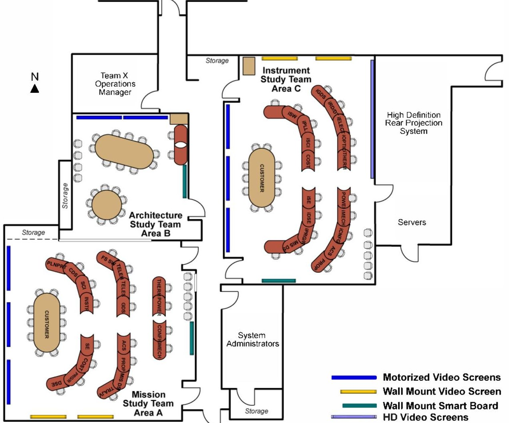

Figure 1. Layout of JPL Project Design Center (PDC); typical of concurrent design centers.

<!-- PDF_PAGE: 3 -->

updates. The software is often built around Microsoft Excel spreadsheets in some way or another. Further, there is often a publish-and-subscribe approach to the timing of interchange that is used to allow individual participants to have time to work separately as needed.

The integration between spreadsheets breaks down after a concurrent study is completed and the mission concept is further developed by the concept team. New or different parameters may be required, nullifying the well-controlled interfaces of the concurrent environment. It becomes harder to provide the controlled infrastructure that enables the custom software to function. Finally, there is a host of additional tools or calculators the nonconcurrent team may wish to employ that are outside the purview of concurrent team toolsmiths.

The difference in environments often available to concurrent and nonconcurrent teams heightens the problem of data transfer. Currently, the handoff is done with documents and presentations. If it is the case that both concurrent and nonconcurrent teams have members in common, this can greatly improve the transition, because design models in the form of spreadsheets can be handed off directly. If this is not the case, teams are often left to "hit the highlights," leaving behind many details of design work that are buried in spreadsheets. In either case, the spreadsheet-based models can be hard to grow organically with increasing detail. Also, convolutions between generic design models and sets of proprietary data or sensitive (e.g., cost) models make it much less likely that the spreadsheets will simply be passed from team to team. Spreadsheets simply make it too challenging to restrict passed information only to that relevant to the receiving team.

All of these considerations have led to an interest in using much more durable and capable expressions of engineering models in JPL's Team X. One such platform is that provided by the Systems Modeling Language (SysML) standard and its supporting toolset. SysML models can be exchanged, expanded, audited, and marked for interconnections between parameters easily and robustly. They appear to be a natural solution for handling both the disparity in concurrent vs. non concurrent tool integration and the issues of data transfer between teams.

## 2. BACKGROUND: REQUIREMENTS UPON MODEL-BUILDING IN A CONCURRENT ENVIRONMENT

Models written in languages like SysML can be to the systems engineer as CAD models are to mechanical engineers. They can convey large quantities of information at a more or less arbitrary level of detail. They are expressed in increasingly standardized languages with improving support tools.

There are many issues in systems engineering that could benefit from software support including: tracing out lines of

causality, cycle detection, graph-based metrics of complexity, and simple verification of system composition rules. This support is often offered by formal modeling. SysML is a language that provides a modeling platform under graphical view creation. SysML is not formal in the sense of semantic languages like OWL but it does provide standardization of multiple diagrams. Also, when combined with frameworks like the Object Constraint Language (OCL) to implement rules and logical queries on user-created profiles, it can approach OWL in formality.

While the possibilities of formal modeling are attractive, it is not to say that the employment of formal models for concurrent engineering is without risk.

The clearest risk is that the use of formal models by systems engineers is relatively new. The discussion above about the degree of SysML's formality highlights a good deal of frustration and confusion in the MBSE community; SysML is not formal enough for those fluent in mathematically-backed semantics but is intimidatingly complex to traditional systems engineers. Formal models have made even less penetration into domains such as mechanical or electrical engineering (outside those directly connected to analytical contexts). Thus, the "standard language" is really not so standard in day-to-day practice. For an interchange between teams via these models to be useful, both teams must have members able to read them.

Another risk especially relevant to concurrent engineering is the potential threat of formal modeling to timeliness and agility. So much time can easily be spent in model-building that there is no time left over to work the actual engineering issues. SysML models can easily become complicated and employ a wide variety of modeling elements and diagrams. Many authoring tools have yet to fully streamline mouse clicks or make finding model attributes entirely intuitive.

Another issue is that SysML was designed to be a general language for system description. Its representation of systems via boxes and lines is very bland in comparison to the rich schematics available to some domains. Engineers in the propulsion or telecommunications areas, for example, would lose a great deal of descriptive power in their diagrams using SysML Internal Block Diagrams.

These risks and others not so well articulated motivated the performance of a pilot task of infusing SysML-based tools into Team X. One key was to get feedback on tools under development from domain experts that participated in Team X as specialist chairs. Another was to assure that this new tooling could be made compatible with the existing infrastructure of Team X to enable incremental deployment.

The requirements that were formulated on tools for Team X were the following:

<!-- PDF_PAGE: 4 -->

- Responsiveness. Since study sessions have a cumulative in-session time of three to fifteen hours, fiddling with the tool can only consume a fraction of this time.

- Visual expression in natural domain terms. Again, speed and the need to rapidly communicate in a concurrent design session require that icons and schematics can be easily understood.

- Minimal involvement with SysML semantics. The number of metaclasses and SysML concepts needed to work with the tool must be kept small to enable training within a few hours or days.

- Selective portability of information. While the model-based approach is meant to facilitate data transfer, it is still vital that this transfer be verifiably in accordance with proprietary data concerns, ITAR, etc.

- Accessibility. The correct information on technical performance and cost should be at the fingertips of chairs during a session.

- Usefulness even with partial deployment. Since Team X is an operational team, any changes to it must be incremental and able to be rolled back if problems arise.

- Compatibility with existing infrastructure. In order to be stood up incrementally,the tooling must talk to existing databases and parameter exchange infrastructure.

This was a challenging set of requirements to address. As a result, this pilot leveraged an active community of modelbased systems engineering practitioners at JPL for inspiration and clues about how to properly develop prototype tools. The community has attacked a variety of problems [5], [6], [7], [8] [9], [10] in the practical use of MBSE technology and was an invaluable experience base to work from.

## 3. BACKGROUND: DOMAIN-SPECIFIC LANGUAGES

The idea that inspired the creation of this pilot is that of the domain-specific language. This is a venerable tradition in programming, although the term is relatively new. The idea is that generality can be sacrificed in order to achieve ease of use or speed in working with a language that is developed for a specific application. Examples abound - Verilog is made for electrical engineers, HTML for web presentation, Lego Mindstorms for toys, and so on. Another excellent example is the scripting language developed for Matlab. It is very powerful for engineering applications, but is limited for developing generic software like games or even hardware adapters without utilizing Java or C extensions.

The development of domain-specific languages now benefits from a variety of tools, such as those offered by the Eclipse Foundation. The Eclipse Modeling Framework [11] and XText [12] project now have several tools for metamodel definition, custom grammar creation, and the

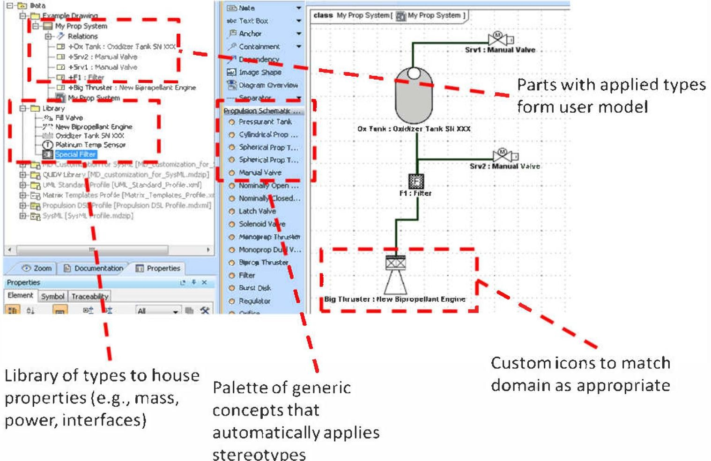

Figure 2. General approach to presenting model-based tooling for a specific domain

<!-- PDF_PAGE: 5 -->

crafting of language interpreters. Microsoft has spent a great deal of effort trying to convince the development community to look toward DSL's for modeling rather than general-purpose frameworks like UML. While Microsoft tools now incorporate UML ideas, they do still promote the domain-specific approach. The approach of using both the domain-specific language while anchoring it on a generally applicable language is a good one, and is promoted by the Open Modeling Group (OMG).

OMG offers multiple approaches to deriving domain-specific models while utilizing a generic framework. Two of the best known are the leveraging of the metametamodel called the Meta-Object Facility (MOF) (aka, M3) and extended UML through profiles. The latter approach is how SysML itself was defined.

## 4. APPROACH: BUILDING DSL'S IN SYSML

The SysML authoring tool MagicDraw has a feature set dedicated to building domain-specific languages. Various modeling elements are dedicated to controlling how various model elements are seen by the tool. Custom diagrams can be created by the user with customized context, side, and title menus. There are also a variety of entry points to the API for further customization. The use of DSL's in defining an appropriate library for domain engineers is presented in Figure 2.

There are three major places that these customization points can be used. The first is to restrict the interface so that only a controlled subset of modeling concepts is available to the user. The second is to change the look and feel of the modeling tool so that it is more appropriate to the domain that a given user is comfortable with. Finally, the third way is to set certain defaults (such as menu items or the placement of Ports when an icon is first drawn) to facilitate faster use of the tool. While all three of these options have been investigated, the last two in the list appear to be the most useful.

The default behavior of MagicDraw was altered via the Application Programming Interface (API) in order to make a true drag-and-drop feel from libraries. This was the first foray into a series of customizations to be made in order to streamline custom tools for concurrent engineering teams. The customization overrides the default behavior, where MagicDraw attempts to size Part Properties according to the length of the name and classifier at a given text size, and then add relevant Ports in either a left / right (all along the left side and right side) or top / bottom configuration. Many of the DSL icons the team used did not obey this convention, but had a different set of locations to fix connections to. Thus, specialized functions were added via MagicDraw's API to resize icons to predetermined values (since thrusters are usually emphasized over temperature sensors, for example) and place Ports in the correct locations.

One final aspect of building the DSL in MagicDraw should be highlighted. While SysML modeling tends to focus on point-to-point connections between components, there are also buses, junctions, and manifolds that must be addressed in engineering schematics. Specialized icons were added for these as well to be added to diagrams for interconnections. This allows for rapid adjustment of layouts, as well as a proper semantic capture of routing. A plumbing fork, for example, does not merely connect multiple components. It also is a place where a common pressure and flow rate is known, and can be leveraged to analyze the properties of the circuit at large. While a similar look can be made by overlaying lines that connect components point-to-point, this would lead to improper information being captured in the model database.

## 5. APPROACH: LIMITING USE OF SYSML CONCEPTS

An important goal of the prototyping effort was to minimize the number and scope of concepts from SysML that would be required to work with the various chair-specialized tools. The quantity and rate of Team X work can be highly variable depending on the demand for concepts (e.g., for peaks to support national Decadal Survey analysis requests). There is potentially a long period of time between when a given specialist will use the Team X tools, and so there is a need for them to be intuitive to minimize retraining demands. Further, many specialist chairs do not have the

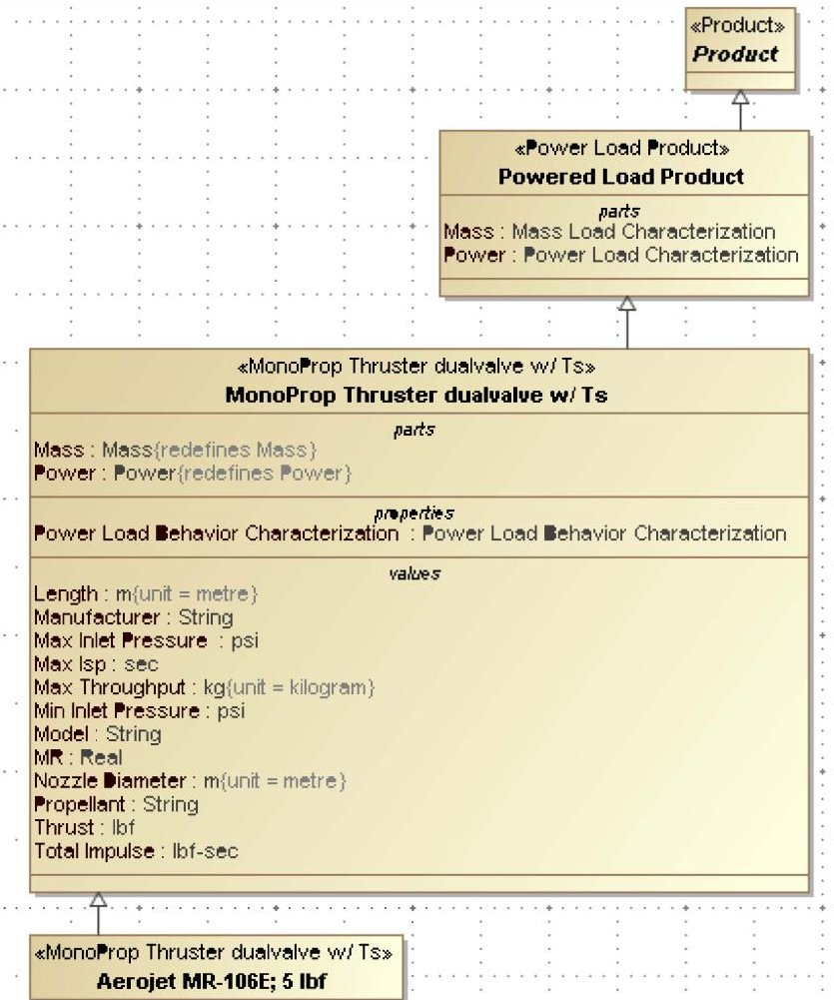

Figure 3. Inheritance path from specific component to generic idea of Product.

<!-- PDF_PAGE: 6 -->

mastery of SysML on the list of critical skills that they must maintain in order to be effective in their various roles within the organization.

In discussing this area, it is worth noting that the UML superstructure and SysML specification together specify about 300 first-class metamodel elements. Many of these are abstract base metaclasses for other metaclasses, which means that inheritance must be considered when attempting to understand the language as a whole. This means that UML / SysML currently requires much study and practice to truly master. Even to comprehensively understand the basics requires many days of class time. While this is perhaps an acceptable training requirement for systems engineers, who will leverage the concepts of the language daily, it is hard to justify training intermittent users.

The traditional way of presenting the major components of a system or subsystem provide the starting point for required SysML elements to be used. The typical box-and-line (or more schematically interesting icon-and-line) drawings that are presented correspond nicely to the contents of a SysML Internal Block Diagram (IBD). This then requires at least the metaclasses of Property and Connector to be introduced. In addition, Ports should also be included to properly ground the connections between major participating elements in a design.

The structure of the model requires some more ideas to be introduced. The notion of TypedElement and Type in general need to be described. Rather than precise SysML semantics, however, this manifests more in the generic "what does it mean to have a 'type'" question. The modular development and semantic refinement of various elements also requires a description of the ideas of inheritance and its relationship to steadily more restrictive classifications. The classification progression of a bipropellant thruster, for example, is Product -> Powered Hardware Product -> Thruster -> Bipropellant Thruster. As the classification is refined, the SysML relationship of Generalization is used to imply that new properties are inherited. Thrusters, for example, will need a property to describe thruster

performance, while bipropellant thrusters will need to discuss mixture ratios. The relationships of Generalization and addition of parameters is shown below in Figure 3.

As more work was done on the toolset, it became clear that behavioral descriptions of the spacecraft would also be required. Although detailed scenario development and definition could be left to systems engineers (who would hopefully be stronger practitioners of SysML), there is still the need to define basic system states. The definitions are required to properly anchor the descriptions of power use and data generation. There are likely other dynamic states that may also be added to the general design framework, but power and data are the only considerations for now.

The initial pattern for defining states is to use SysML State Machines as containers for state value constraints. This is illustrated in Figure 4. In it, the higher Block "Power" is specialized into two State Machines called On and Off. They redefine power estimate properties for the times that they are active. This pattern represents the most challenging pattern developed to date to place behind the more userfriendly façade that this pilot is creating.

The states are then aggregated into relevant "power modes" that can be referred to in scenarios through the use of Sequence Diagrams. This threatens to quickly expand the scope of required concepts. State, State Machine, Lifeline, Interaction, State Invariant, Duration Constraint, and Time Constraint quickly enter the picture.

An approach to keep the concept list small has been to construct the relevant parts of the behavior model automatically (since it is a fairly flat, mechanical pattern) and then use Magic Draw's Generic Table interface to deal with changing modes. This appears to work well, as it provides a simple set of drop-down menus to change system states within modes.

These reflections lead us to a couple of steps of required awareness to move from a basic user of these tools, to a power user / modifier, to a tool smith. The basic user

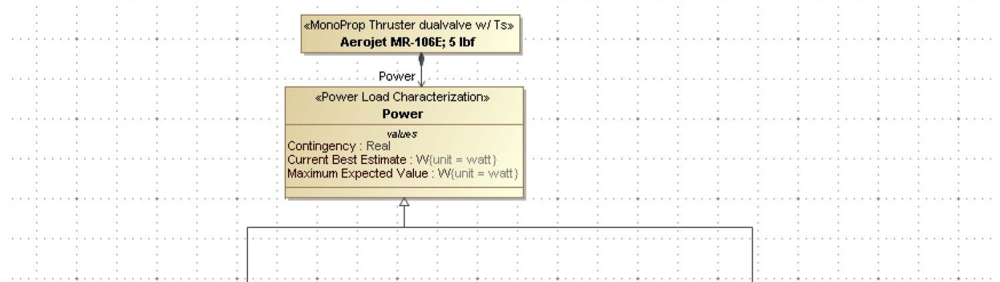

Figure 4. Definition for power consumption of hardware in given states.

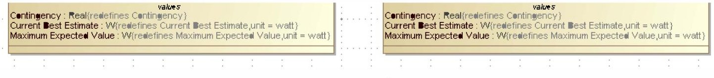

<!-- PDF_PAGE: 7 -->

should require only the ideas of States, State Machines, Properties, Connectors, and Types. A power user will also need to understand Generalization, State Invariants Duration Constraints, Interactions, and Lifelines. Finally, someone who intends to re-engineer these tools should have a broad understanding of SysML and its use in systems engineering in order to consider and evaluate alternative modeling constructs.

## 6. APPROACH: THE PROTOTYPE BUILD AND PROFILES

The approach to building up the libraries and elements of the prototype tool was to use as much good modeling hygiene as possible. While initial tests could be handcrafted, the actual library builds were set up to be entirely automated. This automation was often done in passes. Base types with proper stereotypes were first created, then properties were added, and then Ports and other features. Behavioral elements to support power mode capture were added after this, and a variety of stereotypes were then applied.

Automation was not intended only to save on maintenance times, although this was certainly a side benefit. The important point was to assure that library elements were uniform in their build within the model and had only the attributes that were desired, rather than side effects from tinkering. The tinkering was done on the machinery and the processes used to invoke build codes and scripts along the way to getting new versions of the model built.

A good deal of the automation of building the models was facilitated by the object-oriented nature of SysML. In the same way that objects are instantiated from a class template, the elements of this library were instantiated from templates that we called base types. Stereotypes and the mechanisms for customization in MagicDraw were applied to these base types and propagated forward in order to make a library of elements with the desired parameter definitions, parameter values, and icons when brought into Internal Block Diagrams.

The object orientation is enhanced by using MagicDraw's profiling mechanisms and customization engine. The most visible feature of the customization engine is the ability to apply custom icons to various symbols. More subtle

features of this engine include the ability to specify super types to any element on which a given stereotype has been applied. These super types work exactly according to the SysML Generalization semantics. Via custom tooling, these super types have inherited properties redefined, so that the default values of these properties (such as values for given attributes) can be defined for given elements. The combination of elements to create profiles is shown in the diagram below labeled Figure 5.

An important perspective is needed here to fully appreciate the use of UML Generalization and Stereotypes together. The perspective is that of the view and viewpoint [15] as expressed in SysML. A strong interpretation of SysML through this lens implies that the model file or database is expressed in various diagrams as views into the model. The UML and SysML specifications for graphical syntax are really the viewpoints for looking at a unified model.

In this view, the Stereotype conveys information that cannot be viewed in a diagram, while the Base Classifier conveys information that can. Combining this model-only data (one might be tempted to call it metadata) and data that can be diagramed gives a complete set of the kinds of data that can be kept in a model. This, combined with MagicDraw's tool-specific metadata (Customization classes) allows for a complete definition of everything needed to bring the domain-specific language elements to life.

## 7. APPROACH: CONNECTING TO PARAMETER DATABASE

A major concern of Team X members is the ability to gradually phase in model-based systems engineering tooling, and to be sure to use the correct tool for the correct job. In order to do this, previous investments in quality infrastructure were opportunistically leveraged. As described in [4], the Team X infrastructure works with a Web Service to collect and curate the analysis variable values for a given study. This Web Service makes an excellent target for various programming languages, including those accessible to the MagicDraw API.

Specialized functions and stereotypes were developed to mark certain elements of the model as targets for queries to and from the core parameter database. In the same style as the other workbooks, the custom software works in a

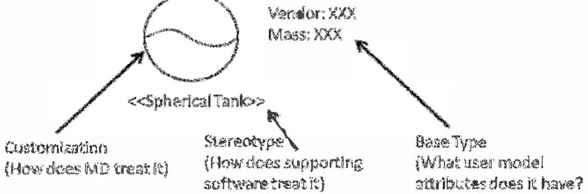

Figure 5. . Generation of domain-specific language element.

<!-- PDF_PAGE: 8 -->

publish-and-subscribe approach. The ability to make these connections lowers the bar for adaptation dramatically since various participants in Team X studies can now opt to use the workbooks or the MagicDraw interface to specify a design.

## 8. INTERMEDIATE RESULTS: FEEDBACK FROM SPECIALIST CHAIRS

The pilot was started with the participation of the chair lead for propulsion in Team X, who worked with the other authors to lay out the requirements for the tool. Later, leads for the telecom and command and data systems (CDS) chairs also joined the piloting effort. While all of the authors had experience in Team X studies and process, there are insights that the specialist chairs immediately provided.

One of the first, and in retrospect most obvious insights, is that the specialist chairs always feel rushed to provide initial estimates for global design parameters like mass and power. These are needed to see if a given design is likely to even be in the ballpark for what a customer needs. To this end, there was a great interest not only in a library of basic parts, but in a library of finished subsystem designs that could be quickly reused or adapted to a given study. If a subsystem does not have strong requirements to a new design, these templates can help accelerate the study and focus attention on the aspects of the design that are driven by unique requirements. If the new mission drives an innovative response, the time pressure is reduced and design capture is deferred until the concept has been developed in session. "Freeform" elements can be used then to capture resource requirements for the purposes of the study and then described in detail later. At the very least, the template designs can be offered as a "guess" to start up other design work while the domain expert has time to think more upon better approaches.

Another interesting aspect that came up is that while only one chair may be responsible for the specification of a given component in the shared design, said chair will often require significant interface with other related subsystems. This was very apparent in PowerPoint diagrams offered as input from CDS, where the avionics were shown to be connected to telecom, power, and attitude control electronics, as well as the instrumentation suite. Before the pilot was started,

the team thought that these cross-connects could be provided by the systems chair. After consultation with the specialist, it became clear that each specialist would need to be able to give cross-cutting views of the whole system from their perspective. That is, the CDS chair would do a data flow diagram, while power would focus on power connections and distribution.

This poses an interesting problem. The challenge is to allow multiple engineers to make intertwined contributions to the overall model in a concurrent way while keeping individual concerns and domain considerations separated. A fuller appreciation of view, viewpoint, and their expression in SysML should provide a way forward, but there are still multiple implementation issues at hand to address. This may lead into the general problem of model merging, which is akin to software code merging, but involves much more complex structures.

Additional feedback provided to the team is that the processes employed by any given domain engineer were a little different than expected by the systems engineers; having the domain expert was thus essential for a useful tool to be developed.

A totally unexpected, but highly encouraging result was an interest in learning more about SysML itself by one of the subsystem chairs that was previously unaware of the language and subsequently became a co-author of this paper. When the language itself is presented as something that leads the way to better data transfer, validation rules, etc., there is often a great deal of concern expressed in the audience about dealing with the large language. On the other hand, if a potentially useful and not overly burdensome tool is presented, there seems to be some interest in learning more about its underpinnings. There is a lesson here in how the value proposition of modeling must be shown, not told, for increasing its acceptance. Of course, this provides much more burden on the advocates of modeling to stay in touch with hoped-for users of their work.

To balance the optimism in the above paragraph, working with the specialists has made it clear that the version of these tools that enter production must have a convenient

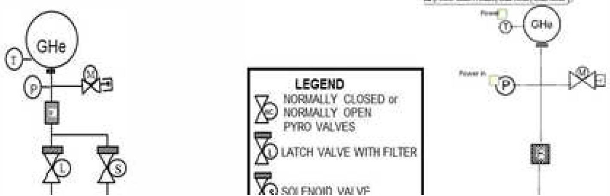

Figure 6. Visual comparison between PowerPoint (left) and MagicDraw (right) iconography.

<!-- PDF_PAGE: 9 -->

user-interface, generate useful results in a rapid fashion, and address the key issues for all subsystem (i.e., approach professional-grade in user experience, reliability, and quality of the final product). A user of MagicDraw and advocate of MBSE is delighted when he or she can hide the "boxology" of SysML for better icons. A user of tools like Microsoft Visio quickly zeros in on misrendering artifacts and gaps in the illusion like whitespaces in the middle of lines as signs of inferior quality. A side-by-side comparison of different drawing tools can be seen in Figure 6. The artifacts are minimal, but there are still some whitespaces between lines and icons that can be seen with a sharp eye. These must be eliminated eventually, although they are not a show-stopper in the near term if offsetting benefits are identified. Those benefits are, of course, a machine-readable data structure behind the diagrams and a proper encoding of routing semantics (e.g., proper fluid junctions rather than overlapping lines) for later analysis.

## 9. INTERMEDIATE RESULTS: ADDRESSING EARLIER RISKS

The risk of interoperating with existing Team X infrastructure has been bought down through connecting the prototype tools to Team X's back-end database. This database makes data from MagicDraw appear identical to data that is passed between the workbooks currently used in Team X. Thus, work best done with the existing tools can be performed with them, while new capability can be rolled out incrementally.

The use of domain-specific languages brings the visual semantics of known icons to the prototype. Further, careful use of these icons and pre-built libraries helps to reduce the amount of added SysML concepts that are required to properly operate this tooling.

The sensitivity of information can actually be better assured through model-based tooling than through hand transcription. Library properties can be tagged according to their sensitivity - proprietary, ITAR-sensitive, etc. through proper stereotypes. These stereotypes can be used as targets for transformations like those used in other model-based efforts [13],[14]. These transformations can redact sensitive information automatically.

Another demonstration made during the pilot was of connecting the MagicDraw-based tooling to the Team X database. This is a highly effective lever for gradually introducing the tooling into the environment rather than being forced to replace the entire set wholesale.

While the work presented in this paper does not make Team X operationally model-based, it does demonstrate that many of the advantages of model-based systems engineering can be captured and the perceived risks are entirely manageable.

## 10. FUTURE WORK: DESIRED IMPROVEMENTS TO SYSML OVERALL

There is a great deal of work ahead to transition from this prototype to a fully functioning capability for using SysML regularly in studies. Some of these are improvements that need to be made to the prototype, others to individual authoring tools, and finally some improvements that need to be made to the standard itself.

On the prototype side there are still a variety of mechanisms that could be streamlined. There are several functions that are still "heavy" in terms of the number of mouse-clicks and menus that must be navigated to do "simple" things in the tooling. More thought must also be given to the interaction between these tools and the Team X database in order to assure that they provide as robust a connection as the individual spreadsheet tools currently do.

The SysML standard would benefit greatly from the concepts of diagram interchange. Diagram interchange is the idea of various modeling tools being able to interchange not only model data, but the layout of drawn diagrams as well. Further, the idea of "diagram interchange" should include specialized icons as well as the basic UML/ SysML versions. It is understandable that this is a major undertaking; it is still a major undertaking for the various authoring tools to exchange just model database information. The Model Interchange Working Group has been making great strides in this area, so it should only be a matter of time.

UML currently offers the profiling mechanism for extending the meaning of the language, and in fact was leveraged to craft SysML. In addition to refining semantics via stereotypes, this prototyping work has shown the value of refining semantics visually as well.

Another need that is becoming apparent is some concept of grouping of model elements that are not pure Classifiers. In general, elements like Class, Activity, State Machine, etc. can be contained directly in Packages, which serve to organize models. Working with this prototype has shown the usefulness of an entity that can organize model elements that are composite properties such as Features, Actions, States, etc. These organizing elements further should serve to project constraints or modifiers on each of the members. This idea arose when working with the specification of power modes in the prototype, and a strong desire by specialists to be able to set up groups of elements to be turned on or off at a given time. Groups would allow for a collection of State Invariants for example to have their constraints updated after a single group has been updated. The groups could also be leveraged (by having Connectors, etc. that are associated with properties packaged into the same group as them) to allow for safe copy-and-paste operations on groups of elements, such as the left-hand branch of a propulsion system's plumbing.

<!-- PDF_PAGE: 10 -->

## 11. SUMMARY

A prototype has been developed using the MagicDraw tool to bring Model-Based Systems Engineering techniques to concurrent engineering. This prototype has been applied to multiple specialist chairs in Team X, which has led to new insights along with way. This has also provided a series of opportunities for feedback from specialist chairs in order to increase the likelihood of eventual deployment. Various risks were identified before the prototype was built, and have now been addressed. Along the way, there have been new insights developed about the practical use of MBSE in even fast-paced environments like Team X.

## ACKNOWLEDGEMENTS

The authors provide their thanks to the support and consultations of Team X specialist chairs involved in this pilot. The research was carried out at the Jet Propulsion Laboratory, California Institute of Technology, under a contract with the National Aeronautics and Space Administration.

## REFERENCES

[1] Wall, S., "Use of Concurrent Engineering in Space Design." European Systems Engineering Conference. Munich, Germany. September 13, 2000.

[2] Warfield, K., "Addressing Concept Maturity in the Early Formulation of Unmanned Spacecraft." Proceedings of the $ 4^{th} $ International Workshop on System and Concurrent Engineering for Space Applications (SECESA 2010). Lausanne, Switzerland, October 13-15, 2010.

[3] Parkin, K., Sercel, J.C., Liu, M.J., Thunnissen, D.P., "ICEMaker: An Excel-Based Environment for Collaborative Design." Proceedings of the IEEE Aerospace Conference 2003. Big Sky, MT, March 8-15, 2003.

[4] Nigg, D., Kinsey, R., Lewis, B., Vaughan, R. Expanding Concurrent Engineering Design Center Capabilities to Meet Future Challenges. $ 4^{\mathrm{th}} $ International Workshop on System and Concurrent Engineering for Space Applications (SECESA 2010). Lausanne, Switzerland, October 13-15, 2010.

[5] Khan, Sievers, Standley, "Model-Based Verification and Validation of Spacecraft Avionics," Infotech@Aerospace 2012 Conference Santa Ana, CA, May 2012.

[6] Ingham, Day, Donahue, Kadesh, Kennedy, Khan, Post, Standley, "A Model-Based Approach to Engineering Behavior of Complex Aerospace Systems," Infotech@Aerospace 2012 Conference, Santa Ana, CA, May 2012.

[7] Khan, Dubos, Tirona, Standley, "Model-Based Verification and Validation." Submitted to IEEE Aerospace Conference 2013, Big Sky, Montana, Mar 2-Mar 9, 2013.

[8] Jackson, M., Delp, C., Bindschadler, D., Sarrel, M., Wollaeger, R., Lam, D., "Dynamic gate product and artifact generation from system models," Aerospace Conference, 2011 IEEE , vol., no., pp.1- 10, 5-12 March 2011.

[9] Cole, B., Chung, S., " Getting a cohesive answer from a common start: Scalable multidisciplinary analysis through transformation of a systems model," Aerospace Conference, 2012 IEEE, 3-10 March 2012.

[10] Cole, B., Delp, C., Donnahue, K., "Piloting model based engineering techniques for spacecraft concepts in early formulation." 20th annual INCOSE International Symposium 2010.

[11] Vogel, L. "Eclipse Modeling Framework (EMF) Tutorial." Accessed October 3, 2012. http://www.vogella.com/articles/EclipseEMF/article.html

[12]“XText 5 Minute Tutorial.” Accessed October 3, 2012. http://www.eclipse.org/Xtext/documentation.html# FirstFiveMinutes.

[13] Cole, B.; Chung, S.H.; , "Getting a cohesive answer from a common start: Scalable multidisciplinary analysis through transformation of a systems model," Aerospace Conference, 2012 IEEE, 3-10 March 2012.

[14] Cornford, S.; Shishko, R.; Wall, S.; Cole, B.; Jenkins, S.; Rouquette, N.; Dubos, G.; Ryan, T.; Zarifian, P.; Durham, B.; , "Evaluating a Fractionated Spacecraft system: A business case tool for DARPA's F6 program," Aerospace Conference, 2012 IEEE, 3-10 March 2012.

[15] Delp, C., Lam, D., "Model Based Document and Report Generation for Systems Engineering." Aerospace Conference, 2013 IEEE, 2-9 March 2013. In press.

<!-- PDF_PAGE: 11 -->

# BIOGRAPHIES

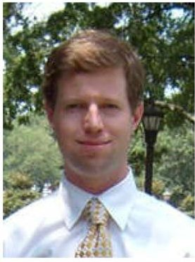

Bjorn Cole is a systems engineer in the Mission Systems Concepts section of the Jet Propulsion Laboratory. His research interests are in the fields of design space exploration, visualization multidisciplinary analysis and optimization, concept formulation architectural design methods technology planning, and more

recently, model-based systems engineering. He has participated in multiple early concept studies and is a Deputy Systems chair in Team X. His most recent body of work concerns the infusion of systems modeling as a data structure into multidisciplinary analysis and architectural characterization. He earned his Ph.D. and M.S. degrees in Aerospace Engineering at the Georgia Institute of Technology and his B.S. in Aeronautics and Astronautics at the University of Washington.

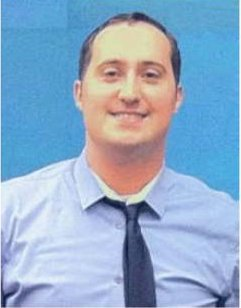

Gregory F. Dubos is a Systems Engineer in the Mission Systems Concept Section at the Jet Propulsion Laboratory (JPL). His current work at JPL focuses on system modeling and simulation during mission formulation activities. He regularly serves as the Risk and Programmatics Chair for Team

X, JPL's concurrent engineering environment, and he recently supported the development of SysML models for Verification & Validation (V&V). He received his B.S and M.S degrees in Aeronautics from SUPAERO, Toulouse, France, and his M.S and Ph.D. in Aerospace Engineering from the Georgia Institute of Technology, Atlanta, GA.

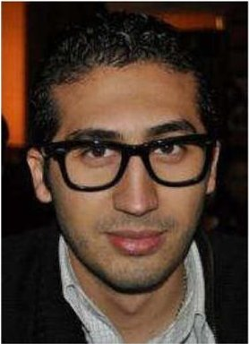

Payam Banazadeh is a graduating senior from the University of Texas at Austin in Aerospace Engineering. He expects to graduate in December 2012 with high honors. His research interests are in interplanetary trajectories, mission design, concept formulation, Cubesat development, and more recently, model-based systems engineering. He has interned at JPL for three summers working on

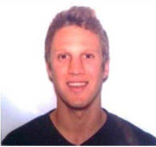

a variety of different projects from student concept development for MoonRise mission to testing the flight software on MSL and lastly Model Based Systems Engineering for Team X. He is planning to work full time at JPL before pursuing his PhD in Aerospace Engineering.

Jonathan Reh is a student at California State Polytechnic University, Pomona majoring in Chemical Engineering. He expects to graduate in December 2012. He is currently involved in an undergraduate research project involving the research, design, and construction of an autonomous

chemically powered car. He will be participating in the AIChE Chem-E-Car regional competition in April 2013. Other research interests include power systems such as fuel cells and air batteries, project formulation, and more recently, model-based systems engineering. He has interned at JPL for two summers working on different projects including the development of an informal database of technical cost information about previous JPL and outside projects, proposed missions, and advanced study missions, and most recently the development of Model Based Systems Engineering for Team X. He is planning to pursue a master's degree in Chemical Engineering after completing his undergraduate study.

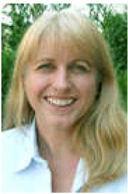

Kelley Case is the Concept Design Methods Chief for the Innovation Foundry program office at the Jet Propulsion Laboratory. She is responsible for managing Team X, which is JPL's concurrent engineering team for rapid design and analysis of novel space mission concepts. Previously she was the technical supervisor of the Collaborative

Engineering group. Kelley joined JPL in 1992 in the Ocean Science Research Section. She was involved with the science data development for the Jason-1 and Gravity Recovery And Climate Experiment (GRACE) missions. In addition, she has managed various Earth Science formulation activities and proposals. Kelley holds an M.S. degree from Claremont Graduate University and a B.S. degree from the University of California, Los Angeles (UCLA) in mathematics.

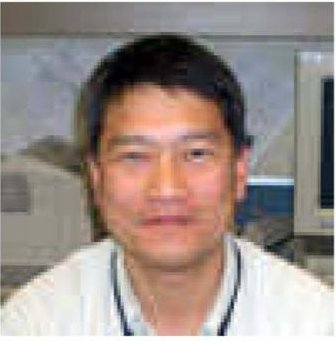

Yeou-Fang Wang is a member of the Planning & Execution Software Systems Group in the Planning & Execution Systems Section at the Jet Propulsion Laboratory. He has developed methodologies and tools for NASA's Deep Space Network, spacecraft ground data system,

and spacecraft concept study teams. His interests are in the fields of systems analysis, software architecture, software development process, collaborative engineering, and computational intelligence. He has BS degree in Control Engineering from the National Chiao-Tung University of Taiwan and MS and PhD in Electrical and Computer Engineering from the University of California, Irvine.

<!-- PDF_PAGE: 12 -->

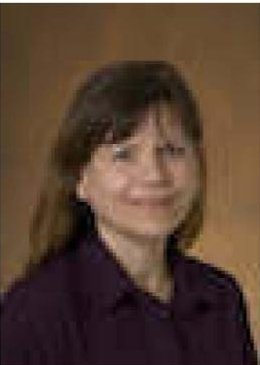

Susan Jones is a systems engineer in the Mission Systems Concepts section of the Jet Propulsion Laboratory. Susan has 29 years of experience at JPL including systems engineering and architecture development for collaborative engineering systems, pre- project information systems technology management systems and model-based systems engineering

(MBSE). She also managed the operations of JPL's Project Design Center, a collaborative engineering facility. Earlier in her career, she provided Mission Planning and Mission Operations System (MOS) design for NASA projects such as Magellan, Topex/Poseidon and the Shuttle Imaging Radar/Synthetic Aperture Radar Project (SIRC/XSAR). She is currently supporting the development of an integrated model-centric development environment to support systems engineering throughout the project lifecycle. She earned her B.S. in Aeronautics and Astronautics at the University of Illinois, Urbana-Champaign.

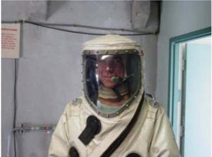

Frank Picha earned his Bachelor of Science in Mechanical Engineering from Washington State University, and he completed his Master of Business Administration also from WSU. He has previously held positions at Sealed Air

Corporation in Redmond Washington, Aerojet Rocket Research Center in Redmond, and in July 2001 joined the Propulsion Flight Systems Group at JPL to support the Mars Exploration Rover Propulsion team.

Frank's expertise and experience include specialized knowledge of monopropellant and bi-propellant rocket engine design and analysis, and hydrazine/catalyst familiarity. He was the Cognizant Engineer for the MER cruise stage propulsion integration and functional testing as well as the test conductor for MER spacecraft propellant loading and system functional testing at KSC. He was also a Propulsion mission operations engineer for both MER spacecraft initial acquisition, spindown, and TCMs. Following MER, he was Cog-E for the Prometheus NEXIS Xenon ion engine fabrication and integration. Frank joined the Mars Science Laboratory project as the Propulsion configuration and integration engineer, and was the contract technical manager for the Cruise Stage and Descent Stage rocket engines. He currently chairs the JPL Team X Propulsion seat, leading early project formulation in a concurrent mission design environment.