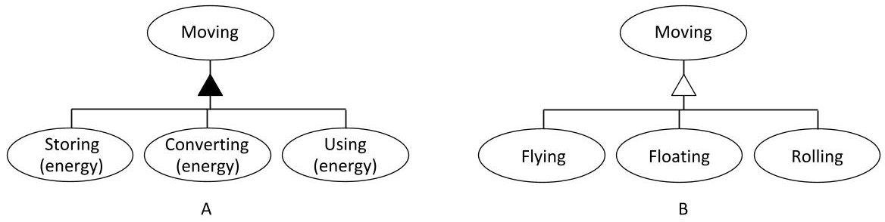
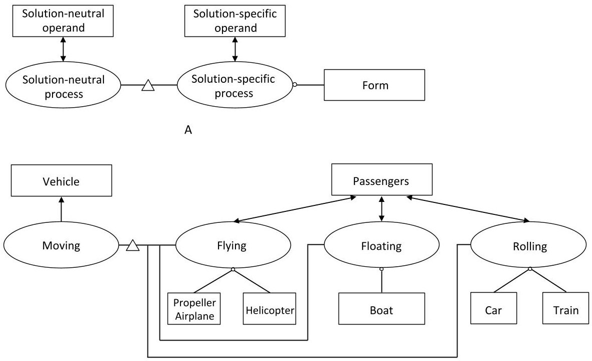
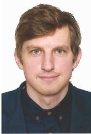
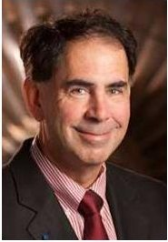

<!-- PDF_PAGE: 1 -->

# DSM-Based Methods to Represent Specialization Relationships in a Concept Framework

Yaroslav Menshenin $ ^{1} $ , Edward Crawley $ ^{2} $

$ ^{1} $ Skolkovo Institute of Science and Technology $ ^{2} $ Massachusetts Institute of Technology

Abstract: DSMs and related matrices are commonly used to represent system decomposition, structure, interaction and function/form assignment. But in conceptual design we must also represent specialization that relates a general thing and a type of that thing. In this paper we propose DSM-based methods to represent specialization relationships that occur in conceptual design. The research questions are: how can we encode in a DSM the information about specialization of a concept's processes and instruments; and how it complements the existing approaches of representing the decomposition relationships. The fundamental utility of the proposed approach is that it facilitates the development of alternative concepts during the conceptual design phase blending the information about specialization and decomposition relationships in united framework. This work also proposes a measure of the formal conceptual similarity between alternative concepts.

Keywords: DSM, concept, model-based conceptual design, specialization

## 1 Introduction

Specialization relationships play an important role in conceptual design phase, as it narrows down the set of alternative concepts. Our work is motivated by the desire to explore specialization relationships, and to encode them in a matrices-based framework, which would enable the identification of alternative concepts satisfying a highly abstracted function. This would also create an opportunity to use the quantitative measures for estimation of formal conceptual similarity between alternative concepts. The objective of this paper is to develop and present a DSM-based framework to represent specialization relationships that commonly occur between concept's processes and forms - especially during conceptual design phase (Pahl and Beitz, 2007).

The Design Structure Matrix (DSM) developed by Steward (1981) is an effective tool to manage a complex system, enabling the matrix models to capture the different DSM applications (Browning, 2001). DSM has been extended to Domain Mapping Matrix (DMM) (Danilovic and Browning, 2004) and Multiple-Domain Matrix (MDM) (Maurer, 2007; Lindemann, 2008). The former is used to facilitate the mapping between two domains, while the latter allows analyzing the system across multiple domains. Eppinger and Browning highlight hierarchical (vertical) and lateral (horizontal) types of relationships, which are important in system modeling (Eppinger and Browning, 2012). The authors argue that vertical relationships stem from the decomposition, while horizontal relationships stem from "interactions between elements, such as flows of

<!-- PDF_PAGE: 2 -->

material or information, at the same level" (Eppinger and Browning, 2012). Although DSM was applied to above-mentioned types of relationships, to our knowledge it has not been applied to such relationships as specialization (Dori, 2002; Crawley and Colson, 2007), which are fundamentally different than, for example, decomposition (Chiriac et al., 2011). Thus, there is a research opportunity to explore the specialization relationships with support of DSM-based approaches. The research questions are how can we encode in a DSM the information about specialization between concept's processes and instruments, and how it complements the existing approaches of representing the decomposition relationships. The specific objective of this work is to demonstrate unified framework, which supports conceptual design phase by keeping the information about specialized and decomposed processes and forms. Another specific objective of our work is to demonstrate how this information can be used for quantitative assessment of formal conceptual similarity between alternative concepts.

This paper is organized as follows. In section 2 we discuss the difference between specialization and decomposition and its importance in concept framework. Section 3 demonstrates unified framework that presents specialization and decomposition in a DSM. In section 4 we explain the benefit of having the united framework, which is the ability to measure conceptual similarity between alternative concepts. We provide a summary of our work in section 5.

## 2 Specialization as a transition in design

Decomposition and specialization are two fundamentally different types of relationships between a concept's entries. The core difference is highlighted in the works of Crawley and of Dori. According to Crawley et al., the decomposition is "the dividing of an entity into smaller pieces or constituents" (Crawley et al., 2015). Dori highlights that specialization is "the relation between a general thing and a type of that thing" (Dori, 2002). These two definitions create a clear distinction that the decomposed process or form is a piece of high-level process or form, while the specialized process or form is a type of a high-level process or form.

The example of process decomposition for the process "moving" (with the implicit instrument "vehicle") is provided in the paper of Deubzar and Lindemann in Figure 1A (Deubzer and Lindemann, 2009). In contrast, Figure 1B shows the specialization of "moving" into three alternative processes - flying (pushing down on air), floating (pushing down on water) and rolling (pushing down on solid ground). The figures 1A and 1B clearly demonstrate the difference between decomposition, realized by dividing process "moving" into smaller sub-processes "storing (energy)”, "converting (energy)”, "using (energy)”, and specialization, realized by relating general process "moving" to such types of that process as "flying", "floating", and "rolling". We see that decomposition and specialization convey different information and both types of information are important and should be considered during the conceptual design phase.

<!-- PDF_PAGE: 3 -->

Figure 1. Decomposition (A) and specialization (B) relationships of the process moving

The appearance of the specialization operation in concept is shown in Figure 2A. Following this framework, conceptual design occurs when a solution-neutral process is specialized to a solution-specific process. Using this framework, we extend the "moving" example by showing how the specialization of process and assignment of instrumental form to the specialized processes creates five distinct concepts, illustrated in Figure 2B. As such, the instrumental forms executing the process "flying" are "propeller airplane" or "helicopter"; "floating" process can be performed by "boat"; and "rolling" process can be executed by "car" or "train". In all examples of Figure 2B the operand is "passengers", as each of the forms serves the purpose to move passengers from one location to another one.

Figure 2. Solution-neutral to solution-specific representation of concept in OPM (A) and example, which specializes the process "moving" to "flying", "floating", and "rolling" (B)

<!-- PDF_PAGE: 4 -->

## 3 United framework for representing specialization and decomposition in a DSM

Having established the two complementary operations for specialization and decomposition we seek a way to represent both in a united DSM framework. We further develop the approach by demonstrating the united framework for two alternatives - a "propeller airplane" and a "boat" - in Figure 3. Such united framework contains both types of relationships - specialization of the process/form and the decomposition of specialized processes/forms.

From the exploration of Figure 3 we may see that the form "propeller airplane" is decomposed into three internal forms - "wings", "propeller", and "control surfaces"; while the process "flying" is decomposed into three internal processes - "lifting", "propelling", and "guiding". DMM at the lower left corner informs us that "wings" are used for "lifting", "propeller" is used for "propelling", and "control surfaces" are used for "guiding" in case of a propeller airplane concept. The same exploration can be done for the second concept - a boat. DSM at the upper left corner maps the information about internal forms to each other. In particular, we can see that both concepts use the same form "propeller" to perform the same process "propelling". This is denoted by sign "V" at the intersection of "propeller" of "propeller airplane" concept and "propeller" of a "boat" concept. This information sheds light on the idea of conceptual similarity. It should be noted that at the conceptual level we do not distinguish between the "propeller" of the "propeller airplane" and the "propeller" of the "boat." This is due to the fact that we are intentionally focusing on identification of which form performs which process without going into details about the form itself and its distinctive features.

<table border="1"><tr><td rowspan="4" colspan="3"></td><td colspan="6">Vehicle</td><td colspan="6">Moving</td></tr><tr><td colspan="3">Propeller airplane</td><td colspan="3">Boat</td><td colspan="6">Flying</td><td colspan="3">Floating</td></tr><tr><td>Wings</td><td>Propeller</td><td>Control surfaces</td><td>Hull</td><td>Propeller</td><td>Rudder</td><td>Lifting</td><td>Propelling</td><td>Guiding</td><td>Lifting</td><td>Propelling</td><td>Guiding</td></tr><tr><td>Wings</td><td>X</td><td></td><td></td><td></td><td></td><td></td><td></td><td></td><td></td><td></td><td></td><td></td></tr><tr><td rowspan="5">Vehicle</td><td rowspan="2">Propeller airplane</td><td>Wings</td><td>X</td><td></td><td></td><td></td><td></td><td></td><td></td><td></td><td></td><td></td><td></td><td></td><td></td></tr><tr><td>Propeller</td><td></td><td>X</td><td></td><td></td><td></td><td></td><td></td><td></td><td></td><td></td><td></td><td></td><td></td></tr><tr><td>Control surfaces</td><td></td><td></td><td>X</td><td></td><td></td><td></td><td></td><td></td><td></td><td></td><td></td><td></td><td></td><td></td></tr><tr><td rowspan="2">Boat</td><td>Hull</td><td></td><td></td><td></td><td>X</td><td></td><td></td><td></td><td></td><td></td><td></td><td></td><td></td><td></td></tr><tr><td>Propeller</td><td></td><td>V</td><td></td><td></td><td>X</td><td></td><td></td><td></td><td></td><td></td><td></td><td></td><td></td></tr><tr><td rowspan="6">Moving</td><td rowspan="3">Flying</td><td>Lifting</td><td>V</td><td></td><td></td><td></td><td></td><td></td><td>X</td><td></td><td></td><td></td><td></td><td></td><td></td></tr><tr><td>Propelling</td><td></td><td>V</td><td></td><td></td><td></td><td></td><td></td><td>X</td><td></td><td></td><td></td><td></td><td></td></tr><tr><td>Guiding</td><td></td><td></td><td>V</td><td></td><td></td><td></td><td></td><td></td><td>X</td><td></td><td></td><td></td><td></td></tr><tr><td rowspan="3">Floating</td><td>Lifting</td><td></td><td></td><td></td><td>V</td><td></td><td></td><td></td><td></td><td></td><td>X</td><td></td><td></td><td></td></tr><tr><td>Propelling</td><td></td><td></td><td></td><td></td><td>V</td><td></td><td></td><td></td><td></td><td></td><td>X</td><td></td><td></td></tr><tr><td>Guiding</td><td></td><td></td><td></td><td></td><td></td><td>V</td><td></td><td></td><td></td><td></td><td></td><td>X</td><td></td></tr></table>

Figure 3. United framework of specialization (denoted by white triangle) and decomposition (denoted by black triangle) for two alternatives-a "propeller airplane" and a "boat"

<!-- PDF_PAGE: 5 -->

In Figure 4 we present the same information, but for all five concepts mentioned in Figure 2. It is important to note that the decomposed processes for all concepts are the same - "lifting", "propelling", and "guiding", because in Figure 2 we are focusing on the function moving passengers. Since the passengers are moved by some kind of vehicle, it is clear that in order to execute any of the processes ("flying", "floating", or "rolling"), the decomposed processes "lifting", "propelling", and "guiding" must be performed. Let us assume that we need to identify the alternative concepts for a different high-level abstracted function: moving money. This example would reveal completely different internal processes, because there are two conceptually different ways to move money: either physically, or electronically. If we try to find the variants to move money physically, we will come up with the same set of alternative concepts as for the moving passengers example: for instance, an airplane, or a car. In this case the internal processes for solution-neutral process moving (money) would be lifting, propelling, and guiding, because in order to move money we will have to move the vehicle that is used as form. However, since for the client it usually doesn't matter which exactly banknotes he or she uses in the wallet, it looks convenient to move money electronically. This set of concepts would have such internal processes as depositing, e-transferring, and withdrawing. Thus, we may see that not only different processes and forms, but also completely different internal processes and internal forms can be used to achieve the same highly abstracted function.

<table border="1"><tr><td rowspan="4" colspan="4"></td><td colspan="14">Vehicle</td><td colspan="14">Moving</td></tr><tr><td colspan="3">Propeller Airplane</td><td colspan="2">Helicopter</td><td colspan="3">Boat</td><td colspan="3">Car</td><td colspan="3">Train</td><td colspan="3">Flying</td><td colspan="3">Floating</td><td colspan="3">Rolling</td></tr><tr><td>Wings</td><td>Propeller</td><td>Control surf.</td><td>Main rotor</td><td>Tail rotor</td><td>Hull</td><td>Propeller</td><td>Rudder</td><td>Wheels</td><td>Wheels</td><td>Wheels</td><td>Wheels</td><td>Track</td><td>Lifting</td><td>Propelling</td><td>Guiding</td><td>Lifting</td><td>Propelling</td><td>Guiding</td><td>Lifting</td><td>Propelling</td><td>Guiding</td></tr><tr><td>Wings</td><td>X</td><td></td><td></td><td></td><td></td><td></td><td></td><td></td><td></td><td></td><td></td><td></td><td>V</td><td></td><td></td><td></td><td></td><td></td><td></td><td></td><td></td><td></td></tr><tr><td rowspan="16">Vehicle</td><td rowspan="3">Propeller Airplane</td><td>Propeller</td><td></td><td>X</td><td></td><td></td><td></td><td></td><td></td><td></td><td></td><td></td><td></td><td></td><td></td><td>V</td><td></td><td></td><td></td><td></td><td></td><td></td><td></td><td></td></tr><tr><td>Control surfaces</td><td></td><td></td><td>X</td><td></td><td></td><td></td><td></td><td></td><td></td><td></td><td></td><td></td><td></td><td></td><td>V</td><td></td><td></td><td></td><td></td><td></td><td></td><td></td></tr><tr><td rowspan="2">Helicopter</td><td>Main rotor</td><td></td><td>V</td><td></td><td>X</td><td></td><td></td><td></td><td></td><td></td><td></td><td></td><td></td><td>V</td><td>V</td><td>V</td><td></td><td></td><td></td><td></td><td></td><td></td></tr><tr><td>Tail rotor</td><td></td><td></td><td></td><td></td><td>X</td><td></td><td></td><td></td><td></td><td></td><td></td><td></td><td></td><td></td><td>V</td><td></td><td></td><td></td><td></td><td></td><td></td></tr><tr><td rowspan="3">Boat</td><td>Hull</td><td></td><td></td><td></td><td></td><td></td><td>X</td><td></td><td></td><td></td><td></td><td></td><td></td><td></td><td></td><td></td><td>V</td><td></td><td></td><td></td><td></td><td></td><td></td></tr><tr><td>Propeller</td><td></td><td>V</td><td></td><td>V</td><td></td><td></td><td>X</td><td></td><td></td><td></td><td></td><td></td><td></td><td></td><td></td><td></td><td>V</td><td></td><td></td><td></td><td></td><td></td></tr><tr><td>Rudder</td><td></td><td></td><td></td><td></td><td></td><td></td><td></td><td>X</td><td></td><td></td><td></td><td></td><td></td><td></td><td></td><td></td><td></td><td>V</td><td></td><td></td><td></td><td></td></tr><tr><td rowspan="3">Car</td><td>Wheels</td><td></td><td></td><td></td><td></td><td></td><td></td><td></td><td></td><td>X</td><td></td><td></td><td></td><td></td><td></td><td></td><td></td><td></td><td></td><td></td><td>V</td><td></td><td></td></tr><tr><td>Wheels</td><td></td><td></td><td></td><td></td><td></td><td></td><td></td><td></td><td></td><td>X</td><td></td><td></td><td></td><td></td><td></td><td></td><td></td><td></td><td></td><td>V</td><td></td><td></td></tr><tr><td>Wheels</td><td></td><td></td><td></td><td></td><td></td><td></td><td></td><td></td><td></td><td>X</td><td></td><td></td><td></td><td></td><td></td><td></td><td></td><td></td><td></td><td>V</td><td></td><td></td></tr><tr><td rowspan="3">Train</td><td>Wheels</td><td></td><td></td><td></td><td></td><td></td><td></td><td></td><td></td><td>V</td><td></td><td></td><td></td><td>X</td><td></td><td></td><td></td><td></td><td></td><td></td><td>V</td><td></td><td></td></tr><tr><td>Wheels</td><td></td><td></td><td></td><td></td><td></td><td></td><td></td><td></td><td></td><td>V</td><td></td><td></td><td></td><td>X</td><td></td><td></td><td></td><td></td><td></td><td>V</td><td></td><td></td></tr><tr><td>Track</td><td></td><td></td><td></td><td></td><td></td><td></td><td></td><td></td><td></td><td></td><td></td><td></td><td>X</td><td></td><td></td><td></td><td></td><td></td><td></td><td></td><td>V</td><td></td></tr></table>

Formal conceptual similarity (DSM) Integrated concept (DMM)

Figure 4. DSM and DMM matrices for five alternatives - "propeller airplane", "helicopter", "boat", "car", and "train". Note that the "V" at the intersections of DSM (symmetric matrix) cells denotes information about existence of conceptual similarity between two alternative concepts

<!-- PDF_PAGE: 6 -->

From Figure 4 we note the existence of formal conceptual similarity between concepts "propeller airplane" and "helicopter", "propeller airplane" and "boat", "helicopter" and "boat", and "car" and "train". This information is contained at DSM section of Figure 4, and is denoted by signs "V". DMM part of the same Figure informs us about the integrated concept, particularly, which exactly internal form is used for which exactly internal process.

## 4 A benefit of presenting specialization and decomposition in a united DSM - identification of conceptual similarity

One of the benefits is that the framework presented in Figure 4 contains the information about formal conceptual similarity between two alternative concepts. The formal conceptual similarity between each one of the concepts might be measured quantitatively, which is demonstrated in Figure 5. This figure is a DSM-based representation of specialization relationship between form "vehicle" and alternative concepts "propeller airplane", "helicopter", "boat", "car", and "train".

<table border="1"><tr><td rowspan="2" colspan="2"></td><td colspan="5">Vehicle</td></tr><tr><td>Propeller Airplane</td><td>Helicopter</td><td>Boat</td><td>Car</td><td>Train</td></tr><tr><td rowspan="5">Vehicle</td><td>Propeller Airplane</td><td></td><td></td><td></td><td></td><td></td></tr><tr><td>Helicopter</td><td>1</td><td></td><td></td><td></td><td></td></tr><tr><td>Boat</td><td>1</td><td>1</td><td></td><td></td><td></td></tr><tr><td>Car</td><td>0</td><td>0</td><td>0</td><td></td><td></td></tr><tr><td>Train</td><td>0</td><td>0</td><td>0</td><td>2</td><td></td></tr></table>

Figure 5. Quantitative measure of formal conceptual similarity for pairs of alternative concepts in DSM (symmetric matrix). The number at the intersection of two concepts indicates how many identical internal forms these alternatives have

Consider such concepts as "propeller airplane" and "helicopter" as an example. The number "1" indicated at the intersection of these two concepts in Figure 5 informs about how many identical internal forms are used between these concepts (in this example, the same internal form is "propeller"). This allows to quantitative measure the formal conceptual similarity between all five alternative concepts.

<!-- PDF_PAGE: 7 -->

## 5 Conclusion

In this paper we proposed a DSM-based framework to represent specialization relationships that occur in conceptual design. We also proposed an approach to represent both types of relationships, namely, decomposition and specialization in the united framework. The fundamental difference of specialization from decomposition has been explained. We demonstrated how the information contained in the united framework could be effectively used to estimate the formal conceptual similarity between alternative concepts.

This work might have several forms of utility. One of its useful properties is the ability to systematically narrow down the set of alternative concepts for a given solution-neutral problem. By encoding the specialization and decomposition information about alternative concepts in DSM/DMM-supported matrices the system architect can keep track of concepts development during conceptual design phase. Another utility is that the quantitative measure enables to estimate the conceptual similarity between alternative solutions on a conceptual level.

## References

Browning, T.R., 2001. Applying the Design Structure Matrix to System Decomposition and Integration Problems: a Review and New Directions. IEEE Transactions on Engineering management, 48, 292-306.

Chiriac, N., Hölttä-Otto, K., Lysy, D., and Suh, E.S., 2011. Three approaches to complex system decomposition. In DSM 2011: Proceedings of the $ 13^{\mathrm{th}} $ International DSM Conference, Cambridge, MA, USA.

Crawley, E., Cameron, B., Selva, D., 2015. System architecture: Strategy and product development for complex systems. Prentice Hall Press.

Crawley, E. and Colson, J., 2007. The projection relationship between object process models (OPM) and design system matrices (DSM). In DSM 2007: Proceedings of the 9th International DSM Conference, Munich, Germany.

Danilovic, M. and Browning, T., 2004. A formal approach for Domain Mapping Matrices (DMM) to complement Design Structure Matrices (DSM). In: Proceedings of the 6th Design Structure Matrix (DSM) International Workshop, Cambridge. Cambridge, UK.

Deubzer, F. and Lindemann, U., 2009. MDM application to interrelate hierarchical layers of abstraction. In DSM 2009: Proceedings of the 11th International DSM Conference, Greenville, SC, USA.

Dori, D., 2002. Object-Process Methodology: A Holistic System Paradigm. Springer.

Eppinger, S.D. and Browning, T.R., 2012. Design structure matrix methods and applications. MIT press, Cambridge.

Lindemann, U., Maurer, M. and Braun, T., 2008. Structural complexity management: an approach for the field of product design. Springer Science & Business Media.

Maurer, M. S., 2007. Structural awareness in complex product design. PhD thesis, Technische Universität München, Munich, Germany.

Pahl, G., Beitz, W., Feldhusen, J., and Grote, K.H., 2007. Engineering design - A Systematic approach ( $ 3^{\mathrm{rd}} $ Edition). Springer-Verlag London Limited 2007.

Steward, D.V., 1981. The design structure system: A method for managing the design of complex systems. IEEE transactions on Engineering Management, (3), pp.71-74

<!-- PDF_PAGE: 8 -->

Contact: Y. Menshenin, Skolkovo Institute of Science and Technology, Skoltech Space Center, Nobelya str. 3, 121205, Moscow, Russian Federation, +7 985 311 5294, y.menshenin@skoltech.ru

About the Authors:

Yaroslav Menshenin, Skolkovo Institute of Science and Technology Yaroslav Menshenin is a PhD candidate in the Space Center at the Skolkovo Institute of Science and Technology (Skoltech), a Moscow-based private graduate research university, established in 2011 in collaboration with MIT. His research interests focus on the development and application of system architecture methods to complex systems, including the model-based conceptual design approaches. In 2016-2017 academic year he spent a semester at MIT working as a visiting doctoral candidate in the System Architecture Lab. He received a Specialist's degree (M.Sc. equalivalent) in Theoretical Physics from

the National University of Science and Technology "MISIS" (Moscow, Russia). He also graduated from the Singularity University located on the territory of NASA Ames Research Center (Silicon Valley, USA).

Professor Edward Crawley, Massachusetts Institute of Technology - Prof. Edward Crawley is the Ford Professor of Engineering, and a Professor of Aeronautics and Astronautics at MIT. He has served as the founding President of the Skolkovo Institute of Science and Technology (Skoltech) in Moscow, the founding Director of the MIT Gordon Engineering Leadership Program, the Director of the Cambridge (UK) MIT Institute and the Head of the Department of Aeronautics and Astronautics at MIT. Professor Crawley is a Full Member of the Alpha Omega International Honorary Society for System Engineering, a

Fellow of the AIAA, the Royal Aeronautical Society (UK) and a member of the International Academy of Astronautics. He is a member of five national academies: in Sweden, the UK, China, Russia and the US. He received an S.B. (1976) and an S.M. (1978) in aeronautics and astronautics and a Sc.D. (1981) in aerospace structures, all from MIT, and has been awarded two degrees of Doctor Honoris Causa. Crawley's research has focused on the architecture, design, and decision support and optimization in complex technical systems subject to economic and stakeholder constraints. His work ranges from the development of underlying theory to the development of models for real systems.