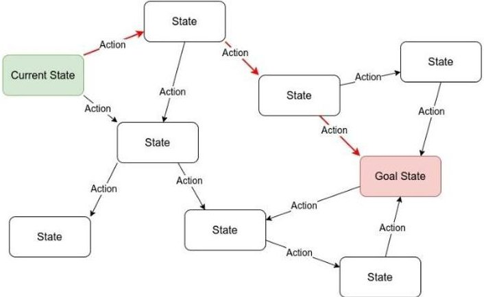
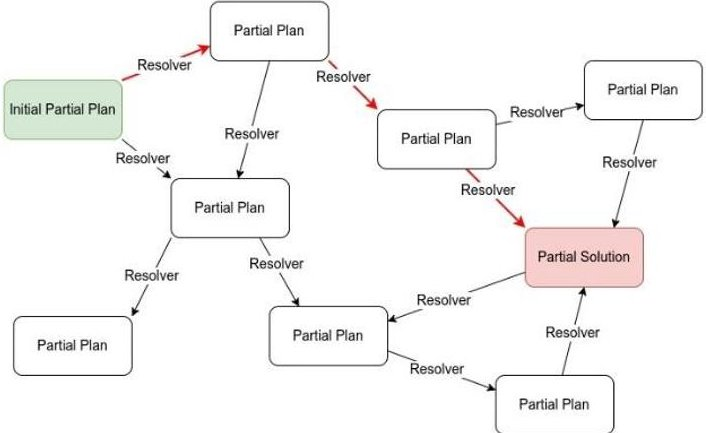

<!-- PDF_PAGE: 1 -->

# Dual-Model Planning Framework for Spacecraft Autonomy using High-Fidelity Simulation

$ ^{1} \ast $Nakamura, R., $ ^{1} $Nomura, S., $ ^{1} $Nakasuka, S. & $ ^{1} $Funase, R.

*lead presenter

$ ^{1} $nakamura@space.t.u-tokyo.ac.jp, The University of Tokyo, Japan

## Abstract

In deep space exploration, spacecraft autonomy is essential due to communication delays and unpredictable conditions. Traditional mission execution methods, relying on pre-programmed rules, struggle to adapt to dynamic scenarios. While model-based planning offers a solution, the complexity of spacecraft systems makes it computationally challenging. Historically, simplified models have been used for planning, but they often fail to capture intricate subsystem interactions, leading to unreliable outcomes.

This study presents a dual-model planning framework that integrates simplified model-based planning with high-fidelity simulation to enhance reliability. The framework operates in two phases: generating an initial plan with a simplified model for rapid creation, followed by validation and refinement using a detailed simulator that considers complex dynamics.

By iteratively refining the plan based on simulation insights, the framework ensures feasibility and robustness, addressing traditional reliability concerns. This approach balances computational efficiency with accuracy and significantly improves the adaptability of autonomous spacecraft operations in deep space environments.

## 1. Introduction

Deep space exploration poses significant challenges to spacecraft autonomy due to extended communication delays and the unpredictability of space environments. Spacecraft must function autonomously over long periods without immediate human intervention. Traditionally, spacecraft activities have been pre-programmed to follow rigid plans designed on the ground, limiting their adaptability to unforeseen situations. To address these challenges, model-based planning has emerged as a promising solution that allows spacecraft to adjust to dynamic conditions on board.

However, model-based planning has its own challenges. Spacecraft systems are inherently multimodal and high-dimensional, making detailed planning computationally expensive. Many existing approaches rely on simplified models to reduce complexity. While these models are computationally efficient, they often fail to capture the complex interactions between spacecraft subsystems. Furthermore, many physical properties in space systems are continuous, but simplified models often discretize them for planning purposes, creating a gap between the continuous dynamics of space systems and their simplified representations. This can result in plans that may not perform reliably in real-world scenarios.

This paper proposes a novel framework that integrates both simplified model-based planning and high-fidelity simulation. The framework enables efficient plan generation while ensuring reliability through iterative refinement using a detailed simulator. By combining these two approaches, we aim to overcome the limitations of traditional planning methods and enhance the reliability of spacecraft autonomy in deep space environments.

## 2. Challenges in Model-Based Planning

## 2.1 Trade-Off Between Computational Efficiency and Planning Accuracy

In spacecraft planning, simplified models are used to reduce computational complexity, especially in on-board planning, where the spacecraft's on-board computer has limited computational resources. Detailed, high-fidelity models of spacecraft systems and their interactions with the space environment

<!-- PDF_PAGE: 2 -->

significantly increase the time required for planning, as the process involves solving complex search problems to determine appropriate actions or trajectories.

Simplified models, on the other hand, allow for faster planning, making them more suitable for onboard use. However, this comes at the cost of accuracy. For instance, simplified models may not fully account for detailed subsystem interactions or operational constraints. Consider the following examples of phenomena that might not be captured in a simplified model during spacecraft attitude changes:

- The star tracker may point toward the Sun, causing the spacecraft's attitude determination accuracy to degrade.

- Solar panels might rotate away from the Sun, leading to reduced power generation and insufficient power supply.

- A science instrument might be exposed to direct sunlight, leading to overheating beyond operational limits and system shutdown.

Because simplified models cannot account for all such multimodal interactions, they may generate plans that are unreliable under real-world conditions. Overcoming these limitations is crucial for improving the robustness of autonomous spacecraft operations.

## 2.2 Examples of On-Board Planners

Several on-board planning systems have been developed to improve spacecraft autonomy, but they primarily rely on simplified models rather than high-fidelity simulations.

For instance, the Remote Agent was the first on-board model-based planner flown on the Deep Space 1 mission [1], [2]. Another recent example is MEXEC, demonstrated on the ASTERIA CubeSat [3], [4]. Both systems rely on simplified models to generate plans, which limits their ability to fully capture the complexities of spacecraft systems.

CASPER (Continuous Activity Scheduling, Planning, Execution, and Replanning) [5] introduced an iterative repair approach that continuously refines plans in real time based on sensor feedback, enabling rapid responses to anomalies. However, like other systems, CASPER utilizes simplified models.

In contrast, the proposed dual-model framework integrates high-fidelity simulations for plan refinement. While CASPER adjusts plans based on real-time observations, our framework employs a detailed simulator to validate and refine plans, allowing for repairs before execution and enhancing safety and reliability.

## 3. Dual-Model Planning Framework

## 3.1 Overview

The proposed dual-model planning framework combines the strengths of both simplified model-based planning and high-fidelity simulation. The framework operates in two phases:

i. Simplified Model-Based Planning Phase: An initial plan is generated using a simplified, computationally efficient spacecraft model. This phase enables the rapid creation of a baseline plan that meets mission objectives.

ii. Plan Refinement Phase with High-Fidelity Simulation: The initial plan is validated and iteratively refined using a high-fidelity simulator. This phase ensures that the plan accounts for complex dynamics and operational constraints that the simplified model may have overlooked.

Each of them is explained in the following sections.

## 3.2 Simplified Model-Based Planning Phase

In the first phase, a simplified model is used to generate a plan that satisfies the primary mission requirements. This model captures essential spacecraft behaviors but omits detailed subsystem interactions. The simplified model allows for rapid plan generation, which is crucial for real-time applications in space missions.

<!-- PDF_PAGE: 3 -->

This phase employs a state-space search approach, as shown in Figure 152, where the spacecraft's potential states are explored to create a plan, which is a sequence of actions. The planner evaluates possible transitions between states to achieve the mission goals.

Languages like the Planning Domain Definition Language (PDDL) [6] can be used to describe the spacecraft's operational model for the state-space search. PDDL provides a structured way to describe

Figure 152: The basic concept of state-pace search

actions, states, and transitions, facilitating efficient plan generation. However, PDDL-like languages are limited in their ability to express highly complex models involving continuous dynamics or detailed subsystem interactions. These limitations highlight the importance of the high-fidelity simulation phase, where assumptions made by the simplified model can be corrected for real-world reliability.

3. 3 Plan Refinement Phase with High-Fidelity Simulation

After the initial plan is generated, it is passed to a high-fidelity simulator for validation and refinement. The high-fidelity simulator models the spacecraft's subsystems in greater detail, capturing interactions and environmental effects more comprehensively.

This phase uses a plan-space search approach, as shown in Figure 153, focusing on refining the sequence of actions. Unlike state-space search, which evaluates state transitions, plan-space search directly modifies the plan by applying "resolvers" to address discrepancies or potential issues revealed by the high-fidelity simulation.

For example, if the simulator detects an insufficient power supply during an attitude change, the framework adjusts the timing or sequence of operations. Effective resolvers are constructed from prior simulation results, gathered during ground-based simulations. This refinement process is iterative: the

Figure 153: The basic concept of plan-space search

refined plan undergoes re-simulation, and further adjustments are made as necessary until the plan is fully validated and deemed feasible.

3. 4 Benefits of the Dual-Model Approach

By combining simplified model-based planning with high-fidelity simulation, the proposed framework offers several advantages:

- Efficiency: Initial plans are generated quickly, enabling the system to respond to mission demands in real-time.

- Accuracy: The plan is refined using a high-fidelity model that accounts for complex interactions and environmental factors.

- Reliability: The iterative refinement process enhances plan robustness, minimizing the risk of failure during execution.

This dual-model approach effectively balances computational efficiency and planning accuracy, addressing the long-standing trade-off in spacecraft autonomy. The framework ensures real-time, reliable planning through iterative refinement rather than complicating the initial search model.

<!-- PDF_PAGE: 4 -->

## 4. Conclusion

The proposed dual-model planning framework addresses the trade-off between computational efficiency and planning accuracy in spacecraft autonomy. By combining simplified model-based planning with high-fidelity simulation for refinement, the framework ensures that plans are generated quickly while remaining reliable in real-world conditions. The iterative refinement process equips the system to account for complex spacecraft interactions and adapt more effectively to the unpredictable conditions of deep space. This framework represents a significant advancement in improving the reliability of autonomous spacecraft operations.

## References

[1] N. Muscettola et al., "On-board Planning for New Millennium Deep Space One Autonomy," presented at the 1997 IEEE Aerospace Conference, in AeroConf, vol. 1. Snowmass, Colorado, USA: IEEE, Feb. 1997, pp. 303-318. doi: 10.1109/AERO.1997.574421.

[2] N. Muscettola, P. P. Nayak, B. Pell, and B. C. Williams, "Remote Agent: to boldly go where no AI system has gone before," AIJ, vol. 103, no. 1-2, pp. 5-47, Aug. 1998, doi: 10.1016/S0004-3702(98)00068-X.

[3] L. Fesq et al., "Extended Mission Technology Demonstrations Using the ASTERIA Spacecraft," presented at the 2019 IEEE Aerospace Conference, in AeroConf. Big Sky, Montana, USA: IEEE, Mar. 2019, pp. 1-11. doi: 10.1109/AERO.2019.8742020.

[4] M. Troesch et al., "MEXEC: An Onboard Integrated Planning and Execution Approach for Spacecraft Commanding," 2020, JPL Open Repository. doi: 2014/53230.

[5] R. Knight, G. Rabideau, S. Chien, B. Engelhardt, and R. Sherwood, "Casper: Space Exploration through Continuous Planning," IEEE Intelligent Systems, vol. 16, no. 5, pp. 70-75, 2001- 10 2001, doi: 10.1109/MIS.2001.956084.

[6] D. McDermott et al., "PDDL - The Planning Domain Definition Language." Aug. 1998.

[Online]. Available: https://www.researchgate.net/publication/2278933_PDDL_-

_The_Planning_Domain_Definition_Language