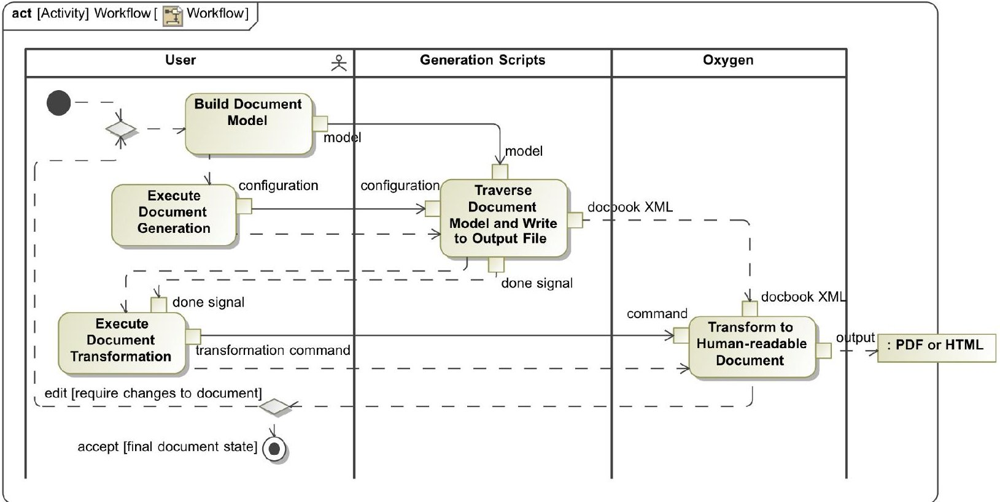
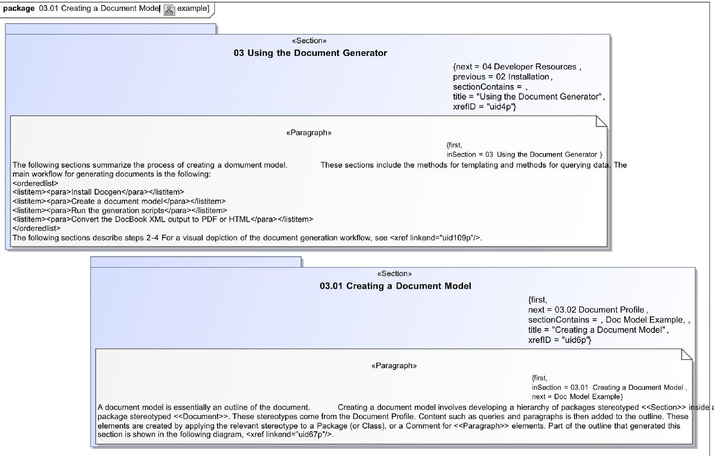
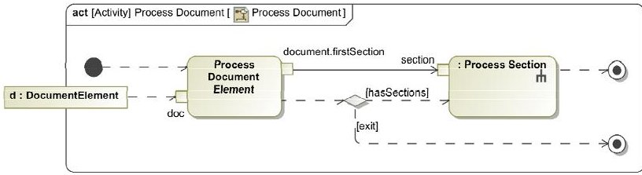
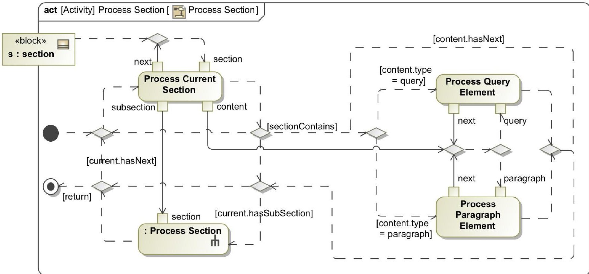
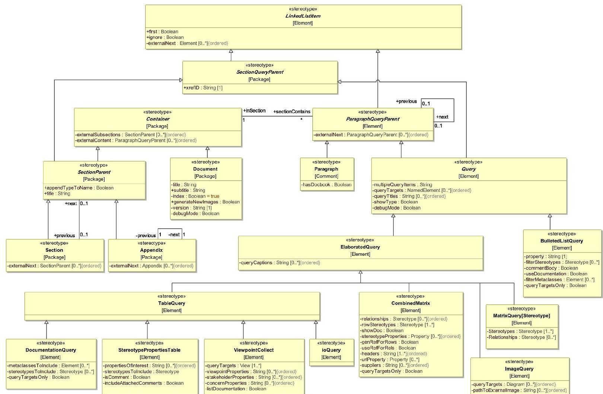
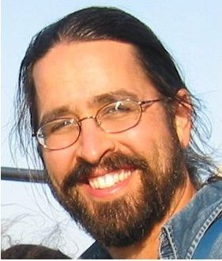
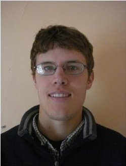

<!-- PDF_PAGE: 1 -->

# Dynamic Gate Product and Artifact Generation from System Models

Maddalena Jackson, Christopher Delp, Duane Bindschadler, Marc Sarrel, Ryan Wollaeger, Doris Lam

4800 Oak Grove Drive

Pasadena, CA, 91109

mjackson@jpl.nasa.gov

818-354-0319

Abstract-Model Based Systems Engineering (MBSE) is gaining acceptance as a way to formalize systems engineering practice through the use of models. $ ^{12} $ The traditional method of producing and managing a plethora of disjointed documents and presentations ("Power-Point Engineering") has proven both costly and limiting as a means to manage the complex and sophisticated specifications of modern space systems. We have developed a tool and method to produce sophisticated artifacts as views and by-products of integrated models, allowing us to minimize the practice of "Power-Point Engineering" from model-based projects and demonstrate the ability of MBSE to work within and supersede traditional engineering practices.

This paper describes how we have created and successfully used model-based document generation techniques to extract paper artifacts from complex SysML and UML models in support of successful project reviews. Use of formal SysML and UML models for architecture and system design enables production of review documents, textual artifacts, and analyses that are consistent with one another and require virtually no labor-intensive maintenance across small-scale design changes and multiple authors. This effort thus enables approaches that focus more on rigorous engineering work and less on "PowerPoint engineering" and production of paper-based documents or their "office-productivity" file equivalents.

## TABLE OF CONTENTS

1. INTRODUCTION...1

2. CONCEPTUAL ARCHITECTURE ...2

3. DOCUMENT PROFILE...3

4. GENERATION SOFTWARE...5

5. VALIDATION SOFTWARE...6

6. TRANSFORMATION TOOLS...7

7. APPLICATIONS...7

8. CONCLUSIONS ...8

REFERENCES ...9

BIOGRAPHY ...9

## 1. INTRODUCTION

The advent of standards like SysML, UML and OWL along with rich modeling-tool support has facilitated MBSE efforts to the point where they are starting to be utilized by mainstream NASA flight projects and programs. As part of an effort using MBSE approaches to re-architect a multimission ground system [1][2], we have successfully used this technique to support a pair of reviews of our Mission Operations System (MOS) 2.0 development effort [2], and it is currently being used to produce the Integrated Model Centric Engineering Operations Concept report, the Advanced Multi-Mission Operations System (AMMOS) As-is Architecture Description, its own user-manual, and by various flight projects to produce supporting documents.

The premise of model-based document generation is that a review document or other paper artifact can be interpreted as a view of the system or engineering model. The structure of that view may be constructed external to the engineering model, but with visibility into it, and may then be transformed into an artifact that communicates effectively to a human viewer, such as a PDF report, website, or spreadsheet. We have developed a technique whereby the structure of a target artifact (such as a document or website) is modeled, in the same tool as the system model, using a profile that extends UML to include elements of a document (such as sections, paragraphs, and figures). This document profile also includes a library of re-usable analysis and query capabilities, which may be inserted into the document model and executed on the system model as a whole or on any subsystem or component. Artifacts are produced from these document models by back-end scripts, which traverse the document model and produce corresponding DocBook XML [3], which may then be transformed by COTS software into PDF, HTML or other formats. This technique is important for a practical transition from a document-based design paradigm to one of model-based systems engineering, where projects wish to take advantage of the benefits of MBSE while operating in the document-based review framework.

The Document Generator arose as a practical solution to the problems posed by adopting model-based engineering in a document-based engineering paradigm. The current standards for many areas of engineering center around

<!-- PDF_PAGE: 2 -->

disparate collections of documents and other artifacts tailored for specific users. From the perspective of adopting MBSE, models must work themselves into the current set of engineering products in a useful and productive way in order to demonstrate the larger value of the work. Any move to implement MBSE must consider the practical challenge of the transition from document-centric to modelcentric communication of engineering results. Specifically, proponents of MBSE face concerns from other stakeholders that standard system views, analyses, and review products will suddenly become unavailable. And while some might suggest that the review documents (often referred to as "gate transition products" at JPL) and other artifacts required by JPL, NASA, or other institutions will be rendered obsolete by MBSE, the need to communicate results in a logical order remains. Whether or not modelbased artifacts will replace laboriously crafted collections of documents, there will always be a need for logical, architected presentation of information. Models alone can be overwhelming if they lack a charted course of navigation through their contents; with the Document Generator, we take advantage of the way in which the order and structure of a document supports the communication of specific points.

Beyond providing a human-friendly way to distribute and ingest information, documents are currently used as evidence in asserting that a model holding the current design and architecture of a system may be "approved." Approval for models comes in the context of version control, design reviews, and authorizations to proceed. Typically, these documents take the form of filled-in Word templates or Power Point packages full of system diagrams and bullet points, which generally require narration to comprehend. While MBSE modeling software offers several ways to manage version control, at present, existing software does not facilitate professional design reviews, as simply opening a modeling tool and scrolling around in various diagrams is not sufficient. In fact, it is often confusing. It was this need to conduct a professional model-based design review that sparked development of the Document Generator.

The case that resulted in the Document Generator was one where the project [1][2], had made the decision to capture and design the architecture with SysML. The project had also selected a modeling tool. A complex architectural model was developed, and a major project review was planned, and an Architecture Description Document was required.

In this situation, the team faced one of the major challenges in adopting MBSE on a wide scale: how to make a human-readable document from the model?

Centralization and commonality of information are one powerful advantage of MBSE. The option of writing the document by hand (thus requiring engineers to spend their

time copying and pasting diagrams, tracking down and synchronizing design changes rather than contributing to the system design) was discarded due to inefficiency and as being counter to the project's model-based paradigm. We needed the flexibility to agilely develop the architecture and the ability to document it quickly. Essentially, we needed the document to be a rapidly producible artifact that changed with the system model. The tool selected by the team includes features that allow users to create document templates with references to model elements, run them through a processing engine, and produce reports. We decided to leverage this capability to create a scripted template for the Architecture Description Document that when processed by the tool, produced our ADD. After wrestling with the challenges of hard-coding an ADD template in the templating language, we decided to leverage the power of SysML and UML to integrate generation of artifacts directly into the model, and make it generic enough that any modeler could create, edit, and produce document artifacts without doing any coding or ever touching a word-processing tool. With this capability, we make artifact production a part of the system design, a view like any other, and provide the foundation to make and re-use the structure of any document, hook in standard analyses to be conducted on the model, and provide the means for easily extending their capabilities.

## 2. CONCEPTUAL ARCHITECTURE

The fundamental concept behind the Document Generator (Docgen) is that any paper artifact is really a serialized model that describes and narrates a set of views of the main engineering model. The document model is dependent upon the system model, parsing it to conduct analysis and extract presentation material. A document is a logical, linearly organized container for a collection of text descriptions, images, and output from reasoning and analysis about the engineering model. With Docgen, the description of a document as a model is absolutely literal: the document structure is completely designed and modeled in UML, using a custom profile. To provide content, the profile contains elements representing query and analysis functions whose inputs are pointers to the main engineering model. The current incarnation of the Document Generator allows the content of a document to be organized according to sequence and depth, such as you might find in a book, technical report, or article.

Content may be structured sequentially and hierarchically: a document is a collection of paragraphs, sections, and pieces of analysis where the order and depth of the content is important. Docgen operates within the modeling tool, traversing a document "outline" and collecting content, performing analysis, and writing the output to a file. The extent of content collected and analysis performed is determined by the modeler - Docgen includes only what is made available by the document model. It can render any

<!-- PDF_PAGE: 3 -->

subset of the diagrams in your model, and perform analysis on each one - or it can produce no diagram images, and analyze the model back-end instead. The Docgen software produces a DocBook XML file, which may be fed into offthe-shelf, open-standard transformation tools to produce the final document in PDF, HTML, or other formats. All diagrams are represented in vector format so no detail is lost during rasterization.

Docgen consists of a UML profile with elements for creating a document framework; a set of scripts for traversing document frameworks, conducting analysis, and producing the output; and a set of tools to help users validate the correctness and completeness of their documents. Users will have to invest the time to create the document framework; once this is done, the document can be produced from a button click whenever the model data is updated. The user never has to waste time numbering sections or fighting with reluctant formatting, as this is all performed automatically during the transformation from DocBook to PDF, HTML, etc. Stylistic concerns such as color, font, spacing, etc. may be customized during the translation from DocBook XML to PDF or HTML, but that information is not stored in the document model. Docgen does allow the user to embed DocBook markup tags in the text if they wish, for small-scale specification of lists, quotes, tables, or other items; however, the DocBook markup is style agnostic, meaning that that all a user can do is specify the existence of a table and the content of the cells. Time-consuming details such as column widths, margins, etc. are part of the post-processing, and not available to the user through Docgen. The intent in

supporting DocBook markup in the text is to ensure backwards compatibility as engineers move towards the model-based paradigm. Docgen encourages users to be completely generic, to store all content in the model, and to access it with queries - but allows users to achieve that milestone comfortably.

Document models lend themselves well to reusability. An empty template for a document (an Architecture Description Document, for example) could be created, stored in a repository, and then instantiated, customized, and filled out by individual projects. The difficulty in altering an existing document model scales with the complexity of manipulating the modeling tool's user interface; if drag-and-drop and setting properties is straightforward in the modeling software, altering the document model will be simple. An institution could provide great value to projects by storing and maintaining a library of document templates centrally available to projects wishing to use them.

## 3. DOCUMENT PROFILE

The Document Profile is a customization of UML intended specifically for constructing document frameworks and queries. The profile content can be divided into structural elements and queries. Each element is aware only of what precedes and follows it. Structural elements are used to create the "outline" of the document, and consist of container elements (sections) and a document element. This structure is filled by content, such as blocks of text, and reusable functions termed queries, which are elements

Figure 1: Workflow and steps required to build a document model, translate it to DocBook XML, and transform it to a human-friendly format. The workflow shows feedback if revisions must be made to the document.

<!-- PDF_PAGE: 4 -->

which accept arguments, perform logic and analysis on them, and return images or text to represent the results. All elements have a few properties in common. These properties are shown in Table 1.

Table 1: Common Properties of Document Elements

<table border="1"><tr><td>Property</td><td>Description</td></tr><tr><td>Next</td><td>Every element in the Document Profile is aware of the element it follows and the element it precedes. This property holds a pointer to the next element in the chain.</td></tr><tr><td>First</td><td>This boolean property indicates that an element is the first in a sequence, at a given level. For example, in a sequence of five subsections, the "first" property of the first element would be set to "true." Docgen&#x27;s validation software ensures that there can be only one &quot;first&quot; element per set of sections at a given level.</td></tr><tr><td>Unique ID</td><td>Elements are assigned a unique identifier for the purposes of cross-referencing. Docgen&#x27;s validation software populates and maintains these IDs. References may be made to any UID from anywhere else in the document. The references are relative, so if the title of the element is changed in the model, every cross-reference in the text will be updated.</td></tr><tr><td>Ignore</td><td>The &quot;ignore&quot; box, when checked, tells the document generator to skip this element and everything below it. For example, if you check the box on one section in a sequence of sections, just the &quot;ignored&quot; section will be skipped, and any subsections will also be ignored.</td></tr></table>

## Structural Elements

The structural elements of the Document Profile are <<Document>> and <<Section>>. With these two elements and their special properties, we can create the structure and a large part of the content of a document. The most important aspects of the structural elements are sequence and containment. Each section is aware only of what precedes and follows it, and what elements it contains. For example, a document is aware of its highest level sections. Those sections are aware of which sections came before and come after it, and what sub-content it contains. References to following and preceding elements can done by setting the properties by hand, or by drawing an order-enforcing dependency between next and previous elements. This makes it very easy to re-order sections. All structural elements have some properties in common:

Table 2: Common Properties of Structural Elements

<table border="1"><tr><td>Property</td><td>Description</td></tr><tr><td>Title</td><td>The title of the section</td></tr><tr><td>Section Contains</td><td>A section should have content of some sort - text, tables, figures, output from a model analysis. This property points to elements that should be rendered within a section.</td></tr></table>

Document: There will exist one document element per document produced. The document is the highest-level element in the tree, and is aware of just the sections below it (via nesting). A document also contains a place to enter author information, version numbers, and other common metadata.

Section: The section is the main organizing element, being aware of sequence and depth. The "level" of a section (i.e., if it is section 1.1 or 1.1.1) is not directly specified; it is inferred by containment. For example, If a section owns another section via the SysML use of "containment," the owned section will be a subsection of the parent. Whether it is a section 1.1.1 or 1.1.2 depends on its order in the linked list of sections at that level. The actual section numbers are not applied until the DocBook XML is transformed, eliminating the time many authors spend wrestling with formatting.

## Content Elements

Placing content in a document model is only a matter of placing paragraph elements and query elements inside of sections. The paragraph element is a container for blocks of text, which may contain any DocBook XML markup, such as index entries, cross references, lists, and any other tags needed.

Queries give Docgen its power, as they are the elements with the ability to reason about other parts of the model and write the output to the document artifact. Queries provide the basis for Docgen's extreme flexibility and extensibility. A query may be created to be as generic or specific as the user requires; and once it is added to the set of existing queries, it is globally reusable. Because queries accept pointers to the main engineering model, they are unaffected by changes in the actual model content, and thus require virtually no maintenance once the document model is constructed. Queries exist at the same level as paragraphs, providing most of the content of the document.

<!-- PDF_PAGE: 5 -->

Figure 2: Example of a Section with Paragraphs. The section numbers are for convenience only. Numbering, crossreference IDs, and next/previous relations are maintained by Docgen's validation suite and user-convenience software.

Queries may be used for functions as simple as printing diagrams into a report, or as complex as analyzing a model for correctness and completeness according to a set of validation rules and inserting the results as a section in the overall report. A query could even produce a host of external dependent artifacts. For example, a query that analyzes a spacecraft system model could perform a mass roll-up and write the results to a spreadsheet, database, or file, in addition to the current report. It could even feed the values into an external mathematical solver, constraint checker, or simulator.

The current version of the Document Generator has been utilized mostly for data collection and reporting purposes, and thus the most frequently used queries are simple. One extremely common query is an Image Query, which simply prints a target diagram into the report and assigns a title and a caption. Another slightly more complicated query is one that accepts collections of elements and filtering parameters and produces bulleted lists of whatever kind of content is desired that exists for those elements. Many queries produce tables, where the columns might be properties of the system like mass, stakeholders, concerns, allocations, comments, etc.

One major advantage of creating a customized profile to store document models over hand-coding report templates is that profiles are transferable between modeling tools.

Assuming that modeling tools implement compatible XMI, when a profile is exported from one tool, it may be ingested by another modeling tool and used in that context. In reality, the XMI is implemented differently by different tools; however, tool-independent transformation standards such as QVT [5] still allow for interchange by translating profiles into tool-independent format, and then back into a (different) tool-specific profile.

## 4. GENERATION SOFTWARE

The second piece of Docgen is the software that traverses the document model, executes the queries, and prints the output.

From a design standpoint, the language used is secondary to the behavior the generation software must implement. The software accepts a document element as input, and recursively traverses the document model, inserting appropriate DocBook XML markup into the output file, rendering text, and executing queries. The behavior of the code (not including the queries) can be visualized in Figure 3.

<!-- PDF_PAGE: 6 -->

Figure 3: Behavior of Document Processing

The generation software starts with a <<Document>> element. It looks for subsections, and processes the first one. This triggers a recursive chain of processing, which is described in Figure 4.

Docgen was developed for the tool MagicDraw UML, and the document generation software is implemented in the Velocity Templating Language (VTL) [4], an Apache product that MagicDraw provides integrated with its modeling tool which has access to MagicDraw's entire Java OpenAPI. MagicDraw's OpenAPI is an interface by which other software can communicate with, interrogate, and modify UML/SysML model instances. MagicDraw provides the capability to extend VTL by writing extension modules in Java, and as such many querying functions are in fact in Java, with VTL providing the template for individual query output. VTL is very well suited to document generation; as a templating language, it only processes its own directives, allowing Docgen developers to write the XML structure within the VTL code, which is then only rendered under the appropriate conditions.

Extending the Docgen software is very straightforward; each query is backed by a VTL or Java module which resides in an Apache Subversion (SVN) repository, which means that extending Docgen is only a matter of creating a new stereotype in the profile, and writing the code for its

behavior and output. Delivering the software is also simple, as code can be shared through the SVN or packaged into builds for non-developers.

## 5. VALIDATION SOFTWARE

The third piece of Docgen consists of tooling to assist users with model validation and simplified editing of the document (not the system model). Abstractly, the tooling checks and asserts several Docgen design constraints: that every element is unique; that each element have no more than one previous or next element; that each section contains exactly one first element in a chain of subelements; and that titles, captions, and other metadata exists where appropriate. Other design constraints, such as a rule that a section cannot follow an appendix, or that a paragraph cannot contain a section, are enforced by the UML profiling mechanism and the modeling tool's implementation of the semantics of a UML profile.

The behavior of these validation scripts is also generic each traverses the model as the generation scripts would, and handles exceptions. For Docgen, validation scripts are implemented in Jython (also included in MagicDraw with access to its API). Jython is advantageous due to its ability to leverage Python and Java libraries, and it may be rapidly developed and tested because it doesn't need to be compiled, resulting in a lower barrier to training people to use and extend Docgen. Jython was also preferred due to team experience with Python, but other languages such as Object Constraint Language (OCL) [6] could be leveraged to provide some of the same benefit.

Figure 4: The behavior of Docgen software to produce section content

<!-- PDF_PAGE: 7 -->

Figure 5: The Document Profile

## 6. TRANSFORMATION TOOLS

DocBook XML is an OASIS standard [3] for storing documents according to a content-based model, rather than a visual or format-based model. DocBook abstracts documents away from concerns of what a "chapter" looks like, and instead defines it as a <section> element that exists one level below a <book>. What elements like tables, indexes, and headings should look like is entirely up to whatever software transforms the document from DocBook XML and into a print artifact. A default set of transformation rules is provided with DocBook XML in the form of XSLT style sheets; however, users have the ability to customize these with their own stylistic preferences.

By creating documents in DocBook XML, Docgen produces artifacts that are standard and may be transformed into a number of different output formats. For example, the same DocBook XML document may be transformed into HTML, XHTML, PDF, ePUB and LaTeX, among others.

## 7. APPLICATIONS

Docgen has been used at JPL by several projects to produce artifacts from their models.

## JPL Ops Revitalization

The Ops Revitalization Project [2] initiated and executed the work to develop Docgen and has used it at every incarnation. The project has now collaboratively produced two Architectural Description Documents for major reviews (both successful). The reviews were conducted by navigating through a web-based version of the ADD (a PDF version was also available); the only use of conventional document-generating methods was to create a few introductory PowerPoint slides. Conventional practice for major reviews such as these is to cease design work anywhere from a week to a month prior so that PowerPoint slides can be generated, reviewed for consistency, and various dry runs and rehearsals for talks conducted. Instead, Ops Revitalization was able to focus more effort and attention on the content of the engineering work. Even dry runs and rehearsals were used to continue the engineering work, with comments made during those meetings being fed back into the overall system model in near real time. Preparation for reviews thus became smoothly integrated into the overall development process for the Project, instead of being an exercise in "PowerPoint engineering." We estimate savings of ~10 work-weeks of effort by the ~5-6 person team during this time.

<!-- PDF_PAGE: 8 -->

## JPL Integrated Model-Centric Engineering

JPL's Integrated Model-Centric Engineering initiative (IMCE) used Docgen to collaboratively create and produce their Concept of Operations. This product used DocGen mainly as a means of demonstrating the productivity and value of building a model based product. Since IMCE is advocating MBSE, it is a powerful demonstrator to be producing their products directly from their models.

## JPL AMMOS Architecture Description Document

Docgen was also used to produce a Software Architectural Description Document for AMMOS (the Advanced MultiMission Operations System) [7]. The AMMOS system is a set of multi-mission tools and services offered to projects by the institution. AMMOS is organized into several subsystems, such as Mission Planning and Sequencing and Spacecraft Analysis. Modeling the software portions of the AMMOS allows us to see the many interconnections and interfaces both between and within these subsystems, which has never been done before. Docgen allowed us to generate a website which shows all this information with cross-referenced links, which is immensely helpful to projects trying to assemble a ground system using software components from the AMMOS.

## JPL Mars Science Laboratory (MSL)

## JPL Docgen Documentation

Another project targeted for use of Docgen is the Mars Science Laboratory Mission (MSL). MSL is currently modeling specific portions of its operations processes and ground data system, with the similar benefit of collecting various distributed pieces of information in one place and the ability to reason and check for information consistency. Using Docgen, MSL can generate the artifacts originally used as input to the model, with the distinction that these artifacts are synchronized and consistent.

The user manual for the product is self-producing. The model used to test Docgen contains the model of the Docgen user manual, and is available for JPL persons interested in modeling. This allows colleagues to start with a complete model, make changes, and see how it affects the final document, and see examples of properly configured model elements and queries.

## 8. CONCLUSIONS

Docgen provides a system for leveraging the power of SysML and UML modeling and enabling teams to more efficiently produce the document-based artifacts required by the current engineering paradigm. Modeling documents requires a one-time labor investment during which a team constructs the structure of the document that the model will produce. The resulting document model relies on references to maintain its structure, so formerly labor-intensive

activities such as synchronizing design specifications with documentation and updating the design is completely automated. This advantage is further multiplied when the same information needs to appear in more than one document, or when documents must be maintained and updated over time (e.g., between major design review, or during mission operations). Teams may collaborate easily on a document, as individual sections and text may be locked and edited while the rest of the document remains available to the rest of the team. Validation rules and tools help users ensure the correctness and completeness of document models, and the DocBook transformation tools produce a highly styled document as a convenience rather than a major obstacle to tackle. MBSE is a very powerful engineering framework with many advantages; however, its adoption will be difficult without means of adopting it within the current document-based paradigm. Demonstrating that MBSE is capable of producing all artifacts necessary to meet requirements and gate reviews allows practitioners and potential adopters to focus on applying and utilizing its strengths.

## 9. FUTURE DIRECTIONS

Docgen is currently implemented to produce artifacts from the modeling client tool. There is no reason it must stop there it is well suited to take advantage of web services and provide other modes of interfacing with UML/SysML models. The vision for Docgen 2.0 provides much more automation of product production and caching as well as direct web access to products. Automation and web access hinges on the need to provide access to products on a broader scale without having to run the modeling client. As large teams adopt MBSE and apply it to flight projects, they require access to both the instantaneous state of the modelbased designs and to cached baselines of reports. This will keep stakeholders up-to-date and amplify the benefit of breaking away from the brittle concept of a paper or PDF document and will provide access to the design in a data-driven way. Additionally, as models become more and more interactively executable, tighter integration and more sophisticated visual products will be needed to properly depict the complexity of models. As models become executable, Docgen will need to come up with new strategies to probe and report execution steps and provide more sophisticated visualization in the form of plots, graphs and other depictions. The supporting meta-model provides a solid foundation to explore more sophisticated concepts, including queries for slide-oriented presentations, data exchange with stand alone simulation tools, and queries that perform deeper and more complex analysis of the model.

<!-- PDF_PAGE: 9 -->

## REFERENCES

[1] Bindschadler, D.L., Boyles, C.A., Carrion, C., and Delp, C.L., MOS 2.0: The Next Generation in Mission Operations Systems, SpaceOps 2010 Conference, Huntsville, AL, Apr 25-30, 2010.

[2] Carrion, C., Delp, C.L., Illsley, J., and Liepack, O., Use of Operational Scenarios in Architecting MOS 2.0, SpaceOps 2010 Conference, Huntsville, AL, Apr 25-30, 2010

[3] DocBook: http://www.docbook.org/whatis

[4] Velocity Website: http://velocity.apache.org/

[5] OMG QVT: http://www.omg.org/spec/QVT/index.htm

[6] OMG OCL: http://www.omg.org/spec/OCL/2.0/

[7] AMMOS: http://ammos.jpl.nasa.gov

## ACKNOWLEDGEMENTS

This research was carried out at the Jet Propulsion Laboratory, California Institute of Technology, under a contract with the National Aeronautics and Space Administration.

Christopher Delp is the Systems Architect for Ops Revitalization task in MGSS. He founded the Modeling Early Adopters grass roots MBE working group. Previously he served as Flight Software Test Engineer for MSL and Software Test Engineer for the Tracking, Telemetry, and Command End-to-End Data Services. He also leads the

INCOSE Space Systems Working Group's entry in the Model Based Systems Engineering Grand Challenge. Additionally, he has performed research on software verification and tools for Service-Oriented Architecture in support of the Deep-space Information Services Architecture. Prior to coming to JPL, he worked as a software engineer performing DO-178b Level FAA flight qualified software development and testing on Joint Tactical Radio System (JTRS) and the T-55 Full Authority Digital Engine Controller (FADEC). Chris earned a Master of Science in Systems Engineering from the University of Arizona where he studied Model Based Systems Engineering, Simulation and Software Engineering.

## BIOGRAPHIES

Maddalena Jackson is a Software Systems Engineer at the JPL since January 2009. She is the main architect and developer of the Document Generator. She graduated from Harvey Mudd College in Claremont, CA in 2008 with a Bachelor of Science in Engineering (General). She has previously worked in fields ranging from renewable energy analysis to lizard ecology,

and completed an AAAS Mass Media Fellowship as a science writer at the Sacramento Bee before starting at JPL. At JPL, she is currently working as a Ground Data Systems Engineer and an Integration, Test, and Deployment engineer on the Juno mission, and is active in JPL's modeling community, currently chairing the JPL Modeling Early Adopters grassroots group.

Duane Bindschadler is the Asst. Program Manager for Operations in Multimission Ground Systems and Services (MGSS) at JPL. He has previously led Ground System development efforts for the Space Interferometry Mission, and led Flight Operations and Science operations during Galileo's extended tour of the

Jovian System. Before coming to JPL, he held research and adjunct faculty positions in Earth and Space Sciences at UCLA. Dr. Bindschadler has a Ph.D and M.Sc. in Geology from Brown University and a B.S. in Physics from Washington University, St. Louis.

Marc Sarrel currently works on the Operations Revitalization task in MGSS, the Multimission Ground Systems and Services Program Office. He has worked on various JPL flight project over the past twenty years, including Mars Observer, Magellan, Cassini and the Spitzer Space Telescope. He has worked in the areas of software development, Ground Data

Systems and Mission Operations Systems, including as the Mission Operations Systems Engineer for Spitzer. Marc has worked on a number of Model Based Systems

<!-- PDF_PAGE: 10 -->

Engineering tasks, in addition to Operations Revitalization, including on the Ares I project and the Constellation Program Software and Avionics Office. He has also participated in the INCOSE Model-Based Systems Engineering grand challenge on the team from the Space Systems Working Group, where he also serves as communications coordinator. Marc has a B.S. in Computer Science from Washington University in St. Louis, and an M.S. in Computer and Information Science from The Ohio State University.

Jackson.

Ryan Wollaeger is a research assistant in the Nuclear Engineering and Engineering Physics graduate program at the University of Wisconsin, Madison. He spent the summer of 2010 supporting the AMMOS Ops Revitalization DocGen effort under the supervision of Christopher Delp and Maddalena

Doris Lam is a Software Systems Engineer and part of the Ground Software Architecture and System Engineering Group at Jet Propulsion Laboratory since August 2008. She got her B.S. in Computer Science from UCLA before joining JPL. She has previously worked in the POQ Information Systems department at Amgen, and as a research scholar at

UCLA's Center for Embedded Networked Sensing, where she participated in the development of a software system for capturing, analyzing, and displaying location (GPS) information from cell phones. She is active in the modeling community at JPL and is currently applying a model based approach to capture and analyze MSL operation processes.