<!-- PDF_PAGE: 1 -->

<div align="center">

# DYNAMIC MODEL CREATION AND SCRIPTING SUPPORT IN THE HORIZON SIMULATION FRAMEWORK

</div>

<div align="center">

# the Faculty of California Polytechnic State University San Luis Obispo

</div>

<div align="center">

# In Partial Fulfillment of the Requirements for the Degree of Master of Science in Aerospace Engineering

</div>

by

Brian Butler

February 2012

<!-- PDF_PAGE: 2 -->

$ \textcircled{c} $ 2012 Brian Butler ALL RIGHTS RESERVED

<!-- PDF_PAGE: 3 -->

<div align="center">

# COMMITTEE MEMBERSHIP

</div>

TITLE:

DYNAMIC MODEL CREATION AND SCRIPTING SUPPORT IN THE HORIZON SIMULATION FRAMEWORK

AUTHOR: Brian Butler

DATE SUBMITTED: February 2012

COMMITTEE CHAIR: Dr. Eric Mehiel, Associate Professor/Dept Chair

COMMITTEE MEMBER: Dr. Robert McDonald, Associate Professor

COMMITTEE MEMBER: Dr. Kira Abercromby, Assistant Professor

COMMITTEE MEMBER: Dr. John Clements, Assistant Professor

<!-- PDF_PAGE: 4 -->

## ABSTRACT

<div align="center">

# Dynamic Model Creation and Scripting Support in the Horizon Simulation Framework Brian Butler

</div>

Dynamic model creation and support for the Lua scripting language was added to the Horizon Simulation Framework used for the verification and validation of system-level requirements. The addition of scripting support allows for subsystem models and their algorithms to be defined using a simpler scripting language, rather than C++. The Luabind library by Rasterbind software is used to expose the C++ algorithms and classes to Lua that are already defined in the framework. Interoperability between Lua and C++ code allows for the ease of use of a scripting language while utilizing the utility classes and functions already created. The dynamic model creation algorithm developed allows for the structure and logic of the simulated system to be defined completely using XML and text files as input to the framework. Dynamic model creation prevents the need to re-compile the framework every time small changes are made and greatly simplifies the changes required to simulate a different model.

A runtime analysis shows that using a scripting language does not decrease the performance significantly, while increasing usability and decreasing the time required to set up simulations. Tests where the scripted code uses only classes and function exposed by luabind show that there is virtually no performance decrease when compared to the same algorithms in C++. Performance decreases as more of the algorithm implemented is executed in Lua. An example test scenario that represents the typical use of the framework showed only a minor decrease in performance. The multi-threaded scheduler developed works with the scripting support and allows for modern multi-core or multi-processor computers to be used most efficiently for simulations.

This thesis describes the algorithms of dynamic model creation and scripting support, as well as the methodology used to expose C++ code to Lua. This thesis also presents the architecture changes required to support dynamic model creation, scripting support, and multi-threaded scheduling. Finally, runtime results of the added scripting support are presented.

<!-- PDF_PAGE: 5 -->

## ACKNOWLEDGEMENTS

I would like to give special thanks to my advisor, Dr. Eric Mehiel, for all of his support throughout my studies and the work I completed on the Horizon Simulation Framework. Thanks to my family and friends for supporting me through my studies.

<!-- PDF_PAGE: 6 -->

## Table of Contents

List of Figures viii

List of Tables ix

1. Introduction 1

   1.1. Motivation 2

   1.2. What is Lua? 3

   1.3. What Lua and Dynamic Model Creation Adds to the HSF 4

   1.4. Scripting Support in Other Areas 5

      1.3.1. Free and Open-Source Software 5

      1.3.2. Commercial Tools 5

      1.3.3. Spacecraft Applications and Operations 6

   1.5. Thesis Overview 6

2. Horizon Simulation Framework Architecture (Version 2.1) 8

   2.1. Elements of the Horizon Simulation Framework 8

      2.1.1. Basic Simulation Elements 8

      2.1.2. Simulation Structural Elements 9

      2.1.3. Simulation Scheduling Elements 9

   2.2. Utility Classes and Components 10

   2.3. Issues with Modeling Framework 10

      2.3.1. Subsystem Node's and Subsystems 10

      2.3.2. Dependency Graph Structure 10

      2.3.3. XML Input for Subsystems 10

      2.3.4. State Variable Initial Conditions 11

   2.4. Dynamic vs. Non-Dynamic Model Creation 11

   2.5. Simplifications due to Dynamic Model Creation and Scripting 13

      2.5.1. Modeling Simplifications 13

      2.5.2. Model Structure Modification 14

3. Scripting in the Horizon Simulation Framework 14

   3.1. Using Luabind to Make C++ Framework Code Available to Lua 15

   3.2. Other Features of Luabind 17

   3.3. Binding Template Classes 17

   3.4. Binding the HSF Classes and Utilities 18

   3.5. Using Luabind to Call Scripting Plug-In Points 18

   3.6. Scripting Plug-In Points 19

      3.6.1. Scripted Subsystems 20

      3.6.2. Scripted Dependency Functions 21

      3.6.3. Scripted Schedule Evaluator 21

      3.6.4. Scripted Equations of Motion (EOMS) 22

4. Dynamic Model Creation in the Horizon Simulation Framework 23

   4.1. Simulation Input Files 23

      4.1.1. Simulation Input File 23

      4.1.2. Target Deck Input File 24

      4.1.3. Model Input File 24

   4.2. Motivation for Dependency vs. Dependency Function Distinction 26

5. Architecture Changes 29

   5.1. Adapter Classes 30

   5.2. Node Dependencies Class 31

   5.3. Multi-Threaded Scheduler 32

      5.3.1. Motivation 32

      5.3.2. Thread Pooling Algorithm 32

      5.3.3. System Model Modifications 35

      5.3.4. Dependencies Modifications 36

      5.3.5. Scripting Support Modifications 36

<!-- PDF_PAGE: 7 -->

6. Runtime Performance Testing...38

6.1. Built-In Function Performance Tests...38

    6.1.1. Results...39

    6.1.2. Conclusions...39

6.2. Matrix Multiplication Tests...40

    6.2.1. Test Case 1 - Framework Built In Matrix Multiplication...40

    6.2.2. Test Case 2 - Matrix Multiplication using Nested Loops with Dot Products...41

    6.2.3. Test Case 3 - Matrix Multiplication Using Nested Loops With Multiplication...43

    6.2.4. Conclusions...45

6.3. Equations of Motion Modeling Tests...46

    6.3.1. Equations of Motion Modeled...46

    6.3.2. Results...48

    6.3.3. Conclusions...48

6.4. Typical Simulation Scenario Testing...49

    6.4.1. Simulation Scenario Setup...49

    6.4.2. Performance Metrics...50

    6.4.3. Scripting Framework Plug-In Points...51

    6.4.4. Conclusions...53

6.5. Multi-Threaded Scheduler Testing...53

    6.5.1. Compiled Code Performance...53

    6.5.2. Scripted Code Performance...59

    6.5.3. Conclusions...65

7. Conclusions...67

7.1. Proposed Future Work...67

    7.1.1. Improved Asset and Target Position Import...67

    7.1.2. Improved Positioning and Propagation System...67

    7.1.3. Dynamic Loading of Compiled Code...68

    7.1.4. Runtime Simulation Result Analysis...68

    7.1.5. Microsoft .NET Framework Porting...69

    7.1.6. Iterative Subsystem Execution...69

References...70

Appendix A - HSF Software Items...72

Appendix B - HSF Classes and Libraries Exposed to Lua...75

Appendix C - Example Model Input File (Scripted)...76

Appendix D - Example Model Input File (Compiled)...79

Appendix E - Example Target Deck Input File (Subset)...81

<!-- PDF_PAGE: 8 -->

## List of Figures

Figure 1 Framework Overview...2

Figure 2 Dynamic Model Creation Algorithm...13

Figure 3 Scripted Simulation Areas...20

Figure 3 System Model with Dependencies ...28

Figure 4 System Model with Additional Dependencies ...29

Figure 5 Thread Pooling Algorithm ...34

Figure 6 Built-In Function Runtime Test ...39

Figure 7 Matrix Multiplication Tests - Case 1 ...41

Figure 8 Matrix Multiplication Tests - Case 2 ...42

Figure 9 Matrix Multiplication Tests Percentage - Case 2 ...43

Figure 10 Matrix Multiplication Tests - Case 3 ...44

Figure 11 Matrix Multiplication Tests Percentage - Case 3 ...45

Figure 12 EOMS Runtime Tests...48

Figure 13 Scripted Scenario Runtime Tests...52

Figure 14 Scripted Scenario Runtime Tests Percentage ...53

Figure 15 Multi-Threaded Tests Total Runtime - Compiled ...54

Figure 16 Multi-Threaded Tests Pregen Runtime - Compiled...55

Figure 17 Multi-Threaded Tests Scheduling Runtime - Compiled...56

Figure 18 Multi-Threaded Tests Total Runtime Percentage - Compiled...57

Figure 19 Multi-Threaded Tests Pregen Runtime Percentage - Compiled...58

Figure 20 Multi-Threaded Tests Scheduling Runtime Percentage - Compiled...59

Figure 21 Multi-Threaded Tests Total Runtime - Scripted...60

Figure 22 Multi-Threaded Tests Pregen Runtime - Scripted...61

Figure 23 Multi-Threaded Tests Scheduling Runtime - Scripted...62

Figure 24 Multi-Threaded Tests Total Runtime Percentage - Scripted...63

Figure 25 Multi-Threaded Tests Pregen Runtime Percentage - Scripted...64

Figure 26 Multi-Threaded Tests Scheduling Runtime Percentage - Scripted...65

<!-- PDF_PAGE: 9 -->

## List of Tables

Table 1 Scripted Simulation Areas ...19

Table 2 Scripted Schedule Evaluator Items...22

Table 3 Scripted EOMS...23

Table 4 Multi-Threaded Runtime Tests Summary...66

<!-- PDF_PAGE: 10 -->

## 1. Introduction

The Horizon Simulation Framework (HSF) is a modeling and simulation framework with applications in the verification and validation of system-level requirements. Because the HSF is a modeling and simulation framework, it can also perform system-level trade analysis and act as a cost-function based optimal scheduling tool. System-level trade analysis is very important to understand the performance sensitivity of the overall system with respect to changes in its architecture or parameters. System-level trade analysis can be easily implemented in the HSF by running different simulation scenarios with varying parameters in order to determine the sensitivity of the system performance to its structure and parameters.

Input to the HSF is performed with specially formatted XML files which define the simulation, scheduler, task, and model properties. Output from the HSF is in the form of standard text files that contain the state variables set by subsystems within the simulation as well as the positions of all assets and targets during the simulation.

The design of the HSF is based on the principles of modularity, flexibility, and utility. The HSF is modular because the two main components-the system model and the scheduling algorithm-are separate and interact through a strictly defined interface. This separation allows the system model or the scheduler to be changed without having to modify the other. The HSF is flexible because it allows for extended simulation capability. Nearly any type of system can be modeled as long as it follows the interfaces to interact with the scheduler. Also, nearly any fidelity of system model can be created. The HSF was designed with utility in mind; many algorithms were created and incorporated into the framework to aid in the modeling of any type of system. Examples include numeric integration methods, coordinate frame transformations, matrix and quaternion classes, and state variable profile containers that are used in the storage of state data. A collection of pre-built subsystem models and other utility models allows for rapid development of simulation scenarios. For reference, a list of terminology of important pieces of the HSF is available in the Appendix A.

<!-- PDF_PAGE: 11 -->


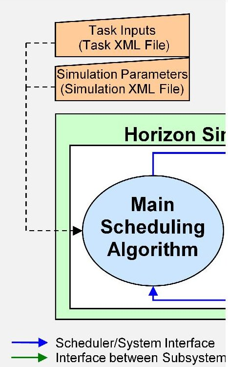


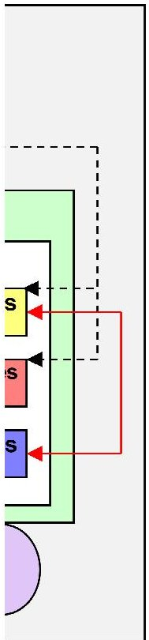


## 1.1. Motivation

The motivation behind this work is to address some of the issues with the existing version of the HSF. One key motivating factor is to lower the requirements of using the HSF to create or modify simulations. Due to lack of flexibility in the input and system model configuration many changes require source code changes to be made and the framework re-compiled. This not only creates many different executables to be created but also necessitates that the person making the changes have the development environment installed (such as Visual Studio), knowledge of C++, and how to build the source code. Dynamic model creation and scripting support resolve this by allowing for a single, generic, HSF executable to be created. Users who need to create or modify a simulation do not need to modify the source code or need the development environment. The only requirement is a text editor to modify the input XML files and Lua script files.

Another motivation for Dynamic model creation is to better integrate all components of the HSF. One major drawback of the existing version is that there is not fundamental coherency between the input files and the system model, and linking the two must be done manually by editing code. Dynamic model creation addresses this by ensuring that there is a link between input files and system model structure. Integration with other modeling utilities, such as the simulated environment and networking components is also provided.

<!-- PDF_PAGE: 12 -->

Allowing for logic code to be scripted allows for the HSF to be used by more people. In general scripting languages, such as Lua, are easier to get a basic working knowledge with rather than C++ which has a steep learning curve. Lower requirements to use the tool opens up more potential users - such as systems engineers who may not have a formal programming background but would find editing XML files and working with a scripting language an approachable task.

An additional motivation behind adding scripting support is that using a scripting language at defined plug-in points within an application allows for many of the interface details and complexity to be hidden while not sacrificing capabilities. Exposing utility classes and modeling components to a scripting language allows for no reduced functionality but hides the complexity of adding compiled code.

Modern computer which the HSF may run on typically come equipped with dual or quad-core processors. However, the HSF uses only a single thread which does not make effective use of modern multi-core processors. The large majority of the calculations done within the HSF are the evaluations of new schedules. These schedule evaluations are independent of each other, and the evaluation of one schedule does not depend on any data from any other schedule valuations. The schedule evaluation falls into the class of problems known as "embarrassingly parallel". By parallelizing the schedule evaluation portion of the HSF scheduler the program make use of multi-core machines and significantly decrease the run-time. A multi-threaded scheduler should also allow configuration. A configurable scheduler allows the user to run it at full resource usage, where the number of threads used equals the number of physical cores of the machine and leads to the fastest execution time. The scheduler should also allow for less number of threads to be used, so that users may run simulations in the background without consuming all processing resources.

## 1.2. What is Lua?

Lua is a powerful scripting language with many features and is freely available under the MIT license. Lua can be embedded in C++ as well as many other programming languages. Because Lua is embeddable, the C++ code can call Lua code and Lua code can call C++ code. Lua is well renowned for its speed, which makes it well suited for scripting simulation logic. Lua has been widely used in the gaming industry for scripting various aspects of game logic as well as for implementing various features in large applications.

<!-- PDF_PAGE: 13 -->

The history of the Lua scripting language $ ^{1} $ is described by Ierusalimschy, Henrique de Figueiredo, and Celes in a paper discussing the evolution of the language. Lua was initially designed as a simple configuration language but has evolved to a fully featured scripting language. Lua was designed with portability, ease of embedding, simplicity, efficiency and small size in mind.

## 1.3. What Lua and Dynamic Model Creation Adds to the HSF

An important aspect to expanding the capabilities of the HSF is to enable various logic aspects of the simulation to be implemented in a scripting language rather than C++ code which must be compiled into the framework before being used. The scripting language selected for this purpose was Lua. The selection of Lua as the scripting language was based on the design features of the language and the availability of binding libraries for the C++ language.

A description of Hybrid Simulations and the benefits for spaceflight simulations is given by Nemeth $ ^{2} $ , where a hybrid software architecture is defined as when compiled software objects are extended into a runtime interpreted environment. Examples given of hybrid software pairings are Python - C/C++, Jython - Java, Iron Python - C#, Lua - C/C++, and Matlab - Visual Basic.

Many of the benefits described by Nemeth for hybrid simulation architecture are achieved by the use of adding scripting with Lua to the HSF. Among these benefits are replacing a compiled code interface with an easy to use scripting interface, allowing inputs and functions of the simulation to be accessible by the scripting interface, allowing extensibility of the simulation, and using the scripting language to provide new capability to the simulation.

The addition of Dynamic Model Creation benefits the HSF by allowing for the model and input decks for the simulation be specified in input XML files, rather than compiled into the simulation. The system model, input deck, and all other HSF components are discussed further is section 2.1. Dynamic Model Creation has benefits related to adding scripting support and the concept of hybrid simulation architecture. It abstracts the structure of the simulation model to the XML input file, allowing for a generic model structure parser instead of changing the compiled code every time the simulated model structure and related interdependencies changes. The model structure consists of all elements of the simulated system, the related code implementation, dependencies between simulation elements and initial conditions. The scope of these changes requires changes the main program routine to parse run-specific input

<!-- PDF_PAGE: 14 -->

XML files into the internal structure used by the HSF. Changing the main program routine for each new simulated system is time-consuming and produces many different executables and sets of input files, rather than having one generic executable that will work with a greater set of input files.

## 1.4. Scripting Support in Other Areas

Support for scripting technologies has widespread use in many industries. Many commercial and open-source games utilize scripting capabilities to allow end-user customization and extensibility. Typical applications of scripting in the gaming industry include in-game console support, artificial intelligence scripts, and user defined scripts and modifications $ ^{3} $ .

## 1.3.1. Free and Open-Source Software

Scripting support is also very common in the domain of free and open-source software to provide users more control over the software without having to modify the source of the program. The free and open source network mapper Nmap $ ^{4} $ uses Lua scripts to automate various networking tasks. The 3D modeling tool Blender $ ^{5} $ utilizes Python scripts to allow for access and modification of objects within the software and is often used to automate common tasks and to create import and export scripts for various model formats.

## 1.3.2. Commercial Tools

Commercial modeling and simulation tools also use forms of scripting to extend the functionality of the software. Scripting is very useful for commercial tools because it allows for a user to expand the capabilities of the software and implement custom algorithms without having to expose the source code. Tools such as AGI's STK $ ^{6} $ utilize scripts in MATLAB, VBScript, and PERL languages as plug-in points for purposes such as coordinate system calculations, engine models, forces for orbit integration and access and communication constraints as well as many other areas. The commercial tool FreeFlyer $ ^{7} $ provides a native scripting language used to define custom algorithms within the software.

Another use of scripting in the field of simulation and modeling is to have scripts that perform optimization or design that setup and execute other software tools many times. As an example, the tool COSMOS has been integrated with MATLAB for purposes such as optimizing Heat exchangers $ ^{8} $ and designing Electrodynamically Actuated Microvalves $ ^{9} $

<!-- PDF_PAGE: 15 -->

## 1.3.3. Spacecraft Applications and Operations

The area of spacecraft operations has seen many applications which use using scripting technologies in recent years for operational and analysis activities. The EPOCH Scripting Client $ ^{10} $ developed by Integral Systems allows for operators to use scripting engines such as VBScript and VBA, as well as compiled languages such as C++, VB. .NET to automate data analysis, real-time data monitoring, and historical collection. The EPOCH Scripting Client can integrate with Microsoft Office tools and example uses include eclipse and thermal analysis reporting.

The Enhanced and Redesign Scripting $ ^{11} $ (ERS) product used by the ISS Payload Operations Integration Center extends features of programming languages VB and C# to include command and telemetry procedures, telemetry measurements, as well as spacecraft commands in a way that is as easy to use as a scripting language. ERS scripts are .NET assemblies which are compiled, validated, and run in various modes.

The James Webb Space Telescope (JWST) $ ^{12} $ will use the COTS JavaScript engine NOMBAS ScriptEase to allow for an event-driven architecture for operations that allows for a simple, high-level command interface. The JWST JavaScript engine is incorporated into the flight software and executes visit files uploaded to the spacecraft in 10-day sections as determined by the short-term scheduler. Each of these visit script files contains activities for vehicle maneuvering, guide star acquisition, and exposure and offset values settings for observation events.

L-3 Telemetry West has developed the JAS $ ^{13} $ language to allow interoperability with the existing language features of PIL, CECIL, and STOL as well as additional functions. The JAS language allows for varying scripting language need for control centers to met while preserving standards and interoperability with existing scripts.

The tool bdStudio $ ^{14} $ uses Python as a scripting subsystem to interact with C++ code used for visualization. bdStudio uses a high level scripting layer, written in Python, to further simplify the interface bindings that are generated by the Simplified Wrapper and interface Generator (SWIG) for Python. The scripting subsystem makes the interaction of different analysis codes used as inputs to the visualization transparent. A key benefit of bdStudio allows the engineer to concentrate on the visualizations generated, rather than interfacing with the inputs.

## 1.5. Thesis Overview

In Section 2, the architecture of the Horizon Simulation Framework is described including all simulation, structural, and scheduling elements. Section 2 also describes issues that were resolved from the previous version and the additional capabilities added since the previous version. Section 3 describes how scripting support is added to

<!-- PDF_PAGE: 16 -->

the framework and the capabilities gained by it. Section 4 describes the motivation behind and the implementation of the dynamic model creation algorithm. Section 5 describes the architecture changes made to the framework since the previous version and the reasoning behind them. Section 5 includes changes related to scripting support, dynamic model creation, and multi-threaded scheduling. Section 6 describes the runtime performance tests that were performed in order to quantify the effects of scripting support and multi-threaded scheduling. Section 7 presents conclusions as well as proposals for future work to improve the capabilities of the framework.

<!-- PDF_PAGE: 17 -->

## 2. Horizon Simulation Framework Architecture (Version 2.1)

This section defines the architecture of the Horizon Simulation Framework present. It presents descriptions of the simulation, structural, and scheduling elements. Next some of the issues which were present in the previous version 2.0 of the architecture are described. Implemented solutions to these issues are described. Finally, simplifications and added features provided by dynamic model creation and scripting support are described.

## 2.1. Elements of the Horizon Simulation Framework

This section defines the various elements of the horizon simulation framework. First defined are the basic simulation elements used for the evaluation of subsystems. Next defined are the structural elements used to encapsulate information and determine the structure of the model to be simulated. Finally key elements related to the scheduling component are defined.

## 2.1.1. Basic Simulation Elements

Task - A task indirectly determines the action of subsystems during the simulation. Subsystems will implement different logic and algorithms based upon the types of tasks presented to them. Tasks consist of a target location, a value, and other simulation dependent properties.

State - A state represents a mechanism for subsystems to store state data in over time. Each state stores the information for all subsystems belonging to an asset for the given scheduler time step. States are linked to previous states in the form of a linked list structure, allowing for access to previous state data.

Event - Events consist of a task and the timeframe that the task must be performed in. An event consists of a lead-in time to the beginning of the time that a task must be completed, a duration in which the task must be completed, and a lead-out time until the end of the time step.

Constraint - A constraint represents a condition placed upon the value of a state variable set by a subsystem that must be valid in order for a schedule to be valid. All constraints placed upon all subsystem must be valid as a necessary condition for a schedule to be valid.

Subsystem - A subsystem represents the key modeling component of the framework. A subsystem represents a state transition object that, given an initial set of state variables, implements logic that determines a final set of state variables and determines if a task scheduled to it is allowed.

<!-- PDF_PAGE: 18 -->

Dependency Function - A dependency function is the interface used by a subsystem to query state variable information set by other subsystems. Restricting subsystems to using dependency functions to access this data preserves modularity between the subsystem logic. Dependency functions access state data from subsystems, and perform any processing on the data to put it in the format desired by the calling subsystem.

Profile - Profiles represent the time history of state variables. This is implemented as a zero-order hold where a value is assumed constant until it changes to the next value set.

2. 1.2. Simulation Structural Elements

Dependency - A dependency signals that a subsystem is dependent upon information generated by another subsystem. A subsystem has a dependency on all subsystems whose state data is accessed by the dependency functions it calls.

System Model - The system model represents the collection of subsystems, grouped into assets, to be simulated in the defined environment. It includes all of the constraints on subsystem state data and the dependency functions called by them.

Subsystem Node - A design element used to set up the dependency structure of subsystems. A subsystem node represents a subsystem and contains information about how that subsystem fits into the structure of the system model. Subsystem nodes contain the information that should not be made available to the implementation of the subsystem logic, such as which other subsystems it is dependent upon as well as flags that are used to determine if a subsystem has been evaluated during each time step of the simulation.

Asset - An asset represents a logical set of subsystems. Subsystems that belong to the same asset store their state variable information in the same state.

Node Dependencies - A node dependencies object represents the set of dependency functions that is available to a subsystem. A node dependencies object encapsulates the work of calling dependency functions, whether they be written in C++ or Lua. A subsystem calling a dependency function using the node dependencies object does not need to know which language the dependency function is written in.

## 2.1.3. Simulation Scheduling Elements

Asset Schedule - An asset schedule is the series of events tasked to an asset and the initial state for that asset.

<!-- PDF_PAGE: 19 -->

System Schedule - A system schedule is a list of asset schedules. It represents the complete initial state of the simulation and contains one asset schedule for each asset defined by the system model.

Scheduler - The scheduler is the component of the framework that generates a set of system schedules that is feasible for the system model to complete and satisfies all constraints.

## 2.2. Utility Classes and Components

Utility classes and functions are built into the framework that are commonly used for the types of problems that the HSF is used for. These tools are provided so that they can be re-used in all uses of the framework. The following utility classes and functions are provided.

- Matrix

- Quaternion

- Coordinate system conversions

- Numerical integrators and propagators

## 2.3. Issues with Modeling Framework

## 2.3.1. Subsystem Node's and Subsystems

The methodology of setting up simulations in the previous version of the framework was very complex and required editing many files. The following section describes some of the issues with the setup.

In order to set up subsystem nodes and the corresponding subsystems, the subsystem nodes first have to be created in the main method. Next, the subsystems have to be created and associated with the proper subsystem node. All of this must be done within the main method initialization code by the system modeler.

## 2.3.2. Dependency Graph Structure

To create the proper structure about which nodes are dependent upon others, the dependency graph structure must be manually specified within the main method after all subsystem nodes have been created. Creating the dependency graph structure is completed by adding a list of the preceding subsystem node's to each subsystem node.

## 2.3.3. XML Input for Subsystems

Using an XML file as input for subsystem parameters requires that the XML parser library within HSF is used to obtain a reference to the proper XML node and pass the XML node reference to the subsystem constructor. The subsystem constructor will then set parameters using the attributes contained within the XML node. Parsing the

<!-- PDF_PAGE: 20 -->

XML file and passing in the proper XML node references is a problem when creating many simulations because it requires working knowledge of the HSF XML parsing library as well as modifying the main method code to set up retrieving XML nodes from the input files properly.

## 2.3.4. State Variable Initial Conditions

In previous HSF versions State variable initial conditions are coded into the initialization, making it more difficult to change them because it requires modifying source files and recompiling the framework.

## 2.4. Dynamic vs. Non-Dynamic Model Creation

The concept of dynamic model creation as implemented in the HSF refers the generalization of the initialization code such that the instantiation of all required simulation models, propagators, dependency function, initial states, etc., is all completed at the start of the program based solely upon the input XML and script files provided as arguments to the HSF. This allows for a single, generic, HSF executable to be compiled and used rather than different executables that previous versions require when changes were made.

Previous versions of the HSF require modifications when anything other than initial conditions and initial state variable values were changed. Among the changes required are:

- If the number or type of subsystem models changes, then the modeler must change the initialization code of the HSF create the appropriate instantiation of the subsystem models to be used.

- The initialization code must be modified by the modeler to use the XML parser within the HSF to iterate through the XML nodes contained within the input files, and pass the appropriate XML node to the subsystem constructor to allow for the subsystem to retrieve default parameters from the proper XML node. Note that this requires knowledge of the XML parser API by the modeler.

- The dependency structure between subsystem models must be setup by the system modeler during the initialization code. Setting up this structure requires the modeler to obtain references to all other subsystems that each subsystem depends upon, and add each of these references to the list of dependent subsystems.

- If changes to dependency functions are required, the system modeler must create new dependency functions as required and modify the subsystem code to ensure that the proper dependency function is called within the code for each subsystem.

<!-- PDF_PAGE: 21 -->

- The orbital or other position propagator must be created by the system modeler and applied to the appropriate Asset (collection of subsystems). If the propagators requires default parameters to be initialized from an XML node, the modeler must obtain the proper reference to the XML node and pass it to the propagator constructor.

- Any changes in the types of tasks contained in the task or target input deck require modifications to the code to initialize the internal structure that holds the target deck used by the scheduler.

- No effort is made to check the structure setup by the system modeler to circular dependencies among subsystems.

To summarize the scope of work involved with prior versions of the HSF without dynamic model creation, the system modeler must not only know how the internal structure of the HSF, but also how to create each simulation object (subsystem, propagator, dependency function, task, etc.) and also how to add them appropriately to create the simulation structure, use the XML parser API to obtain references from the input files, and pass XML nodes to simulation element constructors in the appropriate manner.

The dynamic model creation algorithm simplifies much of the above work by using a single generic initialization sequence that sets up the structure based upon information within the XML input files, For example, the following is an excerpt of an input file that would be parsed by the dynamic model creation algorithm.

MODEL>

<ASSET>

<SUBSYSTEM

  Type="scripted"

  Name="Sub 1"

  SubId="1"

</SUBSYSTEM>

<SUBSYSTEM

  Type="Sub 2"

  SubId="2"

  <DEPENDENCY SubId="2"></DEPENDENCY>

</SUBSYSTEM>

</ASSET>

<ASSET>

<SUBSYSTEM

  Type="scripted"

  Name="Sub 3"

  SubId="3"

  <DEPENDENCY SubId="2"></DEPENDENCY>

  <DEPENDENCY SubId="4"></DEPENDENCY>

</SUBSYSTEM>

<SUBSYSTEM

  Type="Networked"

  Name="Sub 4"

  host="127.0.0.1"

  port="9999"

  SubId="4"

</SUBSYSTEM>

<!-- PDF_PAGE: 22 -->

The example input file above contains definitions for two Assets, each containing two subsystems. The dynamic model creation algorithm would create the model structure shown in Figure 2 with the input file above.


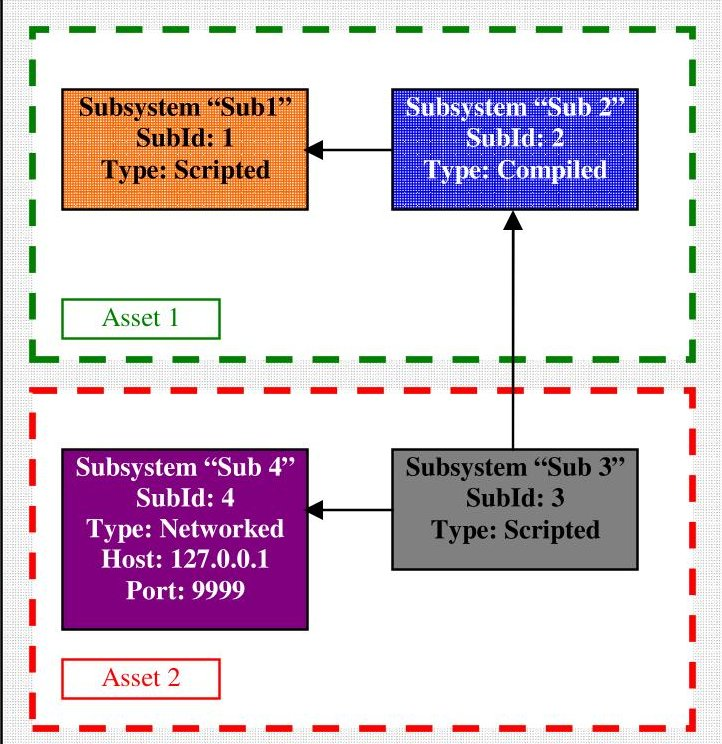


<div align="center">

Figure 2 Dynamic Model Creation Algorithm

</div>

With dynamic model creation, the internal structure is automatically created from input XML files. This allows the system modeler to need to know only how to setup the XML files appropriately and not how to use all of the internal structure of the HSF.

## 2.5. Simplifications due to Dynamic Model Creation and Scripting

## 2.5.1. Modeling Simplicifications

The addition of scripting support greatly simplifies the creation of the code and tools required to set up simulations. The scripting language supported is much easier to use than writing C++ code, which is required in previous versions of the HSF because the entire codebase is written in C++ and no other method of code interoperability is provided. However, no capabilities are sacrificed because all of the important classes and functions are made available to the scripting language.

Writing code to set up simulations previously required more than a basic understanding of C++ and the development environment used. Creating new subsystems, dependency functions, etc. requires knowledge of writing

<!-- PDF_PAGE: 23 -->

C++ classes that implement all of the virtual functions defined by top level interfaces. Knowledge of using an integrated development environment (IDE) is also required to add files and compile the framework. The addition of scripting support along with the dynamic model creation algorithm eliminates this need in many cases. If scripted code is used, or C++ code already exists in the framework, then using an IDE and compiling the HSF is not required. The HSF can be compiled once and the only requirements are the text files representing the input and scripted code.

## 2.5.2. Model Structure Modification

The dynamic model creation algorithm provides a much simpler way to change the structure of the model to be simulated. Because the structure of the model, the code to be used, tasks, initial conditions, and other simulation parameters are all specified in XML files only the input XML files require modifications. For example, to add another identical asset to a simulation, only the part of the model XML file corresponding to the asset needs to be copied, the subsystem ID's and initial conditions changed, and some minor changes to the dependency functions used to accomplish this. There is no need to re-compile the HSF for these types of changes.

## 3. Scripting in the Horizon Simulation Framework

Creating bindings between Lua and the C++ classes and utility functions in the HSF is the key to setting up scripting support. Lua provides a C API to do this but this process becomes complex for C++ because of its object-oriented nature. To simplify the Lua/C++ bindings the Luabind $ ^{15} $ library produced by Rasterbar Software and released under the MIT license is used. The Luabind library helps to create bindings that make C++ classes and functions available to Lua. The Luabind library still uses the Lua C API, but provides many simplifications for binding C++ classes. Luabind also provides an API to simplify calling Lua code from C++. Bindings between Lua and C++ are needed because the scripted simulation code must directly call the existing C++ code within the framework. Conversely, each scripting plug-in point within the HSF must call a Lua script from C++ and Luabind simplifies this process. Although the logic code can now be scripted, scripted code ideally acts as "glue" to piece together the overall algorithm. With the Lua/C++ bindings created using the Luabind library, much of the Lua code is actually calling C++ code within the HSF but with the syntax of Lua while still providing all other features of the Lua language. The features of the Lua language are given in a book on the language by Ierusalimschy $ ^{16} $ . Technical details about the Lua language are presented by Ierusalimschy and Celes $ ^{17} $ .

<!-- PDF_PAGE: 24 -->

## 3.1. Using Luabind to Make C++ Framework Code Available to Lua

The Luabind library can make nearly any C++ function or class available to Lua. This section describes most of Luabind features used to bind code in the HSF. For a complete description of all the features of Luabind, see Ref. 15. The Luabind library needs a pointer to the Lua state created with the Lua C API to complete the binding operations. The simplest example of binding a C++ function is a global function using only primitive types. For example, consider the C++ function signature given below.

double TestFunction(int arg1, double arg2)

To bind this function Luabind requires knowledge of the Lua state, the name that it will be known by in Lua, and a function pointer to the C++ function. The C++ code that is used to bind this function would be as follows. Note that the variable "L" is a pointer to the Lua state that must be created with the Lua C API prior to this code.

```javascript

module(L) [

  .def("TestFunction", &TestFunction)

];

```

In this example the function will now be known by the name "TestFunction" and can be called from Lua. Note that it is not required to name the function the same as its name in C++. Luabind can also handle overloaded functions. For overloaded functions the only difference is that the full signature for the function pointer must be provided. In the following example, the top is the two C++ functions that will be bound, and the bottom is the corresponding code that will bind them. The same methodology for binding overloaded functions also applies to class methods that are discussed later.

```cpp

double TestFunc(int arg1, double arg2)

double TestFunc(double arg)

module(L) [

    .def("TestFunc", (double(*)(int, double))&TestFunc),

    .def("TestFunc", (double(*)(double))&TestFunc)

];

```

Luabind can also bind C++ classes and structures. Luabind does not make any distinctions between binding classes or structures since both are set up by using the same methods. As an example of how classes are bound with Luabind, consider the C++ class definition shown below.

```cpp

class TestClass {

  private:

    double var1;

```

<!-- PDF_PAGE: 25 -->

public:

    TestClass(double var1);

    getVar1();

    setVar1(double var1);

    printVar1();

    double publicVar;

};

Luabind has different constructs to bind class constructors and class methods as well as properties, such as the public variable "publicVar" contained within the class. The following code will bind this C++ class.

```javascript

module(L) [

    class_<TestClass>("TestClass")

        .def(constructor<double>())

        .def("getVar1", &TestClass::getVar1)

        .def("setVar1", &TestClass::setVar1)

        .def("print",    &TestClass::printVar1)

        .def_readwrite("publicVar", &TestClass::publicVar)

];

```

This example class will now have all methods and public variables exposed to Lua. The difference in methodology to bind class methods and the public variable is because in Lua the two are accessed by using different syntax. In Lua, class methods are accessed by using the ":" operator while class properties are accessed by using the "." operator. The next example shows both Lua and C++ code that will create an instance of the test class, call both of the class methods, and set the public variable.

C++ Code

TestClass class1(2.0);

double var = class1.getVar1();

class1.setVar1(3.0);

class1.publicVar = var;

class1.print();

Lua Code

TestClass class1(2.0)

var = class1:getVar1()

class1:setVar1(3.0)

class1.publicVar = var

class1:print()

When the Lua code is now executed it will have the same result as the C++ code. Because the class is available to Lua, all of the method calls in Lua will call the proper C++ methods of the class. Using the binding mechanisms it

<!-- PDF_PAGE: 26 -->

is possible to make entire C++ libraries available to Lua for use with scripting, while still utilizing the performance of the code written in C++.

## 3.2. Other Features of Luabind

The previous section demonstrates some of the main features of Luabind used in the HSF. The library also includes many other features such as binding enumerations, operators, static functions and derived classes. Luabind also includes policies which can be applied to binding registrations which increase the number of special cases where Lua can be used.

## 3.3. Binding Template Classes

In the HSF, one of the main classes used in subsystem logic is the Profile class. The Profile class stores the time history of a state variable as a zero-order hold data series. The HSF Profile class is implemented as a template class so that the same algorithms can be used for all the state variable types. State variable types are the C++ primitive types int, float, double and bool as well as the Matrix and Quaternion classes. However, Luabind can only make concrete class types available. Since the profile class is of utmost importance to make available to Lua the above template types are bound and named differently. The result of binding concrete instances of the Profile class is that different class types for Profiles are available in Lua. Binding concrete templates also simplifies the usage of scripting since coding in C++ with the Profile class requires knowledge of C++ template semantics.

The following example shows how a double Profile would be created and a data point added to the Profile in both C++ and Lua.

## C++ Code

Profile<double> prof = Profile<double>(); prof.addData(0.0, 10.0);

## Lua Code

prof = dProfile()

prof:addData(0.0, 10.0)

Using concrete template bindings, it is possible to make all the profile types in the HSF available to Lua and eliminate the requirement of specifying template types in Lua scripts. In the above example, "Profile<double>" in C++ became "dProfile" in Lua. Similarly for a Profile of matrices, "Profile<Matrix>" would become "mProfile", etc.

<!-- PDF_PAGE: 27 -->

## 3.4. Binding the HSF Classes and Utilities

Using the binding methods described in the previous sections, all of the classes and utility functions available to the system modeler are made available to Lua. Out of necessity this includes all of the classes that are passed to functions which are plug-in points for scripting. For example, the C++ function signature for the Subsystem "canPerform" method is as follows.

bool canPerform(const State* oldState, State* newState, const Task* task, Position* position, Environment* environment, NodeDependencies* dependencies)

Since this is one plug-in point for scripting, this necessitates that the State, Task, Position, Environment, and NodeDependencies classes be made available to Lua using bindings. An additional requirement is that any other classes that may be accessed using the methods of the above classes must also have bindings. For example, the Target class is available from the Task class and the Sun class is available from the Environment class which requires both Target and Sun classes have Lua bindings as well. In addition to arguments passed directly to plug-in points utility functions are made available as well. This includes the Matrix and Quaternion classes, math utilities for performing operations on these classes as well as functions available for position conversions. A full list of classes and utility libraries available to Lua is shown in Appendix B.

## 3.5. Using Luabind to Call Scripting Plug-In Points

In addition to setting up the bindings that allow for C++ code to be made available to Lua, the Luabind library also provides utility functions that simplify the argument setup, calling the function, and getting the return value when calling Lua scripts from C++. Strictly using the Lua C API to achieve this becomes very complex, especially when some of the arguments are classes.

The version of the utility function used in the HSF has the syntax below. The Luabind library needs the Lua state and the name of the function to call. The template type specifies what the return value of the Lua function should be converted to in C++. The ellipses "..." signifies that the Luabind utility function is a variadic function. The variadic argument that the Luabind utility function provides is that any additional arguments after the name are "passed through" to the Lua function to be called. The Luabind utility function handles all of the details of setting up, converting arguments and pushing them onto the Lua stack, calling the Lua function, as well as removing and converting the return value from the called Lua function.

<!-- PDF_PAGE: 28 -->

```cpp

template<class Ret>

Ret call_function(lua_State* L, const char* name, ...)

```

As an example of how this is used in the HSF, the call for scripted equations of motion plug-in point is shown. The equations of motion are of the form $ y^{\prime}=f(t,y) $ ,where t is the current time and y is the state vector (stored in a Matrix). The name of the Lua function representing the equations of motion is stored in the C++ Standard Template Library string variable evalEOMSfcn. The return of the Lua function is the state vector derivative and is converted to a Matrix. Note that the time and state vector derivative variables are defined prior to this call.

Matrix ret = call_function<Matrix>(L, evalEOMSfcn.c_str(), t, y);

An example of a Lua function that may be called by the EOMS plug-in point is as follows. The two additional arguments t and y are passed through plug-in point call to the Lua EOMS function.

function orbitalEOMS(t,y)

...

end

In addition to simplifying the call of the function, Luabind will also throw an error if one occurs while evaluating the Lua function. The plug-in point call must be placed in a try-catch block, so if an error occurs it can be printed to see what went wrong with the function evaluation.

## 3.6. Scripting Plug-In Points

The following areas are scripting plug-in points for the HSF. All major aspects of the simulation logic code are enabled to allow scripting support. The various code plug-in points along with their functions are given in Table 1.

<div align="center">

Table 1 Scripted Simulation Areas

</div>

<table border="1"><tr><td>Main Section</td><td>Subsection</td><td>Purpose</td></tr><tr><td>Subsystem Logic</td><td>Initialization</td><td>Initializes any subsystem parameters needed such as battery sizes,solar panel sizes,etc.</td></tr><tr><td></td><td>canPerform</td><td>Logic code that determines whether the current subsystem, given the current state of the system and previous schedule of operations,perform a task added onto the current schedule while meeting physical and operational constraints.</td></tr><tr><td></td><td>canExtend</td><td>Logic code that determines whether the current subsystem, given the current state of the system and previous schedule of operations,continue in a nominal(as decided by the modeler) while meeting</td></tr></table>

<!-- PDF_PAGE: 29 -->

<table border="1"><tr><td></td><td></td><td>physical and operational constraints.</td></tr><tr><td>Dependencies</td><td>-</td><td>Provides a facility for a subsystem to access and process state data generated by another subsystem. (Ex. Power subsystem needs to know how much power all other subsystem use)</td></tr><tr><td>Schedule Evaluator</td><td>-</td><td>Determines the total value of a feasible set of tasks that the system performs, based upon the times, types of tasks, and the state data within. The scheduling algorithm attempts to produce schedules that maximize this performance index.</td></tr><tr><td>Equations of Motion (EOMS)</td><td>-</td><td>For EOMS of the type: dy=f(t,y), examples include orbital propagators and systems where control input is a function of the state.</td></tr></table>

<div align="center">

Figure 3 shows a visual of how the scripting plug-in points fit into the framework.

</div>


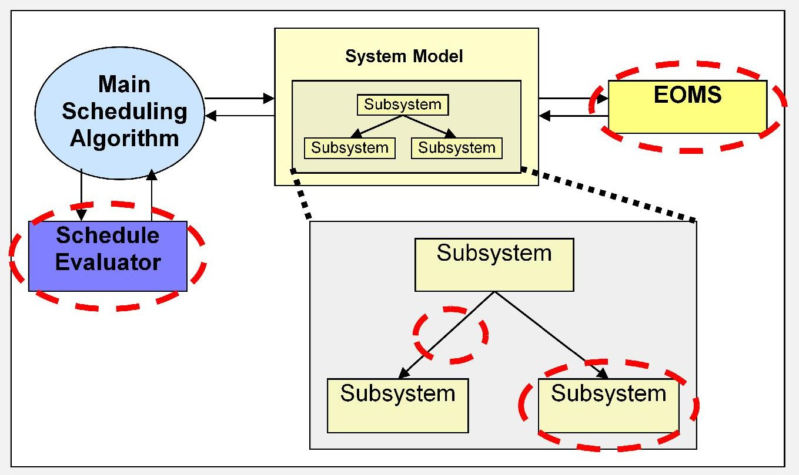


<div align="center">

Figure 3 Scripted Simulation Areas

</div>

## 3.6.1. Scripted Subsystems

Subsystem logic represents the main algorithms that define the model of the system. The scheduling algorithm interacts with the subsystems using standard interfaces that each subsystem must implement. For scripting, these interfaces are implemented as plug-in points for Lua code. An additional plug-in point is added to allow for initialization of subsystem parameters. The subsystem plug-in points for scripting are described below.

<!-- PDF_PAGE: 30 -->

- Initialization. The initialization plug-in point allows for various subsystem parameters to be set before the start of the simulation. This feature is provided by passing a Subsystem parameters object to the initialization Lua script. The script can then add parameters to this object that is also passed to the other subsystem plug-in points for use in the simulation. This effect can also be accomplished by using global variables in Lua, but the Subsystem parameters object allows for a formalized way to do this.

- Can Perform. The CanPerform interface is the key interface used for the simulation of the system model. The CanPerform interface is what Subsystems use to tell the scheduler if the current proposed task is feasible given the previous schedule, state data, and position. Subsystems call dependencies and set state data from within this interface. The subsystem has access to the prior and current state, the position of the asset it belongs to, the model of the simulation environment, and objects used to call dependencies and the subsystem parameters set in the initialization plug-in.

- Can Extend. The CanExtend interface is used by the scheduler to extend the duration of tasks performed. Subsystem logic in this interface is not used to perform any tasks, but rather to extend the duration of a previous task in a nominal operation.

## 3.6.2. Scripted Dependency Functions

The dependency functions allow for Subsystems to access state data set by other Subsystems, not necessarily belonging to the same Asset, in a controlled manner. Scripted dependency functions are called from within Subsystem logic. The dependency functions use a getState method of the Dependencies class in order to get the state data corresponding to an Asset, perform any processing operations on it, and return it to the calling Subsystem. An example of how a dependency function would be used is summing the power usage of all other Subsystems in an Asset that represents a satellite.

## 3.6.3. Scripted Schedule Evaluator

The schedule evaluator is the cost function that the scheduler will attempt to maximize. The schedule evaluator is designed to be generic because the concept of what the cost function should represent is completely up to the system modeler. Changing the cost function will result in different task combinations or schedules. The Lua plug-in point is the cost evaluation of a single event and the resulting cost for the entire schedule is the sum of all of the individual event evaluations.

<!-- PDF_PAGE: 31 -->

The schedule evaluator iterates across all Assets, then iterates through all of the events that the Asset is tasked with. For example if there are two Assets each having performed two tasks, the order that the cost function is evaluated is: Asset 1-Task1, Asset 1-Task2, Asset 2-Task1, Asset 2-Task2.

The scripted schedule evaluator also defines some helper variables in the Lua workspace that may be used within the evaluation function. These variables along with the conditions which they are set to are shown in Table 2. These variables are used to create a schedule evaluator that can span multiple events, for example, to add a penalty if the same task is performed twice in a short time period.

<div align="center">

Table 2 Scripted Schedule Evaluator Items

</div>

<table border="1"><tr><td>Variable</td><td>Condition</td></tr><tr><td>NewSchedule</td><td>Set to 1 for the first event evaluation of a new schedule,0 otherwise.</td></tr><tr><td>NewAsset</td><td>Set to 1 for the first event evaluation of an event for a new Asset,0 otherwise.</td></tr><tr><td>CurrentAsset</td><td>The current Asset number(1 to #Assets)</td></tr><tr><td>CurrentEvent</td><td>The position of this event in the Assets list of events(1 to #ofEvents the Asset has been tasked with)</td></tr></table>

## 3.6.4. Scripted Equations of Motion (EOMS)

The equations of motion is another plug-in point for Lua scripting. The equations of motion supported are those of the form $ y^{\prime}=f(t,y). $ Scripted equations of motion use two different Lua function - an initialization function and an evaluation function.

The initialization function is called when the scripted equations of motion object is constructed and should be used to initialize any parameters or perform any calculations that can be done independently of the evaluation function. The initialization function is designed to provide a potential performance increase since common calculations can be done once in the initialization function, as opposed to performing common calculations each time during the evaluation function which will be called many times to propagate the vehicle state.

The use of variables defined in the initialization function within the evaluation function is possible because of the default scoping rules of Lua. All variables defined in Lua are treated as global variables by default, even if they are defined within the scope of a function or control flow construct. This is a significant difference from the scoping rules of other languages such as C++. However, it is possible to create the same scoping of variables in Lua by using the "local" keyword $ ^{9} $ .

<!-- PDF_PAGE: 32 -->

The EOMS evaluation function evaluates the motion equation $ y^{\prime}=f(t,y). $ The EOMS evaluation function can access any variables defined in the initialization function. Table 3 below describes the syntax of the scripted equations of motion, their purpose, as well as an example for a simple two-body orbit propagator.

<div align="center">

Table 3 Scripted EOMS

</div>

<table border="1"><tr><td></td><td>Initialization</td><td>Evaluation</td></tr><tr><td>Purpose</td><td>Define variables for use with the evaluation function that are constant for each evaluation</td><td>Evaulate the equations of motion of the form y&#x27;=f(t,y)</td></tr><tr><td>Lua Syntax</td><td>function init()</td><td>function eval(t,y)</td></tr><tr><td>Example</td><td>function orbital_EOMS_init()
MU=398600.4418
A_=Matrix(6,6,0.0)
A_:setValue(1,4,1.0)
A_:setValue(2,5,1.0)
A_:setValue(3,6,1.0)
end</td><td>function orbital_EOMS_eval(t,y)
r=norm(y(colon(1,3))
r3=math.pow(r,3.0)
mur3=-MU/r3
A_:setValue(4,1,mur3)
A_:setValue(5,2,mur3)
A_:setValue(6,3,mur3)
return A_*y
end</td></tr></table>

## 4. Dynamic Model Creation in the Horizon Simulation Framework

This section describes the implementation of the dynamic model creation algorithm in detail. The three input files used by the dynamic model creation algorithm are the simulation input file, target deck input file, and the model input file. The dynamic model creation algorithm focuses mainly on creating the system model based upon the model input file, but the implementation improves the handling of the remaining input files as well.

## 4.1. Simulation Input Files

This section describes the input files used by the framework, and how each is used in the model creation algorithm.

## 4.1.1. Simulation Input File

The simulation input file contains information about the simulation start date, start and end offset times, and scheduler parameters.

To load this file, the dynamic model creation algorithm will open the XML file, expecting to find a root node representing the scenario. Next, a child node representing the simulation parameters is looked for. From this child node, simulation-wide accessible attributes are set including the Julian Date representing the start of the simulation,

<!-- PDF_PAGE: 33 -->

the simulation start and end time in seconds, and the simulation scenario name. Finally, a child node representing the scheduler parameters is searched for. This node is used to set parameters such as the max number of schedules, the simulation step size and the size to crop to. The parameters contained within the scheduler parameters may changed depending upon the type of scheduler used.

## 4.1.2. Target Deck Input File

The target deck input file contains the list of all Tasks for the system to perform as well as the corresponding task type, target type, and target location.

The dynamic model creation algorithm loads this file expecting to find a root node representing the collection of targets. The algorithm then iterates through all of the child nodes representing the individual targets. Each target must belongs to a certain type of task. The dynamic model creation algorithm looks for the type of task from the XML node and creates a new task of that type and sets the target corresponding to the task to a new target created from the XML node. Passing the XML node reference to the Target constructor is done to provide extensibility so that different target parameters can be made by modifying the target class and the corresponding XML input files without changing the dynamic model creation algorithm, which was required before these modifications.

## 4.1.3. Model Input File

The model input file is arguably the most important of the input files, since it defines the structure of the system model. Without the system model, there is nothing to tell how the simulation should be run. The dynamic model creation algorithm starts after the XML input file with a root model node is found. The dynamic model creation algorithm then runs through the following steps:

1. An environment node is searched for. If one is found, then the system environment is created based upon the environment node. The environment then initializes its parameters and children based upon the children and attributes of the environment node. If no environment node is found in this step, a default environment model is created.

2. A network data node is searched for. This node is applicable only for simulations that utilize the networking capabilities of the framework. The algorithm uses the attributes of the network data node to open the client side networking resources that will be needed by the simulation. If the network data node is not found, then no network resources are required and no network initialization occurs.

<!-- PDF_PAGE: 34 -->

3. The next step is the initialization of the adapter classes. The adapter classes includes the SubsystemAdapter, ConstraintAdpater, and the DependencyAdapter. The adapter classes are used in later steps to initialize subsystems, constraints, and dependencies written in C++. The use of these classes is not required to initialize scripted subsystems or dependencies.

4. Next functions written in Lua are parsed and made available to the framework for scripted components. The algorithm first looks for a child node that is the parent for additional nodes that represent different files to load Lua functions from. The algorithm iterates through all of the child nodes, loading the corresponding Lua script files, and parsed by the Lua runtime state. Once the parsing occurs the Lua functions can be called from C++.

5. The next step is the most complicated because it initializes all of the subsystems, constraints, and performs setup of the dependency structure of the subsystems. Completely performing setup of the entire structure requires two passes, one to initialize all of the elements, and one to setup the dependencies between subsystems. The first pass iterates through all of the asset nodes defined in the XML file. A subsystem XML node that is a child of the current asset node belongs to the current asset. The following sub-steps take place during each iteration of a subsystem XML node. Multiple data structures are used to store data that will be used in the second pass to set up the final model structure.

a. The type of the subsystem is first determined from the XML node attributes. If the subsystem is compiled into the framework, then the SubsystemAdapter class is used to create an instance of the subsystem from the XML node. The XML node is passed as a reference to the subsystem so that the Subsystem can initialize any parameters from the XML node attributes or child nodes. If the subsystem is a networked subsystem, the subsystem requires the networking capabilities of the framework. Network parameters are loaded from the XML node and a connection is established to the server that will provide the subsystem implementation. If the subsystem is scripted then an instance of a scripted subsystem is created and the appropriate variables set to tell the subsystem what Lua functions to use for the subsystem logic plug-in points.

b. A SubsystemNode is created to encapsulate the generated subsystem and added to the list of SubsystemNodes that have been created. Using a map, the SubsystemNode is linked to the XML node used to generate the Subsystem it contains. Using a second map, an integer id

<!-- PDF_PAGE: 35 -->

defined in the XML node is linked to the SubsystemNode. This numeric id must be unique for each Subsystem because the id is used as a key to set up the dependency structure.

6. Next all of the constraints for the asset are generated by looking at child XML nodes representing constraints. The type of constraint, failure condition, constrained variable and constrained subsystem (determined by the subsystems numeric id) is determined from the XML node and created. For more complex constraints that require custom C++ classes to define, the ConstraintAdapter class is used to initialize the constraint.

7. The second pass starts at this step and is used to set up the dependency structure of the subsystem model. An iteration is performed for all XML nodes used to generate subsystems. If any XML nodes contain child nodes representing a dependency, the SubsystemNode has a dependency added based upon the numeric id contained within the dependency XML node.

8. The dependency functions are now added to the Node Dependencies objects stored by each Subsystem Node. An iteration is performed for all XML nodes used to generate subsystems. If any contain child nodes representing a dependency function, the SubsystemNode has a dependency added to the Node Dependencies object based upon whether it is scripted and two keys. If scripted, the key is simply the name of the Lua function to use as the plug-in point. Otherwise the key is used to look up a C++ function pointer from the dependency adapter by using the key variable. This is added to a map in the Node Dependencies object with another key, the call key. The call key is used by the Subsystem to call the dependency function. The distinction between the key and call key is to allow for the same subsystem logic code to be used but with different dependency functions. This is useful in the case where assets have the same subsystems and logic, but the dependencies may be different.

## 4.2. Motivation for Dependency vs. Dependency Function Distinction

An important design decision separates the distinction of a dependency vs. a dependency function when setting up the dynamic model creation algorithm and the format of the input files. For the purposes of this discussion, the following definitions will be used to describe the intent and how they are used by the dynamic model creation algorithm when setting up the system model.

<!-- PDF_PAGE: 36 -->

- A Dependency Node signals to the dynamic model creation algorithm that a subsystem that is dependent on another must be simulated after the subsystem it is dependent on. A subsystem can have a dependency on any number of subsystems, so long as no circular dependencies are created.

- A Dependency Function Node signals to the dynamic model creation algorithm that the current subsystem makes a call to a dependency function within its logic. A dependency function means that the algorithm must add the proper dependency function to the NodeDependencies object. The dependency function that is called will access state data, and this state data is set by a subsystem. Thus, a dependency node must also be defined for each subsystem's state variables that are accessed by the dependency function defined by a dependency function node.

The separation of these dependency function and dependency concepts allows for a "fail-fast" methodology to be implemented from the input files. For example, consider the satellite system defined by four subsystems - An access, sensor, buffer, and power subsystem. Suppose that the access subsystem contains complex access calculations that must be completed within the subsystem logic and can't be captured in a constraint. Furthermore, suppose that given the list of tasks that the system is to perform, this access calculation is failing the majority of the time. The sensor and buffer subsystems will generate state data based upon the current task, and the power subsystem calls a dependency function that accesses state data set by the sensor and buffer subsystems and has a constraint on one of its state variables. By the definitions of dependency and dependency functions definition above, the power subsystem has a dependency function that exhibits dependencies on the sensor and buffer subsystems. The system model described can be seen in Figure 4.

<!-- PDF_PAGE: 37 -->


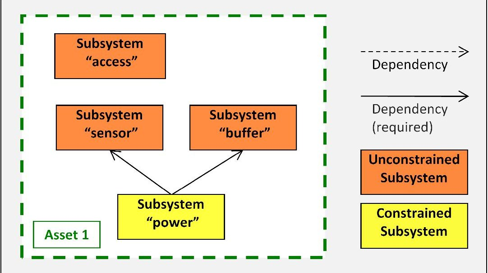


<div align="center">

Figure 4 System Model with Dependencies

</div>

For this system model, subsystem evaluation during each time step will occur as follows. The power subsystem will initially be called first because it is the only constrained subsystem. The power subsystem calls dependency functions, so it is required to have dependencies on the sensor and buffer subsystems and these two subsystems will be called prior to the power subsystem call, running their logic and generating state data. After the sensor and buffer subsystem are evaluated the power subsystem can run. Assuming that the sensor, buffer, and power subsystems were successful and the constraint on the power subsystem is satisfied, the access subsystem will run. The order of subsystem execution poses a runtime problem if the access subsystem is failing most often, because all of the other subsystems will always run before it. This is fine during the schedule evaluations it does not fail but when the access subsystem does fail it is causing a large performance hit. What is desired is to force the access subsystem to run first, so that when this often-failing subsystem fails the other subsystems are not evaluated, speeding up the overall schedule evaluation.

A "fail-fast" methodology can be accomplished by adding an additional dependency from the sensor and buffer subsystems to the access subsystem. These dependencies are not strictly required since neither of these subsystems access state data from the access subsystem using a dependency function, but adding the extra dependency enforces that the access subsystem will always be called before each subsystem. Since the sensor and buffer subsystems are both called before the power subsystem due to the dependencies required by the power subsystem dependency function, this ensures that the access subsystem will be called first. The resulting system model with "fail-fast" methodology applied is shown in Figure 5.

<!-- PDF_PAGE: 38 -->


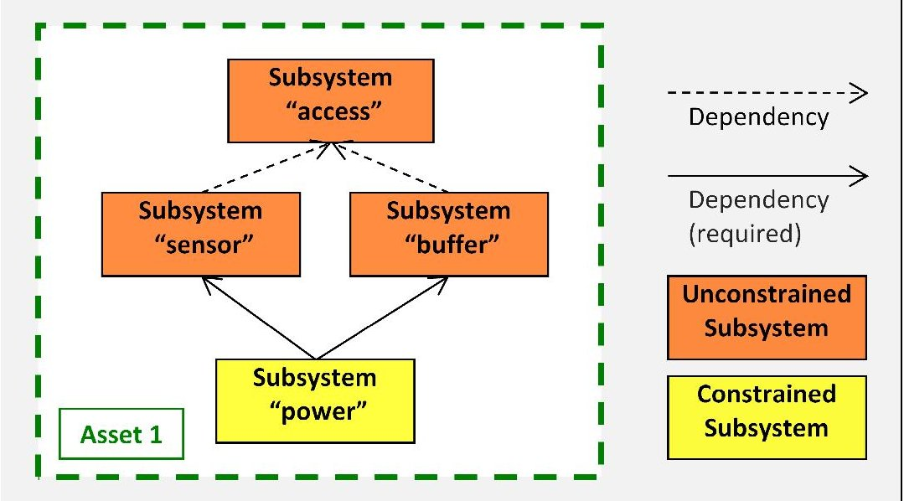


<div align="center">

Figure 5 System Model with Additional Dependencies

</div>

With this system model, the frequently failing access subsystem runs first. If it fails, no other subsystems are executed, saving execution time. This model is an example of how a "fail-fast" methodology can be applied to setting up the system model when one or more subsystems are known to be the limiting cases.

## 5. Architecture Changes

Some key architecture changes were made to the Dependency structure to support scripting and dependencies to exist between assets. A problem existed with prior versions of the framework because of two reasons. First, dependencies were implemented as static member functions in a dependencies class, which took a state as its input. This was a serious architecture problem because it meant that dependency functions could only act upon the state data passed to it. Since subsystem's only have access to the state data for the asset they belong to there could be no dependencies between different assets. The second problem is that it is easy to call the wrong dependency function from within a subsystem.

A new system of calling and structuring dependencies was implemented to provide support for dependencies between assets. The solution implemented integrates the all dependency calls into the SubsystemNode structure and

<!-- PDF_PAGE: 39 -->

changes the structure of the Dependency class to store state data so that dependencies between assets would be supported. The new dependency implementation is coupled with the dynamic model creation algorithm to ensure that each subsystem has access only to the dependency functions that are defined for that subsystem.

## 5.1. Adapter Classes

A method is implemented to initialize various simulation elements and form the model structure based upon the format of the input files. Initialization is done using adapter classes and functions that will create the appropriate objects based upon the XML nodes within the input files. Many of these adapter classes implement something similar to a factory design pattern.

For nearly every type of simulation element which is created, the C++ object must implement the interface provided by the HSF. These interfaces in the HSF are pure virtual abstract base classes (ABC). If a user wants to create a new type of equations of motion model, they must create a new C++ class that derives from the equations of motion ABC and implement all of the pure virtual functions. The same idea applies for subsystems, constraints, and schedule evaluators. Adapter classes for the following simulation elements are created by using this method:

- Subsystems

- Constraints

- Equations of Motion

- Schedule Evaluators

What the adapter classes provide is a way to instantiate the proper derived class implementation by using the information in the XML input files. When the adapter classes are set up correctly, it allows for subsystems, constraints, etc. used within the simulation to be changed quickly by simply modifying the input XML files.

The dependency adapter is different because it returns a function pointer to the proper dependency function rather than a derived class instantiation of a base class. Dependency functions written in C++ are member functions of the Dependencies class. The HSF main method code must be changed to register each new dependency function written in C++. This is done by registering each member function pointer with the dependency adapter with a key that is used by the dynamic model creation algorithm. This change in initialization code is not required when using scripted dependency functions.

In order to initialize simulation elements written in C++ from the input files, the adapter classes described above must be used in order to create the proper instance. Note that the adapter classes are used automatically by the

<!-- PDF_PAGE: 40 -->

dynamic model creation algorithm. The only time changes to adapter classes must occur is when new C++ classes are added to the HSF. Adapter classes are not used for scripted elements, however, because scripted implementation classes exist for each type of simulation element that has a scripting plug-in point. The logic for each instance can be made different, however, by changing the member variables that represent the names of Lua functions that implement each component. These member variables are set automatically based upon parameters within the XML input files.

## 5.2. Node Dependencies Class

One of the limitations of the previous version of the framework is that any dependency function could be called from any subsystem, making it easy for a subsystem to call the wrong dependency function. The introduction of scripting support would require another system for calling scripted dependencies. To resolve these issues the concept of a Node Dependencies class was conceived. The node dependencies class is designed to satisfy the following requirements.

- Integrate the calling of dependency functions into the structure of Subsystem Node's.

- Provide a single interface for calling dependencies for Subsystems. Subsystems should not know, or need to know, whether the dependency that is being called is implemented as C++ code or scripted as a Lua function.

- Make available only the dependency functions that correspond to a Subsystem available to it. This will prevent a Subsystem from calling the wrong dependency function.

- Have the ability to be set up programmatically to fit in with the concept of dynamic model creation.

A class designed to encapsulate dependency calls into a single interface is implemented to satisfy this new format of calling dependencies. Instead of having subsystems calling static dependency functions directly as in previous HSF versions, subsystems now call dependency function using the node dependencies class. The node dependencies class allows for a single interface for a subsystem to call dependency functions, without considering whether they are compiled C++ code or scripted Lua code. Internally, the node dependencies class handles the call from the subsystem and calls the appropriate dependency function, whether it be C++ or Lua code. Subsystems call dependency functions by calling the appropriate method type (int, bool, float, double, Matrix, or Quaternion) of the node dependencies class with a corresponding call key. The dynamic model creation algorithm sets up the node

<!-- PDF_PAGE: 41 -->

dependencies class before the simulation, which allows for the node dependencies class to match the call key to the appropriate type and exact dependency function for every subsystem.

## 5.3. Multi-Threaded Scheduler

This section describes modifications made to the default "Big Dump Exhaustive Search Algorithm (BDESA) $ ^{19} $ scheduling algorithm to incorporate multi-threaded execution and performance increases. This section also covers architecture changes to support multi-threaded execution when using either compiled or scripted code.

## 5.3.1. Motivation

An objective of nearly any simulation is performance, both in terms of algorithmic efficiency and wall-clock execution time. In the case of the HSF, increasing performance is always desired as it allows for a higher fidelity model to be simulated, or for more system architectures to be evaluated without sacrificing the wall clock time required to complete these simulations.

The default scheduling algorithm used in the HSF is the BDESA algorithm. This scheduling algorithm's behavior is to, at each time step, form a list of possible schedules for the system model to perform and then evaluate them sequentially. However, this sequential method of evaluation is far from optimal since the evaluation of schedules is an embarrassingly parallel problem $ ^{20} $ . Schedule evaluation is parallel in nature because at each time step the evaluation of a possible schedule can be completed independent of all others, and no communication is necessary between them. By switching this schedule evaluation portion of the scheduler, which takes up the large majority of the scheduling time, to multi-threaded execution a large performance increase can be achieved.

## 5.3.2. Thread Pooling Algorithm

A thread pooling algorithm is used to implement multi-threaded schedule evaluation. The thread pooling algorithm works by creating up to a set amount of worker threads, each of which will perform a single schedule evaluation. Maximum performance on multi-core or multi-processor machines should be achieved when the number of worker threads is equal to the physical number of cores or processors.

The thread pooling algorithm works as follows:

<!-- PDF_PAGE: 42 -->

1. Determine the max number, N, of worker threads that should be used. This is either set by the user in the simulation input file or auto-detected from the number of physical cores on the simulation machine.

2. Assign the first N schedules to threads and perform the schedule evaluations. If there are less than N schedules to evaluate, jump to step 4.

3. If there are still schedules that have not been assigned to a thread, wait for any thread to finish and then assign the next schedule evaluation to a new thread. This step is repeated until the final schedule is assigned to a thread to be evaluated.

4. Wait for all of the remaining threads to finish.

5. Schedule evaluation completed.

This algorithm can be seen in block diagram form in Figure 6.

<!-- PDF_PAGE: 43 -->


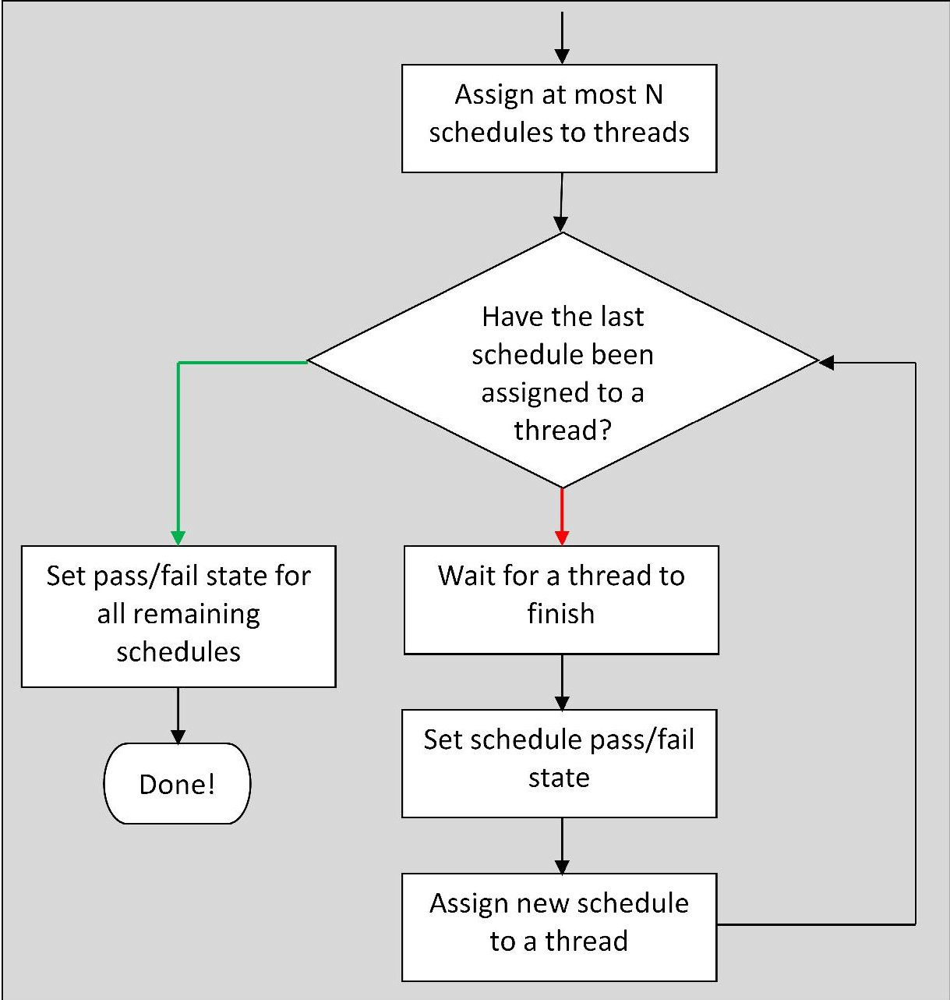


<div align="center">

Figure 6 Thread Pooling Algoirthm

</div>

This thread pooling algorithm is implemented by using Windows API functions $ ^{21} $ for most of the key points. If the scheduler is not told the number of threads to use from an input file, the number of cores or processors is detected by using the function GetSystemInfo. Threading is accomplished by utilizing the multi-threaded C runtime libraries and the _beginthreadex function is used to initialize all threads. Waiting for any single thread or all of them to finsih execution as described in steps 3 and 4 above is accomplished by maintaining an array of handles to all threads in use at any time and using the Windows API function WaitForMultipleObjects. This function has a parameter that causes it to return when any object passed to it finishes or only when all of them are finished, which allows for the difference in functionality in steps 3 and 4 above to be accomplished with a single function.

<!-- PDF_PAGE: 44 -->

## 5.3.3. System Model Modifications

The system model within the HSF represents the structure and state transition algorithms as defined by the user or system modeler. The system model contains all of the subsystem logic, the dependencies between subsystems, and the constraints placed upon state variables. The subsystems are contained within a directed-graph-like structure, where an edge in the graph between subsystems indicates a dependency and that the dependent subsystem must be executed after the subsystem it is dependent upon.

The scheduling algorithm is implemented with a fail-fast methodology where state variable constraints are evaluated, causing the subsystem that the constraint applies to be executed. The graph structure in the system model then causes any subsystem that the current one is dependent upon to be evaluated prior to the current one. This implementation can result in less than all subsystems being evaluated if a constraint fails before all subsystems are evaluated. The motivation for this type of structure is discussed in detail by O'Connor $ ^{22} $

This methodology as implemented within the HSF has each subsystem model wrapped by a subsystem node, which contains flags indicating whether or not is has been evaluated yet. This causes problems when converting to multi-threaded execution because the system model will not be thread-safe because of the presence of the flags within the subsystem nodes (representing subsystems) of the graph structure.

To overcome this limitation, the system model was changed so that it is possible to create a deep copy of the model structure. This resolves the thread-safety problem by allowing each thread of execution to work on a different, but identical in terms of structure and algorithms, system model. The system model deep copy is accomplished by the following algorithm:

1. First make a deep copy of all SubsystemNode's. Copying the SubsystemNodes causes a deep copy of the Subsystem represented by the SubsystemNode to be made via a clone interface and for a deep copy of the NodeDependencies object contained within the SubsystemNode to be made via a copy constructor.

2. Next, the graph structure for the new system model is then recreated by analyzing the structure of the system model to copy. Recreation is performed by looking at what subsystems are dependent on others in the model to copy and setting the appropriate dependencies in the new model.

3. Finally, the constraints have a deep copy made via a clone interface. Because constraints contain a reference to the subsystem whose state variable is being constrained, the system model to be copied is analyzed to changed the referenced subsystem to the corresponding one in the new system model.

<!-- PDF_PAGE: 45 -->

## 5.3.4. Dependencies Modifications

The dependencies within the HSF represent a formalized interface for one subsystem to query state variable information set by another subsystem. An example of a dependency usage is one that would be called by a power management subsystem in a satellite. In order to calculate the battery state of charge over time, the power subsystem needs to know how much power every other subsystem is using over time. To perform this calculation the power subsystem would call a dependency function, which would then calculate and sum up the time history of power usage of all other subsystems. By performing this calculation using the dependency function interface, the power subsystem avoids directly accessing state variables set by other subsystems.

Prior to the implementation of the multi-threaded scheduling algorithm, dependencies were implemented as a class implementing a Singleton design pattern. Dependencies implemented in C++ are added as member functions in this class. The instance of the class also contains a list of the current states of the system, which are updated prior to every new schedule evaluation with the new states of the system. The dependencies structure would not work with multi-threaded schedule evaluation because the dependencies class could only hold the state information for one schedule at a time.

This issue was resolved by adding the capability to the dependencies class to hold information related to multiple instances at a time while also preserving backwards compatibility. This is implemented by adding methods that allow for multiple instances of the Dependencies class to be stored, each one containing the state variable information related to a single copy of the system model and a Lua state. Each worker thread in the scheduler uses its own copy of the dependencies and related state data, ensuring that the Lua state and state variables do not get corrupted during multi-threaded schedule evaluation.

## 5.3.5. Scripting Support Modifications

Enabling scripting capability to multi-threaded schedule evaluation posed problems because of the Lua state system and the Luabind libraries, which are not thread safe.

Embedding Lua within C++ requires the manipulation of a Lua state, which is utilized by the Luabind libraries to simplify scripting within the HSF. A single global lua state could be used by the entire system model during single threaded execution but this will not work with a multi-threaded scheduler due to thread-safety issues.

<!-- PDF_PAGE: 46 -->

One solution is to wrap every call to the Luabind library in a critical section, but this idea was not implemented because it would cause bottlenecks in execution and potentially eliminate performance benefits from multi-threaded execution. The implementation decided upon is to have subsystems and dependencies utilize their own copy of a Lua state. This implementation prevents the Lua state from becoming corrupted as each thread uses its own state. Having multiple copies of the Lua state also prevents any performance bottlenecks from waiting for another thread to release a critical section. Using different Lua states for each copy of the system model allows for all scripted code to receive the same relative speedup as all compiled code with the multi-threaded scheduling algorithm.

<!-- PDF_PAGE: 47 -->

## 6. Runtime Performance Testing

This section describes the series of performance tests completed to understand the effect that scripting support has on runtime performance. A performance analysis is important because a key objective is to provide a way to have scripted plug-in points that can use built-in functions as well as user defined functions without severely compromising performance.

## 6.1. Built-In Function Performance Tests

A key objective of scripting support is to make all of the utility classes and functions available within the framework to be exposed to Lua. An important part of this objective is that when scripted code uses these utility classes or functions, it will be very nearly as fast as if it was coded in C++. The Luabind library is used so that calls to utility functions and classes in Lua are passed through to call the compiled C++ utility functions and classes via the binding mechanism.

Tests using the state and profile classes within the framework were set up to check that the performance of scripted algorithms very nearly match the performance of the same but compiled as C++ utilities were used.

An algorithm used to test the speed of scripting that uses only utility functions exposed by Luabind is chosen to be a combination of State and Profile operations. The Profile class represents the time history of a state variable and is intended to be used by subsystems to store state variable information. Operations on the Profile class include addition or multiplication of constants or other Profile's, adding or removing points, and integration. The State class is used as a container to hold Profiles and stores a key representing a state variable and the Profile representing the time history of that state variable. Operations on the State class include setting and retrieving Profile's given the key that represents a state variable.

The test function, which is identical in the C++ and Lua code tested, takes as input an instance of the State class containing three Profiles. The three Profiles represent a sine wave, cosine wave, and a triangle wave. The test waves are only used to generate data for use in the Profiles, they have no meaning beyond that. The number of data points in each Profile is controlled by parameter, n, which is varied for the test.

First, the test function retrieves the three Profiles stored in the State class passed as an input to the function. The test function then performs multiple addition and scaling by a constant as well as addition of other Profiles. Finally,

<!-- PDF_PAGE: 48 -->

the test function integrates a Profile. There is no real meaning to the operations used other than to increase the complexity so that the relative speed between the C++ and Lua versions of this test function can be seen.

## 6.1.1. Results

Figure 7 shows the resulting runtime as the parameter, n, increases which causes the number of data points in the Profiles to increase. The resulting runtime increases as the parameter increases, which is expected because there is more data for the Profile class to perform operations on. The important result from this test is that the scripted version performance is indistinguishable from the compiled version.


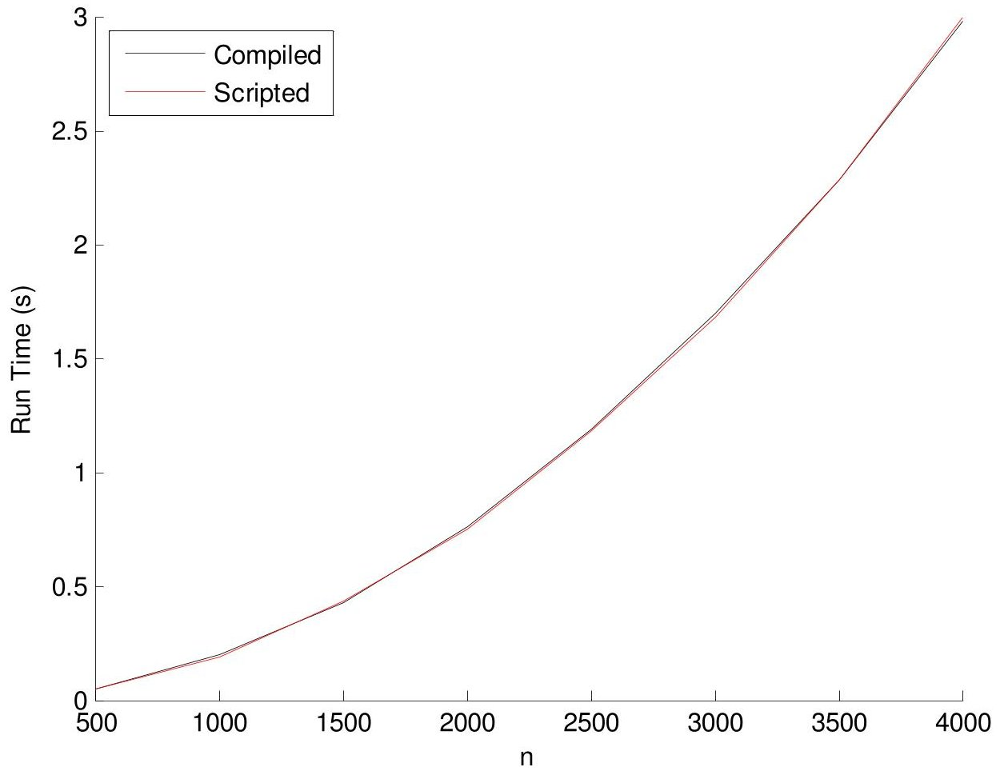


<div align="center">

Figure 7 Built-In Function Runtime Test

</div>

## 6.1.2. Conclusions

The reason for the near exact performance is because this test is designed such that all of the computationally intensive work is done by the framework's utility classes, even when the test algorithm is scripted. In this test the Lua scripting is simply acting as a way to call the utility classes, in this case profile operations.

A major fact about the scripting performance can be learned from these results. If the algorithm used for a scripting plug-in point uses only the functions and utility classes and their corresponding methods exposed within

<!-- PDF_PAGE: 49 -->

the framework via Luabind, then there is essentially no performance hit compared to writing the same algorithm in C++. This is an important result because it provides a very concrete guideline for using the scripting plug-in points. In order to get the maximum performance, only the functions and class methods exposed by Luabind should be used. This allows for the ease of use of a scripting language to be coupled with the performance of compiled code within the framework.

## 6.2. Matrix Multiplication Tests

Another test to compare the performance of scripting is the implementation of a matrix multiplication algorithm. Matrix multiplication was chosen because it can be implemented in different ways. The purpose of the matrix multiplication tests is first to confirm the results shown by state and profile operations tests using only built-in functions, and then to see if there is a performance decrease by moving more of the algorithm from code already inside the framework to Lua. All of the tests were completed by multiplying two square matrices together. The size of the matrices was increased parametrically from 200 to 500 in steps of 50.

## 6.2.1. Test Case 1 - Framework Built In Matrix Multiplication

The first case is trivial in nature but is meant to verify a point made by the state and profile operations test. The test case simply multiplies the two matrices using the operator overloading for multiplication that is defined by the Matrix class in the framework. This works in Lua as well because of the bindings that expose these methods. The results from this test are shown in Figure 8.

<!-- PDF_PAGE: 50 -->


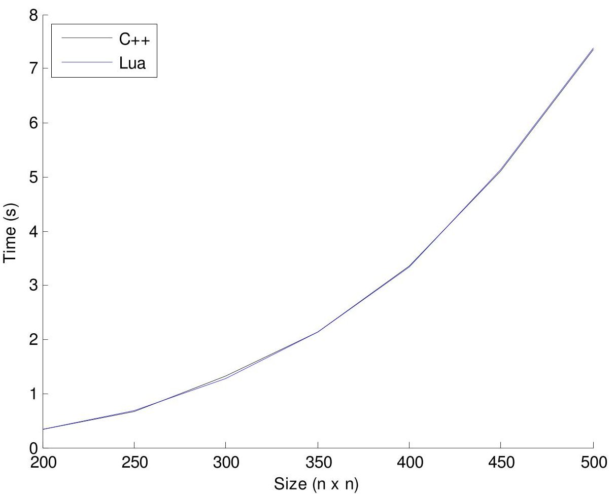


<div align="center">

Figure 8 Matrix Multiplication Tests - Case 1

</div>

It can be seen that the runtimes are indistinguishable from one another, verifying the previous result that there is not any significant performance decrease when the only functions used within a Lua script are those exposed from the framework by Luabind.

## 6.2.2. Test Case 2 - Matrix Multiplication using Nested Loops with Dot Products

The next test case is designed so that it will show a performance decrease for the scripted code. Instead of using the built-in matrix multiplication functions, matrix multiplication methods will be written in both C++ and Lua. The selected algorithm uses the dot product to multiply the matrices. The selected algorithm is shown below, where C is the m x p matrix that is the product of matrices A and B, $ C_{ij} $ is the value in the $ i^{th} $ row and $ j^{th} $ column of C, $ A_{m} $ is the $ m^{th} $ row of A, and $ B_{p} $ is the $ p^{th} $ column of B.

<!-- PDF_PAGE: 51 -->

$$
C = A B = \left[ \begin{array}{c c c c} A _ {1} \\ A _ {2} \\ \vdots \\ A _ {m} \end{array} \right] \left[ \begin{array}{c c c c} B _ {1} & B _ {2} & \dots & B _ {p} \end{array} \right] = \left[ \begin{array}{c c c c} \left(A _ {1} \cdot B _ {1}\right) & \left(A _ {1} \cdot B _ {2}\right) & \dots & \left(A _ {1} \cdot B _ {p}\right) \\ \left(A _ {2} \cdot B _ {1}\right) & \left(A _ {2} \cdot B _ {2}\right) & \dots & \left(A _ {2} \cdot B _ {p}\right) \\ \vdots & \vdots & \ddots & \vdots \\ \left(A _ {m} \cdot B _ {1}\right) & \left(A _ {m} \cdot B _ {2}\right) & \dots & \left(A _ {m} \cdot B _ {p}\right) \end{array} \right]
$$

$$
C _ {i j} = \left(A _ {i} \cdot B _ {j}\right)
$$

This method is implemented by calculating each element of the matrix from the proper dot product. Functions built into the framework to extract rows, columns, and calculate the dot product are used. In the Lua version of the test case, only the loop structure is running as Lua, the rest of the algorithm uses built-in functions. The resulting runtime is shown in Figure 9.


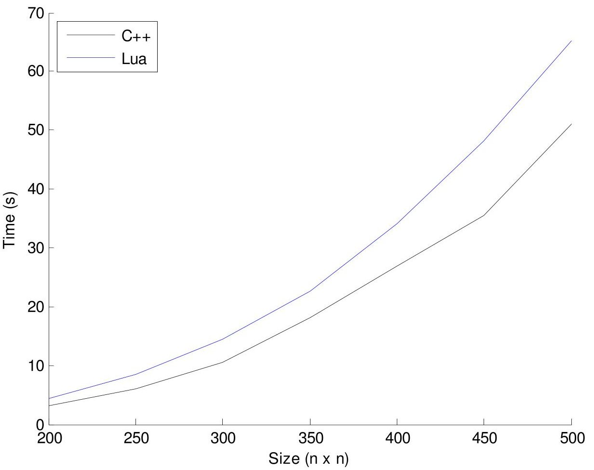


<div align="center">

Figure 9 Matrix Multiplication Tests - Case 2

</div>

<div align="center">

The resulting runtime for the Lua code given as a percentage of the C++ code runtime can be seen in Figure 10.

</div>

<!-- PDF_PAGE: 52 -->


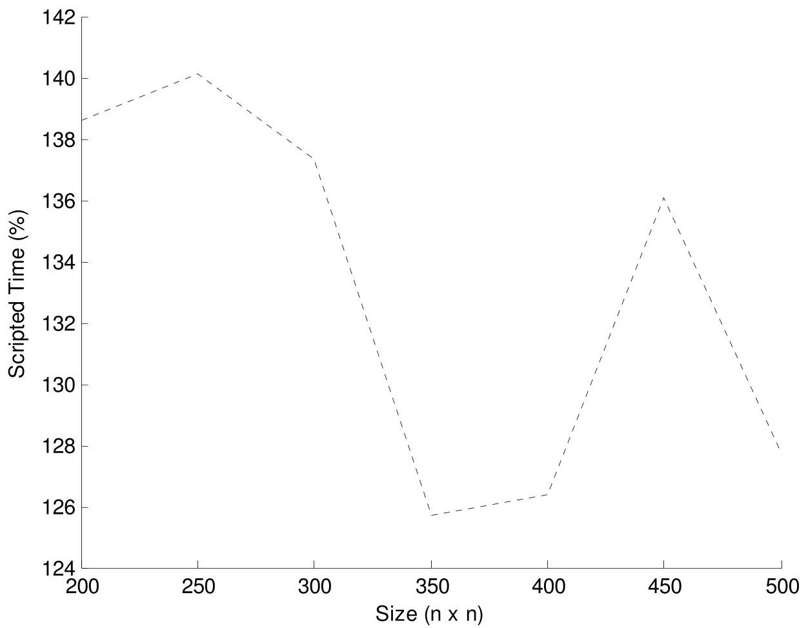


<div align="center">

Figure 10 Matrix Multiplication Tests Percentage - Case 2

</div>

These results show that there is a definite decrease in performance for this test case. The scripted code takes on average 33% longer to run that the compiled version. The difference is not major because the algorithm used for the matrix multiplication uses many built in functions. Only the loops are running as Lua and this is the cause of the performance decrease.

## 6.2.3. Test Case 3 - Matrix Multiplication Using Nested Loops With Multiplication

The final test will show the worst case performance that can be expected from scripting. This is done by using a form of the matrix multiplication algorithms that does not make any use of built-in functions, with the exception of getting and setting values in a matrix. The algorithm used for this test is show below.

$$
C _ {i j} = \sum_ {k = 1} ^ {p} A _ {i k} B _ {k j}
$$

<!-- PDF_PAGE: 53 -->

This test should produce the worst case performance because all the loops, multiplications and additions are running as Lua. It is different from the previous test because instead of using the built-in dot product, it is now implemented in Lua as a summation of multiplying the correct elements. The resulting runtimes are shown in Figure 11.


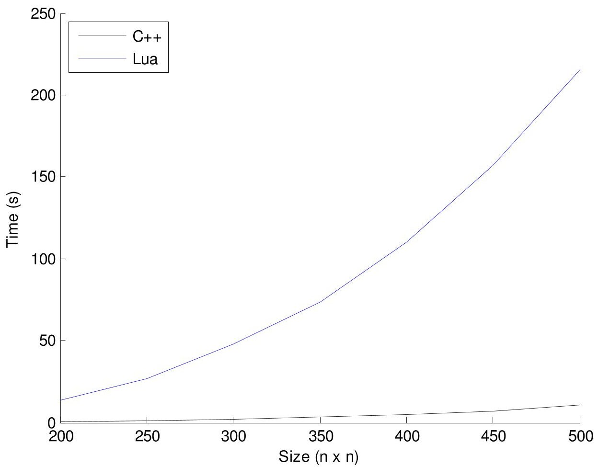


<div align="center">

Figure 11 Matrix Multiplication Tests - Case 3

</div>

The resulting runtime for the Lua code given as a percentage of the C++ code runtime can be seen in Figure 12.

<!-- PDF_PAGE: 54 -->


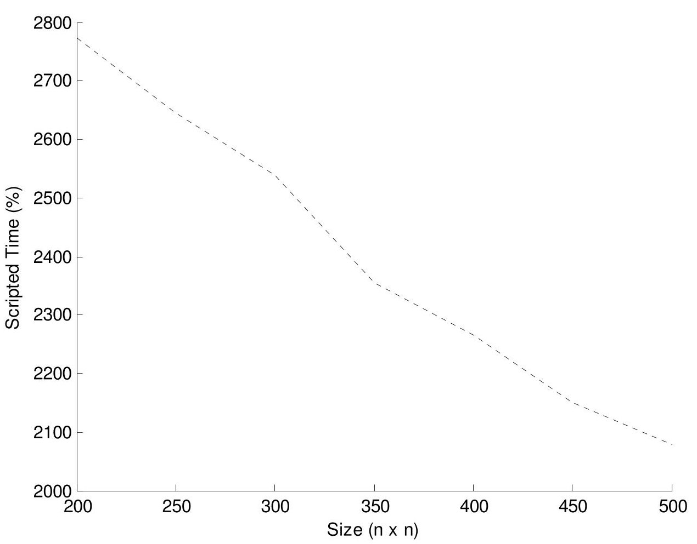


<div align="center">

Figure 12 Matrix Multiplication Tests Percentage - Case 3

</div>

These results show that when an algorithm is implemented completely in Lua and makes no use of framework built-in functions, the performance impact is significant. In this test case the Lua code takes an order of magnitude longer to run.

## 6.2.4. Conclusions

Some conclusions can be drawn from this series of tests. First, when only built-in functions are used there is no noticeable performance impact. Using built-in functions for the majority of the algorithm produces reasonable results. However, implementing algorithms completely with Lua produces poor performance and can lead to an order of magnitude increase in runtime.

<!-- PDF_PAGE: 55 -->

## 6.3. Equations of Motion Modeling Tests

One of the objectives of adding scripting support was to not severely impact the simulation runtime especially during typical use scenarios. If runtime is increased then the benefits from adding scripting support are essentially cancelled out by the decrease of performance, making the tool less useful. To analyze this typical use scenarios to compare scripting performance are tested.

The equations of motion test compares compiled and scripted code for various fidelity models. Different cases represent differing levels of fidelity, and the higher fidelity models will be more computationally intensive. A key objective is to look at the performance impact of scripting support as this fidelity is increased. The equations of motions are chosen for this test for a couple of reasons. First, the propagation can be set up and run without having to run an entire simulation. Secondly, the types of the algorithms used for equations of motion modeling make them similar to common modeling problems.

## 6.3.1. Equations of Motion Modeled

Three different cases were developed to compare the performance of scripting support. All of the three cases are orbit propagators, but with varying levels of complexity. Equations modeling each case are presented to show the relative complexity of each propagation model.

The first case is a simple two-body propagator. This model rests on the assumptions that the earth is spherical and that the mass of the satellite is negligible with respect to the Earth. The equation modeling the two-body propagator is given by equation 3, where $ \vec{a}_{2-Body} $ is the acceleration vector, $ \mu $ is the gravitational parameter of the Earth, $ \vec{r} $ is a vector representing the current position of the satellite, and $ r $ is the magnitude of the satellites position vector.

$$
\vec {a} _ {2 - B o d y} = \left[ \begin{array}{c c c} - \frac {\mu}{r ^ {3}} & 0 & 0 \\ 0 & - \frac {\mu}{r ^ {3}} & 0 \\ 0 & 0 & - \frac {\mu}{r ^ {3}} \end{array} \right] \vec {r}
$$

The second case is a propagator with an added J2 effect. The J2 effect accounts for the ellipsoidal shape of the Earth, and represents the largest perturbation away from a spherical gravitational potential field. The equation

<!-- PDF_PAGE: 56 -->

modeling this propagator is given by equation 4, where $ \vec{a}_{J2} $ is the acceleration vector including the J2 effect, J2 is the coefficient of the second harmonic representing the bulge of the Earth near the equator, $ R_{e} $ is the radius of the Earth, and $ r_{z} $ is the position of the satellite along the inertial z-axis.

$$
\vec {a} _ {J 2} = \left[ \begin{array}{c c c} - \frac {\mu}{r ^ {3}} C _ {x y} & 0 & 0 \\ 0 & - \frac {\mu}{r ^ {3}} C _ {x y} & 0 \\ 0 & 0 & - \frac {\mu}{r ^ {3}} C _ {z} \end{array} \right] \vec {r}
$$

$$
C _ {x y} = 1 - J 2 \left(\frac {3}{2}\right) \left(\frac {R _ {e}}{r}\right) ^ {2} \left[ 5 \left(\frac {r _ {z}}{r}\right) ^ {2} - 1 \right]
$$

$$
C _ {z} = 1 + J 2 \left(\frac {3}{2}\right) \left(\frac {R _ {e}}{r}\right) ^ {3} \left[ 3 - 5 \left(\frac {r _ {z}}{r}\right) ^ {2} \right]
$$

The final case is based upon the J2 orbital propagator, but adds an additional drag term that will slowly decay the orbit. The propagator adds a drag term based upon the drag equation and uses an exponential decay model described in Vallado $ ^{1 1} $ for the density of the atmosphere. The model of this propagator is given by equation 5, where $ \vec{a}_{J 2+D r a g} $ is the acceleration vector including J2 and drag effects, $ C_{d} $ is the drag coefficient of the satellite, A is the reference area of the satellite, m is the mass of the satellite, $ \vec{\nu} $ is the vector representing the velocity of the satellite, $ \nu $ is the norm of the satellite velocity, $ \rho_{0} $ is the reference density, $ h_{0} $ is the reference altitude, H is the scale altitude, and h is the height of the satellite above the Earth's surface.

$$
\vec {a} _ {J 2 + D r a g} = \vec {a} _ {J 2} - \frac {1}{2} \left(\frac {C _ {d} A}{m}\right) \rho v ^ {2} \left(\frac {\vec {v}}{v}\right)
$$

$$
\rho = \rho_ {0} e ^ {- \frac {\left(h - h _ {0}\right)}{H}}
$$

<!-- PDF_PAGE: 57 -->

## 6.3.2. Results

The performance of the three cases is analyzed by propagating the orbit of a satellite for various lengths of time and comparing the total runtime. The propagation is varied over a range of 1 to 30 days, and repeated for algorithms written in C++ and Lua. The resulting runtime results are shown in Figure 13.


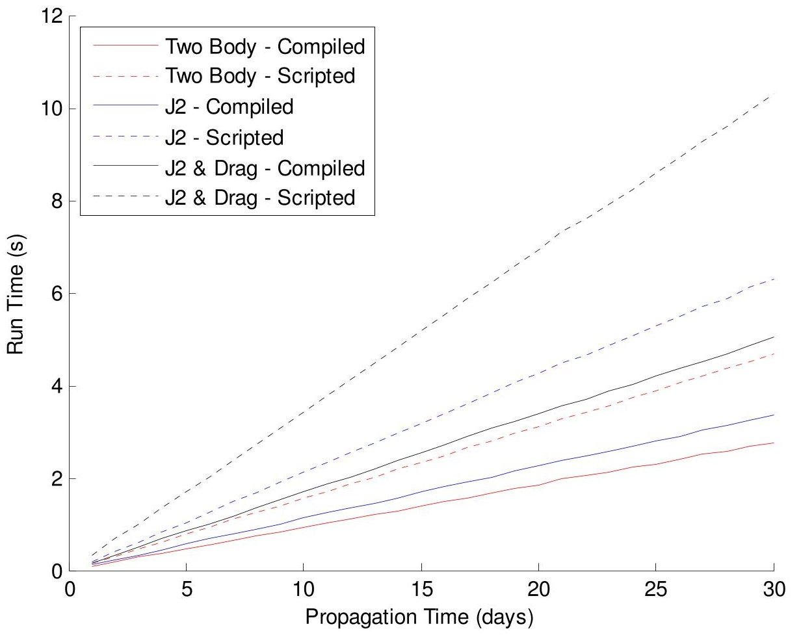


<div align="center">

Figure 13 EOMS Runtime Tests

</div>

## 6.3.3. Conclusions

It can be seen from the results that the runtime requirement increases linearly with respect to the propagation time for both the compiled and scripted cases. In all cases, the scripted code took longer to run than the compiled code and this increase in runtime increased with the fidelity and computational complexity of the propagator case. For the two-body propagator, the scripted code took 64 percent longer to execute. For the J2 propagator, the scripted code took 86 percent longer to execute. For the J2 propagator with drag, the scripted code took 103 percent longer to execute.

<!-- PDF_PAGE: 58 -->

From these results, some conclusions can be drawn. First, the addition of scripting support does not degrade performance to an amount that renders the framework unusable in this example of a typical use scenario. Second, the performance impact of scripting increases with the fidelity of the model or complexity of algorithms implemented.

## 6.4. Typical Simulation Scenario Testing

Runtime testing of the multi-threaded scheduler using scripted code for some or all plug-in points makes use of different performance metrics that time different portions of the scheduling code. Each test varies the simulation end time as well as the simulated model. Test cases for all compiled code as well as different plug-in points scripted and an all scripted case allow for a runtime comparison.

## 6.4.1. Simulation Scenario Setup

A model of an earth-imaging satellite is used for the runtime testing. The model consists of six subsystems comprising the asset. The following are the subsystems defined by the model and a description of the algorithms implemented within the model.

The test case is known as "Aeolus" and is the baseline test case for all versions of HSF. The test case consists of a baseline configuration, subsystem models, orbit initial conditions, orbital propagators, initial state data conditions, and dependencies.

- The Access subsystem calculates geometric access to a location on the Earth based on direct line of sight. The Access subsystem cannot perform a task if this line of sight does not exist.

- The attitude determination and control (ADCS) subsystem determines if there is enough time to slew the spacecraft to align itself with the target on the ground. For this simple scenario this is done simply by looking at the time available before the scheduled start of the task, if it is not enough the ADCS subsystem cannot perform the task. The subsystem also calculates the pointing vector to the target and stores it as a state variable.

- The communications (Comm) subsystem sets its state variables to represent the downlink data rate to aground station. It only function during tasks that are designated as communication tasks. The Comm subsystem calculates this rate by calling a dependency function that calculates the data rate. The data rate is set to a constant downlink rate over the remaining duration of the task.

<!-- PDF_PAGE: 59 -->

- The electro-optical sensor (EOSensor) subsystem calculates the amount of data required to image a target based upon its priority, which is given by the target of the imaging task. the EOSensor subsystem calculates and sets the incidence angle to the target as well as the sizes of images that are taken.

- The solid state data recorder (SSDR) subsystem calculates and stores the current amount of data present in data buffers. The buffer calculation is done by calling a dependency function that calculates the amount of data to be stored based upon the image data set by the EOSensor. Similarly, it calculates the amount of data sent by the COMM subsystem and reduces the amount stored on the data buffer accordingly.

- The Power subsystem calculates and stores the time history of the battery depth of discharge.The Power subsystem calculates the amount of power generated from solar panels by using the current position and a model of the sun, allowing the subsystem to determine the times that the solar panels are lit. The Power subsystem calls a dependency function to determine the time history of power usage of other subsystems. The subsystem uses the power usage history and the size of the batteries to determine the time history of the battery depth of discharge and stores the result as state variables.

## 6.4.2. Performance Metrics

The performance of the scheduler will be directly impacted by the runtime of all subsystems, dependencies, equations of motion, and all other simulation elements. If Lua scripts are used for various plug-in points and they have a large decrease in performance this will be reflected in the scheduler performance. The timing metrics to compare the scheduler performance are as follows:

- Pre-generated Access Time - Pre-generated access time is the time required for the scheduler to calculate the geometric access problem between each asset and target position over the entire simulation runtime. Geometrical access can be calculated in advanced of ever evaluating the first schedule and this information is then used to never schedule tasks to assets that would fail due to geometric constraints. The algorithm is the same in the BDESA scheduler as well as the multi-threaded variant, so runtimes for all tests are expected to be the same.

- Scheduling Time - Scheduling time is the time required to for the scheduler to execute its main scheduling loop, and where the large majority of the time is spent. The scheduling time is where performance benefits will be seen from multi-threading. It is expected that the MT-BDESA scheduler with 1 thread will be

<!-- PDF_PAGE: 60 -->

slightly slower than the BDESA algorithm due to the overhead of setting up a different thread for schedule evaluation, more threads than 1 on a multi-core machine should show performance benefits.

- Total Time - The total time is the time required to completely run the scheduler and should be the approximate sum of the pre-generated access time and the scheduling time.

## 6.4.3. Scripting Framework Plug-In Points

Tests to compare the performance impact caused by using scripted code for the supported plug-in points within the HSF use the following test cases.

1. All code compiled.

2. Equations of motion scripted, all other code compiled.

3. Dependencies scripted, all other code compiled

4. Schedule evaluator scripted, all other code compiled

5. Subsystems scripted, all other code compiled

6. All code scripted.

The resulting total runtime for the cases described can be seen in Figure 14. It can be seen that the scripted equations of motion or dependencies alone had little effect on the total runtime. The schedule evaluator had a small but noticeable effect, and the subsystems had a larger effect. All of the curves increase in wall clock time nonlinearly with respect to simulation time because there are more possible tasks for the scheduler to use at various point in the satellites orbit, corresponding to differing number of schedules at different simulation times.

<!-- PDF_PAGE: 61 -->


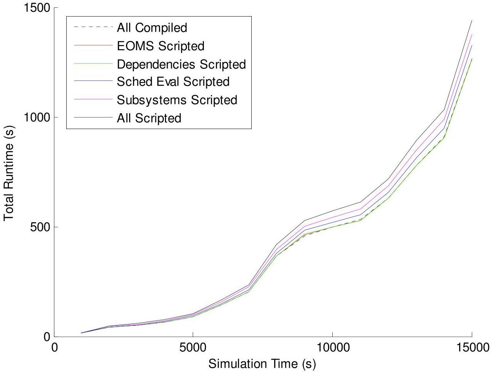


<div align="center">

Figure 14 Scripted Scenario Runtime Tests

</div>

The resulting runtime percentage can be seen in Figure 15. The runtime percentage is obtained by dividing each case's total runtime by the runtime for the all compiled case. The resulting percentage represents the runtime relative to the time required for the compiled case. Scripted subsystems produce an increased runtime percentage of nearly 10%, which is about double the increase due to the schedule evaluator. With all the code scripted, the runtime increase for this simulation is approximately 15% of the runtime.

<!-- PDF_PAGE: 62 -->


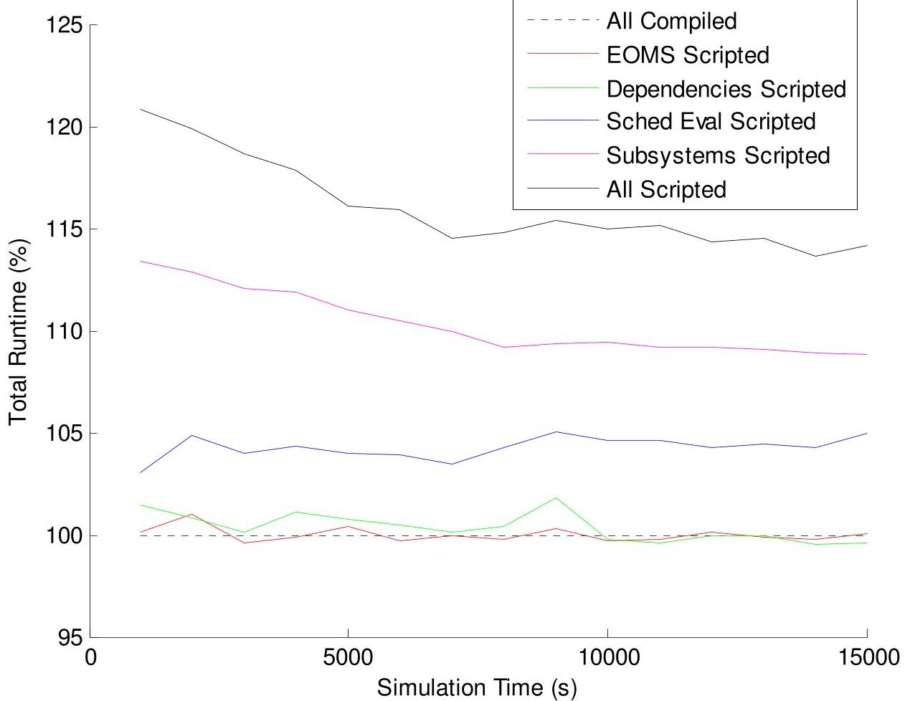


<div align="center">

Figure 15 Scripted Scenario Runtime Tests Percentage

</div>

## 6.4.4. Conclusions

Runtime results show that the addition of scripting support does not greatly impact the performance for the example simulation scenario which is representative of the types of problems that would be solved using the framework. Scripted subsystems had the largest impact on performance, followed the schedule evaluator. Overall the addition of scripting support resulted in an increase of only 15% total runtime or less.

## 6.5. Multi-Threaded Scheduler Testing

The multi-threaded scheduler tests quantify the effect that the multi-threaded scheduler has on simulation runtime performance. The scheduler tests look at the performance increase for both the compiled and scripted versions of the simulation code.

## 6.5.1. Compiled Code Performance

Figure 16 shows the performance increases from the multi-threaded scheduler for all code compiled. The first plot shows the total runtime performance with varying number of threads.

<!-- PDF_PAGE: 63 -->


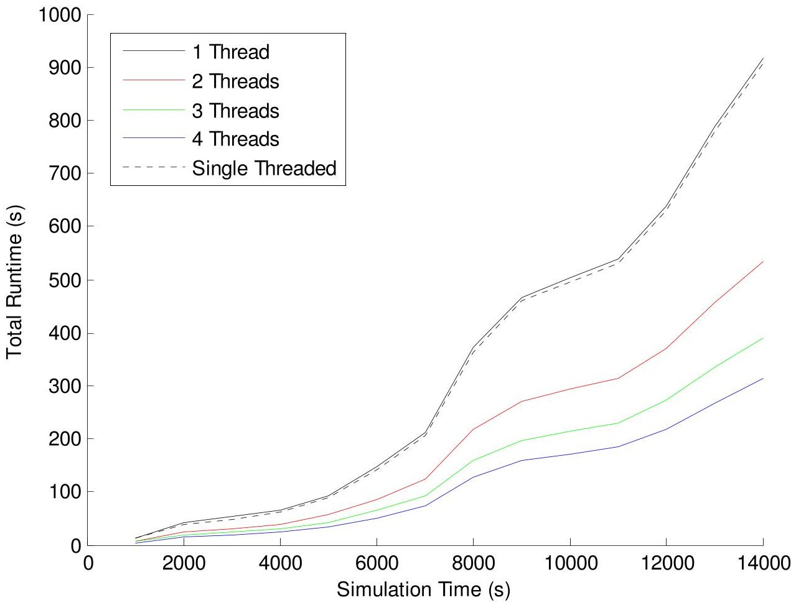


<div align="center">

Figure 16 Multi-Threaded Tests Total Runtime - Compiled

</div>

It can be seen that as the number of threads increases, the runtime steadily decreases. The single threaded scheduler is slightly faster than the multi-threaded scheduler using only one thread, this is due to the overhead of setting up threads in the scheduler. Figure 17 shows the performance increase in the pre-generated access portion of the scheduler.

<!-- PDF_PAGE: 64 -->


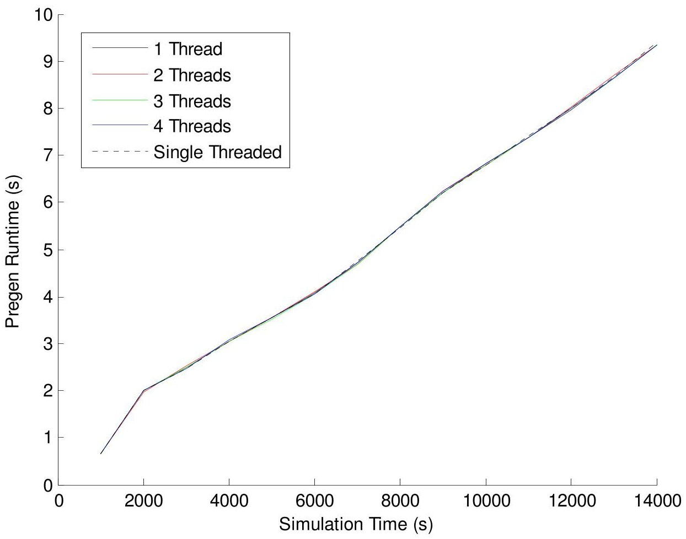


<div align="center">

Figure 17 Multi-Threaded Tests Pregen Runtime - Compiled

</div>

It can be seen that there is no performance increase. The lack of change is because this portion of the scheduler is always executed in a single thread, since it only comprises a small portion of the total scheduling time. Figure 18 shows the scheduling time.

<!-- PDF_PAGE: 65 -->


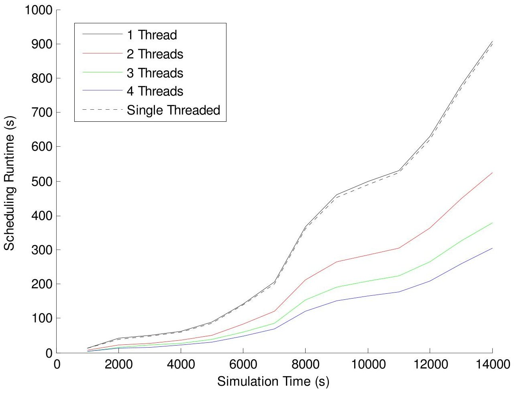


<div align="center">

Figure 18 Multi-Threaded Tests Scheduling Runtime - Compiled

</div>

These results are very similar to the total runtime results because it excludes the pre-generated access time which only takes up a small portion of the total scheduling time. Figure 19 shows the percent runtime for the total scheduler runtime.

<!-- PDF_PAGE: 66 -->


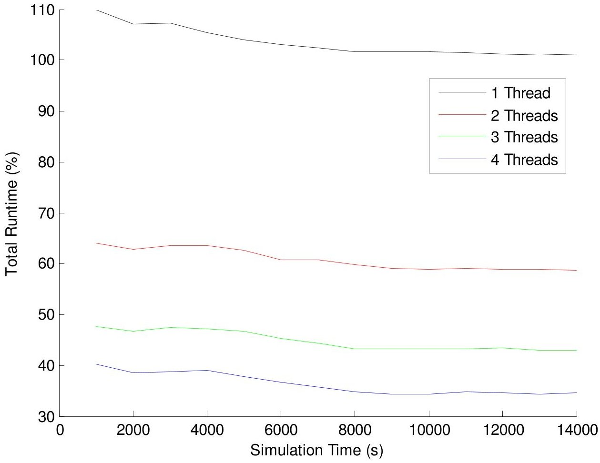


<div align="center">

Figure 19 Multi-Threaded Tests Total Runtime Percentage - Compiled

</div>

The total runtime results show that with 1 thread, the multi-threaded scheduler approaches 101% the runtime of the single-threaded scheduler. With 2 threads, the runtime approaches 59% of the single-threaded scheduler. With 3 threads, the runtime approaches 43% and with 4 threads it approaches 34%. Runtime results show that significant performance benefits can be achieved by using the multi-threaded scheduler. Figure 20 shows the percent runtime for the pre-generated access time.

<!-- PDF_PAGE: 67 -->


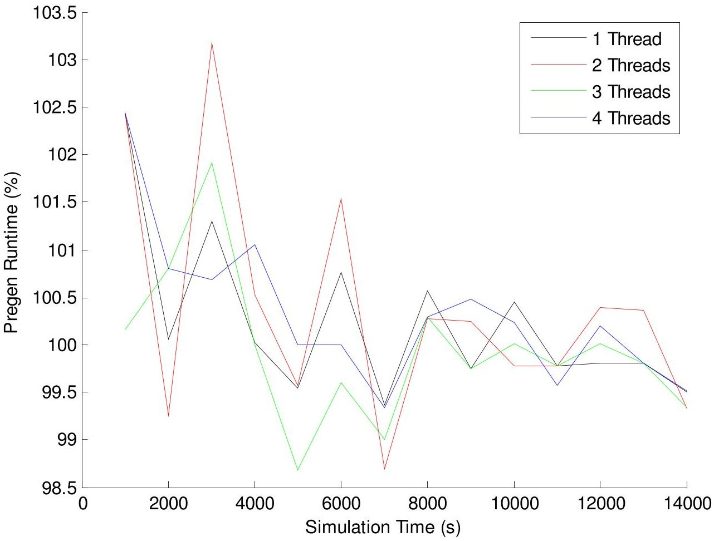


<div align="center">

Figure 20 Multi-Threaded Tests Pregen Runtime Percentage - Compiled

</div>

The pregen runtime results are all around 100% since this portion of the scheduler is executed in a single thread. Figure 21 shows the percent runtime for the scheduling portion.

<!-- PDF_PAGE: 68 -->


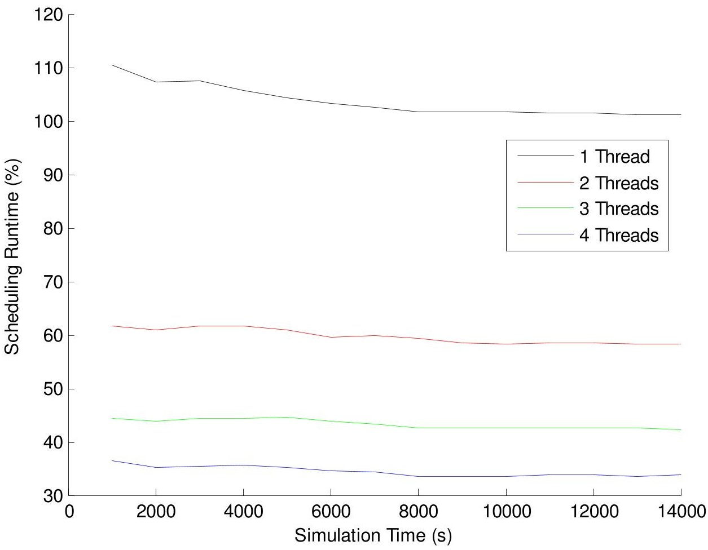


<div align="center">

Figure 21 Multi-Threaded Tests Scheduling Runtime Percentage - Compiled

</div>

These results show that with 1 thread, the multi-threaded scheduler approaches the 101% runtime of the single-threaded scheduler. With 2 threads, the runtime approaches 58% of the single-threaded scheduler. With 3 threads, the runtime approaches 42% and with 4 threads it approaches 34%.

## 6.5.2. Scripted Code Performance

The following plots show the performance increases from the multi-threaded scheduler for all code scripted. Figure 22 shows the total runtime performance with varying number of threads.

<!-- PDF_PAGE: 69 -->


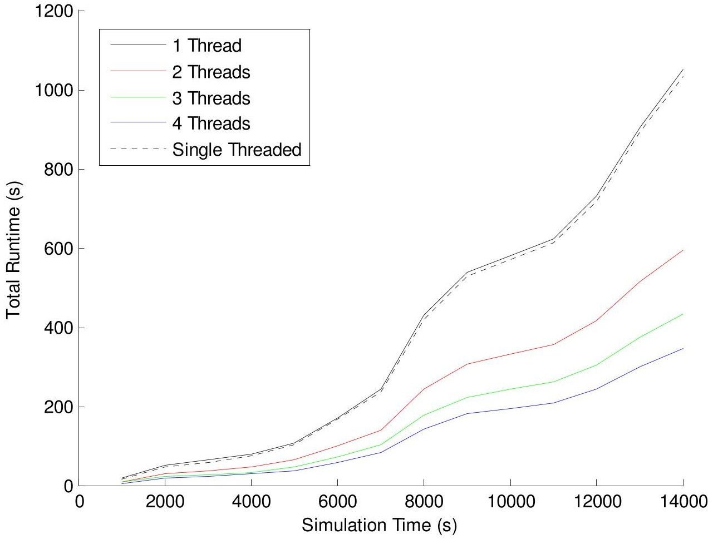


<div align="center">

Figure 22 Multi-Threaded Tests Total Runtime - Scripted

</div>

Total runtime results show that as the number of threads increases, the runtime steadily decreases. The single threaded scheduler is slightly faster than the multi-threaded scheduler using only one thread due to the overhead of setting up threads in the scheduler. The next figure shows the performance increase in the pre-generated access portion of the scheduler.

<!-- PDF_PAGE: 70 -->


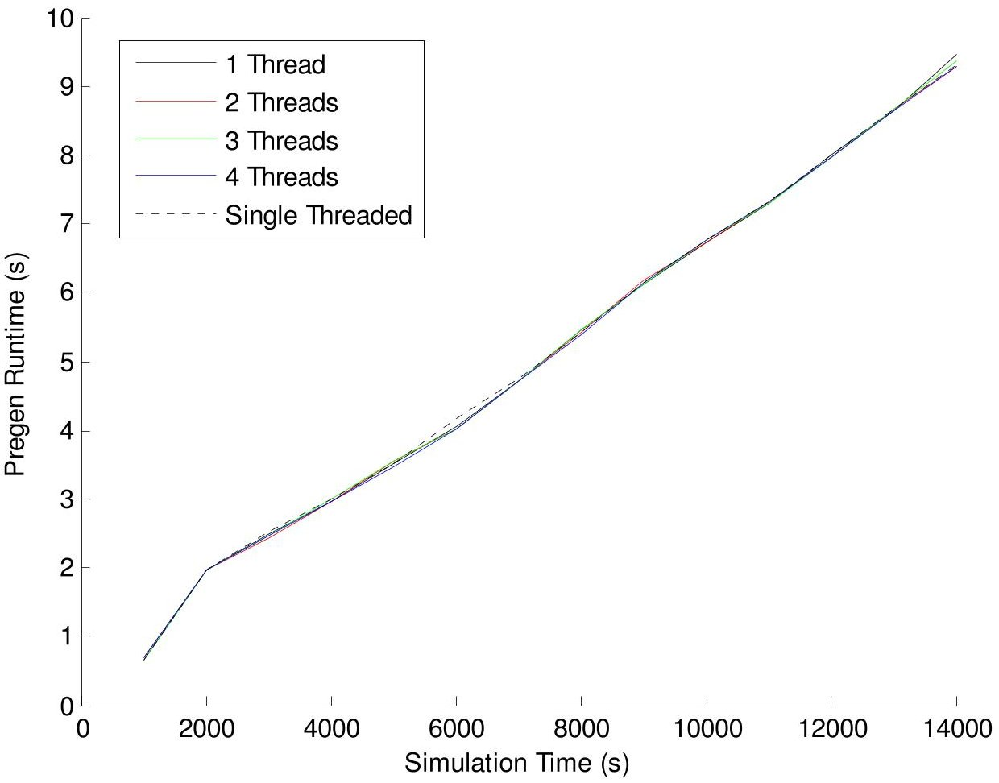


<div align="center">

Figure 23 Multi-Threaded Tests Pregen Runtime - Scripted

</div>

The pregen runtime results show that there is no performance increase for scripted code. This is because this portion of the scheduler is always executed in a single thread, since it only comprises a small portion of the total scheduling time. Figure 24 shows the scheduling time.

<!-- PDF_PAGE: 71 -->


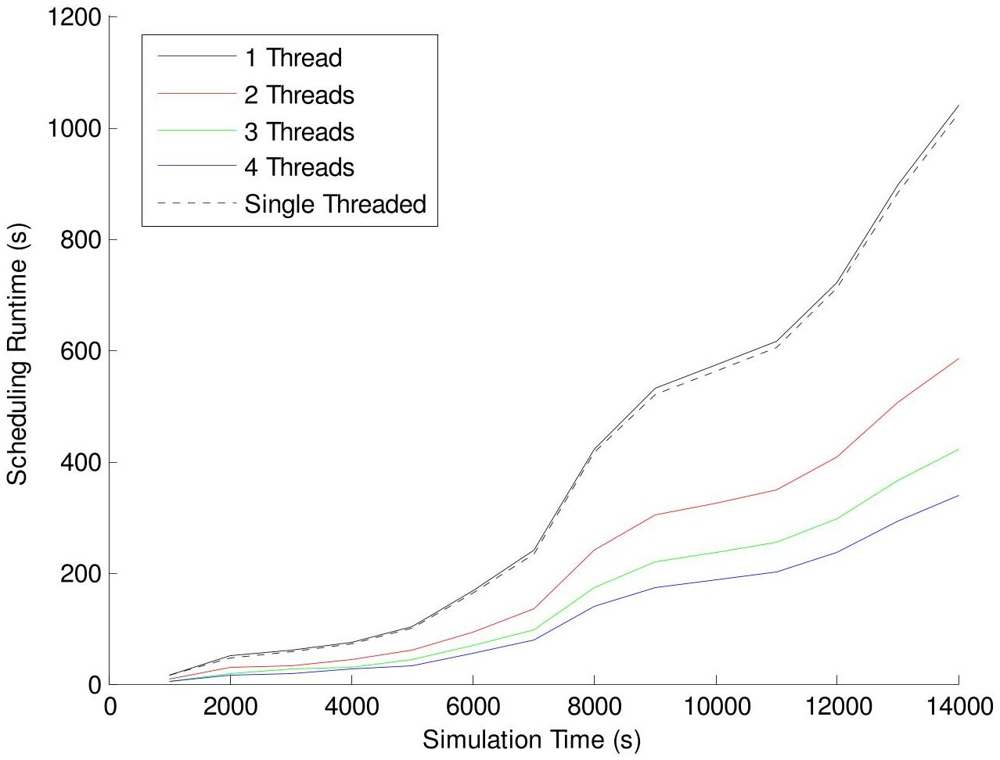


<div align="center">

Figure 24 Multi-Threaded Tests Scheduling Runtime - Scripted

</div>

The scheduler runtime results are very similar to the total runtime results because it excludes the pre-generated access time which only takes up a small portion of the total scheduling time. Figure 25 shows the percent runtime for the total scheduler runtime.

<!-- PDF_PAGE: 72 -->


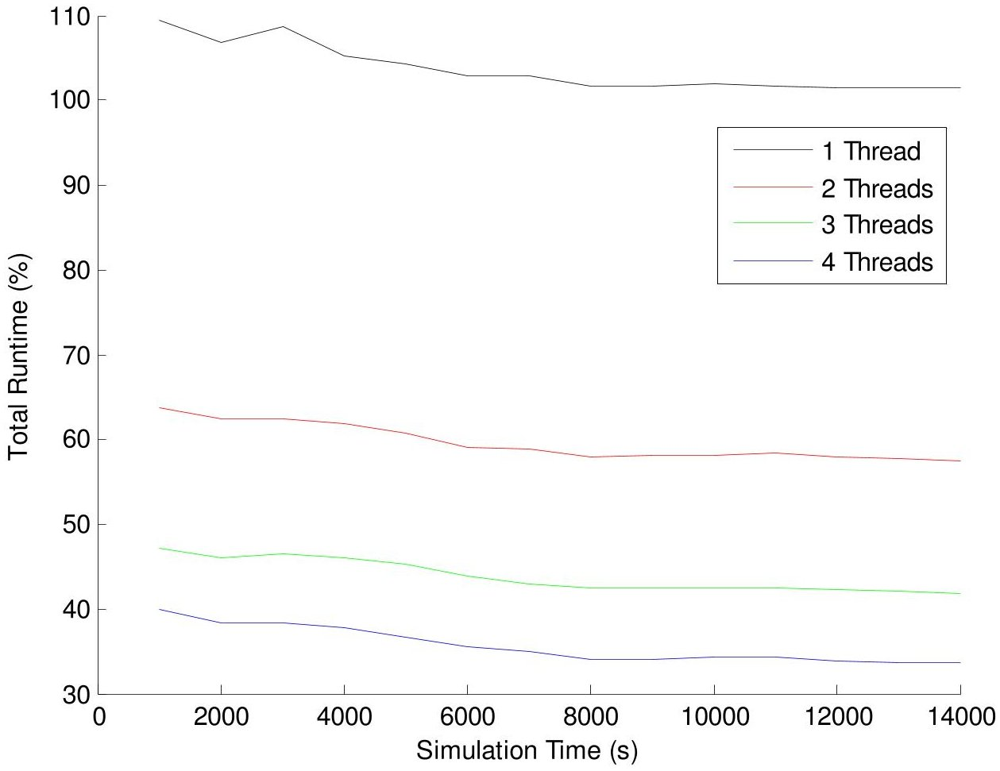


<div align="center">

Figure 25 Multi-Threaded Tests Total Runtime Percentage - Scripted

</div>

The total runtime percentage results show that with 1 thread, the multi-threaded scheduler approaches the 102% runtime of the single-threaded scheduler. With 2 threads, the runtime approaches 58% of the single-threaded scheduler. With 3 threads, the runtime approaches 42% and with 4 threads it approaches 34%. The total runtime percentage results show that significant performance benefits can be achieved by using the multi-threaded scheduler. Figure 26 shows the percent runtime for the pre-generated access time.

<!-- PDF_PAGE: 73 -->


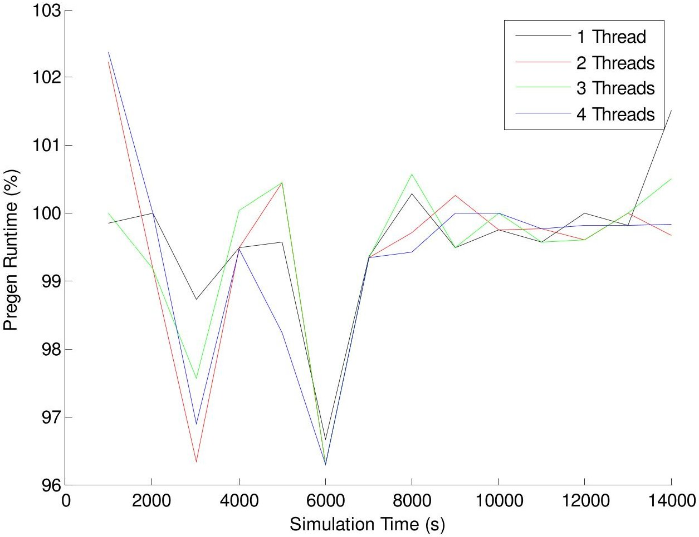


<div align="center">

Figure 26 Multi-Threaded Tests Pregen Runtime Percentage - Scripted

</div>

The pregen runtime percentage results are all around 100% since this portion is executed in a single thread. Figure 27 shows the percent runtime for the scheduling portion.

<!-- PDF_PAGE: 74 -->


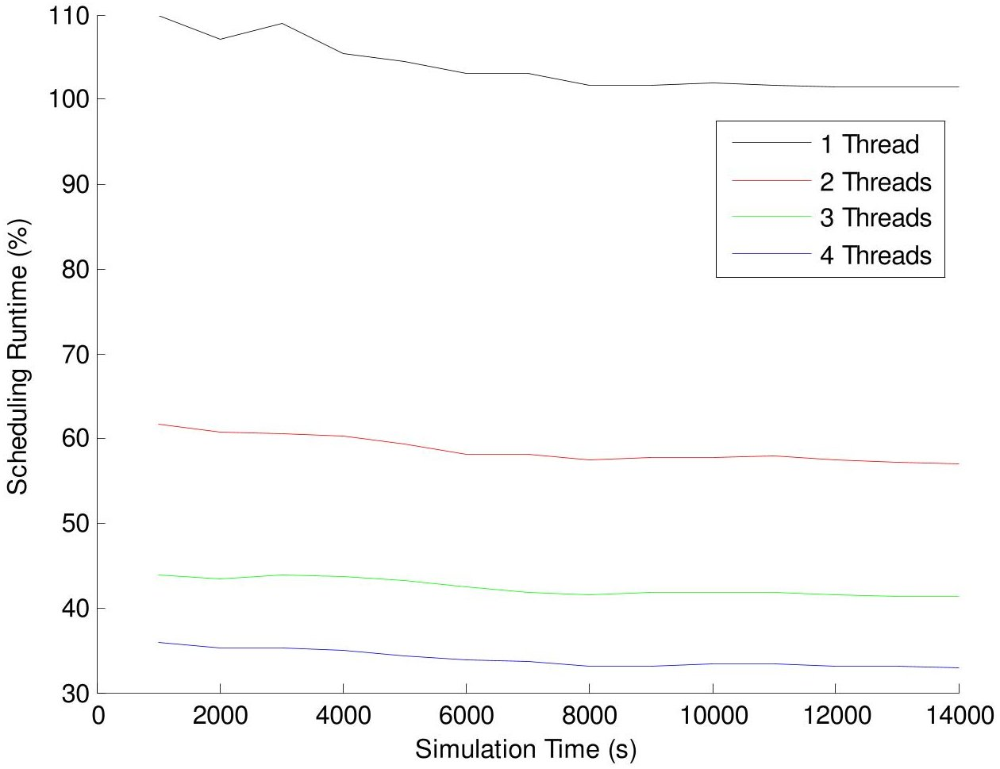


<div align="center">

Figure 27 Multi-Threaded Tests Scheduling Runtime Percentage - Scripted

</div>

The scheduler runtime percentage results show that with 1 thread, the multi-threaded scheduler approaches 102% the runtime of the single-threaded scheduler. With 2 threads, the runtime approaches 57% of the single-threaded scheduler. With 3 threads, the runtime approaches 41% and with 4 threads it approaches 33%.

## 6.5.3. Conclusions

The results of the multi-threaded scheduler tests show that it is a very good way to improve the performance of simulations without adding any complexity to the required setup. In all of the tests done, the number of worker threads used was always specified, but the code is written to auto-detect the optimum number to use if the parameters are omitted. This allows for the optimum performance to be obtained from this scheduler with very little configuration. The scheduler was not found to significantly speed up either scripted or compiled code more. Table 4 summarizes the multi-threaded scheduler runtime results. Numbers in parenthesis are for scripted code.

<!-- PDF_PAGE: 75 -->

<div align="center">

Table 4 Multi-Threaded Runtime Tests Summary

</div>

<table border="1"><tr><td></td><td>1 Thread</td><td>2 Threads</td><td>3 Threads</td><td>4 Threads</td></tr><tr><td>Total</td><td>101(102)</td><td>59(58)</td><td>43(42)</td><td>34(34)</td></tr><tr><td>Pre-Gen</td><td>~100</td><td>~100</td><td>~100</td><td>~100</td></tr><tr><td>Scheduler</td><td>101(102)</td><td>58(57)</td><td>42(41)</td><td>34(33)</td></tr></table>

<!-- PDF_PAGE: 76 -->

## 7. Conclusions

The Horizon Simulation Framework is a modeling and simulation framework with applications in the verification and validation of system-level requirements. The HSF has the greatest usage as a system engineering tool to understand how subsystems interact and the sensitivity of the system to modeling parameters. The dynamic model creation algorithm and support for the Lua scripting language expands upon existing capabilities by making the HSF more flexible and easier to use. Dynamic model creation eliminates the need to recompile the HSF every time changes occur, while scripting support adds functionality in an easy to use language without sacrificing capabilities or seriously impacting performance in expected use cases. Runtime analysis shows that using a scripting language does not decrease the performance significantly, while increasing usability and decreasing the time required to set up simulations. The addition of a multi-threaded scheduler increases the overall performance significantly by making efficient use of modern multi-core and multi-processor machines.

## 7.1. Proposed Future Work

The progression of work on the horizon simulation framework is ongoing and improvements are always being made to increase the utility of the tool. The following section presents some improvements that are proposed for future work.

## 7.1.1. Improved Asset and Target Position Import

The current implementation to set the location or trajectory of a target location or asset is currently only based upon a static location or initial condition and propagator. Specifying a location or an initial condition and propagator is a good system for many applications, extensions can be made to make it more powerful. First, a database of common locations should be made to be referenced and imported by the framework. To use this database information, a location could be referenced by the name in the database and the position automatically looked up. A similar system could be used for satellite systems. A two-line element data set could be referenced (or other ephemeris definition) and that could then be used to propagate the asset position. Similarly, a satellites id could be provided, and the ephemeris is automatically looked up from an online or local database.

## 7.1.2. Improved Positioning and Propagation System

The current implementation of positions in the framework supports only a limited set of coordinate systems such as Earth Centered Inertial (ECI) and geodetic coordinates. Using additional coordinate systems requires code to be

<!-- PDF_PAGE: 77 -->

written that will perform the proper conversions. A more powerful system proposed is to rework the positioning system in a generic way that would allow for custom defined coordinate systems, axes, vectors, and locations. The system should be written in a generic way such that conversions to and from any coordinate system can be done. A library of predefined coordinate systems, axes, and vectors should be created for use by the system modeler, as well as capabilities to be extended with user-defined coordinate systems. A new propagation system should be developed that would allow for equations of motion to be propagated in any coordinate system.

## 7.1.3. Dynamic Loading of Compiled Code

The dynamic model creation algorithm implemented into the framework makes a large amount of progress into creating a very useful, standalone tool. However, there is still the limitation that adding C++ subsystems requires adding the code to the framework, registering them with the adapter classes, and recompiling the framework. This limitation is largely due to the lack of a reflection mechanism in the C++ language. This can be accomplished by adding support for the framework to use subsystems, dependency functions, etc., that are defined in Microsoft Component Object Model (COM) objects. This would allow for dynamic loading of compiled code because COM supports reflection mechanisms which could be integrated into the framework and the dynamic model creation algorithm. A similar mechanism can be achieved via dynamic runtime loading of Dynamic Link Libraries that contain compiled code for simulation plug-in points.

## 7.1.4. Runtime Simulation Result Analysis

Currently there is no way to evaluate the current progress of the schedules that are being created during a simulation. This is not ideal especially for simulations that may take a very long time as there is a lot of downtime to see what types of resulting schedules are being generated. Ideally the user could analyze the schedules generated and view the time history of the state data as it is being generated. This could be accomplished by adding an interrupt that another program could call. When this is triggered, the data corresponding to all current schedules could be transferred, displayed, and analyzed by the user to determine if the simulation should be continued.

<!-- PDF_PAGE: 78 -->

## 7.1.5. Microsoft .NET Framework Porting

A proposed task, that is by no means simple, is to convert the horizon simulation framework to the Microsoft .NET framework. Doing so would provide many benefits. First, all code that is targeted to the .NET framework is compiled to the Microsoft Intermediate Language (MSIL) and run under the Common Language Runtime (CLR), converted into native code by just-in-time compilers. This provides the benefit that subsystem or other logic could be written in any languages that targets the .NET platform, including C#, Visual Basic, and managed C++. Ideally the framework would be ported to C#, which supports reflection mechanisms so that the proper code to be used could be determined from configuration text or XML files.

## 7.1.6. Iterative Subsystem Execution

A current limitation is that the system model cannot have any circular dependencies. For high fidelity models this could be a serious limitation, as subsystems algorithms might need an iterative scheme in order to determine their final output of state data to within the accuracy required for a high fidelity model. Allowing for the system model to have an iterative or circular execution scheme would allow for this to occur, but there are many issues that would need to be addressed such as imposing a limit on iterations so that diverging calculations do not crash the system and ensuring that the runtime remains acceptable. Ideally this type of execution would be optional and require a different interface between subsystems than is currently implemented in the framework.

<!-- PDF_PAGE: 79 -->

## References

$ ^{1} $Ierusalimschy, R., Henrique de Figueiredo, L., and Celes, W., "The Evolution of Lua, "Proceedings of the Third ACM SIGPLAN Conference on History of Programming Languages, New York, NY, USA, 2007.

$ ^{2} $Nemeth, S., " Hybrid Simulation Technology: The Next Step in the Evolution of Spaceflight Simulations," Proceedings of the SpaceOps 2008 Conference, Heidelberg, Germany, 2008.

$ ^{3} $White, W., Koch, C., Gehrke, J., and Demers, A., "Better Scripts, Better Games," Communications of the ACM, Vol. 52, No. 3, Mar. 2009, pp. 42-47.

$ ^{4} $ Lyon, G. F., Nmap Network Scanning: The Official Nmap Project Guide to Network Security Scanning, Insecure.Com LLC, Sunnyvale, CA, 2008, Chap. 9.

$ ^{5} $Mullen, T., Mastering Blender, Wiley Publishing, Indianapolis, IN, 2009, Chaps. 6 - 8.

$ ^{6} $Carrico, J., and Fletcher, E., Software Architecture and Use of Satellite Tool Kit's Astrogator Module for Libration Point Orbit Missions, Analytical Graphics, Inc. White Paper.

$ ^{7} $Binder, J., "Planning Space Missions with FreeFlyer," Aerospace America, July 2005.

$ ^{8} $Muñoz, J. S., Valencia, R., and Nieto, C., "COMSOL and MATLAB Integration to Optimize Heat Exchangers Using Genetic Algorithms Technique," Proceedings of the COMSOL Conference 2008 Boston, Facultad de Ingeniería Mecánica, Universidad Pontificia Bolivariana, Colombia, 2008.

$ ^{9} $Williams, M. D., Zito, J. C., Agashe, J., Sopeju, A., and Arnold, C., "Design of an Electrodynamically Actuated Microvalve Using COMSOL Multiphysics and MATLAB," Proceedings of the COMSOL Conference 2008 Hannover, University of Florida, Gainesville, FL, 2008.

$ ^{1 0} $Cruickshank, D., "Automated Data Analysis in Satellite Operations," Proceedings of the SpaceOps 2006 Conference, Rome, Italy, 2006.

$ ^{11} $Ritter, G., "The Next Generation of Ground Operations Command and Control," Proceedings of the SpaceOps 2010 Conference, Huntsville, AL, 2010.

$ ^{1 2} $Balzano, V., "Event-driven James Webb Space Telescope Operations," Proceedings of the SpaceOps 2006 Conference, Rome, Italy, 2006.

$ ^{13} $Bloomfield, J., CheVers, D., and Blanchard, P., "Developing a Scripting Capability Standard whileMaintaining Interoperability with Existing Scripting Languages," Proceedings of the SpaceOps 2008 Conference, Heidelberg, Germany, 2008.

<!-- PDF_PAGE: 80 -->

$ ^{1 4} $Uchitel, V. G., Hughes, P. R., Turbe, M. A., and Bettss, K. M., "bdStudio: Accurate And Easy-To-Use Visualization Tool For Complex Real Time Aerospace Simulations," Proceedings of the AIAA Modeling and Simulation Technologies Conference and Exhibit, Hilton Head, SC, 2006.

15. "Luabind." Rasterbar Software. 2005. Rasterbar Software. 10 Feb. 2009. <http://www.rasterbar.com/products/luabind.html>.

$ ^{1 6} $Ierusalimschy, Roberto, Programming in Lua, 2nd Ed., Lua.org, 2003.

$ ^{17} $Ierusalimschy, R., de Figueiredo, L. H., and Celes, W., "The Implementation of Lua 5.0," Journal of Universal Computer Science, Vol. 11, No. 7, Jul. 2005, pp. 1159-1176.

$ ^{18} $Vallado, David A., Fundamentals of Astrodynamics and Applications, 2nd Ed., Microcosm Press, El Segundo, CA, 2001.

$ ^{19} $O'Connor, C., M., and Mehiel, E., A., Butler, B., HORIZON 2.1: A Space System Simulation Framework, AIAA Modeling and Simulation Technologies Conference and Exhibit, 18-21 August 2008, Honolulu, HI

$ ^{2 0} $ da Silva, F., and Senger, H., Scalability Analysis of Embarassingly Parallel Applications on Large Clusters, 2010 Symposium on Parallel & Distributed Processing, 19-23 April 2010, Atlanta, GA.

$ ^{21} $Ritcher, J., and Nassare, C., "Windows via C/C++", Microsoft Press, Redmond, WA, 2008.

$ ^{22} $ O'Connor, Cory M., "Horizon : a system modeling and simulation framework for systems engineering utility analysis" M.S. Thesis, Aerospace Engineering Department, California Polytechnic State University, San Luis Obispo, CA, 2007.

<!-- PDF_PAGE: 81 -->

## Appendix A - HSF Software Items

## Basic Simulation Elements

Task - A task indirectly determines the action of subsystems during the simulation. Subsystems will implement different logic and algorithms based upon the types of tasks presented to them. Tasks consist of a target location, a value, and other simulation dependent properties.

Target - A target represents an objection location contained within a task. A target consists of a type, position, as well as a "value" or other modeler-defined properties.

State - A state represents a mechanism for subsystems to store state data in over time. Each state stores the information for all subsystems belonging to an asset for the given scheduler time step. States are linked to previous states in the form of a linked list structure, allowing for access to previous state data.

Event - Events consist of a task and the timeframe that the task must be performed in. An event consists of a lead-in time to the beginning of the time that a task must be completed, a duration in which the task must be completed, and a lead-out time until the end of the time step.

Constraint - A constraint represents a condition placed upon the value of a state variable set by a subsystem that must be valid in order for a schedule to be valid. All constraints placed upon all subsystem must be valid as a necessary condition for a schedule to be valid.

Subsystem - A subsystem represents the key modeling component of the framework. A subsystem represents a state transition object that, given an initial set of state variables, implements logic that determines a final set of state variables and determines if a task scheduled to it is allowed.

Dependency Function - A dependency function is the interface used by a subsystem to query state variable information set by other subsystems. Restricting subsystems to using dependency functions to access this data preserves modularity between the subsystem logic. Dependency functions access state data from subsystems, and perform any processing on the data to put it in the format desired by the calling subsystem.

Profile - Profiles represent the time history of state variables. This is implemented as a zero-order hold data set where a value is assumed constant until it changes to the next value set.

Environment - The simulated environment used. The current implemented environment only consists of models of the Sun position and Earth cloud cover models. The system modeler may extend the environment model with additional models, such as potential fields, magnetic field models, atmospheric density models, etc.

<!-- PDF_PAGE: 82 -->

Equations of Motion (EOMS) - Equations of motion object represent dynamic equations of motion used to propagate an initial condition over time. There are concrete implementations of the base EOMS interface for Two-Body and J3 orbital propagators, State-Space representations, polynomial approximations, and scripted EOMS. New types of EOMS are implemented by using the scripted type or by creating derived implementations with the desired functionality.

## Simulation Structural Elements

Dependency - A dependency signals that a subsystem is dependent upon information generated by another subsystem. A subsystem has a dependency on all subsystems whose state data is accessed by the dependency functions it calls.

System Model - The system model represents the collection of subsystems, grouped into assets, to be simulated in the defined environment. It includes all of the constraints on subsystem state data and the dependency functions called by them.

Subsystem Node - A design element used to set up the dependency structure of subsystems. A subsystem node represents a subsystem and contains information about how that subsystem fits into the structure of the system model. Subsystem nodes contain the information that should not be made available to the implementation of the subsystem logic, such as which other subsystems it is dependent upon as well as flags that are used to determine if a subsystem has been evaluated during each time step of the simulation.

Asset - An asset represents a logical set of subsystems. Subsystems that belong to the same asset store their state variable information in the same state.

Node Dependencies - A node dependencies object represents the set of dependency functions that is available to a subsystem. A node dependencies object encapsulates the work of calling dependency functions, whether they be written in C++ or Lua. A subsystem calling a dependency function using the node dependencies object does not need to know which language the dependency function is written in.

## Simulation Scheduling Elements

Asset Schedule - An asset schedule is the series of events tasked to an asset and the initial state for that asset.

<!-- PDF_PAGE: 83 -->

System Schedule - A system schedule is a list of asset schedules. It represents the complete initial state of the simulation and contains one asset schedule for each asset defined by the system model.

Scheduler - The scheduler is the component of the framework that generates a set of system schedules that is feasible for the system model to complete and satisfies all constraints.

Constraint - A constraint is a restriction on a state variable, or function of state variables, belonging to an asset. In the simplest form, a constraint requires that a certain state variable is less than or greater than a certain value. However, constraints can be formulated in amore generic fashion (such as acting on Quaternion or Matrix states) and can depend upon multiple state variables. The scheduler enforces that all valid schedules that are generated satisfy all constraints applied to the state data generated by the system model.

Schedule Evaluator - The schedule evaluator represents the "cost function" that is maximized by the scheduler. The scheduler in the most generic form determines a value based upon the partial system schedule evaluated. The calculation of the cost function is left up to the system modeler since different cost functions will lead to different sets of schedules that are generated.

## Utility Classes and Components

Matrix - The matrix class is a general utility class within the framework and is intended to be used to be used for matrix and vector operations. The matrix class provides get/set methods, operator overloading for typical matrix operations, inverse, normalization, concatenation, and sub-matrix routines. An additional matrix index class allows for accessing a subset of rows and/or columns within a matrix, and is used to sub-matrix routines.

Quaternion - The quaternion class is a general utility class that is intended to be used for quaternion operations. It provides get/set methods, operator overloading for typical quaternion operations, normalization and conjugate routines.

umath - The umath (utility math) library provides cross and dot product operators for matrices, quaternion conversion and rotation routines, and spline interpolation and re-sampling routines.

geomUtil - The geomUtil (geometry utility) library provides coordinate system transformations for ECI, ECEF, and LLA coordinate frames, Line-Of-Sight (LOS) calculation routines, and time conversion routines.

geomAccess - The geomAccess (geometry access) library is used by the scheduler to calculate the time history of visibility from each asset to the target of each task.

<!-- PDF_PAGE: 84 -->

<div align="center">

# Appendix B - HSF Classes and Libraries Exposed to Lua

</div>

Sim Parameters - Simulation start Julian Data, simulation start seconds, simulation end seconds

STL pair<double, T> for all HSF types

Profile operations for all HSF types

State class

Matrix and matrixIndex classes

Quaternion class

StateVarKey class

Subsystem class

SubsystemParameters class

NodeDependencies class

Environment class

Sun class

Position class

geomUtil functions

EOMS class

Task class

Target class

umath functions

Event class

NetworkDataClient functions

Dependencies class

<!-- PDF_PAGE: 85 -->

## Appendix C - Example Model Input File (Scripted)

```xml

<LUA enableScripting = "True">

    <LUA_FILE src="io/scripts/Aeolus/Subsystems/Access.txt"></LUA_FILE>

    <LUA_FILE src="io/scripts/Aeolus/Subsystems/Adcs.txt"></LUA_FILE>

    <LUA_FILE src="io/scripts/Aeolus/Subsystems/Comm.txt"></LUA_FILE>

    <LUA_FILE src="io/scripts/Aeolus/Subsystems/EOSensor.txt"></LUA_FILE>

    <LUA_FILE src="io/scripts/Aeolus/Subsystems/Ssdr.txt"></LUA_FILE>

    <LUA_FILE src="io/scripts/Aeolus/Subsystems/Power.txt"></LUA_FILE>

    <LUA_FILE

src="io/scripts/Aeolus/Dependencies/AeolusDependencies.txt"></LUA_FILE>

    <LUA_FILE

src="io/scripts/Aeolus/ScheduleEvaluator/ScheduleEvaluator.txt"></LUA_FILE>

    <LUA_FILE src="io/scripts/Aeolus/EOMS/Orbital_EOMS.txt"></LUA_FILE>

</LUA>

<ENVIRONMENT>

    <SUN isSunVecConstant="True">

    </SUN>

</ENVIRONMENT>

<SCHEDULE_EVALUATOR type="scripted" evaluateLUAFcn="ScheduleEvaluator">

</SCHEDULE_EVALUATOR>

<ASSET>

    <POSITION

        PositionType="PredeterminedECI"

        ICs="Matrix(6,1,{7378.137, 0.0, 0.0, 0.0, 6.02088, 4.215866})">

        <EOMS

            EOMSType="scripted"

            initFcn="orbital_EOMS_scripted_init"

            evalFcn="orbital_EOMS_scripted_eval">

        </EOMS>

    </POSITION>

    <SUBSYSTEM

        Type="scripted"

        Name="AccessToTarget"

        initLUAFcn="Access_init"

        canPerformLUAFcn="Access_canPerform"

        canExtendLUAFcn="Access_canExtend"

        SubId="1">

    </SUBSYSTEM>

    <SUBSYSTEM

        Type="scripted"

        Name="Adcs"

        initLUAFcn="Adcs_init"

        canPerformLUAFcn="Adcs_canPerform"

        canExtendLUAFcn="Adcs_canExtend"

        SubId="2">

        <IC type="Matrix" key="ECI_Pointing_Vector(XYZ)"

            value="Matrix(3,1,{0.0, 0.0, 0.0})"></IC>

        <DEPENDENCY SubId="1"></DEPENDENCY>

    </SUBSYSTEM>

    <SUBSYSTEM

        Type="scripted"

```

<!-- PDF_PAGE: 86 -->

```xml

Name="EOSensor"

initLUAFcn="EOSensor_init"

canPerformLUAFcn="EOSensor_canPerform"

canExtendLUAFcn="EOSensor_canExtend"

SubId="3">

<IC type="Double" key="numPixels" value="0.0"></IC>

<IC type="Double" key="IncidenceAngle" value="0.0"></IC>

<IC type="Bool" key="EOSensorOn" value="0.0"></IC>

<DEPENDENCY SubId="2"></DEPENDENCY>

</SUBSYSTEM>

<SUBSYSTEM>

Type="scripted"

Name="SSDR"

initLUAFcn="Ssdr_init"

canPerformLUAFcn="Ssdr_canPerform"

canExtendLUAFcn="Ssdr_canExtend"

SubId="4">

<IC type="Double" key="DataBufferFillRatio" value="0.0"></IC>

<DEPENDENCY_FCN scripted="True" type="double"

    key="Asset1_SSDRSUB_getNewDataProfile"

    callKey="SSDRSUB_getNewDataProfile"></DEPENDENCY_FCN>

<DEPENDENCY SubId="3"></DEPENDENCY>

</SUBSYSTEM>

<SUBSYSTEM>

Type="scripted"

Name="Comm"

initLUAFcn="Comm_init"

canPerformLUAFcn="Comm_canPerform"

canExtendLUAFcn="Comm_canExtend"

SubId="5">

<IC type="Double" key="DataRate(MB/s)" value="0.0"></IC>

<DEPENDENCY_FCN scripted="True" type="double"

    key="Asset1_COMMSUB_getDataRateProfile"

    callKey="COMMSUB_getDataRateProfile"></DEPENDENCY_FCN>

<DEPENDENCY SubId="4"></DEPENDENCY>

</SUBSYSTEM>

<SUBSYSTEM>

Type="scripted"

Name = "Power"

initLUAFcn="Power_init"

canPerformLUAFcn="Power_canPerform"

canExtendLUAFcn="Power_canExtend"

SubId="6">

<IC type="Double" key="DepthofDischarge" value="0.0"></IC>

<IC type="Double" key="SolarPanelPowerIn" value="0.0"></IC>

<DEPENDENCY_FCN scripted="True" type="double"

    key="Asset1_POWERSUB_getPowerProfile"

    callKey="POWERSUB_getPowerProfile"></DEPENDENCY_FCN>

<DEPENDENCY SubId="5"></DEPENDENCY>

</SUBSYSTEM>

<CONSTRAINT>

value="0.25"

SubId="6"

type="FAIL_IF_HIGHER">

<STATEVAR type = "Double" key="DepthofDischarge"></STATEVAR>

</CONSTRAINT>

<CONSTRAINT>

```

<!-- PDF_PAGE: 87 -->

```xml

    value="0.7"

    SubId="4"

    type="FAIL_IF_HIGHER">

    <STATEVAR type = "Double" key="DataBufferFillRatio"></STATEVAR>

    </CONSTRAINT>

    </ASSET>

</MODEL>

```

<!-- PDF_PAGE: 88 -->

## Appendix D - Example Model Input File (Compiled)

```xml

<ENVIRONMENT>

    <SUN isSunVecConstant="True">

    </SUN>

</ENVIRONMENT>

```

```xml

<SUN isSunVecConstant="True">

</SUN>

</ENVIRONMENT>

<SCHEDULE_EVALUATOR type="TargetValueScheduleEvaluator">

</SCHEDULE_EVALUATOR>

<ASSET>

  <POSITION

    PositionType="PredeterminedECI"

    ICs="Matrix(6,1,{7378.137, 0.0, 0.0, 0.0, 6.02088, 4.215866})">

    <EOMS

      EOMSType="orbital_EOMS">

    </EOMS>

  </POSITION>

  <SUBSYSTEM

    Type="Access"

    SubId="1">

  </SUBSYSTEM>

  <SUBSYSTEM

    Type="Adcs"

    SubId="2">

    <IC type="Matrix" key="ECI_Pointing_Vector(XYZ)"

      value="Matrix(3,1,{0.0, 0.0, 0.0})"></IC>

    <DEPENDENCY SubId="1"></DEPENDENCY>

  </SUBSYSTEM>

  <SUBSYSTEM

    Type="EOSensor"

    SubId="3"

    subsystemName = "EOSensor"

    lowQualityNumPixels="5000"

    midQualityNumPixels="10000"

    highQualityNumPixels="15000"

    lowQualityCaptureTime="3"

    midQualityCaptureTime="5"

    highQualityCaptureTime="7">

    <IC type="Double" key="numPixels" value="0.0"></IC>

    <IC type="Double" key="IncidenceAngle" value="0.0"></IC>

    <IC type="Bool" key="EOSensorOn" value="0.0"></IC>

    <DEPENDENCY SubId="2"></DEPENDENCY>

  </SUBSYSTEM>

  <SUBSYSTEM

    Type="Ssdr"

    SubId="4"

    subsystemName = "SSDR"

    bufferSize = "5000">

    <IC type="Double" key="DataBufferFillRatio" value="0.0"></IC>

    <DEPENDENCY_FCN scripted="False" type="double"

      key="Asset1_SSDRSUB_getNewDataProfile"

      callKey="SSDRSUB_getNewDataProfile"></DEPENDENCY_FCN>

    <DEPENDENCY SubId="3"></DEPENDENCY>

  </SUBSYSTEM>

```

<!-- PDF_PAGE: 89 -->

```xml

<SUBSYSTEM

    Type="Comm"

    SubId="5">

    <IC type="Double" key="DataRate(MB/s)" value="0.0"></IC>

    <DEPENDENCY_FCN scripted="False" type="double"

        key="Asset1_COMMSUB_getDataRateProfile"

        callKey="COMMSUB_getDataRateProfile"></DEPENDENCY_FCN>

    <DEPENDENCY SubId="4"></DEPENDENCY>

</SUBSYSTEM>

<SUBSYSTEM

    Type="Power"

    SubId="6"

    subsystemName = "Power"

    batterySize="1000000"

    fullSolarPower="150"

    penumbraSolarPower="75">

    <IC type="Double" key="DepthofDischarge" value="0.0"></IC>

    <IC type="Double" key="SolarPanelPowerIn" value="0.0"></IC>

    <DEPENDENCY_FCN scripted="False" type="double"

        key="Asset1_POWERSUB_getPowerProfile"

        callKey="POWERSUB_getPowerProfile"></DEPENDENCY_FCN>

    <DEPENDENCY SubId="5"></DEPENDENCY>

</SUBSYSTEM>

<CONSTRAINT

    value="0.25"

    subId="6"

    type="FAIL_IF_HIGHER">

    <STATEVAR type = "Double" key="DepthofDischarge"></STATEVAR>

</CONSTRAINT>

<CONSTRAINT

    value="0.7"

    subId="4"

    type="FAIL_IF_HIGHER">

    <STATEVAR type = "Double" key="DataBufferFillRatio"></STATEVAR>

</CONSTRAINT>

</ASSET>

MODEL>

```

<!-- PDF_PAGE: 90 -->

## Appendix E - Example Target Deck Input File (Subset)

```xml

TARGETDECK>

<TARGET

    TargetName = "groundstation1"

    TargetType = "FacilityTarget"

    TaskType = "CommTask"

    MaxTimes = "1000"

    Value = "-1">

    <POSITION

        PositionType = "StaticLLA"

        ICs = "Matrix(3,1,{-33.47, -70.65, 0})">

    </POSITION>

</TARGET>

<TARGET

    TargetName = "groundstation2"

    TargetType = "FacilityTarget"

    TaskType = "CommTask"

    MaxTimes = "1000"

    Value = "-1">

    <POSITION

        PositionType = "StaticLLA"

        ICs = "Matrix(3,1,{18.59, -155.4, 0})">

    </POSITION>

</TARGET>

<TARGET

    TargetName = "imagetarget1"

    TargetType = "LocationTarget"

    TaskType = "ImagingTask"

    MaxTimes = "1000"

    Value = "3">

    <POSITION

        PositionType = "StaticLLA"

        ICs = "Matrix(3,1,{39.2945, -71.1559, 0})">

    </POSITION>

</TARGET>

<TARGET

    TargetName = "imagetarget2"

    TargetType = "LocationTarget"

    TaskType = "ImagingTask"

    MaxTimes = "1000"

    Value = "5">

    <POSITION

        PositionType = "StaticLLA"

        ICs = "Matrix(3,1,{41.1158, -67.8102, 0})">

    </POSITION>

</TARGET>

/TARGETDECK>

```