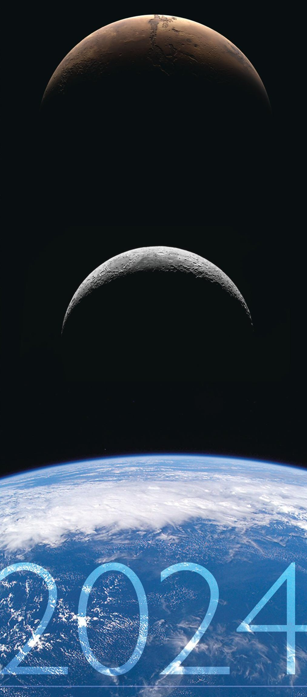
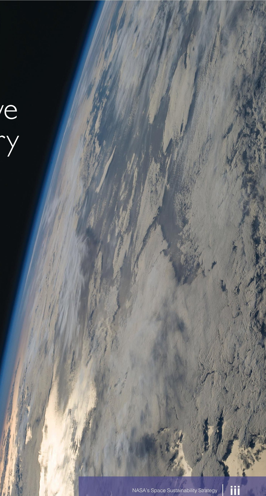
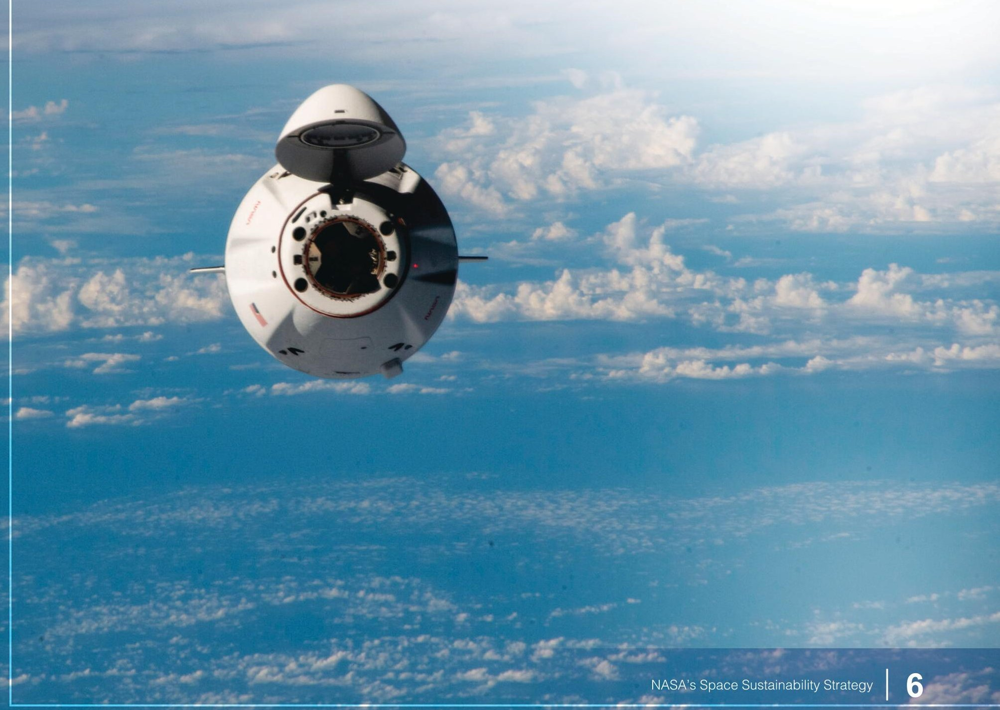
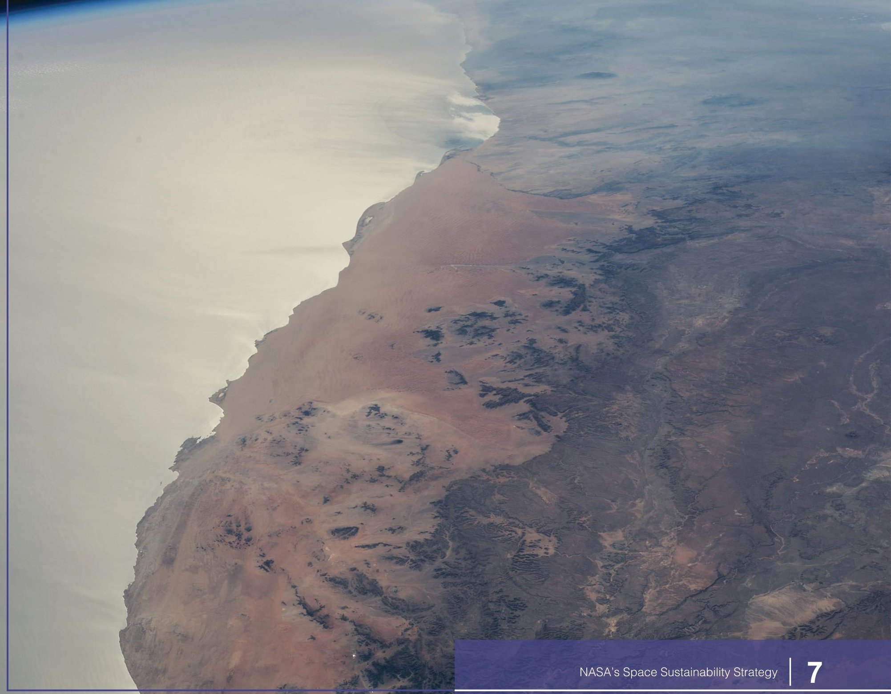
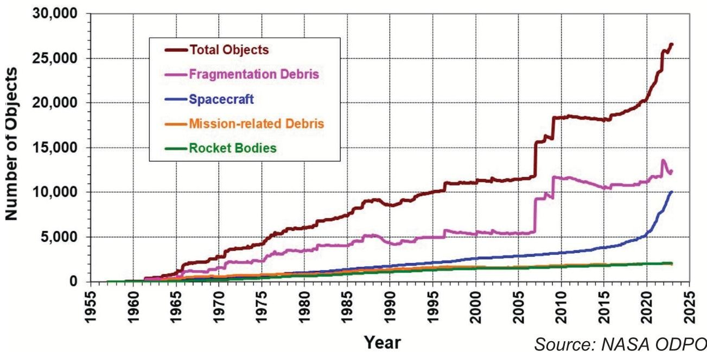
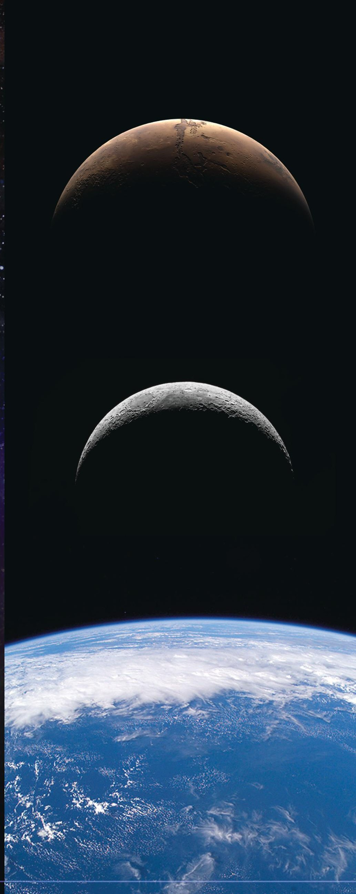

<!-- PDF_PAGE: 1 -->

## NASA's Space Sustainability Strategy

## Volume 1: Earth Orbit

<!-- PDF_PAGE: 2 -->

NASA's Organizations Involved in Space Sustainability

NASA has multiple organizations with responsibilities in space sustainability. Mission Directorates conduct spaceflight missions and develop related technologies. The Office of the Chief Engineer and the Office of Safety and Mission Assurance are technical authorities and own policies related to debris mitigation. The Conjunction Assessment Risk Analysis Program Office and the Multimission Automated Deepspace Conjunction Assessment Process work to prevent NASA's uncrewed spacecraft from colliding with tracked space objects. The Trajectory Operations Officers in the Flight Operations Directorate at the Johnson Space Center work to prevent NASA's crewed spacecraft from colliding with tracked space objects. The Orbital Debris Program Office characterizes the orbital debris environment and supports debris mitigation. The Office of Technology, Policy, and Strategy conducts analyses to inform decisions on policies and technology investments for space sustainability. The Launch Services Office procures launch vehicles and assesses their associated orbital debris risks. Additionally, the Launch Services Office coordinates NASA's review and advice on all orbital-class Federal licensing from the Federal Aviation Administration, National Oceanographic and Atmospheric Administration, Federal Communications Commission, and National Telecommunications and Information Administration. The Office of the General Counsel provides legal advice. The Office of International and Interagency Relations coordinates international and interagency partnerships, White House policy development, and United Nations activities.

The Space Environment Sustainability Advisory Board

The Space Environment Sustainability Advisory Board (SESAB) serves as the integrated body that advises the NASA Associate Administrator on sustainability in the space environment. The SESAB was established to develop and maintain a joint perspective on the state of the space environment, the effectiveness of mitigation efforts, and the risks that the current and future orbital environment pose to spaceflight. The SESAB seeks to integrate and align NASA's approaches and related capabilities, standards, and processes to address risks related to space sustainability. Additionally, the SESAB identifies best practices and shares lessons learned. The SESAB seeks to find consensus, promotes efficient conflict resolution across organizations, and helps interpret and recommend strategic guidance and expectations. The SESAB is cochaired by the Office of Safety and Mission Assurance and the Office of the Chief Engineer.

<!-- PDF_PAGE: 3 -->

## This Document

NASA's Deputy Administrator established a cross-directorate team in the SESAB to create this Space Sustainability Strategy. The team was composed of representatives from the Office of Safety and Mission Assurance; Office of the Chief Engineer; Office of Technology, Policy, and Strategy; Science Mission Directorate; Space Technology Mission Directorate; and Space Operations Mission Directorate. The strategy has been coordinated with the SESAB and NASA Directorates and Offices for final approval by the NASA Administrator.

## Acronyms

<table border="1"><tr><td>ISAM</td><td>In-Space Servicing, Assembly, and Manufacturing</td></tr><tr><td>LEO</td><td>Low Earth Orbit</td></tr><tr><td>OSMA</td><td>Office of Safety and Mission Assurance</td></tr><tr><td>OTPS</td><td>Office of Technology, Policy, and Strategy</td></tr><tr><td>SESAB</td><td>Space Environment Sustainability Advisory Board</td></tr><tr><td>SMD</td><td>Science Mission Directorate</td></tr><tr><td>SSA</td><td>Space Situational Awareness</td></tr><tr><td>SSN</td><td>Space Surveillance System</td></tr><tr><td>STC</td><td>Space Traffic Coordination</td></tr><tr><td>STMD</td><td>Space Technology Mission Directorate</td></tr></table>

## Glossary

<table border="1"><tr><td>Framework</td><td>An entity-relationship model that describes all quantities of interest and their interdependencies and that can be operationalized through measurements, modeling, and assessments using defined figures of merit.</td></tr><tr><td>Orbital debris</td><td>All human-made objects, including fragments and elements thereof, that are in Earth&#x27;s orbit or re-entering the atmosphere and that are nonfunctional.</td></tr><tr><td>Space situational awareness</td><td>The knowledge and characterization of space objects and their operational environment that are needed to support safe, stable, and sustainable space activities.</td></tr><tr><td>Space sustainability</td><td>The ability to maintain the conduct of space activities indefinitely into the future in a manner that is safe, peaceful, and responsible to meet the needs of the present generations while preserving the outer space environment for future activities and limiting harm to terrestrial life.</td></tr><tr><td>Space traffic coordination</td><td>The planning, coordinating, and synchronizing of on-orbit activities to enhance the safety, stability, and sustainability of operations in space.</td></tr></table>

<!-- PDF_PAGE: 4 -->

## Executive Summary

<!-- PDF_PAGE: 5 -->

NASA defines space sustainability as the ability to maintain the conduct of space activities indefinitely into the future in a manner that is safe, peaceful, and responsible to meet the needs of the present generations while preserving the outer space environment for future activities and limiting harm to terrestrial life.

Throughout NASA's history, the organization has consistently led in operating responsibly and sustainably in space. The Agency has developed best practices, analytic studies, models, technologies, and operations that have been widely adopted. However, the space operating environment has changed rapidly and will continue to evolve as new commercial capabilities create a more dynamic space- operational environment. The rapid increase in operational satellites in low Earth orbit (LEO) has made space more crowded with spacecraft and contributes to increased debris. New space capabilities are emerging quickly; examples include satellite constellations for LEO communications, autonomously maneuvering spacecraft, satellite servicing, in-space assembly and manufacturing, and commercial LEO destinations for science and tourism. Additionally, the projected number of governmental and commercial lunar and Mars missions is increasing, which will make sustainable operations around these bodies more challenging. The space community has yet to fully understand the potential benefits and risks these activities create for space sustainability.

Clearly, much work is needed to ensure that decisions made today do not cause unsustainable long-term effects in the space operating environment. Sustainability work is critical to NASA because the risks posed by the continual increase in micrometeoroids and orbital debris are a driving threat to human spaceflight, including the International Space Station and the Artemis Campaign, critical science and robotic missions in Earth's orbit, and missions to other planets in the solar system.

The purpose of this strategy is to focus on advancements the Agency can make that address the mounting space sustainability challenges posed by the rapidly changing space environment and that are aligned with NASA's mission as a science and technology organization. The Agency will increase its role as a global leader in space sustainability by fulfilling the following key responsibilities:

- Provide science and technology leadership in the United States and the global space community on space sustainability topics.

- Support equitable access to and use of space now and in the future.

- Ensure that NASA's missions and operations—including those it undertakes with non-NASA entities-maintain or enhance space sustainability.

There are four domains in which NASA's operations must reflect its space sustainability goals: on Earth; in Earth's orbit; in cislunar space, including the Lagrange points and the lunar surface; and in deep space, including other celestial bodies. This volume of the strategy is focused on sustainability in Earth's

<!-- PDF_PAGE: 6 -->

orbit. Although the other three domains are not covered in this document, NASA commits to release similar Agency-wide strategies regarding these domains.

NASA has identified five challenges that inhibit rapid action regarding space sustainability in Earth's orbit:

1. A single framework for space sustainability has not been accepted by the space community. The presence of differing frameworks leads to confusion when trying to identify space sustainability problems and solutions.

2. Current metrics and modeling are not sufficient to support holistic frameworks. Existing models do not holistically account for connections among tracked and untracked orbital debris, the growing number and diversity of active spacecraft, how and when such spacecraft maneuver, other hazards posed by the highly variable space environment, and methods to reduce the risks of space operations.

3. Uncertainties in the space environment and space operations are a main driver of risks to space sustainability. Operators, mission planners, and policymakers base mission-critical decisions on information and assumptions that are often limited, incomplete, or inconsistent. A challenge is to determine how much various uncertainties must be reduced to enable breakthroughs in the space community's understanding and actions related to space sustainability.

4. Space sustainability may be in tension with other mission interests. To meet cost and schedule constraints, organizations prioritize actions that are essential to mission success. Actions taken to improve sustainability may be perceived as detracting from missions.

5. Space sustainability is a global issue that requires a coordinated multilateral response. The U.S. Government is in the early stages of coordinating unified policies and guidance that support space sustainability. There are still gaps in the policies and guidance.

To address these challenges, NASA commits to pursuing the following goals for space sustainability in Earth's orbit. Each goal is followed by objectives that will guide NASA's achievement of the goals. The goals logically build upon each other; however, their implementation can begin in parallel.

## Goal 1. Develop a framework for assessing space sustainability at NASA

For the purposes of this strategy, a framework is an entity-relationship model that describes all quantities of interest and their interdependencies and that can be operationalized through measurements, modeling, and assessments using defined figures of merit. NASA will work with the domestic and international space community to define an Agency view of the current space traffic and debris environment in Earth's orbit, a consistent set of parameters identifying the future

<!-- PDF_PAGE: 7 -->

state of debris and space traffic, one or more metrics to assess the sustainability of orbital activities, and target values for these metrics that—if met—will lead to a sustainable space operating environment. NASA will use the framework to make investment decisions and to publicly report on the sustainability of the Agency's operations in Earth's orbit. The objectives for this goal are as follows:

1. 1 Define a framework, metrics, and models for assessing sustainability in Earth's orbit.

1. 2 Determine tolerable and desirable levels of risk associated with the future operational environment.

1. 3 Annually publish NASA's effect on the sustainability of space.

## Goal 2. Prioritize the most efficient ways to minimize uncertainties about orbital debris and operations in the space environment

Using the framework, NASA will identify the critical uncertainties that drive the risks to human spaceflight and robotics spacecraft, understand the effects that orbiting anthropogenic objects have on scientific measurements of the space environment, and clarify the most cost-effective ways to reduce these uncertainties. The objectives for this goal are as follows:

2. 1 Identify opportunities for breakthrough improvements in the ability to sense and predict the operating environment.

2. 2 Investigate the feasibility of new approaches to operating in the space environment.

2. 3 Identify cost-effective methods to reduce the creation of new debris.

2. 4 Develop prioritized approaches to managing the risks posed by existing debris.

## Goal 3. Lower barriers to space sustainability through developing and transfering technology

Informed by the results of Goal 2, NASA will invest in technologies that support key elements of space sustainability. These investments will focus on advancing capabilities that NASA needs in order to support the sustainable operation of its missions in Earth's orbit and capabilities that other U.S. space operators need, provided there is a clear transition plan. The objectives for this goal are as follows:

3. 1 Continue investing in early-stage orbital debris management.

3. 2 Identify opportunities to increase investments in space situational awareness, space traffic coordination, and space environmental understanding.

3. 3 Identify potential transition partners, and support demonstrations of debris-related technology.

<!-- PDF_PAGE: 8 -->

## Goal 4. Update or develop policies that provide incentives to support space sustainability

NASA will develop or update policies that enhance space sustainability. The objectives for this goal are as follows:

4. 1 Update NASA's policies and standards to reflect the results of the previous goals.

4. 2 Update NASA's policy related to debris-remediation.

4. 3 Support economic and policy research related to space sustainability.

4. 4 Advance consideration of international issues related to remediating orbital debris.

## Goal 5. Continue and improve coordination and collaboration outside of NASA

NASA will continue its strong leadership role domestically and internationally. Further, NASA will identify opportunities to better share and receive information from academic institutions, industry, interagency partners, and the international space community. The objectives for this goal are as follows:

5. 1 Continue to collaborate with interagency partners on space sustainability.

5. 2 Engage with communities that prioritize space sustainability.

5. 3 Improve the sharing of best practices, procedures, models, data, and tools with the international space community.

5. 4 Improve NASA's ability to incorporate technical advancements made by the broader space community.

## Goal 6. Improve NASA's internal organization to support space sustainability

NASA will design and implement an entity to focus on day-to-day coordination of the Agency's space sustainability efforts. This entity will create accountability to ensure that NASA meets its aspirations for space sustainability, will enable Agencylevel prioritization of relevant efforts and budgets, and will allow NASA to maintain a consistent voice when speaking about space sustainability. The objective for this goal is as follows:

6. 1 Evaluate the design and implementation of an empowered organizational entity to focus on day-to-day coordination and accountability of NASA's space sustainability efforts.

<!-- PDF_PAGE: 9 -->

## Contents

About ...i

Executive Summary...iii

Introduction...1

Background Regarding Sustainability in the Earth’s Orbit...7

Challenges to Sustainability in Earth’s Orbit...11

Goals and Objectives ...14

Goal 1: Develop a Framework for Assessing Space Sustainability at NASA...15

Goal 2: Prioritize the Most Efficient Ways to Minimize Uncertainties About Orbital Debris and Operations in the Space Environment...17

Goal 3: Lower Barriers to Space Sustainability Through Developing and Transferring Technology ...19

Goal 4: Update or Develop Policies That Provide Incentives to Support Space Sustainability...20

Goal 5: Continue and Improve Coordination and Collaboration Outside of NASA...21

Goal 6: Improve NASA-internal Organization to Support Space Sustainability ...23

Suggested Way Ahead for Strategy Implementation...25

<!-- PDF_PAGE: 10 -->

## Introduction

<!-- PDF_PAGE: 11 -->

## Purpose

NASA defines space sustainability as the ability to maintain the conduct of space activities indefinitely into the future in a manner that is safe, peaceful, and responsible to meet the needs of the present generations while preserving the outer space environment for future activities and limiting harm to terrestrial life. This definition is based on the United Nations Long-Term Sustainability Guidelines and incorporates a slight change to align the definition with the U.S. National Space Policy of 2020.

For decades, NASA has been a global leader in space sustainability. The Agency has identified best practices, conducted studies, developed models, advanced technologies, and performed operations that enhance space sustainability and improve understanding of the space environment. The purpose of this strategy is to focus on advancements the Agency can make that address the mounting space sustainability challenges posed by the rapidly changing space environment and that are aligned with NASA's mission as a science and technology organization. The Agency will increase its role as a global leader in space sustainability by fulfilling the following key responsibilities:

- Provide science and technology leadership in the United States and the global space community on space sustainability topics.

- Support equitable access to and use of space now and in the future.

- Ensure that NASA's missions and operations—including those it undertakes with non-NASA entities-maintain or enhance space sustainability.

## What NASA Has Done and Is Doing

The following are examples of NASA's leadership in the national and international communities in space sustainability:

NASA's Orbital Debris Program Office is a global leader in understanding the orbital debris environment. The Office measures the orbital debris environment by using ground-based radars and optical telescopes, space-based sensors, analysis of the surfaces of spacecraft that have returned from space, and ground-based laboratory experiments. These debris measurements inform the development of models that characterize the current and future debris environment. Hypervelocity impact tests assess the risks that orbital debris pose to operating spacecraft. The information on the debris environment and risks to spacecraft is used to support the development of debris mitigation recommendations for spacecraft design and operations. The Office also studies how removing debris, whether large or small, affects the long-term debris environment.

To ensure safe operations on orbit, the Conjunction Assessment Program Officer in NASA's Science Mission Directorate (SMD) oversees the Conjunction Assessment and Risk Analysis program, which provides conjunction analysis

<!-- PDF_PAGE: 12 -->

and mitigation services for NASA's uncrewed spaceflight missions operating in Earth's orbit. The officer also oversees the Multimission Deepspace Conjunction Assessment Process team, which provides conjunction analysis and mitigation services for NASA's uncrewed-spaceflight missions operating in libration orbits and orbits around other celestial bodies. The Trajectory Operations Officers and Flight Dynamics Officer in the Johnson Space Center Flight Operations Directorate provide collision avoidance capabilities for NASA's human spaceflight missions.

NASA conducts the fundamental heliophysics science needed to develop models of the space environment that are critical for space operations. The Heliophysics Division in the SMD plans to collect on-orbit data to validate NASA's models of millimeter-sized debris by funding a hosted payload mission called Light- Sheet Anomaly Resolution and Debris Observation, which will use a sheet of laser light to count orbital debris two centimeters and smaller as it passes through the light. The Heliophysics Division is also funding other efforts to measure small orbital debris.

NASA supports the early-stage development of technologies directly applicable to orbital debris mitigation, tracking, characterization, and remediation. NASA also supports technology-demonstration missions that include in-space servicing assembly and manufacturing (ISAM) capabilities. The Agency's longer-term objectives for Moon-to-Mars infrastructure and sustainment needs are supported through developments in advanced manufacturing, autonomous construction, and in-situ resource use capabilities. NASA also recently established the Consortium for Space Mobility and ISAM to provide an opportunity for U.S. Government, industry, nonprofit research institutions, and academic institutions to coordinate and collaborate on ISAM capability development, business cases, and mission applications.

NASA provides strong support to its U.S. Government partners. NASA coordinates and collaborates with the Departments of Defense and Commerce on various orbital debris radar, telescope, and laboratory measurement projects and conjunction assessment efforts. Likewise, NASA regularly provides technical expertise to other regulatory agencies by reviewing proposed rules and providing feedback on license reviews. NASA also provides expertise to Congress during the process of drafting legislation. The Agency has been a key contributor to national-level policies, such as the National Orbital Debris Research and Development Plan, the National Orbital Debris Implementation Plan, and the National Cislunar Science and Technology Strategy.

The Agency shares its expertise with the world. NASA's orbital debris mitigation and risk assessment models have been shared with hundreds of industry operators around the world. NASA hosts the International Orbital Debris Conference and regularly attends a variety of conferences and technical exchanges, both domestically and internationally, that cover various space sustainability topics.

<!-- PDF_PAGE: 13 -->

Additionally, NASA publishes the Orbital Debris Quarterly News, which has close to 2,000 subscribers globally. NASA also developed and published the Handbook for Limiting Orbital Debris, NASA Procedural Requirements for Limiting Orbital Debris and Evaluating the Meteoroid and Orbital Debris Environments (NPR 8715.6), and the NASA technical standard Process for Limiting Orbital Debris (NASA-STD-8719.14). NASA has also published the Spacecraft Conjunction Assessment and Collision Avoidance Best Practices Handbook, followed by procedural requirements for implementing the best practices (NPR 8079.1), to share insight from NASA's 30-year history of developing and implementing the conjunction assessment process used today.

Internationally, NASA led the U.S. Government delegation to establish the Space Debris Mitigation Guidelines for the United Nations Committee on the Peaceful Uses of Outer Space and supported the development of the Long-Term Sustainability Guidelines for the committee. NASA was a founding member of the Inter-Agency Space Debris Coordination Committee and led the committee to establish the first consensus-based international guidelines for mitigating orbital debris. NASA also promotes the committee's adoption of the Orbital Debris Mitigation Standard Practices, which NASA led the U.S. Government in developing in 2001 and in updating in 2019. These standard practices serve as the foundation for the space sustainability practices of NASA and other operators around the world.

## Domains Regarding Space Sustainability

NASA has identified four domains in which space sustainability is important to consider: Earth's orbit; the Earth; cislunar space, including the Lagrange points and the lunar surface; and deep space, including other celestial bodies. The issues identified in these domains are not in the scope of NASA's 2022 Sustainability Plan. $ ^{1} $ The challenges related to space sustainability may differ depending on the domain, and these challenges need to be identified, understood, and solved. The resulting space sustainability strategies for each domain may be updated as the concept of space sustainability evolves. In response to these strategies, NASA commits to make informed improvements to its operations. Ultimately, the strategies must be implemented by much of the space community for effective space sustainability to be achieved.

## Domain Covered in Volume 1 of This Strategy

So that NASA can rapidly progress in addressing the most pressing issues, volume 1 of NASA's Space Sustainability Strategy focuses on the sustainability of operations in Earth's orbit.

Earth orbit. Operations in Earth's orbit, especially in LEO, present highly visible challenges to space sustainability. This domain includes topics such as space

<!-- PDF_PAGE: 14 -->

situational awareness, space traffic coordination, space environment (weather) awareness, orbital debris management, and spacecraft servicing. The domain emphasizes the health and safety of human spaceflight. Space situational awareness refers to the knowledge and characterization of space objects and their operational environment to support safe, stable, and sustainable space activities. Space traffic coordination refers to planning, coordinating, and synchronizing on-orbit activities to enhance the safety, stability, and sustainability of operations in space. NASA views orbital debris management as the ability to mitigate the creation of new debris through design and operations, to implement operational procedures for spacecraft to avoid collisions with debris, to protect missions from damage due to strikes of orbital debris, to limit reentry casualty risks, to characterize the populations of debris that are not currently tracked, and to clean up debris through various remediation methods. Space weather awareness regards obtaining knowledge of and predicting the varying natural environment in response to changing solar conditions.

## Domains Not Covered in Volume 1 of this Strategy

The three other domains (the Earth, cislunar space, and deep space) are not covered in this volume of the strategy. NASA commits to release similar Agencywide strategies for the other three domains. These domains are described in the following paragraphs.

The Earth. Access to space and capabilities from space can affect life on Earth. For example, increased space launches cause closures in air traffic corridors. The chemicals used during launch raise concerns about atmospheric impacts. Launch operations can be deleterious to nearby wildlife, terrestrial and aquatic habitats, and communities. The increased use of LEO satellites also raises concerns. For instance, reentering satellites that burn up in the atmosphere could cause harmful material to be deposited or catalyzed in the upper atmosphere. Satellite pieces that do not fully burn up and return to the Earth's surface could harm people or damage property. While in orbit, spacecraft may reflect sufficient sunlight to degrade the dark sky environment, affecting astronomers, sky photographers, and other cultural users of dark skies. Future efforts to address these issues should be coordinated with the teams that are implementing NASA's 2022 Sustainability Plan and NASA's 2023 Climate Strategy. $ ^{2} $

Cislunar space, including the lunar surface. Many of the challenges regarding sustainability in cislunar space (including the Earth-Moon Lagrange points) and the lunar surface are similar to those regarding sustainability in Earth's orbit. However, the challenges regarding cislunar space and the lunar surface are magnified because there are fewer historical precedents and norms to follow. Also, the world may not yet have the operational capabilities needed to support sustainable operations. For example, capabilities for situational navigation

<!-- PDF_PAGE: 15 -->

awareness, navigation, and communications are currently insufficient to support robust space traffic coordination and to monitor the sustainability of the operating environment. Similarly, when the mission of lunar surface assets ends, they must be properly disposed of to reduce the risks to other space operators; however, there are no guidelines for performing this disposal. Postmission disposal of orbiting assets is complicated by the Moon's lack of an atmosphere to accelerate the reentry of debris and the chaotic nature of cislunar orbits. Further, preserving scientifically or culturally valuable sites is an important consideration.

Deep space, including other celestial bodies. For the purposes of this strategy, deep space comprises everything beyond cislunar space. Sustainably operating at the Sun-Earth Lagrange points, Mars, other celestial bodies, and beyond may present unique challenges that require considerations and solutions not addressed in the previous domains. For example, planetary protection is a greater concern in deep space than on the Moon; human and robotic spaceflight missions to deep space bodies could introduce terrestrial organisms and other environmental disturbances to these environments. These disturbances could compromise scientific studies, the search for life, and the preservation of heritage sites.

<!-- PDF_PAGE: 16 -->

## Background Regarding Sustainability in Earth's Orbit

<!-- PDF_PAGE: 17 -->

As humanity's activities in Earth's orbit have flourished, our awareness of the risks posed by space operations have not kept pace. The importance of tracking active spacecraft has been recognized since the dawn of the space age, but until more recently, relatively little consideration has been given to collisions involving active spacecraft. Orbital debris has been present since the beginning of the space age and the first known fragmentation event occurred in 1961; however, the importance of orbital debris did not become clear until decades later, when efforts to mitigate debris began in the late 1970s. As space traffic and orbital debris have increased, the importance of coordinating space traffic has emerged as a significant issue since the mid-2000s. Only in the 2020s is humanity beginning to recognize the effects of space operations on scientific measurements, such as of Earth's ionosphere and exoplanets. This section briefly describes the history of four facets of space sustainability in Earth's orbit: space situational awareness (SSA), orbital debris, space traffic coordination (STC), and science.

## SSA

The first step in achieving sustainable operations in Earth's orbit is to have SSA. This term is defined as the knowledge and characterization of space objects and their operational environment that are needed to support safe, stable, and sustainable space activities. The U.S. Government's collection of 30+ telescopes and radars-known as the Space Surveillance System (SSN)—tracks and maintains a catalog of over 25,000 objects. However, the SSN reliably tracks only objects larger than 10 centimeters in LEO and 1 meter in geosynchronous equatorial orbit; spacecraft operators are flying blind with respect to smaller debris. Predicted conjunctions between tracked objects are uncertain because of the fidelity of positional observations and the variability in orbit propagation caused by space weather. Despite these limitations, current SSA capabilities not only enable operators to avoid collisions but also provide crucial information on the space environment.

## Orbital Debris

Orbital debris is defined as all human-made objects, including fragments and elements thereof, that are in Earth's orbit or re-entering the atmosphere and that are nonfunctional. About 25 percent of tracked objects are debris from nominal space operations; these objects include defunct spacecraft, rocket bodies, and items intentionally released during missions. About 50 percent of tracked objects were created during fragmentation events, such as antisatellite tests and self-sabotage, explosion of propulsion systems or batteries, and accidental collisions. The first-known satellite fragmentation occurred in 1961, when the Ablestar upper stage exploded and produced nearly 300 trackable pieces of debris. In total, about 75 percent of tracked objects are debris.

Using SSA capabilities, satellite operators can maneuver to avoid large, tracked debris. However, most debris are not tracked. NASA estimates that around 100

<!-- PDF_PAGE: 18 -->

Figure 1. Distribution of orbital debris with key events identified.

million pieces of small debris are not currently tracked or avoided by spacecraft yet are large enough to degrade or destroy spacecraft. These small, humanderived debris are the source of most of the risks the space environment poses to spacecraft. The risks may increase, as the volume of debris, tracked and untracked, is projected to increase.

## STC

Just as the creation of debris needs to be reduced and collisions with debris need to be avoided, the activities among spacecraft need to be coordinated. STC is defined as the planning, coordination, and on-orbit synchronization of activities to enhance the safety, stability, and sustainability of operations in space.

In recent years, satellite deployments have increased. In each quarter of 2021-2023, nearly 1,000 trackable objects were added to Earth's orbit; more than 50 percent of these objects were spacecraft. In addition to this increase in orbit's use, new space capabilities are emerging quickly; examples include satellite constellations for LEO communications, autonomously maneuvering spacecraft, satellite servicing, in-space assembly and manufacturing, and commercial LEO destinations for science and tourism. The space community has yet to fully understand the potential benefits and risks these activities create in terms of space sustainability. To help mitigate the potential risks, proper coordination among spacecraft is critical.

To ensure sustainability, a major emerging trend that deserves attention is more dynamic space operations. Many new spacecraft use electric propulsion, which enables frequent and long-duration maneuvers. As the option of onorbit refueling emerges, spacecraft with chemical propulsion may make larger

<!-- PDF_PAGE: 19 -->

and more frequent maneuvers. Further, an increasing share of spacecraft may use automated maneuvering capabilities. These systems may enhance sustainability by allowing for more frequent maneuvers to avoid collisions and by rapidly deorbiting defunct spacecraft.

More dynamic space operations may also challenge space sustainability by decreasing the predictability of space operations. During and after a spacecraft's maneuver, its orbit and potential conjunctions with other space objects are currently not predicted reliably by the SSN or other external observers. As maneuvers become longer in duration, larger in magnitude, more frequent, and increasingly automated, the complexity and uncertainty of space operations may increase.

## Science

The proliferation of satellites and debris may also affect how science is conducted in space. Space-based telescopes, such as Hubble and CHEOPS, are increasingly observing "streaks" from active satellites and small debris passing through the telescopes' field of view. Beyond optical measurements, there may be disturbances to measurements of the space environment itself. Space objects that pick up electronic charges may cause ripples in the ionosphere while traveling through it. These anthropogenic ripples may be confused with natural sources of ionospheric variability. These disturbances may also present an opportunity to detect and track small debris. More research is needed to determine whether and, if so, how well debris-related scientific disturbances can be separated from background noise.

<!-- PDF_PAGE: 20 -->

## Challenges to Sustainability in Earth's Orbit

<!-- PDF_PAGE: 21 -->

## A Single Framework for Space Sustainability Has Not Been Accepted by the Space Community

The topic of space sustainability is complex and challenging to fully break down into an accepted conceptual framework that can subsequently be measured and modeled. For the purposes of this strategy, a framework is an entity-relationship model that describes all the quantities of interest, including their interdependencies, that can be operationalized through measurements, modeling, and assessments using defined figures of merit. Some effective models are available for parts of the space environment, but the space community lacks a comprehensive, widely accepted framework for space sustainability that recognizes the interconnectivity of the actions taken to protect space vehicles from colliding with orbital debris, colliding with other space vehicles, and becoming orbital debris. Without such a framework, NASA and the space community cannot robustly assess the sustainability of their risk approach, investment decisions, and future flight opportunities.

## Current Metrics and Modeling Are Not Sufficient to Support Holistic Frameworks

NASA and the space community lack a holistic set of interoperable models that addresses the interdependencies among risks posed by launch vehicles, upper stages, active spacecraft, debris, the space environment, operational maneuvering abilities, space situational awareness, and other hazards. Actions taken to reduce one source of risk may have knock-on effects regarding other sources of risk, but such interactions are generally left unmodeled. Without such a set of models, NASA cannot effectively determine what type and level of space operations are sustainable and cannot assess the effectiveness of proposed actions to enhance space sustainability. The interrelated population dynamics of operational spacecraft and orbital debris create a problem for policymakers who seek to ensure the long-term sustainability of orbital environments. The size, structure, and distribution of spacecraft and orbital debris change over time because of factors such as orbit use rates, spacecraft decommissioning and disposal rates, technology evolution (and revolution), and natural environment fluctuations; these dynamics make the problem even harder to address because solutions tend to be identified based on highly uncertain assumptions about the future.

## Uncertainties in the Space Environment and Space Operations Are a Main Driver of Risks to Space Sustainability

If space operators, safety service providers, and policymakers could significantly reduce the uncertainties regarding operating in space, the necessary actions would become clearer. For example, if operators knew the precise trajectories and physical characteristics of all orbital debris, then operators could greatly reduce

<!-- PDF_PAGE: 22 -->

risks from debris by using evasive maneuvers for debris that can be avoided and by shielding spacecraft to withstand strikes from debris that cannot be avoided. Another source of uncertainty is natural changes in the background plasma and radiation environment since these changes affect the survivability of spacecraft operations. Conversely, spacecraft and orbital debris may affect scientific measurements of the space environment. Merely reducing uncertainties somewhat is not sufficient. A challenge is to determine which uncertainties are most important to address and how much those uncertainties must be reduced to enable breakthroughs in NASA's understanding and actions related to space sustainability.

## Space Sustainability May Be in Tension with Other Mission Interests

Space endeavors are complex and often require decades of coordinated effort. To meet cost and schedule constraints, organizations prioritize actions that are essential to mission success. This prioritization can lead to the moral hazard of a mission maximizing its success and transferring the negative consequences of its operations to other space operators. This result is partially due to a lack of appreciation for the downstream effects on other operators and the added complexity of mitigating actions. When the incentives for near-term mission success and long-term sustainability in the Earth's orbit do not naturally align, the latter receives less attention.

## Space Sustainability Is a Global Issue That Requires a Coordinated, Multilateral Response

The U.S. Government is in the early stages of coordinating unified policies and guidance that support space sustainability; however, there are still gaps in the policies and guidance. For example, agencies do not have clearly defined roles and operational responsibilities related to debris remediation. Further, NASA lacks a coordinated, Agency-wide approach to identify new space sustainability capabilities and then prioritize them, fund them, create them, and infuse them into missions to address the challenges previously discussed. NASA is also insufficiently transparent with the public and the broader space community regarding occasional decisions that reduce space sustainability in order to increase mission benefits; satellite operators and the public do not always learn how the risk environment has changed or why the added risk was considered tolerable. More broadly, NASA alone cannot address space sustainability. As much as possible, the global space community must work from a shared baseline understanding and toward a common vision of a sustainable future. Achieving this multilateral, global coordination is a challenge for many government and private sector space operators because of legal, procedural, and cultural hurdles to sharing with and meaningfully receiving from the space community relevant data, models, analyses, and potential policies.

<!-- PDF_PAGE: 23 -->

## Goals and Objectives

<!-- PDF_PAGE: 24 -->

NASA recognizes that space sustainability is an investment in the Agency's mission, by protecting our future ability to use and benefit from space. NASA is now at the point that the ability to conduct space activities for the benefit of humankind is being challenged by degradations in the space operating environment. We must ensure that space is used sustainably so that it is safe for astronauts to do science in LEO and to explore the Moon and Mars. Further, space sustainability is needed so that NASA's robotic science missions can monitor Earth's changes and probe the secrets of the universe without interruption. Space sustainability is a global concern, and the world is watching NASA for guidance. NASA can support the world in creating a sustainable space operating environment by leading in science and technology and collaborating and partnering with industry and space agencies around the globe. The following goals address the challenges to achieving space sustainability in Earth's orbit. By pursuing the objectives for each goal, NASA will lay the technical foundations and provide the operational leadership that will enable everyone to operate sustainably in space.

The goals logically build upon each other; however, their implementation can begin in parallel. Goal 1 provides a foundational framework and metrics to holistically assess space sustainability in Earth's orbit. Goal 2 utilizes this framework to identify highly effective actions for enhancing space sustainability. Goals 3 and 4 use technology development and policy changes to create incentives for space operators to adopt the highly effective actions. Goal 5 ensures that NASA's implementation of the previous goals is informed by and coordinated with the domestic and international space community. Goal 6 calls for an organizational change within NASA to provide day-to-day coordination and accountability within the Agency for our space sustainability actions. The products of these goals will be periodically reevaluated to ensure they are effective and to stay aligned with the ever-changing space operating environment.

## 1. Develop a Framework for Assessing Space Sustainability at NASA

## Why This Goal Is Important

NASA Policy Directive 1000.0 challenges NASA to address the question of how safe is safe enough? In the context of space sustainability, it is important to establish a framework of technical parameters that are accepted by a diverse set of constituents so that competent decisions can be made that ensure the long-term viability of assets in Earth's orbit that add value to human safety, economic prosperity, and scientific discovery. The space sustainability framework will address challenges 1 and 2. It will also provide a basis for the analyses defined in goal 2.

## Goal 1 addresses challenges 1 and 2:

"A single framework for space sustainability has not been accepted by the space community."

"Current metrics and modeling are not sufficient to support holistic frameworks."

<!-- PDF_PAGE: 25 -->

## Objectives

NASA will work with the domestic and international space community to define an Agency view of the current space traffic and debris environment in Earth's orbit, a consistent set of parameters identifying the future state of debris and space traffic, one or more metrics to assess the sustainability of orbital activities, and target values for these metrics that-if met-will lead to a sustainable space operating environment. NASA will use the framework to make investment decisions and to publicly report on the sustainability of the Agency's operations in Earth's orbit. The objectives for this goal are as follows:

## 1.1 Define a framework, metrics, and associated models for assessing sustainability in Earth's orbit.

Working with the domestic and international space community, NASA will define what it views as the key parameters that affect the sustainability of Earth's orbit, identify the prioritized interdependencies between the key parameters, integrate existing models or develop new ones to support the framework, and choose one or more metrics with which the Agency will measure sustainability. Of particular importance are the feedback mechanisms between the use of orbits; the societal benefits created by space operations; policies for space traffic coordination and orbital debris; and the evolution of technical capabilities for launching inexpensively into orbit, sensing debris and the space environment, maneuvering spacecraft, protecting spacecraft from hazards, and remediating debris. Appropriate metrics may be related to risks measured in monetary terms, carrying capacity, Orbital Debris Mitigation Standard Practices compliance, and other concepts with operational significance. The framework and models should be updated biennially to incorporate major changes in the space operating environment.

## 1.2 Determine tolerable and desirable levels of risk associated with the future operational environment.

Every space operation imposes some level of risk on other operators in space; a risk-free operating environment is not possible. Efforts to minimize the imposed risks may do more harm than good if the efforts stifle the benefits created by robustly using space. NASA will identify a level of imposed risk that is judged to be tolerable and sustainable, then lead the space community toward this level. The tolerable level of risk will be based on the previously developed framework and metrics.

<!-- PDF_PAGE: 26 -->

## 1.3 Annually publish NASA's effect on the sustainability of space.

This product should include a list of upper stages, spacecraft, and any other objects for which NASA has some responsibility; any changes in the risks posed by these objects; the risks associated with newly launched upper stages and spacecraft; the risk-reducing activities undertaken to offset any intolerable risks; and an estimate of NASA's net contribution to risk that year. This product also will address NASA's compliance with the guidelines in the Orbital Debris Mitigation Standard Practices.

## 2. Prioritize the Most Efficient Ways to Minimize Uncertainties About Orbital Debris and Operations in the Space Environment

## Why This Goal Is Important

Operating in the space environment requires time-critical decision-making. Operators make decisions based on the information available at the time of the event. Improving operational data and processes can improve confidence in the intended outcomes and can minimize the effects on operations. Minimizing the uncertainty of the information used to make decisions addresses Challenge 3. This goal also provides direction for the technology development and policy updates that will be undertaken in goals 3 and 4.

## Goal 2 addresses challenge 3:

"Uncertainties in the space environment and space operations are a main driver of risks to space sustainability."

Uncertainties related to space traffic coordination and orbital debris are the main drivers of the perceived risk to operators in the space environment. The current debris environment is poorly understood with respect to debris smaller than 10 centimeters; this debris is not tracked and thus cannot be actively avoided. There is a lag in debris-related statistics, making it difficult to connect debris trends to current events. For example, objects that have accidentally exploded on orbit typically were launched a decade ago, complicating the ability to estimate the explosion potential of systems launching now and the future impact on the space environment. Likewise, the characteristics of small debris are highly uncertain because of a lack of observational measurements and operational capabilities to track the debris. Even the current and predicted locations of active spacecraft are uncertain, preventing accurate predictions of close approaches, a situation that will likely become more challenging as autonomous maneuvering in LEO increases. The rates at which the numbers of active spacecraft and orbital debris are growing are difficult to predict and thus difficult to plan for. These uncertainties can lead spacecraft operators to over- or underestimate the risks operators face and impose on others. In turn, these uncertainties hinder the space community's ability to identify the most effective methods for mitigating and remediating these risks.

<!-- PDF_PAGE: 27 -->

## Objectives

Using the framework, NASA will identify the critical uncertainties that drive the risks to human spaceflight and robotic spacecraft, understand the effects that orbiting anthropogenic objects have on scientific measurements of the space environment, and clarify the most cost-effective ways to reduce these uncertainties. The objectives for this goal are as follows:

Spacecraft Operations:

## 2.1 Identify opportunities for breakthrough improvements in the ability to sense and predict the operating environment.

This effort should consider improvements to orbital position covariance dynamic predictive atmospheric drag models, solar flux predictions, GPS beacons, laser reflectors, data fusion, new sensors, and so forth. When considering improvements in each area, the point of diminishing returns will be estimated.

## 2.2 Investigate the feasibility of new approaches to operating in the space environment.

This investigation may include future autonomous collision avoidance systems, interactions between autonomous and manual collision avoidance systems, the trustworthiness of ephemerides provided by spacecraft operators, and coordination with spacecraft that do not fly Keplerian orbits or thrust constantly. Although these approaches may reduce the risks of operating in space, advancements are also needed in the ability to avoid collisions safely and efficiently during launch. The ability to manage collision risks during this highly dynamic portion of space operations could be improved through advancing launch vehicle technologies, researching approaches to better predict launch vehicle position, quantifying more accurately the uncertainties in the on-orbit catalog, and investigating new approaches to quantifying probabilities for collision avoidance during launch.

## Orbital Debris:

## 2.3 Identify cost-effective methods to reduce the creation of debris.

The creation of debris can be mitigated by making certain choices when designing, operating, servicing, and disposing of spacecraft and upper stages. NASA will assess and identify for potential future development the most cost-effective technologies, capabilities, and policies that will limit the creation of orbital debris. NASA currently prioritizes improving the design and testing of batteries, which are prone to accidental explosion, and measuring millimeter-sized debris to understand its shape and material composition. NASA will continue to assess the costs and benefits of debris mitigation methods, and the priorities may be updated as analyses evolve.

<!-- PDF_PAGE: 28 -->

2. 4 Develop prioritized approaches to managing the risks posed by existing debris.

Most of the debris in space was created prior to this strategy or by non-U.S. entities and is beyond NASA's control. Even if all countries stopped launching new spacecraft, the amount of debris in space would continue to grow. NASA's current approach to remediating the risks posed by debris is to prioritize just-in-time collision avoidance, remove small debris, and develop scalable capabilities for controlled reentry of very large objects. For each of these priorities, NASA will develop technology roadmaps to guide development efforts. These priorities are based on a recent NASA analysis of the most cost-effective methods for remediation; however, NASA will continue to analyze the costs and benefits of remediation options, and these priorities may be updated as analyses evolve.

## 3. Lower Barriers to Space Sustainability Through Developing and Transferring Technology

## Why This Goal Is Important

NASA's investment in technologies that enhance space sustainability can incentivize missions and potential transition partners to adopt the technologies. Such investments reduce the costs and risks associated with incorporating these technologies into missions. Reducing costs and risks can increase adoption of sustainable practices throughout the space enterprise. Further, the technologies that NASA invests in signal to the world what the Agency's priorities

## Goal 3 addresses challenge 4:

"Space sustainability may not align with other mission interests."

are in space sustainability, and the levels of investment are a potential signal of the importance of space sustainability to the Agency. Because other U.S. Federal agencies, Congress, industry, and international entities pay attention to NASA's efforts, NASA will be able to focus attention on the most effective capabilities and encourage greater national and global investment in the identified priority areas.

## Objectives

NASA will invest in technologies that support key elements of space sustainability informed by the results of goal 2. These investments will focus on advancing capabilities that NASA needs in order to support the sustainable operation of its missions in Earth's orbit and capabilities that other U.S. space operators need, provided there is a clear transition plan. The objectives for this goal are as follows:

## 3.1 Continue investing in early-stage orbital debris management.

NASA will support high-priority capabilities related to mitigation, tracking, and remediation. NASA will prioritize investments based on its published assessments of the capabilities' impacts on future space sustainability and will balance investments appropriately across the scope of orbital debris management.

<!-- PDF_PAGE: 29 -->

3. 2 Identify opportunities to increase investments in space situational awareness, space traffic coordination, and space environmental understanding.

NASA will support high-priority capabilities related to detection, tracking, and collision avoidance. NASA's investments should be prioritized considering the results from goal 2 and input from industry and interagency partners.

3. 3 Identify potential transition partners and support demonstrations of debris-related technology.

Transition partners may include NASA missions and other space operators in the U.S. Government and in industry. After identifying these partners, NASA can help them adopt sustainability efforts by supporting demonstrations of commercial technology that meet the partners' needs.

## 4. Update or Develop Policies That Provide Incentives to Support Space Sustainability

## Why This Goal Is Important

Incentives for space sustainability can be improved by ensuring that space policies reward enhanced sustainability. Such policies could involve providing increased budgetary support to missions that are among the first to incorporate best practices and publicly recognizing missions that do substantially more than the minimum in terms of sustainability.

NASA is not a regulatory agency and has responsibility for only its own missions; however, policymakers from other agencies, the White House, Congress, and international entities routinely look to NASA for technical guidance on policy and regulatory issues. NASA can provide its partners with the best technical guidance by proactively identifying and assessing policy issues rather than waiting until action is imminent and there is insufficient time for rigorous consideration.

## Objectives

NASA will develop or update policies that enhance space sustainability informed by the results of goal 2. The objectives for this goal are as follows:

## 4.1 Update NASA's policies and standards to reflect the results of Goal 1.

The updates should include requirements, rewards, and penalties that incentivize space sustainability. Requirements related to developing and operating space systems will ensure that all missions NASA has some responsibility over will incorporate sustainability into their design from the beginning. Programs that go beyond the minimum requirements should be recognized and receive enhanced benefits or privileges. Programs that fail to meet the requirements should internalize the negative effects of their actions.

<!-- PDF_PAGE: 30 -->

## 4.2 Update NASA's policy related to debris remediation.

NASA's previous policy on debris remediation is nearly a decade old and restricts the Agency's ability to meaningfully support the development and use of remediation capabilities. NASA's new policy on debris remediation is: 1) NASA may fund technology development efforts without constraints on the technology readiness level of the initial or resulting technologies. 2) NASA may, but is not required to, fund the development of operational capabilities for debris remediation. 3) NASA will not take an operational role in remediating debris on behalf of others; however, the Agency may remediate its own debris or debris that directly threatens NASA's missions, ideally through partnerships or contracts with commercial domestic or international providers of debris remediation services.

## 4.3 Support economic and policy research related to space sustainability.

The results of this research will support recommendations to regulatory agencies regarding policies that incentivize space sustainability and will inform the Agency's policy updates.

4. 4 Advance consideration of international issues related to remediating orbital debris.

In coordination with the Department of State, NASA will assess legal and other issues related to remediating orbital debris; the nonlegal issues include ownership, return, and other significant issues that may arise in relation to the Outer Space Treaty and the other core space treaties. Although such situations may need to be resolved on a case-by-case basis, clarifying NASA's approach to such issues, when possible and appropriate, may encourage the development of remediation options.

## 5. Continue and Improve Coordination and Collaboration Outside of NASA

## Why This Goal Is Important

Space sustainability is an inherently international challenge. Potential solutions are most likely to succeed through including and cooperating with other U.S. Government agencies, the U.S. commercial sector, academic institutions, and the international space community. Fostering opportunities to address space sustainability together and leverage each other's efforts will more efficiently lead to globally accepted solutions and operational practices, thereby addressing Challenge 5.

## Goal 5 addresses challenge 5:

"Space sustainability is a global issue that requires a coordinated, multilateral response."

<!-- PDF_PAGE: 31 -->

## Objectives

NASA will continue its strong leadership role domestically and internationally. Further, NASA will identify opportunities to better share and receive information from academic institutions, industry, interagency partners, and the international space community. When implementing the objectives, NASA and its partners should document the resources that each entity will bring to the collaboration or coordination. The objectives for this goal are as follows:

## 5.1 Continue to collaborate with interagency partners on space sustainability.

This collaboration should include coordinating U.S. Government science and technology priorities, pursuing joint technology development and demonstrations, and maximizing the sharing of data and technologies. For orbital debris, NASA will continue to support the implementation of the National Orbital Debris Implementation Plan, $ ^{3} $ as appropriate. There is no current national-level coordination mechanism related to space traffic coordination; however, NASA will remain engaged with its interagency partners on this topic.

## 5.2 Engage with communities that prioritize space sustainability

Currently, gatherings of the space sustainability community are spread across many different conferences, consortia, and meetings of professional society committees, each of which focuses on only a portion of space sustainability. NASA will investigate mechanisms to foster space-sustainability-focused engagements involving the broader space community to allow for greater collaboration in prioritizing new science and technology efforts and in providing input on policy initiatives. NASA will investigate whether the scopes of existing consortia can be expanded to achieve the desired collaboration or whether a new organization is necessary.

## 5.3 Improve the sharing of best practices, procedures, models, data, and tools with the international space community.

NASA should investigate what additional data and information can be made available to the global community to enhance sustainable operations in Earth's orbit. Likewise, the Agency should identify potential barriers to publicly distributing the results of NASA's space sustainability efforts and recommend ways to reduce barriers that are prioritized to address.

<!-- PDF_PAGE: 32 -->

5. 4 Improve NASA's ability to incorporate technical advancements made by the broader space community.

NASA could begin by making the source code for selected environmental models available to interested academic and commercial parties, enabling them to provide feedback. NASA could develop a process for integrating non-NASA inputs into models, data sets, and software, enabling submissions from scientists and developers, regardless of origin, to be assessed as trustworthy or authoritative, with the objective of achieving an open source and open architecture modeling environment.

## 6. Improve NASA-internal Organization to Support Space Sustainability

## Why This Goal Is Important

NASA is the recognized leader in space operations, science discovery, and technology development. However, NASA is a large organization that encourages researchers to independently discover and develop new technologies. These independent approaches challenge the alignment of values and the resourcing of crosscutting capabilities. NASA needs to adopt an organizational concept that encourages coordination across multiple Offices and Directorates without stifling innovation.

## Objectives

NASA will design and implement an entity to focus on day-to-day coordination of the Agency's space sustainability efforts. This entity will create accountability to ensure that NASA meets its aspirations for space sustainability, will enable Agency-level prioritization of relevant efforts and budgets, and will allow NASA to maintain a consistent voice when speaking about space sustainability. The objective for this goal is as follows:

6. 1 Evaluate the design and implementation of an empowered organizational entity to focus on day-to-day coordination and accountability of NASA's space sustainability efforts.

This entity should take a leadership role in implementing the current strategy in coordination with the other Directorates and Offices named in previous objectives. When designing this entity, consideration will be given to using or modifying existing organizations and boards in NASA that can provide the following:

- Governance. The entity should have the authority to coordinate and adjudicate as needed to meet the goals of this strategy, including through overseeing a budget to sponsor implementing activities of Mission Directorates, Centers, mission support Offices,

<!-- PDF_PAGE: 33 -->

and external partners. The entity should not direct any activities related to the implementation and oversight of spaceflight missions; this oversight will remain the responsibility of programmatic and technical authorities. The entity should serve as the primary point of contact for external communications regarding space sustainability.

- Implementation. The entity, in coordination with the SESAB, will identify and define studies and early-stage science and technology development that support this strategy. The entity should have the ability to sponsor investments in the prioritized studies, technical assessments, and early-stage science and technology discoveries that will support this strategy. Later-stage development and technology demonstrations will be approved and budgeted through established processes. The entity should act as an impartial advocate for additional resourcing so members of the SESAB can meet requirements for consolidated sustainability programs and projects.

- Policy. TThe entity should be the focal point for coordinating internal and external space sustainability policy, working with subject matter experts and the principal Agency liaison to develop and coordinate national security and national space policy. The entity should facilitate consensus on space sustainability issues for the Agency, primarily through the SESAB. The entity will work with the SESAB to perform analyses related to space sustainability and annually publish space sustainability metrics for the Agency. Technical authorities will retain responsibility for procedural requirements and technical standards for flight programs and projects.

<!-- PDF_PAGE: 34 -->

## Suggested Way Ahead for Strategy Implementation

This strategy provides a comprehensive set of goals and objectives that should be achieved to meet the challenges of space sustainability. The goals in this strategy build on each other and should not be considered in a strict order. Many of the objectives are overlapping and complementary and cannot necessarily be achieved in isolation. That being said, substantive progress should be made on the framework and metrics described in goal 1 because they will provide a foundation for many of the other actions. NASA will form an implementation team to address goals: 1-5 by 1) assessing current programs and lines of effort that are already fully or partially implementing some actions and 2) providing a prioritized action plan (including cost, schedule, and lead points of contact) to address the remaining actions. Collaboration across NASA should increase to create synergy when implementing the actions in the National Orbital Debris Implementation Plan. The collaboration team should use the National Orbital Debris Implementation Plan to provide inputs for the necessary cross-cutting budget. The objective for Goal 6 should be addressed within a year of this strategy's approval, to enhance the collaboration across the Agency and provide continued leadership for space sustainability.

## First steps:

- Establish the framework and metrics for assessing space sustainability.

- Form an implementation team to address goals 1-5 by completing the following steps:

1. Assess current programs and lines of effort that are already fully or partially implementing some actions.

2. Provide a prioritized action plan.

3. Cross-reference this action plan with the National Orbital Debris Implementation Plan.

<!-- PDF_PAGE: 35 -->

National Aeronautics and Space Administration

NASA Headquarters 300 Hidden Figures Way SW Washington, DC

www.nasa.gov

