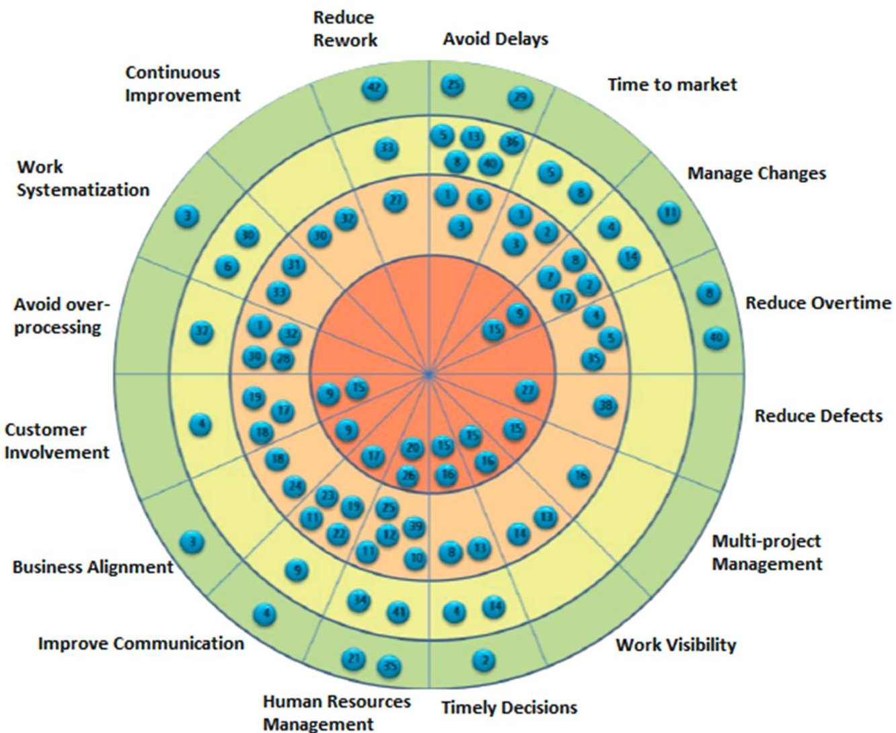
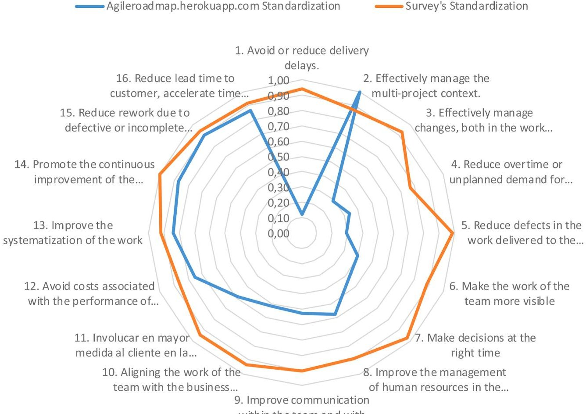

<!-- PDF_PAGE: 1 -->

# Selection of software agile practices using Analytic hierarchy process

Royer David Estrada-Esponda $ ^{a,*} $ , Mauricio López-Benítez $ ^{a} $ , Gerardo Matturro $ ^{b} $ Juan Carlos Osorio-Gómez $ ^{a} $

a Universidad del Valle, Colombia

$ ^{b} $ Universidad ORT Uruguay, Uruguay

## ARTICLE INFO

Keywords:

AHP

Agile software development

Agile manufacturing

Decision making

Analytic hierarchy process

## ABSTRACT

Context: The increasing use of software and information technology in modern society requires that the deployment of IT solutions should be more efficient and controlled. In this sense, agile methodologies are essential to achieve this goal, but a relevant question arises: Which is the right methodology for reaching that goal?

Objective: The purpose of the research was to study the prioritization of agile practices and improvement objectives in the context of software development, using the Analytic Hierarchy Process (AHP) method. For this purpose, 42 agile practices, 16 improvement objectives, 4 organizations dedicated to software development in Colombia and 40 professionals in the area of information and communication technologies in the same country were considered.

Method: ology: The methodological approach used was mixed. On the one hand, we applied a quantitative approach for the treatment of data with the AHP method and, on the other hand, a qualitative analysis by consulting experts through a digital survey to validate the prioritization of the improvement objectives. Questionpro was used as a support tool for multicriteria comparison.

Results: The main results show that applying AHP allowed us to prioritize 6 improvement objectives and 5 agile practices, where it is highlighted that the prioritization does not discard the other objects of comparison but allows us to put into practice the prioritized elements to favor their progressive implementation. The non-prioritized elements could be part of future iterations of multicriteria comparison that go hand in hand with capacity development and organizational maturity models in the context of global software development.

Conclusion: It is highlighted that, although there is evidence of the application of multi-criteria comparison methods in the software development industry, this work applies such methods in the context of four different agile methodologies, which translates into a precedent for the conformation of hybrid methodological approaches.

## 1. Introduction

Industry 4.0 currently supports various types of businesses, perhaps due to the different disruptions of technology in society such as hypermedia, the Blockchain, and the Metaverse, to name a few. In fact, there is empirical evidence about its use in supply chain

<!-- PDF_PAGE: 2 -->

management [1], healthcare [2], and the banking industry [3]. Now, in relation to software development companies, it is known that "agile methodologies have become the most popular methods for this activity in the last few years." However, there is also evidence that the implementation of these agile management approaches and practices is not an easy task. There is a demand for studies on how software development companies make decisions about the relevant practices and processes that must be included in their workflows to generate value for all their stakeholders in short periods of time.

On the other hand, there is abundant literature on large-scale agilism [4-9] which reinforces the previous statement on how to make decisions about the best processes or methodologies, not only for software development companies but also for companies in any industrial sector. For example, interesting initiatives appear for project management [10,11] that apply agile approaches to manage projects, which shows that bodies of knowledge in the field of agilism such as Scrum Body of Knowledge [12]turn out to be relevant for developing these new initiatives. In addition, the covid 19 pandemic accelerated the implementation of agile work approaches in which the selection of agile practices became a priority to assess the adaptation to change of work teams [7,13].

[8] wonder what success factors and challenges on agile transformation have been identified in other studies, which shows the importance of continuing the study of these areas of knowledge based on the large-scale implementation of agile approaches. In Ref. [14] it is mention that despite the fact that deep organizational change is the highest objective, these changes must be carried out progressively, which implies that their intensity gradually increases even with the joint application with other more traditional practices of management.

In fact, on such emerging topics as quantum computing, there is empirical evidence to show that thinking about incorporating agile practices remains a challenge for the software industry in envisioning what software development will look like in the future [15]. In parallel [16], show the importance of identifying different agile practices and how they can be integrated when coming from different agile work approaches, and conclude that the proper selection of these practices will determine the success of software development projects.

So, a relevant question arises: how to know which are the processes or practices that must be selected and included to improve the workflows in an organization? For [14], the prioritization methods of these practices and improvement objectives are necessary, since it is relevant to determine the applicability of each of the agile practices in relation to their contribution to the general objectives of organizational improvement. They also mention that prioritization must consider that the application of some agile practices can induce the application of others, which means that there are dependencies between practices that can be evident.

In relation to secondary studies that outline prioritization processes, some antecedents were found in the main collections of Scopus and Web of Science [6,17-19]. These studies outline trends in specific areas such as software testing prioritization and overall software development, including success factors for continuous process improvement. Other works references in Refs. [20,21] focus on prioritizing business practices or objectives aimed at satisfying the needs of stakeholders. To illustrate in Ref. [20] evaluated four different prioritization methods, including AHP, the One Hundred Dollar Method, simple ranking, and MoSCoW [21]. warns that there is a lack of formal methods to choose the agile practices that should be incorporated into the workflows, although they addressed the prioritization of these agile practices through techniques based on decision making, the Rule-Description-Practice (RDP) technique, the AHP method, and the cost-benefit analysis; this coincides with [22], who use AHP as a strategy to prioritize agile practices taking into account, in addition to business interests, the values and principles of the Agile Manifesto.

Based on the above, it is possible to appreciate the need to expand the number of methods that can support decision-making on the prioritization of agile practices or, in general, the progressive transition from traditional work approaches to newer ones based on organizational agility as well as its validation in real work environments. In this study, we return to the results obtained by Ref. [14] to the extent that they focused on the compilation of practices of four agile management methodological approaches. However, the issue of prioritizing the 42 agile practices associated with the 16 improvement objectives is still pending work.

This aspect differentiates the work of [14] from the studies of [20,21] since the latter focused on the evaluation of prioritization methods, while [14] focus on the application of a specific prioritization method to practices from four different methodological approaches. The prioritization method chosen was Analytic Hierarchy Process (AHP), because it has been validated in similar exercises such as those presented by Refs. [20,21] and more recently in the research of [22]; additionally, because in the case of considering that agile practices have significant dependency between them, the AHP method allows assigning a score that indicates that both elements subjected to the comparison have equal importance.

The AHP method was presented by Saaty [23] and is used to evaluate the opinions of those involved in decision-making processes to find the relative importance of each of the criteria under analysis; in our case, the importance of incorporating agile practices and which ones to consider first. Table 1 presents the assessment scale. Even values represent intermediate values, which makes scoring easier if there is no consensus on odd scores during a decision process.

Table 1 Rating scale.

<table border="1"><tr><td>Value</td><td>Meaning</td><td>Explanation</td></tr><tr><td>1</td><td>Equal importance.</td><td>The attribute in row (i) is of equal importance to the one in column (j).</td></tr><tr><td>3</td><td>Moderately Important.</td><td>The attribute in row (i) is moderately important than the one in column (j).</td></tr><tr><td>5</td><td>Strongly Important.</td><td>The attribute in row (i) is strongly important than the one in column (j).</td></tr><tr><td>7</td><td>Very strongly Important.</td><td>The attribute in row (i) is very strongly important than the one in column (j).</td></tr><tr><td>9</td><td>Extremely important.</td><td>The attribute in row (i) is extremely important than the one in column (j).</td></tr><tr><td>2,4,6,8</td><td>Intermediate values.</td><td>Used when there is no certainty of one of the odd values.</td></tr></table>

<!-- PDF_PAGE: 3 -->

AHP is described as one of the primary and most effective MCDM (Multiple-criteria decision analysis) techniques [24]. The AHP is used to develop overall priorities for ranking the alternatives. AHP provides a convenient way to decide using available data that is usually intangible or based on quality properties. The idea of using a hierarchy aims to reduce any given system to a set of pairwise elements that are comparable against each other [25].

In the case of using this method, it is necessary to construct matrices of order n (nxn) where "n" represents the number of criteria or decision variables. In order to enable the construction of consistent matrices, the concept of inverse value must be considered; that is, if the importance of the value of the row with respect to the column is "x", then the importance of the column in relation to the row must be "1/x" [26].

In addition, according to Saaty in Ref. [23], there is a random coefficient that, in relation to the size of the evaluation matrix, will determine whether or not there is consistency in the results obtained. Table 2 shows the value of coefficients for matrices with N between 1 and 10.

With respect to works that have used multicriteria methodologies in software projects, we can mention [27] They create a comprehensive framework based on Qualtiy of Service (QoS) criteria in ubiquitous environment to rank services, this paper gathers and classifies the QoS criteria into four classes of architecture, usability, ubiquity, and security. This classification organizes QoS criteria in a hierarchical structure. Afterward, Analytic Hierarchy Process (AHP) is used to propose a customized service ranking framework according to the values of each criterion. Other work that uses AHP for software selection is included in Ref. [24]. In this case they combined AHP with PROMETHEE in the process. And specifically application for analyzes the correlation between agile values, principles, and practices to enhance project performance is presented in Ref. [22]. They use the Analytic Hierarchy Process (AHP) to investigate how factors such as project performance, agile values, agile principles, and agile practices are related to one another, the result indicated the highest rank of priority associated with correlation among each variable. The final result of this study suggests which practices adopting when the project performance needs enhancement and which moderator can affect the decision-making process.

This article is organized as follows. Section 2 presents the practices, objectives and studies related to AHP-based prioritization. Section 3 presents the methodological design in which the phases that were followed to apply the prioritization of agile practices and improvement objectives are described. Section 4 presents the results of the research, emphasizing the prioritized vectors. Finally, the limitations of the study and the conclusions are presented.

## 2. Background

## 2.1. Agile practices

The agile practices referred to in this work were consolidated by Ref. [14] and come from four methodological frameworks widely used in the software industry (Lean, Scrum, Kanban, XP), but also in companies undergoing agile transformation processes. Table 3 summarizes these practices.

## 2.2. Improvement objectives

In [14] also propose 16 improvement objectives, each of which groups a set of agile practices that contribute of those objectives. It is worth mentioning that the deployment of the practices can be gradual and even combined with traditional practices to facilitate the fulfillment of their respective improvement objectives. Table 4 summarizes these improvement objectives.

It is evident that both the practices and the improvement objectives are not a straitjacket for the prioritization exercise, due to the nature of the Road Maps [28,29]. It could well happen that any another system of agile practices and improvement objectives that is susceptible to prioritization. Fig.1 presents the practices associated with each improvement objective.

Finally, there are recent works that show the validity of the selection of agile practices for software development processes, for example Quantum Software development [15], Software tests [30] and A Systematic Literature Review for this topic [16].

Table 2

Random coefficient according to the size of the matrix.

<table border="1"><tr><td>Matrix size</td><td>CA</td></tr><tr><td>1</td><td>0</td></tr><tr><td>2</td><td>0</td></tr><tr><td>3</td><td>0.52</td></tr><tr><td>4</td><td>0.89</td></tr><tr><td>5</td><td>1.11</td></tr><tr><td>6</td><td>1.25</td></tr><tr><td>7</td><td>1.35</td></tr><tr><td>8</td><td>1.40</td></tr><tr><td>9</td><td>1.45</td></tr><tr><td>10</td><td>1.49</td></tr></table>

<!-- PDF_PAGE: 4 -->

Table 3 Agile practices [14].

<table border="1"><tr><td>#</td><td>Agile practice</td><td>Method</td></tr><tr><td>1</td><td>Promote simplicity in all aspects. Offer the simplest solution that can be satisfactory to the customer.</td><td>Lean, XP</td></tr><tr><td>2</td><td>Develop and deliver finished work incrementally.</td><td>Kanban, XP, Scrum</td></tr><tr><td>3</td><td>Make frequent deliveries of completed work units.</td><td>Kanban, XP, Scrum</td></tr><tr><td>4</td><td>Hold planning meetings frequently (every few weeks, not months).</td><td>XP, Scrum</td></tr><tr><td>5</td><td>Limit the work planned for a period based on your estimate and the corresponding coherence with the capacity of the team.</td><td>XP, Scrum</td></tr><tr><td>6</td><td>Organize work into iterations that group work units that are delivered on a scheduled date.</td><td>XP, Scrum</td></tr><tr><td>7</td><td>Avoid investing effort in advancing work that is not committed and/or is not close to delivery.</td><td>Lean</td></tr><tr><td>8</td><td>Organize the team&#x27;s work with the focus on generating a good finished workflow.</td><td>Kanban</td></tr><tr><td>9</td><td>Continuous and multi-criteria management of pending work so that it is always duly prioritized.</td><td>Scrum</td></tr><tr><td>10</td><td>Limit work in progress (WIP), that is, the number of work units the team has on a given activity.</td><td>Kanban</td></tr><tr><td>11</td><td>Form small teams and try to keep their members stable.</td><td>XP, Scrum</td></tr><tr><td>12</td><td>Limit the scope of work of each team.</td><td></td></tr><tr><td>13</td><td>Continuous monitoring (frequency of days, not weeks).</td><td>Kanban, XP, Scrum</td></tr><tr><td>14</td><td>Conduct daily meetings of the entire team, face to face, and very short.</td><td>XP, Scrum</td></tr><tr><td>15</td><td>Visualization of all the work entrusted to the team.</td><td>Kanban</td></tr><tr><td>16</td><td>Integrated management of all assigned work, both at the team level and for each team member.</td><td></td></tr><tr><td>17</td><td>Client in close contact with the team and highly available, even if it is possible to be on site.</td><td>XP, Scrum</td></tr><tr><td>18</td><td>That there is a single person who makes decisions regarding the priorities of the team&#x27;s work, and who is a good representative of the client side.</td><td>XP, Scrum</td></tr><tr><td>19</td><td>Hold meetings to review the work delivered.</td><td>Scrum</td></tr><tr><td>20</td><td>The team organizes itself and makes technical decisions.</td><td>Scrum</td></tr><tr><td>21</td><td>Boss with characteristics of leader and facilitator instead of authoritarian and controlling.</td><td>XP, Scrum</td></tr><tr><td>22</td><td>Co-location of team members; the entire team working in the same physical space.</td><td>XP, Scrum</td></tr><tr><td>23</td><td>Have a physical work space that favors interaction between team members.</td><td>XP</td></tr><tr><td>24</td><td>Establish and communicate the vision of the product or service to the team, and reinforce it regularly.</td><td>XP</td></tr><tr><td>25</td><td>That the team has, among all its members, the necessary skills to address all the activities required to complete the work.</td><td>Scrum</td></tr><tr><td>26</td><td>That the members of the team can be in charge of different types of activities, although they may be specialists in some of them.</td><td>Scrum</td></tr><tr><td>27</td><td>Work focused on satisfying acceptance tests agreed with the client.</td><td>XP</td></tr><tr><td>28</td><td>Document only what is strictly necessary. Ensure that the use of the documentation is profitable with respect to the effort associated with preparing it.</td><td>Lean</td></tr><tr><td>29</td><td>Establish guidelines to conveniently manage re-work.</td><td>Lean</td></tr><tr><td>30</td><td>Have a process improvement leader available to the team.</td><td>XP, Scrum</td></tr><tr><td>31</td><td>Setting standards for the team&#x27;s technical work.</td><td>XP</td></tr><tr><td>32</td><td>Hold retrospective meetings to assess the team&#x27;s performance and its ways of working. Continuous process improvement.</td><td>Scrum</td></tr><tr><td>33</td><td>Define and agree on what is meant by&quot;finished work&quot;, both for the activities carried out by the team and for the deliverables to the client.</td><td>Scrum</td></tr><tr><td>34</td><td>Work or activities carried out jointly by two or more team members.</td><td>XP</td></tr><tr><td>35</td><td>Do not abuse overtime, negotiate and re-plan in a timely manner to avoid it.</td><td>XP</td></tr><tr><td>36</td><td>Reduce interruptions or context changes that affect team members in their work.</td><td>Lean</td></tr><tr><td>37</td><td>Establish a discipline of taking advantage of the meetings.</td><td></td></tr><tr><td>38</td><td>Automate tests to ensure that the product maintains the desired behavior when changes are made.</td><td>XP</td></tr><tr><td>39</td><td>Postponing until the last minute the assignment of the person in charge of carrying out an activity.</td><td></td></tr><tr><td>40</td><td>Continuously integrate the finished work into the product.</td><td>XP</td></tr><tr><td>41</td><td>Promote that team members get to know all the parts of the product or service that have been entrusted to the team.</td><td>XP</td></tr><tr><td>42</td><td>Continuously improve the architecture and design of the product to facilitate its maintenance.</td><td>XP</td></tr></table>

## 2.3. Related works

The success of a software development process is associated with a set of decisions that must be made by the team leader and in which a series of characteristics and situations that can affect each project in a particular way must be taken into account. In this sense, the literature shows that it is not enough to adopt an agile development methodology because, when trying to implement it rigorously, the results in many cases are not very encouraging. Thus, in studies such as the one by Ref. [31], the importance of establishing a framework for selecting processes for software development is highlighted. Aspects such as scale, user experience, time to market, and other characteristics should be considered. This is an indication that taking the principles and values declared in the Agile Manifesto as a starting point, a process identification method should be designed to address the aforementioned situation. This research is based on a multicriteria study based on the application of the AHP.

Time is one of the main factors that affect the development of an IT (Information Technology) project, particularly in software development, so the work that is carried out in terms of designing strategies for the adoption of agile practices focuses on this factor. In this sense [31], present an approach called DevOps adapted to the agile methodology that aims to collaborate with software development and operation teams in order to provide continuous high-quality software development in a short period of time. Weather. Although the development of this approach is still incipient, the proposal consists of analyzing the use of the DevOps concept in IT projects by identifying the challenges and mitigation strategies, and grouping them into categories to evaluate the success of such

<!-- PDF_PAGE: 5 -->

Table 4 Improvement objectives [14].

<table border="1"><tr><td>Improvement objective</td><td>Description</td></tr><tr><td>Avoid delays</td><td>Avoid or reduce delivery delays.</td></tr><tr><td>Manage changes.</td><td>Effectively manage changes, both in activities and in their priorities.</td></tr><tr><td>Reduce overtime.</td><td>Reduce overtime or unforeseen demand for additional human resources.</td></tr><tr><td>Reduce defects.</td><td>Reduce defects in the work delivered to the client.</td></tr><tr><td>Improve communication.</td><td>Improve communication within the team and with the client.</td></tr><tr><td>Involve the customer.</td><td>Involve the client to a greater extent in the planning, definition, and validation of the work.</td></tr><tr><td>Work systematization.</td><td>Improve the systematization of work.</td></tr><tr><td>Continuous improvement.</td><td>Promote continuous improvement of the process used by the team.</td></tr><tr><td>Reduce re-work.</td><td>Reduce rework due to faulty or incomplete work detected by the team.</td></tr><tr><td>Time to market</td><td>Reduce the delivery time to the customer, accelerate the "time to market".</td></tr><tr><td>Multi-project management</td><td>Manage effectively in a multi-project context.</td></tr><tr><td>Work visibility.</td><td>Make team work more visible.</td></tr><tr><td>Timely decisions.</td><td>Make decisions at the right time.</td></tr><tr><td>HR Management</td><td>Improve human resource management at team level.</td></tr><tr><td>Alignment with the business.</td><td>Alignment of team work with business objectives.</td></tr><tr><td>Avoid over-processing.</td><td>Avoid costs associated with expendable or doubtfully profitable tasks.</td></tr></table>

Fig. 1. Agile practices by improvement objective [14].

projects.

In addition to time, the proposal of a roadmap for the adoption of agile practices should pay special attention to the coordination between teams in software development, mainly in cases of large-scale development since, as proposed by Ref. [32], can be challenging when relying on agile development methods that emphasize iterative and frequent delivery in teams. Thus, these authors propose four coordination strategies: 1) align autonomous teams, 2) maintain the overview in the large-scale environment, 3) manage priorities, and 4) manage architecture and technical dependencies. The proposal extends to defining intra- and inter-team strategies to understand how teams coordinate and manage their unique coordination situation.

<!-- PDF_PAGE: 6 -->

In accordance with the aforementioned considerations, it is imperative to incorporate not only quantitative measures but also specific qualitative measures in the selection of methodological approaches for making managerial decisions. This holistic approach is crucial for automating management processes and optimizing agile management, which enables organizations to swiftly respond to dynamic environmental changes and evolving requirements [33].

Going into a little more detail on "traditional" agile methodologies, strategies such as eXtreme Programming (XP), Scrum, and Agile Modeling, their adoption for software development also depends on certain criteria. In the study presented by Ref. [34] it is considered as a multi-criteria decision-making problem. In this sense, it is understood that the selection of an agile method is linked to the identification of the particular characteristics of each project, which is why it becomes an important research topic. Like the proposal by Ref. [35], a strategy for the selection of agile methods is presented using the Analytic Hierarchy Process (AHP), which consists of guaranteeing a positive response in the dynamics of requirements (PRDR), incorporation of requirements changes (IRC), communication with the client (CWC) and the size of the development team (SDT).

In addition to the AHP [21], propose the evaluation of the cost-benefit ratio in order to classify agile practices according to their comparative value, taking into account that there are no uniform formal practices and that members must participate in each decision. Of the project team. This comparison might suggest a true agile development process.

Although the selection of the strategy to implement an agile development process must be based on the Agile Manifesto, it is important to keep in mind that there are certain criteria for decision making. According to Ref. [18], these criteria are related to Project Complexity and Reliability (PCR), Project Familiarity and Experience (FEP), Quality and Risk Management (QRM), Experienced and Adaptive Team (EAT), Team Communication and Democratic Culture (TCDC), Formalization and Documentation (FAD), Customer Support and Collaboration (CSC), and Clarity of Requirements (CDR).

The paramount importance of the requirements identification process in software development is evident from various teams' experiences. Project success or failure often hinges on its accuracy. As a [20] asserts, the challenge lies in bridging the gap between customer expectations and software engineers' understanding. Addressing this gap not only facilitates task prioritization but also optimizes resource allocation. Hatton's work discusses four distinct prioritization methods: MoSCoW, the One Hundred Dollar Method, Simple Ranking, and the aforementioned AHP. MoSCoW, in particular, offers a user-friendly approach to narrowing the gap between clients and developers while ensuring consistency, low difficulty, and minimal effort—a set of characteristics also shared by the One Hundred Dollar method.

Table 5 reviews the characteristics identified in the review of previous work, observing coincidences in some of them.

## 3. Methodology

Mixed research methods, including qualitative and quantitative approaches, were used for this study. The research variables refer to the improvement objectives and the agile practices available for comparison. The research question posed for the study is: Which of the improvement objectives and pre-selected practices represent the greatest importance for each of the companies that were part of the multi-criteria analysis?

On the other hand, as outlined in the previous sections, the ultimate purpose of agility is to create value for the different stakeholders through iterative and incremental deliveries. This is based on a continuous improvement approach that, in turn, is supported by quality models such as Kanban and Toyota System process, among others. Therefore, in order to establish how agile practices

## Table 5

Related Works summary.

<table border="1"><tr><td>Related works</td><td>Reference</td><td>Characteristics</td></tr><tr><td>Software process selection system based on multicriteria decision making</td><td>[36]</td><td>Multi-criteria analysis based on the application of the Analytic Hierarchy Process.</td></tr><tr><td>Challenges for adopting DevOps in information technology projects</td><td>[31]</td><td>DevOps: Approach adapted from the agile methodology. Continuous development and delivery of software focused on development and operations teams.</td></tr><tr><td>Coordination Strategies: Managing Inter-team Coordination Challenges in Large-Scale Agile</td><td>[32]</td><td>Intra- and inter-team coordination strategies.</td></tr><tr><td>Qualitative justification of strategic management decisions in choosing agile management methodologies</td><td>[33]</td><td>Analysis based on quantitative and qualitative measures in the selection of methodological approaches.</td></tr><tr><td>Agile trends in Chinese global software development industry: Fuzzy AHP based conceptual mapping</td><td>[34]</td><td>Multicriteria analysis.</td></tr><tr><td>A Method for the Selection of Agile Methods using AHP</td><td>[37]</td><td>AHP applied to the selection of methodologies.</td></tr><tr><td>An Approach for Prioritizing Agile Practices for Adaptation</td><td>[21]</td><td>Cost benefit analysis.</td></tr><tr><td>A Roadmap for Agility Estimation and Method Selection for Secure Agile Development Using AHP and ANN</td><td>[18]</td><td>Analysis based on criteria such as: Project Complexity and Reliability(PCR), Project Familiarity and Experience(FEP), Quality and Risk Management(QRM), Experienced and Adaptive Team(EAT), Team Communication and Democratic Culture(TCDC), Formalization and Documentation(FAD), Customer Support and Collaboration(CSC), Clarity of Requirements(CDR).</td></tr><tr><td>Early Prioritization of Goals</td><td>[20]</td><td>Addresses the strategy of bridging the gap between what the client needs and what the developer understands.</td></tr><tr><td>An AHP Analysis of Correlations Among Project Performance, Agile Core Values, Principles, and Practices</td><td>[22]</td><td>This study uses AHP for the analysis of the correlation between agile values, principles and practices and their impact on project performance.</td></tr></table>

<!-- PDF_PAGE: 7 -->

contribute to continuous improvement objectives, a prioritization study was carried out on both improvement objectives and agile practices, all of them extracted from the work of [14]. This prioritization exercise is compatible with higher order thinking activities according to Bloom's taxonomy. In fact, the purpose of "Analyze", "Evaluate", and "Create" are evidence of this [38]. Although the work of [14] is important from the point of view that the categorization of agile practices will facilitate their implementation in software organizations or industries in the process of digital transformation, it is important to highlight that such practices must be implemented progressively and at the pace that each organization considers appropriate. In this direction, the prioritization methods to establish which of all these practices are more convenient for an organization can be studied theoretically, but they must also be validated at the organizational level.

In order to limit the number of agile practices and improvement objectives, it was decided to determine the absolute frequency of these variables. Six improvement objectives were selected that had the highest number of associated agile practices, as shown in Fig.1. Similarly, the agile practices were selected given their representativeness in relation to the improvement objectives, in this case five agile practices were selected. This preselection to facilitate AHP analysis is compatible with simple comparison processes such as the one outlined in Ref. [20]. However, other screening methods such as Qualitative Point Analysis should not be ruled out. In addition, a review of data from the https://agileroadmap.herokuapp.com platform was undertaken while it was active, and insights were gathered through a survey of IT graduates using the GSuite Forms platform. These additional steps were conducted to augment the study's perspective and enrich the data pool.

With the pre-selection of agile practices and improvement objectives, four software development organizations were selected through a convenience method. They prioritized agile practices and improvement objectives through a survey published on the QuestionPro platform.

These companies are in the category of small and medium-sized companies, and all of them are located in Tuluá, Colombia. Additionally, the sectors in which these companies are engaged are sectors such as payments, ERP, inter-municipal toll management, among others.

Subsequently, prioritization was carried out based on the AHP method proposed by Ref. [23]. To determine the priority of each of the six improvement objectives, the degree of relative importance of each improvement objective in relation to the others was calculated. This exercise was carried out with employees of the selected software development organizations. The same procedure was carried out with agile practices.

Based on Gonzalez's (2015) proposal [39], we carry out the following procedure.

- Initially, the objective of the analysis was established. In the context of this research, the objective was to determine which of the pre-selected improvement objectives and agile practices are most important for each of the companies participating in the study.

- Classify intangibles. The ranking was represented by each of the improvement goals and agile practices. In other words, how important is each of the improvement objectives and agile practices for each of the collaborators who participated in the multicriteria exercise.

- Carry out the comparison of each of the six improvement objectives and the five agile practices.

Also, and considering [40], the following was carried out.

- The degree of importance of a variable in relation to all the others was put into consideration, for which the matrix of paired comparisons of nxn or order n was constructed, with n = 6 for the case of improvement objectives and n = 5 for the case of agile practices. The ratings used correspond to those shown in Table 1.

- The matrices were stabilized using the MMULT function of the Microsoft Office suite.

- Finally, each row of the normalized matrix was averaged in order to obtain a vector of priorities that was expressed in percentage terms.

The results were consolidated according to the methodology proposed by Saaty, who proposes using the geometric mean for this process.

Regarding the validation of the survey-type data collection instruments, the research committee of the academic unit where the research was conducted was consulted, which endorsed the relevance, suitability and protection of personal data of the individuals who were exposed to these instruments. The respective communication and endorsement are available upon request.

## 4. Results and discussion

Due to the significant number of agile practices and improvement objectives, prior to the AHP analysis, on the platform https:// agileroadmap.herokuapp.com/developed within the framework of the work of [14] it was possible (while it was online) to identify a rating for improvement targets. This rating was the result of an evaluation carried out by all the experts who registered their RoadMaps on that platform. At the same time, 40 professionals from the IT area were asked to rate the same improvement objectives on a Likert scale from 1 to 9. A Cronbach's alpha greater than 80 % was obtained, which reflects the consistency of the instrument used. Since the ratings were obtained from two different sources of information, it was decided to standardize them to make them comparable. Fig. 2 shows these results.

After the normalization of the scores given by two different groups of experts, it is evident that there was no clear orientation on which objectives turned out to be more important for both groups.

<!-- PDF_PAGE: 8 -->

Subsequently, based on the 6 improvement objectives and 5 agile practices selected as a result of the analysis of their absolute frequency, the comparison was made based on the AHP method. In parallel, based on the priority vectors, it was possible to conclude which objectives and practices turned out to be of the highest priority to put into practice in the organizational process flows.

With the prioritized objectives and practices, it was also possible to discuss their applicability and contrast them with the works outlined in previous chapters. Next, the comparison matrix (Table 6) and priority vectors (Table 7) for the improvement objectives are presented.

Once the matrix of paired comparisons for the improvement objectives was stabilized, it was possible to identify the priority for each of these objectives. It is emphasized that "making decisions in a timely manner" has the highest priority of all the objectives; In fact, there is empirical evidence of works that consider the decision-making process as a key factor in the software industry [41]. In contrast, "avoid or reduce delivery delays" was the lowest priority objective. Table 6 summarizes the results for the six objectives evaluated.

It is necessary to note that prioritization does not seek to rule out the least qualified targets. What prioritization indicates is that efforts should be concentrated to systematically execute the steps so that each of the objectives can be part of the organizational culture and produce the desired results in relation to the generation of value for the different stakeholders.

For example, timely decision making adds an important knowledge of the organization's environment through the analysis of threats and opportunities that affect the projects it develops. In the case of opportunities, for example, performing constant migrations or upgrades as part of software configuration management. In the case of threats, non-delivery or release of defective products during each work sprint could be avoided.

Improvement objective 11 "Involve the client to a greater extent in the planning, definition, and validation of the work", is related to innovative work approaches where horizontal structures prevail that are compatible with agile work approaches in the software industry, but also in organizations in the process of transformation or incorporation of agility on a large scale. An example aimed at involving users is user-centered design, which defines the user as a co-author and therefore makes him responsible for the project [42].

The objective "improvement of communication within the team and with the client" shows that it is necessary to establish communication channels that are mediated by practices typical of agile methodologies such as, in the case of Scrum, the Daily Scrum and the Retrospective for the team. and Backlog Grooming for communication with stakeholders.

Regarding agile practices, Table 8 and Table 9 outline the comparison matrix and priority vector, respectively.

As shown in Table 8, the best rated practice was "hold planning meetings frequently". This coincides with iterative and incremental methodologies whose purpose is to progressively and constantly deliver value to the different stakeholders. The programming of these meetings must consider the different roles of the collaborators and avoid work overload [43].

In relation to the practices "Organizing the team's work with a focus on generating a good finished job" and "Visualization of all the

Fig. 2. Rating of the improvement objectives by the experts.

<!-- PDF_PAGE: 9 -->

Table 6 Preference matrix for improvement objectives.

<table border="1"><tr><td></td><td>8. Improve human resource management in the team.</td><td>1. Avoid or reduce delivery delays.</td><td>3. Effectively manage changes, both in activities and in their priorities.</td><td>7. Make decisions at the right time.</td><td>9. Improve communication within the team and with the client.</td><td>11. Involve the client to a greater extent in the planning, definition, and validation of the work.</td></tr><tr><td>8. Improve human resource management in the team.</td><td>1</td><td>0,619166504</td><td>1,984006912</td><td>0,543946443</td><td>1</td><td>0,671593799</td></tr><tr><td>1. Avoid or reduce delivery delays.</td><td>1,615074448</td><td>1</td><td>0,665898935</td><td>0,586786488</td><td>1,034219694</td><td>0,440021873</td></tr><tr><td>3. Effectively manage changes, both in activities and in their priorities.</td><td>0,5</td><td>1,501729387</td><td>1</td><td>1</td><td>0,683405939</td><td>0,808,943,379</td></tr><tr><td>7. Make decisions at the right time.</td><td>1,8</td><td>1,704,197,387</td><td>1</td><td>1</td><td>1,135,753,796</td><td>1,183,693,809</td></tr><tr><td>9. Improve communication within the team and with the client.</td><td>1</td><td>0,966,912,548</td><td>1,46,325,916</td><td>0,880,472,514</td><td>1</td><td>0,89,595,846</td></tr><tr><td>11. Involve the client to a greater extent in the planning, definition, and validation of the work.</td><td>1,5</td><td>2,272,614,296</td><td>1,236,180,462</td><td>0,84,481,307</td><td>1,116,123,174</td><td>1</td></tr></table>

Table 7

Vector of priorities for improvement objectives.

<table border="1"><tr><td>Improvement objective</td><td>Priority</td></tr><tr><td>7. Make decisions at the right time.</td><td>20.48%</td></tr><tr><td>11. Involve the client to a greater extent in the planning, definition, and validation of the work.</td><td>20.28%</td></tr><tr><td>9. Improve communication within the team and with the client.</td><td>16.21%</td></tr><tr><td>8. Improve human resource management in the team</td><td>14.95%</td></tr><tr><td>3. Effectively manage changes, both in activities and in their priorities.</td><td>14.46%</td></tr><tr><td>1. Avoid or reduce delivery delays.</td><td>13.61%</td></tr></table>

Table 8

Agile practices preference matrix.

<table border="1"><tr><td></td><td>4.Hold planning meetings frequently(every few weeks,not months).</td><td>8.Organize the team&#x27;s work with a focus on generating a good finished work.</td><td>15.Visualization of all the work entrusted to the team.</td><td>3.Make frequent deliveries of completed work units.</td><td>9.Continuous and multi-criteria management of pending work so that it is always duly prioritized.</td></tr><tr><td>4.Hold planning meetings frequently(every few weeks,not months).</td><td>1</td><td>2,31,258,554</td><td>1,620,656,597</td><td>1,426,943,588</td><td>1,87,075,076</td></tr><tr><td>8.Organize the team&#x27;s work with a focus on generating a good finished work.</td><td>0,432,416,437</td><td>1</td><td>0,762,765,206</td><td>1,732,050,808</td><td>1,513,331,441</td></tr><tr><td>15.Visualization of all the work entrusted to the team.</td><td>0,617,033,863</td><td>1,311,019,423</td><td>1</td><td>0,823,171,254</td><td>0,719,223,093</td></tr><tr><td>3.Make frequent deliveries of completed work units.</td><td>0,700,798,552</td><td>0,577,350,269</td><td>1,214,814,044</td><td>1</td><td>1,236,180,462</td></tr><tr><td>9.Continuous and multi-criteria management of pending work so that it is always duly prioritized.</td><td>0,534,544,751</td><td>0,660,793,778</td><td>1,39,038,917</td><td>0,808,943,379</td><td>1</td></tr></table>

<!-- PDF_PAGE: 10 -->

Table 9

Priority vector for agile practices.

<table border="1"><tr><td>Agile Practice</td><td>Priority</td></tr><tr><td>4.Hold planning meetings frequently(every few weeks,not months).</td><td>30,4%</td></tr><tr><td>8.Organize the team&#x27;s work with a focus on generating a good finished work.</td><td>19,3%</td></tr><tr><td>15.Visualization of all the work entrusted to the team.</td><td>17,5%</td></tr><tr><td>3.Make frequent deliveries of completed work units.</td><td>16,8%</td></tr><tr><td>9.Continuous and multi-criteria management of pending work so that it is always duly prioritized.</td><td>16,0%</td></tr></table>

work entrusted to the team" it can be seen how methodological approaches such as Scrum propose radiators of information that allow the team to keep team aware of the current status of the project and all its workflow before releasing versions in production environments. Example of radiators can be Trello, or Scrumboard. These types of tools are significant for the productivity of highperformance teams and, just as they were qualified in Tables 8 and it can be seen that they are a priority for the companies that participated in the exercise.

In relation to the prioritization method used, there is empirical evidence that shows that there are alternatives to the AHP that have been even better valued in the context of the selection of software products [44]. However, in the context of the present study it was not possible to assess its effectiveness since no other comparison method was used in parallel. At the same time, works such as the one presented by Ref. [45] review a comparison exercise based on the use of two prioritization methods, but this time to select computer-aided design (CAD) tools, which reaffirms that using alternative prioritization methods It is not only a good methodological practice, but it significantly improves the results of the investigations.

On the other hand, there is also empirical evidence showing that the use of AHP, despite being executed independently, is widely used and accepted in the academic community. For example, it has been applied to the selection of ERP systems [46,47], in order to be right about which ERP to choose, taking into account the wide variety existing in the market and the importance of this type of business management systems. There is also evidence of the use of AHP for decision making for the selection of open source software since [48], due to the great popularity of this type of solutions, it is becoming increasingly complex to choose the most appropriate tools for the companies. Likewise, there is also evidence of the use of AHP to support decision making for the selection of multimedia creation systems [49] and for maintenance management systems [50].

Finally, taking into account that the application of AHP in the software industry has been generalized, and despite the fact that in the context of this exercise it was used independently to prioritize improvement objectives and agile practices, this work is interesting as a reference and contribution to the state of the art to motivate the implementation of similar exercises in conjunction with other prioritization methods.

## 5. Conclusions and future works

Analytic Hierarchy Process (AHP) is a well-known multi-criteria decision analysis technique designed to help in making complex decisions. Among the many areas of application (business, engineering, project management, and resource allocation, among others), we decided to apply it to address a recurrent problem faced by software development organizations that are willing to adopt an agile methodology for managing software projects.

Based on the work of [14], we took a subset of the 42 agile practices identified and the 16 improvement objectives proposed by these authors to analyze how to apply AHP to the task of the prioritization of agile practices and improvement objectives in the context of software development.

With the subset of 6 improvement objectives and 5 agile practices, we surveyed software development experts from 4 software companies to gather their opinions regarding how those objectives and practices should be prioritized in the contexts of their organizations. Based on their responses, we applied AHP to decide which objectives and practices turned out to be of the highest priority to put into practice in the organizational process flows.

From this exercise we can conclude that the use of AHP is an appropriate tool to use for software practitioners in cases where a software organization must decide how to prioritize which agile practices to select and which improvement objectives to set to determine the best path to adopt an agile approach to managing the organizational process flows.

The application case of this article, that is, selecting and prioritizing agile practices to support specific improvement objectives, is a common situation in software organizations that seek to adopt an agile management approach or improve their current software process. For this usual context, AHP offers clear advantages over other prioritization methods mentioned above in the Related works section. First, AHP provides a structured framework for decision-making, breaking down complex decisions into a hierarchy of criteria and sub-criteria, making it easier for decision-makers to understand and evaluate the problem. Second, AHP allows decision-makers to make judgments based on relative comparisons of experts' opinions, which is often more practical and feasible in real-world situations where obtaining precise quantitative data for all criteria may be difficult. Third, AHP can accommodate both qualitative and quantitative data, allowing decision-makers to combine subjective judgments with objective data. An additional advantage, relevant to the practical implementation of this method, is that there are numerous software tools available, making it easier for decision-makers to apply the method and analyze results efficiently.

Regarding future works, it is necessary to address future work with companies other than software companies and, thus, generate results that increase the discussion and contributions to the conceptualization and analysis of agility processes on a large

<!-- PDF_PAGE: 11 -->

organizational scale. Although these objectives and practices were taken from a secondary source of information, future work could include steps so that these objectives and practices could also be selected by the organizations themselves and, therefore, generate a higher level of contribution to their process flows.

## 6. Limitations

This study considered only four agile management methodologies, which can be seen as a limitation since there are other methodological approaches that deserve to be analyzed with the approach of multi-criteria assessment methods to evaluate their applicability or notice their weaknesses for instance N-soft sets for support making decision [51]. On the other hand, the use of 16 improvement objectives and 42 agile practices also adds an important bias in relation to the interpretation of the results.

Finally, the work that motivated the multicriteria exercise presented here has a significant emphasis on software development companies. However, as mentioned in the introduction and related works, the topic of organizational agility transcends software development companies.

## Data availability statement

The data associated with the study have not been deposited in a publicly accessible repository. However, data will be made available on request. Frequent question.

## CRediT authorship contribution statement

Royer David Estrada-Esponda: Writing - original draft, Project administration, Investigation, Formal analysis. Mauricio López Benítez: Writing - review & editing, Resources, Conceptualization. Gerardo Matturro: Validation, Supervision, Methodology. Juan Carlos Osorio-Gómez: Methodology, Investigation.

## Declaration of competing interest

Showing experiences of prioritization of agile methods is convenient in times of digital transformation.

Combining agile practices from different methodological approaches in quantitative assessment exercises is necessary due to the adaptability that companies must demonstrate today.

Agile practices should be incorporated progressively without this meaning that other practices not initially prioritized should be included.

We believe that this manuscript is appropriate for publication Heliyon because its results and discussion motivate researchers in the sector to further deepen their work in the field and in the software industry on agile methods and prioritization issues.

The authors have no conflicts of interest to disclose.

## References

[1] G. Matturro, R.D. Estrada-Esponda, C.H. González-Campo, Is agility in organisational management an established study field? a bibliometric analysis of literature (2000-2020), Int. J. Agile Syst. Manag. 15 (2) (2022), https://doi.org/10.1504/ijasm.2022.124915.

[2] M. Unterhofer, E. Rauch, D.T. Matt, Hospital 4.0 roadmap: an agile implementation guideline for hospital manager, Int. J. Agile Syst. Manag. 14 (4) (2021) 635-656, https://doi.org/10.1504/IJASM.2021.120230.

[3] S. Nilsson Tengstrand, P. Tomaszewski, M. Borg, R. Jabangwe, Challenges of Adopting SAFe in the Banking Industry - A Study Two Years after its Introduction, 419 LNBIP, Springer International Publishing, 2021, https://doi.org/10.1007/978-3-030-78098-2_10.

[4] F. Amiri, S. Overbeek, G. Wagenaar, C.J. Stettina, Reconciling agile frameworks with IT sourcing through an IT sourcing dimensions map and structured decision-making, Inf. Syst. E Bus. Manag. 19 (4) (2021) 1113-1142. https://doi.org/10.1007/s10257-021-00534-3.

[5] R.U. Jan, M. Usman, M.F. Abrar, N. Ullah, M. Asshad, S. Ali, Scaling agile adoption motivators from management perspective: an analytical hierarchy process approach, Sci. Program. 2021 (2021), https://doi.org/10.1155/2021/4522273.

[6] R.A. Khan, et al., Practices of motivators in adopting agile software development at large scale development team from management perspective, Electronics (Switzerland) 10 (19) (2021), https://doi.org/10.3390/electronics10192341.

[7] G. Lavie, O. Weinstein, Y. Segal, E. Davidson, Adapting to change: clalit's response to the COVID-19 pandemic, Isr J Health Policy Res 10 (1) (2021) 1-13, https://doi.org/10.1186/s13584-021-00498-2.

[8] D. Suddhasvatta, G. Kevin, Agile Transformation at Scale: A Tertiary Study, Springer International Publishing, 2021, https://doi.org/10.1007/978-3-030-88583-0.

[9] Ö. Uludağ, A. Putta, M. Paasivaara, F. Matthes, Evolution of the agile scaling frameworks, Lecture Notes in Business Information Processing 419 LNBIP (2021) 123-139, https://doi.org/10.1007/978-3-030-78098-2_8.

[10] E.S. Hidalgo, Adapting the scrum framework for agile project management in science: case study of a distributed research initiative, Heliyon 5 (3) (2019), e01447. https://doi.org/10.1016/j.heliyon.2019.e01447.

[11] L.R. Saragih, M. Dachyar, T.Y.M. Zagloel, Implementation of telecommunications cross-industry collaboration through agile project management, Heliyon 7 (5) (2021), e07013, https://doi.org/10.1016/j.heliyon.2021.e07013.

[12] Scrumstudy, Scrum Body on Knowledge, 2017.

[13] B.Y. Neumann M, The Impact of Covid 19 on Agile Software Development: A Systematic Literature Review, 2022.

[14] P. Letelier, C. Penadés, AgileRoadmap : Un modelo y estrategia para implantación de prácticas ágiles, Jornadas de Ingeniería del Software y Bases de Datos (JISBD), 2016.

[15] A.A. Khan, et al., Agile Practices for Quantum Software Development: Practitioners Perspectives, Oct. 2022 [Online]. Available: http://arxiv.org/abs/2210.09825.

<!-- PDF_PAGE: 12 -->

[16] D. Arnyndiasari, R. Ferdiana, P.I. Santosa, Software practices for agile developers: a systematic literature review, in: 2022 1st International Conference on Information System and Information Technology, ICISIT 2022, Institute of Electrical and Electronics Engineers Inc., 2022, pp. 238-243, https://doi.org/ 10.1109/ICISIT54091.2022.9872874.

[17] A.A. Khan, M. Shameem, R.R. Kumar, S. Hussain, X. Yan, Fuzzy AHP based prioritization and taxonomy of software process improvement success factors in global software development, Applied Soft Computing Journal 83 (2019), 105648, https://doi.org/10.1016/j.asoc.2019.105648.

[18] A. Sharma, R.K. Bawa, A roadmap for agility estimation and method selection for secure agile development using AHP and ANN, Adv. Intell. Syst. Comput. 542 (2018) 237-245, https://doi.org/10.1007/978-981-10-3223-3_22.

[19] R. Singh, D. Kumar, B.B. Sagar, Fuzzy analytical hierarchical process based two way assessment for agile testing, J. Discrete Math. Sci. Cryptogr. (2021), https:// doi.org/10.1080/09720529.2020.1794515.

[20] S. Hatton, Early Prioritisation of Goals," Lecture Notes In Computer Science (Including Subseries Lecture Notes In Artificial Intelligence And Lecture Notes In Bioinformatics), vol. 4802, LNCS, 2007, pp. 235-244, https://doi.org/10.1007/978-3-540-76292-8_29.

[21] G. Mikulenas, K. Kapocius, An Approach for Prioritizing Agile Practices for Adaptation, Information Systems Development: Asian Experiences, 2011, pp. 485-498, https://doi.org/10.1007/978-1-4419-7355-9_41.

[22] V.C. Dewi, S.J. Huang, Y. Palopak, An AHP analysis of correlations among project performance, agile core values, principles, and practices, in: Proceeding - 6th International Conference on Information Technology, Information Systems and Electrical Engineering: Applying Data Sciences and Artificial Intelligence Technologies for Environmental Sustainability, ICITISEE, 2022, p. 2022, https://doi.org/10.1109/ICITISEE57756.2022.10057743.

[23] T.L. Saaty, The Analytical Hierarchy Process, Planning, Priority," Priority Setting. Resource Allocation, MacGraw-Hill, New York International Book Company, 1980.

[24] E. Çalişkan, E. Aksakal, S. Çetinyokuş, T. Çetinyokuş, Hybrid use of Likert scale-based AHP and PROMETHEE methods for hazard analysis and consequence modeling (HACM) software selection, Int. J. Inf. Technol. Decis. Making (2019), https://doi.org/10.1142/S0219622019500330.

[25] R.M. Czekster, H.J. De Carvalho, G.Z. Kessler, L.M. Kipper, T. Webber, Decisor: a software tool to drive complex decisions with analytic hierarchy process, Int J Inf Technol Decis Mak 18 (1) (2019), https://doi.org/10.1142/S0219622018500360.

[26] R.D. Estrada-Esponda, C.H. González-Campo, Análisis jerárquico de procesos para la implementación de un modelo de referencia de procesos de gestión de conocimiento en el ámbito del desarrollo de software, Revista Logos, Ciencia & Tecnología 10 (4) (2018), https://doi.org/10.22335/rlct.v10i4.512.

[27] S. Izadpanah, H. Vahdat-Nejad, H. Saadatfar, A Framework for ranking ubiquitous computing services by AHP analysis, International Journal of Modeling, Simulation, and Scientific Computing 9 (4) (2018), https://doi.org/10.1142/S179396231850023X.

[28] T.A. Kappel, Perspectives on roadmaps: how organizations talk about the future, J. Prod. Innovat. Manag. 18 (1) (2001) 39-50, https://doi.org/10.1016/S0737-6782(00)00066-7.

[29] R. Kostoff and R. Schaller, "Science and Technology Roadmaps".

[30] A. Gómez García, M. Sosa Hernández, Good practices of software engineering: software tests, Revista Cubana De Transformación Digital 4 (2) (2023) [Online]. Available: https://rctd.uic.cu/rctd/article/view/205. (Accessed 10 October 2023).

[31] J.A.V.M.K. Jayakody, W.M.J.I. Wijayanayake, Challenges for adopting DevOps in information technology projects, 2021, in: Proceedings - International Research Conference on Smart Computing and Systems Engineering, SCSE, 2021, https://doi.org/10.1109/SCSE53661.2021.9568348.

[32] M. Berntzen, V. Stray, N.B. Moe, Coordination strategies: managing inter-team coordination challenges in large-scale agile, in: Lecture Notes in Business Information Processing, 2021, https://doi.org/10.1007/978-3-030-78098-2 9.

[33] Y. Rudnichenko, L. Liubokhynets, N. Havlovska, O. Illiashenko, N. Avanesova, Qualitative justification of strategic management decisions in choosing agile management methodologies, International Journal for Quality Research 15 (1) (2021), https://doi.org/10.24874/IJQR15.01-12.

[34] A.A. Khan, M. Shameem, M. Nadeem, M.A. Akbar, Agile trends in Chinese global software development industry: fuzzy AHP based conceptual mapping, Appl. Soft Comput. 102 (2021), 107090, https://doi.org/10.1016/j.asoc.2021.107090.

[35] B. Sayed, Z. Shamsi, M. Sadiq, A method for the selection of agile methods using AHP, Adv. Intell. Syst. Comput. 516 (2017) 297-303, https://doi.org/10.1007/ 978-981-10-3156-4-30.

[36] M. Pandey, R. Litoriya, P. Pandey, Novel approach for mobile based app development incorporating MAAF, Wirel Pers Commun 107 (4) (2019) 1687-1708. https://doi.org/10.1007/s11277-019-06351-9.

[37] B. Sayed, Z. Shamsi, M. Sadiq, A method for the selection of agile methods using AHP, Adv. Intell. Syst. Comput. 516 (2017) 297-303, https://doi.org/10.1007/ 978-981-10-3156-4_30.

[38] B.S. Bloom, D.R. Krathwohl, Taxonomy of educational objectives: the classification of educational goals, in: Handbook I: Cognitive Domain, 1956.

[39] G. Patricia González, Propuesta de un modelo para medir activos intangibles en empresas de software a partir de una herramienta multicriterio, Estud. Gerenciales 31 (135) (Apr. 2015) 191-201, https://doi.org/10.1016/J.ESTGER.2014.12.002.

[40] B. Gérard, T. Hurtado, "EL PROCESO DE ANÁLISIS JERÁRQUICO (AHP) COMO HERRAMIENTA PARA LA TOMA DE DECISIONES EN LA SELECCIÓN DE PROVEEDORES : APLICACIÓN EN LA SELECCIÓN DEL PROVEEDOR PARA LA EMPRESA GRÁFICA COMERCIAL MYE S.R.L.," 2005.

[41] G. Hernández, A. Martínez, I. Argote, D. Coral, Metodología adaptativa basada en Scrum: Caso empresas de la Industria de Software en San Juan de Pasto Colombia, vol. 28, Diciembre, 2015, pp. 211-223.

[42] R. Galeano, User centered design, Universidad Internacional de la Rioja 2 (4) (2008) 1-15 [Online]. Available: http://www.nosolousabilidad.com/artículos/ hipermedia.htm.

[43] H.Z. Furones, B.J. P, Aplicación de la clasificación jerárquica a la planificación de reuniones, XXV Congreso Nacional de Estadística e Investigación Operativa: Vigo 4-7 (2000) 485-486, de abril de 2000, 2000, ISBN 84-8158-152-6, págs. 485-486, https://dialnet.unirioja.es/servlet/articulo? codigo=566008&info=resumen&idioma=SPA. (Accessed 10 October 2023).

[44] A. Jadhav, R. Sonar, "Analytic hierarchy process (AHP), weighted scoring method (wsm), and hybrid knowledge based system (HKBS) for software selection: a comparative study," 2009, in: 2009 2nd International Conference on Emerging Trends in Engineering and Technology, ICETET, 2009, pp. 991-997, https://doi.org/10.1109/ICETET.2009.33.

[45] Z. Ayağ, A combined fuzzy AHP-simulation approach to CAD software selection, Int. J. Gen. Syst. 39 (7) (2010) 731-756, https://doi.org/10.1080/ 03081079.2010.495190.

[46] N. Karaarslan, E. Gundogar, An application for modular capability-based ERP software selecction using AHP method, Nature 388 (2020) 539-547.

[47] C.C. Wei, C.F. Chien, M.J.J. Wang, An AHP-based approach to ERP system selection, Int. J. Prod. Econ. 96 (1) (2005) 47-62, https://doi.org/10.1016/j.ijpe.2004.03.004.

[48] Y. Yah Jusoh, Open source software selection using an analytical hierarchy process (AHP), Am. J. Software Eng. Appl. 3 (6) (2014) 83, https://doi.org/ 10.11648/j.ajsea.20140306.13.

[49] V.S. Lai, B.K. Wong, W. Cheung, Group decision making in a multiple criteria environment: a case using the AHP in software selection, Eur. J. Oper. Res. 137 (1) (2002) 134-144, https://doi.org/10.1016/S0377-2217(01)00084-4.

[50] O. Durán, Computer-aided maintenance management systems selection based on a fuzzy AHP approach, Adv. Eng. Software 42 (10) (2011) 821-829, https:// doi.org/10.1016/j.advengsoft.2011.05.023.

[51] F. Fatimah, D. Rosadi, R.B.F. Hakim, J.C.R. Alcantud, N-soft sets and their decision making algorithms, Soft Comput. 22 (12) (Jun. 2018) 3829-3842, https:// doi.org/10.1007/s00500-017-2838-6.