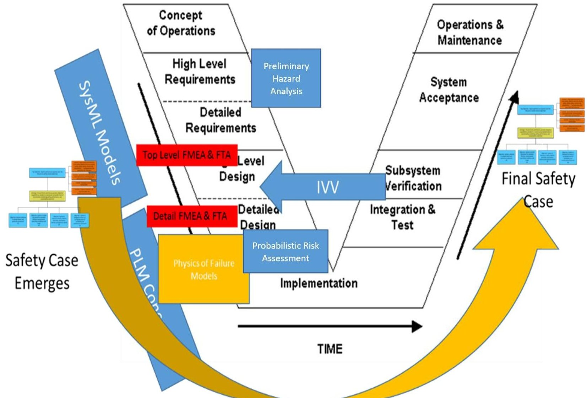
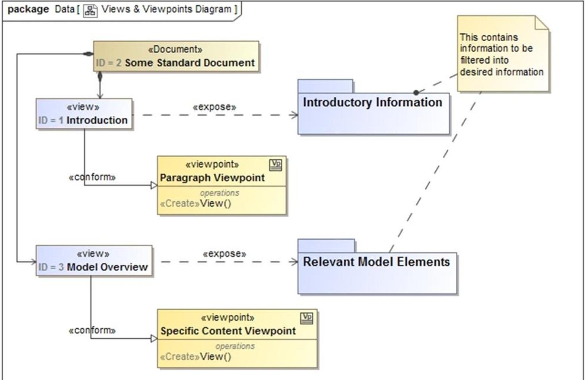
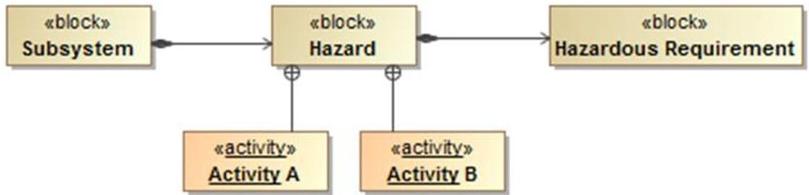
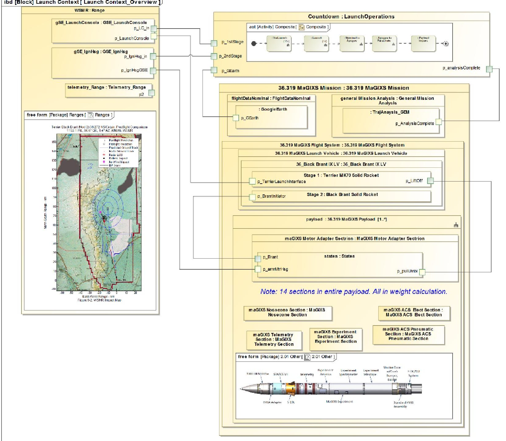
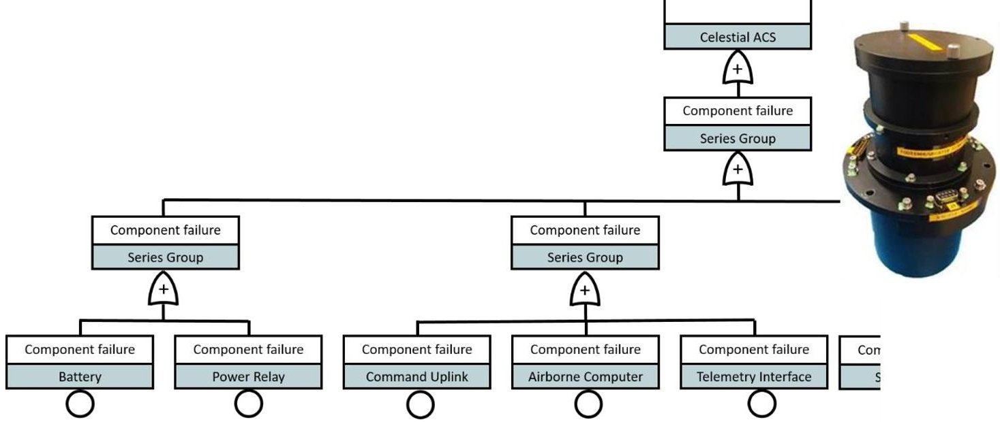

<!-- PDF_PAGE: 1 -->

# Enabling Assurance in the MBSE Environment

John W. Evans, PhD, NASA Office of Safety and Mission Assurance

Steven L. Cornford, PhD, Jet Propulsion Laboratory, California Institute of Technology

David Kotsifakis, MSci, NASA/Goddard Space Flight Center

Tim Crumbley, MSci, NASA Marshall Space Flight Center

Martin S. Feather, PhD, Jet Propulsion Laboratory, California Institute of Technology

Key Words: assurance, model-based systems engineering, MBSE

## SUMMARY & CONCLUSIONS

A number of specific benefits that fit within the hallmarks of effective development are realized with implementation of model-based approaches to systems and assurance. Model Based Systems Engineering (MBSE) enabled by standardized modeling languages (e.g., SysML $ ^{\circledR} $ ) is at the core.

These benefits in the context of spaceflight system challenges can include [1]:

- Improved management of complex development

- Reduced risk in the development process

- Improved cost management

- Improved design decisions

- With appropriate modeling techniques the assurance community can improve early oversight and insight into project development. NASA has shown the basic constructs of SysML in an MBSE environment offer several key advantages, within a Model Based Mission Assurance (MBMA) initiative [2, 3]. These include the following:

- Model viewpoints that promote rapid and systematic assessment of requirements coverage, hazard tagging and risk management

- Embedded safety assessments for launch vehicles

- Deployment of model assisted development of reliability products - Failure Modes and Effects Analyses (FMEAs) and Fault Trees

- Test Planning

- Validation and Verification of complex functions

- Support of Assurance Case development for complex systems

In addition, while there are benefits, there is a realization that these do not come without effort and cost. Enabling modelbased approaches requires structure, not only in an organizational context, but in a modeling context as well. There can be a steep learning curve and costs associated to train skilled modelers. But, on the other hand, not all of the assurance community need to be modelers. Models themselves must conform to ontologies that enable assurance. This places constraints upon the models and modelers. Optimums have yet to be developed where resources and constraints on modeling must be traded off in the organization and modeling efforts for

projects.

A number of barriers need to be overcome, as well, which pose challenges to the developers of the software that supports MBSE/MBMA. Information and data must be made to flow seamlessly through the life cycle. Because there is a wide variety of tools used in the community, to avoid the problems of the past of silos, delays, and diverging interests, information should flow among these tools to support the "single source of truth" paradigm of MBSE. This will greatly facilitate MBMA and advancement of assurance functions.

## 1 INTRODUCTION

Model Based Engineering (MBE) is emerging in the aerospace sector as an important contributor to improved development from concept to production. Indeed, Model Based Systems Engineering (MBSE) is leading the way in moving from a document centric development process to the digitally enabled modeling environment. In NASA, selected major projects have moved forward with MSBE enabled development. Examples include NASA's Europa Clipper project led by the Jet Propulsion Laboratory (JPL) in which systems modeling effort has been at the forefront from the beginning, and NASA's Orion in which modeling has enabled more effective development of the guidance and navigation (GN&C) software [1,4]. These examples are relevant as they define the state of the art in implementation of model based concepts.

Europa Clipper is a major interplanetary exploration project with an anticipated launch date in 2023. It will take on exploring Jupiter's icy moon Europa, for which it was named. The implementation of MBSE on the project has centered on the implementation of SysML models, with viewpoints that enable systems engineers on the project to manage mass and power margins, track and trace requirements, and oversee the conceptual development. The benefits and value added to the project have recently been evaluated by Bayer [1]. In this case, benefit to system assurance is realized by improved management of requirements, better communication across the project, and a single source of truth implementation to drive analysis, thereby reducing errors. An implementation of auto

<!-- PDF_PAGE: 2 -->

generated fault trees is being used and results checked against conventional fault trees being developed for the mission's probabilistic risk analysis (PRA).

Orion is NASA's crewed flagship system for the upcoming Moon and Mars missions. The guidance and navigation system (GN&C) is crucial to the success of its deep space mission scenarios and its software is the heart of this system. While this success may not have utilized SysML at the top level, Orion GN&C clearly reflects the utility of modeling in system development. In this case, Simulink $ ^{\circledR} $ provided a basis for a model driven development of the flight software [4]. GN&C algorithms were developed and tested, and autocoding produced the flight software products. The successful test of the Orion in EFT-1 showed the overall success of this development [5]. Clearly, system assurance benefits from the lower error rates in code that emerges from this type of effort.

With each success and demonstrated benefit MBE continues to gain a foothold across NASA, as new and everincreasing complexity emerges. With progression, assurance can gain greater and more direct benefits from the modeling

environment [2]. The authors have previously discussed these anticipated benefits, many of which have been demonstrated on a smaller programmatic scale [2,3]. These include synthesis of assurance products and views of the system from SysML, such as failure modes and effects analysis, fault trees and reliability block diagrams for analytical purposes, as well as fault diagrams, and Bayesian nets [3]. Further development across the agency and continuing applications have poised the assurance fields for greater advancement, as discussed below.

## 2 ENGAGING THE ENTERPRISE

In recognizing the potential benefits of MBMA, it can be quickly seen that success depends upon a System of Systems (SoS) solution within the enterprise, in order to realize products and demonstrated benefits. Concurrent with MBMA at NASA, the systems engineering community emerged with a program to explore MBSE beyond that experienced within Europa and Orion. This provided a natural partnership for MBMA development.

Figure 1. Systems Vee overlaid with assurance products for safety and reliability.

## 2.1 Cross Life Cycle Modeling Team

NASA's Pathfinder endeavor provided a natural partnership for the NASA assurance community to develop MBMA concepts [6,7]. Multiple Pathfinder projects allowed for testing ideas, development of views and viewpoints, and

engaging the model for safety and reliability products and analyses.

Pathfinder evolved to become the Model Based Systems Engineering (MBSE) Infusion and Modernization Initiative (MIAMI). This program has focused on expanding modeling capabilities across the life cycle of NASA systems using

<!-- PDF_PAGE: 3 -->

sounding rocket missions as the basis [8]. Sounding rocket missions afford a life cycle in which MBSE and MBMA benefits can be demonstrated to the enterprise in a relatively short timeframe as compared to larger scale missions. The projects have been driven by the Cross Life Modeling (CLM) team with membership across the agency.

The objectives of the team were well delineated by Waldram et. al. [8]:

"1) Develop useful, innovative Model Based Systems Engineering (MBSE) approaches to successfully advance and achieve Sounding Rocket and Experiment Missions and

2) Provide a cornerstone of MBSE approaches (e.g., deployment of structure, behavior, requirement, and parametric models, libraries, templates, patterns, configuration management) that will be used as a best practice for the MBSE [and MBMA] practitioner."

Among the successes have been the development of viewpoints to engage non-expert modelers with the model, which is highly useful to the assurance community, and the infusion of safety requirements for launches directly into the model. These are explained in more detail below.

## 2.2 Assurance Across the Life Cycle

In the earliest stages of the program, requirements are developed and flowed down to subsystems. At this stage, assurance can receive the benefits of MBSE by working directly with the development of the requirements, which provides early access to project development. As the model emerges with the design, appropriately scoped views can provide oversight at the earliest stages of development.

An effective SoS solution at the enterprise level for MBE will involve integration of a variety of software tools to meet stakeholder needs at various stages of the life cycle [10]. Assurance tools in fact vary widely depending upon their purpose and the products needed at the appropriate point the life cycle. Figure 1 shows some safety and reliability artifacts that are needed in the design of systems, overlaid on the systems vee (SE-V) [??107]. Various software tools support these analyses. The benefits of the system model in producing these analyses is realized when the information from the systems model can be exploited by other tools, or if the analysis can be directly extracted from the systems model by specialized scripts or plug-ins. In the latter case, the fidelity of the artifacts will depend on the level of the model.

As an example, early Failure Mode and Effects Analysis (FMEA) can be extracted directly from SysML models, given a correct ontology. Details within the model supporting design trade decisions and an early understanding of off nominal behavior and failure can then be derived [8]. Similarly, Fault Trees can be synthesized rapidly, along with block diagrams. However, as details emerge in the design of hardware or software, other tools may be more useful [9]. In this case, early products may serve as precursors to more detailed analyses for which structural information needs to move from SysML into other tools in the modeling environment. A significant lesson herein is that data must flow through the SE-V rapidly and seamlessly to take full advantage of MBE. This presents

challenges in the solutions space that are not easily solved when there are multiple stakeholders requiring the use of different modeling tools.

Goal Structuring Notation (GSN) based assurance or safety cases are highly compatible with MBE and can be folded into the modeling environment. The Assurance or Safety Case then supports maintaining a machine-readable logic structure that serves as a record of assurance decisions affecting the design, while rolling up in the digital format, products and analysis that support design, testing and operations from a safety and reliability viewpoint. The utility of the assurance on small missions has been shown by Austin et. al. [9] focusing on radiation assurance for a cubesat mission. Assurance and Safety Cases can serve a significant benefit and represent a type of model that is the assurance perspective of the "single source of truth" for oversight and reviews as well as for risk acceptance prior to deployment of the system.

## 3 ASSURANCE VIEWS AND ASSURANCE PRODUCTS

The ability to develop model views from multiple stakeholders is an essential characteristic of the modeling environment [12]. This must be a priority in the enterprise solution of MBE to enable assurance and other stakeholders to interact with the modeling environment. This is part of the notion of the SysML specification [13]. We often describe the model as an N-dimensional being, and the views give us 2- (or 3-) dimensional slices of the higher dimensional object. This is similar to what we were doing with all of the documents of yesteryear, but in the current case there are no inconsistencies since all stakeholders share the same data.

Another important aspect of Views and Viewpoints is the ability to make 'standard' Views and Viewpoints, which contain selected information of interest to particular stakeholder(s). The promise of having standardized insight into a standardized model has an overwhelming allure. This promise usually requires (among other things) that some portion of the pattern for modeling be standardized. This can be more easily illustrated using Figure 2 below. A Document (e.g., Some Standard Document in the Figure) consists of a collection of Views (e.g., Introduction and Model Overview). Each View must 'conform' to a Viewpoint and 'expose' one or more packages. The Viewpoint contains 'methods' or ways of constructing the View and usually involves Collection of objects, Filtering of objects, Sorting of objects and representation of Object attributes. The package(s) exposed contain the objects to be collected, filtered, sorted and displayed. If the method is looking for 'stereotypes' of a certain name, then the model needs to be using the pattern of stereotypes with the naming convention expected. There are more robust ways of gathering information, but there will always be some degree of conformance required.

## 3.1 Views from Assurance Stakeholder Viewpoints

The benefits of modeling from an assurance perspective are derived from interacting with the model to access information or to impact the development of the system. Oversight functions to facilitate independence of technical authority, for

<!-- PDF_PAGE: 4 -->

example, require the appropriate stakeholder viewpoint that is more global in nature to explore the state of the project. A model view emerges, which allows for evaluating requirements hazards, and risks early in the life cycle. Other views may be

more focused on specific aspects of safety to automatically ensure compliance. A launch system Concept of Operations (CONOPS), for example, would embed range safety requirements into mission planning.

Figure 2. SysML diagram for views from stakeholder viewpoints.

Figure 3. A simplified modeling pattern for Hazard tags. Activities in this context are well defined safety procedures.

A key aspect of the MIAMI/MBMA collaboration described earlier is the emphasis on the two thrusts that reflect assurance stakeholder needs:

Thrust 1: Representing safety, reliability and quality for hardware and software in SysML (to the extent practical)

Thrust 2: Lowering the 'barrier to entry' for model interaction and review for assurance stakeholders who are not expert modelers (to the extent practical)

The MIAMI/MBMA Thrust 1 effort represented key notions such as Requirements, Environments, Hazards, Risks and Procedures in a SysML model. One example is shown in Figure 3. Note, that this seemingly simple pattern enables us to do something rather efficient. When an informed

stakeholder determines that a particular Hazard is present, the linkage to the Requirements governing the Processes and Procedures is automatically present. This powerful pattern means that the act of allocating a Hazard to a System Element also attaches all of the procedures and traceability to associated requirements. Un-allocating removes all of them. They can be changed and managed in one place, and used in many. Implementation of such patterns is an essential aspect of enabling the assurance stakeholders in a community where resources are scare and time is at a premium. But this requires engagement of expert modelers and cooperative systems engineering and assurance efforts.

<!-- PDF_PAGE: 5 -->

## 3.2 Integration of Range Safety: A Specific Model View

In the case of Thrust 2 type collaboration within MIAMI, a range safety and CONOPS view was developed with unique features for visualization of safety requirement compliance. The SysML modeling fragments and visualization are shown in Figure 4. A vehicle is automatically selected and launch paths

calculated given the mass of the payload. Trajectories are bounded and overlaid on Google Earth to show compliance with range safety. This view integrates planning and safety compliance in the very early stages of the lifecycle. Assurance is embedded and expert modelers are not needed to exercise the view and visualization.

Figure 4. SysML model fragments reflecting integration of range safety requirements implemented in a view with range visualization showing trajectory data based on sounding rocket characteristics (courtesy WFF-CLM Team contribution)

## 4 ASSURANCE ANALYSIS IN MBSE

Modeling can also enable a variety of assurance artifacts to be automatically produced and used as appropriate in the life cycle. The earliest benefits may be yielded in reliability and maintainability [2]. Several papers have been published by NASA modeling team reflecting the benefits and products [3, 9, 10] including those from the authors.

Generally, there are two ways to accomplish the task of producing reliability artifacts. One approach is to extract the FMEA or FTA from a SysML structure model, given the model

is assembled to do so. In this case, state machines, a standard SysML behavior model, become very useful and plugins can be set up to traverse the model to evaluate effects. A second approach is to export the SysML structure model to a secondary tool, such as a PLM driven tool, and perform the analyses there. This can be useful for detailed FMEAs particularly when canned libraries can be accessed for well-defined components. One such output is reflected in Figure 5. However, limited data flows between tools often makes this difficult, thereby illustrating a key challenge to full MBE implementation.

<!-- PDF_PAGE: 6 -->

## 5 STATUS\

Evidence of benefits to assurance from its alignment with Model Based Systems Engineering are accumulating, as seen in major NASA projects. Collaborative efforts between systems engineering and assurance have been underway to expand the scope of such benefits. In particular, studies of sounding rocked missions, with their shorted lifecycles, have provided opportunities to explore innovative approaches. These studies have begun to address ways to allow assurance personnel to interact with assurance-related model information without the need to become expert modelers themselves. In parallel, work continues to expand the range of assurance artifacts whose production benefits from access to MBSE information. A key

challenge that remains is the need to ensure ease of information exchange between the multiple tools used by engineering and assurance.

## 6 ACKNOWLEDGEMENTS

This research was carried out at NASA HQ, NASA/Goddard Space Flight Center, NASA Marshall Space Flight Center, and the Jet Propulsion Laboratory, California Institute of Technology under a contract with the National Aeronautics and Space Administration.

Figure 5. Auto fault tree from PLM tool. (courtesy GSFC).

## REFERENCES

1. T. Bayer, "Is MBSE helping? Measuring value on Europa Clipper," 2018 IEEE Aerospace Conference, IEEE 2018, pp 1-13.

2. J. Evans, S. Cornford, M. S. Feather, "Model based mission assurance: NASA's assurance future," 2016 Annual Reliability and Maintainability Symposium (RAMS), IEEE 2016, pp 1-7.

3. J. W. Evans, F. J. Groen, L. Wang, R. Austin, A. Witulski, S. Cornford, M. Feather, N. Lindsey, "Towards a framework for reliability and safety analysis of complex space missions," 19th AIAA Non-Deterministic Approaches Conference 2017, p. 1099.

4. M. Jackson, J. Henry, "Orion GN&C Model Based Development: Experience and Lessons Learned," AIAA Guidance, Navigation, and Control Conference, 2012 p. 5036.

5. T. Cichan, S. D. Norris, P. Marshall, "Orion: EFT-1 flight test results and EM-1/2 status," AIAA SPACE 2015 Conference and Exposition, 2015, p. 4414.

6. J.B. Holladay, J. Knizhnik, K.J. Weiland, A. Stein, T. Sanders, P. Schwindt, "MBSE Infusion and Modernization Initiative (MIAMI): "Hot" Benefits for Real NASA Applications," 2019 IEEE Aerospace Conference, IEEE 2019, pp. 1-14.

7. J. Evans, J. Knizhnik, K. Weiland, S. Cornford, "Advancing Model Based Mission Assurance for Complex Systems," Model Based System Assurance Workshop, Systems Engineering Research Center, Washington, DC, 2016.

8. N. Waldram, S. Cornford, M. Piette, G. Plattsmier, "Cross Lifecycle Modeling in MBSE,". 2019 IEEE Aerospace Conference. IEEE 2019, pp. 1-6.,

9. J. Evans, A. Mosleh, "Concepts for Safety and Reliability Modeling in Model Based Engineering for Complex Systems Design," Aerospace, MDPI-Open Access, https://www.mdpi.com/journal/aerospace, submitted, 2019.

10. M. Izygon, H. Wagner, S. Okon, L. Wang, M. Sargusingh, J. Evans, "Facilitating R&M in spaceflight systems with MBSE," 2016 Annual Reliability and Maintainability Symposium (RAMS), IEEE 2016, pp. 1-6.

11. R. A. Austin, N. Mahadevan, B. D. Sierawski, G. Karsai, A. F. Witulski, J. Evans, "A CubeSat-payload radiation-reliability assurance case using goal structuring notation," 2017 Annual Reliability and Maintainability Symposium (RAMS), IEEE 2017, pp 1-8.

12. M. Elaasar, "Open Caesar Initiative," JPL Model-Based Systems Engineering (MBSE) Symposium and Workshop, https://www.slideshare.net/MagedElaasar/open-caesar-

<!-- PDF_PAGE: 7 -->

initiative, 2019.

13. Object Management Group, "OMG SYSTEM MODELING LANGUAGE," https://www.omg.org/spec/SysML/

## BIOGRAPHIES

John W. Evans, PhD

Office of Safety and Mission Assurance

NASA

300 E St SW

Washington, DC, 20546, USA

e-mail: john.w.evans@nasa.gov

John Evans earned his PhD in Materials Science and Engineering from Johns Hopkins University, and is the Program Manager for Reliability and Maintainability and Program Executive for the NASA Electronic Parts and Packaging Program at NASA HQ Office of Safety and Mission Assurance. He has authored or coauthored 3 textbooks, a book chapter on electronic materials and over 50 publications.

Steven L. Cornford, PhD

Jet Propulsion Laboratory, California Institute of Technology

4800 Oak Grove Drive

Pasadena, CA, 91109, USA

e-mail: steven.l.cornford@jpl.nasa.gov

Steven Cornford earned his PhD in Physics from Texas A&M University, and has worked at JPL since 1992. He has performed a variety of line management and project management functions. He has been a system engineer, reliability engineer, test engineer and a DARPA Principal Investigator. He is currently particularly interested in crosscutting problems and efforts to increase the breadth of earlyphase modeling and trade space exploration. He has authored over 100 papers.

David Kotsifakis, MSci NASA/Goddard Space Flight Center 32400 Fulton St. Wallops Island, VA, 23337

e-mail: david.p.kotsifakis@nasa.gov

David Kotsifakis is a Systems Engineer at Wallops Flight Facility for the Guidance, Navigation, and Control Section of the Systems Engineering Branch. He earned his MSci from University of Maryland - College Park, and his BSci in

Aerospace Engineering from Missouri University of Science and Technology in 1981. He has worked for NASA's Wallops Flight Facility since 1982. Although his current work involves MBSE, he has served as Head of Flight Systems with NASA/Wallops, project manager for Sounding Rockets, and Project Manager for NASA's technology development effort for a flight termination replacement called AFSS (Autonomous Flight Safety System).

## Tim Crumbley, MSci NASA Marshall Space Flight Center Huntsville, AL 35811, USA

## e-mail: tim/crumbley@nasa.gov

Tim Crumbley serves as NASA's Software Assurance technical fellow and works with center organizations to establish the agency-level SA procedures, policies, training and requirements for NASA. He has more than 30 years of experience working in the NASA software engineering community. His responsibilities have included the establishment and maintenance of NASA software engineering and management policies and requirements, teaching NASA software engineering classes, and providing guidance to effectively meet the scientific and technical objectives of software products developed under NASA funding. He has a Bachelor's degree in Chemical Engineering from the University of Alabama and a Master's degree in Computer Science from the University of Alabama in Huntsville.

Martin S. Feather, PhD

Martin S. Feather, PhD Jet Propulsion Laboratory, California Institute of Technology 4800 Oak Grove Drive Pasadena, CA, 91109, USA

e-mail: martin.s.feather@jpl.nasa.gov

Martin Feather is a Principal Software Assurance Engineer in JPL's Office of Safety and Mission Success, and has been with JPL for over 20 years. His activities are focused on identifying, developing and infusing research results that offer the prospect of improving assurance of space missions, with a particular interest in software. He received his BA and MA in Mathematics and Computer Science from the Cambridge University, UK, and PhD in Artificial Intelligence from the University of Edinburgh, UK, all in the previous millennium. He has authored or coauthored over 150 papers.