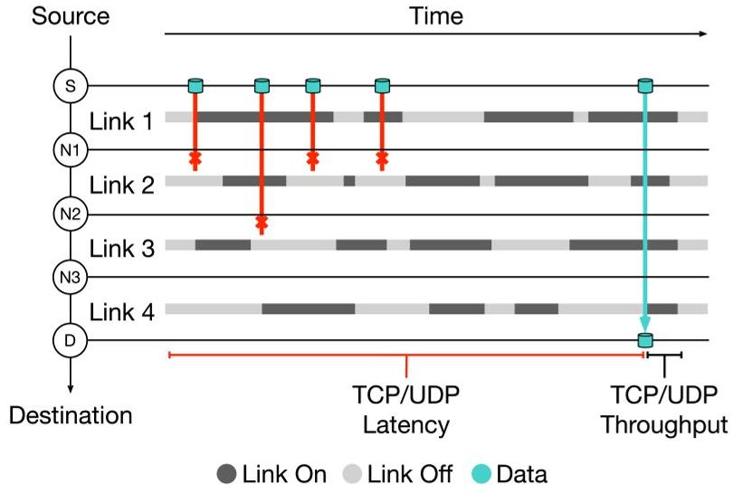
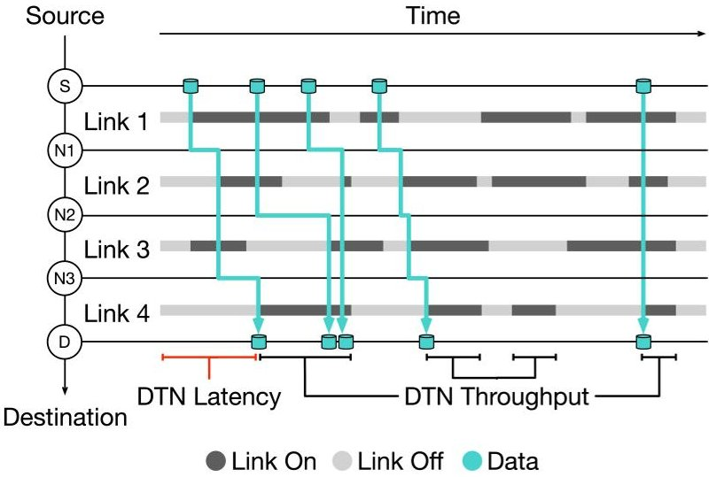
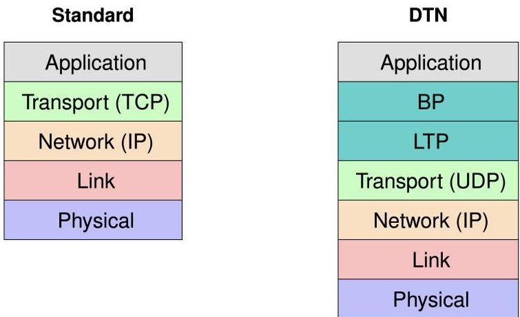
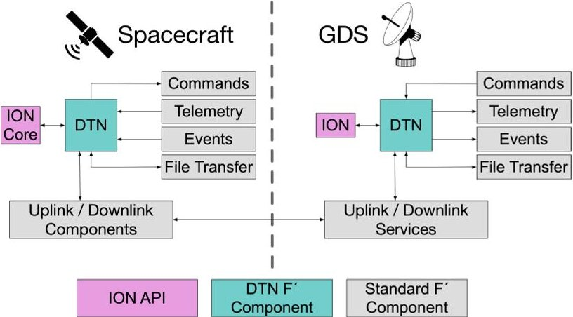
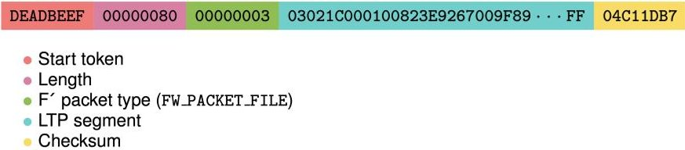
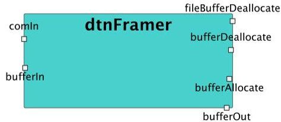
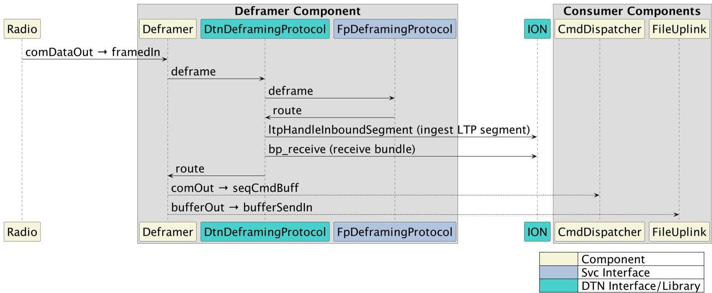
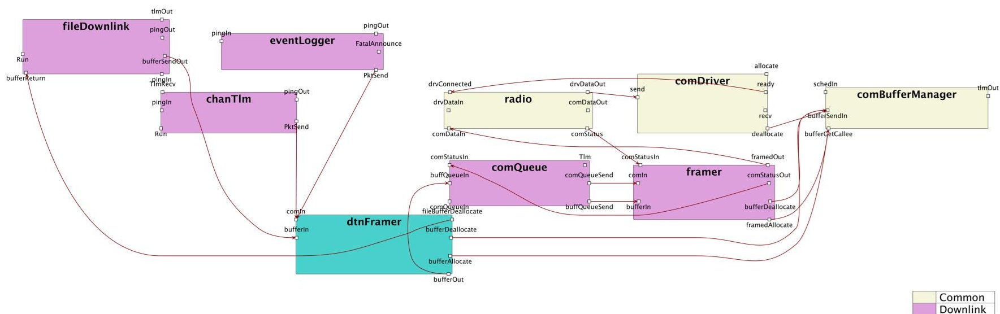
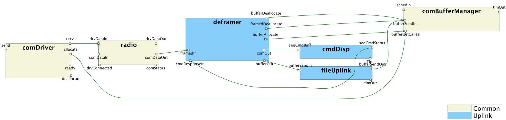

<!-- PDF_PAGE: 1 -->

# Enabling DTN in Spaceflight Systems: Integration of ION with the F Prime Flight Software Framework

Paul Rosemurgy, Jay Gao, Sky DeBaun Michael Starch, Jeffrey Levison, Rebecca Castano

Jet Propulsion Laboratory, California Institute of Technology 4800 Oak Grove Dr. Pasadena, CA 91109 paul.c.rosemurgy@jpl.nasa.gov, jay.l.gao@jpl.nasa.gov, sky.u.debaun@jpl.nasa.gov, michael.d.starch@jpl.nasa.gov, jeffrey.w.levison@jpl.nasa.gov, rebecca.castano@jpl.nasa.gov

Abstract—In this paper we will present an integration of Delay Tolerant Networking (DTN) within the F Prime flight software framework.

Delay/Disruption Tolerant Networking technology was designed and developed to address communication challenges in deep space environments characterized by long propagation delay and discontinuous connectivity where contemporaneous end-to-end data paths may not always be present. The Interplanetary Overlay Network (ION), an implementation of DTN, had its first in-flight demonstration on the EPOXI spacecraft in 2008. ION has been deployed and operating on the ISS, supporting science commanding and delivery between onboard instruments and ground investigators. ION has also been demonstrated on the Korea Pathfinder Lunar Orbiter (KPLO) mission with the Deep Space Network (DSN) and on the Morehead State University's 21-meter antenna. As DTN technology continues to demonstrate its potential for mission-critical communications, focus on mission infusion is gaining substantial momentum both inside and outside of NASA.

F Prime is an open-source flight software (FSW) framework that makes use of reusable software components to provide flight projects with an extensible and modular FSW architecture. F Prime has allowed for rapid development and deployment of FSW on instruments, CubeSats, and technology demonstrations such as ISS-RapidScat, ASTERIA, and Ingenuity Mars Helicopter. By implementing DTN uplink and downlink as discrete F Prime components, DTN can be enabled on existing F Prime projects with significantly reduced developmental effort.

We will describe the architecture and technical approach of how we integrated ION with F Prime to enable future missions to participate in space-based DTN networks and leverage automated capabilities for reliable store-and-forward, routing, transport of command, telemetry, event reporting, and file transfer between the flight deployment and ground. This integration will be the basis for future upgrades that will introduce advanced networking capabilities for end-to-end security and data streaming such as video and audio playback in near realtime.

## TABLE OF CONTENTS

1. INTRODUCTION...1

2. DESIGN ...3

3. IMPLEMENTATION...4

4. TESTING ...5

5. CONCLUSIONS ...5

ACKNOWLEDGMENTS ...7

REFERENCES ...7

BIOGRAPHY ...7

## 1. INTRODUCTION

The TCP/IP protocol [1], commonly used for Earth-based networking, faces significant challenges when applied to deep space communications. Its three-way handshake mechanism requires a fairly continuous end-to-end connection, making it ill-suited for the space environments where latency is high and connections may be intermittent (see Figure 1). DTN addresses this issue by delivering data hop-by-hop without endpoint handshaking to improve throughput and reduce latency (see Figure 2).

Additionally, the high bit error rate in deep space can severely impact round-trip times for data transmission. To address these issues, DTN aims to establish an internet standard specifically designed for reliable data transmission over deep space links and in other environments without continuous connectivity, such as remote areas, wildlife tracking systems, and marine networks [2].

Figure 1. Throughput with TCP/UDP requiring end-to-end connectivity.

<!-- PDF_PAGE: 2 -->

Figure 2. Throughput with DTN operating hop-by-hop with store-and-forward.

DTN enables a store-and-forward mechanism, hop-by-hop reliability, and scheduled contact links for better data transmission. It can transmit "bundles" of application-layer data across heterogeneous transport and network layers, such as TCP, UDP, and LTP.

In a DTN each node operates using the Bundle Protocol (BP) to send and receive data [3]. These nodes are part of one or more groups, known as DTN endpoints, which facilitate communication. Applications interact with DTN nodes to transmit or receive data encapsulated in bundles. Unlike traditional TCP/IP, these bundles are broken down into Licklider Transmission Protocol (LTP) segments for space link transmission [4]. LTP differs from TCP in that it ensures eventual delivery of data and does not halt subsequent transmissions if a segment is missing. These bundles are stored and forwarded from one node to another, traversing a path that ultimately leads to the intended destination. Figure 3 below shows how DTN's core protocols, namely BP and LTP, fit within the conventional protocol stack of the Internet.

Figure 3. Protocol stack comparison.

ION is an open-source implementation of the DTN protocol suite maintained by NASA's Jet Propulsion Laboratory (JPL). ION was designed to work under the processor and memory constraints typical of radiation-hardened spacecraft computers running a real-time operating system (RTOS). Shared memory is used to efficiently pass data between ION tasks in a POSIX-compatible manner. It is expected for flight projects using ION to pre-allocate memory for ION to use as its shared memory, thereby avoiding dynamic allocation of

## system memory.

In 2008, the first in-flight demonstration of ION was conducted on the EPOXI spacecraft as part of the DINET experiment [5]. The experiment lasted 27 days, during which around 300 images were successfully transmitted and forwarded by ION. This demonstration of flight readiness was later expanded through deployments on the ISS, the Korea Pathfinder Lunar Orbiter (KPLO), and the Deep Space Network (DSN) [6]. To reduce the complexity and implementation cost of maturing DTN for flight readiness we contend that it is necessary for ION to be integrated into an available and reusable flight software framework.

The open-source F Prime flight software (FSW) framework is an ideal FSW framework to develop safe, reliable, and multimission DTN components within. F Prime was developed at JPL to simplify the development and reuse of FSW for small-scale missions [7]. A component-based architecture is used to enforce modularity and simplify reasoning about the explicitly defined connections between components' ports. Successful deployments on ISS-RapidScat, ASTERIA, and Ingenuity Mars Helicopter have proven F Prime's ability to provide an effective and modular FSW architecture for a wide variety of operational environments and flight hardware. As open-source projects, F Prime and ION are both readily available and actively maintained by both internal and external contributors. By implementing DTN uplink and downlink within discrete F Prime components, DTN can be enabled with the following characteristics:

1. No need for new development of FSW infrastructure to encapsulate ION within a generic API for use by other modules/components.

2. No excising of a pre-existing ION FSW integration needed to carry over a successful integration into a new mission.

3. Tested and publicly available ION FSW integration.

4. Compile-time checks on inter-component connections, defined by F Prime typed ports.

In this paper, we describe the goal, design, implementation, and testing of a prototype F Prime FSW deployment and component library integrated with the ION DTN protocol suite. Our initial prototype of ION integrated into F Prime aims to offer a comprehensive set of capabilities to facilitate DTN for space missions. One of its primary goals is to achieve interoperability using the latest DTN Bundle Protocol v7, which is used on both international and NASA DTN communications providers such as the Deep Space Network. Additionally, it seeks to establish a reliable space data link service through the Licklider Transmission Protocol. The system is designed to enable dependable data transfers either over a single link or through a multi-hop relay DTN network via a "bundle" interface. This interface accepts and delivers each Application Data Unit (ADU) as a whole, without any partial acceptance or delivery.

Operational assumptions for the prototype include the responsibility for data accounting resting with the user's endpoints, such as avionics and mission operations, through command, telemetry, and Event Reporting (EVR) mechanisms. F Prime FSW will manage the initial uplinking and subsequent updates of ION configuration files and contact graphs. Other operational roles - such as command, telemetry, file accounting, and verification - fall under the purview of F Prime. The system also assumes that F Prime will allocate sufficient memory and non-volatile data storage as per the ION configuration file and will handle uplink and downlink framing, as well as encoding/decoding of Consultative Committee for

<!-- PDF_PAGE: 3 -->

Space Data Systems (CCSDS) frames. Lastly, a synchronized clock is assumed to be provided to ION to automate reliable link-layer data transfer using LTP.

## 2. DESIGN

The standard topology of F Prime components used to queue, frame/deframe, and radiate/receive data with the Ground Data System (GDS) is referred to as the "communications stack" and can be found within the F Prime System Reference $ ^{1} $ project. This topology helps to drive the design for DTN communication components that must fit within the current topology with minimal rewiring of existing connections and reconfiguration of components. Our DTN components are tasked with ensuring reliable application-layer communication through BP and reliable link-layer communications through LTP's automated retransmission functionality, which is compatible with many mission-specified uplink/downlink communication protocols. Figure 4 presents a high-level architectural overview of the F Prime DTN flight and ground prototype.

F Prime's modeling of FSW components allows for abstract data flow representations of FSW to be nearly identical to the actual models defined by the F Prime Prime (FPP) modeling language [8]. FPP is used to autogenerate C++ component source files with stubs for port handlers to be implemented by the developer. In this section we will discuss the modeldriven design of the uplink and downlink components necessary for a DTN-enabled F Prime deployment and GDS.

Figure 4. High-level overview of F Prime flight deployment and GDS running ION.

## Downlink

In the F Prime communications stack, downlinking data from a spacecraft to the ground occurs with the following sequence of events:

1. Application-layer data is destined for the ground - either as channelized telemetry from chanTlm, an EVR from event- Logger, or a file from fileDownlink.

2. Application-layer data is queued within comQueue with an associated priority.

3. Queued data is dequeued from the comQueue and passed to the framer to add an identifying header and checksum.

4. Framed data is passed from the framer to the radio. The radio then radiates the data to the ground through the comDriver, which operates specific radio hardware.

As seen in Figure 10, the standard steps needed for downlink

$ ^{1} $https://github.com/fprime-community/fprime-system-reference

are mostly untouched. The DTN framer component (dtn Framer) is placed between the three application-layer data sources and the comQueue. Externally, the DTN framer component is a passive component (one without its own thread of execution) that receives application-layer data to ingest into ION as bundles using the BP API. Internally, however, the component contains an inner thread to facilitate the segmentation of each bundle using the LTP API. This is necessary because a single bundle may result in many LTP segments and ION's LTP API to obtain segments is blocking. Depending on how ION is configured the expected sizes and number of LTP segments per bundle will vary. The framer will receive LTP segments and frame them as opaque file packets to be reassembled on the ground as bundles of application-layer data.

Loosely formalized, framing can be described by the composition of functions shown below.

$$
F _ {f r a m e} ^ {\prime} \left(L T P \left(B P \left(F _ {d a t a _ {i}} ^ {\prime}\right)\right)\right)
$$

Where:

1. $ F_{data_{i}}^{\prime} $ is the $ i^{th} $ telemetry/event/file ADU. See Figure 5.

2. BP() bundles application-layer data, adding headers in accordance with the Bundle Protocol.

3. LTP() segments and encodes data to conform to LTP protocol - adding checksum and error detection bits. See Figure 6.

4. $ F_{frame}^{\prime} () $ frames data to conform to F Prime wire protocol, contains start token, length, and checksum. LTP segments use the FW_PACKET_FILE packet type. See Figure 7.

Note that after LTP segmentation, a bundle's header is only embedded in the first LTP segment. Also note that all LTP segmentation and reconstruction occurs internally within ION's background processes. Therefore, raw bundle data units are not currently exposed to FSW.

00000001 00000100 000200647F798D0009727E0000001900004···FD

F' packet type (FW_PACKET_TELEM)

TLM channel ID (blockDrv.BD_Cycles, value increments roughly every second)

Application data

Figure 5. F Prime telemetry data

03021C000100823E9267009F89···FF

Figure 6. LTP segment of F Prime telemetry data

Figure 7. F Prime frame of LTP segment

Uplink

Uplinking commands and files from the ground to a spacecraft mirrors the sequence of events performed during downlink. F Prime's stock deframer component currently handles both the deframing of uplink packets and the routing of deframed packets to their destined component - either to cmdDisp for command dispatch or to fileUplink for file

<!-- PDF_PAGE: 4 -->

uplink. Scheduled work within F Prime's core component library is planned to pull routing logic out of the deframer and into a standalone component. Since routing and deframing are coupled, we have developed a DTN "deframing protocol" implementation that the stock deframer can be configured with to enable DTN. The implementation and configuration of our DTN deframing protocol is discussed in greater detail in section 3. From a design perspective, enabling DTN for uplink in a standard F Prime communications stack currently does not require the addition of a new component or any rewiring of connections between existing components. See Figure 11 for the standard uplink topology.

## Uplink consists of the following sequence of events:

1. Command packets or file packets are sent to the spacecraft and received by the comDriver radio hardware driver.

2. comDriver streams uplinked data to the radio component to pass to the deframer.

3. Within the deframer, start tokens inserted by the framer are used to segment the stream of uplinked data into packets. Each packet's header is checked to determine whether the packet is a command or file.

4. Depending on the packet type, the deframed data is passed to either the cmdDisp or fileUplink.

DTN is implemented within this standard sequence solely within the deframer by enqueueing deframed LTP segments into ION. On an inner thread within the DTN deframing protocol, a blocking call to ION to reconstruct bundles is called in a loop, resulting in full-fledged command or file packets that are passed along to their respective destination (cmdDisp or fileUplink).

## Ground Data System

Integrating DTN into the GDS follows the same design as the flight uplink and downlink architectures. However, the F Prime GDS does not strictly follow a model-driven component-based design. Conveniences such as dynamic allocation and dynamic typing are generally accepted on GDS implementations - these in turn simplify the design.

DTN-enabled downlink is supported within the GDS by adding a background thread to ingest deframed LTP segments into ION while the main thread waits for fully reconstructed bundles to be returned from ION. Uplink is supported by ingesting command/file packets into ION as bundles. In a background thread each bundle is segmented with LTP, framed with the existing F Prime GDS framing logic, and radiated to the spacecraft.

## 3. IMPLEMENTATION

The fprime-dtn $ ^{2} $ project consists of two main DTN-enabled elements developed in C++: a reference project and a separate component library. The reference project is located within Ref/ and features a flight-like topology that is based on the F Prime System Reference project, providing a template for real-world applications. The component library is located within Dtn/ and is engineered to function as an external library for F Prime projects, facilitating integration and customization. The project is compatible with the latest F Prime version, v3.3.2, and is open-sourced as part of the F Prime community.

Statically linked ION libraries used within fprime-dtn are

generated from ion-core. The ion-core $ ^{3} $ project is a streamlined version of the ION open-source software suite and offers essential DTN functionalities including BP, LTP, UDP convergence layer adapters, bundle store-and-forward capabilities, hop-by-hop reliability, and routing mechanisms

The GDS used to demonstrate end-to-end DTN communication is implemented within the fprime-gds-dtn $ ^{4} $ project as a fork of fprime-gds $ ^{5} $ . For ease of deployment and operation, Debian-based Docker images are defined to reproducibly build and run containerized F Prime DTN deployments with the DTN-enabled F Prime GDS. Containerization and end-to-end integration testing is discussed in greater detail in section 4.

The F Prime DTN framer component and deframing protocol "infrastructure" both interact with ION DTN services by "attaching" to the shared memory and semaphores that facilitate ION's interprocess communications (IPC). This enables a suite of ION daemons to operate in the background, performing various tasks such as buffering, data processing, and routing on behalf of the DTN infrastructure. To ensure that the DTN infrastructure is the only FSW that has access to ION we intentionally only build this source with statically linked ION libraries as opposed to building all of FSW with the linked libraries. Helper classes are also used to keep the framer component and deframing protocol implementations minimal and to isolate direct calls to ION (Dtn::FramerHelper and Dtn::DeframerHelper respectively). In this section we will expand on the implementation details of uplink and downlink on our F Prime deployment and GDS.

## Downlink

As discussed in section 2, the downlink dtnFramer component is a passive component with an inner thread. See Figure 8 for an expanded view of the dtnFramer component and its ports. Ports are shown with inputs on the left and outputs on the right. The input port handlers for telemetry and events (comIn) and file downlink (bufferIn) ingest the application-layer data into ION through the non-blocking bp_send() ION function. An inner thread calls the blocking ltpDequeueOutboundSegment() ION function in a continuous loop to pass LTP segments downstream to the stock F Prime framing topology.

Figure 8. F Prime DTN downlink framer component.

Note that in Figure 10 the only output port being used to flow data downstream is the bufferOut port. Since all application-layer data is converted to bundles and segmented by LTP, an arbitrarily-sized buffer from a pre-allocated region of memory is needed to store segments. When the stock framer frames each segment buffer it automatically uses the FW_PACKET_FILE packet type which supports arbitrarily sized data.

See Dtn/Dtn/Framer/ for the complete downlink component

<!-- PDF_PAGE: 5 -->

implementation.

## Uplink

From a topological perspective, DTN-enabled uplink does not require any changes to the standard F Prime uplink topology. This is due to deframing and routing logic being implemented internally within the deframer component's deframing protocol implementation. Our Dtn::DeframingProtocol acts as an intermediary between the stock F Prime deframer and deframing protocol and is enabled through the project's Ref/Top/instances.fpp phase configuration for the deframer component. Figure 9 shows the sequence of port and function calls executed during the deframing of uplinked data when this deframing protocol is enabled on a project.

Similarly to the downlink component implementation, the Dtn::DeframingProtocol also contains an inner thread to continuously invoke blocking bp_receive() calls to obtain uplinked data (either a command or an uplinked file). A complete bundle will only be returned by ION once all LTP segments comprising the bundle are ingested with ltpHandleInboundSegment(). LTP segments are ingested after an initial deframing step is taken to strip the F Prime framing data from the LTP segment. In Figure 9 this initial deframing can be seen with the deframe and route calls between Dtn::DeframingProtocol and FpDeframingProtocol the stock F Prime deframing protocol implementation. Once a bundle is obtained from ION, Dtn::DeframingProtocol calls route() to have the stock deframer pass the deframed data command or file to the appropriate component.

See Dtn/Dtn/DeframingProtocol/ for the complete deframing protocol implementation.

## Ground Data System

The fprime-gds-dtn project was developed as a fork of fprime-gds with a minimal set of changes required to integrate ION within the GDS. The most pertinent change is the addition of a DtnDownlinker and DtnUplinker within updown.py. These two new classes mirror the existing Downlinker and Uplinker. With these changes being as isolated as they are it will be possible to deliver this GDS DTN implementation as a GDS plugin when a thin plugin architecture for downlink/uplink implementations is supported. With the F Prime GDS being implemented in Python, the pyion $ ^{6} $ project is used to invoke ION through an established and tested Foreign function interface (FFI). The pyion wrapper maintains a near one-to-one mapping of the ION API, resulting in a GDS DTN implementation for uplink and downlink that appears very similar to the flight implementations.

DtnDownlinker is functionally similarly to the flight uplink implementation. Data received on the ground is deframed by the GDS checking for the presence of an F Prime "start token". Each deframed packet is ingested into ION using pyion's ltp_handle_inbound_segment(), while on a separate thread bp_receive() is called to obtain a deframed telemetry, event, or file packet.

DtnUplinker is functionally similarly to the flight downlink implementation. A command or file to be uplinked to a spacecraft is framed by first ingesting the ADU into ION through bp_send(), while on a separate thread ltp_dequeue_outbound_segment() is called to return LTP segments to pass along to the stock GDS framing implementation.

No changes were needed to the GDS graphical user interface (GUI) which is accessed through a self-hosted web server. File uplink and downlink both function as expected as the GUI is agnostic to implementation details of the underlying communications stack.

## 4. TESTING

To deliver and maintain a reliable reference deployment and GDS we have developed testing infrastructure with both automated and interactive capabilities. The F Prime unit testing framework based on GTest is also used to autogenerate test stubs and run targeted, component-focused unit tests.

For ease of deployment and operation, Debian-based Docker images are defined to reproducibly build and run containerized environments with the reference deployment and GDS fully integrated. This containerized infrastructure handles the following demands of an integrated test environment:

1. Configuration of shared memory to be used by ION and FSW.

2. Volume-mapping of the local repositories which are checked-out as Git submodules.

3. Configuration of the test network required for the reference deployment and GDS to communicate.

4. Configuration of ION and its suite of tools with a host run command (RC) file. This is where scheduled contacts, LTP segment sizing, and BP endpoints are defined.

5. Initial execution of background ION processes through the ionstart executable.

6. The compilation and execution of the reference deployment.

7. The execution of the GDS.

With this capable development and end-to-end test environment it is possible to reuse the same Docker images for both interactive tests and automated tests. When running the containers interactively the GDS is self-hosted on the host machine through Docker port forwarding. From the self-hosted GDS GUI commands can be issued, channelized telemetry can be monitored, and event reports can be seen for diagnostics. An automated integration test starts both the reference deployment and GDS, programmatically uplinks a number of FSW commands, and asserts that an expected number and volume of bundles were transmitted and received through ION - verifying that DTN is being used end-to-end.

Future integration tests could improve the current automated testing by uplinking more complicated sequences of commands, measuring stress-test performance, and arranging multiple reference deployments in a "swarm" environment with periodic inter-agent contacts.

## 5. CONCLUSIONS

The fprime-dtn integration of Delay Tolerant Networking within the F Prime flight software framework demonstrates the potential for future missions to modularly and cost-effectively engage in space-based DTN networks. The ION and F Prime open-source projects are ideal frameworks for developing multi-mission, cross-platform DTN-enabled flight software. Due to our modular design and isolation from mission-specific FSW via standardized, well-defined ports and interfaces, the integrated ION DTN infrastructure

<!-- PDF_PAGE: 6 -->

Figure 9. F Prime DTN uplink deframing protocol.

Figure 10. F Prime DTN downlink topology.

Figure 11. F Prime standard uplink topology.

<!-- PDF_PAGE: 7 -->

is highly adaptable and can be tailored to suit a diverse array of F Prime configurations designed for a variety of missions.

As development progresses, we intend to focus on the following limitations and desired features:

1. The current prototype is designed to operate with a single underlying communication service - such as a mission-specific framing and radio stack - future iterations are planned to incorporate "multiduct" capabilities to support the simultaneous operation of multiple radio and link-layer protocols.

2. ADU delivery status verification is not currently provided. Limited bundle status reporting capabilities may be included in future releases.

3. Load-and-go command support for tactical ION configuration changes.

4. Deployment and testing on flight hardware.

## ACKNOWLEDGMENTS

The research was carried out at the Jet Propulsion Laboratory, California Institute of Technology, under a contract with the National Aeronautics and Space Administration (80NM0018D0004). The authors would like to thank the Interplanetary Network Directorate for funding this work and the F Prime development team for technical support.

## REFERENCES

[1] "Transmission Control Protocol," RFC 793, Sep. 1981. [Online]. Available: https://www.rfc editor.org/info/rfc793

[2] L. Torgerson, S. C. Burleigh, H. Weiss, A. J. Hooke, K. Fall, D. V. G. Cerf, K. Scott, and R. C. Durst, "Delay-Tolerant Networking Architecture," RFC 4838, Apr. 2007. [Online]. Available: https://www.rfceditor.org/info/rfc4838

[3] K. Scott and S. C. Burleigh, "Bundle Protocol Specification," RFC 5050, Nov. 2007. [Online]. Available: https://www.rfc-editor.org/info/rfc5050

[4] S. C. Burleigh, S. Farrell, and M. Ramadas, "Licklider Transmission Protocol - Specification," RFC 5326, Sep. 2008. [Online]. Available: https://www.rfc editor.org/info/rfc5326

[5] J. Wyatt, S. Burleigh, R. Jones, L. Torgerson, and S. Wissler, "Disruption tolerant networking flight validation experiment on nasa's epoxi mission," in 2009 First International Conference on Advances in Satellite and Space Communications, July 2009, pp. 187-196.

[6] K.-R. Lee, J.-H. Jo, B.-S. Lee, and S. Ji, "An overview of architecture and applications of delay tolerant network for korea pathfinder lunar orbiter," in 2022 27th Asia Pacific Conference on Communications (APCC), 2022, pp. 649-650.

[7] R. Bocchino, T. Canham, G. Watney, L. Reder, and J. Levison, "F prime: an open-source framework for small-scale flight software systems," 2018.

[8] R. L. Bocchino, J. W. Levison, and M. D. Starch, "Fpp: A modeling language for f prime," in 2022 IEEE Aerospace Conference (AERO), 2022, pp. 1-15.

## BIOGRAPHY

Paul Rosemurgy is a Flight Software Engineer at the Jet Propulsion Laboratory. He joined the lab in 2018 and has worked on mission modeling, simulation, and planning software supporting SMAP, M2020, NISAR, and Psyche missions. Currently, in addition to integrating Delay Tolerant Networking (DTN) into the F Prime flight software framework, Paul is also working on mission-

critical Entry, Descent, and Landing (EDL) flight software for the upcoming Mars Sample Retrieval Lander (SRL).

Jay Gao joined the Jet Propulsion Laboratory in 2001 and is currently a senior researcher in the Telecommunications Research and Architecture Section. His research is primarily focused on spacebased wireless communication systems, with emphasis on adaptive data rate, demand assignment multiple access, Kaband optimization, and Delay Tolerant Networking (DTN) for distributed, collaborative robotics applications. He is currently the software development lead for the Interplanetary Overlay Network (ION) implementation of DTN for the NASA DTN Readiness Project. Prior to this assignment, he has supported system engineering and verification and validation activities for Europa Clipper mission's End-to-End Information System (EEIS) team and Radio Science operations and data analysis for the Cassini mission. Other research interests include distributed communication, energy efficient routing and selforganization algorithm for cooperative networks. He received his Ph.D. degree in Electrical Engineering from UCLA in 2000.

for Space.

Sky DeBaun currently serves as Technical Lead for the Interplanetary Overlay Network (ION) Asynchronous Message Service (AMS) at NASA's Jet Propulsion Laboratory. He holds a Bachelor of Science in Computer Science from the Bourns College of Engineering at the University of California, Riverside. His primary research interest lies in the area of Software Defined Networking (SDN)

Michael Starch is a flight software engineer at the Jet Propulsion Laboratory where he is the community manager and cognizant engineer overseeing the F Prime flight software framework. Michael has also worked on numerous deep space missions including the Mars Helicopter, Ingenuity. Michael graduated with a bachelor's in engineering from the University of Michigan and

worked in cloud-scale data systems before ultimately landing in flight software development.

<!-- PDF_PAGE: 8 -->

Jeffrey Levison has been with the Jet Propulsion Laboratory for over 30 years supporting NASA/JPL flight projects predominantly in software engineering operations and management involving real-time embedded systems. He holds a Master of Engineering degree from Cornell University and a Bachelor of Science from Carnegie Mellon University. At JPL he is the Supervisor of the

Small Scale Flight Software Group and manager of the opensource F Prime Flight Software Product Line, overseeing its deployment on several internal JPL missions including the CubeSats ASTERIA, Lunar Flashlight, and Near Earth Asteroid Scout and the Ingenuity Mars Helicopter that accompanies the Perseverance Rover for the M2020 mission. Jeff has previously served as the Flight Software Deputy Project Element Manager for the Mars Science Laboratory mission sending the Curiosity rover to Mars, the lead Project Software Systems Engineer for the DAWN mission to asteroids Vesta and Ceres, and the Fault Protection Flight Software Development Lead and Flight Software Operations Lead for the Deep Impact Mission to comet Tempel 1.

Rebecca Castano is the Directorate Technologist for the Interplanetary Network Directorate at JPL. In this role, she works on ensuring that relevant new technologies are developed, matured, validated, and infused. She is also the JPL Program Manager for the Center Innovation Fund (CIF). Prior to her directorate position, Dr. Castano was the Division Technologist for Division 39,

the Mission Systems and Operations Division. She earned a Ph.D. in Electrical Engineering from the University of Illinois with her dissertation in the area of computer vision. She has contributed to autonomy software flying on Earth orbiters and Mars rovers.