<!-- PDF_PAGE: 1 -->

# ENABLING TECHNOLOGIES FOR ACTIVE SPACE DEBRIS REMOVAL: THE CADET PROJECT

Alessandro Chiesa $ ^{1 *} $ , Franco Fossati $ ^{1} $ , Giovanni Gambacciani, Emanuele Pensavalle $ ^{1} $

$ ^{1} $Aviospace srl-an Astrium Company, via P.C. Boggio 59/61 10138 Torino

*Alessandro.chiesa@aviospace.com

## ABSTRACT

This paper describes the activities performed by Aviospace in the frame of CADET (CApture and DEorbiting Technologies) R&T project, whose objective is the preliminary development of enabling technologies required for Active Debris Removal from LEO orbits. The project focuses in particular in-space capture concepts for large space debris, such as upper stages of elderly launchers or decommissioned satellites. For these, a non-collaborative rendez-vous and capture procedure, to be performed by a robotic spacecraft (namely "chaser") is required.

- techniques for orbital recognition of the target debris, based on images obtained in-situ by the chaser spacecraft via optical sensors

- technologies of autonomous guidance, navigation and control for phases of close rendez-vous, final approach and capture

- technologies, strategies and concepts for target capture and solidarization

For such technologies, current level of development - at least on the national scenario - is TRL 2 and it is planned to reach of TRL 4 through the development of an integrated demonstrator and the associated test setup to be adopted for functional validation.

CADET project started in January 2013; it is co-funded by Regione Piemonte according to: POR FESR 2007/2013-linea di attività I.1.1. "Piattaforme innovative”-AEROSPAZIO FASE II.

## 1 INTRODUCTION

The challenge of removal of large pieces of space debris in Low Earth Orbits, (such as spent launcher upper stages or satellites having reached their end of lifetime), is already well known and recognized by the most important space players, both institutional and industrial. This is a necessary step in order to make appreciable progresses towards a cleaner and safer Space environment. This is a mandatory condition for making future space-flight activities safe and feasible in terms of associated risks. At European level, the activities aiming at developing an orbital system for active large debris removal are still at an overall low TRL, which is applied research with a focus on functional technology demonstration. Aviospace (hereafter referred as AVS), an Airbus Defence & Space

company, is well aware of the high-strategic value of this technology domain and since 2011 has been approaching its challenges. This paper aims to describe the design activities performed by Aviospace under the supervision of Airbus DS in the frame of CADET R&T project.

## 2 ACTIVE DEBRIS REMOVAL: WHY IT IS IMPORTANT?

The space activity, since its inception, has always given a relatively low value to disposal of satellites and orbiting objects, once the operational life cycle reaches the end. Only in recent decade's necessity led to draw up precise guidelines with the aim of limiting the number of debris in Earth orbits (from LEO to GEO). Yet the risk inherent in the presence of an increasing number of objects in orbit tends to worsen as much as emerging nations acquire the technology necessary for the exploitation of the circum-terrestrial space. Currently, the overall number of objects in LEO and GEO is more than 10,000, with characteristic dimensions above 10 cm [1]. These objects can roughly belong to following categories:

- Operative satellites

- Inactive satellites

- Launchers' upper stages and rocket boosters

- Fragmentation debris

Orbital debris formation may have various causes. Some among them is due to nominal operations during the life cycle of operating spacecrafts. This type of debris can include, for example:

- Separation devices

- Satellite's spin mechanism

- Fairings

- Empty propellant tanks

- Objects released in the frame of EVA

Another source of debris is fragmentation of objects in orbit, due to the presence of collisions or explosions, intentional or accidental.

Recent studies demonstrated that capability to remove existing space debris, over preventing the creation of new ones (for instance providing newly launched assets with the so-called "post mission disposal" capability PMD), is necessary to invert growing trend in number of debris that lies in orbits around Earth. The following figure shows that a minimum of ten large debris (> 500 kg) removed is required for stabilize the trend.

<!-- PDF_PAGE: 2 -->

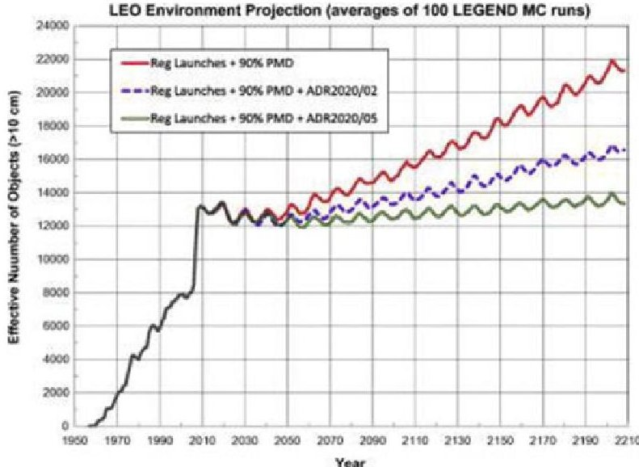

Figure 1: increasing trends in debris population in case of different debris removal missions frequencies [2]

## 3 THE CADET PROJECT

## 3.1 Introduction, scope and objectives

CADET project aims to develop and validate enabling technologies needed for complex systems for orbital debris removal and de-orbiting. All technologies investigated throughout the project, will be set up and oriented toward the final test campaign, to be conducted at Aviospace premises, and which involves the building of a specific validation laboratory, namely CADETLab. Unlike the early phases of launch and target orbit approach, related to the reference mission (which will not be within the scope of the validation), the proximity operations, the close and final approach, debris capture and functionality of the capture mechanism will be implemented in the CADETLab in scale.

Enabling technologies directly involved in the project, can be summarized as follows:

- Target visual recognition by means of IR devices

- 3D object virtual reconstruction

- Design of algorithms for inferring target thermo-optical, inertial and kinematic properties

- Target position and attitude identification by means of star trackers and IMUs

- Design of close approach avionic system

- Selection and design of the capture mechanism All of the afore mentioned technologies are currently at TRL 2 and, by the end of the project, the objective is to push them forward to TRL 4, by validating and verifying them in the frame of CADETLab test campaign. The following figures summarize CADET project objectives, which have met the strategic needs of CADET project partnerships:

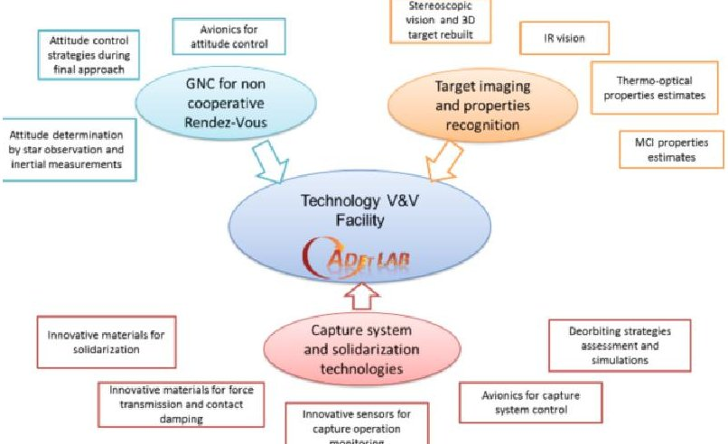

Figure 2: CADET project objectives

## 3.2 Project consortium and key competences

CADET project started in January 2013; Regione Piemonte is co-funding according to POR FESR 2007/2013-linea di attività I.1.1. "Piattaforme innovative" - AEROSPAZIO FASE II. Being a Regional project, the consortium responsible of its execution has been setup by Aviospace, Italian subsidiary of Airbus Defence and Space, by including SMEs and Research Organization having their premises on Regione Piemonte's territory, over being appropriate for what concerns resources, skills and capabilities and strategic reasons for joining the Project; the following figure shows the project consortium organization.

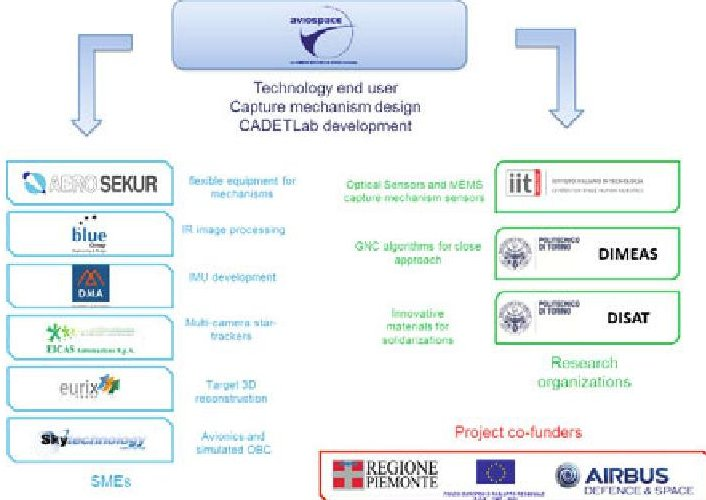

Figure 3: CADET project consortium organization

It can be noticed that the expertise provided by this consortium is manifold, including competences that range from thermo-mechanics (Aviospace, Blue Engineering, Politecnico di Torino), innovative materials (Aerosekur, Politecnico di Torino), avionics and sensors (IIT, Eicas, DMA), on-board software (Eurix, Skytechnology, Blue Engineering), space vehicles and systems (Aviospace, Politecnico di Torino). This was specifically setup to build a core of competences that can be durable and then re-proposed

<!-- PDF_PAGE: 3 -->

for further developments of the technologies grown within CADET project.

## 3.3 Reference mission targets

The CADET project aims to demonstrate the feasibility of debris capturing, by means of a fully autonomous capture mechanism, adapted on the reference target needs and characteristics. Only one target per mission has to be processed, yet a further project enhancement, by switching the launcher selection, is feasible. Another key requirement of the project is that removal mission shall target only European pieces of debris.

Aviospace has selected reference targets with the aim of enhancing mission generalization, and not confining the project research on niche applications. H10 target adequately represents the whole family of Ariane 4 upper stage debris, both in terms of geometry features and orbital positioning. Spot 3 is on the other hand a clear example of satellite belonging to observation family, with a massive central body and a wide solar array attached on its surface. Both of them have masses around 2 tons (1907 kg for SPOT-3 and 2150 kg for H10).

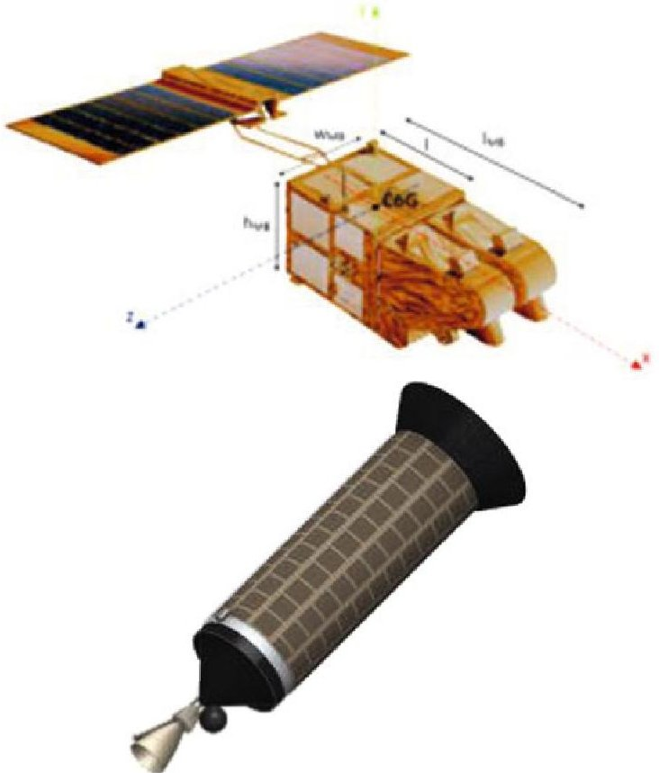

Figure 4: CADET reference targets: SPOT-3 (up) and H10 upper stage (down)

Glancing at "NORAD Top 100 Targets" (a catalogue of the Top 100 pieces, in terms of mass and thus associated collision risks, orbital objects classified as space debris that are currently tracked from ground), it is worth to notice that the selected targets are quite representative of the full population of space debris. In fact, Spot 3 lies

on a belt of orbit inclinations, nearly polar, that is very populated, being it inclusive of Sun-Synchronous orbits, which provide the most favourable illumination conditions for Earth Observation satellites' operations. On the other hand, the selected H10 upper stage target, despite being a rather "isolated" one is still very representative, for two reasons: first, there are many H10s among the debris population, most of which lying on similar orbits as Spot-3. The selected H10, being on a nearly-equatorial orbit, can be reached by a mission which has less constraints in terms of mass at launch, as the capability achieved by any launch vehicles for this target orbit are higher than nearly polar orbits. Nevertheless, the final phases of such a mission after the non-cooperative rendez-vous and capture, which include a controlled de-orbiting and destructive atmospheric re-entry, are much more demanding in terms of Delta-V and therefore it is very interesting to assess their feasibility. The following figure shows the distribution of the NORAD Top 100 Targets, on an inclination vs. altitude plot.

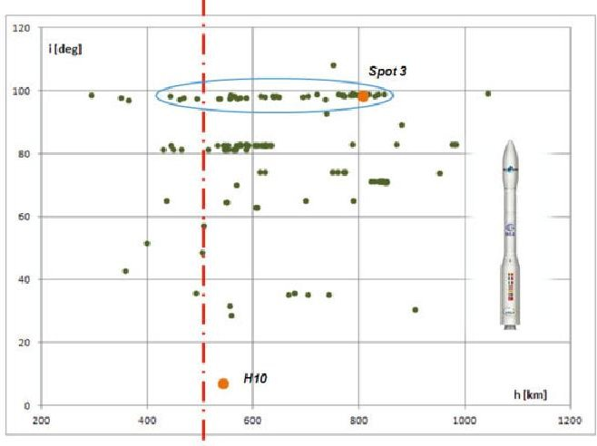

Figure 5: NORAD Top 100 targets locations

## 3.4 Reference mission concept and chaser architecture

For an active debris removal mission, different system concepts and architectures can be evaluated. In this frame, it is worth to mention that ESA is orienting towards a novel approach for the development of such kind of missions, as it is recognized that a traditional, institutional funding is not sustainable in a mid-long term. Alternatively, a private-public partnership (NASA has pursued a similar approach with "Commercial Orbital Transportation Systems" programme) is expected to be a more suitable model to develop a recurring service for active debris removal. In this view, cost reduction is a key driver and mission and system design should enforce as far as possible a "design to cost" approach. In order to minimize the single mission cost, a non-reusable system to perform a one-shot, "mono-target" mission (i.e. with the goal) is preferred rather than a reusable system to perform a multi-target

<!-- PDF_PAGE: 4 -->

mission. This kind of mission can exploit a small-class launcher, such as Vega.

Moreover, a multi-target mission can rely on the same "one-shot" concept, by means of a cluster-launch.

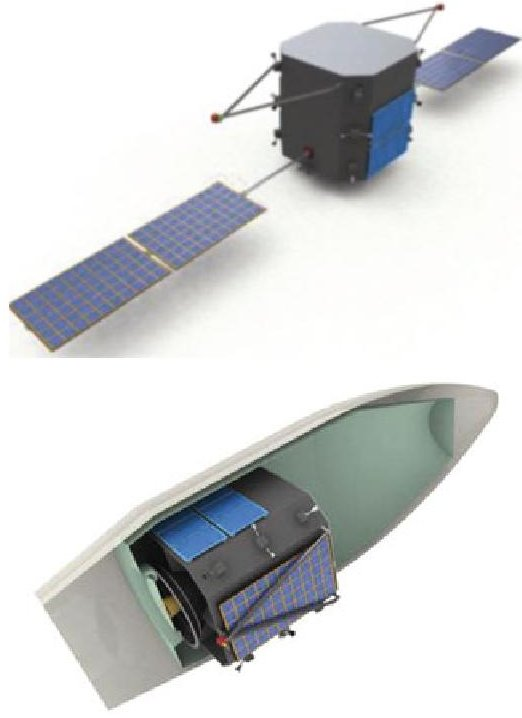

Figure 6: CADET "one-shot" chaser concept deployed (up) and stowed inside VEGA fairing (down)

The reference mission concept defined for CADET foresees the following phases:

- Launch with VEGA from CSG

- Separation at 550 km: this altitude lies in a range which maximize the useful mass to target orbit, and which enables, in case of injection on nearly polar latitudes, to reach a wide number of targets that includes most of European Earth Observation satellites lying on sunsynchronous orbits.

- Orbit rising to target orbit and phasing

- Proximity operations (target observation and recognition)

- Capture operation

- Composite (stack) stabilization de-orbiting

Due to programmatic constraints, not all of the above phases have been analysed in detail. Proximity and capture operations, for which enabling technologies are the core of CADET, did undergo a more detailed study. Following chapters provides a deeper insight on them.

## 4 ENABLING TECHNOLOGIES - STEREOSCOPIC VISION AND TARGET 3D RECONSTRUCTION

By the point of view of the overall mission, a noncooperative Rendez-vous mission is not different, in its early phases, from a cooperative rendez-vous, as the

Automated Transfer Vehicle currently performs it on the ISS. Both types of mission perform far range rendezvous (i.e. from phasing manoeuver until the chaser reaches a distance of 3 km from the target) in the same way. Differences exist when the "target" and the "chaser" get close enough to be in sight; in this case, a cooperative rendezvous operation foresees that the two objects may exchange signals to easy up the approach and subsequent docking. Differently, in the case of noncooperative RdV, the target is substantially an object that is uncontrolled, cannot provide any kind of information on its status or attitude, and cannot talk neither with ground stations nor with the chaser. Therefore, the chaser shall accomplish the function of target imaging and recognition, in a fully autonomous way.

In order to perform a Vision-Based Navigation and target recognition, the first task that a chaser must accomplish is detection of the target and 3D shape reconstruction.

In some cases, the chaser may plan the RdV operation relying on the a-priori knowledge of the target 3D shape. However this may not be a robust approach, as the target shape can be modified by damages suffered by the target (which are quite likely in case of targets lying uncontrolled in orbits for many years), or may not be known at all in case of fragmentation debris. Moreover, an approach including a 3D-shape rebuilt can be suitable also for non-cooperative RdV missions also towards natural targets (Near Earth Objects).

The 3D shape reconstruction requires that, after the chaser reaches an adequate distance from the target, the chaser adopt some sensors to image and scan the target. Several technologies are currently available for this; stereoscopic vision is one of the most suitable for this purpose, as it allows using only passive sensors, providing the advantage of a low power consumption and limited risks compared to laser scanners. These may create scattered reflection; on the other hand, time-offlight based sensors, such as lidars or laser telemeters can provide additional information that allows an overall more accurate characterization of the targets and a more precise control of relative position between target and chaser.

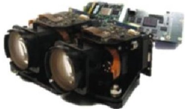

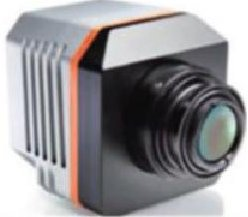

Figure 7: Selected HW for visible field and IR field vision

Adopting a stereoscopic vision technique, "shapes from shading" and "Scale invariant feature transform"

<!-- PDF_PAGE: 5 -->

techniques allow performing the 3D shape reconstruction.

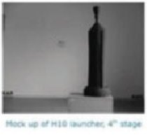

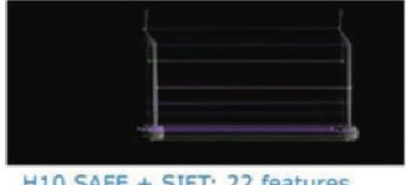

Figure 8: Application of 3D reconstruction algorithms on H10 mock-up

## 5 ENABLING TECHNOLOGIES-TARGET PROPERTIES RECOGNITION

After the 3D model of the target is achieved, the next step is the estimate of target properties, essentially:

- Target thermal status and thermo-optical properties

- kinematic properties (e.g. how can be described the target motion relative to the chaser)

- MCI properties (position of centre of gravity overall mass, inertial tensor)

All of these properties are required in order to plan accurately and safely the RdV and capture operation. Thermal status and thermo-optical properties assessment requires the adoption of IR-wavelength cameras and algorithms to perform a matching between their outputs with a-priori performed thermal analysis. This assessment is required for the correct identification of the most proper docking site on the target, as well as to support the MCI properties assessment: in fact, the thermal status can provide useful information to estimate the mass distribution on the 3D body.

For what concerns kinematic properties, a precise estimate of tumbling and spinning motions of the target is required in order to plan the final approach manoeuvre. To perform such estimates, image processing algorithms may be exploited in order to identify marker points on the target, either due to peculiar shapes (e.g. vertices on the tip of booms) or to discontinuities of the thermal distributions. Tracking the position of these markers on a series of consequent images should enable to determine the target kinematics relative to the observer (chaser).

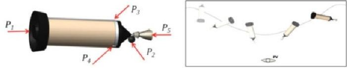

Figure 9: Point-tracking based target kinematic estimates

The kinematics-estimate based on point-tracking technique can be fused with the above mentioned matching between IR images and predicted thermal status achieved on a GTMM of the target, so that an estimate is possible also in the case that no markers are clearly detectable for a sufficient time-lapse to gather confidence about their kinematics estimate.

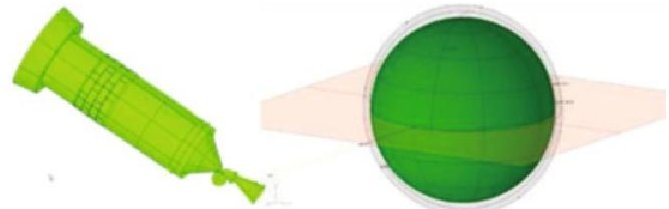

Figure 10: GTMM based target kinematic estimates

Combining this information with the known kinematics (attitude rates, determined by the techniques described on the next chapter) of the chaser enables the determination of absolute kinematics of the target; on top of it, MCI properties of the target can be estimated relying on estimated values of environmental forces and torques acting on the target.

In this case, as well, algorithms for target properties recognition could, in some case, be redundant with the a-priori knowledge of the target. However, the capability to estimate them in-situ provides a more robust approach, as target properties (inertial and thermo-optical) may have evolved after prolonged stay in space; moreover, this is an approach that can be applied to every kind of orbital object, including NEOs or fragmentation-derived debris for which a-priori knowledge cannot be available.

With these techniques, expected performances on accuracy in the target position estimates are:

- On Angular rates <= 0.0025 rad/s

- On CoG position (assumed unknown) estimates <= 2 cm

## 6 ENABLING TECHNOLOGIES-GNC FOR NON-COOPERATIVE RDV

In order to be able to perform a non-cooperative RdV mission, the GNC subsystem of the chaser shall enable mixing of absolute GNC and relative GNC, i.e. vision based navigation. In other words, the chaser shall be able to autonomously determine and control its own absolute attitude during the whole mission, and to be able as well to adapt its control strategies according to the inputs provided by target observation and recognition algorithms. Within CADET, focus is on the following:

- An autonomous system for attitude determination based on data fusion between star tracking measures and inertial measures. The IMU is currently under development, integration and qualification as a new product.

<!-- PDF_PAGE: 6 -->

The star tracking system will be based on three COTS (identified taking into account requirements of compatibilities with a space application) cameras oriented on three independent axes, and whose images are then compared with available star-catalogues. The main objective pursued for this development is the capability to have a self-calibrating sensor set, regardless of their mutual positioning.

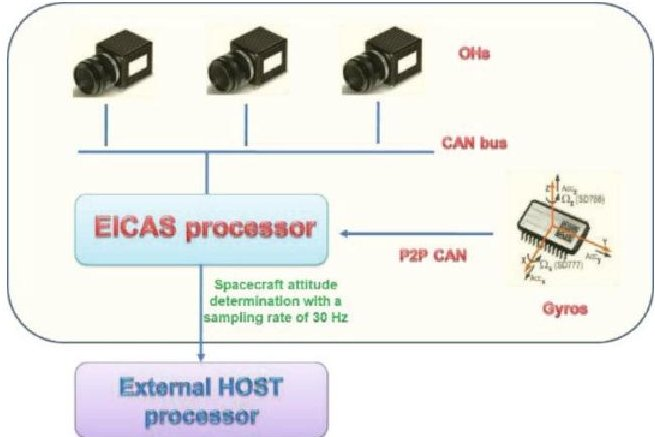

Figure 11: architecture for multi-camera + gyros based attitude determination system

- Attitude control system, whose design will be focused mainly on the final approach phase, and therefore shall take into account the impact of the deployment of a large payload (the capture system) which may influence significantly the inertial tensor of the chaser;

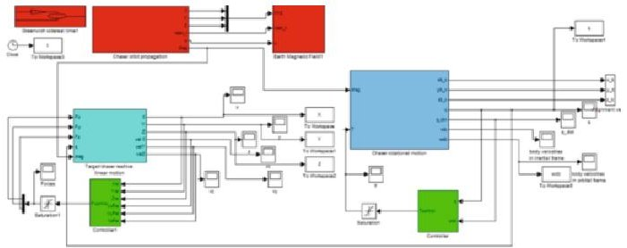

Figure 12: simulation architecture for chaser AOCS

- Development of simulated OBC and ACC core modules.

With these techniques, expected performances on accuracy in the chaser attitude determination are the following:

- Pose on the three axes < 2 arcseconds

- Rates around the three axes < 0.1 arcsec/s

## 7 ENABLING TECHNOLOGIES-CAPTURE MECHANISM AND SOLIDARIZATION DEVICES

Capture technologies represents one of the key elements of an ADR mission and system concept. Many different technology groups can be assessed, and the goal of the project in this area is the identification of candidate concepts that are, on one hand suitable to safely capture the reference targets and, on the other hand, sufficiently versatile to be compatible also for different targets, potentially also larger.

In the frame of this study, up to 23 different concepts for the capture system have been surveyed and traded-off, after being evaluated versus a series of parameters (« features »).

A full description of all the concepts surveyed is out of the scope of this paper. Nevertheless, to give an idea of the wide variety of technologies that can be suitable, the following table summarizes the technological families so far identified:

<table border="1"><tr><td>Technology family</td><td>Base principle</td><td>Examples of concepts</td></tr><tr><td>Mechanical (MEC)</td><td>These concepts rely on mechanical coupling between hard surfaces. These concepts realize typically strong contacts between surfaces of the CS and the target debris.</td><td>Robot arm, clamp, drilling machine, welding machine, tentacles, and harpoons.</td></tr><tr><td>Wires or Cables (WIR)</td><td>These concepts tie the target debris using wires, cables or belts. The typical link realized relies on tether.</td><td>Lasso, bolas.</td></tr><tr><td>Inflatable (INF)</td><td>Locking between target and capture system is ensured by means of inflatable element</td><td>Inflatable hand</td></tr><tr><td>Glues or Foams (FOM)</td><td>Fluidic materials are “sprayed” by the CS on a portion of the target debris external surface. The foamed surface can then create a docking site for the chaser.</td><td>Cover surface with foam.</td></tr><tr><td>Net or Bag (NET)</td><td>A net or a bag wrap around the target. The way to deploy and control the net/bag and the way to tie the net/bag on target debris body represent the characteristic of each concept.Achieved link is typically flexible, based on tether.</td><td>Basket, shot nets, butterfly net.</td></tr></table>

<!-- PDF_PAGE: 7 -->

<table border="1"><tr><td>Mix of previous families(MIX)</td><td>This family includes all concepts that are based on a mix of technologies belonging to two or more of the previous families</td><td>Net moved by inflatable structure,Tentacle realized by belts,inflatable structure moved by wires.</td></tr></table>

## 7.1 Capture system concepts trade-off

The set of features that will be taken into account is presented in the following figure

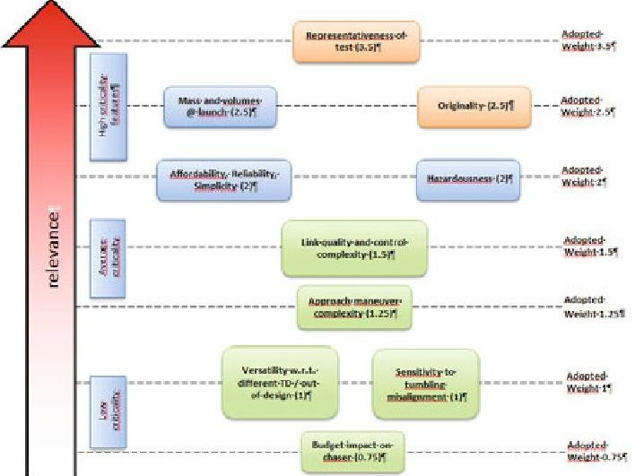

Figure 13: capture system trade-off features and priorities

Major objectives of CADET drove the trade-off features definition and prioritization. These can broadly grouped as follows:

- Features that are key success factors for the CADET project. They include the feasibility of a scaled demonstration of the candidate concept, and the level of originality. The rational is that it would make no sense to develop concepts which cannot be demonstrated within CADET, or which are a mere repetition/copy of concepts developed by other organizations.

- Features that may affect heavily the technical feasibility and efficiency of the candidate concepts. These include the impacts on masses and volumes at launch, the risks associated to the execution of a single capture operation (hazardousness), as well as the estimated reliability and affordability; these two in particular are going to be critical factors in view of future implementation programmes, in which Agencies are moving towards implementation of a commercial-based service.

overall feasibility of the candidate capture concept.

- Features that may have some impact on the efficiency, but which are not jeopardizing the

## 7.2 Trade-off winner concept

The concept that achieved top score in the trade-off, thus resulting as the most promising, is the so-called "Tentacles with belts", which was initially nicknamed "soft hug", as the chaser approaches the target and then "hugs" it with four arms, which closes around it. These arms, when closed, put in place four segments of belts; micro-docking mechanisms allow coupling them in order to achieve two closed belts. Electric motors perform retrieving of the belts to tie around target body. To provide solidarization, upper belts push, during their retrieving, the targets against a cradle (made of four additional "lower" belts), so that most of the lateral circumference of the target is in contact with the belts. This would guarantee a stiff link, which can withstand the deorbiting loads.

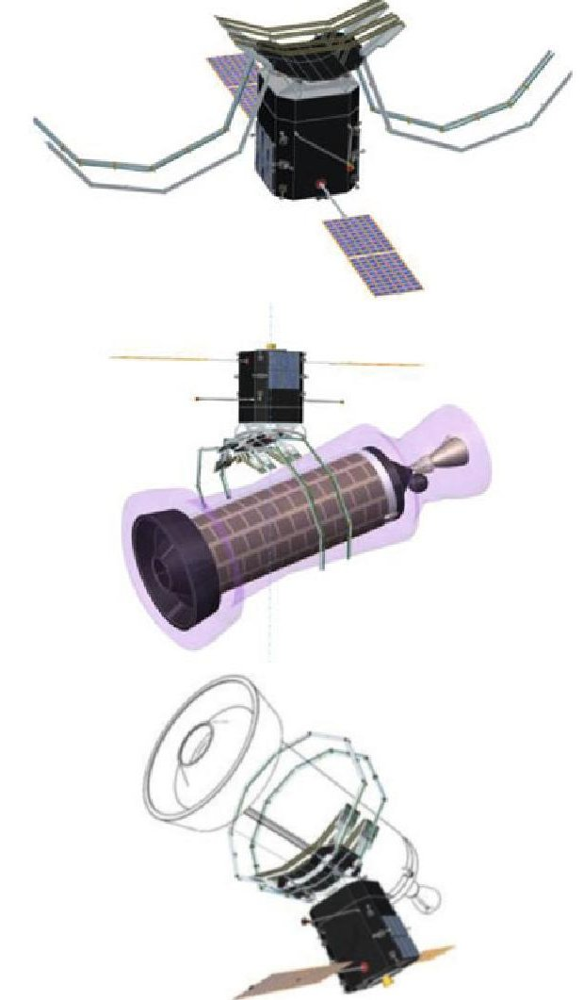

Figure 14: Tentacles with belts - capture sequence

Main strengths of this concept are:

- Mass and volume in stowed configuration can be reduced so that it can be comfortably accommodated on a VEGA launch

- Contact is achieved only by means of softelastic elements, so that risks associated to capture operation are quite limited

<!-- PDF_PAGE: 8 -->

- The "closure force" can be trimmed and adjusted by regulating the tie-force on the belts

- The cradle mechanism can provide a good tolerance on alignment precision

- Over these qualities, this is quite an original variant of "tentacles-based" capture concept. Moreover, a ground demonstration within CADETLab (see next chapter) is feasible.

On this concept, Aviospace carried out an extensive FE- analysis and simulation campaign in order to optimize and validate its design, by means of LS-Dyna SW tool, which is particularly suitable to simulate the impact dynamics and contact establishment between rigid and soft/flexible bodies.

## 8 TECHNOLOGY VERIFICATION AND VALIDATION-CADETLAB

CADET will have its final objective in the development of a facility for verification and validation of the selected technologies: the Cadet-Lab will be located among the Aviospace premises:

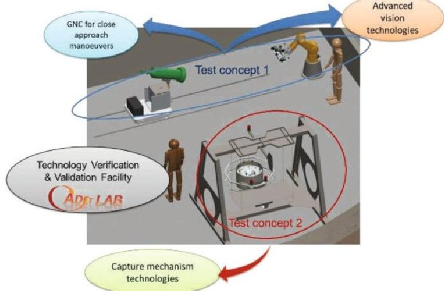

Figure 15: CADETLab facility

It will consist of a control room and a series of ground test concepts aiming to host breadboards of target and chaser to simulate a non-cooperative rendez-vous and capture in its major phases.

Expected results are the debris/capture system interaction measurement, assessment on the validity of preliminary analyses performed and indication on the overall feasibility of the capture strategy worked out.

In order to limit the complexity of the architecture, two different test setups are currently under development:

- A first test setup with the target handled by means of a rotating platform, able to provide tumbling and spinning motion, mounted on a dolly platform so that it is possible to simulate also variable distance. The chaser breadboard, mounted on a robotic arm, shall be equipped with all required sensors for target imaging and

attitude determination. All the electronic boards and on-board software shall be located separately, in order to reduce the load on the robotic arm and to reduce the complexity of chaser breadboard. The following figure shows this setup.

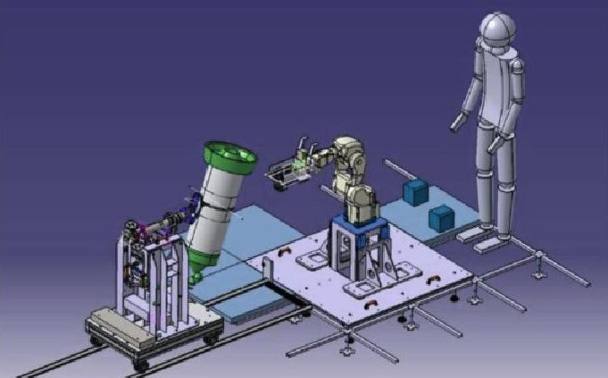

Figure 16: CADETLab - test setup 1

Aviospace has planned to exploit this configuration for the following tests:

- Attitude determination (STR + IMU) + star simulators (LED, to be attached on dark panels):

- BB chaser is moved by robotic arm with known angles;

- Attitude sensors measure this rotation by detecting star simulators located around the BB chaser

- Determination and control of target-chaser distance

- TOF sensor and stereoscopic cameras mounted on the chaser measure the distance between BB chaser and target.

- Control of dolly platform stops it when a TBD fixed distance is reached

- Validation of attitude control and target following capability

- Same setup as test 1, with robotic arm performing some attitude maneuvers TBD on the chaser, eventually trying to null one of the dofs in the target movement

- Validation of software for image processing, 3D rebuilt, target recognition:

- This could be done also with target handled by robotic arm and BB chaser standing still - To be defined

- A second test setup, with the target hanging from the ceiling with a cable that can provide it

<!-- PDF_PAGE: 9 -->

with spinning motion, and the capture system breadboard which can be put in place either by the robotic arm or by the rotating platform, or even hanging itself. The following figure shows this setup, which is required to perform tests on the capture mechanism functionality and robustness towards different relative pose and target spinning.

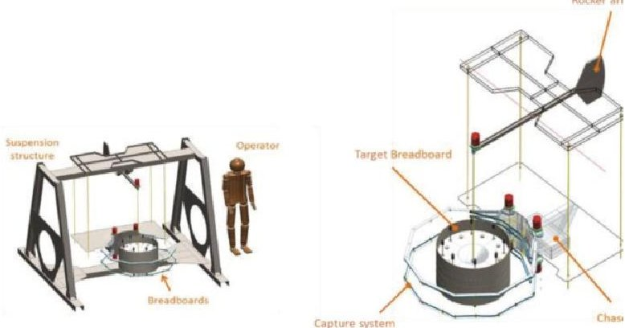

Figure 17: CADETLab - test setup 2

## 9 CONCLUSIONS

The main results achieved so far by CADET are the following:

- The first phase of CADET project lead to result of definition of a reference concept for an active debris removal mission and system able to perform it.

- This preliminary activity allowed a complete identification of required enabling technologies for ADR. For each of them technological objectives have been defined and the project has now entered in the development phase. The main results that have been achieved so far are the following:

WP 1 & 2 (imaging and target properties estimates): hardware identification and procurement, algorithms consolidation & start-up of the integration and assembly phase

WP 3 & 4: GNC algorithms definition and selection/design of HW for attitude determination equipment & OBC

Aviospace has delivered particular effort in the frame of identification and development of suitable capture system concepts. An innovative solution, whose major elements can undergo initial validation on a ground test facility, has undergone a detailed development. Aviospace has carried out detailed FE simulation campaign in order to support

its design and analysis sizing of major components.

- The project will have its final objective in the development of a facility for verification and validation of the selected technologies, where the target and the chaser mock-up/breadboards will be either handled by a robotic effector able to provide it with 6 dof movements, or mounted on other ground support infrastructure. The chaser breadboards will be able to perform survey of the target, autonomous definition of the approach trajectory and required thrust and delta-V, and perform a complete capture sequence.

- AVS will adopt this facility to perform a ground functional validation of at least one of the capture systems proposed, in order to reach a TRL 4 for such concept within 2014. AVS foresees further steps beyond, even if not yet planned in detail, to reach TRL 5 within end of 2015/mid 2016.

## 10 ACKNOWLEDGEMENTS

The authors want to thank:

- The Regione Piemonte - Direzione Attività Produttive, which is co-funding the project, and the Distretto Aerospaziale Piemontese for their activity in promoting the Aerospace piedmontese industry

- the SMEs and Research Organizations that are partners of the CADET consortium

- the Aviospace staff that is currently working on the CADET project

- Airbus Defence and Space, Aviospace's mother-company that has involved Aviospace in its R&T activities since 2010 and which allowed Aviospace to grow and to be able to play as Coordinator in the frame of this project.

## 11 ACRONYMS

<table border="1"><tr><td>ADR</td><td>Active Debris Removal</td></tr><tr><td>BB</td><td>BreadBoard</td></tr><tr><td>CADET</td><td>Capture and Deorbiting Technologies</td></tr><tr><td>COTS</td><td>Commercial Off-the shelf</td></tr><tr><td>CSG</td><td>Centre Spatial Guyannaise</td></tr><tr><td>GEO</td><td>Geostationary Orbit</td></tr><tr><td>GNC</td><td>Guidance, Navigation and Control</td></tr><tr><td colspan="2">GTMM Geometrical Thermal Mathematical Model</td></tr><tr><td>IMU</td><td>Inertial Measurement Unit</td></tr><tr><td>IR</td><td>InfraRed</td></tr><tr><td>LEO</td><td>Low Earth Orbit</td></tr><tr><td>MCI</td><td>Mass, Centre of Gravity, Inertia</td></tr><tr><td>NEO</td><td>Near-Earth Objects</td></tr><tr><td colspan="2">NORADNorth American Aerospace Defense Command</td></tr></table>

<!-- PDF_PAGE: 10 -->

RdV Rendez-Vous

R&T Research and Technology

SAFE Shape Assessment from Epipolar Geometry

SIFT Scale Invariant Feature Transform

SME Small-Medium Enterprise

SPOT Satellite Pour l'Observation de la Terre

SSO Sun Synchronous Orbit

TBD to Be Defined

TOF Time of flight

TRL Technology Readiness Level

## REFERENCES

[1] NASA, "Handbook for Limiting Orbital Debris", Washington DC, 2008

[2] J.C. Liou, D.T. Hall, P.H. Krisko, J.N. Opiela, "LEGEND, a 3-dimensional LEO to GEO Debris Evolutionary Model", Adv. Space Res., 2004