<!-- PDF_PAGE: 1 -->

# End-to-End Validation Process for the INTA-Nanosat-1B Attitude Control System

Óscar R. Polo $ ^{a,*} $ , Segundo Esteban $ ^{b} $ , Lorenzo Cercos $ ^{b} $ , Pablo Parra $ ^{a} $ , Manuel Angulo $ ^{c} $

$ ^{a} $Space Research Group, University of Alcala, Alcalá de Henares, Madrid, Spain $ ^{b} $ISCAR Research Group, Complutense University of Madrid, Madrid, Spain $ ^{c} $National Institute of Aerospace Technology (INTA), Madrid, Spain

## Abstract

This paper describes the end-to-end validation process for the Attitude Control Subsystem (ACS) of the satellite INTA-NanoSat-1B (NS-1B). This satellite was launched on July 2009 and it has been fully operative since then. The development of its ACS modules required an exhaustive integration and a systemlevel validation program. Some of the tests were centred on the validation of the drivers of sensors and actuators and were carried out over the flying model of the satellite. Others, more complex, constituted end-to-end tests where the concurrency of modules, the real-time control requirements and even the well-formedness of the telemetry data were verified. This work presents an incremental and highly automatized way for performing the ACS validation program based on two development suites and an end-to-end validation environment. The validation environment combines a Flat Satellite (FlatSat) configuration and a real-time emulator working in closed-loop. The FlatSat is built using the NS-1B Qualification Model (QM) hardware and it can run a complete version of the on-board software with the ACS modules fully integrated. The real-time emulator, running on an industrial PC, samples the actuation signals and emulates the sensors signals to close the control loop with the FlatSat. This validation environment constitutes a low-cost alternative to the classical three axes tilt

<!-- PDF_PAGE: 2 -->

table, with the advantage of being easily configured for working under specific orbit conditions, in accordance with any of the selected tests. The approach has been successfully applied to the NS-1B in order to verify different ACS modes under multiple orbit scenarios, providing an exhaustive coverage and reducing the risk of eventual errors during the satellite's lifetime. The strategy was applied also during the validation of the maintenance and reconfiguration procedures required once the satellite was launched. This paper describes in detail the complete ACS validation process that was performed and it shows the most relevant errors detected and fixed during testing. Finally it summarises some of the most significant conclusions.

Keywords: End-to-end Validation Test, Satellite Attitude Control System, Real-Time Emulation, Hardware in-the-loop, Component-Based Software Development

## 1. Introduction

Nowadays, satellite development projects, due to their wideness and complexity, require the division of the system into modules that are developed in parallel. This division compels to a later effort of validation during the integration and acceptance stages, bearing in mind that, when dealing with complex systems, the combination of minor defects can lead to large system failures [1]. However, experience shows that a great number of minor failures are detected after launch [2], which clearly states the need of pursuing more exhaustive validation strategies. Ideally, these strategies must consider any possible contingency that might happen during the mission or the execution of the ground operation procedures. An inadequate validation, in which aspects relative to the interaction between the satellite and the ground segment software are omitted, might cause the loss of the spacecraft and thus the failure of the whole mission [3]. For all these reasons, validation tests need to be extended also to the nominal operation phase, since the in-orbit reconfiguration capabilities may lead the satellite to work under unexpected conditions that might cause its loss,

<!-- PDF_PAGE: 3 -->

as happened with the Mars Global Surveyor mission [4].

One of the most complex subsystems to validate is the ACS, mainly due to the heterogeneity of the signals involved -electrical, both analog and digital, magnetic, thermal, mechanical, dynamical, etc. and the wide variety of information and algorithms that are used. This complexity can be better tackled by dividing the validation process into two different stages.

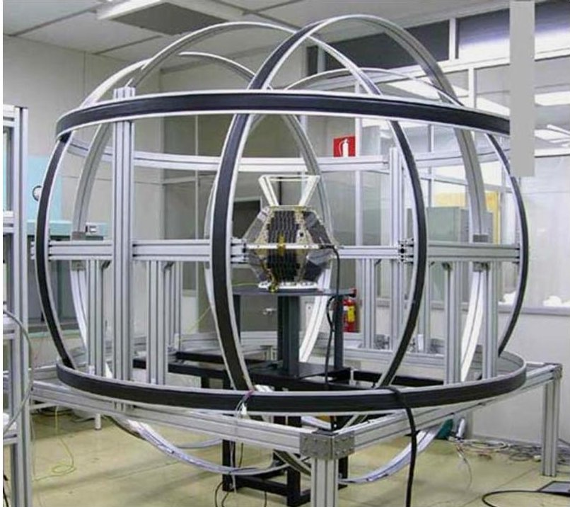

Figure 1: NS-1B in a Magnetic Chamber

The first stage comprises the complete set of basic integration tests of each of the low level ACS modules performed separately. These tests have to take into account the fact that each module might need a different testing scenario:

- Some actuators and their drivers can be verified in open-loop using a classical three axis tilt table, where the magnitude, sense and direction of the applied torques can be easily checked.

- The sensors and their drivers, on the other hand, might require another set of scenarios where the quality of the stimulus can be controlled more easily and the response of the complete measurement chain is verified

<!-- PDF_PAGE: 4 -->

under more specific conditions. Figures 1 and 2 show validation scenarios for the magnetic and solar sensors of NS-1B, respectively.

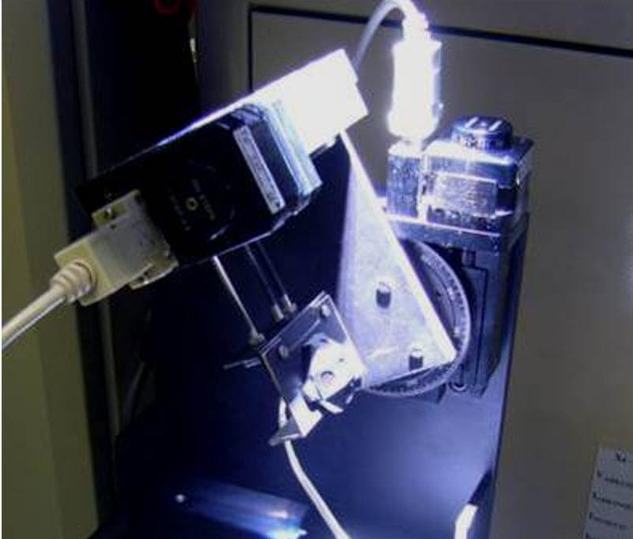

Figure 2: NS-1B Nominal Sun Sensor in SpaSoLab

On the second stage, the ACS modules of a higher level of abstraction are validated. These modules are in charge of determining the attitude and calculating the control actions. This process presents, as its main difficulty, the need of an environment that allows the control loop between the sensors and the actuators to be closed. In order to achieve this, ACS simulators are developed with the highest degree of detail, which allow the validation of the functional behaviour of the algorithms that are to be used [5]. Thanks to this kind of environments, not only the determination and control algorithms can be put under exhaustive test benches, but also the behaviour of the generated code can be properly validated after its integration into the on-board software.

Even though this simulator-based approach allows checking the functional response of the complete system under circumstances equivalent to those that take place during the operational phase, in order to fulfill the real-time control requirements of the ACS, the measurements of the Worst Case Execution Time

<!-- PDF_PAGE: 5 -->

(WCET) should be done using the final hardware platform [6]. The need of these measurements is even more critical when dealing with multi-tasking software running on a single CPU, which is the common case in pico or nano-satellites such as NS-1B, since they have limited computational resources. In this case, the schedulability analysis of the ACS is mandatory. Tools like MAST [7] allows performing this analysis by modelling the concurrent execution of the different tasks, as well as the interferences produced by the interrupt handling routines such like the one that manages the rate-monotonic clock and annotating these models with the execution times measured on the platform. For correctly evaluating the WCET of the ACS modules' code, different testing scenarios shall be defined. These scenarios have to take into account the system's sensibility, not only to the data used in the attitude estimation or the control calculations, but also to any other relevant aspect, e.g. the maximum size of the telemetry files that can be generated.

All the efforts taken in the validation stage are against economic interests, since they require both labor and material resources. Nevertheless, its cost can be minimized if advanced environments and technologies are used. A current line of work is to automate the software integration and validation processes using model-based design and verification strategies [8]. This approach combines satellite dynamics and space environment models with an infrastructure for integrating the platforms that support the execution of the on-board real-time software. This infrastructure allows the integration of simulators of the on-board computer, a full FlatSat configuration based on the QM (which will be explained thoroughly in Section 4.1) or even the very satellite, as well as replacing one platform with another depending on the maturity level of the project and the kind of test that is to be done. The main advantage of using a model-based solution, compared to using hardware mock-ups, is to have at one's disposal a much more flexible environment for injecting specific working conditions and thus being able to perform more exhaustive tests in a shorter period of time. This fact finally results in a minimisation of the possible sources of error, as well as bringing forward their detection, and a substantial reduction of costs

<!-- PDF_PAGE: 6 -->

and development times.

In this work, the schema proposed by [8] has been simplified and adapted to the design and validation process of the ACS of NS-1B, providing a low cost alternative in the field of nano and micro-satellites. Like this, the Simulink models, both of the environment and satellite dynamics, which were initially used to validate the design of the ACS' algorithm, are taken as inputs for the automated generation of different products, which are in turn integrated into the suits that support the design and validation process of the on-board software. Amongst these products are the configuration data of a real-time hardware emulator that allows completing the end-to-end validation tests and closing the attitude control loop over a platform that supports the execution of the real-time on-board software. Figure 3 shows a schema of the toolchain that supports the integration and validation procedures of the NS-1B's ACS, which will be detailed in the following sections.

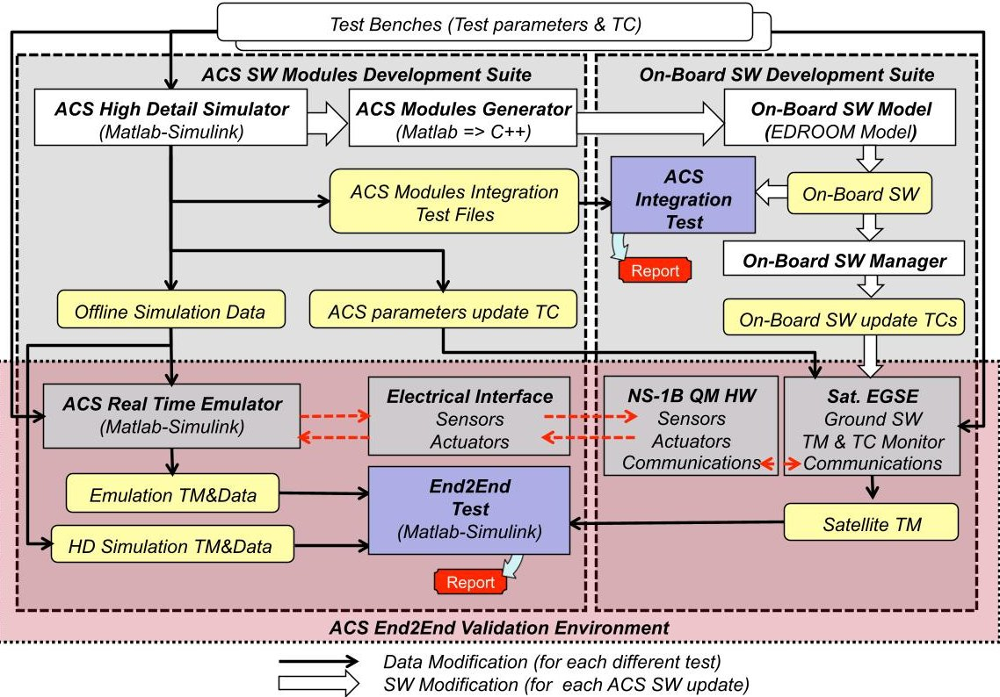

Figure 3: Integration and validation flow of NS-1B's ACS software

<!-- PDF_PAGE: 7 -->

The toolchain is organized in two separated development suites that are finally combined in an end-to-end validation environment. These development suites are the following:

- ACS Software Modules Development Suite (ACSMDS). This suite is in charge of the design, simulation and generation of ACS software modules. It also provides the test bench files for integrating the ACS modules into the on-board software and the configuration files for the ACS environment real-time emulator.

- On-Board Software Development Suite (OBSWDS). This suite is in charge of the design, integration, code generation, deployment and monitoring of the on-board software.

Following the validation flow, the ACS software modules are generated by the ACSMDS suite, in the form of C++ source code, and later provided to the OBSWDS for their integration into the on-board software. This process is sustained by the encapsulated interfaces declared on the component-based model of the on-board software. The component-driven approach has facilitated, also, the building of a specific ACS Modules Integration Test, which is fed with the input/output test bench files generated by the ACSMDS and only interacts with the component in charge of the ACS. This solution avoids the interference of other functionalities of the on-board software with the control of the exhaustive integration test.

The validation step following the integration takes place at system level. It is performed over the ACS End2End Validation Environment, where both the ACSMDS and the OBSWDS work together in real-time. The ACS environment is emulated with Simulink closing the control loop on a real On-Board Data Handling (OBDH) hardware.

The whole solution is mostly automated to facilitate the analysis of several scenarios during the validation process. No additional development is required to change the scenario, thus costs and development times are reduced. Furthermore, the environment allows the injection of scenarios reached by the satellite

<!-- PDF_PAGE: 8 -->

during flight using the very same telemetry downloaded at the mission centre. The capability of injecting flight scenarios facilitates the maintenance and update of the ACS software in order to correct or enhance the already implemented control and determination algorithms.

This paper details the infrastructure used in the validation process of the ACS software (ACS-SW) of the satellite NS-1B. The provided information allows understanding how, for each new version of the ACS-SW, all the stages can be completed until performing the end-to-end validation using the real OBDH hardware in the loop. Section 2 focuses on the ACS-SW's development process, based on Matlab/Simulink, and on how all the tools needed for the later integration and validation stages have been developed. Section 3 explains the OBSWDS, introducing the component model used on the on-board software (OBSW), as well as the design of the integration tests of the ACS-SW and the infrastructure that the OBSWDS provides for the end-to-end validation. Section 4 explains in detail the closed-loop environment that makes possible to perform the end-to-end tests. Section 5 shows the different scenarios that have been used in the validation of the ACS-SW, as well as the most relevant results obtained with the introduction of the process. More precisely, examples of errors that were detected and easily corrected thanks to the versatility of the proposed solution, are illustrated. Finally, the last section shows the conclusions.

## 2. The ACS Software Development

As part of the ACSMDS, the ACS High Detail Simulator (ACS-HDS) has been developed on top of Matlab-Simulink in order to design and validate the ACS drivers and the determination and control algorithms. Matlab-Simulink uses an interpreted language with a powerful debugger and provides very good monitoring facilities, including 3D rendering. This tool offers the best math libraries, an easy file manager, embedded processors emulation, automatic code generation (in C and C++) and a lot of useful libraries (aerospace, control, signals, mechanical, etc). It does not run in real-time, so it is possible to simulate

<!-- PDF_PAGE: 9 -->

the different layers (physical, electrical and software) with a high level of detail and without penalties in the time-to-prototype metric.

Before starting an ACS-HDS simulation, it is necessary to perform an offline calculation of the data corresponding to the test scenario that is to be run. These offline simulation data are mainly the ones related to the orbit and the space environment:

- Time frames. Coordinated Universal Time (UTC) is used to command the satellite, Greenwitch Mean Sidereal Time (GMST) for reference frame transformations and Julian Date (JD) for orbit propagation [9].

- Reference frames. The main frame is Earth-Centered Inertial (ECI). An Earth Centered Earth Fixed (ECEF) frame is also used to compute the earth magnetic field, and a Local Vertical Local Horizon (LVLH) frame does the same with the pointing reference [10].

- Satellite Orbital Model. The SPG4 of the North American Aerospace Defense Command (NORAD) has been implemented [11]. The parameters of the SPG4, called Two Line Elements (TLEs), are daily updated by Celestrak and be downloaded during NS-1B's maintenance. When the satellite was being developed, the TLE was built using the classical orbital elements obtained by the mission analysis.

- Sun Model. It includes the Sun coordinates in ECI, the irradiation due to the solar cycle and Earth orbit's eccentricity, and the Earth eclipse [12].

- Earth Magnetic Field Model. The World Magnetic Model 2010 is used [13].

Figure 4 shows the top level of the ACS-HDS Simulink model. The main elements of the ACS-HDS are the following:

1. The Orbit and Space Environment. This block comprises the aforementioned calculated offline simulation data corresponding to the test scenario. Those data are provided as inputs to a group of blocks that simulate the

<!-- PDF_PAGE: 10 -->

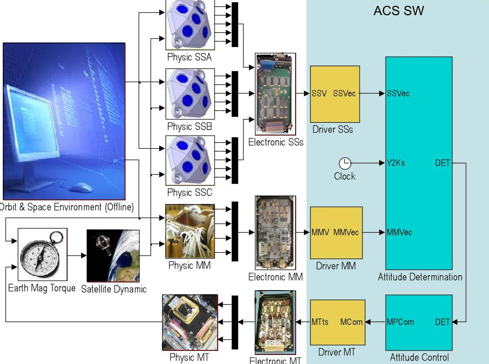

Figure 4: Top view of the ACS-HDS

sensor physics as well as to another block that calculates the Earth Magnetic Torque that determines the satellite dynamics.

2. The Sun (SSA, SSB and SSC) and Magnetometer (MM) Sensor Physic simulators. They simulate the effective excitation of the sensing elements. Their outputs are analog electrical signals equivalent to those of the sensors.

3. The Electronic SSs and Electronic MMs blocks. They transform the analog signals generated by the sensors and the Magnetometer blocks into digital signals that will be sampled by the ACS-SW.

4. The ACS-SW block. It consists of the software drivers of the solar and magnetic sensors (Driver SSs and Driver MM), the Attitude Determination and Attitude Control modules and the Magneto-Torquers driver (Driver MT). This last drivers generates the ACS-SW block by means of a Pulse

<!-- PDF_PAGE: 11 -->

Width Modulation (PWM) that controls the MTs.

5. The Electronic MT and Physic MT blocks. They transform the PWM generated by the ACS-SW into a Magnetic Dipole.

6. The Earth Mag Torque block. It crosses the calculated Magnetic Dipole with the Earth Magnetic Field to generate a torque. Other disturbance torques are also modelled in it.

7. The Satellite Dynamic block. It computes a continuous integration of satellite attitude dynamics based on the calculated Earth Magnetic Torque and finally closes the simulation loop.

It is relevant to remark that the structure of the ACS-SW block has been specifically designed to conform to the actual OBSW interface, thus allowing: 1) the automatic integration of the ACS-SW into the OBSW; and 2) the automatic generation of I/O Files for the ACS Modules Integration Test that will be performed by the OBSWDS.

Once the algorithms have been validated in simulation, they are subsequently coded in C++. Simulink allows the generation of code, being also possible to check the resulting code using the same simulator, since it is able to execute C++ routines directly. Both solutions have been used to automate the validation process of the NS-1B's ACS.

## 3. ACS Software Integration and Validation

In this section first the component model used to define the top level structure and behaviour of the on-board software is explained. Then, the ACS software integration and validation process is described, emphasizing the benefits provided by the component-based solution to support this process. In both cases, the relevant details of the infrastructure that sustains and automates the whole process are also introduced.

## 3.1. On-Board SW Component Model

The Nanosat-1B on-board software has been developed using a componentbased software engineering approach [14]. The whole development process has

<!-- PDF_PAGE: 12 -->

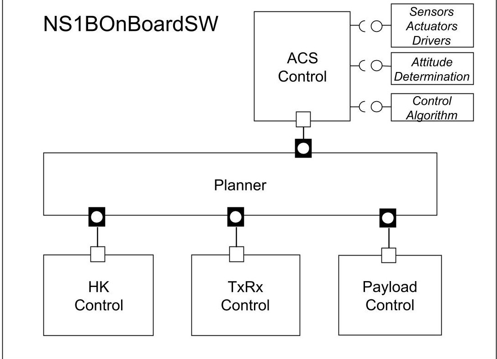

Figure 5: NS-1B on-board software EDROOM model

been supported by a Computer-Aided Software Engineering (CASE) tool, called EDROOM [15], which provides a graphical editor for a specific subset of UML2 diagrams [16] and automatic code generation for a wide set of platforms. By means of these diagrams, it is possible to specify both the interfaces between the components (using ports and communication protocols) and their internal reactive behaviour (using state charts whose transitions are triggered by message reception). Under this approach, the NS-1B on-board software model has been defined using five components. One central component is in charge of the system planning while the other four control different satellite subsystems. One of these four components is the ACS-Control component. Figure 5 shows the UML2 component diagram that defines these top level system components and the communication topology between them. The model uses a port-based communication, where components can send and receive messages through ports, not allowing the direct access to the internals of other components. The component

<!-- PDF_PAGE: 13 -->

encapsulation requires also the explicit declaration of its dependencies on service modules belonging to a lower abstraction layer. In the case of the ACS-Control component, between these dependencies there are the three modules generated by the ACS Software Modules Development Suite: SensorsActuatorsDrivers, AttitudeDetermination and ControlAlgorithm.

## 3.2. The ACS Integration Test

The EDROOM component run-time is available for different platforms that either can be based on real-time operating systems, such as CMX, RTEMS, RTKernel, VxWorks, etc., or on non real-time operating systems, such as as Linux or Windows. This fact, together with the component encapsulation, have facilitated to build a PC/Linux ACS Integration Test based on the ACS- Control component. The test controls the port interface of the component and replaces those modules that work on the real OBDH target, i.e. TargetAD, TargetGetTime and TargetApplyControl, with modules that simulate the hardware by taking the data from a set of input files (FileAD and FileGetTime), saving also the resulting output to another file (FileApplyControl). This last file is used to validate the integration by means of comparing the expected data with the calculated ones. Figure 6 shows a scheme of this test structure. It is important to remark that the input files that feed the test, and the files used to check the applicable calculated control produced by the ACS-Control component, are automatically generated by the ACS Software Modules Development Suite.

## 3.3. The ACS End to End Validation

Once a new version of the ACS modules has passed the integration test, a set of patch telecommands for the flying on-board software update are automatically generated. The On-Board Sw Manager facility integrated in the OBSWDS is in charge of this process. This tool can manage the successive configurations of the on-board software and, according to the current version running on the satellite, can generate the proper on-board software update telecommands. Before the

<!-- PDF_PAGE: 14 -->

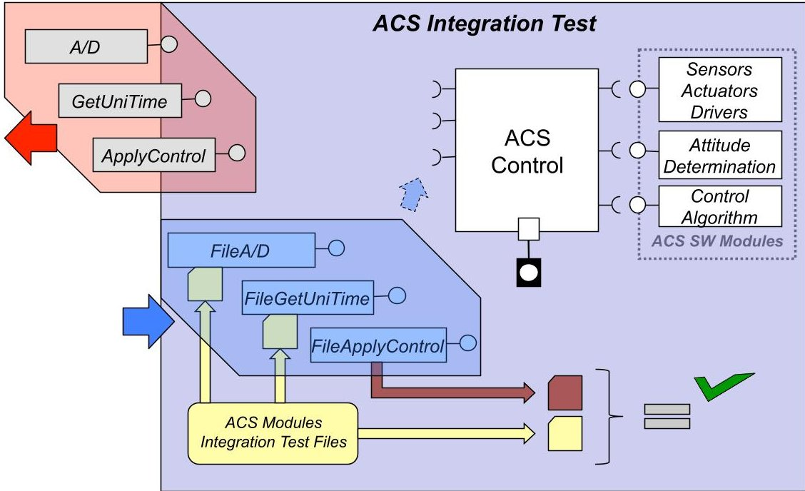

Figure 6: ACS Modules Integration Test Structure

telecommands can be sent to NS-1B, the whole response of the patched on-board software must be tested using the end-to-end validation environment, which is explained in detail in the next section.

## 4. ACS End-to-End Validation Environment

The validation environment comprises four modules:

- ACS Real-Time Emulator (ACS-RTE),

- Electrical Interface (EI),

- FlatSat based on Qualification Model Hardware (QM-HW).

- Satellite Electrical Ground Support Equipment (EGSE).

The satellite's EGSE is wired with the NS-1B FlatSat model. It uses backup units of the ground station's UHF transmitter and receiver for telecommanding the NS-1B FlatSat and for downloading the telemetry. Update telecommands

<!-- PDF_PAGE: 15 -->

for TLEs and on-board universal time references are used to set the specific conditions of each test scenario. After timing synchronization between the OBSW running on the NS-1B FlatSat and the ACS-RTE, both systems work in realtime and close loop during programmed time intervals. The ACT-RTE and the NS-1B FlatSat model are interconnected by an electrical interface that fits with the connectors of the attitude sensors and actuators, so the set-up requires that real sensors and actuators are removed from the NS-1B FlatSat. The ACS-RTE generates the electrical sensor signals and samples the electrical actuator signals generated by the OBSW. The emulation of the sensors and actuators, integrated in the ACS-RTE, allows testing the OBSW response to their degraded behavior. This enables the implementation of complementary tests involving the physical sensors and actuators and their drivers.

## 4.1. NS-1B FlatSat based on Qualification Model Hardware

The NS-1B FlatSat model has been used to close the control loop of the end-to-end validation environment. This model, built from the qualification model hardware, includes the following units:

- Central Processor Unit (CPU): is the main processing unit of the satellite. Its function is to execute the OBSW that controls all the satellite's subsystems.

- Power Distribution Unit (PDU): is in charge of supplying power to the electronics and sensors. It also manages, by using H bridges, the activation and sign of the magneto-torquer control currents.

- Communication Unit (Comm): is a subsystem that allows the communication between the NS-1B FlatSat and the mission centre application, which is integrated in the EGSE.

- Sun Sensors Electronics (SSE): is in charge of conditioning the solar sensors. Solar cells work as intensity sources, but the OBDH only has a voltage analog-to-digital converter, so this unit is in charge of converting electrical intensity to a [0,10] V range.

<!-- PDF_PAGE: 16 -->

- Input/Output Electronic (IO-MEM): it performs different functions within the OBDH and integrates an analog-to-digital voltage converter. Within the end-to-end validation environment, this unit is in charge of digitising the analog signals coming from the magnetic sensors and the ones that are conditioned by the SSE. The unit also integrates an analog signal demultiplexer in order to sample a wide number of signals with one single converter.

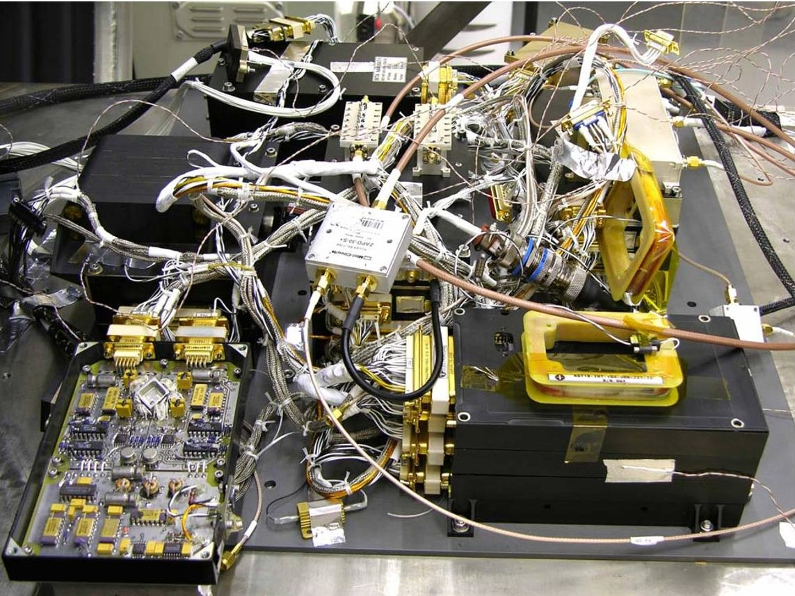

Figure 7: FlatSat NS-1B built from QM hardware

Figure 7 shows an image of the NS-1B FlatSat model built from the QM hardware. In the bottom right corner of the image there are two of the three magneto-torquers, with one of them located on top of the CPU unit as it is in its final configuration. In the bottom left corner in turn there is the board that integrates the magnetometer, which shows the cube to which the four magneto-resistive sensors are fixed. In the background there are the rest of the units, i.e.,

<!-- PDF_PAGE: 17 -->

the PDU, the SSE and the communications subsystem.

## 4.2. Electrical Interface

The Electrical Interface comprises three modules: a pair of I/O PC cards, a Voltage-to-current Intensity Circuit (V2I) and a voltage divisor (25 to 10).

The I/O Cards, inserted in an industrial personal computer, are the Advantech PCL-818HD [17] and the PCL-727 [18]. The PCL-818HD card includes Analog-to-Digital (A2D) converters that are used to capture the signals from the actuators. The PCL-727 card includes Digital-to-Analog (D2A) converters that are used to generate the signals of the sensors and the magnetometer. The V2I circuit is a voltage-to-current signal conversion linear circuit designed according to [19]. It emulates the behaviour of the solar cells, which are current sink polarized, and translates the PCL-727 card output, [0,10] V, to the signal expected by the ESS,[-15,0] mA. The inverse model of this circuit must be included in the ACS-RTE to do this translation transparently.

The actuators, which are three magnetic-coils, are driven by H bridges in a range of [-25,25] V. A voltage divider from 25 V to 10 V is used to connect these signals to the PCL-818HD card with a [-10,10] V range configuration.

Finally, the magnetometer signals, emulated by the ACT-RTE and generated by the PCL-727 card, are connected directly to the IO-MEM. In this case, the real signals have the same [0,10] V range as the PCL-727 card.

## 4.3. ACS Real-Time Emulator

The ACS-RTE provides a real-time emulation not only of the satellite dynamics and the space environment, but also of any hardware not included in the loop. Matlab-Simulink offers facilities to work in real-time with hardware in the loop, e.g. I/O card drivers, real-time kernel and C codification. For each test scenario, once the universal time and the TLE are set, the offline simulation data generated by the ACSMDS are integrated in the ACS-RTE. The data, related to the orbit, time and space environment, are used to reduce the computing operations to be done in real-time. The test scenario includes a starting

<!-- PDF_PAGE: 18 -->

satellite attitude that allows the ACS-RTE to perform the calculations involved in the control loop once the emulation has been initiated. In order to do so, the ACS-RTE periodically samples the voltage generated by the OBSW, which corresponds to the control signals used to command the MTs. Figure 8 shows the top level diagram of the ACS-RTE Simulink model.

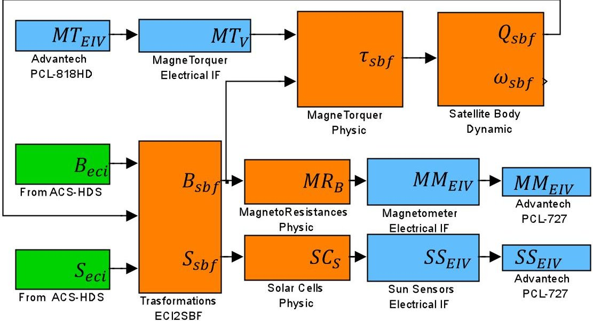

Figure 8: ACS-RTE Simulink model

The model comprises several modules:

- Transformations ECI2SBF: the offline simulation data include the Magnetic Field Vector and the Sun Vector in ECI frame. During emulation, it is necessary to reference these vectors in Satellite Body-Fixed (SBF) frame.

- MagneTorquer Electrical Interface: it is the inverse of the 25 to 10 voltage divider of the EI.

- MagneTorquers Physic: the MTs three orthogonal coils generate a torque equivalent to the cross product between the magnetic field in SBF and the magnetic dipole generated by the current intensity around the coils. A simple LR (inductance/resistance) circuit model is used to

<!-- PDF_PAGE: 19 -->

simulate the transient behavior of the current intensity with respect to the voltage input. The Perturbation Torque introduced by the satellite remnant dipole has been included too. The following equations model the problem and discretise it for the emulation base period T, using backward discretisation:

$$
\begin{array}{l} \mathrm {M T} _ {\mathrm {L}} \cdot \frac {d M T _ {I} (t)}{d t} + \mathrm {M T} _ {\mathrm {R}} \cdot M T _ {I} (t) = M T _ {V} (t) \Longrightarrow \\ M T _ {I} (k) = \frac {M T _ {V} (k) + \frac {\mathrm {M T} _ {\mathrm {L}}}{\mathrm {T}} \cdot M T _ {I} (k - 1)}{\frac {\mathrm {M T} _ {\mathrm {L}}}{\mathrm {T}} + \mathrm {M T} _ {\mathrm {R}}}; \\ \tau_ {s b f} (k) = \mathrm {S A T} _ {\mathrm {D I P}} \times B _ {s b f} (k) + \left(\mathbf {M T} _ {\mathrm {I 2 D I P}} \cdot M T _ {I} (k)\right) \times B _ {s b f} (k); \\ \end{array}
$$

where $ \mathbf{M T}_{\mathrm{I 2 D I P}} $ is a matrix with the direction and magnitude $ ( A \cdot m^{2}) $ of the MT, $ \mathrm{S A T}_{\mathrm{D I P}} $ is a satellite remnant dipole vector, $ \mathrm{M T}_{\mathrm{L}} $ and $ \mathrm{M T}_{\mathrm{R}} $ are the inductance and resistance of the MT respectively.

- Satellite Body Dynamic: whereas the ACS-HDS uses a continuous model to be accurate, in the ACS-RTE a discrete model is used to alleviate the computation, as it is shown in next equation. In the ACS-SW, matrix algebra is used, whereas in this case quaternion algebra is used to avoid the same accumulations errors. The Angular Velocity in SBF, $ \omega_{sbf} $ , is computed for the next simulation step. The Quaternion from ECI to SBF, Q, is propagated and normalized to eliminate computation errors.

<!-- PDF_PAGE: 20 -->

$$
\left. \begin{array}{l} \frac {d \omega_ {s b f} (t)}{d t} = \tau_ {s b f} (t) - \\ \omega (t) \times \left(\mathbf {S A T} _ {\mathrm {I n e r t i a}} \cdot \omega_ {s b f} (t)\right) \\ \frac {d Q (t)}{d t} = \frac {1}{2} \boldsymbol {\Omega} \left(\omega_ {s b f} (t)\right) \cdot Q (t) \end{array} \right\} \Longrightarrow
$$

$$
\left\{ \begin{array}{l} 1) \omega_ {s b f} (k + 1) = \omega_ {s b f} (k T) + T \cdot \left[ \tau_ {s b f} (k) - \right. \\ \omega_ {s b f} (k) \times \left(\mathbf {S A T} _ {\mathrm {I n e r t i a}} \cdot \omega_ {s b f} (k)\right) \\ 2) Q (k + 1) = \frac {1}{2} \boldsymbol {\Omega} \left(\omega_ {s b f} (k T)\right) \cdot Q (k) \\ 3) Q (k + 1) = \frac {Q (k + 1)}{| Q (k + 1) |} \end{array} \right.
$$

where a forward discretization has been used for simplicity and $ \Omega $ is a 4x4 matrix to solve the quaternion product [10].

- MagnetoResistances Physic: the magnetometer is composed of four Magneto Resistive sensors (MR), whose directions have been calibrated with respect to the SBF frame. This model computes the projection of the Magnetic Field on the MR directions applying the scalar product. Its outputs, $ M R_{B} $ , are four signals proportional to the effective magnetic field on each MagnetoResistance. MRs have a cumulative magnetic offset, $ M R_{O f f} ( k T ) $ , with a slower dynamics than that of the attitude, so a constant behaviour is assumed due to the limitation of the number of output channels.

- Magnetometer Electrical Interface: a constant temperature, $ M R_{T e m p} $ , is assumed for simplicity. The calibration model transforms the $ M R_{B} $ signals into electrical signals $ M M_{E I V} $ . These signals are injected through the MM connector to the NS-1B FlatSat QM-HW. The next equation shows this relation between the electrical and physical signals.

$$
\begin{array}{l} M M _ {E I V} (k) = \left(M R _ {k 1} \cdot M R _ {T e m p} + M R _ {k 2}\right) \cdot M R _ {B} (k) + \\ \left(M R _ {k 3} \cdot M R _ {T e m p} + M R _ {k 4}\right) \\ \end{array}
$$

<!-- PDF_PAGE: 21 -->

- Solar Cells Physics: there are three Sun Sensors (SSs), each one with five Solar Cells (SC). Each SC direction has been calibrated with respect to the SSs, considering that the orientation of each SS is known. This model calculates the projection of the Sun Intensity Vector on the directions of the SCs applying the scalar product. Results are five $ SC_{S} $ signals for each SS. The used ECI framed Sun Vector includes the earth eclipse, but the structural shadows must be computed in real-time. The Earth's Albedo has not been included in this model to facilitate the interpretation of the different signals.

- Sun Sensor Electrical Interface: in the following equations, the $ SC_{S} $ signals are transformed by the inverse of the calibration model, constants $ SC_{k1} $ and $ SC_{k2} $ , into sink current signals, $ SC_{I} $ . Sink current signals cannot be generated by the I/O card, so the V2I circuit is used in the connection with the FlatSat QM-HW. It is necessary to include, in this model, the inverse of the V2I circuit, constants $ EI_{k1} $ and $ EI_{k2} $ , in order to make this circuit transparent.

$$
1) S C _ {I} (k) = S C _ {k 1} \cdot S C _ {S} (k) + S C _ {k 2}
$$

$$
2) S S _ {E I V} (k) = E I _ {k 1} \cdot S C _ {I} (k) + E I _ {k 2}
$$

The ACS-RTE generates sensor signals with a frequency of 10 Hz. A zeroorder hold is applied by the I/O cards to allow a 100 Hz sampling by the low-level ACS-SW drivers integrated in the OBSW. These drivers apply low-pass filters and reduce the sampling frequency from 100 Hz to 0.5 Hz, which is the computing rate of the higher level ACS-SW drivers. Noise measurements, present in the ACS-HDS, have not been included in the ACS-RTE because the laboratory environment adds more noise than the space environment.

<!-- PDF_PAGE: 22 -->

## 5. End to End Validation Scenarios

## 5.1. Closed-loop Scenarios

In a closed-loop test, signals are calculated by the ACS-RTE to evaluate the dynamic behaviour of the different ACS Modes. Each one of the following ACS Modes has been tested in closed-loop:

- Detumbling Mode: damps the angular velocity of the satellite. Some tests have been focused on the actuation delay, since it is very important for controlling high angular velocities.

- Sun Pointing Mode: is used to calibrate nominal sun sensors and to test the experimental sun sensors.

- Earth Magnetic Pointing Mode: is used for on-board experiments and also for calibrating the magnetometer.

- Nadir Pointing Mode: is the nominal pointing for communications. The 3-axis attitude determination module is a complex software that requires exhaustive testing. Some of this testing has been done open-loop with real telemetry. On the other hand, the control module is simpler than the determination module, but closed-loop tests are essential for its validation.

The complete on-board software integration has been performed under these scenarios. A set of previously undetected errors were found, and their fixing was facilitated by the end-to-end environment. Some of the most relevant errors have been the following:

- Initialization of ACS inner states: the intensive housekeeping performed by the OBSW sporadically requires the interruption of the ACS service. When it is restarted, it introduces stabilizations delays in some of the ACS' inner states that affects the calculation of the derivative action as it is shown in Figure 9.

<!-- PDF_PAGE: 23 -->

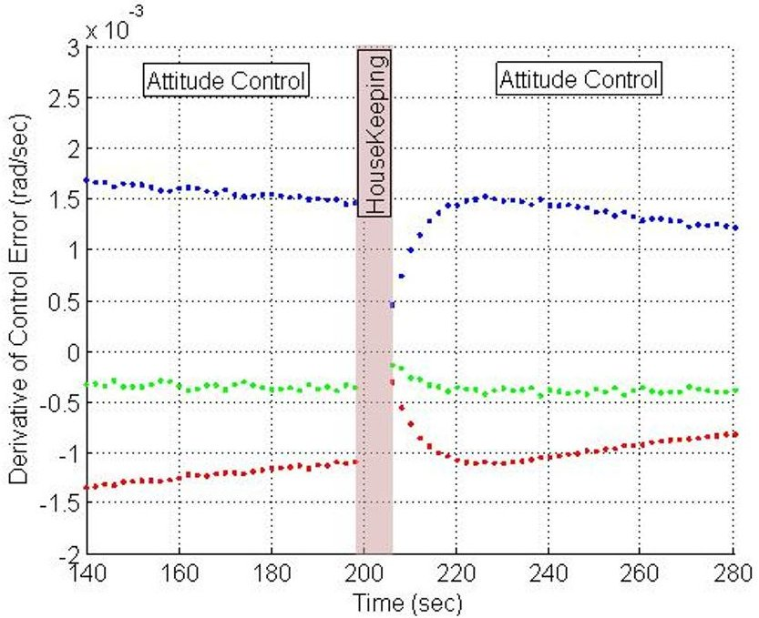

Figure 9: Filtered derivative action stabilisation due to a housekeeping interruption

This problem was solved by adding an algorithm to the ACS initialization. The algorithm checks the timestamp of the last estimation and decides to propagate the satellite's attitude or to reset.

- CPU overload when the telemetry files are closed: this overload generated an error on the MM Driver. Figure 10a shows the MM Driver output period, which is altered by another task, mainly when the TM file is being closed. Figure 10b shows the output of the Magnetometer Driver during TM file closure. Any derivative control action computed from this signal is wrong. This error was fixed by reducing the maximum size of the telemetry files.

- ACS-SW updating patches error: every time the ACS-SW is partially modified, an OBSW update patch telecommand (TC) is generated. This TC is transferred to the FlatSat OBDH using the EGSE, and the closed-loop scenario is used to validate the correct behavior of the updated software. Sporadic human error cases have been detected in the automatic

<!-- PDF_PAGE: 24 -->

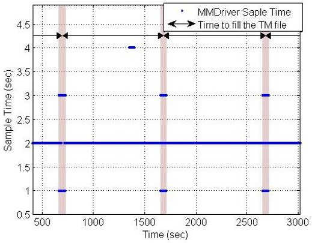

(a) Left MM Driver output period

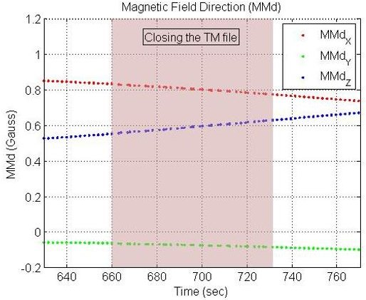

(b) Right MM Vector output in trouble

Figure 10: CPU overload when the telemetry files are closed

patch generation process due to a bad configuration of the scripts. As an example of their effects, the ACS' constants were not properly updated because they were not allocated in an appropriate memory area. The end-to-end validation process has allowed the early detection of this human error and the fixing of the scripts before the patching TC was sent to the NS-1B.

## 5.2. Open-Loop Scenarios

The ACS-RTE has also been used to inspect the OBSW performance using flight telemetry. In this case the loop is broken by the injection of real measured signals in the Drivers, according to the downloaded ACS telemetry, and discarding the magnetorquers commands. Some anomalies have been solved after the satellite's launch using these scenarios:

- Floating-point precision: single precision is used by default in the TMs, while the OBSW uses double precision floating-point numbers. Figure 11 shows the accumulated error when the attitude is propagated using a single precision TM.

The discrepancies on the ground attitude propagation have been solved by declaring some critical TMs as double precision.

<!-- PDF_PAGE: 25 -->

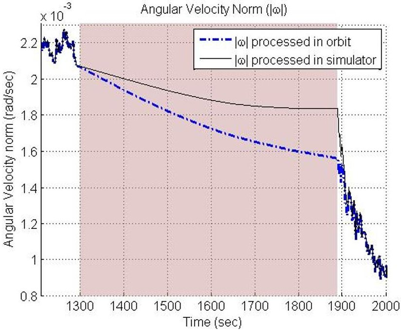

Figure 11: Angular velocity module propagation with poor precision

- Effect of shadows on the solar sensors: Figure 12 shows the shadows generated by the antennas on the SSC Solar Cells. A newer SSDriver was developed after the launch of the satellite using the knowledge acquired in flight. In this driver the priority of the combinations of Solar Cells has been changed to minimize the disturbance introduced by the shadows of the antennas. The modification was verified on ground using real flight telemetry before uploading it.

## 6. Conclusions

The distributed development of the different software modules of a satellite requires an integration and validation process that involves both hardware and software. In a general way, within this process, each subsystem control software is tested separately and, finally, system level tests are conducted. End-to-end system level tests allow a verification and validation of the overall technical approach robustness. With these tests, complex execution conditions can be reproduced that might lead to the detection of non-conforming behaviours that

<!-- PDF_PAGE: 26 -->

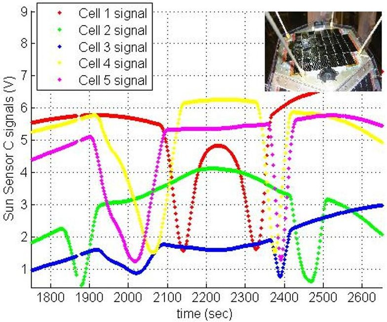

Figure 12: Shadows generated by antennas on Solar Cells of SSC

were left undetected in the previous validation stages. This is the case of the on-board software of the NS-1B, where the tasks that control the different subsystems must be executed concurrently on a single CPU.

In this paper, an environment and a procedure for developing and validating ACS software has been presented. This solution has allowed automating the integration into the NS-1B on-board software of the generated ACS modules and it has established, in parallel, a flow of auxiliary data intended for validation. The procedure consists of three subsystem-level stages and one final system-level stage based on end-to-end testing:

1. A stage of unitary tests, run in the laboratory, of the ACS modules in charge of interacting with the space environment. The measurement (MM + DriverMM, SS + DriverSS) and actuation (MT + DriverMT) chains have to be validated using specific laboratory equipment.

2. A simulation and generation stage, both of the ACS's source code and of the input/output and environmental data files linked to the different test scenarios. These files will be later used in the tests of the following stages.

<!-- PDF_PAGE: 27 -->

In order to reduce the amount of errors and the cost of the subsequent integration, the code is designed and generated to be compliant with the previously defined interface of the OBSW component model.

3. A stage including the on-board software integration tests. These tests, based on the on-board software component model, automatically check the functional response of the high-level ACS modules in charge of the attitude determination and the control calculations. In order to perform these tests, the files generated during the simulation stage are used.

4. Finally, a stage introducing the end-to-end tests with which the functional and extra-functional system-level behaviour is validated. These tests include the real satellite's QM hardware with a FlatSat configuration. During the tests, the ACS modules have already been integrated in the multi-tasking on-board software. In order to perform these tests, a real-time emulator of the ACS's environment has been built, which provides the equivalent information to the one that the satellite would receive in flight and responds to its actions, thus closing the attitude control loop. The emulator uses the data that was calculated offline during the simulation and generation stage to fix the different test scenarios. Furthermore, it can also be configured to work on an open-loop configuration using previously downloaded flight telemetry.

The paper enumerates the ACS modes on which the end-to-end validation tests scenarios were built. It also highlights some of the anomalous behaviours that were detected during this stage, which were mainly caused by the complexity of the situations reached by the multi-tasking on-board software. These behaviours have been shown, as well as the solutions that were adopted to address them and were later validated both on the end-to-end validation environment and in flight.

The environment, when configured to work in an open-loop scheme, has also allowed the analysis of the ACS's response to complete series of attitude conditions reached in flight. This has been done by injecting directly into the

<!-- PDF_PAGE: 28 -->

real-time emulator the data from the attitude telemetry measured in flight.

Finally, it is also worth noting that the last stage of the procedure has also been used to validate the deployment of the code patches after an onboard software modification. According to this, a set of ACS scenarios has been selected for inclusion on the mandatory regression tests.

The approach presented in this paper has been successfully applied to NS1B and it provides a low-cost solution, both in terms of development time and monetary expenditure. It allows automating the execution of the proposed stages for the ACS validation. The last and most relevant of these stages is the one corresponding to the final end-to-end validation, which is based on the use of an environment whose kernel is a real-time emulator of the space environment, the sensors and the attitude dynamics. A simple industrial PC with commercial input/output cards is used to run the emulator. This PC is in turn connected, using a basic interface, to the electronics of the sensors and actuators of the ACS subsystem corresponding to a complete FlatSat model of the satellite. This model is built from the satellite's QM units and allows the execution of the on-board software in the same conditions it has when spaceborne.

Matlab-Simulink has been used as a support tool for the solution, both for the ACS design and for the offline and real-time emulations. On the other hand, the EDROOM tool for component-based modelling and automatic code generation has been used to develop the complete on-board software and to build an integration test of the ACS software modules in the component model.

The complete toolchain used for automating the end-to-end validation process has allowed the performance of exhaustive tests of the ACS response over the flight version of the on-board software. The solution has been adopted without a significant increment in neither time nor cost, due to the fact that the most part of the required hardware is based on the satellite's QM model, and the real-time emulator runs Matlab-Simulink blocks that have been developed during the ACS design. The early detection of minor failures and the absence of critical incidents during the nearly four years of INTA-Nanosat-1B nominal operation, are evidences that this approach can be used to successfully achieve

<!-- PDF_PAGE: 29 -->

the end-to-end ACS validation process of this kind of nanosatellites.

## References

[1] G. J. Holzmann, Conquering complexity, Computer 40 (12) (2007) 111-113.

[2] N. W. Green, A. R. Hoffman, Anomaly trends for missions to Mars: Mars Global Surveyor and Mars Odyssey, in: Proceedings of the 46th AIAA Aerospace Sciences Meeting and Exhibit, 2008.

[3] B. J. Sauser, R. R. Reilly, A. J. Shenhar, Why projects fail? how contingency theory can provide new insights - a comparative analysis of nasa's mars climate orbiter loss, International Journal of Project Management 27 (7) (2009) 665-679.

[4] NASA, Report reveals likely causes of mars spacecraft loss, Available at http://www.nasa.gov/mission_pages/mgs/mgs-20070413.html (2007).

[5] R. Keil, D. Risquez, F. van Leeuwen, A. G. A. Brown, An attitude model for the spacecraft of the ESA mission Gaia, Acta Astronautica 69 (2011) 869-881.

[6] G. Bernat, A. Colin, S. Petters, pwcet: a tool for probabilistic worst-case execution time analysis of real-time systems. URL http://www.rapitasystems.com/system/files/YCS-2003-353.pdf

[7] M. G. Harbour, J. J. G. García, J. C. P. Gutiérrez, J. M. D. Moyano, MAST: Modeling and analysis suite for real time applications, in: Proceedings of the 13th Euromicro Conference on Real-Time Systems, ECRTS '01, IEEE Computer Society, Washington, DC, USA, 2001, pp. 125- URL http://dl.acm.org/citation.cfm?id=871910.871923

[8] J. Eickhoff, A. Falke, H.-P. Röser, Model-based design and verification State of the art from Galileo constellation down to small university satellites, Acta Astronautica 61 (2007) 383-390.

<!-- PDF_PAGE: 30 -->

[9] P. Seidelmann, B. Guinot, L. Dogget, Time, in: P. K. Seidelmann (Ed.), Explanatory Supplement to the Astronomical Almanac, U. S. Naval Observatory, University Science Books, Mill Valley, CA, 1992, Ch. 2.

[10] J. R. Wertz, Spacecraft Attitude Determination and Control, Kluwer Academic Publishers, Boston, 1978.

[11] F. Hoots, R. Roehrich, Models for propagation of norad element sets, Tech. rep., Spacetrack (1988).

[12] D. Vallado, W. McClain, Fundamentals of Astrodynamics and Applications, Space Technology Library, Microcosm Press, 2001. URL http://books.google.es/books?id=PJLlWzMBKjkC

[13] S. Maus, S. Macmillan, S. McLean, B. Hamilton, A. Thomson, M. Nair, C. Rollins, The US/UK World Magnetic Model for 2010-2015, NOAA technical report NESDIS/NGDC-2, NOAA National Geophysical Data Center, 2010.

[14] O. R. Polo, P. Parra, M. Knoblauch, I. García, S. Sánchez, Manuel, Component-based engineering and multi-platform deployment for nanosatellite on-board software, in: Proceedings of the DASIA 2012 Conference, 2012.

[15] A. Viana, O. L. Oscar R. Polo, M. Knoblauch, S. Sánchez, D. Meziat, EDROOM: A free tool for the UML2 component based design and automatic code generation of tiny embedded real-time systems, in: Proceedings of the 3rd European Congress on Embedded Real-Time Software ERTS, 2006.

[16] OMG, UML superstructure specification v2.3, Available at http://www.omg.org/spec/UML/2.3/Superstructure/PDF/ (May 2010).

[17] Advantech, Pcl-818hd datasheet, Available at http://www.advantech.com/products.

<!-- PDF_PAGE: 31 -->

[18] Advantech, Pcl-727 datasheet, Available at http://www.advantech.com/products.

[19] T. R. Kuphaldt, Lessons In Electric Circuits, Volume III Semiconductors, Open Book Project, 2007, available at http://openbookproject.net/electricCircuits/.