<!-- PDF_PAGE: 1 -->

ORIGINAL PAPER

# Modelling the development of complex products using a knowledge perspective

Xiaoqi Zhang $ ^{1} $ Vince Thomson $ ^{1} $

Received: 9 May 2017/Revised: 17 October 2017/Accepted: 26 October 2017/Published online: 8 November 2017 $ \textcircled{c} $ Springer-Verlag London Ltd. 2017

Abstract The need for more knowledge intensifies the complexity of product development. To understand how knowledge contributes to designing products and how learning improves the product development process, this paper introduces an agent-based model that represents product development as the learning and application of knowledge. Product development consists of a complex network of interdependent agents, such as product functions, design activities and designers. Knowledge is the link connecting these elements, since product functions are the embodiment of knowledge, since design activities require knowledge, and since designers provide knowledge. The simulation of model activities and agent interactions at the micro-level generated project performance, which was measured in terms of project effort and duration at the macro level. The model used product and development process data from GE Hydro. Results demonstrated that design effort and project duration increased exponentially with product knowledge (complexity), that product development was more sensitive to the design of interfaces as compared to the design of components, and that designer knowledge played an important role in mitigating complexity. The implications for managers were that attention should be paid to the management of interfaces, to coordination thorough communication and consultation, and to increasing the rate of designer learning.

Keywords Product development · Process modelling Design management

## 1 Introduction

Product development is critical for company success because new products provide competitive advantage. Brown and Eisenhardt (1995) point out that a robust development process helps companies to adapt in an everevolving marketplace. With the rapid growth of technology and increasing customer demands, the knowledge base required to design products has been expanding at an everincreasing pace (Granstrand et al. 1992). For instance, for the design of an aircraft flight control system, the introduction of fly-by-wire transforms the once purely mechanical and electrical system into a complex integration of sensors, microprocessors, data storage, and software. Evidence has shown that the development time of a product increases with greater knowledge requirements (Lucke et al. 2009).

To understand better the impact of increasing knowledge requirements during product development, the goal of this paper is to study the development processes of complex products from a knowledge perspective. Consequently, this paper introduces an agent-based model that simulates the learning and application of knowledge during product development. Use of a real example develops insights into how knowledge impacts complexity and effort as well as into how a designer's knowledge ability contributes to performance. The concept of knowledge has been studied in a wide range of topics, such as problem solving, artificial intelligence and psychology. Instead of being concerned with the detailed cognitive process employed during design, this paper uses the concept of

<!-- PDF_PAGE: 2 -->

knowledge from the point of view of product design at a high level of abstraction. Knowledge is defined as both types of disciplinary expertise required to create products and the level of experience or know-how about products used by designers. The authors argue that product complexity is driven by the requirements of the different knowledge used for product development along with the interdependency among product subsystems, where the former contributes to the technical difficulty of designing a product, and the latter hinders smooth integration. Viewing product development as the gradual reduction of product complexity, we model the development process such that designers apply disciplinary knowledge and product-related experience to do design work as well as share knowledge to resolve technical problems and integration issues. A key contribution of this paper's research is the use of a knowledge perspective to model product complexity and the product development process.

The paper is organized as follows: Sect.2 describes related work and the need for a new approach; Sect.3 presents the definition of knowledge used in the model; Sect.4 shows how we measure product complexity from a knowledge perspective; Sect.5 gives a detailed description of the model; Sect.6 discusses the model's baseline scenario, the verification and validation of the model, model sensitivity to input parameters, and simulation results; Sect.7 gives managerial implications learned during the research; and Sect.8 concludes the paper.

## 2 Related work

This section reviews simulation models of the product development process, describes the knowledge perspective in product development used in this paper, and explains how the proposed knowledge approach is built upon previous research.

## 2.1 Process models

Product development is a dynamic and nonlinear process that has great interdependency and uncertainty. Due to its multidisciplinary nature and short development time, the development of a complex product is usually broken down into manageable tasks, which are assigned to professionals from various disciplines. The decomposition is accompanied by a complex network of interdependencies within and among product development elements such as product subsystems, designers and activities (Yassine and Bradley 2013), which require intense communication across organizational boundaries (Torry-Smith et al. 2014) and great collaborative effort (Grogan and de Weck 2016). As interdependency increases, it becomes more challenging to

predict project behaviour. Furthermore, early phases of product development often encounter considerable uncertainty due to incomplete product information, limited understanding of the required functions, and a lack of both technical and product knowledge (Oberkampf et al. 2004). To reduce uncertainty and gain knowledge, designers have to go through several iterations of innovation and validation, which makes product development a nonlinear process (Suss and Thomson 2012). Consequently, the intrinsic properties of interdependency and uncertainty make product development a dynamic and nonlinear system that is difficult to study with static or linear approaches.

Modelling and simulation are often adopted to investigate the dynamic and nonlinear behaviour of design. Simulation is used to predict how a real system behaves under tested conditions, where results provide better comprehension of the process and managerial implications to control the process (Smith and Morrow 1999). Modelling and simulation prevent disruption due to direct experimentation on real systems, and in many cases allow analysis which would otherwise be impossible (Browning et al. 2006).

Early process models were mostly derived from traditional project management methods, such as program evaluation review technique (PERT) and critical path method (CPM), where the development process was viewed as a network of discrete activities with stochastic duration and sequential relationships (Pritsker 1966; Ritchie 1972). The limitation of this approach lies in its incapability of capturing feedback and iterations that are common in the development process (Smith and Morrow 1999).

As many researchers have emphasized the nonlinear nature of product development (Kline 1985; Whitney 1990), more attention has been paid to the modelling of iterations, feedback and loops. Eppinger et al. (1997) explicitly modelled iterations by adding a probability of repetition for each task. Similarly, Zhang et al. (2015) captured nonlinear properties by adding review tasks which had a certain probability to cause rework. Rather than directly setting probabilities for rework iterations, many researchers have modelled the conditions which trigger rework, such as quality problems (Le et al. 2012), and uncertainty in inputs (Suss and Thomson 2012). Braha and Bar-Yam (2007) analyzed networks of tasks and found that, when tasks were finished, weakly connected tasks were not susceptible to rework, but strongly connected tasks were particularly susceptible.

With product development becoming fast paced, dynamic and chaotic, procedural models tend to be less helpful in describing and predicting the development process. Many researchers moved to the perspective of a complex system by claiming that product development is

<!-- PDF_PAGE: 3 -->

more than stages and iterations; instead, it should be viewed as a system where the combined attributes and interactions of agents (people, product and activities) generate different behaviours in the whole process (Chiva-Gomez 2004; Gomes 2003; McCarthy et al. 2006). The development of the object-oriented programming and agent-based modelling paradigm prompted the modelling of process from the view of a complex system, especially in the study of organizational structures (Jin and Levitt 1996; Lenox 2002; Wong and Burton 2000). For example, in their Virtual Design Team model, Jin and Levitt (1996) simulated the micro-level processing of information and the coordination of designers, which enabled them to observe the project level performance that emerged from designer interactions.

## 2.2 The knowledge perspective

Product development has been recognized as a knowledge intensive process where knowledge is embedded in development team members, tools, tasks and networks that are formed by these elements (McGrath and Argote 2008), and where the process proceeds with the dynamics of knowledge creation, transfer and exploitation (Davis et al. 2005; Madhavan and Grover 1998; Nissen 2002). The intensity and diversity of the knowledge required during product development drive design complexity. The multidisciplinary nature of designing products requires an extensive integration of different knowledge domains through collaboration (Kleinsmann et al. 2010), which leads to more complex coordination and communication among designers. Yassine et al. (2003) showed that product development often failed to be on schedule because designers that worked concurrently on interdependent features did not coordinate sufficiently.

The management of knowledge plays a key role in successful product development. Surveys of companies have shown that the knowledge diversity of design teams, the knowledge transferability within and among companies, and the level of knowledge sharing are positively correlated to design quality and product development performance (Kim et al. 2013; Markham and Lee 2014). Yassine and Bradley (2013) proposed a framework with four sequential layers of networks, where each layer represented data, information, knowledge and product, respectively. The framework provided a detailed view of how product architecture was affected with the use of knowledge. However, since the networks were predefined, the framework did not represent the dynamic nature of the relationships within a product development process well. Nissen and Levitt (2004) added the feature of knowledge dynamics to their Virtual Design Team model by modelling experience growth during working and training. The

growth was continuous, which was mathematically represented by learning curve functions. The growth after training was one time, and was modelled as a fractional or unit increment. However, the model of knowledge growth was oversimplified when studying the interactions between product and designers, as it did not include the impact of product characteristics on a designer's learning process.

The high impact of knowledge requirements on product design and knowledge sharing for subsystem integration led the authors to investigate the product development process from a knowledge perspective. Although other researchers have studied the product development process from the point of view of collaborative tasks, dynamic scheduling, learning and rework, and have used tools such as agent-based modelling, none have studied the process from the point of view of a product's knowledge requirements and the knowledge sharing among designers needed to create a product.

## 2.3 A new approach

First, when considering which modelling paradigm to use, since the product development process is dynamic and nonlinear, we adopted the view that the process was a complex system whose behaviour emerged from the interactions of different agents; so, the agent-based modelling paradigm was chosen. Second, we argued that knowledge was an important dimension for studying the product development process based on the implications from the literature reviewed in Sect. 2.2; therefore, to provide a tool to investigate better a complex process, a knowledge perspective should be incorporated into the agent-based model. Research by Yassine and Bradley (2013) provided theoretical support for the idea that product and designers were linked through the application of knowledge. Clarkson and Hamilton (2000) proposed the capturing of design knowledge and meta-knowledge for the creation of a task planning tool. Nissen and Levitt's (2004) model, although too simple to represent well the relationship between product complexity and designer knowledge, showed examples of modelling knowledge growth during product development. Therefore, we introduce an agent-based model which represents product development as a process of designers who learn, develop and apply knowledge to resolve product complexity.

## 3 Definition of knowledge

Knowledge is an important corporate asset and has a broad scope from database to organizational culture.Rather than capturing every aspect of knowledge, this paper focuses on the technical knowledge applied by designers during

<!-- PDF_PAGE: 4 -->

design activities. Within this restrictive definition of knowledge, we further distinguish between general knowledge and product-specific knowledge.

General knowledge is the understanding and skill in a certain field, which is acquired through formal education, structured study or systematic training. It determines whether a designer is able to do certain tasks. For example, if a task requires stress analysis, then, it is reasonable to assign the task to a mechanical engineer instead of a software engineer. General knowledge can be identified with a matrix that classifies and quantifies the knowledge required for development projects. Knowledge items classified using a numerical scale should be mutually exclusive. The knowledge of 'geometry' and the knowledge of 'weight' are good examples of mutually exclusive knowledge, whereas the knowledge of 'geometry' and the knowledge of 'shape' are not.

Knowledge levels, such as minimum (numerical value = 0), general (numerical value = 1) and intense (numerical value = 2), are defined to assess the severity of knowledge requirements. Correspondingly, a designer's level of ability to apply general knowledge is defined with the scale: novice (numerical value = 0), ordinary (numerical value = 1) and expert (numerical value = 2). An example of a knowledge scale for the development of a hydroelectric generator at GE Hydro is shown in Table 1. Since the knowledge items are exclusive, each item can be treated as an independent dimension. N knowledge items form an N-dimensional space, where the knowledge requirement for a development activity is represented as a knowledge vector: $ \vec{V} = (k_{1}, k_{2}, \dots , k_{n}, \dots , k_{N}) $ , where $ k_{n} $ is the value of knowledge item n. Similarly, the knowledge ability of a designer is a knowledge vector as well: $ \vec{A} = (a_{1}, a_{2}, \dots , a_{n}, \dots , a_{N}) $

Product knowledge is the comprehension of the specific product to be designed, which is mostly developed from prior experience obtained in similar projects. Designers with good product knowledge are aware of interdependent

activities besides their own tasks; so, based on experience, they are able to anticipate possible development and integration issues and to take proactive measures. We quantify the knowledge ability of a designer that is relevant to creating a new product as a percentage. Zero percent of knowledge ability means that the new product is radically innovative and designers do not have any related experience. A hundred percent of knowledge ability means that the new product is the same as in previous projects, and designers have well-established methodologies to resolve technical and interface issues. The most common situation is that knowledge ability is somewhere between the two extremes where a higher value typically means a more mature product, less uncertainty and higher designer experience. In summary, a general knowledge requirement and a designer's general knowledge ability are defined on a scale of 0-2, and a product knowledge requirement and a designer's product knowledge ability are defined on a scale of 0-100%. Modelling product knowledge and the corresponding designer ability needed a finer scale than the three-point scale used for general knowledge for the simulation of different scenarios, especially involving knowledge learning.

## 4 Characterization of complexity

A product is appreciated through its functionality; so, a product can be represented as a network of functions connected by interfaces, such as spatial alignment, energy exchange, information transformation and material exchange (Pimmler and Eppinger 1994). Describing a product as a set of functions is useful in many cases since it is a pre-embodiment representation, i.e., the set of functions describes what a product is, and the description is not restricted by the specifics of part size and shape, of energy source for activation, etc. In the present model, a functional description of a product is used so that the knowledge requirements of a product can be given previous to a

Table 1 A scale for the knowledge requirements for the development of a hydroelectric generator at GE Hydro

<table border="1"><tr><td colspan="2">Levels knowledge</td><td>Minimum</td><td>General</td><td>Advanced</td></tr><tr><td>1</td><td>HVAC(heating,ventilating and air conditioning)</td><td>0</td><td>1</td><td>2</td></tr><tr><td>2</td><td>Air circulation</td><td>0</td><td>1</td><td>2</td></tr><tr><td>3</td><td>Water circulation</td><td>0</td><td>1</td><td>2</td></tr><tr><td>4</td><td>Heat transfer</td><td>0</td><td>1</td><td>2</td></tr><tr><td>5</td><td>Electric heat generation</td><td>0</td><td>1</td><td>2</td></tr><tr><td>6</td><td>Control</td><td>0</td><td>1</td><td>2</td></tr><tr><td>7</td><td>Mechanical engineering</td><td>0</td><td>1</td><td>2</td></tr><tr><td>8</td><td>Sensor technology</td><td>0</td><td>1</td><td>2</td></tr><tr><td>9</td><td>Physics</td><td>0</td><td>1</td><td>2</td></tr><tr><td>10</td><td>Electrical engineering</td><td>0</td><td>1</td><td>2</td></tr></table>

<!-- PDF_PAGE: 5 -->

product's design. A function diagram can be obtained through function analysis where, to identify product functions, one starts with the primary function and expands the functions into subfunctions, and then, expands subfunctions into sub-subfunctions, etc., until the end functions are too simple to be further broken down. The result of the functional decomposition of a hydroelectric generator from GE Hydro is a function tree as shown in Fig. 1. Bytheway (2007) developed the concept of the function tree and the process for creating it. The interdependency among the hydroelectric generator functions is shown in Fig. 2.

The essence of product development is integrating multiple knowledge to achieve desired functions. During the development process, not only do designers apply disciplinary knowledge to satisfy each function, they also need to understand other knowledge to integrate the different functions into a whole product. With a wider range and higher level of knowledge required in development activities, designers have to solve more complex technical problems and integration issues. To model development complexity, we introduce metrics for technical complexity and integration complexity.

Technical complexity is a measure of the types of knowledge in a function. It is defined for each individual function and corresponds to the technical challenge needed to satisfy development requirements. Since functions with more severe knowledge requirements are more complex (Bashir and Thomson 1999a, b), we use Eq. (1) to calculate the technical complexity (TC) of a function whose general knowledge requirement is $ \vec{V}=(k_{1},k_{2},\ldots,k_{n},\ldots,k_{N}) $ where N is the number of knowledge items needed for a given function. TC is the technical complexity of an individual function that was developed by Zhang and Thomson (2017) as part of the Bashir-Zhang-Thomson metric for measuring product complexity from a knowledge perspective.

$$
T C = \sqrt {\sum_ {n = 1} ^ {N} k _ {n} ^ {2} / N}
$$

Integration of components into a product can be decomposed into a set of interfaces where each interface is between two components (Rahmani and Thomson 2012). Integration complexity is defined as the complexity of integrating a pair of functions. The number of interfaces between two functions (NF) contributes to integration complexity, as more interfaces usually put more constraints on the development of functions. The general knowledge difference between two functions (KD) also drives integration complexity, as designers' mutual understanding decreases with a greater difference of general knowledge between functions (Hage et al. 2008), which makes

integration more difficult. The difference of general knowledge between two functions with knowledge vector $ \vec{V} $ and $ \vec{U} $ , respectively, is calculated as

$$
K D = r ^ {\sin \theta} = r \sqrt {1 - \left(\frac {\vec {V} \cdot \vec {U}}{\| \vec {V} \| \cdot \| \vec {U} \|}\right) ^ {2}}
$$

where r is the upper limit of the knowledge scale, and where its power sin $ \theta $ calculates the intersection between two knowledge vectors. Thus, the integration complexity (IC) between two functions is calculated as

$$
I C = 0. 5 \cdot N F \cdot K D
$$

IC is calculated using the number of interfaces; however, IC is defined in terms of functions. Since there are two functions for each interface, the constant, 0.5, is added to Eq. (3) because both functions $ \vec{V} $ and $ \vec{U} $ are counted when calculating IC.

## 5 Model of product development

Product development is viewed as the demand of knowledge by product functions and the supply of knowledge by designers. This point of view requires modelling the interdependencies and interactions among functions and designers. The adoption of the agent-based modelling paradigm allows variations in agent characteristics and in the interactions between agents. The product to be designed is modelled as a group of interdependent function agents requiring knowledge. Designers are modelled as designer agents with different knowledge ability to finish assigned tasks. To develop functions, designer agents perform technical work by applying knowledge and spending effort. To ensure successful integration, designer agents communicate by exchanging information about interdependent functions. To improve working efficiency and quality, designer agents consult with colleagues about general knowledge to improve a design and product knowledge to accomplish integration. The interactions among function agents and designer agents are summarized in Fig. 3. Simultaneous design tasks as well as interactions among designer agents and function agents generate the complex behaviour of the development process. The behaviour of the model during simulation is dynamic since the duration of design tasks is stochastic and since the need for communication and consultation between designers is probabilistic. The following subsections explain in detail the properties and behaviour of function agents and designer agents during the three main development activities: technical work, consultation and communication.

<!-- PDF_PAGE: 6 -->

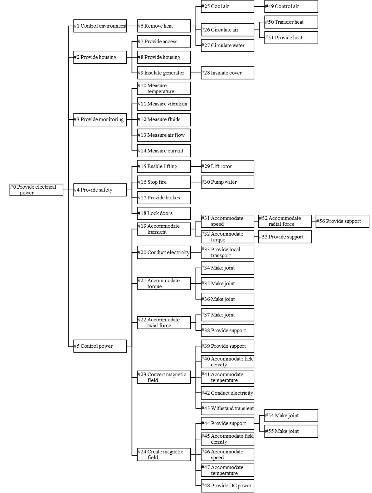

Fig.1 Function tree of a hydroelectric generator adapted from (Bashir and Thomson 2004)

<!-- PDF_PAGE: 7 -->

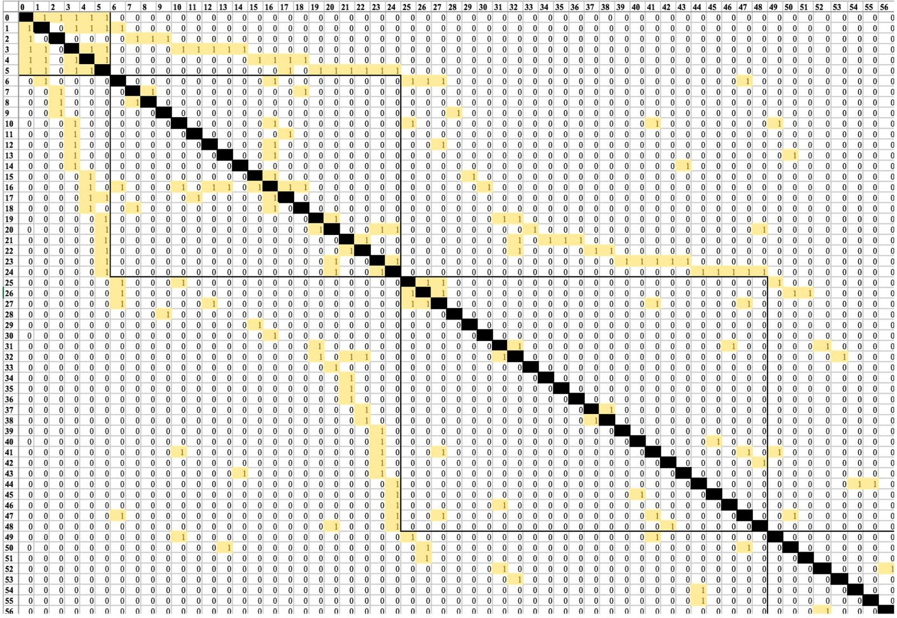

Fig. 2 The interdependency among specified development functions is documented using a Development Structure Matrix (DSM), where 1 means interdependence and 0 means independence between the

## 5.1 Technical work

When representing a product as a function tree, we define a function that does not have any subfunctions as a child function, and define a function with one or more subfunctions as a parent function. The development of a parent function is considered to be the integration of its subfunctions. A parent function starts when all its subfunctions have provided information that is good enough for integration (a 95% quality level $ ^{1} $ ). Therefore, the development process begins with the child functions, progresses to their parent functions, and further, to the parent functions at the next higher level. The development process is considered completed when all functions are developed and integrated.

Developing a function is a progressive and iterative process where it is assumed that one designer creates the design for one function. A function agent is modelled as a series of sequential tasks, each with a certain probability of

function in the first row and the function in the first column. Interdependence between functions at the same level of the function tree is shown by a black outline

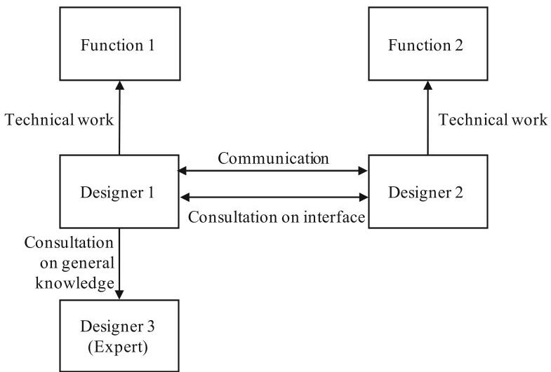

Fig. 3 Interactions among function agents and designer agents

rework. After the completion of the last task, the function agent goes through a technical review, where rework is requested if technical errors are detected. Error-free work is sent to parent functions for integration. The integration work, i.e., the development of a parent function, is also

<!-- PDF_PAGE: 8 -->

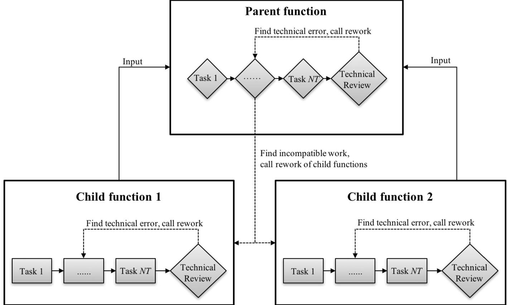

Fig. 4 Development and integration of functions

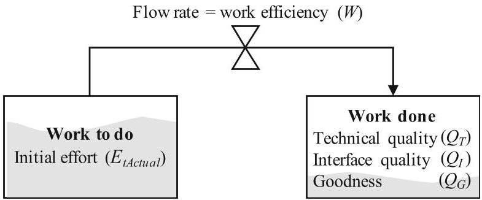

Fig. 5 A designer agent performs a task

composed of sequential tasks. Integration tasks are about mating the interfaces of subfunctions and testing if the integration realizes the parent function. Incompatible work may be found during tests, thus generating rework for the subfunctions. The process of developing and integrating every function in a function tree follows the same structure as illustrated in Fig. 4, although the effort, work efficiency and work quality for tasks of different functions vary with complexity and the assigned designer's knowledge ability.

The execution of each task is modelled as workflow, where a designer agent transfers effort from the work-to-do tank to the work-done tank of a task as illustrated by Fig. 5. Initially, the work-to-do tank contains all the effort required to complete the task $ ( E_{\mathrm{tActual}} ) $ . As the assigned designer works on a task, the effort flows to the work-done tank with the flow rate equal to the designer's work efficiency ( W ). The task is completed when all effort has flowed to the work-done tank. The quality of the finished

work is measured by technical quality $ ( Q_{\mathrm{T}}) $ which determines the probability of detecting technical errors during the technical review, interface quality $ ( Q_{\mathrm{I}}) $ which determines the probability of incompatible work during integration, and solution goodness $ ( Q_{\mathrm{G}}) $ which determines if the work result is acceptable with respect to the required level of integration.

## 5.1.1 Task effort

The initial effort in work-to-do is estimated using Eqs. 4-7. Based on the assumption that more effort is required for functions with higher technical complexity, Eq. (4) estimates the planned effort for a function $ ( E_{\mathrm{fPlan}} ) $ , where TC is the function's technical complexity and TRI (a,b,c) is an effort value chosen from a triangular distribution with lower limit a, upper limit b and mode c. The total effort required to design a function is divided into tasks where each task is assumed to take 4 h of work (a half day). A designer works to finish a task and does not communicate during this time. After a task is finished, a designer communicates task outcomes to dependent functions. Using smaller values for task time increases the simulation time, but does not affect simulation outcomes. Using larger values for task time greatly reduces the number of communication events and makes observation of design process behaviour more difficult. The number of tasks (NT) is calculated with Eq. (5), where nint (x) is a function that gives the nearest integer x and 4 is the chosen number of

<!-- PDF_PAGE: 9 -->

hours for a task. The planned effort for each task $ ( E_{\mathrm{tPlan}} ) $ is calculated using Eq. (6). In practice, the rework of a task takes less effort the second time compared to the first time because of the learning curve effect. Thus, the actual effort required to perform a task, $ E_{\mathrm{tActual}} $ , is modelled using the classic learning curve expression in Eq. (7), where l is the learning factor and r is the repeat time of the task.

$$
E _ {\mathrm {f P l a n}} = \operatorname {T R I} (a, b, c) \cdot T C
$$

$$
N T = \operatorname {n i n t} \left(E _ {\mathrm {f P l a n}} / 4\right)
$$

$$
E _ {\mathrm {t P l a n}} = E _ {\mathrm {f P l a n}} / N T
$$

$$
E _ {\mathrm {t A c t u a l}} = E _ {\mathrm {t P l a n}} \cdot (1 - l) ^ {r}
$$

## 5.1.2 Work efficiency

The efficiency of the technical work (W), i.e., the flow rate from work-to-do to work-done, equals the designer's competence, D, which is calculated with Eq. (8), where $ k_{n} $ is a function's general knowledge requirement for knowledge item n, $ a_{n} $ is a designer's knowledge ability for knowledge item n, M is the set of indices n that satisfy $ k_{n} > 0 $ m is the size of set M, and min (x, y) is a function that returns the smaller value between x and y. The formula is based on the assumption that, given the knowledge requirement of a function, a designer's competence increases with his/her general knowledge.

$$
D = \frac {1}{m} \cdot \sum_ {n \in M} \min \left(1 0 0 \%, \frac {a _ {n}}{k _ {n}}\right)
$$

## 5.1.3 Task quality

Designers who match the general knowledge requirement of a function are less likely to make technical mistakes; so, the technical quality of a designer's achieved work $ ( Q_{\mathrm{T}} ) $ is modelled to be equal to the designer's technical competence (D). During technical review, the technical quality of each task is checked in sequence. A task passes the review with a probability of $ Q_{\mathrm{T}} $ . A failed task triggers rework Since a later activity is performed based on the work from an earlier activity, all the tasks done after a failed task need rework.

Designers with better product knowledge have a better understanding of the interdependent functions; so, they are more likely to develop compatible interfaces. Based on this assumption, the interface quality of the finished work $ ( Q_{\mathrm{I}}) $ is modelled to be equal to the designer's product knowledge $ ( PK ) $ . The probability of successful integration equals

$ Q_{\mathrm{I}} $ . The proportion of work that needs rework triggered by failed integration is calculated as $ 1-Q_{\mathrm{I}}. $

Goodness $ ( Q_{\mathrm{G}}) $ refers to the accuracy, certainty and completeness of task outcomes. Goodness increases as a solution to technical work progresses. The progress of technical work (H) is the fraction of total tasks completed and it is calculated using Eq. (9) where taskNumber is the serial number of the task, and NT is the total number of tasks in the function agent.

$$
H = t a s k N u m b e r / N T
$$

Since errors and deviations are cumulative, we set the upper limit of goodness at the goodness level of the input information $ \overline{{{Q_{\mathrm{G}_{input}}}}} $ . The input goodness is calculated as the weighted average of the goodness value from all the input information, as shown in Eq. (10), where i is the index of functions providing inputs, $ IC_{i} $ is the complexity of integrating function i, and $ Q_{G_{i}} $ is the goodness of the information from function i.

$$
\overline {{Q _ {\mathrm {G} \_ \mathrm {i n p u t}}}} = \frac {\sum_ {i} I C _ {i} \cdot Q _ {G \_ i}}{\sum_ {i} I C _ {i}}
$$

Another factor contributing to goodness is the designer's overall product knowledge $ (\overline{PK}) $ , which indicates the designer's experience with a product. A designer's overall product knowledge is calculated as the weighted average of their product knowledge for all dependent functions as shown in Eq. (11), where i is the index of functions providing inputs, $ IC_{i} $ is the complexity of integrating function i, and $ \mathrm{P K}_{i} $ is the designer's product knowledge for function i.

$$
\overline {{P K}} = \frac {\sum_ {i} I C _ {i} \cdot P K _ {i}}{\sum_ {i} I C _ {i}}
$$

Goodness is expected to exhibit a slower rate of change at the beginning and at the end of the development work of a function like an S-shaped function (Suss and Thomson 2012). According to Carrascosa et al. (1998), the S-shape is the best shape function to represent task completion as it can embody a growth phenomenon similar to learning. Thus, we modelled goodness with Eq. (12), where $ \alpha $ and $ \beta $ are shape parameters. The formula limits the certainty value between zero and the input goodness, and allows the goodness value to increase with progress in the development of function and product knowledge. Figure 6 shows that goodness increases with progress in an S-shape at different levels of product knowledge.

$$
Q _ {\mathrm {G}} = \frac {Q _ {\mathrm {G} \_ \mathrm {i n p u t}}}{1 + \alpha \cdot e ^ {- \beta \cdot \overline {{P K}}} \cdot H}
$$

<!-- PDF_PAGE: 10 -->

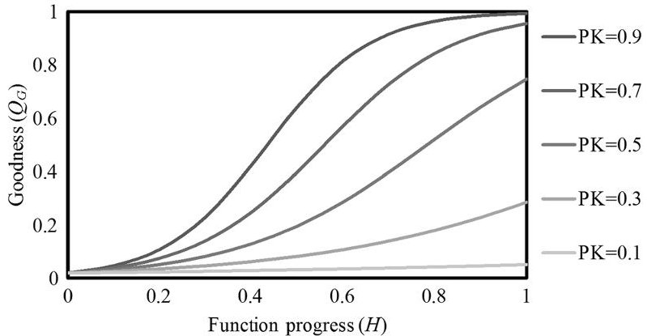

Fig. 6 The function shape of Eq. (12) $ \overline{{{Q_{\mathrm{G}_{-}\mathrm{input}}}}}=1 $ $ \alpha=50 $ $ \beta=10 $

## 5.2 Consultation $ ^{2} $

Consultation is modelled as meetings among designers concerning technical difficulties or interface issues. The process for a consultation meeting is shown in Fig. 7. When consultation is needed, a designer spends effort to prepare a meeting request. There is a delay between a request and a meeting, which models the fact that managers need time to coordinate activities and arrange a meeting. An invited meeting participant rejects the meeting if the items to be discussed are not relevant to his/her scheduled development work. A variable called schedule fitness $ ( P_{\mathrm{sked}} ) $ is introduced to model the probability of a designer accepting the meeting request. If the meeting is accepted, then, after spending effort learning from each other, designers go back to technical work with a better understanding of the product; otherwise, designers ignore the problems and continue technical work with old knowledge. The preparation effort, management delay time and consultation effort follow different triangular probability distributions. Depending on the purpose of the meeting, there are consultations on general knowledge or consultations on product knowledge.

## 5.2.1 Consultation on general knowledge

The request for consultation on general knowledge is triggered when a function fails a technical review or encounters technical difficulties. A technical review is performed after the completion of a function as shown in Fig. 4. Technical problems happen during development activities, which force a designer to stop working and to seek help. The time interval between two technical

problems is modelled to follow an exponential distribution with the parameter $ \lambda $ determined by Eq. (13), where $ k_{n} $ is a function's general knowledge requirement for knowledge item n, $ a_{n} $ is the designer's knowledge ability for knowledge item n, and M is the set of indices n that satisfy $ k_{n}>0 $ . The expected value for the exponential distribution is $ 1 / \lambda $ . If the designer's ability matches the function's requirement for every dimension of general knowledge, then $ \lambda $ is 0, and the average time interval is infinite, which means the designer does not have technical difficulty in performing the task. If the function requirement is at an advanced level $ (k_{n}=2) $ and the designer only has general knowledge $ (a_{n}=1) $ , then $ \lambda $ is 0.5 and the average time interval is 2 hours.

$$
\lambda = \max _ {n \in M} \left(1 - \frac {a _ {n}}{k _ {n}}\right)
$$

We define experts in the model as those designers who are at an advanced level for a certain type of general knowledge. An expert is called to a consultation meeting to help a designer with technical problems. By consulting with an expert, a designer's ability to use general knowledge improves. Progress in general knowledge learning is modelled to follow an exponential rise that starts with the designer's initial ability for the knowledge $ ( a_{n}^{\mathrm{Initial}}) $ , ascends with consultation effort $ ( E_{\mathrm{cnslt}}) $ and stabilizes at the expert's level $ ( X_{n} ) $ . A parameter, consultation efficiency $ ( s ) $ , is introduced to model the effectiveness and quality of the discussion, which can be interpreted as the complexity resolved per hour. Since functions with high technical complexity put the consultation in a complex context, we assume that technical complexity $ ( TC ) $ impairs the learning speed. Therefore, a designer's improved ability in using general knowledge n after consultation $ ( a_{n}^{\mathrm{New}}) $ is calculated as Eq. (14), where $ \gamma $ is a shape parameter. Figure 8 shows that general knowledge increases with consultation effort in situations with different technical complexity.

$$
a _ {n} ^ {\mathrm {N e w}} = \frac {X _ {n}}{1 + \left(\frac {X _ {n}}{a _ {n} ^ {\mathrm {i n i t i a l}}} - 1\right) \cdot \mathrm {e} ^ {- \frac {\gamma \cdot s \cdot E _ {\mathrm {c n s l t}}}{T C}}}
$$

## 5.2.2 Consultation on product knowledge

The request for consultation on product knowledge is triggered if the development work is found, during communication or integration, to be incompatible with other functions or to have too much uncertainty. The consultation meeting on product knowledge models the discussion between designers whose tasks are interdependent. During the consultation meeting, designers learn about each other's work, improve their understanding about the product, and collaborate to find solutions to integration problems.

<!-- PDF_PAGE: 11 -->

Fig.7 Flowchart of consultation meeting

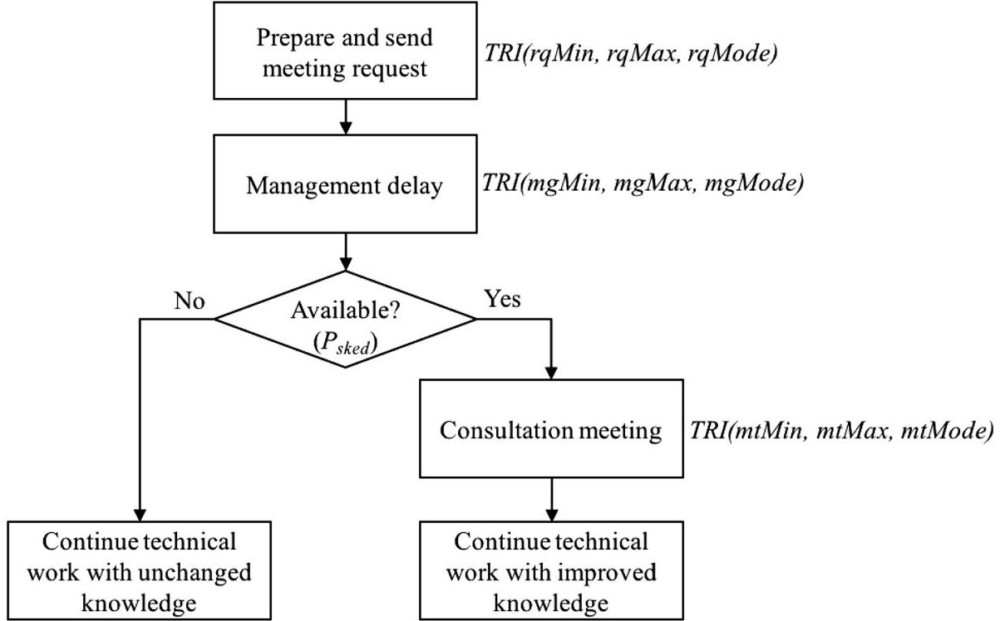

The designers' product knowledge between the two functions to be integrated improves after the consultation meeting. Similar to the learning process for general knowledge, the improvement of product knowledge follows an exponential function that begins with the designer's initial understanding of the interdependence between the two functions under discussion $ ( P K^{\mathrm{I n i t i a l}} ) $ and rises with consultation effort $ ( E_{\mathrm{c n s l t}} ) $ until the product knowledge hits the 95% limit. The improved product knowledge $ ( P K^{\mathrm{N e w}} ) $ is calculated as Eq. (15), where IC is the integration complexity of the two functions, s is consultation efficiency, and $ \delta $ is a shape parameter.

$$
P K ^ {\mathrm {N e w}} = \frac {1}{1 + \left(\frac {1}{P K ^ {\mathrm {I n i t i a l}}} - 1\right) \cdot \mathrm {e} ^ {- \frac {\delta \cdot s \cdot E _ {\mathrm {c n s l t}}}{I C}}}
$$

After a consultation meeting, designers revise incompatible work based on an improved interpretation of the

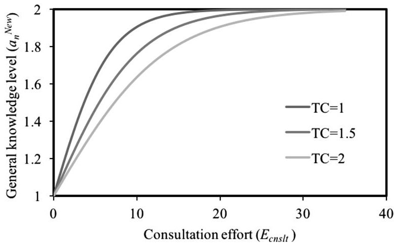

Fig. 8 The function shape of Eq. (14) $ ( a_{n}^{\mathrm{Initial}}=1, X_{n}=2, s=0.1, $ $ \gamma=3 $

product. Effort required for rework is modelled as 1- $ Q_{\mathrm{I}} $ of the work-done, where $ Q_{\mathrm{I}} $ equals the old product knowledge before consultation.

## 5.3 Communication

We define communication as the exchange of task outcomes, such as data, drawings, reports, models, etc., between dependent functions. The input and output information of development activities have to flow both ways between interdependent functions. An information agent is introduced to model the phenomenon. After the completion of each task, a designer agent prepares an information agent for the function and sends it to the dependent functions. The information is received after a certain delay time, and is stored in the information list of the receiver functions. Before starting a new task, a designer checks the information list to read information from other functions. An information agent records the quality of the task from which it comes, based upon which the designer makes decisions such as the need for rework and consultation.

## 5.3.1 Communication effort

The preparation and reading of information requires effort from designer agents. To model the amount of effort needed, we have the following assumptions: (a) the effort spent in preparing and reading information is proportional to the size of the information content; (b) each task adds new information and expands the content size; and (c) designers only exchange content that has not been communicated. Thus, the effort required in preparing (E_prep) and reading (E_read) information is calculated by Eqs. 16 and

<!-- PDF_PAGE: 12 -->

Fig.9 Example: information is prepared and sent after completing task 5 and task 7

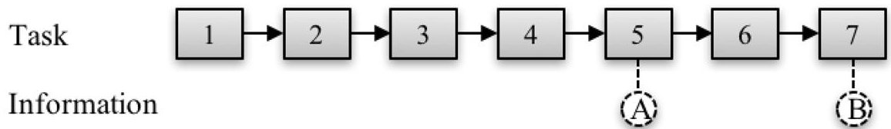

17, respectively, where MT is the number of tasks whose content has not been communicated. For example, Fig. 9 shows a function consisting of seven tasks where the designer prepares information after finishing task 5 and task 7. Upon the completion of task 5, the designer has to prepare the information content from task 1 through task 5; so, MT is 5 at this point. After completing task 7, the designer only needs to prepare the content of task 6 and task 7; so, MT equals 2 at this point.

$$
E _ {-} \mathrm {p r e p} = M T \cdot \mathrm {T R I} \left(p r e p M i n, p r e p M a x, p r e p M o d e\right)
$$

$$
E _ {\text {r e a d}} = M T \cdot \mathrm {T R I} \left(\text {r e a d M i n}, \text {r e a d M a x}, \text {r e a d M o d e}\right)
$$

## 5.3.2 Communication effect

An information agent stores data about the interface quality $ ( Q_{\mathrm{I}} ) $ and the goodness $ ( Q_{\mathrm{G}} ) $ of task outcomes. The information agent sends this data to a function's interdependent functions and parent function, which triggers events as shown in Fig. 10.

During the communication between interdependent functions, designers may find conflicting design information or incompatible work. There is usually a consultation to resolve an interface issue and to rework the conflicted part based on an agreed solution. This is modelled as a

series of events on the left branch of Fig. 10. Designer agents for interdependent functions check the interface quality $ ( Q_{\mathrm{I}} ) $ during information reading. The probability to pass is $ Q_{\mathrm{I}} $ . A failure during checking causes the designer agent to call a consultation meeting to improve the product knowledge for the interface. Communication allows designer agents to resolve interface issues earlier instead of working on incompatible work, which leads to more rework.

A parent function cannot start until the input information from its subfunctions has reached a certain level of goodness. The condition for information to be used in the integration work of the parent function is $ Q_{\mathrm{G}} \geq R_{\mathrm{p}} $ , where $ Q_{\mathrm{G}} $ is the goodness of the information and $ R_{\mathrm{p}} $ is the requirement for goodness. When the condition is not satisfied, the behaviour of the parent function depends on the state of its subfunctions. If the information is preliminary, i.e., generated before the design of a function is completed, the parent function waits until the information from the subfunctions is more developed. A consultation meeting on product knowledge is called if the information still does not reach the desired level of goodness when subfunctions are fully developed, i.e., when $ Q_{\mathrm{G}}=95\% $

## 5.4 Summary of product development model

Figure 11 shows the inputs and outputs for the simulation described in this paper. Product is defined by data such as

Fig.10 Events triggered by communication

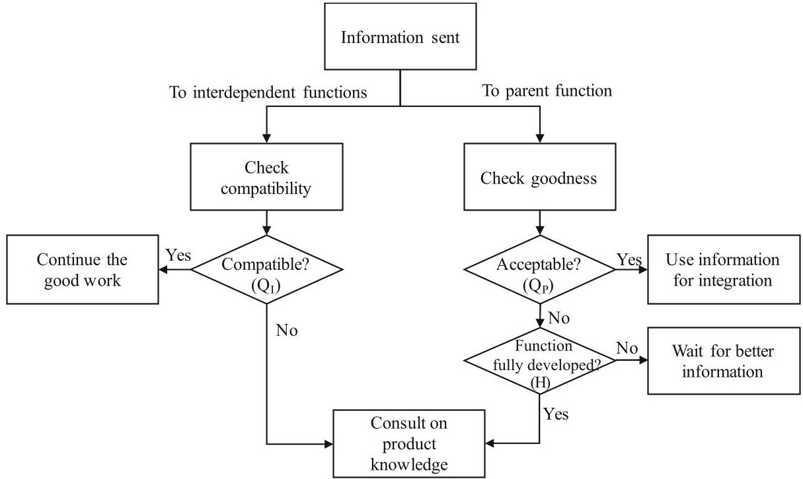

<!-- PDF_PAGE: 13 -->

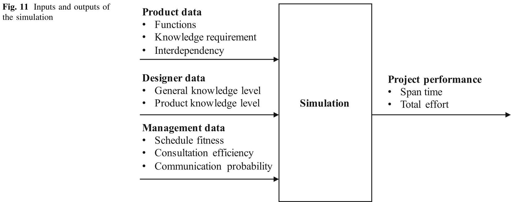

the functional decomposition, the knowledge requirement for designing each function, and the interdependency among functions. The design team's ability is characterized by designers' general knowledge and product knowledge. The data for each function agent and designer agent are specified in a Microsoft Excel $ ^{\textcircled{R}} $ file and read by the model. Management variables concerning communication and consultation are set through a user interface built into the model. With the input data of product, designers and process management, the model creates agents whose microscale activities and interactions determine the project performance on a macro-scale. Project performance is evaluated by span time, i.e., the time from the beginning of the process until the point the product development is completed, and by total effort, i.e., the hours that designer agents spend on all activities. Table 2 gives a summary of the model constructs and major parameters.

## 6 Simulation

## 6.1 Baseline scenario

The simulation results presented in this paper are based on the product data of a hydroelectric generator, which was obtained from GE Hydro (Figs.1,2,Table1). Precise designer data in the project was unknown; so, it was assumed that one designer was assigned to each function, and among the designers for each general knowledge item, 10% were experts (general knowledge level = 2, i.e., advanced), 70% were ordinary designers (general knowledge level = 1, i.e., general), and 20% were novices (general knowledge level = 0.5, i.e., between zero and general). The product knowledge for designers was set at

50% which means that designers have medium experience about the product. As to process management data, schedule fitness was 50% which means that designers have a 50% chance to successfully schedule a consultation meeting; consultation efficiency was set at 0.1, which means that designers resolve 0.1 units of complexity per hour of consultation; communication probability was at 50% which means that the probability that designers send information to interdependent functions after a task is complete is 50%; goodness requirement was set at 95% which means that a parent function does not start integration until all its subfunctions provide information with a goodness of 95%. This setup was used as the baseline scenario.

The data for instantaneous changes in task completion, complexity and designers were captured and saved in a Microsoft Excel $ ^{\textcircled{2}} $ file during each simulation. Figure 12 shows the changes in the baseline scenario with time. Figure 12a shows that the completion rate of tasks follows an exponential distribution where the completion rate is high at the beginning and slows down as the number of tasks completed reaches its limit asymptotically. The project starts with child functions from the bottom of the function tree, whose tasks are mostly independent and can be finished quickly. As the project advances, more integration work is carried out, which triggers more communication and consultation concerning interfaces; so, each of these tasks takes a longer time to finish. Figure 12b shows that complexity gradually reduces with time. Designers focus on resolving technical complexity in the early part of the project and spend more effort resolving integration complexity in the latter part. Different from technical complexity, which can be resolved independently, integration complexity needs to be resolved through the coordination of two or more designers, which prolongs the

<!-- PDF_PAGE: 14 -->

Table 2 Summary of the model constructs and major parameters

<table border="1"><tr><td>Construct</td><td>Name</td><td>Description</td><td>Values</td></tr><tr><td>Function diagram</td><td></td><td>Function tree; parent-child relationships</td><td></td></tr><tr><td>Function interdependency</td><td></td><td>DSM; shows function interdependency</td><td></td></tr><tr><td rowspan="6">Knowledge</td><td>Required general knowledge</td><td>Skill in a field required to design a part</td><td>Minimum 0
General 1
Intense 2</td></tr><tr><td>Designer general knowledge</td><td>Skill in a field that facilitates part design</td><td>Novice 0
Ordinary 1
Expert 2</td></tr><tr><td>Required product knowledge</td><td>Level of product innovation</td><td>0-100%</td></tr><tr><td>Designer product knowledge</td><td>Designer experience with similar products; model parameter-PK</td><td>0-100%</td></tr><tr><td>Team composition</td><td>Ratio of expert:ordinary:novice designers</td><td></td></tr><tr><td>Function</td><td>Requires knowledge; measures progress</td><td></td></tr><tr><td rowspan="3">Agent</td><td>Designer</td><td>Performs tasks to create knowledge</td><td></td></tr><tr><td>Information</td><td>Delivers knowledge</td><td></td></tr><tr><td></td><td></td><td></td></tr><tr><td rowspan="2">Complexity</td><td>TC</td><td>Technical complexity</td><td></td></tr><tr><td>IC</td><td>Integration complexity</td><td></td></tr><tr><td rowspan="3">Effort</td><td>EfPlan</td><td>Planned effort per function</td><td>(h)</td></tr><tr><td>EtPlan</td><td>Planned effort per task</td><td>(h)</td></tr><tr><td>EtActual</td><td>Actual effort per task</td><td>(h)</td></tr><tr><td>Span time</td><td></td><td>Time from start to end of product creation</td><td>(h)</td></tr><tr><td rowspan="2">Designer efficiency</td><td>W</td><td>Flow rate of work done</td><td>0-100%</td></tr><tr><td>D</td><td>Designer competence to do work</td><td>0-100%</td></tr><tr><td rowspan="5">Design quality</td><td>QT</td><td>Quality of achieved general work</td><td>0-1</td></tr><tr><td>QI</td><td>Quality of achieved product work; probability of successful interface work</td><td>0-1</td></tr><tr><td>H</td><td>Fraction of total tasks completed</td><td>0-1</td></tr><tr><td>Rp</td><td>Requirement for goodness: accuracy, certainty, completeness of task outcomes</td><td>0-1</td></tr><tr><td>QG</td><td>Goodness achieved</td><td>0-1</td></tr><tr><td rowspan="3">General consultation</td><td>Psked</td><td>Schedule fitness: probability of attending a meeting</td><td>0-100%</td></tr><tr><td>Ecnslt</td><td>Consultation effort</td><td>(h)</td></tr><tr><td>CE</td><td>Consultation efficiency - complexity resolved per hour</td><td>0-1</td></tr><tr><td rowspan="2">Product consultation</td><td>NF</td><td>Number of interfaces (interdependency)</td><td>1-3</td></tr><tr><td>CA</td><td>Availability of designers</td><td>0-100%</td></tr><tr><td rowspan="3">Communication</td><td>Eprep</td><td>Effort to prepare information</td><td>(h)</td></tr><tr><td>E_read</td><td>Effort to read information</td><td>(h)</td></tr><tr><td>CM</td><td>Communication probability</td><td>0-1</td></tr></table>

project. Figure 12c shows how the number of active designers change with time. An active designer is a designer who is doing technical work, communicating or consulting. A large group of designers are active in the early phase to develop functions, but project span time is highly driven by the few designers who integrate functions during the latter part of a project.

## 6.2 Verification and validation

Since adding certain characteristics to the development process model could introduce inaccuracy, it was necessary to verify and validate the model to ensure that there are no errors. Verification is ensuring that a model behaves as it is intended, which means making sure it implements

<!-- PDF_PAGE: 15 -->

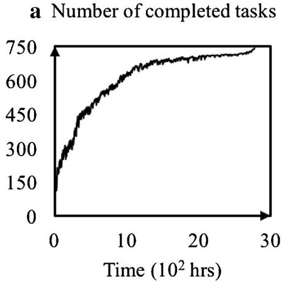

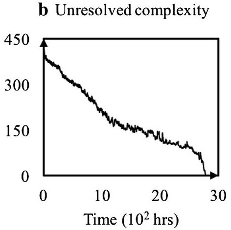

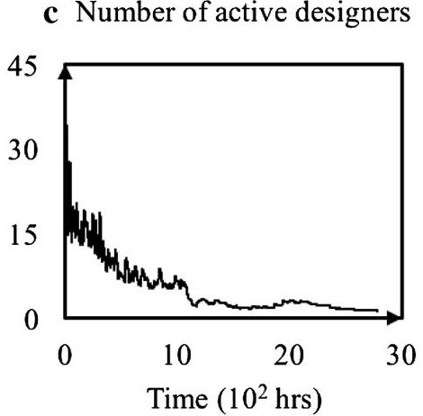

Fig. 12 The number of completed tasks (a), unresolved complexity (b) and the number of active designers (c) versus project time for the development of a complex product. The data were created by

assumptions, logic and equations correctly. Validation ascertains that a model's behaviour is reasonable in terms of reflecting reality.

## 6.2.1 Verification

The model was developed with AnyLogic, a simulation software that supports multiple modelling paradigms, namely discrete event and agent based. Agents, such as functions and designers, were the main building blocks of the model. Each type of agent was built from simple computer programs with more complexity being added progressively. To ensure that the model behaved as it was intended, regression testing was done. After each change to the model, simulation of the baseline scenario was performed. The execution of algorithms, the duration of design activities, the interaction of designers who create dependent or interdependent functions as well as total effort and span time were compared between successive versions of the model.

The algorithm within each type of agent was verified through monitoring the state chart, which is a graphic tool in AnyLogic used to visualize the states of a given algorithm, the events that cause a transition from one state to another, and the actions that result from state change. The active state or transition was highlighted at model runtime; so, we were able to locate each step of an agent's algorithm and to make sure that they were developed correctly. The algorithm of interactions between agents was verified by tracing the order of agents' actions during their interaction. Agents interact though message passing, which was tracked by outputting textual information about the message senders, receivers, the relevant agents' state, the value of influenced variables, and the time of every occurrence of interaction.

modelling the activity during a multiyear project at GE Hydro. The dataset for (c) has been smoothed with a moving average

The major versions of the model started with function and designer agents only. Information agents were added. Communication, and then, consultation were added. Regression testing was done after each major revision of the model. Finally, the overall behaviour of the model was verified by changing the main parameters of the GE Hydro case study and checking whether results were consistent. For example, the number of interfaces between interdependent functions was varied to observe how instantaneous effort changed with time. Besides interfaces, changes were made to the types of knowledge required by a function, the complexity of a function, and the effort required by a function. Agent actions were verified as described above and the amount of total effort and span time were analyzed.

## 6.2.2 Validation

To validate the model, simulations were made of the baseline scenario using GE Hydro data. Measurements were made of the amount of rework and total effort. Terwiesch et al. (2002) have reported that rework typically consumes up to one-third of the total effort during product development. The simulation of the baseline scenario showed that rework took 27% of the total effort on average, a reasonable agreement.

GE Hydro had been using the estimation method developed by Bashir and Thomson (2004), as shown in Eq. (4), to predict project effort since the year 2000. Eqn 18 gives the equation for estimating total effort where PC is Bashir and Thomson's complexity index, DE is the ratio of difficulty to expertise, TD is the type of drawings to be submitted, and DP is the involvement of partners. Using the data for the GE Hydro hydroelectric generator that are used to create the baseline scenario in this paper, a total effort of 13,226 person-hours was obtained where

<!-- PDF_PAGE: 16 -->

PC = 332 and all other parameters were set to a value of 1. Simulation of the baseline scenario gave total effort that ranged from 12,376 person-hours to 13,364 person-hours, which had a deviation from 13,226 person-hours of $ - 6 \% $ and $ + 1 \% $ , respectively, which showed a good agreement. To further validate the model, the authors are in the process of obtaining product development process data from other companies.

$$
\hat {E} = 0. 1 2 \mathrm {P C} ^ {2} \mathrm {D E} ^ {0. 4 1} \mathrm {T D} ^ {0. 3 5} \mathrm {D P} ^ {0. 6 9}
$$

## 6.3 Sensitivity analysis

Since product functions' required level of general knowledge determines technical complexity, thereby driving technical effort, the project is expected to have a longer span time and to consume more effort with more severe knowledge requirements. However, due to the impact of other variables and the stochastic effect of time distributions, the knowledge requirement may not exhibit significant impact until reaching a certain level. Similarly, although designers' product knowledge affects work quality, and thus influences rework, the project may not be sensitive to small changes in this factor. General and product knowledge have the greatest effect on model outcomes.

To examine the model's sensitivity to changes in general knowledge and product knowledge, a series of simulation experiments were done where incremental changes were made using the baseline scenario until a significant impact on project performance was observed. Making changes to general knowledge and product knowledge were chosen for sensitivity analysis since these two factors determine the complexity of the product development task, and thus, the dynamics of interaction of designers and the quantities of the simulation outputs of total effort and span time. Other model parameters and assumptions were studied during the regression analysis done for verification during model building. Moreover, the two factors of general knowledge and product knowledge determine the performance of the model. A product's knowledge requirement and a designer's knowledge ability have a symmetric effect in the model; so, for sensitivity analysis it is only necessary to change a product's knowledge requirement.

To study the model's sensitivity to a change in general knowledge, we made some functions more complex by increasing a single-knowledge requirement by 50%. For example, the original knowledge vector for a function (1,1 0,0,0,1,0,0,0,0) was changed to (1.5,1.5,0,0,0,1.5,0 0,0,0). Different functions were randomly chosen to make the change. The objective was to find the tipping point when increasing the complexity of functions achieved a

critical level that made a significant impact on project performance at a 95% confidence level. The result is shown in Fig. 13. Calculating the percentage of changed functions and the resultant increase in total effort and span time, we made the following statements: (a) total effort showed a significant change of 3% when 7% of the functions became more complex; (b) span time showed a significant change of 9% when 15% of the functions became more complex. The lower sensitivity for span time to changes in designer knowledge was due to the stochastic nature of the time taken to perform a task and the fact that different designers were busy or idle at different times. Thus, changing the time for completing a single task could have a large effect or no effect at all.

To study the model's sensitivity to product knowledge, we decreased designers' product knowledge for different interfaces. Product knowledge is a relative concept defined as designers' certainty about the interfaces between a pair of functions. Low product knowledge, such as 10%, means that designers have little experience about interdependency. Thus, by reducing the assigned designer's product knowledge to 10%, we modelled low knowledge about interfaces. The incremental number of interfaces being changed were randomly chosen. The result is shown in Fig. 14. We observed that, when 6% of the interfaces became more complex, the project showed a significant increase in effort ( $ \sim 4\% $ ) and span time ( $ \sim 10\% $ ) at a 95% confidence level.

## 6.4 Simulation scenarios

The model takes product data, designer data and management data as inputs and generates the outputs of total effort and span time. By varying the three groups of input data, we were able to create a series of scenarios to study research questions regarding product complexity, designers' ability and coordination mechanisms.

We consider a product as the integration of functions that are knowledge intensive and either dependent or interdependent. From this perspective, the main drivers of product complexity are the knowledge required to design functions and the interdependency among functions. To study research questions regarding the impact of product complexity, different scenarios were created by modifying the actual product data (Fig. 15). The knowledge requirement for designing each function either decreases or increases by 50% for the scenario of low knowledge requirement and the scenario of high knowledge requirement, respectively. The number of interfaces between each pair of interdependent functions was assumed to be 2 for the baseline scenario, 1 for the scenario with low interdependency, and 3 for the scenario with high interdependency.

<!-- PDF_PAGE: 17 -->

Fig.13 Interval plots of total effort (a) and span time (b) versus the number of complex functions (95% confidence level)

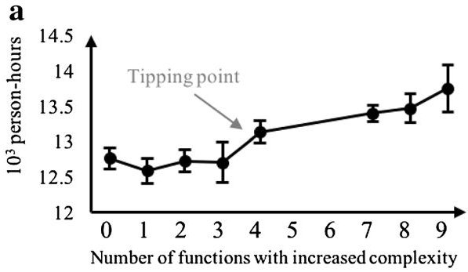

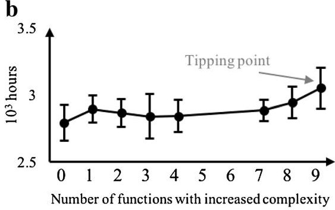

Fig.14 Interval plots of total effort (a) and span time (b) versus number of complex interfaces (95% confidence level)

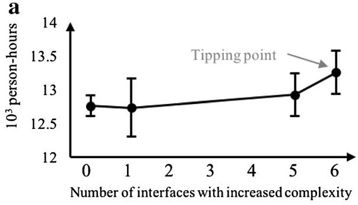

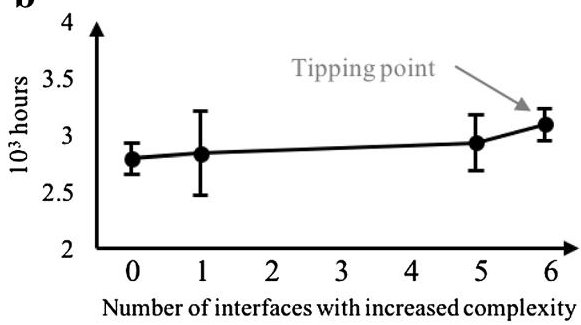

Fig.15 Simulation scenarios to study the impact of product complexity

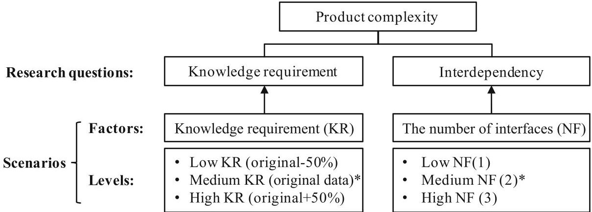

*Values for the baseline scenario

Designer agents are defined by designer data such as the number of designer agents, the task assignments, and the ability level of each designer, namely novice, ordinary or expert. The overall ability of the design team in terms of general knowledge is quantified by the ratio of experts to ordinary designers to novices. The design team's product knowledge is defined with a percentage that measures the design team's relevant experience. Three levels: low (25%) , medium (50%) and high (75%) , were defined for both general and product knowledge. Scenarios with different design team ability were created as shown in Fig. 16.

Coordination mechanisms determine how often and how efficiently designer agents communicate and share knowledge. In the model, communication is characterized by the factor of communication probability, which determines the frequency of information exchange between interdependent functions. Consultation is characterized by consultation efficiency, which is quantified as the unit of complexity solved per hour of consultation, and the availability of

designer agents in consultation meetings, which is quantified as the probability of designer agents accepting consultation requests. Each factor has three levels enabling the creation of different scenarios using these coordination mechanisms as shown in Fig. 17.

The factors and levels of the different scenarios are summarized in Table 3. To study the impact of each factor, one factor was varied each time while the other factors were kept at the same level as in the baseline scenario, i.e., the medium level. Thus, seven groups of experiments were created, each containing three scenarios with different levels of the factor to be tested. Each scenario was run multiple times to obtain averages due to the stochastic nature of the model. To see whether a certain factor affects design effort and project duration significantly, one-way analysis of variance was performed among scenarios where the factor was set at different levels.

<!-- PDF_PAGE: 18 -->

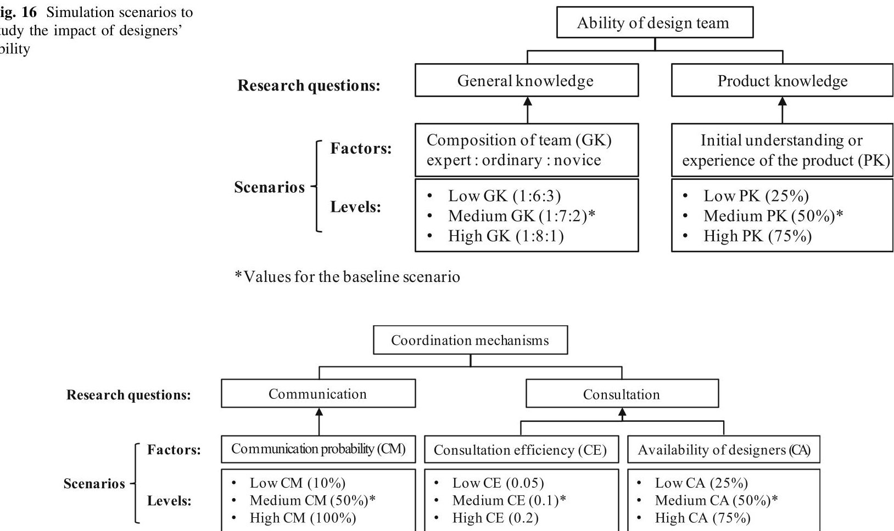

*Values for the baseline scenario

Fig.17 Simulation scenarios to study the impact of coordination mechanisms

Table 3 Summary of scenario factors and levels

<table border="1"><tr><td>Categories</td><td>Group</td><td>Factors</td><td>Levels</td></tr><tr><td rowspan="2">Product complexity</td><td>#1</td><td>Knowledge requirement</td><td>Low/medium/high</td></tr><tr><td>#2</td><td>Interdependency</td><td>Low/medium/high</td></tr><tr><td rowspan="2">Ability of design team</td><td>#3</td><td>General knowledge</td><td>Low/medium/high</td></tr><tr><td>#4</td><td>Product knowledge</td><td>Low/medium/high</td></tr><tr><td rowspan="3">Coordination mechanisms</td><td>#5</td><td>Communication probability</td><td>Low/medium/high</td></tr><tr><td>#6</td><td>Consultation efficiency</td><td>Low/medium/high</td></tr><tr><td>#7</td><td>Availability of designers</td><td>Low/medium/high</td></tr></table>

## 6.5 Simulation results

The means and confidence intervals of total effort and span time were plotted for different scenarios and were compared within each group. All factors showed significant impact on total effort and span time. Detailed results and explanations are given in the following subsections.

## 6.5.1 The impact of product complexity

Total effort and span time increased exponentially with knowledge requirements as shown in Fig. 18. Knowledge requirements determine the technical complexity of

product functions, which drives planned technical work and number of tasks. Since each task has a certain probability to exchange information with interdependent functions, the increasing number of tasks leads to more communication effort. In addition, designer agents are more likely to encounter technical difficulties and make technical errors with increasing knowledge requirements, thereby spending more effort in consultation and rework.

Total effort and span time are positively correlated with functional interdependency as shown in Fig. 19. Interdependency contributes to integration complexity. High interdependency impedes designers from understanding the design problem, which induces more integration issues and

<!-- PDF_PAGE: 19 -->

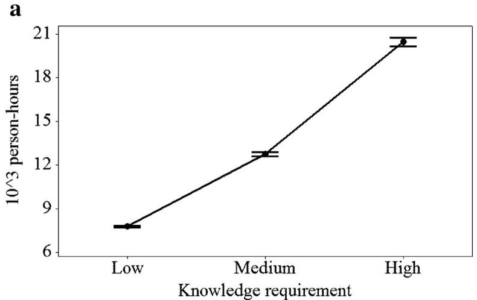

b

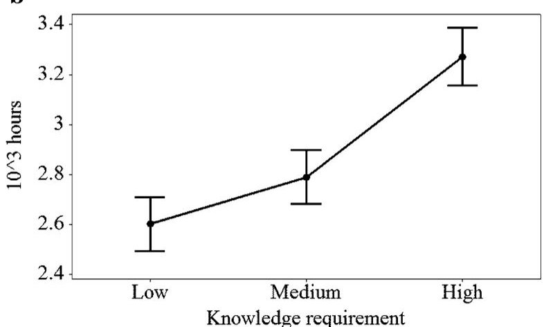

Fig. 18 Interval plots of total effort (a) and span time (b) versus knowledge requirement (95% confidence level)

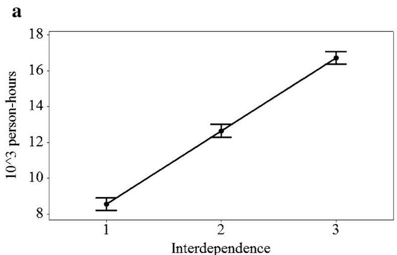

b

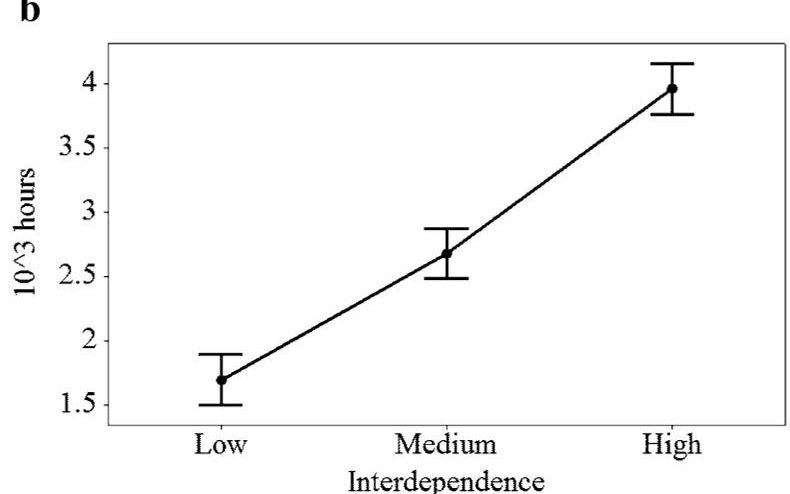

Fig. 19 Interval plots of total effort (a) and span time (b) versus interdependency (95% confidence level)

greater uncertainty in task outcomes. More consultation about interfaces is requested by designer agents to learn about each other's work and to improve their perception of a product as a whole. Rework increases due to incompatible work and uncertainty. It was also found that overall complexity was impacted more by product complexity, i.e., interdependence between functions, than a product's general knowledge requirements.

## 6.5.2 The impact of a design team's ability

Total effort and span time decrease with higher levels of a design team's general knowledge as shown in Fig. 20. The factor indicates the proportion of novices who are underqualified for design tasks. With an increasing number of novices, more effort is spent on rework and consultation to resolve technical problems, which results in greater total effort and longer span time.

The level of a design team's product knowledge has significant impact on total effort and span time as shown in Fig. 21. A design team with better product knowledge has

experience with similar products; so, designer agents are able to anticipate possible design and integration issues, and take this into consideration during design, which results in a higher success rate for integration, less rework and less effort spent on consultation about interfaces.

## 6.5.3 Coordination mechanisms

With more frequent communication among interdependent functions, there is a significant decrease in total effort and span time as shown in Fig. 22. With low communication probability, designer agents focus on their own tasks and have little information about other agents' work; so, any possible integration issues can only be discovered in late design stages when designer agents start to integrate different parts. Failed integration causes a large amount of rework. With a high possibility of communication, designer agents get updates about interdependent functions promptly and adapt interface designs to other functions, which improves the success rate of integration and reduces rework.

<!-- PDF_PAGE: 20 -->

a

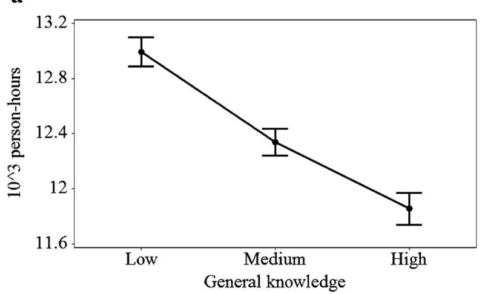

b

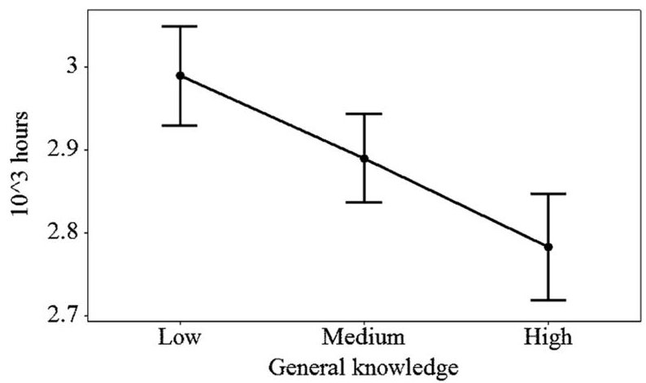

Fig. 20 Interval plots of total effort (a) and span time (b) versus general knowledge of a design team (95% confidence level)

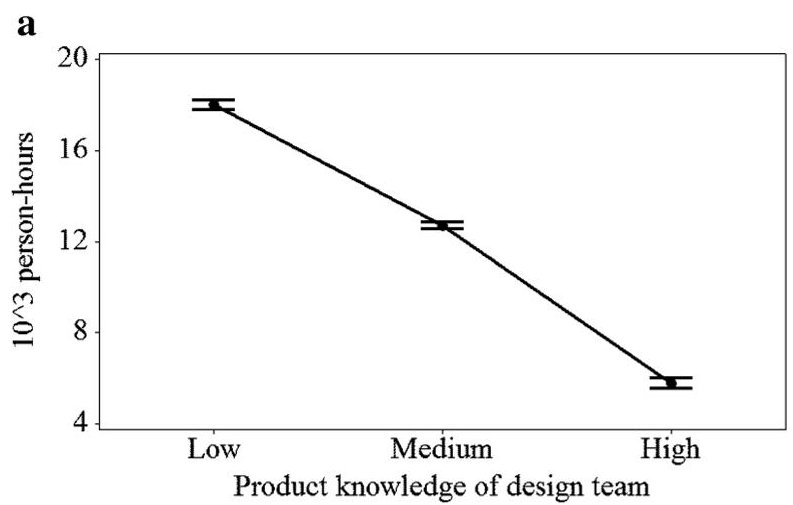

b

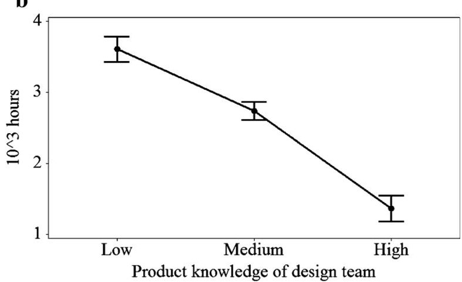

Fig. 21 Interval plots of total effort (a) and span time (b) versus product knowledge of a design team (95% confidence level)

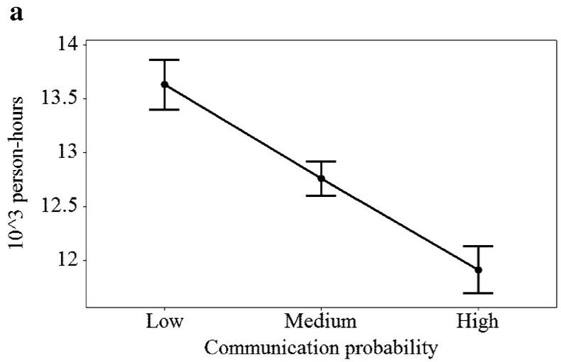

b

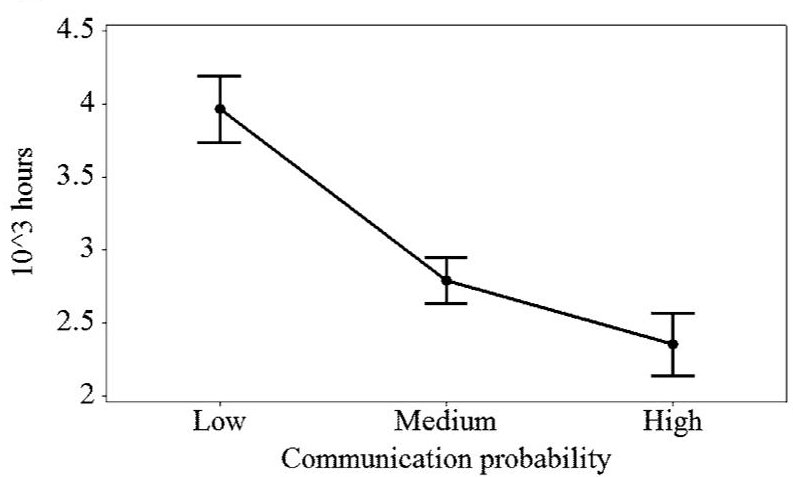

Fig. 22 Interval plots of total effort (a) and span time (b) versus communication probability (95% confidence level)

An increase in coordination efficiency showed significant impact on the reduction of total effort and span time as shown in Fig. 23. Consultation efficiency indicates how productive a consultation meeting is in solving technical problems or integration issues. A consultation meeting is expensive regarding time and effort, as it involves the coordination of many designer agents and may cause some

delay due to participants' schedules. A higher efficiency during consultation enables designers to share knowledge more effectively, which improves work quality and reduces the need for other meetings.

Total effort and span time decrease with a higher probability of designer agents being available to participate in consultation as shown in Fig. 24. A higher level of

<!-- PDF_PAGE: 21 -->

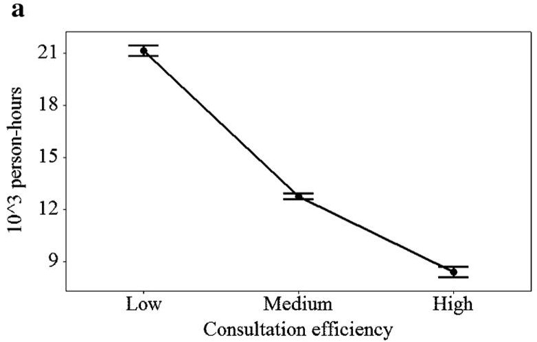

b

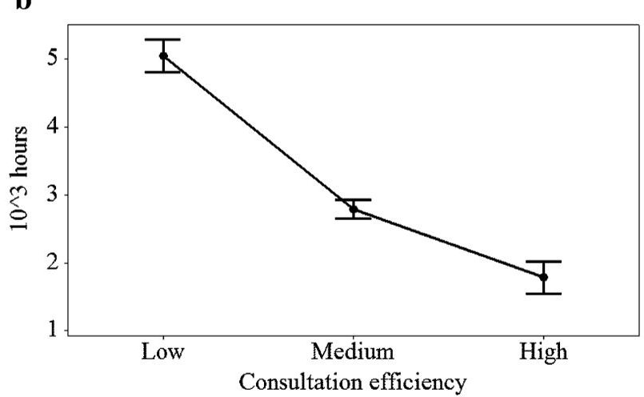

Fig. 23 Interval plots of total effort (a) and span time (b) versus consultation efficiency (95% confidence level)

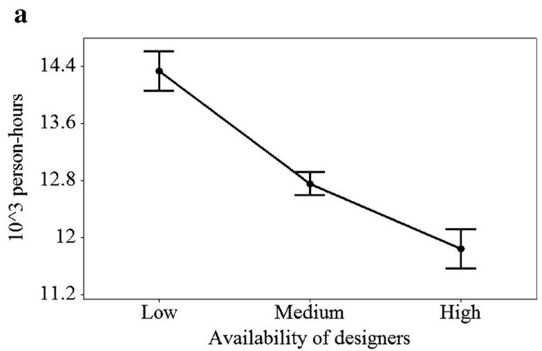

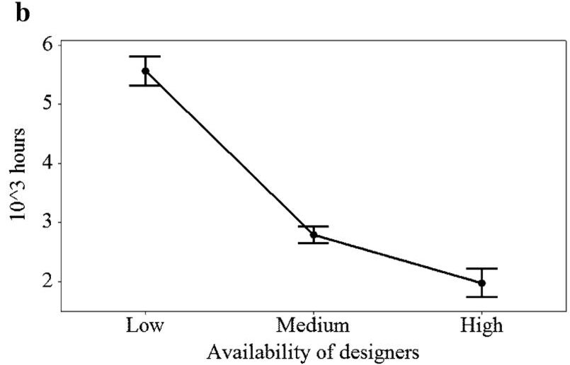

Fig. 24 Interval plots of total effort (a) and span time (b) versus the availability of designers for consultation (95% confidence level)

designer agents' availability means that designer agents are more likely to accept a consultation request; so, problems can be resolved promptly instead of being delayed while more work is built on flaws and misunderstandings.

## 7 Managerial implications

Simulation results showed that increasing product complexity, characterized by knowledge-intensive and interdependent product functions, escalated design effort and prolonged development duration, thereby putting projects at a higher risk of budget overrun, schedule slippage and late delivery. Results also indicated that significant potential for mitigating the impact of product complexity could be achieved by applying the following methods.

## 7.1 Mitigating the interdependency among product subsystems

Simulation results showed that designers' knowledge about interfaces (Fig. 21) had greater impact on project

performance than designers' general knowledge did (Fig. 20). Therefore, interdependency among product subsystems should be mitigated, especially when the product is innovative with regard to designers' experience. This can be achieved by modularization, which means decomposing a product into nearly independent modules and standardizing the interfaces among modules (Baldwin and Clark 2003). Putting functions that share multiple interfaces into the same module allows the resolution of interface issues with just the few designers responsible for the module. Decreasing interface complexity between product subsystems allows the distribution of design tasks, reduces the required intensity of communication between teams, and therefore, allows faster design changes (Bonvoisin et al. 2016). Even with increased modularity, there are often many required interfaces. Results obtained here indicated that an increased focus on resolving interface issues could mitigate high levels of complexity. This can be done through the use of design standards, standardized processes for interface design, and the use of coordination mechanisms that quickly resolve interface problems.

<!-- PDF_PAGE: 22 -->

## 7.2 Ensuring communication between interdependent functions

It has been shown that frequent and prompt communication between interdependent functions efficiently mitigated complexity (Fig. 22). To track communication concerning interfaces, Sosa et al. (2007) proposed the use of a Design Structure Matrix (DSM) tool to identify product interfaces versus product functions, and to analyse communication among design teams, which enabled the discovery of any unattended interfaces. To ensure communication, managers can formally assign people to actively tend to communication about interfaces, and to schedule activities properly such that designers assigned to interdependent functions are more available to resolve integration issues and share interface knowledge. To identify problems early about interfaces, Suss and Thomson (2012) suggested the use of agile product development methods. In agile product development, product design is structured as successive time periods, called sprints, for resolving a series of well-defined design problems. Within each sprint, design teams are collocated; they focus on specific design tasks and have intensive communication (scrums) to find solutions. In this way, the impediments to communication are minimized. Computerbased communication and teleconferencing are necessary for organizations where the physical collocation of designers is not practical.

## 7.3 Improving knowledge utilization

Designers' technical knowledge and experience are significant for the mitigation of the impact of product complexity (Figs. 20, 21); so, it is important to maximize the exploitation and use of accumulated knowledge. First, knowledge can be applied more efficiently by adopting computer-aided design applications with knowledge-based engineering capabilities, which reduce design effort and duration through automation of routine tasks while capturing design knowledge (Verhagen et al. 2012). Second, systematization of knowledge, i.e., the development of databases and processes for knowledge creation, use, movement and storage, improves the efficiency of knowledge utilization. Companies with successful knowledge management store structured knowledge, i.e., documents such as memos, reports, presentations, and articles, in a repository where people can easily retrieve information; they also store tacit knowledge, i.e., the knowledge usually residing in people's minds, in repositories that are made available for community-based electronic discussion (Davenport et al. 1998).

## 7.4 Promoting knowledge learning and sharing

Simulation results have shown significant improvement in project performance due to more efficient and more frequent knowledge consultation (Figs. 23, 24); thus, an effective measure to mitigate complexity is the promotion of knowledge learning and sharing. A key factor is to develop a knowledge-friendly culture where people are willing and free to explore and share knowledge. This can be achieved by building a working environment that encourages the formation of effective learning communities. Effective measures include displaying work, mentoring schemes, listing experts, rewarding those who share knowledge, and improving team members' relationships through informal socializing outside the workplace, etc. (Lawson et al. 2009; Markham and Lee 2014; McMahon et al. 2004). Another factor is to choose the proper organizational structure. In a function-based organization, designers with similar expertise are grouped together, which strengthens functional ties and supports the development of technical knowledge. In a project-based organization, designers with different expertise form a team and work together on a project, which improves the sharing of product knowledge and benefits the development of a broader perspective (Edmondson and Nembhard 2009). Therefore, a project should adjust its position in the spectrum between a function-based structure and a project-based structure according to the requirement of technical knowledge and the complexity of interdependencies.

## 8 Conclusions

## 8.1 Development process model

The creation of an agent-based model of the product development process was discussed in this paper where the global behaviour of product development in terms of effort and span time emerged from the interactions of process elements including product functions, activities and designers. The novelty of the model lies in its employment of a knowledge perspective to study the development of complex products where complexity is driven by the intensity and diversity of the knowledge required to create products. Model elements of the design process are connected by knowledge where product functions are the embodiment of the knowledge required to specify a product, where design activities require knowledge to complete a design, and where designers provide the knowledge.

Since the need for more knowledge intensifies complexity, studying the product development process from a knowledge perspective provides a better opportunity to understand how using knowledge contributes to the effort

<!-- PDF_PAGE: 23 -->

required to design products and how learning improves the product development process by reducing effort and span time.

The example of designing hydroelectric generators at GE Hydro demonstrated that the model reflected product development well. It also showed that the product development process was very sensitive to increases in the amount of knowledge embedded in a product as well as the amount of knowledge that designers had. Therefore, studying the product development process from a knowledge perspective allows the understanding of the trade-offs between developing more complex products and the required knowledge and experience of design teams. The model also showed that product development was more sensitive to the design of interfaces as compared to the design of components, thus showing that designer experience with similar products is very important for the successful development of complex products. To validate better the model, the authors are in the process of obtaining data from other companies to simulate their product development process.

From a project management standpoint, a knowledge perspective allows managers to evaluate the impact of product complexity and experienced designers on project performance, such as the best place to use talented designers or the trade-offs of ensuring project delivery on time versus the cost of more experienced people.

## 8.2 Impact of results

This paper studied the impact and mitigation of product complexity through simulation experiments. Using product data from GE Hydro, a series of scenarios were simulated to investigate the impact of product complexity, the influence of a design team's knowledge, and the effectiveness of coordination mechanisms that facilitate learning and communication. From simulation results, we observed that design effort and project duration increased exponentially with product complexity, that designers' knowledge played an important role in mitigating complexity, and that coordination mechanisms which promoted information exchange and knowledge sharing reduced overall effort and project duration. The implication for managers is that attention should be paid to the management of interfaces, to the effectiveness of coordination thorough communication and consultation, and to how these mechanisms increase the rate of designer learning.

complexity and worker experience matter can benefit from investigation using a knowledge perspective.

Although this paper studied the effect of knowledge on the product development process, the employment of models with a knowledge perspective can be applied to other types of activity where know-how and learning are key performance factors. This means that almost any type of project where

In the future, the authors intend to use the model to study other aspects of the product development process. One such topic is to determine the amount of effort required for design change. Given a change propagation path, the simulation can estimate the required effort. Another topic is the impact of complexity on the use of preliminary knowledge.

## References

Baldwin CY, Clark KB (2003) Managing in an age of modularity. In: Garud R, Kumaraswamy A, Langlois R (eds) Managing in the modular age: Architectures, networks, and organizations. Wiley, New York

Bashir HA, Thomson V (1999a) Estimating design complexity. J Eng Des 10:247-257. https://doi.org/10.1080/095448299261317

Bashir HA, Thomson V (1999b) Metrics for design projects: a review. Des Stud 20:263-277. https://doi.org/10.1016/S0142-694X(98)00024-6

Bashir HA, Thomson V (2004) Estimating design effort for GE hydro projects. Comput Ind Eng 46:195-204. https://doi.org/10.1016/j. cie.2003.12.005

Bonvoisin J, Halstenberg F, Buchert T, Stark R (2016) A systematic literature review on modular product design. J Eng Des 27:488-514. https://doi.org/10.1080/09544828.2016.1166482

Braha D, Bar-Yam Y (2007) The statistical mechanics of complex product development: empirical and analytical results. Manage Sci 53(7):1127-1145

Brown SL, Eisenhardt KM (1995) Product development: past research, present findings, and future directions. Acad Manag Rev 20:343-378

Browning TR, Fricke E, Negele H (2006) Key concepts in modeling product development processes. Syst Eng 9:104-128. https://doi.org/10.1002/sys.20047

Bytheway CW (2007) FAST creativity and innovation: Rapidly improving processes, product development and solving complex problems J. Ross Publishing, Richmond

Chiva-Gomez R (2004) Repercussions of complex adaptive systems on product design management. Technovation 24:707-711. https://doi.org/10.1016/S0166-4972(02)00155-4

Clarkson PJ, Hamilton JR (2000) Signposting, A parameter-driven task-based model of the design process. Res Eng Des 12(1):18-38

Davenport TH, De Long DW, Beers MC (1998) Successful knowledge management projects. Sloan manag rev 39(2):43-57

Davis J, Subrahmanian E, Westerberg A (2005) Knowledge management: organizational and technological dimensions. Physica-Verlag Heidelberg

Edmondson AC, Nembhard IM (2009) Product development and learning in project teams: the challenges are the benefits. J Prod Innov Manag 26:123-138. https://doi.org/10.1111/j.1540-5885. 2009.00341.x

Eppinger SD, Nukala MV, Whitney DE (1997) Generalised models of design interaction using signal flow graphs. Res Eng Design 9:112-123. https://doi.org/10.1007/bf01596486

Gomes JF (2003) Order and disorder in product innovation models. Creat Innov Manag 12:174-187

<!-- PDF_PAGE: 24 -->

Granstrand O, Bohlin E, Oskarsson C, Sjöberg N (1992) External technology acquisition in large multi-technology corporations. R&D Manag 22:111-134

Grogan PT, de Weck OL (2016) Collaboration and complexity: an experiment on the effect of multi-actor coupled design. Res Eng Design 27:221-235. https://doi.org/10.1007/s00163-016-0214-7

Hage J, Jordan G, Mote J, Whitestone Y (2008) Designing and facilitating collaboration in R&D: a case study. J Eng Tech Manage 25:256-268. https://doi.org/10.1016/j.jengtecman.2008. 10.005

Jin Y, Levitt RE (1996) The virtual design team: a computational model of project organizations. Comput Math Organ Theory 2:171-195. https://doi.org/10.1007/bf00127273

Kim N, Im S, Slater SF (2013) Impact of knowledge type and strategic orientation on new product creativity and advantage in high-technology firms. J Prod Innov Manag 30:136-153. https:// doi.org/10.1111/j.1540-5885.2012.00992.x

Kleinsmann M, Buijs J, Valkenburg R (2010) Understanding the complexity of knowledge integration in collaborative new product development teams: a case study. J Eng Tech Manage 27:20-32. https://doi.org/10.1016/j.jengtecman.2010.03.003

Kline SJ (1985) Innovation is not a linear process research management 28:36-45. https://doi.org/10.1080/00345334.1985. 11756910

Lawson B, Petersen KJ, Cousins PD, Handfield RB (2009) Knowledge sharing in interorganizational product development teams: the effect of formal and informal socialization mechanisms. J Prod Innov Manag 26:156-172. https://doi.org/10.1111/j.1540- 5885.2009.00343.x

Le HN, Wynn DC, Clarkson PJ (2012) Impacts of concurrency, iteration, design review, and problem complexity on design project lead time and error generation. Concurr Eng 20:55-67

Lenox M (2002) Organizational design, information transfer, and the acquisition of rent-producing resources. Comput Math Organ Theory 8:113-131. https://doi.org/10.1023/A:1016039916673

Lucke LE, Mickelson A, Anderson D (2009) Proving experience speeds medical device time to market. In: 2009 Annual International Conference of the IEEE Engineering in Medicine and Biology Society, IEEE, pp 7057-7060

Madhavan R, Grover R (1998) From embedded knowledge to embodied knowledge: new product development as knowledge management. J Market 62:1-12. https://doi.org/10.2307/1252283

Markham SK, Lee H (2014) Marriage and family therapy in NPD teams: effects of We-ness on knowledge sharing and product performance. J Prod Innov Manag 31:1291-1311. https://doi.org/ 10.1111/jpim.12184

McCarthy IP, Tsinopoulos C, Allen P, Rose-Anderssen C (2006) New product development as a complex adaptive system of decisions. J Prod Innov Manag 23:437-456. https://doi.org/10.1111/j.1540- 5885.2006.00215.x

McGrath JE, Argote L (2008) Group processes in organizational contexts. In: Blackwell Handbook of Social Psychology: Group Processes. Blackwell Publishers Ltd. Chapter 25, pp 603-627. https://doi.org/10.1002/9780470998458

McMahon C, Lowe A, Culley S (2004) Knowledge management in engineering design: personalization and codification. J Eng Des 15:307-325. https://doi.org/10.1080/09544820410001697154

Nissen ME (2002) An extended model of knowledge-flow dynamics. Commun Assoc Inform Syst 8:251-266

Nissen ME, Levitt RE (2004) Agent-based modeling of knowledge dynamics. Knowl Manag Res Pract 2:169-183. https://doi.org/ 10.1057/palgrave.kmrp.8500039

Oberkampf WL, Helton JC, Joslyn CA, Wojtkiewicz SF, Ferson S (2004) Challenge problems: uncertainty in system response given uncertain parameters. Reliabil Eng Syst Safety 85:11-19. https://doi.org/10.1016/j.ress.2004.03.002

Pimmler TU, Eppinger SD (1994) Integration analysis of product decompositions. ASME Conference on Design Theory and Methodology, Minneapolis, MN, vol 68. pp 343-351

Pritsker AAB (1966) GERT—graphical evaluation and review technique NASA memorandum. RM-4973-NASA

Rahmani K, Thomson V (2012) Ontology based interface design and control for collaborative product development. J Comput Aided Des 44:432-444

Ritchie E (1972) Planning and control of R&D activities. Oper Res Quart 1970-1977(23):477-490. https://doi.org/10.2307/3007961

Smith RP, Morrow JA (1999) Product development process modeling. Des Stud 20:237-261. https://doi.org/10.1016/S0142-694X(98)00018-0

Sosa ME, Eppinger SD, Rowles CM (2007) Are your engineers talking to one another when they should? Harv Bus Rev 85:133

Suss S, Thomson V (2012) Optimal design processes under uncertainty and reciprocal dependency. J Eng Des 23:829-851. https:// doi.org/10.1080/09544828.2012.704546

Terwiesch C, Loch CH, Meyer AD (2002) Exchanging preliminary information in concurrent engineering: alternative coordination strategies. Organ Sci 13:402-419

Torry-Smith JM, Mortensen NH, Achiche S (2014) A proposal for a classification of product-related dependencies in development of mechatronic products. Res Eng Design 25:53-74. https://doi.org/ 10.1007/s00163-013-0161-5

Verhagen WJC, Bermell-Garcia P, van Dijk REC, Curran R (2012) A critical review of knowledge-based engineering: an identification of research challenges. Adv Eng Inform 26:5-15. https://doi.org/ 10.1016/j.aei.2011.06.004

Whitney DE (1990) Designing the design process. Res Eng Des 2:3-13. https://doi.org/10.1007/bf02029818

Wong S-S, Burton RM (2000) Virtual teams: what are their characteristics, and impact on team performance? Comput Math Organ Theory 6:339-360. https://doi.org/10.1023/a: 1009654229352

Yassine AA, Bradley JA (2013) A knowledge-driven, network-based computational framework for product development systems. J Comput Inform Sci Eng 13:011005. https://doi.org/10.1115/1.4023166

Yassine A, Joglekar N, Braha D, Eppinger S, Whitney D (2003) Information hiding in product development: the design churn effect. Res Eng Des 14(3):145-161

Zhang X, Thomson V (2017) Measures and mitigation of complexity during product development. PhD thesis. McGill University, Montreal

Zhang X, Hao Y, Thomson V (2015) Taking ideas from paper to practice: a case study of improving design processes through detailed modelling and systematic analysis. IFAC-PapersOnLine 48:1043-1048. https://doi.org/10.1016/j.ifacol.2015.06.221

