<!-- PDF_PAGE: 1 -->

## SYSTEMS ENGINEERING VISION 2035

ENGINEERING SOLUTIONS FOR A BETTER WORLD

<!-- PDF_PAGE: 2 -->

The purpose of the Systems Engineering Vision 2035 is to inspire and guide the strategic direction of systems engineering across diverse stakeholder communities, which include:

- ENGINEERING AND EXECUTIVE LEADERSHIP

ENGINEERING PRACTITIONERS

- PROFESSIONAL ORGANIZATIONS

- STANDARDS BODIES

- RESEARCHERS, EDUCATORS, AND STUDENTS

- TOOL VENDORS

- POLICY MAKERS

ADDRESS

FUTURE SYSTEMS ENGINEERING CHALLENGES

BROADEN

EXPLORATION SYSTEMS

THE BASE OF SYSTEMS ENGINEERING PRACTITIONERS

TRANSPORTATION SYSTEMS

SYSTEMS ENGINEERING INITIATIVES

ALIGN

PROMOTE

POWER AND ENERGY SYSTEMS

SYSTEMS ENGINEERING RESEARCH, EDUCATION, AND PRACTICE

INFORMATION SYSTEMS

HEALTHCARE SYSTEMS

TELECOMMUNICATION SYSTEMS

A web-based version of this vision is available from the INCOSE website at www.incose.org/sevision

<!-- PDF_PAGE: 3 -->

CHAPTER 1

THE GLOBAL CONTEXT FOR SYSTEMS ENGINEERING

02 Human and Societal Needs

03 Global Megatrends

10 Technology Trends

11 Stakeholder Expectations

12 The Enterprise Environment

CHAPTER 2

17 THE CURRENT STATE OF SYSTEMS ENGINEERING

18 Historical Perspectives

19 Roles and Competencies

20 Practices

21 Industry Adoption

22 Foundations

23 Education and Training

24 Challenges

CHAPTER 3

29 THE FUTURE STATE OF SYSTEMS ENGINEERING

30 Overview and Introduction

31 Impacts of the Digital Transformation

33 Model-Based Practices

42 Theoretical Foundations

43 Systems Engineering Applied to Major Societal Challenges

44 Building the Systems Engineering Workforce of the Future

47 A Day in the Life of a Systems Engineer in 2035

CHAPTER 4

55 REALIZING THE VISION

56 The Path Forward

57 Collaboration

57 Changing the Engineering Ecosystem

58 Systems Engineering Challenges

59 Specific Recommendations

61 Top Level Roadmap

62 SUMMARY OF SYSTEMS ENGINEERING BY 2035

<!-- PDF_PAGE: 4 -->

## VALUE STATEMENT

SYSTEMS ENGINEERING AIMS TO ENSURE THE PIECES WORK TOGETHER TO ACHIEVE THE OBJECTIVES OF THE WHOLE.

- ARCHITECT BALANCED SOLUTIONS THAT SATISFY DIVERSE STAKEHOLDER NEEDS FOR CAPABILITY, DEPENDABILITY, SUSTAINABILITY,

SOCIAL ACCEPTABILITY, AND EASE OF USE

- ADAPT TO EVOLVING TECHNOLOGY AND REQUIREMENTS

- MANAGE COMPLEXITY AND RISK

<!-- PDF_PAGE: 5 -->

# EXECUTIVE SUMMARY

This Vision is intended to inspire and guide the strategic direction of systems engineering for the global systems community. This community includes leaders of organizations, practitioners, students, and others serving this community that includes educators, researchers, professional organizations, standards bodies, and tool vendors.

This vision can be used to develop strategies to evolve the systems engineering capability of an enterprise or project. This, in turn, will help deal with the continuously changing environment, be

more responsive to stakeholders, and become more competitive. The vision can also be used to help direct investments and support collaborative efforts to advance the discipline and grow the skill base to meet current and future challenges. Finally, the reader will gain insights on trends that impact enterprise competitiveness and how systems engineering will respond to these trends, which include the digital transformation, sustainability, smart systems and complexity growth, and advancements in modeling, simulation, and visualization.

## THE VISION IS ORGANIZED INTO FOUR CHAPTERS:

## CHAPTER 1

Provides the global context for systems engineering. It summarizes some of the key trends and influencing factors that are expected to drive changes in the practice of systems engineering. These factors include:

- the societal and environmental condition,

- technology,

- nature of systems,

- stakeholder expectations,

- enterprises and the workforce.

## CHAPTER 2

Highlights the current state of systems engineering including systems engineering competencies, practices, foundations, and current challenges. It points to the fact that basic elements of systems engineering apply to all kinds of systems, small and large, but that there is significant variation in maturity across industries and organizations.

## CHAPTER 3

Describes the future state of systems engineering needed to address the changing global context and the current challenges. It addresses the digital transformation and the direction towards a fully model-based systems engineering environment. It touches upon theoretical foundations, and the education and training needed to develop the competent systems engineering work force of the future. It also provides an example of how the daily life of a systems engineer could look in 2035.

## CHAPTER 4

Describes what is needed to realize the vision. It identifies a set of systems engineering challenges, and the high-level roadmaps needed to transition systems engineering from the current state to the future state. It also highlights the need for collaboration among the global systems community to evolve and implement the roadmaps.

<!-- PDF_PAGE: 6 -->

## The Changing Global Environment

We live in a world whose global social, economic political, and physical environment continually changes, alongside advances in technology and new scientific discoveries. The world is highly interconnected, and increasingly interdependent, where information is shared instantly, and enterprises compete in one global marketplace.

The pace of technology advancements continues to accelerate, and impacts the nature of systems solutions along with their positive and adverse effects on society.

Global interdependence

Socio-economic trends include significant increases in urbanization and lifespan, and reductions in poverty in many places around the globe. These trends will most likely continue through the 21st century.

Impact of changing technology

At the same time, increasing population and improved global economic conditions have resulted in increased consumption and waste that stress natural resources, including air, water, soil, and biodiversity.

In addition, natural disasters, pandemics, and political and economic upheaval continue to threaten regions and nations around the globe.

Increasing demands on the global environment and natural resources.

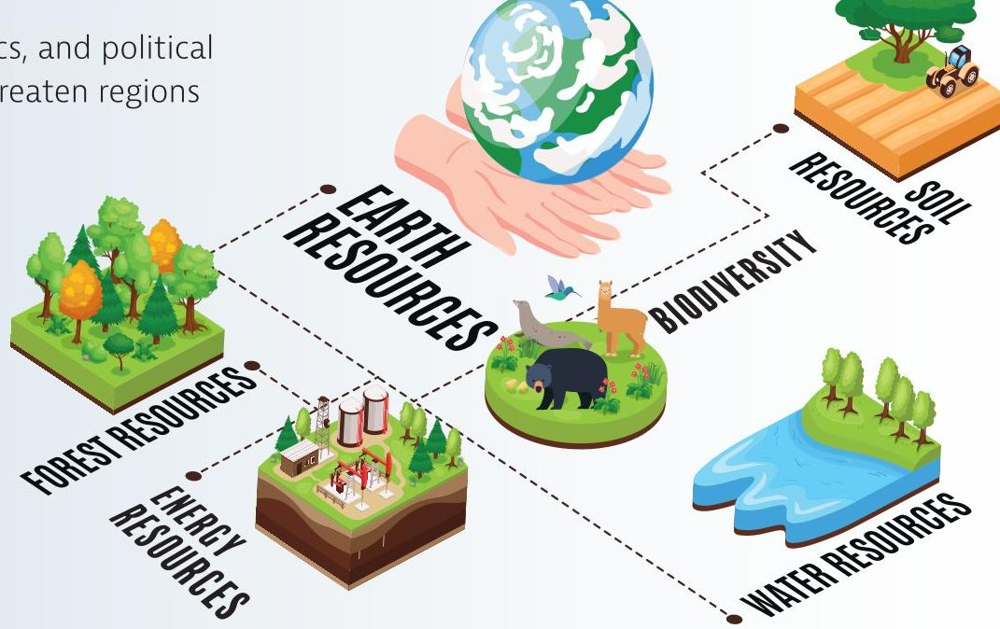

<!-- PDF_PAGE: 7 -->

## Changing Nature of Systems and Technology

In response to this changing environment, system solutions will leverage new technologies, including digital, material, power conversion and energy storage, biotechnology, and others. These solutions can provide enterprise and consumer value, while at the same time, they can benefit society and limit the stress on the finite natural resources. These system solutions apply to all aspects of society, including transportation, agriculture, energy production, healthcare, and many other services.

Most system solutions include increasing amounts of embedded and application software to provide their functionality, and increasing amounts of data to process. Many systems also provide services, such as those used to purchase items in the global marketplace. Other system solutions are increasingly characterized as cyber-physical systems (CPS) that include sensors, processing, networks, and data storage to control physical processes.

Changing nature of systems that are more interconnected and smarter.

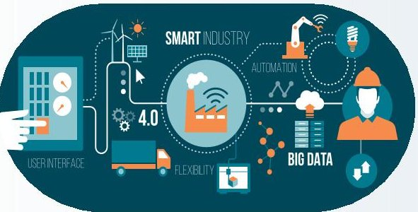

These systems are often interconnected with other systems to share resources and data as part of a broader systems of systems. For example, smart buildings, smart transportation, smart utilities, and smart waste management systems are part of smart cities.

These systems increasingly leverage artificial intelligence (AI), that may include machine learning, to enable the system to adapt to its environment and other changing conditions. The interconnected nature of these systems also introduces system design challenges, such as their vulnerability to cyber-threats.

As society benefits from advancements in system capabilities, consumers and users continue to expect more from these systems. This includes expectations that systems are more capable dependable, sustainable, and affordable. They expect systems to be more socially acceptable by considering their impact on society and the environment. Users also expect systems to be more autonomous, enabling them to seamlessly interact, and understand and respond to their requests.

## Demands on Enterprises

The enterprises that develop, produce, operate, and support these systems face increasing competition in the global marketplace to meet stakeholder expectations. This requires that they provide innovative products and services, while reducing costs and cycle time, increasing sustainability, and responding to regulatory changes, cyber threats, and supply chain disruption. The workforce skills must continuously evolve for the enterprise to remain competitive.

Knowledge is a critical enterprise asset. It must be properly managed for an enterprise to continue to learn and advance. Digital technology enables the transformation of how enterprises capture, reuse,

exploit, and protect knowledge through digital representation and semantic integration of all information. Evolving digital technology, including the broader application of AI, will enable automation and autonomy to be used to perform increasingly complex tasks, providing further opportunities for humans to add value through innovation.

Knowledge sharing through the digital transformation.

<!-- PDF_PAGE: 8 -->

# Evolving the Practice of Systems Engineering

Aspects of systems engineering have been applied to technical endeavors throughout history. However, it has only been formalized as an engineering discipline beginning in the early to middle of the 20th century. Systems engineering was applied to address the growing challenges of the aerospace, defense, and telecommunications industries. Over the last few decades, systems engineering practices have been codified in international standards and a shared body of knowledge. There is a recognized professional certification program and a large number of

degree programs in systems engineering.Many other industries have begun to recognize and adopt systems engineering practices to deal with the growing systems complexity. This complexity results from the increasing software and data content, increasing systems interconnectedness competing stakeholder expectations, and the many other social, economic, regulatory, and political considerations that must be addressed when designing systems in a systems of systems context.

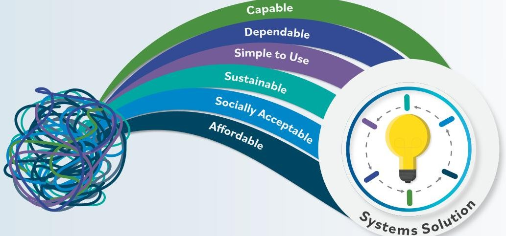

Systems engineering brings stakeholder value while managing growing complexity and risk.

Systems engineering aims to ensure the elements of the system work together to achieve the objectives of the whole. This requires systems engineering to deal with the complexity and risk by integrating across system elements, disciplines, the life cycle, and the enterprise. Systems engineering balances system solutions that satisfy diverse and often competing stakeholder needs and expectations such as performance, reliability, security, privacy, and cost. To accomplish this, systems engineering is inherently trans-disciplinary, and must include representation and considerations from each discipline and each affected stakeholder. Systems engineering must guide and orchestrate the overall technical effort including hardware, software, test, and specialty engineering to ensure the solution satisfies its stakeholder needs and expectations.

The practice of systems engineering will further evolve to support the demands of ever-increasing system complexity and enterprise competitiveness. By 2035, systems engineering will leverage the digital transformation in its tools and methods, and will be largely model-based using integrated

descriptive and analytical digital representations of the systems. Systems design, analysis, and simulation models, immersive technologies, and an analytic framework will enable broad trade-space exploration, rapid design evolution, and provide a shared understanding of the system throughout its life cycle.

Automated and efficient workflows, configuration and quality management of the digital thread, integrated tool chains, and AI will enable systems engineering to seamlessly collaborate and quickly adapt to change. By 2035, model-based reuse practices will effectively leverage enterprise

<!-- PDF_PAGE: 9 -->

investments. These practices include reference architectures and composable design, product line engineering, and patterns. Human-centered design, using models of the systems and users, will enable more seamless user-system interactions.

By 2035, the systems engineering practices will be based on a set of theoretical foundations and other general principles that are taught consistently as part of systems engineering curriculum. These foundations provide a common basis for applying systems engineering to the broad range of industry domains. Systems engineering education and training will address both the technical, business, socio-economic, leadership, and soft skills needed to enable collaboration among globally

distributed development teams. Systems engineering education and training will continue throughout a career to stay abreast of changing practices, tools, technologies, and application domains. The systems engineering workforce will support the growing needs from small, medium, and large enterprises across the range of industry and socio-technical systems applications.

In this changing world, systems engineering must continue to evolve to deliver stakeholder value and be responsive to change, while managing complexity and risk. This vision identifies the following systems engineering challenges in five categories that are needed to achieve the future state of systems engineering that is described in Chapter 3.

## Applications

1. Systems engineering contributes innovative solutions to major societal challenges.

2. Systems engineering demonstrates value for projects and enterprises of all scales, and applies across an increasing number of domains.

3. Systems engineering anticipates and effectively responds to an increasingly dynamic and uncertain environment.

## Practices

4. Model-based systems engineering, integrated with simulation, multi-disciplinary analysis, and immersive visualization environments is standard practice.

5. Systems engineering provides the analytic framework to define, realize, and sustain increasingly complex systems.

6. Systems engineering has widely adopted reuse practices such as product-line engineering, patterns, and composable design practices.

## Tools and Environment

7. Systems engineering tools and environments enable seamless, trusted collaboration and interactions as part of the digital ecosystem.

## Research

8. Systems engineering practices are based on accepted theoretical foundations and taught as part of the systems engineering curriculum.

## Competencies

9. Systems engineering education is part of the standard engineering curriculum, and is supported by a continuous learning environment.

<!-- PDF_PAGE: 10 -->

<!-- PDF_PAGE: 11 -->

# 1 THE GLOBAL CONTEXT FOR SYSTEMS ENGINEERING

Systems engineering in 2035 is shaped by the global environment: human and societal needs; global megatrends; and grand engineering challenges. It is also shaped by the technologies that underly systems and the evolving enterprise work environment. Stakeholder expectations, aligning with broad societal, technological, enterprise trends also influence the practice of systems engineering.

In this section, we highlight the global context motivating the creation of engineered systems, of incredible breadth of purpose, and the changing nature of these systems to which engineering particularly systems engineering, must respond.

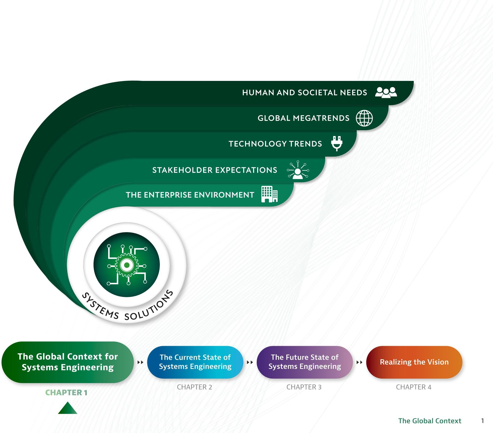

<!-- PDF_PAGE: 12 -->

## Human and Societal Needs Drive System Solutions

The United Nations sustainability goals serve as a proxy for human needs.

The United Nations Sustainable Development Goals (SDGs) are a call for action by all countries - poor, rich and middle-income - to promote prosperity while protecting the planet. They recognize that ending poverty must go hand-in-hand with

strategies that build economic growth and address a range of social needs including education, health, social protection, and job opportunities, while tackling climate change and environmental quality.

United Nations Sustainable Development Goals: https://sdgs.un.org/goals

Engineering of systems will play a central role in addressing the SDGs. The US National Academy of Engineering (NAE) identified Grand Challenges for Engineering in the 21st Century. These separately generated, visionary challenges complement the SDGs by focusing on engineering opportunities that are globally relevant and address fundamental societal needs. Large, complex, engineered socio-technical systems are often key to achieving the NAE Grand Challenges, thereby satisfying the physical, psychological, economic, cultural, human, and societal needs. Realization of the NAE Vision will require significant contributions from all engineering disciplines.

## THE UNITED STATES NATIONAL ACADEMY OF ENGINEERING GRAND CHALLENGES

- Advance Personalized Learning

- Make Solar Energy Economical

- Enhance Virtual Reality

- Reverse-Engineer the Brain

- Engineer Better Medicines

Any human-engineered system must be deployed into the prevailing social, physical, cultural, and economic environments; and the technologies applied to systems solutions must be tailored to

- Advance Health Informatics

- Restore and Improve Urban Infrastructure

- Secure Cyber-Space

- Provide Access to Clean Water

- Provide Energy from Fusion

- Manage the Nitrogen Cycle

- Prevent Nuclear Terror

- Develop Carbon Sequestration

- Engineer the Tools of Scientific Discovery

NAE Grand Challenges for Engineering: http://www.engineeringchallenges.org/challenges.aspx

relevant local or regional capabilities and resources. The world context strongly influences these systems solutions, so it is useful to look at important global trends forming that context.

<!-- PDF_PAGE: 13 -->

# Global Megatrends Shape the Systems of the Future

Global megatrends are driven (and enabled) by global socio-economic changes, coupled with technological advances. We are experiencing global increases in wealth leading to greater stakeholder expectations for addressing the type of issues as laid out by the United Nations that is, increased demand for improved healthcare, clean living environments, social equality, education etc. Greater wealth also feeds the advancement of technological capabilities and societal appetite for applying these technologies in a responsible, sustainable manner while transitioning away from fossil-fuel based energy.

## SOME KEY ATTRIBUTES

OF GLOBAL SOCIO-ECONOMIC CHANGE INFLUENCING THE NATURE OF SYSTEMS

- Decreases in extreme poverty

- Improved access to healthcare

- Lowering of fertility rates and infant mortality

- Increasing electrification

- Increase in income levels

- Improvement in education levels, especially for women

- Improved nutrition

- Increased reliance on social communication communities

- Increased access to the internet

## MEGATRENDS expected to influence systems engineering through 2035.

1. Sustainability

2. Interdependent World

3. Digital Transformation

4. Industry 4.0/ Society 5.0

5. Smart Systems

6. Complexity Growth

These global socio-economic megatrends shape the needs and expectations for systems, providing products and services across all industries and domains such as transportation, health care, space utilization, communications, energy production and distribution, education, food production, and all forms of modern infrastructure.

## SYSTEMS ADDRESS A WIDE VARIETY OF DOMAINS

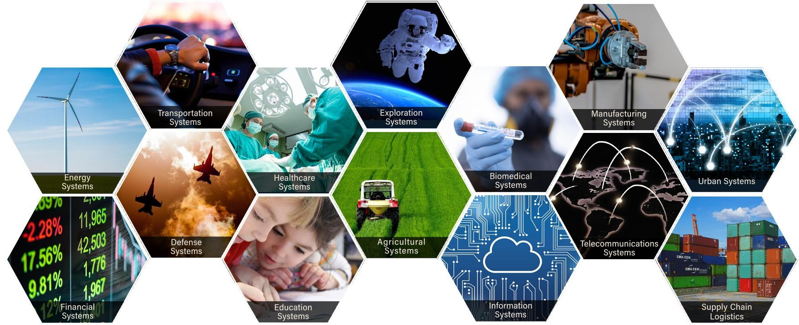

SOCIETAL CHANGES CAN PRODUCE GREAT SOCIETAL STRESS, URBAN INFRASTRUCTURE DEMANDS AND INCREASED SYSTEM CHALLENGES FOR AGRICULTURE, ENVIRONMENTAL HEALTH, AND SUSTAINABILITY. TRUST IN INFORMATION, ALONG WITH PROTECTION OF PERSONAL DATA, CONSTITUTES A GRAND CHALLENGE FOR INFORMATION SUPPLIERS AND CONSUMERS.

<!-- PDF_PAGE: 14 -->

Consumption of non-renewable resources resulting from economic activity will increasingly require better global management, recycling strategies, sustainable policies, local actions, and supporting systems, such as energy conversion and infrastructure for clean transportation and manufacturing.

Environmental change will result in shifts in living conditions, and impacts bio-diversity climate, global heat transport, the availability of fresh water, and other natural resources necessary for human sustenance and well-being.

Overall environmental quality will be a priority, requiring global cooperation. The trend toward greater concern for environmental sustainability will result in several key societal and system imperatives.

Engineering for sustainability, a system characteristic, will create a new generation of engineers who routinely assess the societal impacts of engineered systems.

Impacts of human activity on climate will be ingrained in assessments of engineered systems and public/private policies.

Many systems, both straightforward and novel, will arise to mitigate the deleterious impacts of climate change, such as global warming.

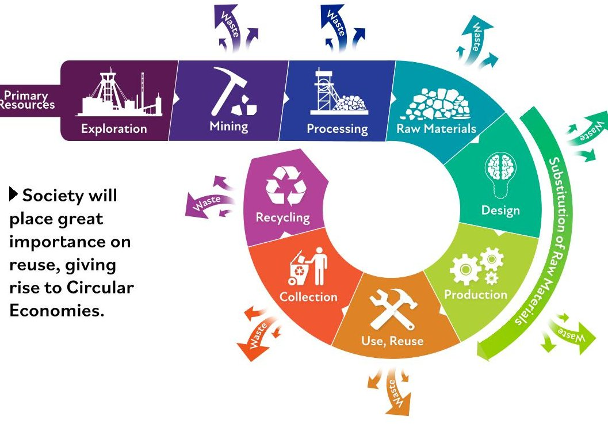

Priority will be placed on sys that are more efficient at resource utilization and responsible waste disposal. Though enterprises will continue to struggle with business and consumer pressures to increase consumption, versus environmental prerogatives to reduce waste

The global fossil fuel based energy economy will be transformed to one based on clean and renewable sources.

<!-- PDF_PAGE: 15 -->

A global community facilitated by advancing communications, information, and mobility capabilities results in higher levels of political and economic interdependence. This brings about the need to share resources and to interconnect systems in global partnerships. Governments and enterprises have become globally intertwined, relying upon the effectiveness of the supporting infrastructure systems. Many systems operating today never envisioned or ignored the impacts of this interdependence. Enterprises themselves are becoming ever more complex systems, in need of interconnected engineering and sustainment.

The exponential growth of the value of global exports over the past 70 years is a key indicator of economic interdependence. This interdependence is resulting in new collaboration mechanisms for global disaster relief, public health, information and sharing of knowledge and technology... but will also require improved coordination of policies to meet economic and financial challenges while achieving balance and global equity.

Telepresence, teleoperation, and telemedicine will be increasingly common, with global reach.

The reality can no longer be ignored that we live in an interdependent world which is bound together to a common destiny

Today's internet will be supplemented by a space-based internet with global scope.

-Nelson Mandela

Communications via shared global media contributes to leveling social aspirations and decreasing knowledge disparities.

THE RELATIVE VALUE OF GLOBAL EXPORTS (Adjusted for inflation)

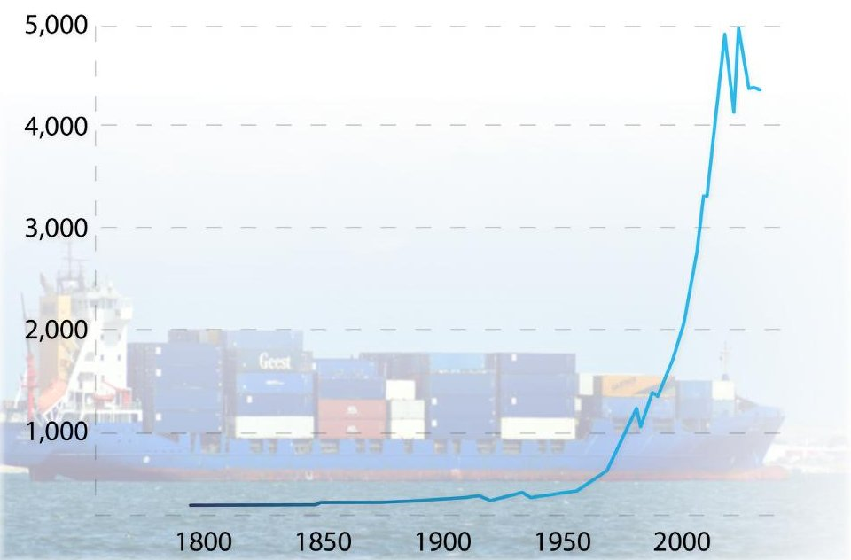

Our World in Data: https://ourworldindata.org/trade-and-globalization

<!-- PDF_PAGE: 16 -->

## 3

## THE DIGITAL TRANSFORMATION CHANGES PRODUCTS AND THE WAY WE WORK

ommercial and governmental enterprises are aggressively undertaking efforts to modernize processes and products by moving toward robust digital representations of enterprise information semantically integrating

information across the enterprise and supply chains for design, development, manufacturing, logistics and business analysis. Knowledge engineering information representation, model curation, and data analytics will underpin the way decisions are made and collaborative work is accomplished. Value will be provided to the consumer not only via end products but increasingly by providing services. Digital transformation will provide advantages for the more agile and competitive enterprises that master and adopt these approaches.

Thus, the nature of engineering, especially tools and methods, will be changing more profoundly than in prior decades. Modeling, simulation analysis, and visualization of system designs and end-to-end solutions enabled by high fidelity digital representations will dominate the practices of all engineering disciplines. AI will be increasingly integrated into tools throughout the system life cycle.

Digital representations of systems will enable the exploration of design and margins (physical as well as performance and safety) using virtual reality and/or augmented reality including highly immersive environments. Digital representation of products and manufacturing environments will be all-encompassing. A digital proxy, the digital twin, will be common-place in representing products throughout their life cycle. This will allow engineers to explore designs and production methods, both conceptually and physically, from a variety of viewpoints by placing themselves inside a system of interest. Specialized visualizations will assist engineers in understanding time-variant behaviors. Analysis of uncertainty and analysis of alternatives will be much faster and rigorous than ever before.

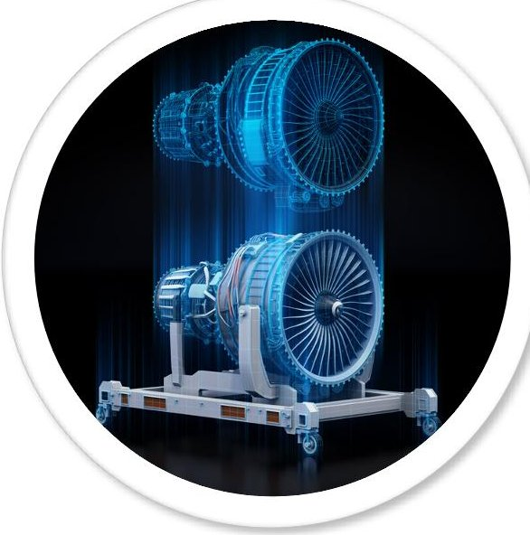

Increased reliance on digital representations will require cyber-security diligence in order to protect data and intellectual property.

<!-- PDF_PAGE: 17 -->

Industry is in the process of reinventing itself by adjusting to new societal and technological challenges. Global interaction and interdependencies of machines, warehouses, logistics systems, and engineering within cyberphysical systems create unbounded flexibility of self standing automated processes. The German Academy of Technology (Acatech) coined this development "Industry 4.0."

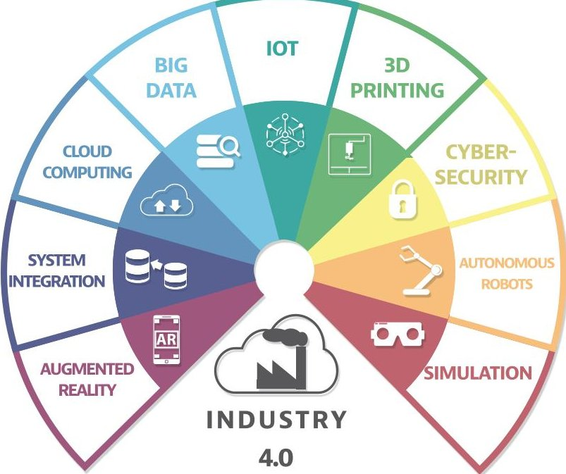

Industry has evolved over the past three hundred years from primitive mechanization to mass production, then electronics-based automation, and now to cyber-physical systems, defined as systems that integrate computation, networking, and physical processes. Embedded computers and networks monitor and control the physical processes, with feedback loops where physical processes affect computations and vice versa.

Under the Industry 4.0 approach, the logic and control of production changes significantly, and form the basis for smart factories. Products are monitored, their state of production and shipping are known, and their physical or software state configurations are individually catalogued at every step of their life cycle. A record for every

component of a larger system becomes transparent for customers, manufacturers and supply chains. Digital twins are at the heart of the overall system development life cycle. The digital chains of interacting tools and processes are seamless throughout the life cycle, established at every link of participating players, available to and trusted by all involved.

Society 5.0 explicitly looks to a future of socio-cyber-physical systems. That is, a human-centered society that balances economic advancement with the resolution of social problems by a system that highly integrates cyber-space and physical space. In Society 5.0, data from sensors in physical space are accumulated in cyber-space, analyzed by artificial intelligence (AI), and results are fed back to humans in physical space in various forms.

Together these trends respond to the sustainable goals of the UN,the recommendations of the World Economic Forum,and the changing values of the world's population, especially of younger generations.

## SOCIETY 5.0

Japan has established Society 5.0 as a national strategic policy that will shape national priorities and investments. Society 5.0 is envisioned as society's next major transformation beyond the information age.

"Society 5.0 will be an Imagination Society, where digital transformation combines with the creativity of diverse people to bring about "problem solving" and "value creation" that lead us to sustainable development. It is a concept that can contribute to the achievement of the Sustainable Development Goals (SDGs)

adopted by the United Nations."

- Nakanishi, H., World Economic Forum Annual Meeting, 2019

Society 5.0: https://www8.cao.go.jp/cstp/english/society5_0/index.html

<!-- PDF_PAGE: 18 -->

Complexity emerges from system designs, in part because of the increased coupling which produces dependencies, vulnerabilities and risks that need to be understood and exposed for systems managers, sponsors, and public policy decision makers. Complexity is also growing due to increased demand for greater systems capability and efficiency which in turn increases use of software and autonomy - improving systems adaptability but making testing

difficult and introducing cyber-threats. Complexity is growing across markets and application domains in which distributed systems interact in a highly coupled, unpredictable and ever-changing ecosystem, blurring the frontiers between industries, markets, and application domains. The potential for system failure can often be exacerbated by the complex organizations which operate these systems.

Complexity increases over time due to the integration of ever more complex layers of technology.

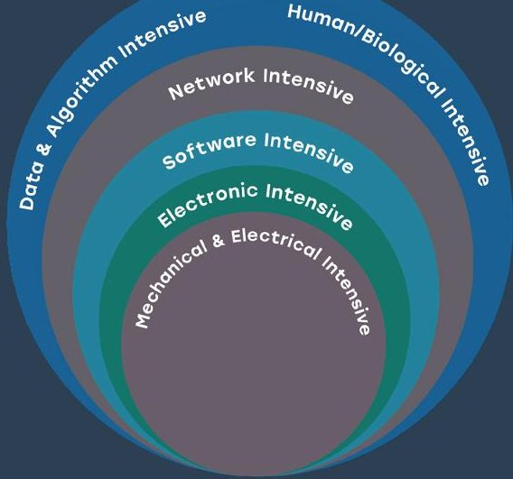

Technology-driven complexity

Scope-driven complexity

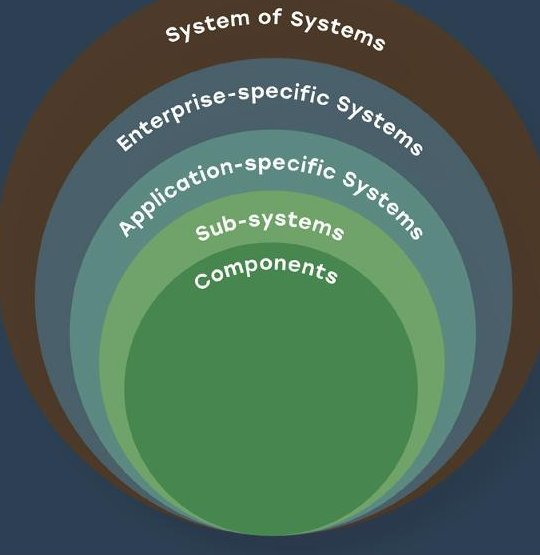

Complexity increases with systems scope expansion due to proliferation of interfaces and governance mechanisms.

## EXAMPLES OF INCREASING SYSTEM COMPLEXITY ARE:

SMART HOUSES containing heating, air-conditioning, lighting, and security subsystems, controlled by smart thermostats and a spectrum of sensors, which are frequently connected to the internet and mobile phones, to optimize energy consumption, comfort, safety, and other functions.

MODERN AUTOMOBILES incorporating intelligent navigation systems and multiple controllers for advanced driving assistance systems, power management, suspension management, and many more subsystems each of which is highly complex in its own right.

HOUSEHOLD APPLIANCES such as washing machines, containing sensors and a surprisingly large amount of software, enabling their vastly growing functionality and maintainability.

COMPUTING, MOBILE, AND WEARABLE DEVICES which have sophisticated computation, sensor, and communications capabilities.

ENERGY NETWORKS that are necessarily systems of systems consisting of geographically and managerially distributed elements comprising generation transmission and distribution supported by intelligent sensors energy management processors and sophisticated logistical and cyber-security systems.

containing implantable mechatronic devices: from pacemakers, heart valves, neurostimulators, cardioverters, and sensors; to wearable closed loop infusion control devices and exoskeleton technology for the walking-impaired.

<!-- PDF_PAGE: 19 -->

## 6

Smart elements employing AI, automation and autonomy features, and advanced sensors for system functional behaviors as well as system self-diagnosis and repair, will be commonplace. However, the non-determinism inherent in many Al-based approaches will raise issues of system verifiability, safety, and trust.

Human-centered design with a focus on user experience will be a key factor for success of smart systems.

Smart systems will be commonplace in diverse fields, such as agriculture, urban complexes, homes, appliances, health, financial services, energy, telecommunications, private and public transportation, and national security. Intelligence will move closer to devices and away from central control.

Rather than engineer a system for a fixed design point, systems will be engineered to contain the data and information flows that are necessary for them to continuously evolve. The system creating the system-of-interest and the system-of-interest itself will merge.

Consumers will increasingly be provided services tailored to their individual needs, as opposed to ownership of products which, over time, become obsolete.

Systems will increasingly be part of a larger system of systems, creating enhanced intelligence and functional value, but also challenges for smooth system evolution. Formal, ontology-based information representation will be the basis on which system elements are aware of each other's state.

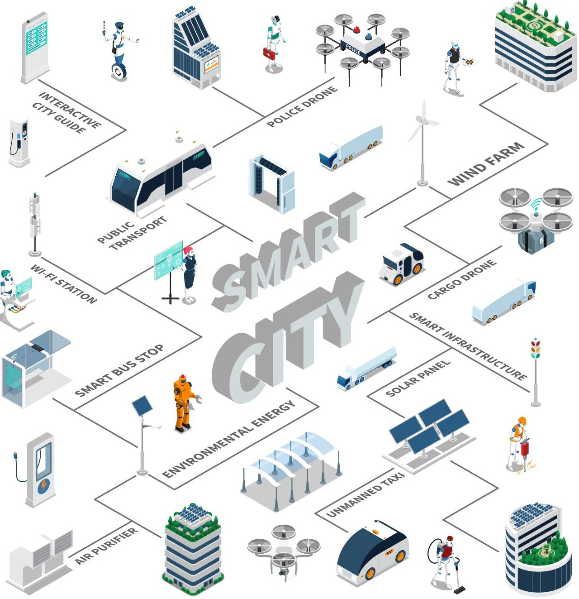

AN OVERARCHING SOCIETAL CONCERN, DUE TO INCREASED USE OF AUTONOMY AND INFORMATION RELATED TO PERSONAL BEHAVIOR, IS PUBLIC TRUST OF SMART SYSTEMS TO FUNCTION RELIABLY AND SAFELY AND TO PROTECT PERSONAL INFORMATION.

<!-- PDF_PAGE: 20 -->

## Technology Advances Shape the Nature of Systems

Technology advancements and systems solutions are highly interdependent. Systems designs are predominantly based upon available technologies, but as technologies advance, new design solutions become possible, leading to increased value for the stakeholder. Engineers must continually assess technologies for potential application to

ADVANCES IN MATERIALS AND MANUFACTURING

...will bring new materials with novel mechanical, chemical, optical, and/or electrical characteristics into systems at all scales, with increased performance and reliability.

designs that satisfy stakeholder needs. Technology developers are challenged to make their efforts relevant and address evolving systems needs and expectations. Application and demonstration of new technologies in systems can, in turn, validate the utility of technology advancements.

## ADVANCED MODELING AND SIMULATION

...will play a key role in representing complex system solutions, transforming digital data into virtual and digitally-augmented representations which can be queried and modified by immersive human-machine interactions.

## AUTONOMY AND ARTIFICIAL INTELLIGENCE (AI)

...will significantly advance via applications in computing, software, smart sensors, robotics, energy storage, and human intensive interactions.

## BIG DATA AND ANALYTICS

...will continue to evolve as a key technology because the number and complexity of data sources will grow enormously. These technologies will drive Society 5.0 and enable progress in socio-cyberphysical systems.

BIO/LIFE SCIENCE AND NANO TECHNOLOGIES

...that are embedded and greatly miniaturized will transform many domains in medicine and human-computer interaction.

## COMMUNICATIONS TECHNOLOGIES

...such as advanced photonics, radio frequency coding techniques, and software-based radios will foster fast, wireless, and universal internet access for the global population.

## EDGE COMPUTING

...will fuel the internet of everything by connecting computational and control resources in almost every device with the cloud to improve the user experience, enable faster, lower latency processing of data, and reduce costs.

## GEOSPATIAL TECHNOLOGIES

...will advance a multitude of areas such as e-commerce, public health management, smart agriculture national security, cyber-security land management, supply chain logistics social media, tourism, and disaster mitigation.

## POWER GENERATION, STORAGE, AND CONVERSION

...will enable more efficient, decentralized, environmentally-friendly, and flexible energy systems, integrating local, regional, and national generation sources.

## QUANTUM INFORMATION SCIENCE

...will harness the properties of nature at the smallest scale for applications in large-scale computing, secure communications, navigation, and sensing.

<!-- PDF_PAGE: 21 -->

## Growing Stakeholder Expectations

1. SIMPLE System solutions must provide expected capability but hide as much design complexity as possible, have simple user interfaces, be understandably failure tolerant, and easy to use. Employing human-centered design and taking into account the entire user experience will be increasingly important to system acceptance.

2. TIMELY Systems must be developed and placed into use in a timely fashion to assure customer demand and market conditions are conducive to systems success and provide sponsor value.

intensive designs, are increasingly being used in applications in which human, environmental, and property safety is a significant concern.

Ever increasing levels of safety and resilience must be assured in the face of increasing systems complexity.

4. SECURE System complexity, global connectivity, and IT dependence give rise to system vulnerabilities. The challenges for averting unwanted intrusions or for mitigating the results of intrusions have grown enormously.

Threats must be continuously assessed throughout the system life cycle and solutions implemented, ensuring security and cyber defense against both ad hoc and organized (national actor) threats.

## 5. STABLE AND PREDICTABLE Systems of

the future must be stable, reliable and predictable in order to meet operational needs, achieve customer acceptance, operate efficiently, minimize unintended consequences, avoid liability, and provide expected value. Systems must be validated to be consistent with customer stability expectations across a wide variety of use cases and stress conditions.

6. SMART Smart systems are able to cope with a changing and unknown environment, assist human operators, or self-organize to provide products and services. Social, functional and physical demands must be integrated to create valuable systems solutions that are resilient in their operational environment.

7. SUSTAINABLE Stakeholders will demand, as a result of global imperatives and market forces, that systems and services be environmentally sustainable - such as minimizing waste and undesirable impacts to climate change. Sustainability as a system characteristic will be stressed as well as the sustainability ethic of the responsible enterprises.

take into account maintenance costs over the full product life cycle, management of product diversity, pre-planned product evolution and disposal, capture and disposition of knowledge gained from fielded systems, and the ability to perform upgrades while operational. Engineers must be able to balance the often contradictory technologically driven demands of support for deployed systems.

9. SCALABLE Scalable systems are adaptable to a range of performance and capabilities without breaking their fundamental architecture. This is an important trait because of the high cost associated with initial infrastructure investments or non-recurring engineering costs.

Scalability and adaptability must be a consideration from system inception and be reconciled with the conflicts that scalability often presents for products optimized for single applications.

10. AFFORDABLE For systems to be viable they must be affordable within the context of the total cost of ownership. They must provide value to systems sponsors and users, and, very often, the general public. Developers must understand systems value from the perspective of all stakeholders and incorporate these often competing values, into design decisions.

<!-- PDF_PAGE: 22 -->

# The Enterprise Environment

## GLOBALIZATION AND DIVERSITY

Enterprises will continue to move toward greater globalization, embracing diversity, innovation, and new collaboration methods in search of competitive efficiencies.

## SUSTAINABILITY ETHICS

Sustainability will become a key attribute of the enterprise culture and products. Enterprises will need to develop a positive ethical identity to attract and retain customers as well as employees.

## SYSTEMS THINKING

Demand for an enterprise culture of systems thinking will grow to address issues of product,production and organizational complexity. Dispersed multi-disciplinary teams will generate collective systems views supported by digital tools.

## ANTICIPATION OF TECHNOLOGY

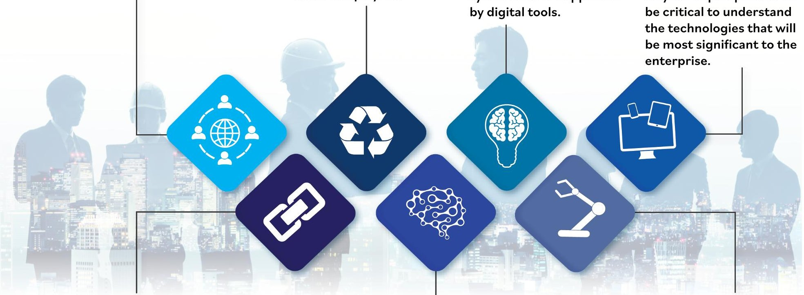

Successful enterprises of the future will anticipate and rapidly embrace new technologies. It will not simply be sufficient to wait for a technology to prove itself in the market. A systems perspective will be critical to understand the technologies that will be most significant to the enterprise.

## SUPPLY CHAIN INTEGRATION

Modern supply chains will depend upon layers of systems-cognizant subcontractors who can deal astutely with functionality trade offs and risk decisions. Coherence of software among all project partners will be critical for seamless and trusted exchange of digital products and intellectual property.

## ENTERPRISE INTELLIGENCE DECISION MAKING AND LEARNING

Enterprises will need to protect product and process know-how, while at the same time creating an internal learning environment in which the workforce can easily access and take advantage of the enterprise intellectual assets. Enterprises will need to be flexible and sufficiently adaptable to react quickly.

## AUTOMATION AND DIGITAL TRANSFORMATION

Digital transformation of the enterprise will increase reliance on quantitative decision making, streamlined development processes, and automation. Software robots will complement physical robots in the quest for ever greater product and service quality as well as reductions in the cost of production.

## EDUCATION SYSTEMS OF THE FUTURE

...will recognize that information will be readily available to the workforce via digital search, and much routine work will be accomplished by robots and Al. Training must concentrate on human skills, creativity, leadership, reading and comprehension, and analytical skills. Education systems must support this workforce transition by breaking down the traditional barriers between STEM and social science/humanities curricula.

<!-- PDF_PAGE: 23 -->

## Influencing Factors for Systems Solutions

Systems provide solutions, products, and services which change according to the capabilities of technology. But systems are driven by the needs and expectations of global stakeholders and by the trends in the enterprises which develop and operate these systems - within societal, regulatory and political constraints.

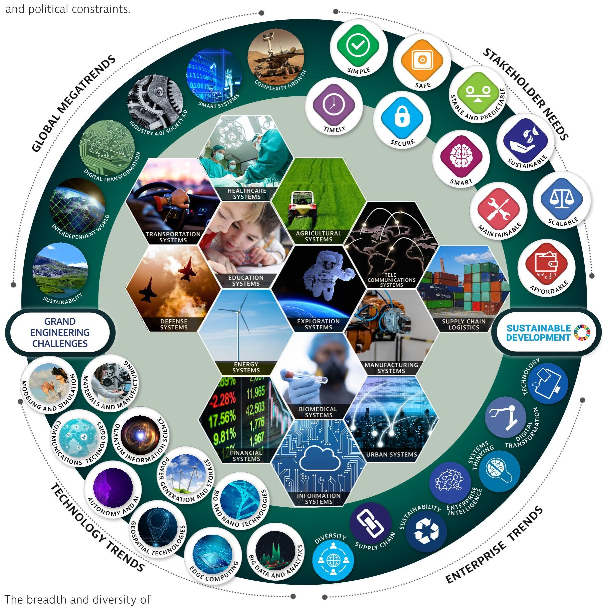

The breadth and diversity of systems is enormous, encompassing engineered as well non-engineered social and environmental systems.

<!-- PDF_PAGE: 24 -->

<!-- PDF_PAGE: 25 -->

## THE SYSTEMS OF THE FUTURE WILL...

...respond to a growing and diverse spectrum of societal needs in order to create value.

...harness technology innovations while protecting against unintended consequences.

...become smarter, self-organized, sustainable resource-efficient, robust and safe, but trusted, in order to meet stakeholder demands and expectations.

...align with global trends in industry, the economy and society, which will, in turn, influence systems needs and expectations.

...be engineered by an evolving, diverse workforce which, with increasingly capable tools, can innovate and respond to competitive pressures.

...present enormous engineering challenges due to growing complexity and decreasing predictability with widespread application of artificial intelligence.

## SUMMARY

The big challenges of the 21st century will be global in nature. What will happen when climate change triggers ecological catastrophes? What will happen when computers outperform humans in more and more tasks and replace them in an increasing number of jobs? What will happen when biotechnology enables us to upgrade humans and extend lifespans? No doubt we will have huge arguments and bitter conflicts over these questions. But these arguments are unlikely to isolate us from one another. Just the opposite. They will make us ever more interdependent.

-21 Lessons for the 21st Century, Yuval Noah Harari, (2018)

<!-- PDF_PAGE: 26 -->

<!-- PDF_PAGE: 27 -->

## 2 THE CURRENT STATE OF SYSTEMS ENGINEERING

We must understand the current state of systems engineering to project its future state. This chapter highlights the current state of systems engineering practices and their adoption across industry. It includes the current state of systems engineering foundations, education and training, and challenges facing the systems engineering community.

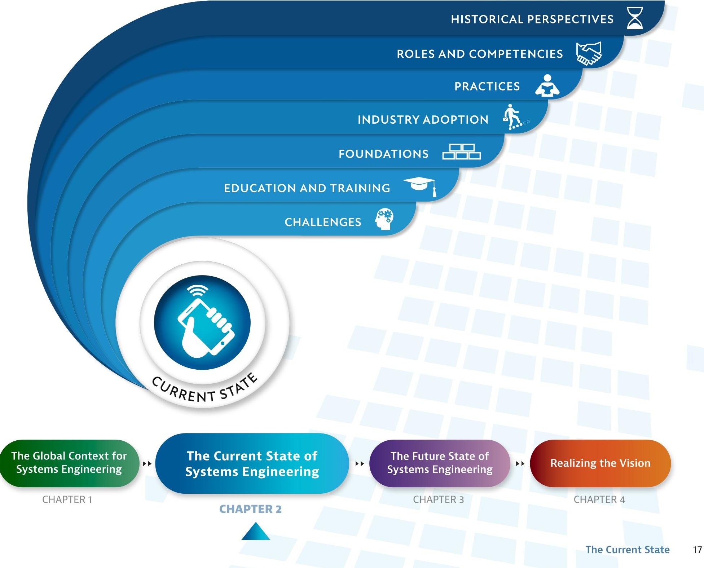

<!-- PDF_PAGE: 28 -->

Today's systems engineering practices are influenced by the global context, their historical evolution, and the domains to which they are applied. Successful engineers have been practicing systems thinking for centuries- often by intuition, but also by heuristics as experience grew from designing and constructing buildings, aqueducts, bridges, ships, and sewers. These intuitions have often been codified into tools and practices that are application domain specific. Today systems engineering is valued more widely in businesses both large and small. Some businesses have dedicated systems engineers- but many have domain engineers who design using systems engineering practices.

Today systems engineering has strengthened its theoretical foundations and broadened its best practices and standards. Engineers are increasingly using newer concepts such as model based systems engineering, digital transformation, and product line engineering and more domains are adopting systems engineering principles, practices, and insights. This is true for very large systems, systems of systems, complex socio-technical systems- and for very small systems, IoT devices, and in situ medical devices. Today's engineers design and operate large constellations of small satellites, plan missions to Mars, develop new vaccines, and address climate change. Furthermore, the state of the art is evolving rapidly because of ongoing technical advances and the convergence of systems engineering with other disciplines.

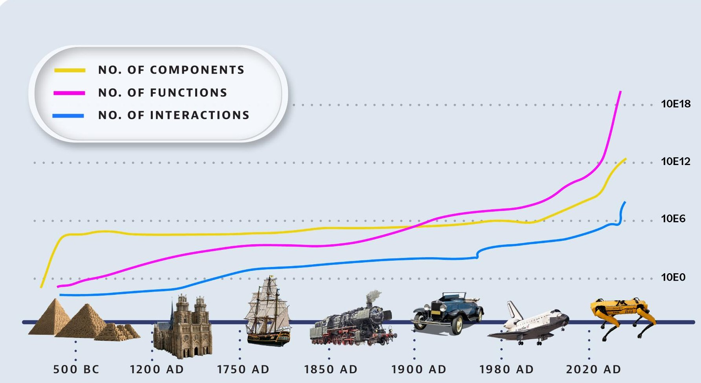

<!-- PDF_PAGE: 29 -->

Systems engineering contributes directly to product, mission, and organizational success.

Systems engineers today often come from other engineering disciplines, such as mechanical, aeronautical, software, or electrical engineering. But what makes a good engineer in one domain does not necessarily make a good systems engineer.

Systems engineers must be holistic thinkers strong communicators, maintain a broad view of the systems and how they are being used while at the same time, pay attention to the relevant details. Systems engineers must develop a breadth of knowledge, a balance of skills and be aware of global issues and trends such as digital transformation and systems of systems.

Fortunately, the systems engineering community has evolved competencies, bodies of knowledge, and curricula to guide the role definition, training and career development of systems engineers. Although these competencies cover much of the systems engineering discipline, no one person may need expertise in all of them, but the composite experience of the systems engineering team should provide the requisite skills needed for the particular application.

## Core Systems Engineering Principles

- Systems Thinking

- Life Cycles

- Capability Engineering

- General Engineering

- Critical Thinking

- Systems Modelling and Analysis

## Professional Competencies

Communications

- Ethics and Professionalism

- Technical Leadership

- Negotiation

- Team Dynamics

- Facilitation

- Emotional Intelligence

- Coaching and Mentoring

## Technical Competencies

- Requirements Definition

- Systems Architecting

- Design for...

- Integration

- Interfaces

- Verification

- Validation

- Transition

- Operation and Support

## Systems Engineering Management Competencies

- Planning

· Monitoring and Control

· Decision Management

· Concurrent Engineering

· Business and Enterprise Integration

· Acquisition and Supply

· Information Management

· Configuration Management

· Risk and Opportunity Management

## Integrating Competencies

- Project Management

· Finance

· Logistics

· Quality

<!-- PDF_PAGE: 30 -->

Many systems engineering practices are now considered standard, while others are emerging. Every systems engineering practice can be thought of as having a maturity curve. The figure below illustrates some of the many systems engineering

practices and where they are in the maturity curve. These are just illustrative; many exemplars exist of emerging and transitioning practices in real-world projects, some of which are highlighted later in the chapter.

Systems engineering practices are adapted to different industries.

Systems engineering practices are codified in many standards, guidebooks, and the Guide to the Systems Engineering Body of Knowledge.

Systems engineering practices are incorporated in to domain-specific processes covering the solution life cycle from cradle to grave.

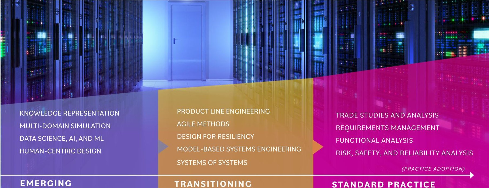

<!-- PDF_PAGE: 31 -->

While systems engineering has been accepted as a fundamental discipline across a growing number of application domains, the terminology, methods, and practices are still applied inconsistently across industries and organizations. Customization in different domains is important to efficiency and agility, but a common systems engineering framework would facilitate knowledge sharing across domains.

## Industry Adoption

Systems engineering is broadly applied in aerospace and defense- and it is increasingly applied in other industries. However, even in aerospace and defense, the maturity of systems engineering practices varies across companies and across programs within a company.

The way systems engineering is practiced also varies with product complexity, project size, and experience of the engineering team. For example, systems engineering practices vary based on whether industries are market-driven or government-contracted with strong regulatory standards, and whether a product is delivered as a component or subsystem, or delivered as an integrated end-product or service.

Progress has been made in the last decade on standardizing terminology and practices for systems engineering across application domains. But there remains significant differences as one might expect across such varied domains. These domains have unique drivers that impact their systems engineering practices, but customization from a common framework can enhance efficiency and agility.

ELECTRONICS

HEALTHCARE

AUTOMOTIVE

FACILITIES AND INFRASTRUCTURE

POWER AND ENERGY

INFORMATION TECHNOLOGY

AEROSPACE

TRANSPORTATION

DEFENSE

LOGISTICS

<!-- PDF_PAGE: 32 -->

A sampling of current systems engineering foundational topics supporting systems engineering as taught in some academic programs includes decision theory, operations research, risk analysis, information theory, probability theory, control theory, complexity theory, systems theory, network theory, and the rapidly maturing field of uncertainty quantification and systems thinking. $ ^{1} $

Practicing systems engineers use a variety of analytical tools that are based on math and science. This requires competencies in the foundational math and science that is needed to analyze the systems of interest, and the enabling systems used to manufacture and support the systems. The systems engineer also must understand how to use probability and statistics to understand risk and uncertainty, and understand principles such as coupling and cohesion to manage systems complexity. For cyber-physical systems, a systems engineer of today must also have a basic understanding of control theory and communications.

A systems engineer is competent in the relevant scientific foundations essential to their systems of interest.

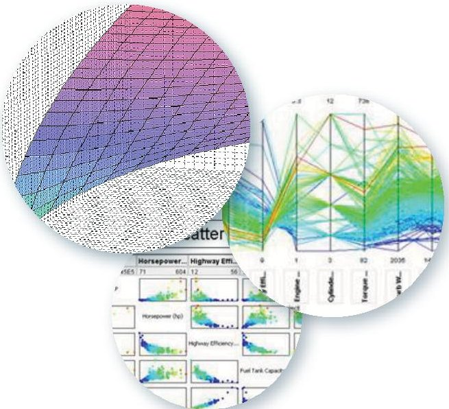

A systems engineer uses applied mathematic tools, such as probability and statistics, to model critical properties of the system.

In addition to its math and science analytical foundations, systems engineering has evolved processes and procedures learned over decades of experience with large scale systems. These include systems engineering practices and heuristics captured in standards, handbooks, and guidelines. These knowledge repositories and standards have added to the foundations of systems engineering practice in recent years.

Given the breadth of mathematics, and the physical and social sciences needed to support systems engineering, there is an effort underway to describe how these different foundations can be abstracted and integrated into the theoretical foundations for systems engineering. These foundations can be more uniformly taught as part of a common systems engineering curriculum.

<!-- PDF_PAGE: 33 -->

The growing worldwide demand for systems engineers in many application domains exceeds the available supply. Most practicing systems engineers do not have a formal systems engineering education but learned systems engineering "on the job". Many large enterprises have initiated internal training programs to further develop their workforce.

An increasing number of universities and training providers teach systems engineering, but the

number of students is small when compared to other engineering disciplines. Various guidelines for curricula harmonization and competence categorizations have recently been defined as part of international efforts to broadly stimulate systems engineering education. Various programs have been initiated to attract new students to the study of systems engineering. The significance of systems thinking is also being recognized and taught in other disciplines.

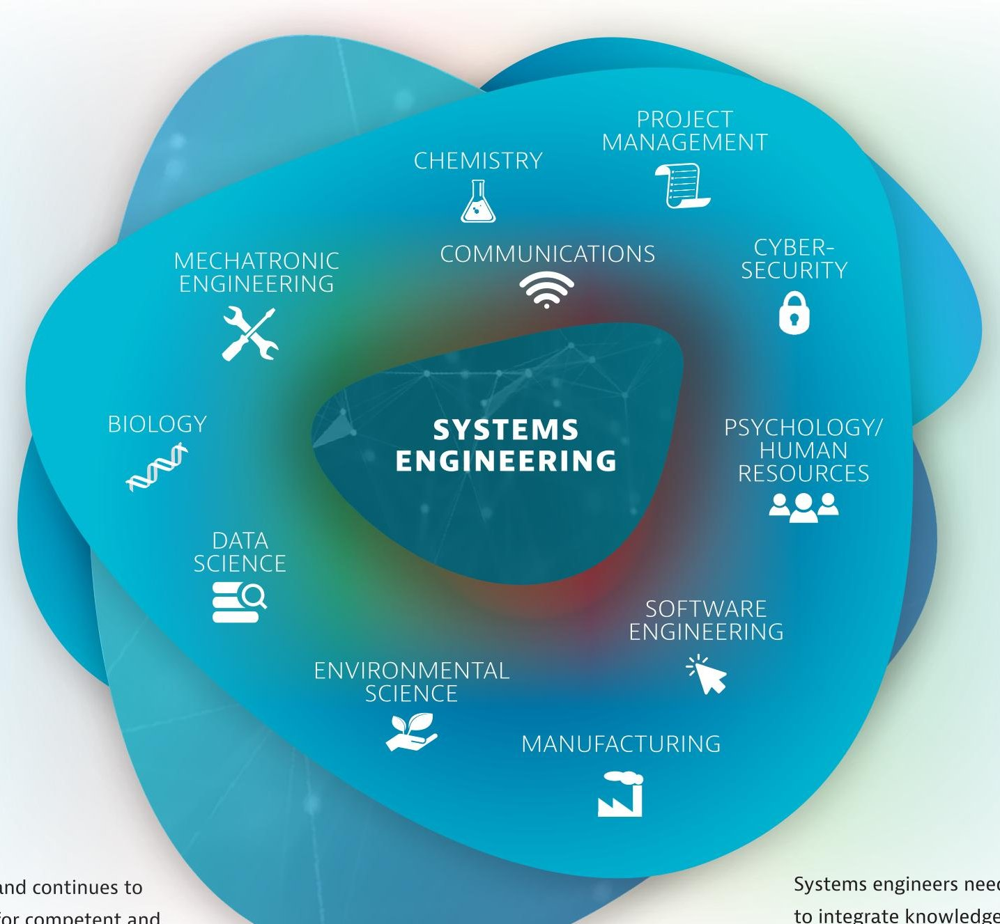

The demand continues to increase for competent and well-trained system engineers that have broad exposure to other scientific and engineering disciplines, who can communicate with and integrate across different practitioner groups.

Systems engineers need to integrate knowledge across many different fields illustrating the need for well-educated engineers with sound domain and systems competencies.

<!-- PDF_PAGE: 34 -->

## Challenges

## Tools and Data Integration

One of the challenges for systems engineering today is the enormous fragmentation across the engineering tools and data landscape:

MULTIPLE SPECIALIZED TOOLS FOR EACH DISCIPLINE

PROPRIETARY DATA FORMATS

LIMITED STANDARDIZATION

Federation across different domain specific tools, and integration of data are becoming a focus for enabling collaboration and analysis, but many obstacles remain. Emerging standards like the Functional Mock-Up Interface (FMI) $ ^{2} $ are improving simulation interoperability, while standards like the OASIS Open Services for Lifecycle Collaboration (OSLC) $ ^{3} $ are gaining traction to improve traceability and interoperability.

In many industries, systems engineering still relies heavily on document-centric processes. The new emphasis on digital engineering opens new opportunities, but also introduces new integration challenges. Other model-based standards such as the Systems Modeling Language (SysML) and the Unified Architecture Framework (UAF) are continuing to evolve to provide a standard way to support model-based systems engineering for systems and enterprises.

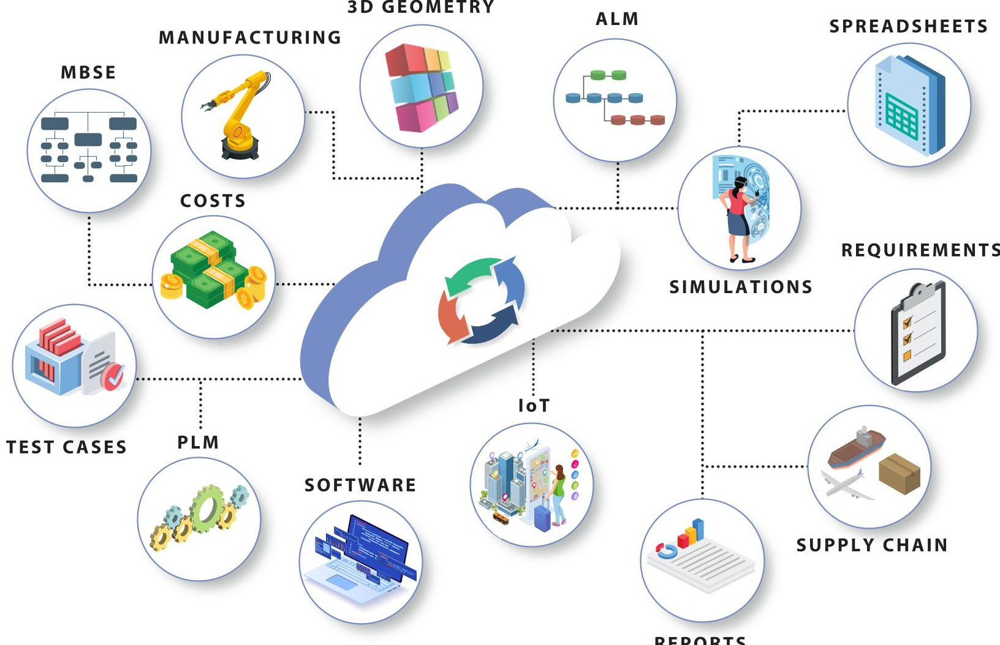

Integration of tools and data from different specialties and different vendors via the OASIS Open Services for Lifecycle Collaboration standard.

<!-- PDF_PAGE: 35 -->

## Software Complexity, Agility, and Scale

Over the last 50 years, software has become a more important component of many systems. As software has grown in scale, complexity and interconnectivity, the software engineering community has adapted—and developed new approaches with an emphasis on agility, evolution, development and operations (DevOps), and continuous development, integration, and deployment.

The systems engineering community is working with the software engineering community to generalize these approaches to cyber-physical systems (CPS), to bring new value and capabilities to users sooner and more often, and to balance risks, regulatory issues, and societal impacts.

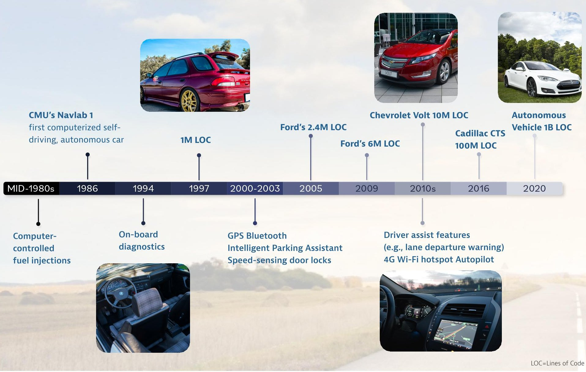

## Impact of AI and Autonomous Systems

Traditional systems engineering tools and practices do not address complex systems that continue to learn and modify themselves during operation. In addition, these systems can have significant social and ethical implications that need to be considered as part of the design. Examples include critical decisions that are allocated to autonomous vehicles that may impact safety, and how these systems can potentially create information that violates privacy. Methods to curate data, to assure

it is not biased, and to ensure that the training sets adequately span the operational environment are only being developed now. Furthermore, validation and verification of these systems is currently based on traditional systems engineering approaches, but new techniques and concepts may be necessary to account for the opacity of how these systems make decisions. The need for ongoing verification of continuously learning and evolving systems also needs to be addressed.

<!-- PDF_PAGE: 36 -->

<!-- PDF_PAGE: 37 -->

Systems engineering is more important- and more valued- due to rising complexity, increased interconnectivity, and societal impacts.

Systems engineering has advanced the state of its competencies, practices, and foundations.

Systems engineering is not just for systems engineers- all engineers need to practice systems engineering.

The maturity of systems engineering practices varies across industry domains, organizations, and projects.

Systems engineering is addressing challenges in tool and data integration,the impact of artificial intelligence and autonomous systems,and rising software complexity,agility,and scale.

## SUMMARY

<!-- PDF_PAGE: 38 -->

<!-- PDF_PAGE: 39 -->

# 3 THE FUTURE STATE OF SYSTEMS ENGINEERING

By 2035, systems engineering will make significant strides in meeting the challenges and needs described in Chapter 1 on the Global Context for Systems Engineering. Systems solutions will be increasingly characterized as cyber-physical systems (CPS) and product service systems, and will routinely be interconnected with other systems as part of broader systems of systems. The relevance and influence of systems engineering will continue to grow beyond large scale product development to a broad spectrum of engineered and socio-technical systems applications. Systems engineering will moreover become an essential prerequisite and enabler for digital enterprises. Systems engineering

will bring a transdisciplinary perspective to these applications that is critical to systems and product innovation, defect reduction, enterprise agility, and increasing user trust. Systems engineering practice will be model-centric, leveraging a vast library of reusable elements, enabling rapid response to changes in stakeholder needs and technology, while providing the essential methodologies to manage ever- increasing complexity and risk across the systems life cycle. Systems engineering will be broadly recognized by governments and industry as a high value contributor, resulting in a growing demand for systems engineering education and skills.

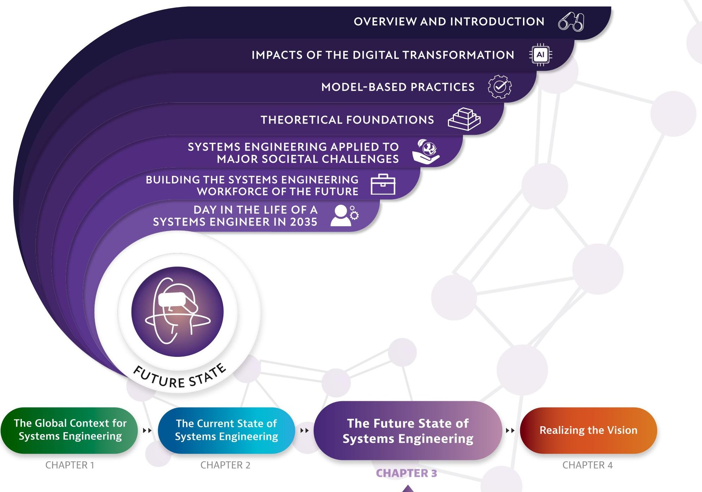

<!-- PDF_PAGE: 40 -->

By 2035, systems engineering will adapt to meet its challenges through a wide variety of new and emerging practices. Advanced technologies such as the expanded use of artificial intelligence (including machine learning), communication technologies, and new kinds of materials will impact the nature

of systems, how people interact with systems, and the way in which systems are developed. Systems engineering practices will adapt to, and will be transformed by these technologies to deal with increasing systems complexity.

The future of systems engineering is model-based, leveraging next generation modeling, simulation, and visualization environments powered by the global digital transformation, to specify, analyze, design, and verify systems. High fidelity models advanced visualization, and highly integrated, multi-disciplinary simulations will allow systems engineers to evaluate and assess an order of magnitude more alternative designs more quickly and thoroughly than can be done on a single design today.

Artificial Intelligence, powered by large data sets and expert domain knowledge will drive major changes in systems engineering methods and tools, and within systems themselves, as algorithms are developed to assist the systems engineer be more efficient and effective to deliver solutions.

Data science techniques will be infused into the systems engineering practice to help make sense of large-scale data sets and assess complex systems. Further, the rapidly expanding set of data science tools will be an important part of an integrated analytic framework for systems engineering.

Human-systems integration practices will become essential to design smart systems that can effectively interact with humans, and account for increasing levels of systems complexity and autonomy.

The theoretical foundations for systems engineering will be based on established science and mathematics that characterize systems phenomena and stakeholder value, and provide the basis for systems education and evolving methods and tools.

Ongoing education and training of systems engineers and the infusion of systems thinking across a broad range of the engineering and management workforce will meet the demands for a growing number of systems engineers with the necessary technical and leadership competencies.

Systems engineering will be embraced by a greater number and broader range of small and medium enterprises and will be continually adapted to manage systems complexity while also driving incremental market value.

<!-- PDF_PAGE: 41 -->

## FROM

Advancing digital technologies and standards development

are enabling model-based systems engineering (MBSE) practices, but modelingecosystems are often rudimentary and incomplete.

Additionally, computation, cloud infrastructure, and data discovery are not being fully leveraged compared to other engineering and scientific disciplines.

## TO

Systems engineering environments fully leverage advances in digital technologies

and modeling standards to enable rapid exploration of designs using high fidelity simulation, data visualization, and semantic web technologies. Systems engineering tools benefit from internet connectivity and knowledge representation to provide seamless exchange of information with other disciplines and their tool environments as part of a broader enterprise digital engineering environment. Further, systems engineers partner with machines to combine creativity and automation in a robust and agile design process.

## IMMERSIVE VISUALIZATION

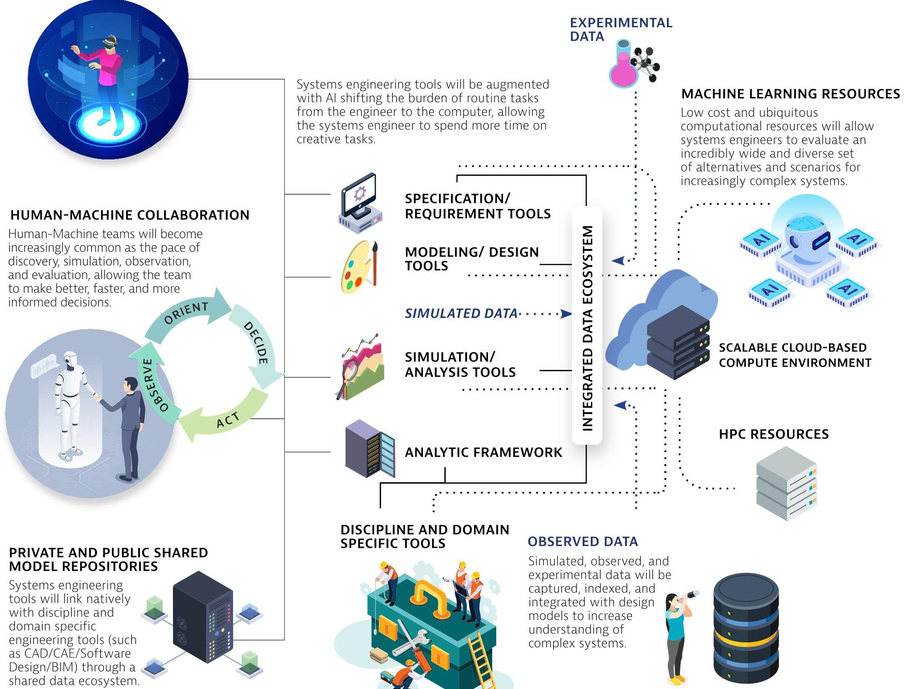

<!-- PDF_PAGE: 42 -->

## Impacts of AI on Systems Engineering

## FROM

There is limited support in the current systems engineering tool ecosystem to

help guide, evaluate, and optimize the specification design, and analysis tasks the systems engineering team performs.

Entering data,building reports,and organizing diagrams are all manual efforts that detract from the value-added effort to create high quality system designs. Further, while the systems engineering community has contributed significant advancements in the development and verification of advanced algorithms,the systems engineering community has had limited engagement with the current exponential growth of AI and machine learning (ML) algorithms which are becoming increasingly ubiquitous in new systems.

## TO

Systems engineering tools will be augmented with data driven and context aware

algorithms that allow the systems engineer to focus more of their time on creative tasks and less on mundane tasks of data entry, consistency checking report generation, and many others. Instead, systems engineers provide their design intent and allow the tools to help guide them to high-quality specifications and design. Additionally systems engineers will themselves be more frequently designing systems with Al and ML components, requiring new systems engineering skills. The systems engineers will be critical in the development of data sets for algorithm training and testing, and will need to establish methods to validate systems behavior, performance and safety for an increasingly large number of systems with "learned" behaviors.

## AI enablers for systems engineering tools and practices Impacts to the systems engineering practice required to build systems leveraging AI

There will be new AI techniques joining neural and symbolic methods allowing systems engineering organizations to describe the design domain in such a way that algorithms can tailor support for the organization and systems of interest.

Systems engineers will play a critical role in setting the context, and encoding domain concepts in such a way that AI powered design tools can be leveraged to generate alternative designs for evaluation and trade off.

Natural language processing (NLP) techniques will be used to help systems engineers write better specifications, removing ambiguity, identifying incompatible requirements and assessing the impact of requirements on the final design.

## AI enabled tools will help identify and optimize the required testing to build confidence in systems.

Al algorithms will enable adaptive design of experiments and synthesis of alternative architectures based on a human specification and design intent.

Systems engineers will have to ensure algorithms are not biased as part of the validation process.

As systems become more non-deterministic (such as those enabled by ML), systems engineers will need to adopt analytical V&V methods replacing traditional testing means.

Systems engineers will need to adapt how they plan and execute tests to gain sufficient coverage and trust on non-deterministic systems without relying on brute force methods.

Al enabled tools help to drive design activities in collaboration with the systems engineer and help avoid bad design choices that do not support the design intent.

The systems engineering community will need to become more versed in AI and ML methods as systems begin to leverage more components enabled by these algorithms.

Systems engineers will have a new role in building and evaluating training and testing data for algorithms to help ensure the data is balanced and representative of the real environment the systems will operate in.

<!-- PDF_PAGE: 43 -->

# The Future of Systems Engineering Is Predominantly Model-Based

## FROM

Although a growing number of systems engineering

organizations have adopted model-based techniques to capture systems engineering work products,the adoption is uneven across industry sectors and within organizations. Custom, one-off simulations are used for each project,and there is still limited reuse of models especially during critical early phases of systems architecting and design validation.

Systems engineers routinely compose task-specific virtual models using ontologically linked, digital twin-based model-assets. These connected models are updated in real-time providing a virtual reality-based, immersive design and exploration space. This virtual global collaboration space is cloudbased, enabled by modelling as a service and supports massive simulation leveraging cloud-based high-capacity compute infrastructure. Families of unified ModSim frameworks exist enabling small and medium businesses along with Government agencies to collaborate.

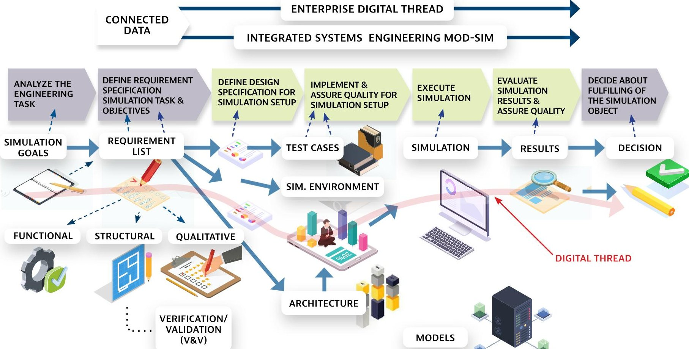

By 2035, a family of unified, integrated MBSE-Systems Modeling and Simulation (SMS) frameworks exist. They leverage digital twins and are fully integrated into the enterprise digital thread foundation. This enables efficient pattern-based model composition and seamless "cradle to grave" virtual exploration. Integrated AI/ML-based agents identify high impact parametric studies, noise factor sweeps, and support closed loop safety/security operational domain design surface explorations.

The digital thread-based MBSE-ModSim framework(s) enables agile and efficient capture modeling, simulation, and understanding of user experiences. Virtual design candidates can be evaluated

down through manufacturing, maintenance, updates, and eventual decommissioning. The MBSE-SMS frameworks also leverage high bandwidth, bi-directional connectivity supporting fresh data ingestion, segmentation and AI/ML network re-training. Realtime system anomaly detection can be detected and the connected data used for virtual systems design updates. These updates can be deployed to the field using exploratory "shadow software" to run in parallel to the main software application, gathering performance data and informing the systems engineer on appropriate release actions. Finally, the MBSE-SMS frameworks provide integrated asset life cycle management systems that support Agile continuous integration, build, validation and release cycles.

<!-- PDF_PAGE: 44 -->

## MBSE-SMS FRAMEWORK

CONNECTED DATA

Highly connected data with integrated AI/ML-based data segmentation, object labelling, and temporal scenario - ontology mapping supports automated digital twin creation, model correlation, verification and validation and seamless systems engineering trade studies.

MODEL-BASED SYSTEMS ENGINEERING

MBSE Descriptive models created using semantically rich modeling standards provide systems abstraction, data traceability, separation of views, and leverage AI/ML-based reference model reuse at both systems and product realization levels.

INTERACTIVE HMI VIRTUALIZATION

Interactive customer HMI experiences with virtualized connected services, real-time control algorithm, and CPU emulation providing real-time system response parameter exploration.

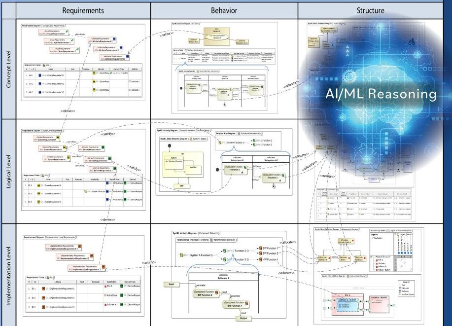

## INCREASING FIDELITY AND COMPLETENESS SUPPORTING EXTENDED REALITY

Layered simulation models at multiple levels of abstraction allowing real-time simulation at multiple scales (single vehicle to multi agent traffic to city infrastructure fleet to regional/cross country simulations)

DETAILED SCENARIO ANALYSIS WITH PHOTO-REALISTIC VISUALIZATION

Photo-realistic simulation and visualization enable detailed scenario analysis.

<!-- PDF_PAGE: 45 -->

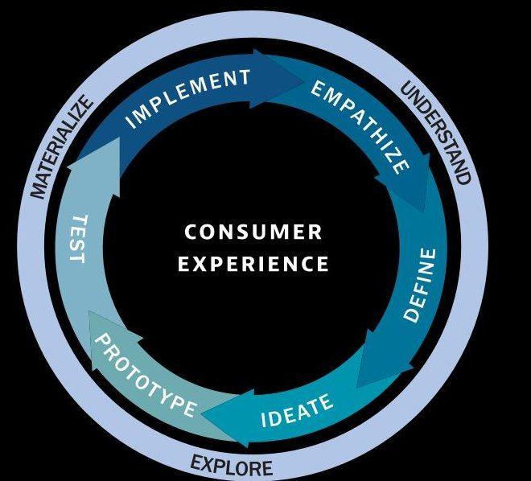

## SYSTEMS OF SYSTEMS

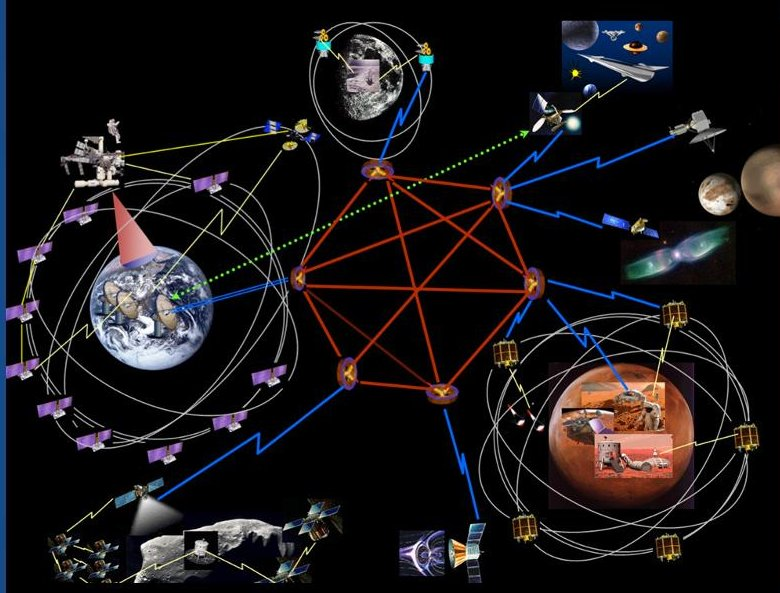

Real-world Systems of Systems, operational design domain customer experience data into cloud-data-lakes providing instantaneous opportunities for action-oriented information extraction.

GAMING ENGINE PHOTO REALISM AND EXPLORATION

Extended Realities: (xR) Augmented, Virtual, and Mixed.

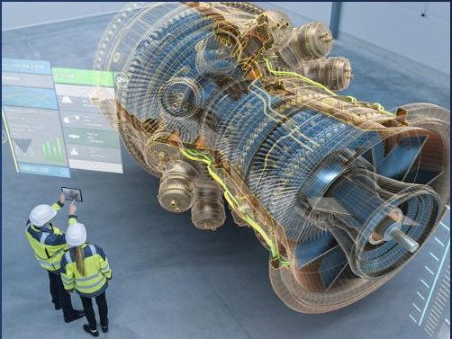

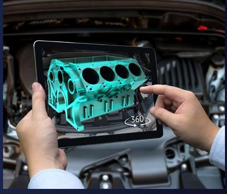

## MASSIVE PARALLEL COMPUTE

High-Capacity Parallel Compute supporting advanced AI/ML augmented data visualization providing synthetic data generation, and deep learning-based edge case exploration for performance, safety-risk, and security-threats.

ENVIRONMENTAL CONDITIONS TOPOGRAPHIES,SCENE GENERATION, AND MAPS

High fidelity 3D maps, road topologies, scenes, weather and traffic conditions.

<!-- PDF_PAGE: 46 -->

# Architecting Flexible and Resilient Systems

## FROM

Systems architecting is often ad-hoc and does not effectively

integrate architectural concerns from all relevant technical disciplines (such as hardware, software operations, manufacturing, security, and more) nor does it fully integrate other stakeholder concerns. Further, systems architecting does not always include sufficient environmental context or failure scenarios to evaluate and optimize the architecture for operational resiliency.

## TO

Systems architecting methods are well established and address

broad stakeholder concerns associated with increasingly complex systems. Systems architecture, design, and analysis is integrated across disciplines, domains, and life cycle phases to provide a single, consistent, unambiguous, system representation. Evolving needs, external context, and anticipated failure scenarios are central to the architecture process resulting in flexible, resilient, and adaptable architectures.

Engineered systems have always been used in ways that were not considered during their initial design, sometimes adapting elegantly to new use cases. However, as we approach 2035, designing systems and their supporting systems and supply chains with specific focus on flexibility, robustness, and resilience will be a central tenet of the architecture process. Emerging techniques such as Loss-Driven Systems Engineering (LDSE) and Opportunity-Driven Systems Engineering (ODSE) will help systems engineers identify systems optimizations to increase systems resiliency. Techniques such as chaos engineering will be adapted to drive resiliency of a greater variety of system types (not just IT and software systems).

Resilience pursues a future where systems have the ability to deliver required capability in the face of adversity. Systems engineering practices by 2035 will design systems that can adapt to emergent systems and operations behaviors in both reactive and proactive ways.

The emergence and commoditization of autonomous systems illustrates the need for systems resilience as these systems must be robust to a wide range of environmental conditions, adaptive to unexpected conditions, and capable of anticipating and recovering from failure conditions. Resilient systems can continue to carry out the mission in the face of disruption, and by 2035, systems engineers will readily use high fidelity modeling, simulation, and analysis to evaluate and optimize systems to be resilient to various operating conditions, failure scenarios, and unexpected conditions.

## RESILIENCE ARCHITECTURES IN SMART CITIES

Smart cities integrate data from a vast array of sources-deployed sensors, buildings, transportation systems, utilities, and more. This data is used to both inform decision makers, but also to automatically react to changing conditions. The highly-interconnected nature of smart cities and the potential for interdependence between municipal functions drives a need for a highly resilient architecture.

A resilient smart city architecture will address and limit the risk of cascading intra and inter system failures, support integration across systems, and will facilitate continuous, dynamic adaptation, and expansion of systems of systems

<!-- PDF_PAGE: 47 -->

## Engineering Trusted Systems

## FROM

Systems trust is a loosely defined concept that includes many

properties including cyber-security, data privacy, systems safety and overall reputation. The legal landscape governing how systems must address these properties is evolving quickly and inconsistently, but the properties that comprise "trust" are routinely "secondary" considerations in overall system designs. But the increasing level of interconnectedness in systems and the increasingly routine nature of data collection to power new systems, is resulting in a risk surface for organizations that is rising exponentially.

## TO

Systems engineering routinely incorporates a range of new perspectives including

security, privacy, and explainability with traditional perspectives such as systems safety to define and track a metric of "systems trust". This includes designing with data minimization and defense in depth principles to protect the systems from cyberthreats and minimize the impact to users if a system is breached.

As autonomous systems become mainstream principles of explainability and provable safety will allow system providers to build confidence in these systems and will allow those system developers to differentiate themselves in the marketplace.

## TRANSPARENCY AND CORPORATE ETHICS

System properties only make up one portion of the trust equation; system developer behavior and country of origin also contribute to how users feel about systems. By 2035 corporate ethics, reputation and transparency - especially regarding use of personal data will be central to how users determine what systems to trust, and which to avoid.

CYBER-SECURITY

The cyber landscape is ever evolving with new threats emerging daily, including a wider variety of nation-state actors forming attacks for political, strategic, and economic gain. As our digital infrastructure becomes increasingly connected and we begin to rely more heavily on autonomy, cybersecurity is increasingly a major tenet of systems safety and forms a foundation of trust.

By 2035, cyber-security will be as foundational a perspective in systems design as system performance and safety are today. The systems engineering discipline will grow to become even more interdisciplinary, embedding cyber expertise into the team to ensure cyber is considered through the full system life cycle. Additionally, modeling and simulation tools to help test and evaluate cyber aspects of the system will be increasingly prevalent, providing a holistic picture of system security that is too often only considered late in the development life cycle today.

Design for cyber-security will extend beyond the components of the system to include analysis of the supply chain and sourced parts to eliminate any weak spots in the system.

DATA AND PERSONAL PRIVACY

Systems are increasingly reliant on collected data to operate. Data is critical to the functionality of autonomous systems, and other systems that learn and adapt to user preferences and behaviors. Users will increasingly trust system providers that are responsible with user data, transparent, and have mechanisms for data minimization and protection surrounding any and all collected data that is personal in nature.

<!-- PDF_PAGE: 48 -->

# Infusing Data Science Methods into Systems Engineering Practice to Understand Complex Systems Behavior

## FROM

system behaviors using models of performance, physical constraints, cost, and risk using a mix of tools ranging from commercial simulation and analysis tools to spreadsheets to homegrown code. These analyses generally are restricted to relatively limited data sets and systems engineering practice does not generally include methods to correlate large data sets to help understand complex behavior.

## TO

## The systems engineer's toolkit is

significantly expanded by the infusion of data science tools and techniques, allowing better quantification of performance and risk for non-deterministic systems, and improved ability to continually monitor system behavior over time. This expanded toolkit facilitates more comprehensive analysis and allows for the collection and exploration of extremely large, interconnected data sets to understand increasingly complex systems.

The increasing complexity of systems of 2035 also increases the difficulty in analyzing and predicting systems behavior. Cyber-physical systems will be massively interconnected, incorporate smart systems technology, and must be safe and trusted. Systems engineers will be expected to analyze these systems with increasingly large trade spaces and extremely large data sets to quantify system behaviors. Systems engineering practices will require smart data collection mechanisms and will include both formal and semi-formal methods for identifying emergent behaviors and detecting, quantifying, and managing uncertainties and unanticipated behaviors leveraging that data.

Improvements in data science methods and open-source tools coupled with inexpensive cloud-computing resources will help power the next generation of systems engineering practices and tools, allowing the systems engineer to better understand possible non-deterministic outcomes while also coping with uncertainty. Research in data science, data analytics, and big data will be

infused into the systems engineering practice and data science will become a core competency of the systems engineer.

Analytical techniques adopted from the data science discipline such as clustering, outlier detection, and probabilistic reasoning, will be commonly used to explore huge systems state spaces to identify and eliminate undesirable systems states. Techniques will be developed to correlate, monitor, and visualize a diverse range of systems parameters as indicators of systems health. Analytical techniques will leverage large data sets from real-time monitoring of operational systems, that is used to better understand the systems behavior and improve systems performance and other quality characteristics. Capitalizing on this understanding to develop systems that are more fail safe, fault tolerant, secure, robust, resilient, and adaptable will be a fundamental part of systems engineering practices. Visualization tools will enable interactive analysis from many different stakeholder-specific viewpoints, allowing decision makers to gain new insights, perform what-if analyses, and communicate the impact of their decisions.

Systems engineers and decision makers will have more information and machine-driven insights from which to draw conclusions

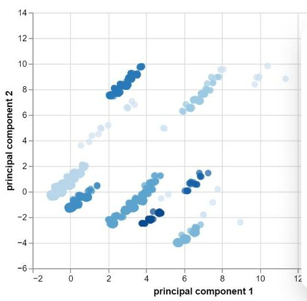

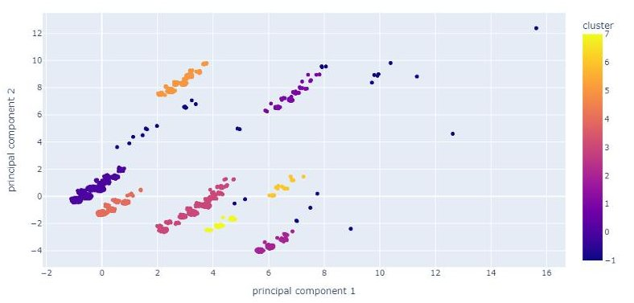

<!-- PDF_PAGE: 49 -->

# Model-Based Systems of Systems Practices

## FROM

The systems engineer is primarily focused on the

design of dedicated domain specific systems. There is broad recognition that systems and devices are no longer stand alone but are interconnected as part of broader systems of systems (SoS). Initial design guidance has been developed in the form of architecture frameworks and interoperability standards.

## TO

Systems of systems are designed with a family of unified modeling approaches.

Common SoS style guides, patterns, and methodologies are practiced that integrate socio-technical systems human factors, cybernetics, evolutionary biology, and sociology into the SoS. Model-based verification of SoS's are realized using service-agent based model composition on a stand-alone or net-centric simulation platform. Systems engineers design-in assumed SoS reuse within an anticipated larger SoS solution.

By 2035 the systems of systems engineering (SoSE) community has grown to include practitioners across a diverse set of domains including Government-Policy, Civil and Commercial.

These communities have identified the collective advantage of working together and treating the aggregate set of separately owned and operated technical and non-technical systems, and applying a broad-based systems approach despite the lack of a 'top level authority'. This opens new opportunities for implementing SoSE across domains.

a core set of frameworks to capture and analyze SoS in terms of legal, organizational, semantic, and technical interoperability. These SoS frameworks also have gone a long way to address the key challenges identified in the INCOSE handbook.

SoSE has evolved to include aspects of Socio- Technical Systems Theory, Open Systems Principles, Network & Network Analysis, and Interoperability Models into the systems engineering best practices. Collectively, these practices provide the SoSE with

New SoSE patterns have been established that are leveraged to design and implement extensible, robust and adaptive SoS solutions. These patterns include object oriented systems engineering (OOSE) methods such as data encapsulation, inheritance, and abstraction. These model-based techniques fully integrate SoSE-patterns, OOA/D and AI/ML network analysis providing an extended capability to explore the full virtual SoS concept space. They are used to design an extensible and re-usable systems in the context of systems of systems.

A SoS is an integration of a finite number of constituent systems which are independent and operable, and which are networked together for a period of time to achieve a certain higher goal.

-Jamshidi, 2009

<!-- PDF_PAGE: 50 -->

# Understanding Socio-technical Complex Systems with Human Systems Integration Methods

## FROM

While there is a notable increase in the adoption

user experience design methods, there is still a gap between systems engineering and user experience teams. Systems analyses often focus only on the technology-centric aspects of systems or model the human in the systems with limited fidelity.

## TO

## Systems engineering methods have integrated User Experience concepts

and Human Systems Integration (HSI) methods to ensure human elements of systems are appropriately understood and considered in all aspects of design. Further, as systems more frequently rely on humanmachine collaboration, the interplay of the technical elements and human elements of the system will become an increasingly critical part of system design.

Approaching 2035, socio-technical systems will be increasingly autonomous, incorporating more AI, will be massively interconnected, and must be collaborative, safe, secure and trusted. Analyzing and predicting system behavior will become more challenging, but systems engineers will be expected to analyze, design, and evaluate these systems with human and natural principles in mind. Systems engineering practice will include HSI methods for evaluating human factors and usability, identifying emergent behaviors, and detecting and managing unanticipated behaviors.

Improvements in HSI methods, human behavioral simulation and human-in-the-loop simulation capabilities will help power the next generation of systems engineering practices and tools, allowing the systems engineer to better understand possible non-deterministic outcomes and cope with uncertainty.

Research in HSI will be infused into the systems engineering practice and become a core competency of the systems engineer.

The human will be increasingly "part of the system" to solve complex problems and will have a wide range of interaction mechanisms available ranging from voice to touch with haptic feedback.

By 2035, human-machine interfaces have continued to evolve, following current trends, providing users with a wide variety of ways to interact with systems, including voice, touch, and gesture. HSI will increasingly focus on human-machine collaboration as more humans, machines, and processes to solve previously intractable problems.

HSI generally incorporates various dimensions that need to be integrated: human and organizational factors, HSI planning and project management, manpower and evolution of jobs, personnel, training, life-criticality that includes occupational health, safety, environment, habitability, and human survivability. HSI is interested in socio-technical complex systems with respect to systems of

systems topology, human and machine activities and emergent properties. Systems interact among each other through various kinds of organizations, communities and informal groups. HSI includes the perspective of all personnel ranging from system owners to operators, maintainers, support personnel and end users.

<!-- PDF_PAGE: 51 -->

# Shifts in Acquisition Towards Collaborative Processes

## FROM

Project needs and requirements are prepared 'in-house' by organizations

to inform traditional acquisition processes, with the consequence that the project does not fully leverage the knowledge of the wider enterprise during its earliest and most formative phases. Acquirers possess limited ability to assess technical performance during the systems development process, while contracted parties are not motivated to share information. Reference architectures, when used, are unique to projects and not maintained after delivery of the systems.

## TO

## Acquiring organizations leverage industry knowledge during the

earliest phases of a project, prior to the 'main contract'. They establish multi-organization integrated project teams to perform as 'smart' customers during the entire systems life cycle, able to build upon evolving reference architectures and best practices. Shared digital engineering solutions maximize access to, and enhance the use of, information by all project participants during all phases, including 'smart operations'.

## BETTER REQUIREMENTS AND PRE-COMPETITIVE PREPARATION

Statement of need and conceptual reference architecture prepared by acquirer (government or industry) in collaboration with potential downstream suppliers and strategic partners followed by finalization and issue of the tender by the acquirer. Better pre-competition collaboration will result in higher quality requirements and lower risk and better cost management for the delivered capability.

## SHARED INFORMATION AND SHARED ENVIRONMENTS

## CONTRACT INCENTIVES AND LOWER BARRIER TO ENTRY

Maximized access to useful program information by all members of the enterprise, strengthening communication, reducing errors and duplication of assets. Shared digital engineering solutions, with mature configuration and variant management, allows the enterprise to work in highly iterative, short steps/phases, providing the agility and flexibility needed to manage large and complex systems, supported by dynamic "dashboards" and high degree of automation, while still supporting fair protection of intellectual property of all enterprise members.

Innovative pricing (and tendering) models foster collaboration such as target cost or incentive fee (appropriate to risk level) enabling shared risk-taking and reasonable (but maximized) profits.

Adoption of standards, and access to shared environments and technology will lower the barrier to entry for new and non-traditional organizations.

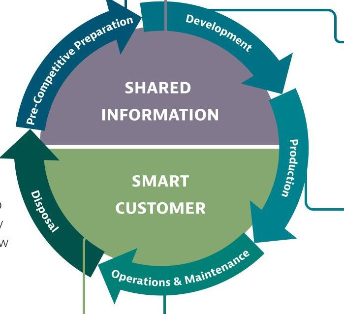

## SMART CUSTOMER

Acquirer is able to draw on own team, strategic partners and a library of design guidelines and policies to judge system/design fitness, maturity, and risk at all phases of a program. Systems engineering knowledge and competence is available at acquirer site enabling better communication between acquirer and suppliers.

## REFERENCE ARCHITECTURES

The enterprise has regular access to- and maintains- a proven and evolving catalogue of applicable architecture patterns and frameworks matched to the needs and phase of the program.

## SHARED MANAGEMENT OF RISKS

All stakeholders share and collectively manage program risks. This arrangement leverages the greater knowledge of the enterprise, and shared access to information across the life cycle by the acquirer and supplier, to address risks, and also reduces surprises and issues leading to conflict. Ownership of risk is transferred to the party best able to manage them.

## SMART OPERATIONS

Operations will be integrated across projects and through the trusted supply chain, leveraging digital twins, pervasive health monitoring, and predictive maintenance, to achieve a completely optimized life cycle up to controlled disposal.

<!-- PDF_PAGE: 52 -->

## FROM

Systems engineering foundations are derived from application

experience, and are documented in the Systems Engineering Body of Knowledge (SEBoK), various process standards such as ISO/IEC 15288, and handbooks, such as the INCOSE Systems Engineering Handbook; these are taught and supported by higher education, certification bodies, and professional societies.

## TO

The systems engineering foundations have a stronger scientific and

mathematical grounding based on advanced practices, heuristics, systems observable phenomena, and formal ontologies. The foundations are shared across application domains, and provide additional rationale for selecting and adapting practices to maximize value for the particular application.

## Observable Phenomena as the Basis for Theoretical Foundations

By 2035, the systems engineering community is benefitting from foundational research into systems engineering theoretical foundations on multiple fronts. A combination of foundations have been pursued and models, methods, and the underlying mathematics defined that offers analytical insights to new emergent behaviors resulting from rapidly evolving real-world systems and systems of systems. One area of research is to identify the more general observable phenomenon, derived from basic science, that underlie system interactions. Another research area is to identify the relevant

foundations that provide the basis for establishing and optimizing systems value. These foundations and their supporting mathematical-based descriptive models provide the basis for virtual explorations of the system design-interaction space. The theoretical foundations based virtual space establishes and optimizes system value across a broad SoS trade space. Additional foundations are still being derived from physical, social, and systems sciences, and will be integrated into a more cohesive set of systems engineering theoretical foundations.

1. THE SYSTEMS PHENOMENON (LAWS OF COMPONENT/SYSTEMS-OF-SYSTEMS INTERACTIONS)

By 2035, the systems engineering community has recognized the value of understanding, interpreting, and leveraging in practice the theoretical foundations of the systems phenomenon. Research into this phenomenon has provided the systems engineer with principles and derived theories that capture the interactions between components (state-impacting exchange of energy, force, material, or information). Systems phenomenon-derived models are based on Hamilton's principle and directly relatable to STEM specific specialization models.

2. THE VALUE SELECTION PHENOMENON (CUSTOMER EXPERIENCE VALUE CREATION)

The observable value selection phenomenon provides the systems engineering practitioner insights into a product's perceived value, from a user's perspective, when the products is used in context of its intended operational domain. For instance, an autonomous vehicle in city traffic. The customer/users ultimate value selection of the "product-in-context" is a function of both the products "designed" performance and the interactions between the product and its environment. Empirical discovery of value is a key goal of agile engineering methods, minimum viable products (MVPs), fail-fast strategies, and on-line A/B experiments and tests, all of which directly observe selection phenomena.

3. THE MODEL TRUST BY GROUPS PHENOMENON (LAWS OF HUMAN AND MODEL UNCERTAINTY)

Research into the observable phenomenon called Model Trust by groups has provided frameworks that expose and help capture the critical factors associated with model trust. The generation of model credibility metrics are standard systems engineering practice, to providing an assessment of model quality, value, and fitness for purpose. The model trust by groups phenomenon has led to the development of model patterns that provide reuse efficiencies and elevate decision maker model confidence.

<!-- PDF_PAGE: 53 -->

## Climate Risks 1.5°C vs 2°C Global Warming

Extreme Weather 100% increase in flood risks vs 170% increase in flood risk

People 9% of the word's population will be exposed to extreme heat waves at least once every 20 years vs 28% of the word's population will be exposed to extreme heat waves at least once every 20 years

## Species

6% of insects, 8% of plants, 4% of vertebrates will be affected vs 18% of insects, 16% of plants, 8% of vertebrates will be affected

WWF: https://www.wwf.org.uk/updates/our-warming-world-how-much-difference-will-half-degree-really-make

Sea-Level Rise 46 million people impacted by sea-level rise of 48cm by 2100 vs 49 million people impacted by sea-level rise of 56cm by 2100

Arctic Sea Ice Ice-free summers in the Arctic at least once every 100 years vs Ice-free summers in the Arctic at least once every 10 years

Major societal challenges such as climate change, pandemic response, and global access to healthcare are, at their core, global systems challenges. Solutions to address these challenges require overarching systems analyses and perspectives. Working as a component of a vast array of multidisciplinary experts, systems engineers will, by 2035, bring an increasingly wider systems thinking perspective and perform modeling, simulation, and tradeoff analysis to supplement the corresponding activities of the scientific community.

As highlighted in the example above from the World Wildlife Fund, climate change impacts the global systems environment that we live in, with many interwoven and interdependent system elements. Systems engineers can help analyze the interactions among natural and human systems as they contribute to the global environment and inform the development of mitigation approaches that recognize the tradeoffs in feasibility, cost and benefits informing the development of public policy.

<!-- PDF_PAGE: 54 -->

## FROM

More and more industries recognize systems engineering

as a critical skill to deal with the increasing complexity of today's systems. However, the growing worldwide demand for highly skilled systems engineers in many application domains exceeds the available supply. Although there are a growing number of university graduate programs and professional training programs, most system engineers do not have a formal systems engineering education but learn "on the job". This in turn limits the ability to establish minimum standards for educating systems engineers, and the ability for systems engineers to stay abreast of the latest advances in practices and technologies.

An educational, training, mentoring, and life-long learning pipeline is in place to empower more system engineers with strong multi- and transdisciplinary competencies.

Systems thinking is embedded in early education. Basic systems engineering with strong technical and IT content is part of every engineer's curriculum.

A wide range of education and training programs provide systems engineers the requisite systems engineering fundamentals, and help them continue to stay abreast of advances in practice and technologies. Professional certifications are normal, and career paths for systems engineers are well established within organizations.

## Growing Need and Functional Differentiation for Future System Engineers

The growth of systems applications has led to a high demand for competent and well-trained system engineers. In part this is due to the trend of deep and narrow engineering specializations in "high-tech" organizations, leading to higher fragmentation of design work and hence the need for better systems integration.

The trends towards increasing automation and autonomy, ever more sophisticated digital ecosystems, rapidly changing technologies, and the need for cyber-secure and trusted systems have further fueled the need for more encompassing systems engineering competencies. Recognition is growing that a stronger differentiation and complement of domain and system competencies is needed.

These examples illustrate the need for well-educated and trained engineers with sound domain and system competencies.

## Communication and energy networks

require engineers with a strong background in advanced electronics control, operations, and communications engineering along with systems analysis expertise.

## Automated or autonomous

systems, such as automobiles or harbor/airfield logistics require skills in IT, software sensors, AI, ML, communication cyber-security, safety, and social science skills.

## Medical or smart home

devices, such as blood pressure or temperature measurement equipment need skills in sensor, IT software and communication and system analytics competencies.

<!-- PDF_PAGE: 55 -->

# What are the Implications for Education and Lifelong Learning by 2035?

# SCHOOLS AND PRIMARY EDUCATION WILL BE CONTINUOUSLY ADAPTED

Systems thinking will be embedded in early education to complement learning in sciences, technology, engineering, and mathematics. Early school education will develop team skills to create transdisciplinary solutions that respond to pre-defined problems and constraints.

Later school education will teach basic systems engineering concepts, such as: soliciting and understanding stakeholder needs, developing

requirements identifying, and evaluating conceptual alternatives before arriving at a solution. Such concepts will

consider a broad range of perspectives while understanding and validating sources of data. Teaching and mentoring will be based on real-world experiences and case projects.

# UNIVERSITIES ARE DESTINED FOR SUBSTANTIAL CHANGE

The digital transformation, new technologies, and virtual environments will substantially change demands for university engineering education. Interdisciplinary and technical competencies,

as well as soft and durable personal and professional skills need to be offered to enable students to cope with new demands in a changing society. New generations of students "live their lives vastly digital", and course delivery will continue to shift towards coursework being equally available in the classroom, virtually, and available for self study.

Systems engineering may diversify along specific needs by various stakeholders into different specialties, such as research systems engineering, systems integrator, or systems architect. Additionally,

non-systems engineering programs (such as business programs) will increasingly include systems engineering courses, especially focused on systems thinking and systems analysis, helping make all decision makers systems thinkers.

Master, PhD, or post grad systems engineering education will include, next to sound scientific and technical skills, socio-technical, leadership, and entrepreneurship to enable engineers to cope with often non-deterministic complex systems that span a broad range of applications and involve a large industrial supply chain. Systems engineering curricula will expand to include socio-political and soft or durable skills. They will also feature broad digital modeling, simulation, virtualization, and tools skills, modern/agile processes, and methods and hence students will learn to shift from traditional "design-build-test" to "model-simulate-analyze-build" approaches.

## ENTERPRISES WILL SUPPORT SYSTEMS ENGINEERING CAREERS

Continuous learning programs, prioritizing practical experiences, driven by employers will expand. This will enable a smooth transition from university education to industrial practice. Early to mid-career training and education by "internal universities", will be focused upon company practices, and tailored to

the systems, technologies and enterprise specific practices and standards used in the organization. Systems engineering certification programs will support validation and self-assessment of systems engineering competencies throughout an engineering career.

## TRAINING PROVIDERS HAVE AN IMPORTANT ROLE

In view of the increasing needs for life-long learning commercial systems engineering training providers will continue to grow and serve as "gap fillers" for teaching or deepening special subjects. Training houses with experienced system instructors, who have applied systems engineering to industry or real-

life projects, and which can flexibly react to changing enterprise needs, new technological or methods developments, will continue to play a strong role for improving competencies and skills of the systems engineering community.

<!-- PDF_PAGE: 56 -->

<!-- PDF_PAGE: 57 -->

# INTRODUCTION TO A DAY IN THE LIFE OF A SYSTEMS ENGINEER IN 2035

To illustrate how the future state of systems engineering might evolve, we have prepared a fictitious "Day-in-The Life" storyboard. This storyboard captures how an early-career Systems Engineer called Priya Rumani navigates her way through a complex, systems of systems project called "The Autonomous Vehicle Fleet - Emergency Response Project".

The storyboard is portrayed using two distinct views; a Process Execution View and a Model-based Systems Engineering / Simulation View.

Priya's project brief is to develop an emergency response system (ER) that leverages existing city-based autonomous vehicle fleets (AVFs), along with the city edge-cloud compute infrastructure to compose a coordinated citizen extraction fleet.

We join Priya at the start of the project where she is forming her diverse team, developing a scalable agile systems engineering framework, and establishing the digital assets required to execute the project.

Priya Rumani

## ABOUT ME

Born and raised in India

Loved to make connected electric toy cars

Learning to program Al/ML

Following the path to be a valuable contributor to society

Enjoys traveling around the world, learning, and meeting new people

Values: Science and Karma

Married with 2 children-work life balance is an imperative

Technology: Electronics, Computer Vision, and Deep Learning

## INTERESTS AND HOBBIES

Reading: Physics, Math, Electronics and Sci-Fi Novels

Sports: Swimming and Chess

Movies: Documentaries and Sci-Fi

## SKILLS

MODSIM DEEP TOOLS LEARNING

TU Delft University of Technology, NL

## EDUCATION

University of India Mechanical Eng., Bachelor- 2021

University of Michigan Biomedical Eng., Masters-2023

University of Michigan Biomedical Eng.,PhD-2025

Lecturer, University of India- 2022

PREVIOUS AND CURRENT WORK

Intern at Ford Motor, RLE International, Germany-2026

Systems Engineer- Ford Motor Company, USA-2028

Senior Systems Engineer, FMC Ford of India-2032

<!-- PDF_PAGE: 58 -->

## CONCEPT DEFINITION

Priya identifies her customers and key stakeholders. She forms Teams of Teams collaborative acquisition and shares dynamic dashboards.

## SYSTEMS DEFINITION

Priya leverages the essential digital threads created within the integration of enterprise-wide PLM, ALM, CAD, CAE tools and data lakes to perform virtual concept and architectural explorations.

## SYSTEMS REALIZATION

DATA SCIENCE

AI/ML

Lean Portfolio Management

An integrated and linked systems engineering framework, supporting agile processes is key to the successful incorporation of small and medium business into the project.

Priya's Data Science and AI/ML team develops connected data methods to update, inhale, clean, and normalize both structured and unstructured data. These are provided as dynamically updated training data for the neural nets providing both AVF Emergency Response policy algorithms and to tune operational models.

Agile Product Delivery

Team and Technical Agility

Continuous Learning Culture

Early team forming leverages systems engineering development planning strategies that engage company workforce, the university student body, and the university faculty.

The team engages in Epic-based Agile-systems engineering sprints and customer reviews to test hypothesis using over-the-air shadow-code updates on real-world naturalistic AVFs.

Priya's team engaged the Company Government policy team and develops socially responsible and sustainability aligned User/Business and DevOps models of the mission outline.

The team identifies critical SoS digital threads and AI/ML risk-based strategies for emergency response policy.

INTEGRATED SE-MODSIM

TRUSTED SYSTEMS

SYSTEMS OF SYSTEMS

<!-- PDF_PAGE: 59 -->

SYSTEMS SUPPORT AND UTILIZATION

Priya leverages the multi-layered AI/ ML augmentations available connected "cloud" business intelligence and AI/ML-based engineering asset reuse.

The manufacturing team transfers the digital twin data from the PD cloud containers into a Manufacturing container. This is used to run pilot plant build cycles creating the ER communication hub and fleet transponders.

The service team uses the digital twin data to develop maintenance and update strategies that include multifleet software updates, prognostics, and OTA software updates.

Priya's team leverages photo-realistic, gaming engine-supported immersive modelling and simulation to viscerally engage stakeholders.

The ER deployment team leverages connected fleet data to track and analyze nominal and deployed ER behavior. They update AI/ML models and policy as required.

Priya reuses the enterprise flexible reference architectures that have been developed with reliance, scalability, and extensibility in mind.

<!-- PDF_PAGE: 60 -->

# AV EMERGENCY RESPONSE PROJECT

CONNECTED DATA

Priya leverages her data scientists and AI team members to establish dynamic connections into her SoS systems modeling and simulation environment. The pre-acquisition collaboration work provides the framework for her medium business enterprise collaborators.

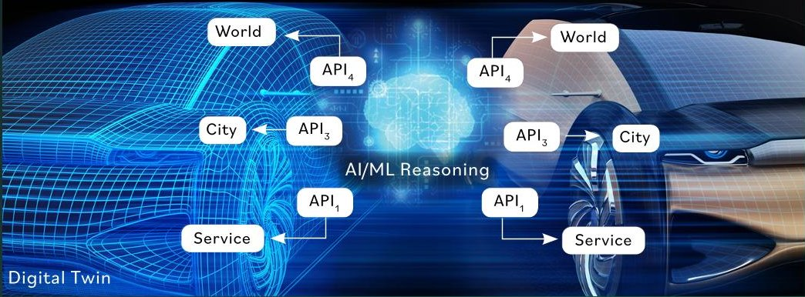

MODEL-BASED SYSTEMS ENGINEERING

The systems engineering team creates a baseline SoS descriptive model using minor adjustments to a scalable reference architecture. The trimmed SysML models are instantiated using model-based product line engineering (MbPLE) and all associated design and functional model elements are linked.

The offshore ModSim team uses the linked MBSE use cases and critical characteristics to define the appropriate levels of simulation model element fidelity and completeness.

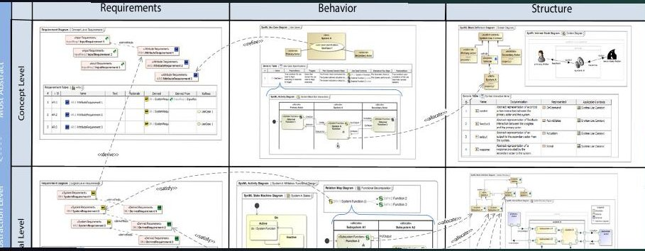

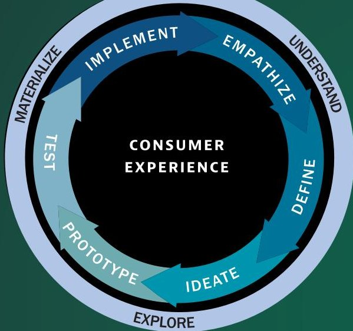

The photo-realism team generates a virtual environment capable of generating emergent SoS behaviors. This is used with synthetic data sets to train AI/ML algorithms and identify critical operational modes.

## SYSTEMS OF SYSTEMS

Priya knows that architectural reuse provides resilient system designs with built in safety and security concepts. This project will extend the traditional AVF-taxi and delivery service operational domain. This will require special focus on providing a validated trusted system. Virtual model-based systems analysis and exploration will be fundamental to the validation of these new operational scenarios. Synthetic scenario-scene simulations derived from scenario parameter fuzzification and virtual agentsbased dynamic exploration will deliver safety coverage key process indicators (KPIs) and the safety case.

Priya tasks the SoS team to extend the existing Autonomous Vehicle Transportation Operation System (AVTOS) reference patterns for AVFs creating a comprehensively broad but not deep SoS network model. The network model is used to identify critical path component system first responders, city infrastructure, emergency satellite communication, traffic congestion systems) that support the ER project. Mission critical threads are identified to focus development of critical to success KPIs.

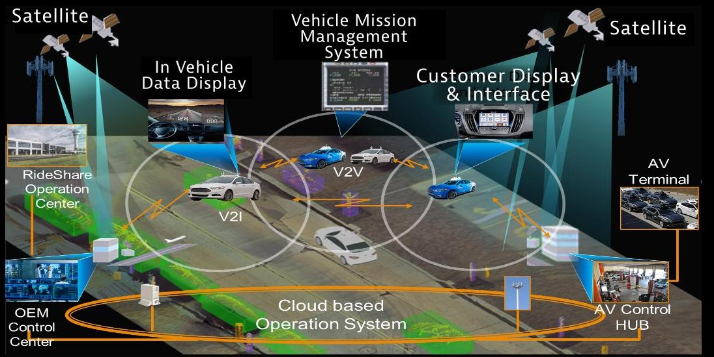

<!-- PDF_PAGE: 61 -->

## ENVIRONMENTAL CONDITIONS, TOPOGRAPHIES, SCENE GENERATION, AND MAPS

INCREASING FIDELITY AND COMPLETENESS SUPPORTING EXTENDED REALITY

## DETAILED SCENE, SCENARIO, PARTICIPANT AND LAST MILE ROBOT MODELS

QUANTUM COMPUTING AND MASSIVE PARALLEL COMPUTE

The team leverages quantum computing and the phenomenon of superposition, entanglement, and interference to solve major systems engineering concerns in Al, classifier training, security encryption of the ER systems, code, and the movement of critical ER communications. The secure massive parallel compute infrastructure provides real-time AVF path trajectories supporting complex mission movement.

## INTERACTIVE HMI VIRTUALIZATION

Priya goes big on human systems integration (HSI), human centered design (HCD) and design thinking. Emergency response AVFs will only be successful if the "populace under-stress" can trust, relate-to, and easily transactwith, the emergency vehicle systems. Detailed HSI/HCD user experience models are created and tested with VR-based simulations. These simulations are extended to the emergency responders, fleet coordinators and city management staff to ensure seamless SSF operational effectiveness.

Priya had studied the theoretical foundations during her masters program and infuses her project with aspects of the "Value Selection Phenomenon" that provides a framework for systematic-project elements, value selection across the multi-layered SoS project solution. This supports identification and setting of ER performance KPIs.

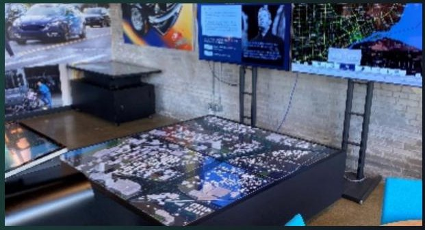

Priya interacts with the key stakeholders with a series of simulations providing visceral insights to the project scope approach, and end goal vision. These models are successively "build-out" in content, complexity, and simulation reality. The modeling approach is minimum viable simulation-based, only enough modeling and simulation are incorporated to provide insights, decision making support, and policy making support. The virtual capabilities demonstrate clearly the systems impact of early policy decisions in delivering a fully capable AVF-based ER system.

<!-- PDF_PAGE: 62 -->

<!-- PDF_PAGE: 63 -->

The future of systems engineering is model-based enabled by enterprise digital transformation.

Systems engineering practices will make significant advancements to deal with systems complexity and enable enterprise agility.

Systems engineering will leverage practices from other disciplines such as data science to help manage the growth in data.

Formal systems engineering theoretical foundations will be codified leading to new research and development in the next generation of systems engineering methods and tools.

## SUMMARY

AI will both impact the systems engineering practice and the types of systems designed by the systems engineering community.

There will be a step change in systems engineering education starting with early education with a heavy focus on lifelong learning.

<!-- PDF_PAGE: 64 -->

<!-- PDF_PAGE: 65 -->

## 4 REALIZING THE VISION OF SYSTEMS ENGINEERING

Realizing this vision will require developing and executing a strategy supported by a diverse stakeholder community. This chapter outlines the beginnings of this strategy as a set of recommendations and roadmaps to transition from the current state of systems engineering to the future state.

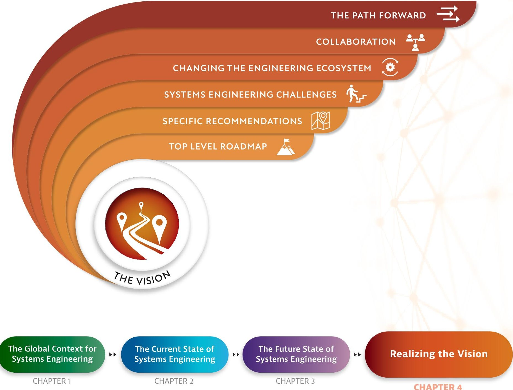

<!-- PDF_PAGE: 66 -->

The strategy and planning needs to take into account not only the global context, and the current and future states that have been discussed in Chapters 1-3, but also the PESTEL factors; that is the Political, Economic, Social, Technical, Environmental, and Legal. All of these factors need to evaluate the required changes in a holistic and comprehensive manner that address both the enablers and the potential impediments to this

transition. The activities in the figure below are derived from the content of the previous chapters and reflect key enablers for progress.

To be successful, the path forward must address the set of systems engineering challenges while inspiring collaboration and managing the culture change required to shift mindsets and approaches from the current state to the future state.

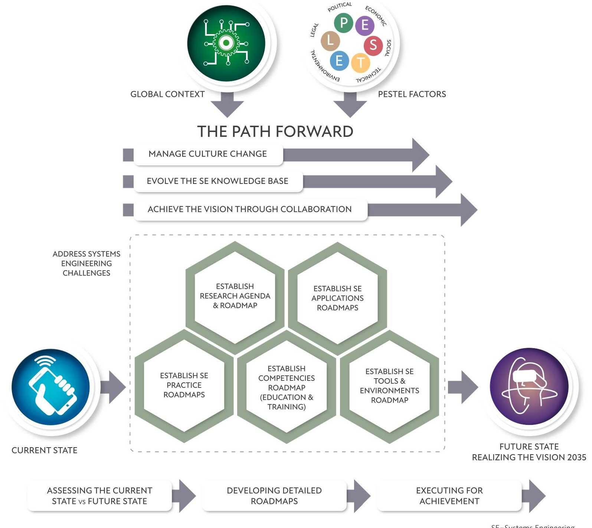

Our situation is not comparable to anything in the past. It is impossible, therefore, to apply methods and measures which at an earlier age might have been sufficient. We must revolutionize our thinking, revolutionize our actions...

- Albert Einstein (1948) in "A Message to Intellectuals"

<!-- PDF_PAGE: 67 -->

## Collaboration and Desired Objectives

Realization of the Vision will be enabled by collaboration that includes industry, government, academia, and non-profits. This engagement will be structured as a collaboration between stakeholders from both traditional and non-traditional systems engineering application domains, providing the opportunity to synergize investment and other resources across domains, capturing common needs while also retaining the unique needs of each domain. The stakeholders also need to include those from developing regions that could benefit from systems approaches for both technical and societal needs. The collaboration will incrementally evolve the vision through the involvement and inclusion of a broad range of systems engineering stakeholders. This will include professional societies, industry associations, standards development organizations,

science foundations, and engineering academies, as well as researchers, educators, and tool providers.

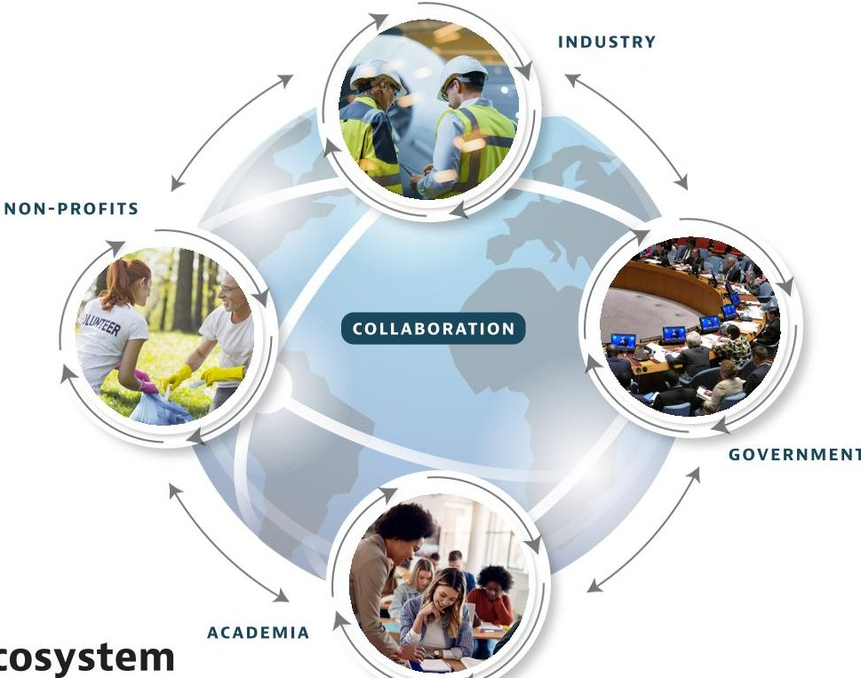

## Changing the Engineering Ecosystem

Facilitating Change to All Elements Needed for Innovation

Changes to systems engineering practice are necessary to address the changing nature of the systems we engineer and their interactions with their environments, including other systems. This requires change to the processes, methods, and enabling environments that are applied to the

project management of the life cycle of the system. These changes need to be adopted by the enterprise in its evolution of its standard processes and innovation approaches. Finally, these changes must be captured, learned, and consistently applied by the enterprise.

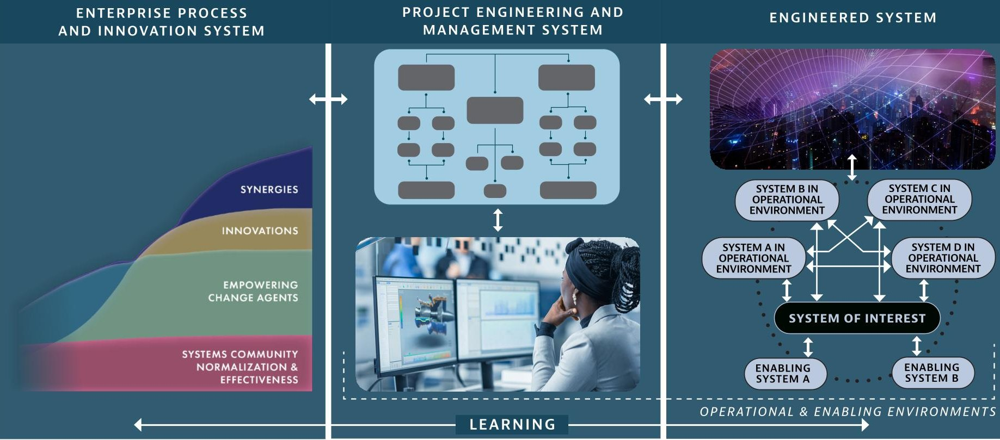

<!-- PDF_PAGE: 68 -->

## Systems Engineering Challenges

The Systems Engineering Challenges reflect accomplishments that are necessary for systems engineering to evolve and be prepared for the future, to realize this vision. The challenges are focused on addressing the challenges of the current state of systems engineering as outlined in Chapter 2, and achieving the desired future state for systems engineering as outlined in Chapter 3.

Achieving the Systems Engineering Challenges also provides the systems engineering capabilities to address global trends and societal challenges that were discussed in Chapter 1. The information and roadmaps in the following sections are intended to provide initial objectives on how to achieve the Systems Engineering Challenges.

## CATEGORY

## SYSTEMS ENGINEERING CHALLENGES

## Applications

1. Systems engineering contributes innovative solutions to major societal challenges.

2. Systems engineering demonstrates value for projects and enterprises of all scales, and applies across an increasing number of domains.

3. Systems engineering anticipates and effectively responds to an increasingly dynamic and uncertain environment.

## Practices

4. Model-based systems engineering, integrated with simulation, multi-disciplinary analysis, and immersive visualization environments is standard practice.

5. Systems engineering provides the analytic framework to define, realize, and sustain increasingly complex systems.

6. Systems engineering has widely adopted reuse practices such as product-line engineering, patterns, and composable design practices.

## Tools and Environment

7. Systems engineering tools and environments enable seamless, trusted collaboration and interactions as part of the digital ecosystem.

## Research

8. Systems engineering practices are based on accepted theoretical foundations and taught as part of the systems engineering curriculum.

## Competencies

9. Systems engineering education is part of the standard engineering curriculum, and is supported by a continuous learning environment.

<!-- PDF_PAGE: 69 -->

## Specific Recommendations (to Systems Engineering Community) Roadmaps for Progress

The changes needed that are listed here are derived from the FROM and TO conditions that are described in Chapter 3 within the context of Chapters 1 and 2.

## Systems Engineering Contributions to Solving Societal Challenges

- Foundational Systems Engineering competencies are integrated into college and pre-college curricula.

- Digital engineering methods and tools enable integrated analysis of both technical and non-technical elements.

· Systems engineering application is promoted for a broad set of domains and non-technical/socio-technical needs.

· Systems engineering serves as an integrator for many engineering and global challenges (such as, sustainability).

· Systems engineering is included on agendas for industry and government leadership.

## Demonstrate the Value of Systems Engineering

## CHANGES NEEDED

- Systems Engineering Core Competencies are part of individual, team, and enterprise learning.

- Digital Engineering transformation integrates systems engineering practices and systems thinking across all disciplines.

- Systems engineering is effective across domains, life cycle models, delivery approaches, and solution portfolios.

- Strong systems engineering Communities of Practice form within application domains.

- Systems engineering demonstrates utility for solutions of any complexity [and integrates both horizontally and vertically].

## Addressing Dynamic Change and Uncertainty

## CHANGES NEEDED

- Data standards are developed and adopted enabling effective data interconnection and exchange.

- Methods and tools for dealing with product variation and variability are widely adopted.

- Knowledge Management and incremental learning are integrated with systems engineering practices.

- Systems engineering incorporates dynamic feedback into solutions across the life cycle (such as Agile practices).

- Increasing technology assistance for human tasking is incorporated including automated workflows.

## MBSE- Digital Transformation

## CHANGES NEEDED

- Use and management of models, architecture, and digital thread mature, including digital twins.

· Immersive visualization with modeling and simulation is incorporated.

- Trusted digital environments with broad span are established.

- Trusted data is managed as an essential asset.

- Effective semantic integration of digital assets is applied, including knowledge representation.

- MBSE is supported by AI/ML to aid development of solutions.

<!-- PDF_PAGE: 70 -->

## Analytic Framework for Enhanced System Understanding

## CHANGES NEEDED

- Advanced data science, AI/ ML, augmentation, and visualization are integrated to support analyses for improved understanding of system behavior.

- Standards and regulations are integrated in the framework.

- Capability to analyze a broader set of elements across the life cycle (such as, sustainability and social acceptability) is developed.

- Effective synthesis capabilities are matured, including for systems of systems.

- Knowledge is increased of natural systems and how they embody and deal with complexity.

## Systems Engineering Adoption of Reuse Practices

## CHANGES NEEDED

- Commonality of practice across a range of systems engineering use cases is understood and applied.

- Patterns and unified models that account for variations are established.

- Effective reuse practices evolve and become widely applied across domains (Product Line Engineering and Composable Design).

## Systems Engineering Tools for Digital Environment

## CHANGES NEEDED

- Focus shifts to data/ information rather than tools.

- Consistent artifacts for communication are established.

- Modeling language and data interchange standards are developed and used that facilitate information sharing.

- Effective distributed information sharing/interchange is common.

- Speed and capacity for analyzing alternatives and impacts increases (orders of magnitude).

## Foundations and Research

## CHANGES NEEDED

- New principles, phenomena, concepts, heuristics, and technologies are integrated with existing knowledge.

- Research to define and validate the systems engineering Theoretical Foundations is launched.

- Research on systems engineering practices, tools, and applications that address dynamic change and uncertainty is facilitated.

- Industry, government, and associations team with academia to further systems engineering research and incorporate systems engineering foundations into the curriculum.

- Systems engineering research encourages cross-disciplinary engagement to move towards integrated approaches.

## Advancement of Education

CHANGES NEEDED

- Enhance workforce via lifelong education/training.

- Engineering continuing education and pre-college education integrates select systems engineering concepts and systems thinking into their curricula.

- Systems Engineering community and accreditation bodies team to add systems engineering and system concepts into all engineering accreditation criteria.

- Non-technical requirements are added to the curricula, such as human dynamics and sustainability.

- Challenge-based, hands-on education, and training of integrated methods and approaches evolves.

<!-- PDF_PAGE: 71 -->

## Top-Level Roadmap

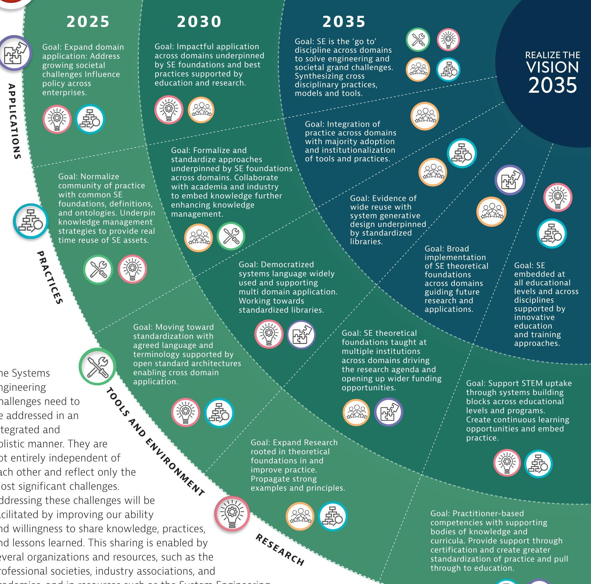

Body of Knowledge (SEBoK) and INCOSE product portfolio.

These are updated regularly with new practices, artifacts, and emerging

technical information. Initiatives focused on progressing the necessary achievement

COMPETENCIES

includes over a dozen organizations; and various systems engineering research organizations.

The figure here is a top-level roadmap that reflects the set of Systems Engineering Challenges.

The subsequent section includes more detailed recommendations with respect to each challenge.

<!-- PDF_PAGE: 72 -->

## SUMMARY OF SYSTEMS ENGINEERING BY 2035

ADAPTS TO CHANGES IN ITS GLOBAL CONTEXT

## SYSTEMS SOLUTIONS

## DIGITAL ENTERPRISE

- Knowledge as an asset

DELIVERS

(including cyber-physical, service-oriented, socio-technical,...)

- Agile and efficient

- Innovative

- Distributed and diverse workforce

Global competition

Technology

Regulatory environment

Cyber threats

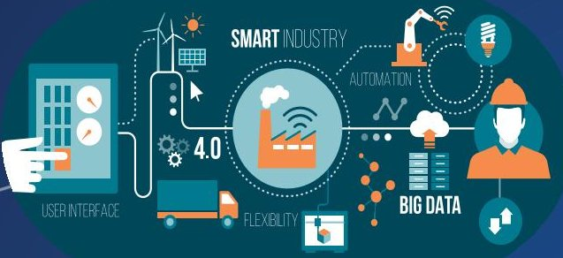

INCREASING SYSTEMS COMPLEXITY

Supply chain

- Interconnectedness

- Data

- Software

- Human interaction

- Competing stakeholder expectations

## SYSTEMS ENGINEERING

SUPPORTS

aims to ensure the pieces work together to achieve the objectives of the whole.

## PRACTICES

- Agile

- Model-based

- Analytic framework

- Architecting for trust, resilience, and other key stakeholder concerns

- Leveraged reuse

- Human-centered design

## TOOLS AND ENVIRONMENT

- Part of digital ecosystem

- Seamless interactions and trusted collaboration

- Automated workflow

- Managed digital thread

- Enterprise reuse repository

- Al assist

## EDUCATION AND TRAINING

- Life-long learning

- Technical and leadership competencies

- Standardized curriculum adapted to application domains

- Theoretical foundations and systems engineering principles part of standard curriculum

- Systems thinking taught broadly across engineering disciplines

<!-- PDF_PAGE: 73 -->

Strong demand from across industry and governments for systems engineering to provide balanced system solutions to complex problems

Systems engineering is a highly valued discipline Readily available education programs

- Well-established career paths

- Opportunity to innovate, lead, and work across disciplines and technical domain

## BROAD APPLICATIONS

- Collaborations between industries, academia, and governments continues to advance systems engineering

- Power and energy systems

- Healthcare systems

- Transportation systems

- Defense systems

- Education systems

- Exploration systems

- Agricultural systems

- Telecommunication systems

- Manufacturing systems

- Information systems

RESULTS IN

... and many others

## ENVIRONMENTAL IMPACT

- Natural resources

- Biodiversity

- Climate change

- Pollution

IMPACTS ON ENVIRONMENT AND SOCIETY

RESULTS IN

DRIVER OF

GROWING STAKEHOLDER EXPECTATIONS

- Dependability

- Capability

- Ease of use

- Scalability and adaptability

- Sustainability

- Social acceptability

- Affordability

## SOCIETAL CHANGE

- Global interdependence

- Population

- Lifespan

- Socio-economic condition

<!-- PDF_PAGE: 74 -->

## TERMS OF USE

This Systems Engineering Vision 2035 is offered as a COMMUNITY SERVICE from the International Council on Systems Engineering (INCOSE). INCOSE's intention is to stimulate the world's systems community to think creatively about future developments in the systems and related engineering fields.

We encourage the document's widest use, including reproductions translations, adaptations/derivatives with only three restrictions:

1. Permission for use of images, unless indicated as in the Public Domain, must be acquired for derivative works. Please contact INCOSE for Image contact information.

2. Please mark your material derived from Systems Engineering Vision 2035 Copyright $ \textcircled{c} $ 2021 by INCOSE.

3. Commercial uses of this document require INCOSE's prior approval.

In view of the minimal restrictions for any use of this Vision, please send an electronic information copy of any document created with and from this Vision to our INCOSE Administration Office vision@incose.net

## LIST OF PHOTOGRAPHY/ ILLUSTRATIONS

Front Cover: Cover Image ©Alican Akcol /Shutterstock. Page 0: Space Satellite ©Dima Zel /Shutterstock, Solar Energy ©Animaflora PicsStock / Shutterstock, Transportation ©Denis Belitsky /Shutterstock, Healthcare ©Ash Tproductions /Shutterstock, Telecommunications ©Gyn9037 /Shutterstock. Page ii: Puzzle Piece ©Emerge /Shutterstock. Page iv: Globe ©Nikhom / Shutterstock, Retro Phone ©BrAt82 /Shutterstock, Future Phone ©HQuality / Shutterstock, Earth Resources ©Macrovector /Shutterstock, Animals ©Andrew Krasovitckii /Shutterstock. Page v: Smart Industry ©elenabsl /Shutterstock, Group Thinking ©Ellagrin /Shutterstock. Page vi: Complexity Graph ©Taylor Riethle. Business Technology ©Blue Planet Studio /Shutterstock. Page vii: Puzzle Icon ©Fresh Take Design /Shutterstock, Search Icon ©Davooda / Shutterstock, Tool Icon ©Davooda /Shutterstock, Lightbulb Icon ©Alexander Lysenko /Shutterstock, Group Stars Icon ©Coosh448 /Shutterstock. Page 2: Sustainable Goals ©United Nations. Sustainable Goals 1-17 ©United Nations. Page 3: Complexity Growth-Courtesy NASA/Jpl-Caltech. Page 4: Solar Power Fit Z studio /Shutterstock. Page 5: Networks ©sdecoret /Shutterstock, Communication Team ©idea Ink Design /Shutterstock, Telepresence ©sdecoret / Shutterstock. Page 6: Telemedicine ©Elnur /Shutterstock, Digital Twin ©Chesky /Shutterstock. Page 9: Smart City ©Macrovector /Shutterstock. Page 10: Ai Allies Interactive /Shutterstock, Geo-Location ©Illus_man /Shutterstock. Page 12: Workforce ©metamorworks /Shutterstock, Women Engineer ©metamorworks /Shutterstock, World-Economic-Forum ©Word Economic Forum. Page 13: Complexity Growth-Courtesy NASA/Jpl-Caltech, Smart Systems Alexander Kirch /Shutterstock, Sustainable Goals Logo ©United Nations, Global Communication ©TechSolution /Shutterstock, Quantum Physics Jurik Peter /Shutterstock, Ai Allies Interactive /Shutterstock, Solar Power Esb Professional /Shutterstock, Geospacial Illus_man / Shutterstock, DNA/Microscope paulista /Shutterstock, Microchip Vector Insanity /Shutterstock, Graph Maxger /Shutterstock. Page 17: Main Icon Pendi_design /Shutterstock. Page 18: Robot Roman Korotkov /Shutterstock. Page 19: Meeting Flamingo Images /Shutterstock. Page 20: Blue INCOSE Handbook INCOSE, Green INCOSE Handbook INCOSE, NASA Handbook -Courtesy NASA. Data Room Oleksiy Mark /Shutterstock. Page 22: Xray Human Magic mine /Shutterstock, Periodic Table Peter Hermes Furian / Shutterstock, Ui Systems Aleksandr_a /Shutterstock, NextGen Images on Computer Screen- Courtesy of the Federal Aviation Administration. Page 24: Simulations Macrovector /Shutterstock, Spreadsheets Ben Davis /

Shutterstock, Requirements ©Beboy /Shutterstock, Supply Chain ©Rvector / Shutterstock, Plane ©Tele52 /Shutterstock, Reports ©Mayrum /Shutterstock, lot ©Golden Sikorka /Shutterstock, Software ©Zinetron /Shutterstock, PLM ©Mvp_stock /Shutterstock, Test Cases ©Aiwd /Shutterstock, Costs Vector Dude /Shutterstock, Manufacturing ©Golden Sikorka /Shutterstock, 3D Geometry ©Rvector /Shutterstock. Page 25: On-Board Diagnostics Fernandov /Shutterstock, 1m LOC ©Santi Lumubol /Shutterstock, Chevy Paceman /Shutterstock. Page 30: Simulation ©Jiw Ingka /Shutterstock, Ai Brain ©Goodstudio /Shutterstock, Cube Regular /Shutterstock, Tablet Vectorpot /Shutterstock, Math Macrovector /Shutterstock, Student Elenabsl /Shutterstock, Graph Curiosity /Shutterstock. Page 31: Simulation Golden Sikorka /Shutterstock, Computer smashingstocks /Shutterstock, Design Rvector /Shutterstock, Graph Macrovector /Shutterstock, Analytic Framework Alexdndz /Shutterstock, Robot/Human Shake Dilen /Shutterstock, Model Computer Vectorsmarket /Shutterstock, Toolbox aurielaki /Shutterstock, Experimental Data Rvector /Shutterstock, Computer Cloud Vectorsmarket /Shutterstock, Ai Robot Tartila /Shutterstock, HPC Resources Hilch /Shutterstock, Data Observe Macrovector /Shutterstock, Data Observe Woman Macrovector /Shutterstock. Page 33: Notebook, Req List, Results, Test Cases Vectorpocket /Shutterstock, Documents Smashingstocks /Shutterstock, Simulation Computer Stonepictures / Shutterstock, Decision Andrii Symonenko /Shutterstock, Gear Aiwd / Shutterstock, Blue Print Rvector /Shutterstock, Clipboard Alexandr Iii / Shutterstock, Simulation Environment Macrovector /Shutterstock. Page 34: Connected Data Jackie Niam /Shutterstock, Systems of Systems - Courtsey of NASA. AI/ML Brain bestfoto77 /Shutterstock, Interactive HMI Zyabich /Shutterstock, Digital Car JLStock /Shutterstock, Detailed Cityscape thinkhubstudio /Shutterstock. Page 35: Augmented Reality car Zapp2photo /Shutterstock, Augmented Reality Student Gorodenkoff / Shutterstock, Augmented Engine Gorodenkoff /Shutterstock, Planet graph-Courtesy of NASA. Massive Parallel Compute Fit Z studio /Shutterstock, Weather Hurricane Andrey Vp /Shutterstock, Plane Radar Mr. Teerapon Tiuekhom /Shutterstock. Page 36: Smart City Faber14 /Shutterstock. Page 37: Handshake Lidiia /Shutterstock, Lock Illus_man /Shutterstock, Pixels Yuri Hoyda /Shutterstock. Page 38: Graphs INCOSE. Page 39: Complex Systems Bloomicon /Shutterstock. Page 40: Doctors Aleksandr Lupin /Shutterstock. Page 43: Center Earth Tsunami Polar Bear Macrovector /Shutterstock, Flood Macrovector /Shutterstock, Fire Macrovector /Shutterstock, Forest Martina Dedic /Shutterstock. Page 44: Human Connection Vector Stall /Shutterstock, Car Kosmofish /Shutterstock. Page 45: Engineer Team Gorodenkoff / Shutterstock, Girl Learning Metamorworks /Shutterstock. Page 47: Priya Rumani Monkey Business Images Shutterstock, India Cityscape Towering Goals Shutterstock, Female Scientist Plataa /Shutterstock. Page 50: AI/ MI Brain bestfoto77 /Shutterstock, SMS Framework INCOSE. Systems of Systems Ford Motor Company. Page 51: Traffic Zephyr_p /Shutterstock, Topology Quardia /Shutterstock, Car Scan JLStock /Shutterstock, Apartment Building vizual3d /Shutterstock, Delivery Van Chesky /Shutterstock, 3d Model Table Ford Motor Company. Computer Hallway r.classen / Shutterstock, Interactive Car Interior Metamorworks /Shutterstock. Page 55: Top Level Icon Di Bronzino /Shutterstock. Page 57: Non Profits Dmytro Zinkevych /Shutterstock, Industry Gorodenkoff /Shutterstock, Government Golden Brown Shutterstock, Academia Drazen Zigic Shutterstock, Female Engineer Gorodenkoff /Shutterstock. Page 58: Puzzle Icon Fresh Take Design Shutterstock, Search Icon Davooda /Shutterstock, Tool Icon Davooda / Shutterstock, Lightbulb Alexander Lysenko /Shutterstock, Group/Stars Coosh448/Shutterstock. Page 62: Business Meeting INCOSE. Digital Cloud Blackboard Shutterstock. Page 63: Earth Fisheye Lens Pablo Scapinachis Shutterstock, Stakeholder Alexander Supertramp Shutterstock. Back Cover INCOSE Logo INCOSE. Vision 2035 Logo INCOSE.

<!-- PDF_PAGE: 75 -->

The INCOSE Board of Directors sponsored the Systems Engineering Vision Project Team to develop this Vision. The team included:

Christopher Davey Ford Motor Company

Sanford Friedenthal (Lead)

Sky Matthews IBM

NASA/Jet Propulsion Laboratory California Institute of Technology

Paul Nielsen

Carnegie Mellon University

Software Engineering

Institute

Christopher Oster

Lutron Electronics

Taylor Riethle

Graphic Designer

Garry Roedler INCOSE

Paul Schreinemakers How2SE

Emma Sparks Cranfield University

Heinz Stoewer (CTO)

Space Associates and

Delft University of Technology

This vision is an evolution of the Systems Engineering Vision 2020 that was published in 2007, and the Systems Engineering Vision 2025 that was published in 2014. A special thanks goes to the many support team members that contributed directly to the content of the vision that include Guy Boy, Paul Clements, Hans Peter de Koning, Rick Dove, David Endler, Robert Karban, Charles Krueger, Tom McDermott, Paul Pearce, Troy Peterson, Art Pyster, and William Schindel, to Lisa Hoverman who provided technical editing support, to the review support teams that facilitated the preliminary and final review, and to the many stakeholder reviewers of this vision who provided valuable insights and comments.

The vision authors considered expert inputs including those from the vision reviews, many publications, and the collective experience of the vision team to determine the content of this vision. Time will tell the accuracy of the projected changes to systems engineering and the global context that it responds to. If this Vision 2035 can inspire engineers, policy makers, and other professionals anywhere to deeply reflect upon their own future paths and strategies, then we will have succeeded in our objectives for this Vision.

STATEMENTS FROM REVIEWERS OF THIS VISION

"As a summary, I find the document valuable and inspiring for the engineering community." — Costas Stavrinidis, NAFEMS

"The document presents an exciting vision for a world transformed by the widespread application of modern systems engineering to be a better connected and more prosperous world." — Daniel Hastings, MIT

"SE Vision 2035 offers a cogent cosmopolitan set of competencies and capabilities to engage with the complex systems we live by."   

— Guru Madhavan, US National Academy of Engineering

"INCOSE's initiative to plan for the future of the SE community is commendable as an example of what a professional technical organization needs to do to anticipate engagement of challenges and opportunities." — Christopher Nemeth, IEEE Systems, Man, and Cybernetics Society Liaison to INCOSE

"An important reference to evolve systems engineering as a digitally enabled, value driven practice." Grant Veroba, Petronas

"Vision 2035 summarizes the major challenges of our society - and derives what it means for the technical systems of the future and their development."

— Frank Thielemann, Unity AG

## ACKNOWLEDGEMENTS

<!-- PDF_PAGE: 76 -->

"It is not the strongest of the species that survives, nor the most intelligent that survives. It is the one that is the most adaptable to change."

- Charles Darwin

"Failure is an option here. If things are not failing, you are not innovating enough."

- Elon Musk

"As for the future, your task is not to foresee it, but to enable it."

- Antoine de Saint Exupéry