<!-- PDF_PAGE: 1 -->

Article

# Enhancing Planetary Exploration through Digital Twins: A Tool for Virtual Prototyping and HUMS Design

Lucio Pinello $ ^{1,*} $ D, Lorenzo Brancato $ ^{1} $ D, Marco Giglio $ ^{1} $ , Francesco Cadini $ ^{1} $ and Giuseppe Francesco De Luca $ ^{2} $

$ ^{1} $ Department of Mechanical Engineering-Politecnico di Milano, Via La Masa 1, 20156 Milano, Italy; lorenzo.brancato@polimi.it (L.B.); marco.giglio@polimi.it (M.G.); francesco.cadini@polimi.it (F.C.)

2 Agenzia Spaziale Italiana, Coordinamento Programmi di Ricerca e Relazioni col MIUR-Dir. Scienza e Ricerca, 00133 Roma, Italy; giuseppefrancesco.deluca@asi.it

* Correspondence: lucio.pinello@polimi.it

Academic Editor: M. Reza Emami

Citation: Pinello, L.; Brancato, L.; Giglio, M.; Cadini, F.; De Luca, G.F. Enhancing Planetary Exploration through Digital Twins: A Tool for Virtual Prototyping and HUMS Design. Aerospace 2024, 11, 73. https://doi.org/10.3390/aerospace11010073

Received: 13 December 2023

Revised: 8 January 2024

Accepted: 10 January 2024

Published: 12 January 2024

Abstract: In recent times, the demand for resilient space rovers has surged, which has been driven by the amplified exploration of celestial bodies such as the Moon and Mars. Recognising the limitations of direct human intervention in such environments, these rovers have gained a great deal of importance. Our proposal introduces a digital twin for space exploration rovers that seamlessly integrates intricate geometric, kinematic, and dynamic models, along with sensor and control systems. It faithfully emulates genuine real-world scenarios, providing an authentic testing ground for rover prototypes and the development of damage detection algorithms. Its flexibility in replicating diverse terrains, environmental conditions, and operational scenarios significantly expedites rover development. The digital twin serves as a valuable tool in the perfecting of damage detection systems, allowing engineers to efficiently craft diagnostic algorithms. This innovative approach not only conserves valuable resources but also ensures the robustness of space mission systems, thus enhancing the overall success and safety of planetary exploration endeavours.

Copyright: 2024 by the authors. Licensee MDPI, Basel, Switzerland. This article is an open access article distributed under the terms and conditions of the Creative Commons Attribution (CC BY) license (https:// creativecommons.org/licenses/by/ 4.0/).

Keywords: digital twin; space exploration rovers; HUMS design; virtual testing

## 1. Introduction

The use of space exploration rovers, which are autonomous vehicles capable of cruising and performing research activities on celestial bodies, actively contributed to the recent return of surface exploration of planets and satellites, such as Mars and the Moon. The impossibility of direct human action and limited communication capabilities, for example with Mars [1], jeopardise mission completion, possibly losing relevant scientific data and even the rover. Therefore, anomalies and damages must be detected and addressed promptly, increasing mission availability and allowing the testing and implementation of corrective actions. To face this problem, NASA developed physical twins for the twin rovers Curiosity and Perseverance, which are MAGGIE [2] and OPTIMISM [3], respectively, for testing command lines that implement mitigation or corrective actions, and the ESA developed Rosalind Franklin with Amalia in a complementary fashion [4]. Additionally, NASA collaborated with Siemens to develop a digital twin of Curiosity to face the heat dissipation problems caused by the Multi-Mission Radioisotope Thermoelectric Generator (MMRTG) using SimCenter 3D [5].

In the framework of using digital twins to face anomalies of the real rovers, the project "DIGital twin di sistemi di Esplorazione lunare" (DIGES) of Politecnico di Milano and Agenzia Spaziale Italiana aims at developing a digital twin for a future space exploration rover with the final goal of developing a Health and Usage Monitoring System (HUMS). For instance, early-stage detection of internal short circuits is vital for safe mission completion, since internal short circuits degrade battery behaviour with the risk of thermal runaway, which can lead to battery explosion. A successful method implemented in the literature to detect internal short circuits in batteries is the Kalman filter [6-12], which is also used

<!-- PDF_PAGE: 2 -->

to estimate the state of charge (SOC) of batteries [13-18]. The estimation of the SOC is needed because this is not a directly measurable quantity, and its estimation can help during mission planning and supervision, allowing changes in the plan according to the SOC of the batteries.

Thus, this work aims to develop a digital twin of a lunar rover in the MATLAB $ ^{\textcircled{2}} $ Simulink $ ^{\textcircled{2}} $ environment. The digital twin should mimic a real rover's behaviour in both healthy and damaged conditions in a lunar environment even if it can be adapted to other planets or satellites. This is also possible thanks to model-updating algorithms, which allow one to obtain the estimation of the parameters of the real system given some measurements, allowing the digital replica to simulate the life cycle of the rover. By exploiting model updating algorithms, it is also possible to perform damage detection by monitoring the evolution of the parameters of the digital twin. The Simulink $ ^{\textcircled{2}} $ framework allows for multiphysics block-based modelling, in which it is possible to artificially inject damages to replicate the rover's behaviour in damaged conditions. This enhances the explainability of damage detection algorithms since they will be generated and tested on a multiphysics database. Modules have been implemented for the adaptability of the digital twin, ensuring the capability to respond to sudden, and possibly unforeseen, changes. Software interfaces with interconnected models have been included, such as the lunar ground profile (for navigation and guidance) and the energy-harvesting system (sunlight availability, ephemerides, and rover tilt on the lunar surface).

This study aims to demonstrate the effectiveness of using a digital twin to be used as a virtual prototype and to design and implement a HUMS for space exploration rovers by creating a database of signals in healthy and anomalous conditions, reducing the risk of mission failure and scientific data loss.

## 2. Digital Twin for HUMS Purposes

In this study, the digital twin is used from the point of view of the Health and Usage Monitoring System (HUMS) framework, as shown in Figure 1. A digital twin can be defined as a virtual representation of a system that spans its lifecycle, is updated from real-time data, and uses simulation, machine learning, and reasoning to help decision making [19]. The HUMS consists of algorithms that must analyse in real time signals coming from the real system to perform both diagnosis and prognosis, i.e., estimation of residual useful life (RUL), to support decision making using damage indicators selected ad hoc for the application. The digital twin can be based on analytical and numerical models, the latter built on experimental or real data. In addition, to increase the digital twin's computational efficiency and move towards real-time applications, parts of the digital twin can be surrogated, for instance, with black-box models. In this way, the developed digital twin can be used to mimic the real system behaviour in healthy conditions but, by implementing damage models in it, it is also possible to represent the anomalous operations of the real system. Eventually, a database can be obtained that collects signals from healthy and damaged simulations, and it can be used to develop machine learning algorithms that can be used for the HUMS application.

Within an HUMS framework, diagnostic algorithms play a pivotal role in the detection of anomalies. These algorithms must alarm when the system behaviour deviates from the expected normal behaviour, which is also known as the baseline. In general, algorithms should indicate whether the system needs to be serviced and estimate its urgency. In the case of a space exploration rover, a possible output of the algorithms can consider corrective actions to implement to maximise the mission duration and minimise the impact, and possibly the evolution, of the damage. Eventually, the comparison of the algorithms to implement can be based on the trade-off between the Probability of Detection (POD) and the False Alarm Rate (FAR), for instance, based on the cost of having a false alarm rather than a missed detection.

<!-- PDF_PAGE: 3 -->

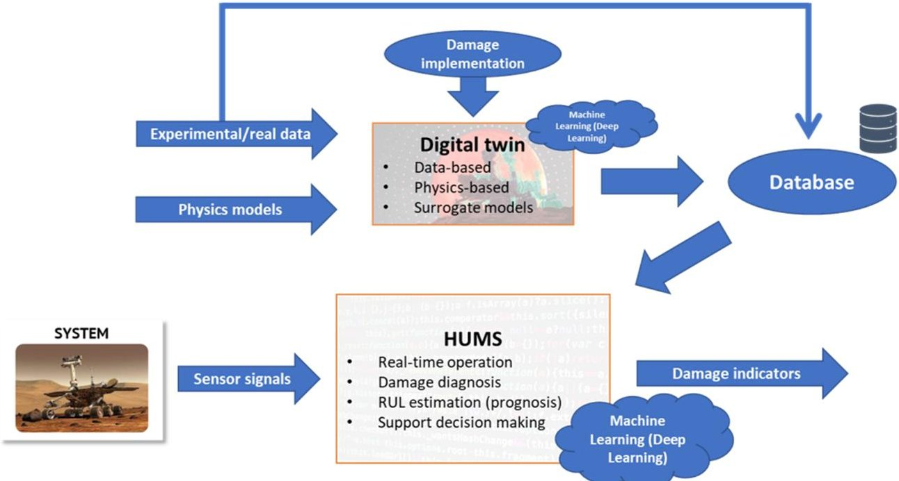

Figure 1. Health and Usage Monitoring System and digital twin coupled approach.

## 3. Space Exploration Rover Digital Twin

The modelling environment is MATLAB $ ^{\circledR} $ -Simulink $ ^{\circledR} $ since it allows for a continuous time multiphysics simulation with a good level of detail thanks to the Simscape $ ^{\circledR} $ toolbox. NASA rovers and the ESA rover Rosalind Franklin have been used as a reference thanks to the availability of information, since there is no real space exploration rover developed in the project. The digital twin developed is based on a Mathworks model of a Martian rover [20]. This model considered the structural components of the NASA Curiosity rover (e.g., chassis, suspensions, wheels and robotic arm), the driveline motors, and the control algorithm for both cruising and sampling, but it did not implement the robotic arm motors, the energy-harvesting and storage system, the heat rejection system, and the communication system. The original model has then been modified according to the lunar environment, and the MMRTG has been substituted with solar panels since they are less expansive than the MMRTG. Thus, the model has been updated with the parameters of the real driveline motors and gearboxes of Perseverance and ESA Rosalind Franklin, and then it has been adapted to the lunar environment by changing the terrain parameters and gravity. Then, the subsystems mentioned before have been added to mimic a real rover behaviour. The datasheets of the Perseverance and Rosalind Franklin components have been used for implementing a digital twin whose behaviour can represent a real rover:

- The Rosalind Franklin ESA Rover is equipped with six 30% Triple Junction GaAs Solar Cell-Type: TJ Solar Cell 3G30C—Advanced solar panels [21] produced by AzureSpace $ ^{\circ} $ , four of which are deployable while the remaining two are fixed [22].

- Saft $ ^{\textcircled{R}} $ developed for extreme working conditions the MP 176065 xtd [23] Li-ion rechargeable batteries used for Rosalind Franklin.

- Ten electric motors are present in both Perseverance and Rosalind Franklin [24] for the driveline, for which 4 motors are used for steering and 6 are used for driving. The driving motors are one for each of the six wheels, whereas the steering motors are placed at each front and rear wheel. The motors used are the Maxon $ ^{\circledR} $ DC M32 [25]. Additionally, Perseverance has six motors for the robotic arm: one motor for each of the 6 degrees of freedom of the arm.

- A pericyclic gearbox is placed downstream of each motor for precision positioning high output torque, lower speed, and lower inertia, and thus, low gyroscopic loads and low bearing loads [26], which have been developed by NASA for the Perseverance rover wheels and robotic arm.

In addition to the components required for the operation of the rover, some components are used to keep the rover within a specific temperature range due to the limited working tem-

<!-- PDF_PAGE: 4 -->

perature range of electronics, batteries, motors, and sensors. Therefore, these components must be kept in a tight temperature range during the mission. Spirit and Opportunity could work properly between $ -40 $ and $ +40 $ $ ^{\circ}C $ [27]. Rosalind Franklin batteries can withstand temperatures ranging from $ -40 $ to $ +85 $ $ ^{\circ}C $ [23]. This is a significant improvement in the battery working temperature range, since the MERs' batteries had to be kept between $ -20 $ and $ +30 $ $ ^{\circ}C $ [28]. However, the lunar ground temperature oscillates from $ -183 $ to $ +106 $ $ ^{\circ}C $ , while the Mars temperature goes from $ -99 $ to $ +83 $ $ ^{\circ}C $ . Thus, since rovers are subjected to very extreme environments, a temperature control system is always required to carry out the mission successfully. The heat rejection system is the subsystem of the rover devoted to this scope. It is composed of both active and passive components: the former are used to heat the rover components when their temperature decreases below a certain threshold, set to 278.15 K in the digital twin, to avoid damages caused by undercooling; the latter can be used either to heat up or cool down the rover components. The active components are the electric heaters, which are located near the motors and the batteries. In the digital twin, there are a total of 64 heaters for the motors, that is, 4 per motor [29], and 12 for the battery and the Warm Electronic Box (WEB), which is the part of the chassis in which the electronics are placed. Instead, passive components used to heat the rover are Radioisotope Heating Units (RHUs), which are located close to the batteries inside the WEB [30,31]. The RHUs exploit the decay of radioisotopes to generate heat, and this is a crucial component for solar-powered rovers, and the developed digital twins, since during the night they allow one to save battery power. Moving on to passive components used for cooling, there are (i) thermal switches, heat pipes, thermal straps, thermal interface materials, and phase change materials [32], which are used to dissipate heat, (ii) an external painting used to reduce radiation heat transfer, such as the white S13GP6NL0-1 painting used in Perseverance [33], and (iii) an insulation layer between the exterior wall of the chassis and WEB; for Curiosity, Perseverance and Rosalind Franklin, this layer consists of a $ \mathrm{CO_{2}} $ gas cap [31].

All the components mentioned have been modelled in Simulink $ ^{\textcircled{R}} $ using the blocks of the Simscape $ ^{\textcircled{R}} $ toolbox libraries:

- The DC motors are represented by the Motor and Drive (System Level) blocks [34].

- The Simple Gear blocks [35] model pericyclic gearboxes.

- The solar panels are modelled with the Solar Cell blocks [36].

- The Behavioral Battery Model blocks [37] represent the batteries.

- The RHUs are represented by constant Heat Flow Rate Source blocks [38] producing 1.1 W each.

- Electric heaters are represented by Heat Flow Rate Source blocks [38], which generate either 0 W or 43 W depending on whether the component temperature is, respectively, above or below 278.15 K.

- The effect of painting is modelled by adjusting the parameters of the Radiative Heat Transfer blocks [39].

- The Conductive Heat Transfer blocks [40] simulate the $ \mathrm{C O_{2}} $ insulation layer.

- The passive components required for cooling are modelled according to the thermal conductance curve of the PGS thermal straps, which is plotted against the temperature of the cooled component, presented in [32]. Thus, they are modelled as Heat Flow Rate Source blocks [38] generating negative thermal power to cool the components depending on their temperature.

The parameters of the blocks have been set on the basis of the datasheets of the components. The lunar rover digital twin was modelled with all the components mentioned above, which are interconnected to consider the influences of a subsystem on the others. Noises are added numerically in Simulink $ ^{\circledR} $ to take into account uncertainties and noise related to the real components, for example, those related to measurements. To conclude, the Mechanics Explorer [41] is a Simscape Multibody tool that allows the visualisation of the behaviour of the multibody models during the simulation.

<!-- PDF_PAGE: 5 -->

## 3.1. Digital Twin Architecture

The description of the architecture of the developed digital twin takes place in this section. The DT is built by representing the real components with the Simscape $ ^{\circledR} $ libraries, as described in Section 3. The scheme shown in Figure 2 is divided into four subsystems: (i) Mission Target, (ii) Mission Target Control, (iii) Rover and Environment, and (iv) Sensors. The Mission Target subsystem is one of the model's inputs, since it allows one to select the rover's path and mission type (either cruising or cruising and sampling). Then, the Mission Target Control subsystem computes the trajectory of the rover and, when the sampling location is reached, it also evaluates the trajectory of the robotic arm to reach the sample. The communication system is included in the Mission Target Control subsystem, sending messages when the key steps of the mission are completed. The Rover and Environment subsystem contains the model of the rover and the lunar environment (terrain geometry and gravity). Eventually, the Sensors subsystem allows plotting measured quantities such as the motors' torque, the rover's speed, the robotic arm's motion, etc.

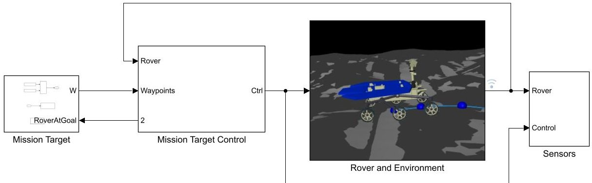

Figure 2. Scheme of the developed digital twin.

Focussing on the Rover and Environment subsystem, it is the subsystem in which the lunar environment and the rover are built. More specifically, all the rover components are implemented, the geometry of the terrain is reconstructed, the parameters of the environment (day or night) are set, and the sample is created for the sampling task. The terrain geometry is given as an .stl file in the Terrain block, while the sample block allows the definition of the sample shape and dimension, that is, a sphere of 0.02 m radius. In this subsystem, each CAD component of the rover is assembled to build the real rover architecture. This subsystem includes, under the name of Rover Functional Subsystems subsystem, the power generation and storage subsystem (e.g., solar arrays and batteries), the motors of the driveline and the robotic arm, and the thermal management system, together with the thermal modelling of the rover.

## 3.2. Rover Functional Subsystems

The Rover Functional Subsystems is the subsystem devoted to the motion of the rover, the generation of the power required by the motors, and the calculation of the motor and battery temperature. It consists of six subsystems: Power, Steering Motors, Driving Motors, Robotic Arm, Power Control Logic, and Thermal Management System. The first subsystem, Power, contains the solar panels and the rover batteries, allowing energy generation and storage. Steering Motors, Driving Motors, and Robotic Arm are the subsystems that collect the motors of the steering, driving, and robotic arm motors. The Thermal Management System computes the temperature of motors and batteries and, if necessary, turns on the electrical heaters to keep the components warm. Eventually, the Power Control Logic is the control logic unit that manages the usage and charge of the batteries depending on the difference in power produced and required. The Thermal Management System has been surrogated to allow real-time operations of the digital twin, and it consists of a neural network which computes the estimated final temperatures of the rover components given

<!-- PDF_PAGE: 6 -->

(i) the temperatures of the rover's components at the beginning of the mission, (ii) the temperature of the lunar ground, and (iii) the solar irradiance. The Power subsystem is the subsystem that contains solar panels, batteries, and switches that manage the connection of solar panels and batteries to electrical circuits, depending on the Power Control Logic subsystem. Solar panels and batteries are connected in parallel to each other. The current generated/absorbed by the batteries, depending on whether they are charging or giving power, is measured together with their voltage to compute the power produced/absorbed. To evaluate the power generated by the solar panels, this subsystem receives as input the inclination of the rover. The outputs are the current, voltage and power generated by the solar panels, as well as the current, voltage, temperature, and state of charge (SOC) of the batteries. The state of charge is estimated with the extended Kalman filter, which also allows for the estimation of the short-circuit resistance of the batteries. An overview of the Steering Motors, Driving Motors, Robotic Arm, Solar Panels, and Batteries subsystems is given in the following three subsections. It should be noted that since the modelling and functioning of the motors used for driving, steering, and sampling are the same, the description of the last three subsystems is done only for one of them: that is the Robotic Arm.

## 3.2.1. Robotic Arm Subsystem

The Robotic Arm subsystem is described in this section. Since the functioning and the modelling of the motors are the same as the Steering Motors and Driving Motors subsystems, this description is valid for these subsystems as well. The only difference is related to the number of motors, as mentioned in Section 3:

- There are four steering motors, two for the two front wheels and two for the two rear wheels.

- Six motors are used to drive, one for each wheel.

- Six motors are used for the motion of the robotic arm.

The Robotic Arm subsystem contains six DC motors and their gearboxes to allow sampling operations. The motor block is the Motor and Drive (System Level) block. It receives as input the torque evaluated in the Mission Target Control subsystem divided by the transmission ratio of the gearboxes and computes the current and the voltage required by the motor to generate the desired torque. Then, the torque generated by the motor is the input of the Simple Gear block, which models a gearbox. Eventually, the output torques actuate the modelled joints of the robotic arm. The signals of the current absorbed by the motors, the angular velocity of the motors, and the torques generated by them, before entering the gearboxes, are sensed and stored.

The gearbox model accounts for an ideal efficiency of 100% due to the lack of data for these applications. However, in future work, a lower efficiency can be included in the model as soon as data are available. Lower gearbox efficiency should not cause problems for digital twin operations, as shown in Section 4.1, as only an increase in current absorbed by the motors is expected.

## 3.2.2. Solar Panels Subsystem

The Solar Panels subsystem is the subsystem that contains the solar panels and computes the irradiance given the orientation of the rover. It consists of the subsystem that evaluates irradiance and six parallel connected solar panels, namely Central 1 and Central 2, which form the two fixed central panels, and Dep1, Dep2, Dep3, and Dep4, which form the four deployable panels. Additionally, the voltage and current of each solar panel are measured. The solar panels are modelled with the Solar Cell block. This subsystem receives as input the instantaneous inclination of the rover. The measured current and voltage for each solar panel are the output of this subsystem. The evaluation of the irradiance is based on the instantaneous inclination of the rover, by projecting the vertical irradiance perpendicular to the solar panels, and on knowledge of the ephemerides. To do so, an input interface is added to the digital twin to include the evaluation of the ephemerides. Therefore, the user must specify the year, month, and day of the simulated mission. In this

<!-- PDF_PAGE: 7 -->

way, it is possible to evaluate the Sun-Moon distance based on the date of the simulation thanks to the Planetary Ephemeris block [42], which requires the date in Julian format, which is obtained with the Julian Date Conversion block [43]. Then, using Equation (1) [44], one can calculate the Total Solar Irradiance (TSI) by knowing the distance before (R) in m, under the assumption of considering the solar luminosity $ ( L_{s}ol=3.841026W $ [45] ), also known as the total radiant power, propagating homogeneously as a sphere.

$$
T S I = \frac {L _ {s o l}}{4 \pi R ^ {2}} \quad \left[ \frac {W}{m ^ {2}} \right]
$$

After evaluating the TSI, an analytical model [46] is used to evaluate the direct solar irradiance for a flat surface of specified orientation (tilt and azimuth) as a function of time:

$$
E _ {d i r} (t) = T S I \cos (\delta (t)) \quad \left[ \frac {\mathrm {W}}{\mathrm {m} ^ {2}} \right]
$$

where $ \delta $ is the angle of incidence as a function of the time t passed since the local dawn. The angle $ \delta $ is a function of the azimuth and elevation of the Sun to the Moon and the location of the rover in terms of the selenographic longitude and latitude. The model to evaluate the term $ \cos(\delta(t)) $ in Equation (2) is not reported in this document to avoid repetitions; however, it is described in [46]. Figure 3 shows the elevation and azimuth angles a and b of the Sun with respect to the selenographic latitude c and longitude d of the rover. For this reason, at the beginning of the simulation, the user must specify also the rover's selenographic longitude and latitude and the number of days passed since the local lunar dawn to allow the estimation of the actual incidence angle of the sunlight on the rover. After this estimation, which is the solar irradiance incident on a plane tangent in the location of the rover to the lunar surface considered as a sphere, it must be considered that the rover has a tilt to this plane, because the lunar terrain is uneven. Therefore, the inclination of the rover is taken into account by projecting the estimated solar irradiance before on the actual plane of the rover. This can be accomplished thanks to the information about the orientation of the rover coming from the Inertia Measurement Unit (IMU) installed in the chassis of the rover.

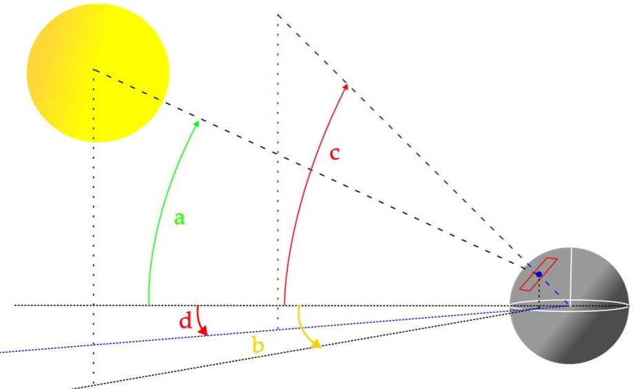

Figure 3. Schematic of the Sun's azimuth (b) and elevation (a) and of the rover's selenographic longitude (d) and latitude (c), with the latter represented as a blue dot laying on a plane tangent to the Moon's surface.

## 3.2.3. Batteries Subsystem

The Batteries subsystem is the subsystem that contains the battery packs and their switch to connect or disconnect the batteries based on the Power Control Logic subsystem output. The seven battery packs are connected in parallel, and each battery pack consists of eight batteries connected in series. The number of battery packs and batteries per battery

<!-- PDF_PAGE: 8 -->

pack has been selected based on the maximum amount of power that can be supplied by the Rosalind Franklin rover battery, which is 1140 Wh [47]. When examining the single battery pack, each battery has its own Battery Management System, which is composed of a dissipative electrical circuit (a resistor) and an electrical switch [48] that connects the battery to the dissipative circuit. The switch is activated by the control logic of the BMS. If the SOC of the battery is above a safety threshold of SOC, set to 5.4 Ahrs, then the switch is closed and the battery is connected to the dissipative circuit to discharge itself, avoiding overcharging. Since the SOC of the batteries is not a quantity that can be measured directly, it is estimated with an Extended Kalman Filter (EKF). The implemented EKF is also devoted to estimating possible internal short circuits in batteries. The internal short circuit has been modelled as an internal resistor with variable resistance: as the resistance value is large, for example 1000 $ \Omega $ , the battery behaves as if there is no short circuit; instead, if the resistance drops down, for instance, around 1 $ \Omega $ , the battery functionalities are compromised. The Kalman filter requires the characteristic curve of the battery, that is, the Open Circuit Voltage (OCV)-State of Charge (SOC) curve, its derivative with respect to the SOC, and measurements of the current generated by the battery and its voltage. The discretised battery dynamic is described according to the following equations which, also, consider the presence of a short-circuit resistance that will be used in Section 4 to model a battery anomaly.

$$
\left\{ \begin{array}{l} S O C _ {k + 1} = S O C _ {k} - \frac {\left(i _ {k} + v _ {k} \cdot Y _ {i s c , k} + w _ {t}\right) \cdot \Delta t}{Q} \\ i _ {R i, k + 1} = i _ {R i, k} \cdot e ^ {- \frac {\Delta t}{Q}} + \left(1 - e ^ {- \frac {\Delta t}{Q}}\right) \cdot \left(i _ {k} + v _ {k} Y _ {I S C, k} + w _ {k}\right) \\ Y _ {i s c, k + 1} = Y _ {i s c, k} + n _ {k} \end{array} \right.
$$

The variables appearing in (3) can be collected in the state vector $ x_{k}=[z_{k}, i_{Ri,k}, Y_{ISC,k}], $ the input vector $ u_{k}=[i_{k}, v_{k}], $ and the process noise vector $ w_{k}=[w_{k}, n_{k}], $ where z is the open-circuit voltage, $ i_{Ri} $ is the current passing through the internal resistance of the battery in the equivalent circuit shown in Figure 4, $ Y_{ISC} $ is the short-circuit impedance that represents the internal short circuit, i is the current exiting the battery, v is the battery voltage, w is the process noise, i.e., the noise of the system, and n is the noise related to measurements. Thus, the system dynamics can be described in the matrixial form that is used in the Kalman filter, which is

$$
x _ {k + 1} = A x _ {k} + B g \left(x _ {k}, u _ {k}, w _ {k}\right)
$$

where

$$
A = \left[ \begin{array}{c c c} 1 & 0 & 0 \\ 0 & e ^ {- \frac {\Delta t}{Q}} & 0 \\ 0 & 0 & 1 \end{array} \right]
$$

$$
B = \left[ \begin{array}{c c c} - \frac {\Delta t}{Q} & 0 & 0 \\ 1 - e ^ {- \frac {\Delta t}{Q}} & 0 & 0 \\ 0 & 0 & 1 \end{array} \right]
$$

$$
g \left(x _ {k}, u _ {k}, w _ {k}\right) = \left[ \begin{array}{c} i _ {k} + v _ {k} \cdot Y _ {i s c, k} + w _ {k} \\ s g n \left(i _ {k} + v _ {k} \cdot Y _ {i s c, k} + w _ {k}\right) + \\ n _ {k} \end{array} \right]
$$

<!-- PDF_PAGE: 9 -->

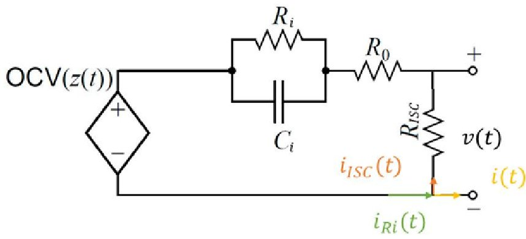

Figure 4. Battery equivalent circuit.

## 3.2.4. Thermal Management Subsystem

The Thermal Management System is a crucial subsystem for the rover, as it allows the evaluation of the temperature of the components. This is crucial because enabling a fast temperature estimation can avoid operations that cause excessive overheating/undercooling of the rover, leading to malfunctions and jeopardous operative conditions. Therefore, the development of a fast surrogate model for this subsystem is reasonable from the point of view of evaluating safe operating conditions. For the purpose of the project, the surrogate model has been implemented starting from a database obtained through simulations by varying parameters such as the initial temperatures of the components, the lunar ground temperature, and the solar radiation for a given mission time. Therefore, the three inputs are the aforementioned parameters, e.g., components' initial temperatures, lunar ground temperature, and solar radiation for a given mission time. At the beginning of the simulation, the user is required to insert the initial temperatures of the components and the lunar ground temperature, while the solar radiation is evaluated with the ephemerides model described in Section 3.2.2. Thus, in this way, it is possible to estimate the final temperatures of the rover components at the beginning of the simulation.

## 4. Damage Modelling

A digital twin should represent both the healthy and damaged state of the rover since it can be damaged during the mission, as happened for NASA Martian rovers [49], with a motor winding break, or with the Pathfinder mission with dust deposition on the solar arrays that causes an acceleration of the degradation rate of the solar panels [50]. Thus, in this section, some simulations in a damaged rover scenario are presented under the assumption that missions are conducted when there is energy production by the solar panels to preserve battery life. It is worth stating that implementing damages in the digital twin helps develop damage detection algorithms while enhancing their interpretability. More specifically, the modelling of the damaged conditions is described, and the simulation results are presented by comparison with the baseline, e.g., simulation results in healthy conditions. The analysis is going to focus on (i) short circuit for the left-rear steering motor; (ii) malfunctions of the right-front driving motor gearbox; (iii) solar panels' malfunctions under two levels of damage; and (iv) battery internal short-circuit. It must be noted that for the purpose of the developed digital twin, the simulations performed under damaged conditions aim to build a database on which it is possible to design and test algorithms to perform damage detection and quantification with the final objective of building an HUMS.

## 4.1. Left-Rear Steering Motor Short-Circuit

The short circuit is an anomalous condition that can be due to sudden voltage shocks, long-term exposure to high temperatures, and insulation loss [51]. The analysis of motor short circuits will focus on the driveline; more specifically, the left-rear steering motor is the one that is faulty. For the sake of simplicity, the short circuit is implemented to happen at 60 s from the beginning of the mission for all the simulations. Looking at Figures 5 and 6, it is possible to notice that the short circuit causes an increase in the time required to

<!-- PDF_PAGE: 10 -->

complete the mission, which is around 12.8 s. Figure 5 shows a zero current absorbed by the faulty motor because the transient of the short circuit is not modelled, but the simulation immediately shows the consequence of the short circuit: that is, the motor is broken and is not functioning anymore. The behaviour of the model can be explained by considering that, due to the short circuit, the temperature of the motor rises suddenly, causing damage to the windings and the wires. This may cause burnings or breakages that cause the motor to be out of service, without being able to absorb current, interrupting the circuit. Figure 5 shows that the other steering motors are affected by the fault motor, since, in addition to the increase in the duration of the mission, an overall increase in the absorbed current is shown in the damaged scenario, represented in blue, with respect to the baseline, which is represented in red. The greater absorbed current may be due to the fact that because the left-rear steering motor is defective, the rover cannot steer properly. A similar behaviour is depicted in Figure 6: all motors seem to absorb a greater amount of current in the damaged scenario compared to the baseline. The motivation is similar to the one stated for the steering motors: since the left rear wheel is stuck in its position, the control unit of the rover requires the driving motors to produce more torque to complete the cruising operations.

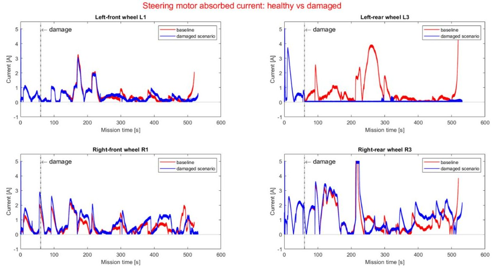

Figure 5. Steering motors absorbed current when the left-rear wheel steering motor is faulted.

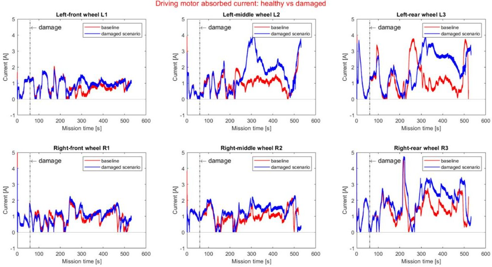

Figure 6. Driving motors absorbed current when the left-rear wheel steering motor is faulted.

<!-- PDF_PAGE: 11 -->

## 4.2. Left Front Wheel Gearbox Malfunctions

This section will focus on transmission line malfunctions. The anomalies are modelled as an efficiency loss of the gearboxes and can represent meshing losses, backlash, and viscous losses. The damage is modelled as a decrease in efficiency down to 70% of the gearbox of the left front wheel driving the motor. The effect of a loss of efficiency in the gearbox downstream of the driving motor of the left front wheel is an increase in the current absorbed by that motor, while the behaviour of the other does not deviate from the baseline, as can be seen in Figure 7. Therefore, in contrast to what is observed in Section 4.1 a damaged gearbox of one motor does not affect the other motors.

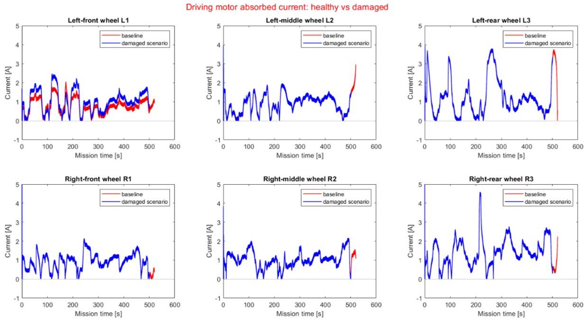

Figure 7. Driving motors absorbed current when the left-front wheel driving motor gearbox experiences a malfunction.

## 4.3. Solar Panels Malfunctions

This section will focus on the anomalies of solar panels. In particular, the focus is on the regolith coverage of the solar arrays, on the possible thermal cracking caused by the extreme temperature difference between lunar day and lunar night, and on general malfunctions. Anomaly conditions are modelled with a loss in the efficiency of solar panels. Two efficiency reductions have been considered: a mild loss of 30% efficiency and a severe loss of 50%. Looking at the power generated by each solar panel, it is possible to see in Figure 8 that the greatest power reduction is shown by the first central fixed panel, which is the one with the larger exposed surface. The good response of the rover to damaged solar panels may be due to a redundant design of the latter.

## 4.4. Battery Internal Short-Circuit

This section focusses on the internal short circuit of a battery. The short circuit is modelled as a resistor with variable resistance connected in parallel to one battery. A step function is used to simulate a sudden internal short circuit after 100 s since the beginning of the mission, where the internal resistance drops from 1000 $ \Omega $ to 1 $ \Omega $ . The extended Kalman Filter is used to detect the short circuit, acting as a preliminary damage detection algorithm, and to predict the battery SOC. Looking at Figure 9, it is possible to notice that the implemented EKF is able to detect and estimate the change in battery behaviour almost immediately. This is also reflected by looking at the estimated state of charge, represented in Figure 10, since the figure shows a step variation of the SOC due to the sudden drop in short circuit resistance.

<!-- PDF_PAGE: 12 -->

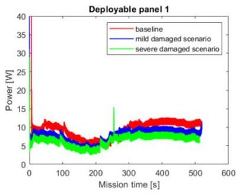

Solar panels generated power: healthy vs damaged

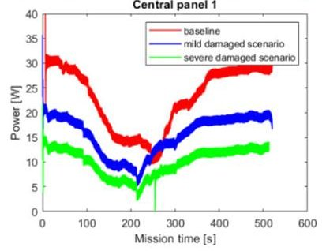

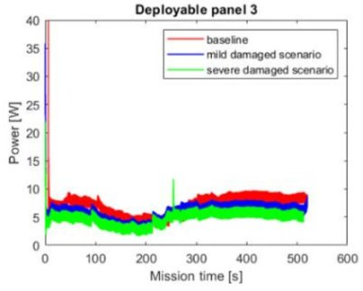

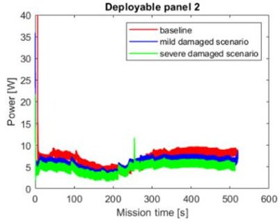

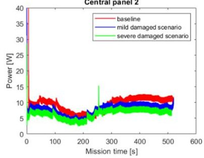

Figure 8. Power generated by the solar panels when they experience mild and severe damage.

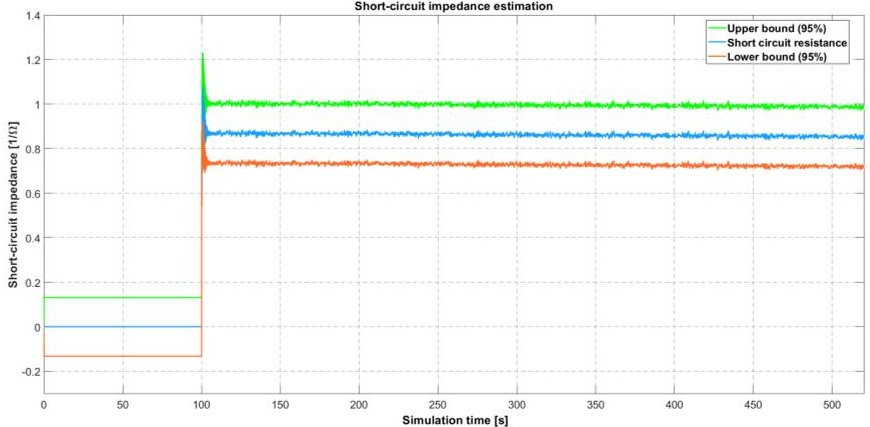

Figure 9. EKF SOC internal short circuit detection.

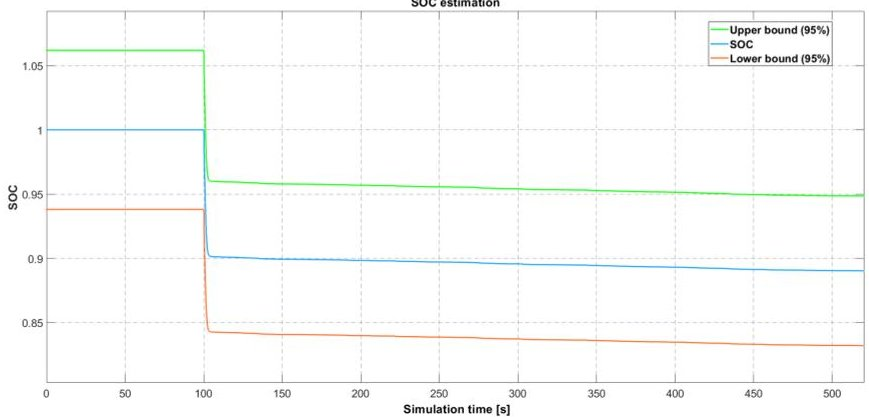

Figure 10. EKF SOC estimation.

## 5. Discussion

The results presented in Section 4 show that the digital twin developed of a space exploration rover is capable of representing the behaviour of the system under healthy and anomalous conditions. Thus, it is possible to use the digital twin to effectively build a database of healthy and damaged signals that can be used to build damage detection algorithms. These algorithms can then be used in the framework of a Health and Usage Monitoring System to perform real-time damage detection, resulting in damage indexes to support the decision-making process. This allows optimising the planning of the mission of the space rover by minimising the risk of scientific data loss.

Simulations show that an anomaly in one subsystem affects the behaviour of the other subsystems, as shown for the driveline motors when one steering motor is out of service

<!-- PDF_PAGE: 13 -->

due to a short circuit. It should be noted that the digital twin appears to be very sensitive to motor failures on the driveline, as shown in Figures 5 and 6. This can help in distinguishing between sensor faults and motor faults: if, for instance, the current sensor of a motor is faulted, and thus it shows a zero absorbed current, by looking at the absorbed current of the other motors, it is possible to detect a motor failure.

The behaviour of the digital twin shown in the event of transmission line malfunctions is different from what was stated before. This is due to the driveline control system implemented, which, having a target torque to be produced by each motor, forces the motor upstream of the faulted gearbox to generate more torque, thus absorbing more current without affecting the other motors. This cannot happen in the case of an out-of-service motor, since the latter is not able to produce any torque, and therefore, the other motors should supply the extra torque required for mission completion. In any case, the increase in current absorbed by the motor with the faulty gearbox can be used to detect transmission line anomalies.

Moving on the solar panels malfunctions, it is possible to notice the redundant design of the solar panels used, which are the same in characteristics and number as the ESA Rosalind Franklin rover. This is a desirable feature because it makes the system more robust against anomalies since the rover is still able to operate under these conditions. This consideration allows us to highlight the dual use of the digital twins, in particular of the developed one: they can be used as virtual prototypes to test design changes and observe their impact virtually before performing expensive and time-consuming tests and real prototypes.

The last anomalous condition introduced is the internal short circuit of one of the rover batteries. In this case, when the short-circuit resistance drops to 1 $ \Omega $ , the battery is almost compromised, but recognising the faulted battery and thus the faulted battery pack allows one to avoid continuing with the use of that battery. This can avoid thermal runaway, a possible consequence of the internal short circuit of batteries, which can lead to the battery explosion and, therefore, to the loss of the rover. For this reason, the EKF has been implemented not only to allow the estimation of SOC, which cannot be measured directly, but also to detect defective batteries. Thus, the EKF is used as a preliminary damage detection algorithm to be implemented in the HUMS of the rover. It was shown to successfully detect a sudden internal short circuit, as shown in Figure 9; therefore, it can be used as an anomaly detection algorithm.

To conclude, the simulation results shown in the previous section allow one to design and test damage detection algorithms. For example, different algorithms can be compared under several conditions to observe which one fits better to the case under analysis. For example, two diagnostic algorithms could be tested: one based on the Mahalanobis distance and the other based on the RMSE (root mean square error). The root mean square error is commonly used to assess the quality of the predictions. It indicates how far the forecast values fall from the actual measured values using the Euclidean distance. The Mahalanobis distance is usually used in statistics for multivariate outlier analysis. It determines whether a point belongs to a distribution or is perceived as an outlier. The Mahalanobis distance is a weighted Euclidean distance with the weight function being the inverse matrix of the covariance of the cluster. This method takes into account the correlation characteristic between the elements in the clusters. Then, the choice of the algorithm can be made on the basis of the Probability of Detection (POD) and the False Alarm Rate (FAR), as described in Section 2.

## 6. Conclusions

This work focused on the usage of digital twins for virtual prototyping and damage detection purposes in space exploration rover applications, which are high-cost and high-risk systems due to their operational condition. The results presented address the anomalous conditions of driving motors, transmission lines, solar panels, and internal short circuits. However, the described digital twin can be used to implement several damages

<!-- PDF_PAGE: 14 -->

to the various subsystems. The aim of this work is to build a database to design and test algorithms to perform real-time damage detection and model, possibly, model updating. Updates to the parameters of the digital twin are a serious concern in order to ensure that the digital twin is able to mimic the behaviour of the real system. In this work, a Kalman filter has been implemented to perform SOC estimation and internal short-circuit detection. The filter receives in the reported case study the measurements coming from the digital twin itself to show the damage detection capabilities and the correct functioning of the implemented algorithm. However, the Kalman filter could process data from the real rover, and then its prediction should set the simulator parameters. Similarly, other model-updating algorithms can be implemented in future works addressing telemetry and environmental data, such as for navigation purposes or to adjust the estimation of the solar irradiance. For example, the height, heading, and tilt of the rover can be quantities of interest to adjust the lunar terrain model, while the velocity and acceleration of the rover can be used to calibrate the driveline parameters or the wheel-terrain contact parameters. Since all the signals that can be acquired on the actual asset can be recorded also in the simulator, the availability of a real system allows initially for calibration/validation of the digital twin and then for damage detection/model updating by comparing the real and the simulated signals. In general, this study proposes a fertile framework for developing digital twins to help understand the behaviour of real systems with the help of existing physical twins. Being a preliminary feasibility study, no validation and verification is planned at this stage. However, if the project continues, there will be space for validation of the digital twin performance, allowing one to also implement and test damage detection algorithms.

Author Contributions: Conceptualisation, F.C., M.G. and G.F.D.L.; Methodology, L.P., L.B. and F.C.; Formal analysis, L.P.; Writing—original draft, L.P.; Writing—review and editing, L.P. and F.C.; Visualisation, L.P.; Supervision, F.C. and G.F.D.L.; Project administration, M.G. and G.F.D.L. All authors have read and agreed to the published version of the manuscript.

Funding: The work is part of the Project DIGES: DIGital twin di sistemi di ESplorazione lunare funded by ASI—Agenzia Spaziale Italiana, under the "ACCORDO ATTUATIVO n. 2021-41-HH.0 NELL'ALVEO DELL'ACCORDO QUADRO ASI-POLITECNICO DI MILANO n. 2016-27-H.0".

Institutional Review Board Statement: Not applicable.

Informed Consent Statement: Not applicable.

Data Availability Statement: No new data were created or analysed in this study. Data sharing is not applicable to this article.

Conflicts of Interest: The authors declare no conflicts of interest. The funders had no role in the design of the study; in the collection, analyses, or interpretation of data; in the writing of the manuscript; or in the decision to publish the results.

## Abbreviations

The following abbreviations are used in this manuscript:

DT Digital Twin

NASA National Aeronautics and Space Administration

ESA European Space Agency

MMRTG Multi-Mission Radioisotope Thermoelectric Generator

HUMS Health and Usage Monitoring System

RUL Residual Useful Life

WEB Warm Electronic Box

RHU Radioisotope Heating Unit

GUI Graphic User Interface

EKF Extended Kalman Filter

POD Probability of Detection

FAR False Alarm Rate

<!-- PDF_PAGE: 15 -->

## References

1. Olson, C.F.; Matthies, L.H.; Wright, J.R.; Li, R.; Di, K. Visual terrain mapping for Mars exploration. Comput. Vis. Image Underst. 2006, 15, 73-85.

2. Castelluccio, M. Interplanetary Twins. Available online: https://sfmagazine.com/technotes/2021/march/interplanetary-twins/ (accessed on 15 December 2023).

3. Cook, J.R.; Johnson, A.; Hautaluoma, G. NASA Readies Perseverance Mars Rover's Earthly Twin. Available online: https://www.nasa.gov/feature/jpl/nasa-readies-perseverance-mars-rovers-earthly-twin (accessed on 15 December 2023).

4. ESA. ExoMars Rover Testing Moves Ahead and Deep Down. Available online: https://www.esa.int/Science_Exploration/ Human_and_Robotic_Exploration/ExoMars_rover_testing_moves_ahead_and_deep_down (accessed on 15 December 2023).

5. M.I.T. Digital Twins Improve Real-Life Manufacturing. Available online: https://www.technologyreview.com/2022/01/05/104 2981/digital-twins-improve-real-life-manufacturing (accessed on 15 December 2023).

6. Ren, P.; Wang, S.; He, M.; Cao, W. Novel strategy based on improved Kalman filter algorithm for state of health evaluation of hybrid electric vehicles Li-ion batteries during short- and longer-term operating conditions. J. Power Electron. 2021, 21, 1190-1199. [CrossRef]

7. Yang, R.; Xiong, R.; Shen, W. On-board diagnosis of soft short circuit fault in lithium-ion battery packs for electric vehicles using an extended Kalman filter. CSEE J. Power Energy Syst. 2022, 8, 258-270.

8. Ma, M.; Duan, Q.; Li, X.; Liu, J.; Zhao, C.; Sun, J.; Wang, Q. Fault diagnosis of external soft-short circuit for series connected lithium-ion battery pack based on modified dual extended Kalman filter. J. Power Electron. 2021, 41, 102902. [CrossRef]

9. Jia, Y.; Brancato, L.; Giglio, M.; Cadini, F. Temperature enhanced early detection of internal short circuits in lithium-ion batteries using an extended Kalman filter. J. Power Sources 2024, 591, 233874. [CrossRef]

10. Wu, J.; Chen, Z. Diagnosis of Internal Short Circuit for Lithium Ion Battery Pack under Varying Temperature. In Proceedings of the 2019 IEEE 3rd International Electrical and Energy Conference, Beijing, China, 7-9 September 2019.

11. Gao, W.; Zheng, Y.; Ouyang, M.; Li, J.; Lai, X.; Hu, X. Micro-short-circuit diagnosis for series-connected lithium-ion battery packs using mean-difference model. IEEE Trans. Ind. Electron. 2019, 66, 2132-2142. [CrossRef]

12. Zhang, H.; Liu, Z.; Su, H. Fuzzy Kalman Filter based Short Circuit Fault Diagnosis Design for Lithium-Ion Battery. IEEE Trans. Ind. Electron. 2023, 71, 2883-2892. [CrossRef]

13. Hossain, M.; Haque, M.E.; Arif, M.T. Kalman filtering techniques for the online model parameters and state of charge estimation of the Li-ion batteries: A comparative analysis. J. Energy Storage 2022, 51, 104174. [CrossRef]

14. Shrivastava, P.; Soon, T.K.; Idris, M.Y.I.B.; Mekhilef, S. Overview of model-based online state-of-charge estimation using Kalman filter family for lithium-ion batteries. Renew. Sustain. Energy Rev. 2019, 113, 109233. [CrossRef]

15. Xu, L.; Wang, J.; Chen, Q. Kalman filtering state of charge estimation for battery management system based on a stochastic fuzzy neural network battery model. Energy Convers. Manag. 2022, 53, 33-39. [CrossRef]

16. Sun, F.; Hu, X.; Zou, Y.; Li, S. Adaptive unscented Kalman filtering for state of charge estimation of a lithium-ion battery for electric vehicles. Energy 2011, 36, 3531-3540. [CrossRef]

17. Baba, A.; Adachi, S. SOC estimation of HEV/EV battery using series kalman filter. Electr. Eng. Jpn. 2014, 187, 53-62. [CrossRef]

18. Lee, J.; Nam, O.; Cho, B.H. Li-ion battery SOC estimation method based on the reduced order extended Kalman filtering. J. Power Sources 2007, 174, 9-15. [CrossRef]

19. Armstrong, M.M. Cheat Sheet: What Is Digital Twin? Available online: https://www.ibm.com/blogs/internet-of-things/iot-cheat-sheet-digital-twin/ (accessed on 15 December 2023).

20. Miller, S. Mars Rover Model in Simscape. Available online: https://uk.mathworks.com/matlabcentral/fileexchange/105700 -mars-rover-model-in-simscape?s_tid=srchtitle (accessed on 15 December 2023).

21. AzureSpace $ ^{\textcircled{2}} $ . SPACE Solar Cells. Available online: https://www.azurspace.com/index.php/en/products/products-space/ space-solar-cells (accessed on 15 December 2023).

22. Ferrando, E.; Zanella, P.; Riva, S.; Damonte, G.; Romani, R.; Ferrante, L. Photovoltaic Assemblies for the Power Generation of the Exomars Missions. In Proceedings of the European Space Power Conference, Thessaloniki, Greece, 3-7 October 2016.

23. Saft $ ^{\circ} $ . MP 176065 xtd Rechargeable Li-Ion Cell. Technical Report, Total. Available online: https://www.saft.com/download file/6X7JMGAnv3Fm6HdmtEv%252B2gtlbZ1bRRVHkjS11M6md92GD2EF7vU%252F3Oybbz3WOlG%252BxR8srpA5iCdJ% 252FV3IQzTVHQyiTucngZKEg9KkYCLkowAvgaG1hurjJQn5GZh5EuTb%252Bj1Nt2DmkSO%252B8gEVysOqbqCjW34rd0 kyveY8yUtImNTWH3zvwg%253D%253D/Data.Sheet.MP.176065.xtd.31109-2-0819.pdf (accessed on 15 December 2023).

24. maxon $ ^{\circ} $ . 5 Years: NASA Mars Rovers Keep on Running and Running and Running. Available online: https://www.maxongroup.co.uk/maxon/view/news/MEDIENMITTEILUNG-marsrover#:~:text=Each%20rover%20is%20equipped%20with,kg)%20over%20the%20planet's%20surface (accessed on 15 December 2023).

25. maxon $ ^{\textcircled{2}} $ ECX FLAT 32 L, $ \Phi $ 32 mm, Brushless, with Hall Sensors. Available online: https://www.maxongroup.us/maxon/view/ product/motor/ecmotor/ecflat/ECXflat32/ECXA32LZF50E6ILACO1Y330A (accessed on 15 December 2023).

26. Krantz, T.; Cameron, Z. Development of Pericyclic Gearbox for Roving Application. In Proceedings of the International Design Engineering Tecnical Conference, Anaheim, CA, USA, 18 August 2019.

27. MathWorks. Rover Temperature Controls. Available online: https://mars.nasa.gov/mer/mission/rover/temperature/ (accessed on 15 December 2023).

<!-- PDF_PAGE: 16 -->

28. Ratnakumar, B.V.; Smart, M.C.; Halpert, G.; Kindler, A.; Frank, H.; Di Stefano, S.; Ewell, R.; Surampudi, S. Lithium batteries on 2003 Mars Exploration Rover. In Proceedings of the 17th Annual Battery Conference on Applications and Advances, Long Beach, CA, USA, 18 January 2002.

29. Kempenaar, J.G.; Novak, K.S.; Redmond, M.J.; Farias, E.; Singh, K.; Wagner, M.F. Detailed Surface Thermal Design of the Mars 2020 Rover. In Proceedings of the International Conference on Environmental Systems, Albuquerque, NM, USA, 8-12 July 2018.

30. NASA. Rover Temperature Controls. Available online: https://mars.nasa.gov/mer/mission/rover/temperature/#heaters (accessed on 15 December 2023).

31. Hatakenaka, R.; Fujita, K.; Nonomura, T.; Takai, M.; Toyota, H.; Satoh, T.; Sugit, H. Preliminary Thermal Design of the Japanese Mars Rover Mission. In Proceedings of the International Conference on Environmental Systems, Hilton Bellevue, Bellevue, 12 July 2015.

32. Weston, S. (Ed.) State-of-the-Art of Small Spacecraft Technology; Small Spacecraft Systems Virtual Institute, Ames Research Center, Moffett Field, CA, USA, 2023; pp. 185-204.

33. Bradford, E.; Rabinovitch, J.; Abid, M. Regolith Particle Erosion of Material in Aerospace Enviornments. In Proceedings of the IEEE Aerospace Conference, Big Sky, MT, USA, 2-9 March 2019.

34. MathWorks. Motor & Drive (System Level). Available online: https://it.mathworks.com/help/sps/ref/motordrivesystemlevel. html (accessed on 15 December 2023).

35. MathWorks. Simple Gear. Available online: https://it.mathworks.com/help/sdl/ref/simplegear.html (accessed on 15 December 2023).

36. MathWorks. Solar Cell. Available online: https://it.mathworks.com/help/physmod/sps/ref/solarcell.html (accessed on 15 December 2023)

37. MathWorks. Battery. Available online: https://it.mathworks.com/help/sps/ref/battery.html (accessed on 15 December 2023).

38. MathWorks. Heat Flow Rate Source. Available online: https://it.mathworks.com/help/simscape/ref/heatflowratesource.html (accessed on 15 December 2023).

39. MathWorks. Radiative Heat Transfer. Available online: https://it.mathworks.com/help/simscape/ref/radiativeheattransfer. html (accessed on 15 December 2023).

40. MathWorks. Conductive Heat Transfer. Available online: https://it.mathworks.com/help/simscape/ref/conductiveheattransfer. html (accessed on 15 December 2023).

41. MathWorks. Mechanics Explorer. Available online: https://it.mathworks.com/help/sm/ref/mechanicsexplorer-app.html (accessed on 15 December 2023).

42. MathWorks. Planetary Ephemeris. Available online: https://uk.mathworks.com/help/aeroblks/planetaryephemeris.html (accessed on 15 December 2023).

43. MathWorks. Julian Date Conversion. Available online: https://uk.mathworks.com/help/aeroblks/juliandateconversion.html (accessed on 15 December 2023).

44. Breiter, S.; Vokrouhlicky, D. Yarkovsky-O'Keefe-Radzievskii-Paddack effect with anisotropic radiation. Mon. Not. R. Astron. Soc. 2011, 410, 2807-2816. [CrossRef]

45. NASA. Sun Fact Sheet. Available online: https://nssdc.gsfc.nasa.gov/planetary/factsheet/sunfact.html (accessed on 15 December 2023).

46. Kaczmarzyk, M.; Gawronski, M.; Piatkowski, G. Global database of direct solar radiation at the Moon's surface for lunar engineering purposes. E3S Web Conf. 2018, 49, 00053. [CrossRef]

47. Brochard, S.A.P. Batteries for extended temperature range EXOMARS rover mission. E3S Web Conf. 2017, 16, 06001. [CrossRef]

48. MathWorks. Switch. Available online: https://it.mathworks.com/help/simscape/ref/switch.html (accessed on 15 December 2023).

49. Callas, J.L.; Golombek, M.P.; Fraeman, A.A. Mars Exploration Rover Opportunity End of Mission Report Mars Exploration Rover Project MER Opportunity-End of Mission Report; NASA Technical Reports; Jet Propulsion Laboratory: Pasadena, CA, USA, 2019; JPL Open Repository.

50. Landis, G.; Kerslake, T.; Jenkins, P.; Scheiman, D. Mars Solar Power. In Proceedings of the 2nd International Energy Conversion Engineering Conference, Providence, RI, USA, 16-19 August 2004. [CrossRef]

51. Xuan, J.; Wang, X.; Liu, D.; Wang, L. Research on the safety assessment of the brushless DC motor based on the gray model. Adv. Mech. Eng. 2017, 9, 168781401769543. [CrossRef]

Disclaimer/Publisher's Note: The statements, opinions and data contained in all publications are solely those of the individual author(s) and contributor(s) and not of MDPI and/or the editor(s). MDPI and/or the editor(s) disclaim responsibility for any injury to people or property resulting from any ideas, methods, instructions or products referred to in the content.