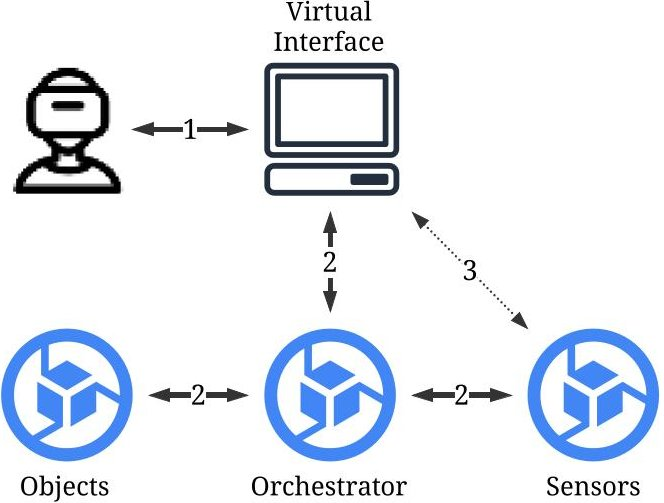
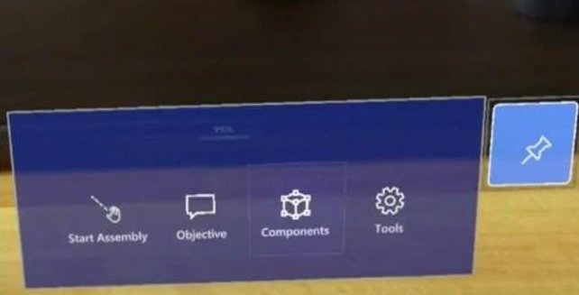
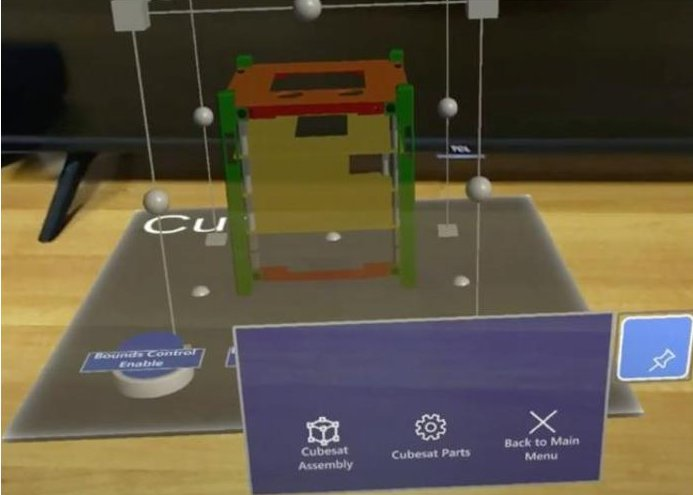
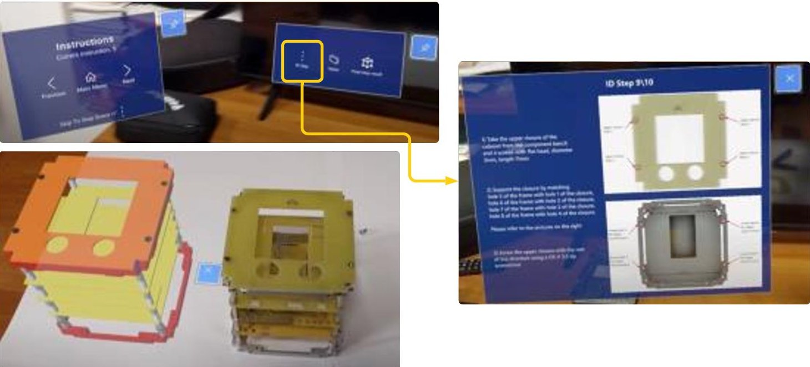
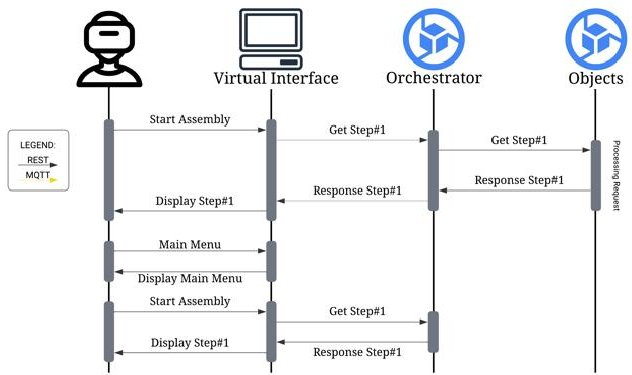
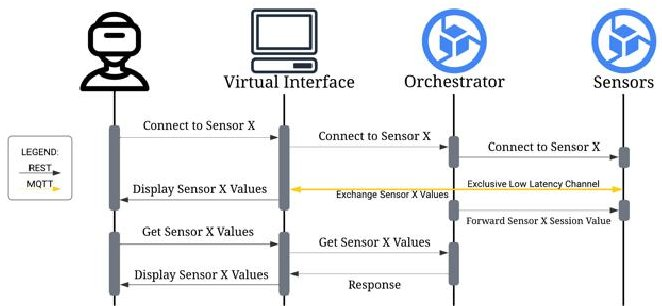
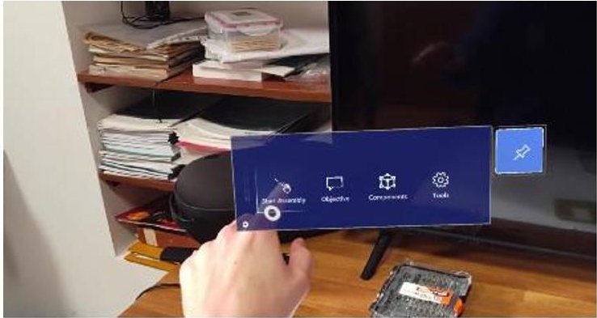
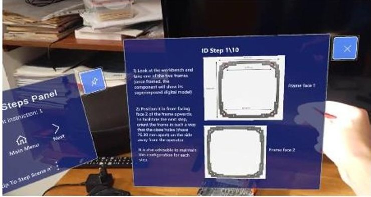
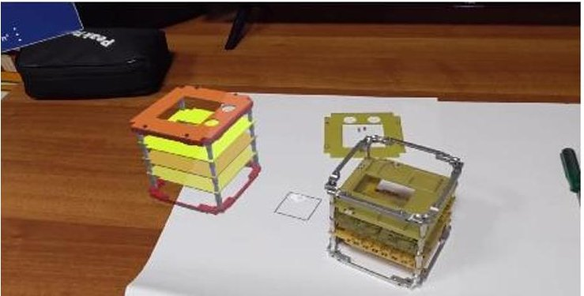
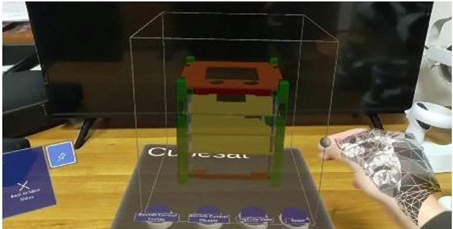

<!-- PDF_PAGE: 1 -->

$ 75^{\mathrm{th}} $ International Astronautical Congress (IAC), Milan, Italy, 14-18 October 2024. Copyright $ \textcircled{2} $ 2024 by the International Astronautical Federation (IAF). All rights reserved.

IAC-24,D1,IPB,28,x89552

Enhancing the MAIT of Aerospace Systems through AI-based Immersive Technologies

J. Pesce $ ^{1} $ , A. Carini $ ^{2} $ , M. Marinacci $ ^{2} $ , J. Rossi $ ^{2} $ , M. Boscia $ ^{1} $ M. Pasquali $ ^{1} $ , M. Eugeni $ ^{1} $ , A. Arman $ ^{2} $ , F. Leotta $ ^{2} $ , P. Marzioli $ ^{1} $ M. Mecella $ ^{2} $ , P. Piergentili $ ^{1} $ , P. Gaudenzi $ ^{1} $

$ ^{1} $ Department of Mechanical and Aerospace Engineering, Sapienza University of Rome, Via Eudossiana 18,00184, Rome, Italy $ ^{2} $ Department of Computer, Control and Management Engineering Antonio Ruberti, Sapienza University of Rome, Via Ariosto 25,00185, Rome, Italy

## Abstract

The aerospace industry is undergoing a significant transformation through the adoption of augmented reality (AR) technologies that overlay digital information onto the physical world, enhancing human-machine interactions in complex assembly processes. This approach provides real-time visualizations, step-by-step instructions, and interactive overlays, which can significantly reduce errors, shorten learning curves, and improve the efficiency and quality of assembly tasks in the Manufacturing-Assembly-Integration-Testing (MAIT) loop. Despite the promising potential of these technologies, existing solutions are often developed for specific applications and lack a standardized, adaptable framework that can be easily deployed across different scenarios. Driven by advancements in immersive technologies and AI-based methods, AR integration in assembly processes has gained substantial attention for its ability to enhance operator performance and task accuracy. Several studies highlight the benefits of AR, including its capabilities to provide interactive guidance during complex tasks, which expedites the learning curve for shopfloor operators and improves overall task efficiency. However, most tools implemented to date are ad-hoc solutions tailored to specific applications, and the development of a generic, adaptable framework remains a challenge. To address this gap, our approach includes a Domain-Specific Language (DSL) designed to streamline the configuration and customization of AR-assisted assembly processes. The DSL facilitates the definition of tasks, components, and tools, enabling rapid adaptation to various assembly scenarios without extensive reprogramming. This approach emphasizes reducing computational overhead on AR headsets by distributing processing tasks across different system components, thereby enhancing the quality of life for operators by optimizing the interaction between virtual and physical environments. This work aims to demonstrate a functional architecture and related methodologies that could be implemented to enhance the integration of AR technologies in assembly tasks. One of the key elements is the use of an orchestrator that manages the data flow between AR interfaces, 3D model management, and sensor integration. By focusing on these aspects, the framework seeks to provide a flexible and adaptable approach that supports operators in performing complex assembly tasks with greater accuracy and efficiency. The goal is to highlight an example of a functional architecture and the methodologies behind it, underscoring the potential for AR technologies to revolutionize aerospace assembly processes through thoughtful design and integration strategies. Preliminary tests using a CubeSat engineering model demonstrate the system's effectiveness, and future work will explore leveraging AI and large language models to further automate the configuration of assembly processes, enhancing scalability and adaptability in various aerospace applications.

Keywords: Cyber-Physical Systems, Human-Machine Interaction, Digital Twins, Augmented Reality, Smart Manufacturing.

## 1. Introduction

Industry 4.0 represents a new phase of industrial evolution, characterized by the integration of advanced technologies such as Artificial Intelligence (AI) [1] and immersive technologies like augmented and virtual reality [2]. These innovations are destined to transform production processes, improving the automation and the precision of operations [3]. They are crucial for highly complex sectors, such as the aerospace industry, where

the production and integration of complex systems require high standards of quality and safety [4].

In the aerospace sector, the production of components requires extremely high precision. Manufacturing Assembly-Integration-Testing (MAIT) processes, which are fundamental for the development of spacecraft and other aerospace products, present considerable variability and operational complexity. Continuous training of operators is essential to maintain quality and

<!-- PDF_PAGE: 2 -->

safety. The growing demand for products such as satellites, CubeSats [5] and advanced aircraft requires the industry to find ways to improve the efficiency of production processes without compromising safety. To face this challenge, we can introduce the use of immersive technologies and AI in this context. Current implementations don't have a standardized methodology to facilitate their integration into MAIT processes. This represents a significant problem to their adoption.

In this work, our purpose is to develop a generic and scalable framework to facilitate the adoption of immersive technologies and AI in assembly and integration processes for the aerospace sector by defining a framework that overcomes current limitations and offers a flexible and adaptable approach applicable to the aerospace industry. This approach simplifies the operators' operations and reduces the risk of errors through the use of immersive technologies.

The proposed framework will be structured on several key components. There is a focus on the use of Domain Specific Languages (DSL) [6] to represent the assembly steps of a product. This DSL will allow the framework to be dynamic and not restricted to a single configuration guaranteeing the adaptivity of the simulation according to the selected assembly procedure. Moreover, the integration of a control system based on image processing techniques will ensure continuous monitoring of physical activities, improving quality and correcting any errors.

The rest of the paper is organized as follows: Section 2 introduces the research methodology, Section 3 presents the background, Section 4 describes an implementation of the framework, Section 5 focuses on the field evaluation and Section 6 concludes the paper.

## 2. Research Methodology

From the literature, it is clear that while many companies have improved most of their production processes with Industry 4.0, in some of them, certain production aspects may still be anchored to traditional methods. This often occurs due to the difficulty of integrating advanced technologies and methodologies into activities that involve different areas of work, where the final result depends on the union of these areas. To provide a concrete example that reflects our case study, the assembly phase of a product generally requires the attention of various operators. For instance, there may be assembly workers, quality inspectors, machine operators, engineers who designed the product and the assembly line, supervisors, welders, painters, and many other roles depending on the product being made.

Following these considerations, the following research questions have been identified to mitigate these

issues and simplify the integration of augmented reality technologies:

- RQ1: What are the critical and non-critical aspects that our framework must manage to reduce and monitor the work performed during assembly?

- RQ2: How can our framework simplify assembly activities using augmented reality technologies?

To answer these questions, this paper will demonstrate how our framework, through Software Engineering techniques and adhering to the principles of Human-Computer Interaction (HCI), aims to replace traditional assembly methods with those supported by Augmented Reality (AR). It is important to highlight that this framework aims to be a unique solution, avoiding the use of different technologies to assist workers during the assembly phase.

Our framework was developed following the metrics defined by the Design Science approach [7]. This approach is particularly useful for creating scientific artifacts aimed at solving complex problems. In detail, the phases that were carried out are as follows:

- Problem formulation and objectives: through which the problem that our framework needs to solve was formulated. According to what has been stated so far, it can be summarized as the need to "integrate augmented reality technologies to support an operator during the assembly phase of a space product." To solve this problem, it is necessary to take into account many aspects that can be inferred from our research questions RQ1 and RQ2. In particular, it is clear that the primary objective is to develop an application, using Software Engineering techniques, that contains the necessary functionalities to ensure the assembly of a space product and that, through HCI heuristics, is easy for the operator to use. The purpose of this research is therefore to guarantee a methodology for introducing augmented reality technologies into the assembly phase of a space product, replacing the existing traditional approaches.

- Requirements definition: in which all the necessary requirements to solve the research questions and achieve the final objective of our research were identified. To develop our application, as will be shown in Section 3, it was necessary to focus on multiple aspects of both hardware and software nature. As a first step, we delved into the concepts and techniques of Software Engineering, which led us to decide to create a software architecture based on the use of containers to isolate particularly computationally intensive parts of the code and to enhance the maintainability of the application, ensuring better deployability, scalability, and consistency across different environments.

<!-- PDF_PAGE: 3 -->

Subsequently, it was necessary to become familiar with the existing augmented reality devices and how to develop a virtual environment for them, supported by HCI techniques specific to such environments. Finally, as the last step, we focused on a possible case study that could be useful for our research, and for this purpose, we chose to use a CubeSat as it is a space product that is easily obtainable.

Design: this is where the structure that our framework must have is defined. After various interviews with industry experts, it was found that the functionalities necessary for the correct use of the application mainly involved the availability of documentation and suggestions during the various assembly phases, as well as methods for visualizing the correct operation of certain components using specific measurement tools. The application is characterized by several services organized in containers, each with its own development environment and dedicated libraries, which will be queried by a main service acting as a service orchestrator whenever the application developed in Unity needs to use a specific service. The communication between these containers and the Unity application is managed through Representational State Transfer (REST) APIs and Message Queuing Telemetry Transport (MQTT), depending on the type of information to be handled. Demonstration: used to demonstrate how an application to address this problem with these prerequisites can be realized. In Section 4, we will show a detailed implementation of our framework, focusing on both the augmented reality component and the architecture formed by the containers, with particular emphasis on the latter.

Evaluation: This is the final phase of the Design Science approach and is used to evaluate the final artifact. Our application was tested by having users who had never seen or assembled a product of this type complete the full assembly of the CubeSat, supported by augmented reality devices. It was also evaluated by industry experts, who provided useful feedback regarding possible aerospace applications of this artifact.

## 3. Background

## 3.1 Software Engineering

Software engineering is a discipline that deals with the development, design, maintenance, and management of complex software systems [8]. It combines computer science principles with engineering methodologies to create high-quality, reliable, and scalable software that

meets the specific requirements. Software engineering techniques can be used to manage various aspects of software development:

- In the initial requirements gathering phase, software engineering focuses on understanding stakeholder needs and defining requirements. Techniques such as use case analysis and requirements modelling are used to translate user expectations into detailed, testable specifications.

- During the design phase there is a focus on the software architecture, which determines the structure of the system and how the various components interact with each other. There are different ways of defining a software architecture. Monolithic architectures involve the entire software being a single, indivisible block, which may be easier to develop initially but difficult to scale and maintain over time. In contrast, microservices architectures break down software into a series of independent services, which can be developed, deployed and scaled separately, improving the flexibility and resilience of the system [9].

- In the development phase, developers follow guidelines to ensure that code is readable, reusable, and compliant with security standards.

- In the testing phase: unit, integration and system testing are used to identify and fix defects before the software is released to end users. Software engineering emphasizes the use of test automation tools and methodologies such as Test-Driven Development (TDD) [10] to improve the reliability and robustness of the software.

- The maintenance phase is related to constant monitoring that allows for rapid identification of issues and timely release of updates and patches. This proactive approach to maintenance reduces downtime and improves the long-term reliability of the software.

In this context, DevOps [11] is an increasingly popular approach to software engineering. It plays a key role during the development, testing, and deployment phases. DevOps combines the principles of software development and IT operations to foster a culture of collaboration and integration. This approach aims to reduce the gap between development and operations teams, facilitating frequent and reliable software releases. DevOps practices include deployment automation, continuous monitoring and helping accelerate development cycles and improve software quality.

Considering the System Development Life Cycle (SDLC): The Waterfall model [12] emphasizes a rigorous, sequential approach, ideal for projects with stable, well-defined requirements, while the Agile model [13] promotes an iterative, incremental approach,

<!-- PDF_PAGE: 4 -->

encouraging flexibility, collaboration, and rapid response to change. Scrum [14], an Agile framework, is distinguished by its use of short sprints and continuous feedback loops, which allow teams to quickly adapt software based on emerging needs. DevOps can be integrated with Scrum, enhancing the team's ability to respond quickly to market needs and continuously release high-quality software.

## 3.2 Human-Computer Interaction

One of the most important aspects of the development phase is to consider how a person can interact with the designed system. At this point, it comes out the importance of Human-Computer Interaction. A multidisciplinary discipline that studies how people interact with technology, with the goal of improving usability and the overall user experience. At the core of HCI is User-Centered Design (UCD) [15], a design approach that places the user at the center of every phase of the development process. This approach involves a deep understanding of users' needs, capabilities, and limitations in order to create products that are not only functional but also intuitive to use. UCD is based on a continuous iteration between analysis, design, prototyping, and testing, involving end users to ensure that the final product actually meets their needs.

With the increasing use of immersive technologies such as AR and virtual reality (VR), user interface design has had to adapt to new challenges [16]. In these environments, user interface design is no longer limited to flat screens and keyboard and mouse input, but must consider a three-dimensional interaction in which users move and interact in a more natural and immersive way. User Experience (UX) in Immersive Environments therefore becomes a crucial field of study, focusing on how to create experiences that are not only visually engaging, but also intuitive and interactively satisfying.

Because of their complexity, these technologies require thorough Usability Testing in AR/VR [17]. This type of testing is essential to identify potential issues in the interaction, such as difficulty in gesture recognition or the presence of motion sickness, which can seriously compromise the user experience. Testing allows to iterate on the design, refining the interface and interaction to ensure that the final experience is as smooth as possible.

## 3.3 Internet of Things

Internet of Things (IoT) is a technological paradigm that involves the interconnection of physical objects to the digital world, allowing them to collect, process, exchange data in real time [18]. This interaction between the physical and virtual worlds is achieved through a network of intelligent devices, sensors and actuators, creating an integrated ecosystem that revolutionizes the

way information is managed and used in different industrial sectors.

In an IoT architecture there are different components like: sensors, actuators, gateways, and cloud platforms. All the components can work together to create a flexible and efficient system [19]. Sensors collect data from the environment, such as temperature or pressure, while actuators perform physical actions based on commands. Gateways serve as intermediaries, transmitting sensor data to cloud platforms, which handle data management, processing, and analysis. Cloud platforms offer scalability and support advanced algorithms like machine learning and AI to process vast amounts of data from numerous IoT devices. IoT in Industry 4.0 offers several key benefits [20]:

- Predictive Maintenance: The use of IoT sensors allows you to continuously monitor the operating conditions of machines, collecting data on critical parameters such as vibration, temperature and wear. By analyzing this data, you can accurately predict when a machine will require maintenance, avoiding sudden failures and reducing unplanned downtime [21]. This approach allows you to optimize the useful life of equipment and reduce operating costs.

- Machine Monitoring: Real-time monitoring of machine performance is another crucial benefit of IoT in Industry 4.0 [22]. Thanks to the continuous connection with management systems, the data collected can be used to optimize production, reduce energy consumption and improve the quality of the final product. Furthermore, continuous monitoring allows you to intervene promptly in the event of anomalies, minimizing the impact of any problems on production.

- Automation: IoT allows you to automate a wide range of industrial processes, reducing dependence on manual operations and improving operational efficiency [23]. Connected components can communicate with each other and with central management systems, performing complex operations autonomously and with a level of precision and speed that is difficult to achieve with human intervention. This leads to faster production, with fewer errors and reduced costs.

## 3.4 CubeSat

CubeSats are small satellites that have revolutionized the way of doing research for space missions. Their development dates back to 1999, when they were developed at the Stanford and California Polytechnic State Universities [24]. In recent years, CubeSats have grown in popularity, becoming essential tools not only for education, but also for research institutions, companies and space agencies. Thanks to their relatively

<!-- PDF_PAGE: 5 -->

low cost, they represent an affordable solution for testing new technologies, performing scientific experiments in orbit.

A CubeSats has standardized dimensions defined in units (U), where 1U corresponds to a cube with a side of 10 cm [25]. It is possible to create larger configurations, such as 2U (20x10x10 cm) or 3U (30x10x10 cm) to meet different requirements. This modular system simplifies the design and integration of these satellites into standardized launch systems.

Space agencies, such as NASA and ESA (European Space Agency), have developed rigorous guidelines for the design of CubeSats, known as CubeSat Design Specifications (CDS). These specifications are continually updated to explore technological advances and new operational needs. For example, the introduction of techniques such as 3D printing has made it possible to create lighter, stronger and more complex components, reducing production times and costs.

Analysing in detail the hardware structure of a CubeSat, there is not a defined standard and each implementation can be different depending on the mission for which it is has been developed. Usually, in a CubeSat it is common to find the following components [26], [27]:

- On-Board Computer (OBC);

- Electric Power Supplies (EPS);

- Attitude Determination and Control System (ADCS);

- Transceiver module (TRX);

- Data Concentrator (DCU);

- Payload (PL), like the Camera module, GPS module, and Magnetometer;

- Propulsion system

- Solar panel

- Antenna module

In summary, CubeSats represent a major innovation in space engineering, enabling access to space for universities, public and private institutions and industry. Their standardization increases the opportunities for space exploration and research.

## 4. Framework Implementation

This section will describe the framework by showcasing an application (see Fig.1), that represents a possible implementation of the user interface and software architecture. This example is designed to illustrate how AR technologies can be utilized to support an operator during the assembly of a space product. The services that have been implemented involve the use of external sensors, the management of 3D models for visualization within the virtual simulation environment, and the main orchestration service, which communicates with the corresponding service depending on the requested functionality.

Fig.1. Application Architecture

To go into more detail, the following services can be identified:

- Orchestrator: a service that takes on the primary role of information dispatcher, acting as an intermediary between the augmented reality application and the services whose functionalities are requested.

- Objects: a service responsible for managing 3D models and the information associated with each of them.

- Sensors: a service responsible for managing external sensors, allowing access to the functionalities provided by the sensors intended for use.

The software architecture and user interface developed are specific to our case study, but the methodology used can be adapted according to various needs. For example, it is possible to integrate different sensors into the Sensors service, use different methods for managing 3D models within the Objects service, or even implement different services that introduce new functionalities during the virtual simulation via the Orchestrator. It is important to highlight that software architectures of this type are fundamental when using augmented reality technologies because, although they represent a powerful tool for supporting users in multiple operations, they have limited computational capabilities. Therefore, it is necessary to distribute the workload across different machines, communicating only the necessary information for the simulation.

Furthermore, depending on the requested functionalities, the exchange of information and interaction between services and clients will occur in different ways to ensure a better user experience for the operator. In particular, Fig. 1 shows three different types of communication:

1. Communication between the user and the virtual interface: the interaction between the user and the

<!-- PDF_PAGE: 6 -->

Fig.2. Main Menu

virtual interface is direct, the user can select, enter data, or perform operations directly from the interface, which is designed to be intuitive and easily usable even by non-specialized users. Following the HCI best practices, the feedback to the user is immediate, ensuring direct control over ongoing operations.

2. Communication via REST API [28]: this mode of communication is primarily used to exchange data between the client and the various services that make up the system architecture. REST APIs offer a standardized interface and allow secure and scalable access to the system's data and functionalities. API requests are sent via Hypertext Transfer Protocol (HTTP)/ Hypertext Transfer Protocol Secure (HTTPS) protocols, and the response is processed by the client to display the results or perform additional operations.

3. Communication via MQTT [29]: is a lightweight messaging protocol that facilitates real-time communication between devices and services. This type of communication is particularly useful for continuous monitoring and updating the states of sensors and connected devices. Messages are published and subscribed to specific topics, allowing for efficient and responsive data management in distributed and resource-constrained environments.

## 4.1 Virtual Interface

The graphical interface was developed following interviews with industry experts to extract the application's requirements. By combining these requirements with HCI principles, it was possible to develop the virtual environment using the Unity engine, which will be used by operators during the assembly phases. As shown in Fig. 2, once the operator wears the augmented reality device, an initial interface will appear on the screen, from which they can access the main functionalities of the simulation. In this first screen, they will find various virtual buttons: Start Assembly, which will redirect them to the beginning of the assembly procedure; Objective, which will provide information

Fig. 2. Components Menu

about the assembly; Components, from which they can analyze the components they will need to use and the associated specifications; and Tools, where they can obtain information about the tools needed throughout the procedure. The information accessible to the operator, displayed in each of the previously described sections, is contained in a configuration file. The configuration file was created according to rules defined by our DSL, which will make the configuration procedure of the virtual simulation dynamic depending on the product to be assembled.

By pressing the Components button, the operator will see the complete product in the virtual space in front of them (see Fig. 2) that they will need to assemble, along with another menu that allows them to observe each individual component of the product in detail and read its associated specifications. Using hand gestures, they can freely move each element of the space product within the virtual space and examine every aspect, increasing or decreasing its size.

By pressing the Start Assembly button, the operator will initiate the assisted assembly procedure. In this phase, the user will have two different menus available (see Fig. 4) that allow for various interactions. Through the first menu, they can choose which step of the assembly to perform or return to the main menu. The second menu allows them to consult detailed textual information with any images that describe the component to be assembled, watch a video containing the procedures to be followed, or display the final result to be achieved after completing the selected step by visualizing the virtual model. Finally, during the entire time the operator is in the Start Assembly screen, for each step of the assembly, when they frame the space product with the augmented reality headset, the application will proceed with the recognition and tracking of the current state of the product. To perform this last operation, we used the

<!-- PDF_PAGE: 7 -->

Fig. 3. Start Assembly menu

Vuforia Engine, which offers quick and efficient integration with Unity.

## 4.2 Services

Efficient communication between the various services is critical for the proper functioning of the AR application, particularly as it supports complex tasks like real-time monitoring of external sensor data and displaying such values in the virtual environment to let the user react to variation and adjust the physical object accordingly. The Orchestrator plays a central role, acting as the primary dispatcher, ensuring seamless interaction between the AR interface and the back-end services. The implementation we describe in this section foresees two main services which are Objects, responsible for managing 3D models, and Sensors, which handle the integration of real-time sensor data into the AR environment.

## 4.2.1 Communication with the Objects Service (via REST API)

The communication with the Objects service is handled by REST API as can be seen in Fig. 4. Once the operator presses the Start Assembly button, the application sends a REST request (GET step #1) to the Orchestrator. The orchestrator forwards this request to the Objects service, which retrieves the 3D model and relevant information for the specified assembly step. The Objects service processes the request and returns the data to the orchestrator.

The orchestrator caches the response to avoid repetitive calls to the Objects Service during the same session. This optimization allows the operator to seamlessly resume the assembly process after returning

to the main menu, without the need to send additional requests. The cached information, which includes 3D models and assembly instructions, is delivered directly to the AR device, reducing system load and ensuring a smoother user experience.

## 4.2.2 Communication with the Sensors Service (via MQTT Protocol)

The communication with the Sensor service as can be seen in the Fig. 5 is mainly handled by REST API, and when it is needed a real-time exchange of data a MQTT channel is established.

When the operator needs to monitor external sensors, such as current or voltage during the assembly process, a request is sent to the orchestrator through the virtual interface. The Orchestrator forwards this request to the Sensors Service, which establishes a MQTT communication channel with the AR device.

The use of the MQTT protocol facilitates real-time, lightweight communication between the sensors and the AR interface. This enables continuous monitoring of sensor data, which is displayed in real-time on the AR

Fig. 4. Communication with the Objects Service

<!-- PDF_PAGE: 8 -->

Fig. 5. Communication with the Sensors Service

headset, providing the operator with immediate feedback on critical sensor values. Such dynamic updates are essential for making informed decisions during the assembly, particularly when physical parameters like current or voltage are crucial to the product's integrity.

At the end of sensor usage, the Sensors Service sends a detailed report back to the orchestrator, containing all recorded sensor data. This report is stored and can be retrieved later via a REST API call for further analysis, reducing the need to rerun sensors unnecessarily during the same session. The communication mechanisms described above ensure that the system efficiently handles real-time interactions between the operator and the virtual environment, with optimized performance and reduced system load during the assembly process. These mechanisms are crucial for maintaining a smooth and responsive AR experience, especially in a resource-constrained environment like AR devices.

## 5. Field Evaluation

To evaluate the usability and effectiveness of the AR-assisted system, we conducted a field evaluation involving experts from the aerospace industry. The goal of this evaluation was not only to assess the system's technical functionality but also to gather feedback on its applicability in real-world aerospace scenarios. The test involved a complete walkthrough of the Assembly, Integration, and Testing (AIT) process of the CubeSat structure, with the experts utilizing the AR-assisted system at every stage. In Fig. 7, several key steps of the evaluation process are highlighted, illustrating how the experts interacted with both the virtual environment and the physical components.

The AR-assisted system was designed to enhance user interaction with complex assembly procedures by overlaying 3D virtual models onto real-world objects. The evaluation has been performed by compiling questionaries. Analysing the result, it became clear that the system successfully met this objective. The various system elements, such as menu navigation, selection, and interaction with virtual objects, worked as expected. The ease with which users were able to navigate the interface contributed to an overall smooth user experience, minimizing the need for extensive training or prior familiarity with AR systems.

One of the standout features of the system was its ability to present 3D models of the CubeSat components, which were particularly useful in helping operators familiarize themselves with the parts before the actual

Fig. 7. Some steps of the field evaluation phase

<!-- PDF_PAGE: 9 -->

physical assembly. The experts found this feature intuitive, as they could easily manipulate the virtual components using basic gestures such as picking, rotating, zooming, and exploring exploded views. This hands-on experience in the virtual environment allowed users to visualize how different components fit together, significantly reducing the cognitive load during the actual assembly phase.

Furthermore, the system provided additional value by offering interactive panels that displayed detailed technical specifications and assembly instructions for each individual component. This feature allowed the operators to access relevant information in real-time, ensuring that they had immediate access to crucial data without the need to consult external manuals or documents. The integration of this feature into the AR interface was found to significantly enhance the overall efficiency of the process, allowing for more fluid transitions between virtual instructions and physical assembly tasks.

During the object recognition phase of the evaluation, it became apparent that the AR-assisted system demonstrated exceptional performance in tracking and identifying components. Interestingly, the recognition times were significantly faster when dealing with asymmetrical objects, especially when viewed from non-frontal angles. This finding suggests that the system is optimized for recognizing more complex shapes, which can be crucial in aerospace applications where components often have non-uniform geometries. Additionally, the system accurately tracked the position of the components even as the operator moved through the assembly process, ensuring consistent and reliable recognition throughout.

Another key strength of the AR-assisted system was its ability to differentiate between various electronic boards during the assembly. The system's high accuracy in identifying the correct components confirmed that operators could confidently select the appropriate parts based on the current step of the assembly process. This feature played a critical role in ensuring that the assembly followed the correct sequence, reducing the likelihood of errors or mismatches during the integration phase.

From a functional standpoint, the AR framework performed well in all the tasks where it was tested. The system's integration with IoT devices, such as the Bluetooth-enabled multimeter, further validated its practical utility. In the evaluation, real-time data from the multimeter was successfully transmitted to both the physical device and the AR interface, allowing users to monitor critical measurements without switching between different tools or platforms. This seamless integration of IoT technology demonstrated the system's potential to enhance the real-time monitoring and

decision-making processes within complex aerospace environments.

In conclusion, this comprehensive evaluation validated the AR-assisted system's practical applicability to the AIT process, demonstrating its potential to streamline complex workflows and reduce assembly times. The system's ability to optimize the AR framework by improving interaction with virtual objects, enhancing object recognition accuracy, and integrating seamlessly with IoT devices and collaborative tools, positions it as a valuable asset in the aerospace industry. Its adoption could lead to increased efficiency, better accuracy in component assembly, and ultimately, more reliable aerospace systems.

## 6. Conclusion

This work presents a functional architecture designed to integrate AR technologies into aerospace assembly processes, enhancing operator interactions and overall task efficiency. By leveraging a distributed system architecture, we have demonstrated the potential of AR to support complex assembly tasks, providing real-time feedback and interactive overlays that streamline the MAIT loop. Our approach reduces computational overhead on AR headsets, redistributing processing tasks to ensure a responsive and immersive user experience.

The framework incorporates a DSL to define and customize assembly procedures, allowing the virtual environment to adapt according to contained information. Although the current implementation showcases the core capabilities of the system, further testing is essential to establish the completeness and correctness of the application across various scenarios. Future evaluations will focus on validating the robustness and adaptability of the framework in different aerospace assembly environments.

To further enhance the system's capabilities, we plan to incorporate Large Language Models (LLMs) to semiautomatically extract assembly procedures from official documentation. This will enable the automatic generation of DSL configurations, significantly reducing manual input and increasing the scalability of the system. By automating the extraction of tasks, components, and tools, the LLM integration will streamline the setup of AR-assisted assembly workflows, making the framework more accessible for diverse applications.

Moreover, the object tracking and recognition components of the system will be improved using advanced techniques such as You Only Look Once (YOLO) [30] for more accurate and efficient object detection. Enhancing these capabilities will ensure that the system can reliably identify and track components in real-time, even under challenging conditions, thus further minimizing errors during the assembly process.

<!-- PDF_PAGE: 10 -->

We can conclude by saying that our framework represents a step forward in integrating AR technologies into the aerospace sector, offering a flexible, scalable, and user-friendly solution that addresses current limitations in AR-assisted assembly processes. By focusing on enhancing the interaction between virtual and physical environments, optimizing performance, and expanding the system's adaptability through advanced AI techniques, we aim to establish a new standard for AR applications in aerospace manufacturing. Future work will continue to refine the system, ensuring it meets the evolving needs of the industry and provides tangible benefits to operators and stakeholders.

## Acknowledgements

This study was carried out within the Space It Up project funded by the Italian Space Agency, ASI, and the Ministry of University and Research, MUR, under contract n. 2024-5-E.0 - CUP n. I53D24000060005.

The work of Matteo Marinacci and Jacopo Rossi is also supported by Thales Alenia Space and Regione Lazio, through the fellowships 35752- 22066DP000000040-A0627S0030 Utilizzo dell'Intelligenza Artificiale a supporto della progettazione e qualifica del prodotto spaziale and 35757-22066DP000000041-A0627S0031 Advanced Software Based on Cloud Computing and Machine Learning for Space Systems.

The work of Massimo Mecella is also supported by the MICS (Made in Italy - Circular and Sustainable) and received funding from the European Union Next GenerationEU (Piano Nazionale di Ripresa e Resilienza PNRR).

## References_

[1] 'Industrial Artificial Intelligence in Industry 4.0 - Systematic Review, Challenges and Outlook | IEEE Journals & Magazine | IEEE Xplore'. Available: https://ieeexplore.ieee.org/abstract/document/9285 283

[2] 'Augmented and virtual reality applications in industrial systems: A qualitative review towards the industry 4.0 era - ScienceDirect'. Available: https://www.sciencedirect.com/science/article/pii/S 2405896318315131

[3] N. M. Durakbasa, J. Bauer, and G. Poszvek, 'Advanced Metrology and Intelligent Quality Automation for Industry 4.0-Based Precision Manufacturing Systems', Solid State Phenom., vol. 261, pp. 432-439, 2017, doi: 10.4028/www.scientific.net/SSP.261.432.

[4] D. Carou, 'Aerospace Transformation through Industry 4.0 Technologies', in Aerospace and Digitalization: A Transformation Through Key

Industry 4.0 Technologies, D. Carou, Ed., Cham: Springer International Publishing, 2021, pp. 17-46. doi: 10.1007/978-3-030-67849-4_3.

[5] 'CubeSat Communications: Recent Advances and Future Challenges | IEEE Journals & Magazine | IEEE Xplore'. Available: https://ieeexplore.ieee.org/abstract/document/9079 470?casa_token=vfIYFi7bKDsAAAAA:EuiwMmk TtmtfZ2jktTzKQatTiPouaCfdQqau0P8qkmsiar- 4uwttf3GIa37FsF KehDeHsowA

[6] A. lung et al., 'Systematic mapping study on domain-specific language development tools', Empir. Softw. Eng., vol. 25, no. 5, pp. 4205-4249, Sep. 2020, doi: 10.1007/s10664-020-09872-1.

[7] 'An Introduction to Design Science | SpringerLink'. Available: https://link.springer.com/book/10.1007/978-3-319- 10632-8

[8] C. Ghezzi, M. Jazayeri, and D. Mandrioli, Fundamentals of software engineering. USA: Prentice-Hall, Inc., 1991.

[9] M. Kalske, N. Mäkitalo, and T. Mikkonen, 'Challenges When Moving from Monolith to Microservice Architecture', in Current Trends in Web Engineering, I. Garrigós and M. Wimmer, Eds., Cham: Springer International Publishing, 2018, pp. 32-47. doi: 10.1007/978-3-319-74433-9_3.

[10] D. Staegemann et al., 'A Literature Review on the Challenges of Applying Test-Driven Development in Software Engineering', Complex Syst. Inform. Model. Q., no. 31, pp. 18-28, Jul. 2022, doi: 10.7250/csimq.2022-31.02.

[11] 'DevOps | IEEE Journals & Magazine | IEEE Xplore'. Available: https://ieeexplore.ieee.org/abstract/document/7458 761?casa_token=l8CvMom_F3YAAAAA:BA7PoI htxF- UOvDSYYYq0lmBQ4bVWqxIV1K5_WjnFZFkT 6OmhZOvvquRIXifdRQGgOiliM6itg

[12] K. Petersen, C. Wohlin, and D. Baca, 'The Waterfall Model in Large-Scale Development', in Product-Focused Software Process Improvement, F. Bomarius, M. Oivo, P. Jaring, and P. Abrahamsson, Eds., Berlin, Heidelberg: Springer, 2009, pp. 386- 400. doi: 10.1007/978-3-642-02152-7_29.

[13] Y. Zhang and S. Patel, 'Agile Model-Driven Development in Practice', IEEE Softw., vol. 28, no. 2, pp. 84-91, Mar. 2011, doi: 10.1109/MS.2010.85.

[14] A. Srivastava, S. Bhardwaj, and S. Saraswat, 'SCRUM model for agile methodology', in 2017 International Conference on Computing, Communication and Automation (ICCCA), May 2017, pp. 864-869. doi: 10.1109/CCAA.2017.8229928.

<!-- PDF_PAGE: 11 -->

[15] E. Salinas, R. Cueva, and F. Paz, 'A Systematic Review of User-Centered Design Techniques', in Design, User Experience, and Usability. Interaction Design, A. Marcus and E. Rosenzweig, Eds., Cham: Springer International Publishing, 2020, pp. 253- 267. doi: 10.1007/978-3-030-49713-2_18.

[16] N. Ashtari, A. Bunt, J. McGrenere, M. Nebeling, and P. K. Chilana, 'Creating Augmented and Virtual Reality Applications: Current Practices, Challenges, and Opportunities', in Proceedings of the 2020 CHI Conference on Human Factors in Computing Systems, in CHI '20. New York, NY, USA: Association for Computing Machinery, Apr. 2020, pp. 1-13. doi: 10.1145/3313831.3376722.

[17] 'The Challenges of Evaluating the Usability of Augmented Reality (AR)'. Available: https://journals.sagepub.com/doi/epdf/10.1177/107 1181321651315

[18] M. Soori, B. Arezoo, and R. Dastres, 'Internet of things for smart factories in industry 4.0, a review', Internet Things Cyber-Phys. Syst., vol. 3, pp. 192204, Jan. 2023, doi: 10.1016/j.iotcps.2023.04.006.

[19] P. K. Malik et al., 'Industrial Internet of Things and its Applications in Industry 4.0: State of The Art', Comput. Commun., vol. 166, pp. 125-139, Jan. 2021, doi: 10.1016/j.comcom.2020.11.016.

[20] D. G. S. Pivoto, L. F. F. de Almeida, R. da Rosa Righi, J. J. P. C. Rodrigues, A. B. Lugli, and A. M. Alberti, 'Cyber-physical systems architectures for industrial internet of things applications in Industry 4.0: A literature review', J. Manuf. Syst., vol. 58, pp. 176-192, Jan. 2021, doi: 10.1016/j.jmsy.2020.11.017.

[21] J. Passlick, S. Dreyer, D. Olivotti, L. Grützner, D. Eilers, and M. H. Breitner, 'Predictive maintenance as an internet of things enabled business model: A taxonomy', Electron. Mark., vol. 31, no. 1, pp. 678, Mar. 2021, doi: 10.1007/s12525-020-00440-5.

[22] A. Agarwal, 'Cloud Internet of Things Based Machine Monitoring Analysis of Energy Parameters Using Novel Techniques', Wirel. Pers. Commun., vol. 124, no. 2, pp. 1789-1814, May 2022, doi: 10.1007/s11277-021-09431-x.

[23] J. Soldatos, S. Gusmeroli, P. Malo, and G. D. Orio, Internet of Things Applications in Future

Manufacturing', in Digitising the Industry Internet of Things Connecting the Physical, Digital and VirtualWorlds, River Publishers, 2016.

[24] 'DigitalCommons@USU - Small Satellite Conference: CubeSat: The Development and Launch Support Infrastructure for Eighteen Different Satellite Customers on One Launch'. Available: https://digitalcommons.usu.edu/smallsat/2001/All2001/59/

[25] A. Poghosyan and A. Golkar, 'CubeSat evolution: Analyzing CubeSat capabilities for conducting science missions', Prog. Aerosp. Sci., vol. 88, pp. 59-83, Jan. 2017, doi: 10.1016/j.paerosci.2016.11.002.

[26] C. Nieto-Peroy and M. R. Emami, 'CubeSat Mission: From Design to Operation', Appl. Sci., vol. 9, no. 15, Art. no. 15, Jan. 2019, doi: 10.3390/app9153110.

[27] F. Davoli, C. Kourogiorgas, M. Marchese, A. Panagopoulos, and F. Patrone, 'Small satellites and CubeSats: Survey of structures, architectures, and protocols', Int. J. Satell. Commun. Netw., vol. 37, no. 4, pp. 343-359, 2019, doi: 10.1002/sat.1277.

[28] 'REST API Design Rulebook - Mark Masse Google Libri'. Available: https://books.google.it/books?hl=it&lr=&id=4lZcs RwXo6MC&oi=fnd&pg=PR3&dq=19.+Masse,+M ::+REST+API+design+rulebook.+%22+O%E2%80 %99Reilly+Media,+Inc.%22+(2011)+&ots=F7Cqc FisaM&sig=0fInLs1al6p8qBI4XBhwmvrr- I0&redir_esc=y#v=onepage&q&f=false

[29] M. Singh, M. A. Rajan, V. L. Shivraj, and P. Balamuralidhar, 'Secure MQTT for Internet of Things (IoT)’, in 2015 Fifth International Conference on Communication Systems and Network Technologies, Apr. 2015, pp. 746-751. doi: 10.1109/CSNT.2015.16.

[30] P. Jiang, D. Ergu, F. Liu, Y. Cai, and B. Ma, 'A Review of Yolo Algorithm Developments', Procedia Comput. Sci., vol. 199, pp. 1066-1073, Jan. 2022, doi: 10.1016/j.procs.2022.01.135.