<!-- PDF_PAGE: 1 -->

## DISSERTATION

## ENHANCING THE TEST AND EVALUATION PROCESS: IMPLEMENTING AGILE DEVELOPMENT, TEST AUTOMATION, AND MODEL-BASED SYSTEMS ENGINEERING CONCEPTS

Submitted by Joshua T. Walker Department of Systems Engineering

<div align="center">

# In partial fulfillment of the requirements For the Degree of Doctor of Philosophy

</div>

Colorado State University

Fort Collins, Colorado

Fall 2020

Doctoral Committee:

Advisor: John Borky

Co-Advisor: Thomas Bradley

Edwin Chong

Sudipto Ghosh

Anura Jayasumana

<!-- PDF_PAGE: 2 -->

Copyright by Joshua T. Walker 2020

All Rights Reserved

<!-- PDF_PAGE: 3 -->

## ABSTRACT

<div align="center">

# ENHANCING THE TEST AND EVALUATION PROCESS: IMPLEMENTING AGILE DEVELOPMENT, TEST AUTOMATION, AND MODEL-BASED SYSTEMS ENGINEERING CONCEPTS

</div>

With the growing complexity of modern systems, traditional testing methods are falling short. Test documentation suites used to verify the software for these types of large, complex systems can become bloated and unclear, leading to extremely long execution times and confusing, unmanageable test procedures. Additionally, the complexity of these systems can prevent the rapid understanding of complicated system concepts and behaviors, which is a necessary part of keeping up with the demands of modern testing efforts.

Opportunities for optimization and innovation exist within the Test and Evaluation (T&E) domain, evidenced by the emergence of automated testing frameworks and iterative testing methodologies. Further opportunities lie with the directed expansion and application of related concepts such as Model-Based Systems Engineering (MBSE). This dissertation documents the development and implementation of three methods of enhancing the T&E field when applied to a real-world project. First, the development methodology of the system was transitioned from Waterfall to Agile, providing a more responsive approach when creating new features. Second, the Test Automation Framework (TAF) was developed, enabling the automatic execution of test procedures. Third, a method of test documentation using the Systems Modeling Language (SysML) was created, adopting concepts from MBSE to standardize the planning and analysis of test procedures.

<!-- PDF_PAGE: 4 -->

This dissertation provides the results of applying the three concepts to the development process of an airborne Electronic Warfare Management System (EWMS), which interfaces with onboard and offboard aircraft systems to receive and process the threat environment, providing the pilot or crew with a response solution for the protection of the aircraft. This system is representative of a traditional, long-term aerospace project that has been constantly upgraded over its lifetime. Over a two-year period, this new process produced a number of qualitative and quantitative results, including improving the quality and organization of the test documentation suite, reducing the minimum time to execute the test procedures, enabling the earlier identification of defects, and increasing the overall quality of the system under test. The application of these concepts generated many lessons learned, which are also provided. Transitioning a project's development methodology, modernizing the test approach, and introducing a new system of test documentation may provide significant benefits to the development of a system, but these types of process changes must be weighed against the needs of the project. This dissertation provides details of the effort to improve the effectiveness of the T&E process on an example project, as a framework for possible implementation on similar systems.

<!-- PDF_PAGE: 5 -->

## ACKNOWLEDGEMENTS

This work benefited from the contributions of many people, both directly and indirectly, and I would be remiss to not acknowledge them.

First, I would like to thank Dr. Borky for his help throughout my time in this program and for seeing it through retirement. May you enjoy your well-deserved retirement after an impactful and productive career. Thank you also to my advisory committee for their time and guidance in supporting this effort.

Thank you to the Georgia Tech Research Institute (GTRI) for creating a culture that encourages academic endeavors through the sustainment of educational support programs. Additionally, I would like to thank the leadership of the Electronic Systems Integration Division for supporting my pursuit of this degree, with specific mention to my branch head, Scott Banks.

This work would not have been possible without the dedication and cooperation of several coworkers at GTRI. First, thank you to the project leadership team, with specific mention to Aaron Payne, Mark Ross, and Lyndsay Strates, for allowing me the latitude to design and document the process changes as part of this effort. I would like to thank my Test Engineering team, with specific mention to Brian Booker, Justin Earnest, Shane Hecker, Damon Lopez, and Brian Schreiber, for all the hard work implementing these process changes and providing me with generous feedback. Thank you to all former and current members of the Test Automation Framework team, with special thanks to the founding members Anthony Agnone, Andrew Brinson, Matthew Johnston, Kyle Kizirian, and Colton Mathis. Finally, I would like to thank Clay Carpenter, Nathanael Mosley, and Brian Schreiber for their time as a sounding board when I was first brainstorming potential ideas for this work.

<!-- PDF_PAGE: 6 -->

To my family, thank you all for your understanding throughout the missed opportunities, shortened vacations, and skipped holidays over the past several years. I deeply appreciate the constant support and encouragement throughout this process. I would like to thank my father, Phillip Walker, for passing down his desire for excellence, refusing to accept mediocrity in even the small things. I would like to thank my mother, Pamela Fields, for establishing a strong academic foundation within me and instilling a continual thirst for knowledge; she has never failed to believe in all that I could accomplish. This academic achievement is a culmination of the groundwork she laid so many years ago.

Finally, I would like to thank my wife Marsha for her endless encouragement, love, and support during this journey. I am fortunate to have found my best friend and soulmate so early in life. You are always there to calm my frustrations, strengthen my doubts, challenge my ideas, and help me find a solution to any problem. I truly would not have been able to accomplish, or even start, this journey without your unwavering confidence in me. I love you with everything I have, to an unreachable depth. May I be as helpful as you while you complete your own doctorate and we finally become the "Doctors Walker."

<!-- PDF_PAGE: 7 -->

## TABLE OF CONTENTS

ABSTRACT...ii

ACKNOWLEDGEMENTS...iv

TABLE OF CONTENTS...vi

LIST OF TABLES...xii

LIST OF FIGURES...xiii

CHAPTER 1: INTRODUCTION...1

1.1. Statement of the Problem...2

1.2. Motivation...3

1.3. Overview of Solution...4

CHAPTER 2: RESEARCH AREA BACKGROUND...6

2.1. Overview of Testing...6

2.1.1. Traditional Testing Levels...6

2.1.1.1. Unit Level Testing...7

2.1.1.2. Integration Level Testing...7

2.1.1.3. System Level Testing...7

2.1.1.4. Acceptance Level Testing...8

2.1.2. Traditional Verification Methods...8

2.1.3. Types of Testing...9

2.1.3.1. Regression Testing...9

2.1.3.2. Black-Box vs. White-Box Testing...10

2.1.3.3. Security Testing...10

2.1.3.4. Functional Testing...11

2.1.3.5. Performance Testing...12

2.1.3.6. Safety Testing...12

2.1.4. Testing Processes...13

2.1.4.1. Test Phases...13

2.1.4.1.1. Test Planning...13

2.1.4.1.2. Test Development...14

2.1.4.1.3. Test Execution...15

2.1.4.1.4. Test Reporting...15

2.1.4.2. Testing Methods...16

2.1.4.2.1. Manual Testing...16

2.1.4.2.2. Automated Testing...16

2.1.4.2.3. Advantages and Disadvantages...18

2.1.4.2.3.1. Perspective...18

2.1.4.2.3.2. Human Interaction...19

2.1.4.2.3.3. Speed...19

2.1.4.2.3.4. Costs...20

2.1.5. Testing within Traditional System Development Processes...20

2.1.5.1. Waterfall Methodology...20

2.1.5.2. Spiral Methodology...22

2.1.5.3. Agile Development...24

<!-- PDF_PAGE: 8 -->

2.2. Overview of Modeling and Model-Based Systems Engineering ...25

2.2.1. Engineering Modeling ...25

2.2.2. Model-Based Systems Engineering ...26

2.2.2.1. Benefits ...30

2.2.2.2. Limitations ...32

2.2.3. Model-Based System Architecture Process Methodology ...33

2.2.3.1. Overview ...33

2.2.3.2. Basic Principles ...33

2.2.3.3. Approach ...35

2.3. Overview of Model-Based Testing Activities ...37

2.3.1. Execution of Modeled Elements ...37

2.3.2. Benefits of Testing in a Model-Based Environment ...40

2.4. Overview of Agile Development Methodologies ...41

2.4.1. Scrum ...42

2.4.1.1. Roles ...43

2.4.1.1.1. Product Owner ...43

2.4.1.1.2. Scrum Team Member ...44

2.4.1.1.3. Scrum Master ...44

2.4.1.2. Components ...44

2.4.1.2.1. Product Backlog ...44

2.4.1.2.2. Sprint Backlog ...45

2.4.1.2.3. Velocity ...45

2.4.1.3. Activities ...45

2.4.1.3.1. Sprint Planning ...45

2.4.1.3.2. Daily Scrum ...45

2.4.1.3.3. Backlog Refinement ...46

2.4.1.3.4. Sprint Review ...46

2.4.1.3.5. Sprint Retrospective ...47

2.4.2. Kanban ...47

2.4.2.1. Kanban Board ...47

2.4.2.2. Roles ...48

2.4.2.3. Cycle Time ...48

CHAPTER 3: SYSTEM DESCRIPTION ...49

3.1. Previous Development Process ...49

3.2. Process Improvement Opportunities ...50

3.2.1. Multiple Releases ...50

3.2.2. Requirements ...51

3.2.3. Documentation ...51

3.2.4. Regression Timeline ...52

3.2.5. Team Knowledge and Training ...52

CHAPTER 4: CONCEPT APPLICATION ...54

4.1. Agile Transition ...54

4.1.1. Organizational History of Agile ...54

4.1.2. Change to Agile ...56

4.1.2.1. The Researcher’s Role ...57

4.1.2.2. First Steps ...57

<!-- PDF_PAGE: 9 -->

4.1.2.2.1. Product Reorganization ...57

4.1.2.2.2. Release Timelines ...58

4.1.2.2.3. Development Tools ...58

4.1.2.2.4. Documentation Methods ...58

4.1.2.2.5. Employee Commitment ...59

4.1.2.2.6. Agile Knowledge and Training ...59

4.1.2.2.7. Automated Testing ...59

4.1.2.3. New Process ...60

4.1.2.3.1. Team Organization ...60

4.1.2.3.1.1. Roles and Responsibilities ...61

4.1.2.3.1.1.1. Program Manager ...61

4.1.2.3.1.1.2. Lead Engineer ...62

4.1.2.3.1.1.3. Discipline Leads ...62

4.1.2.3.1.1.4. Scrum Teams ...62

4.1.2.3.1.1.5. Scrum Master ...63

4.1.2.3.2. Components ...63

4.1.2.3.2.1. Sprints ...63

4.1.2.3.2.2. Product Backlog ...63

4.1.2.3.2.3. Team Backlog ...64

4.1.2.3.3. Activities ...64

4.1.2.3.3.1. Sprint Planning ...64

4.1.2.3.3.2. Daily Scrum ...64

4.1.2.3.3.3. Backlog Refinement ...65

4.1.2.3.3.4. Sprint Review ...66

4.1.2.3.3.5. Sprint Retrospective ...66

4.1.2.3.4. Schedule ...66

4.1.2.3.4.1. Traditional Waterfall Process ...66

4.1.2.3.4.2. New Modified Scrum Process ...68

4.1.2.3.5. Process Walkthrough ...70

4.1.2.3.5.1. Epic Creation ...70

4.1.2.3.5.2. Epic Breakdown ...70

4.1.2.3.5.3. Task Refinement ...71

4.1.2.3.5.3.1. Story Points ...72

4.1.2.3.5.3.2. Roadblocks ...73

4.1.2.3.5.3.3. Pseudo-Requirements ...74

4.1.2.3.5.3.4. Status Change ...74

4.1.2.3.5.4. Task Assignment ...74

4.1.2.3.5.5. Task in Progress ...74

4.1.2.3.5.5.1. Requirements Definition ...75

4.1.2.3.5.5.2. Design/Planning ...75

4.1.2.3.5.5.3. Development ...76

4.1.2.3.5.5.4. Testing ...76

4.1.2.3.5.6. Task Ready for Regression ...76

4.1.2.3.5.7. Task in Regression ...77

4.1.2.3.5.8. Task Released ...77

4.1.2.3.6. Task Status Workflow ...77

<!-- PDF_PAGE: 10 -->

4.2. Test Automation...78

4.2.1. Organizational History of Test Automation...78

4.2.1.1. 2012: Master Test Application...79

4.2.1.2. 2013-2014: Pure AutoIt...79

4.2.1.3. 2015: C# Wrapped AutoIt...80

4.2.1.4. Early 2016: Robot Framework Rediscovery...81

4.2.1.5. Mid 2016: Internal Funding for Investigation...82

4.2.1.6. Late 2016-2017: Development of the TAF Infrastructure...82

4.2.1.7. 2018-Current: The TAF Product...82

4.2.2. Overview of the Test Automation Framework...83

4.2.2.1. The Researcher’s Role...83

4.2.2.2. Objectives...84

4.2.2.3. Basic Architecture...84

4.2.2.4. Single Keyword Example...86

4.2.2.5. Example Test Case...88

4.2.2.5.1. Settings Section (Lines 1-5)...90

4.2.2.5.2. Variables Section (Lines 7-10)...90

4.2.2.5.3. Test Cases Section (Lines 12-51)...90

4.2.2.5.3.1. Title (Line 13)...90

4.2.2.5.3.2. Tags (Line 14)...90

4.2.2.5.3.3. Comments (Lines 15; 19)...91

4.2.2.5.3.4. Setup (Line 24)...91

4.2.2.5.3.5. Actions (Lines 16-17, 20-22, 26-28, 36-37, 43-44, 50)...91

4.2.2.5.3.6. Requirements Declarations (Lines 30, 34, 39, 41, 46, 48)...91

4.2.2.5.3.7. Expected Results (Lines 31-33, 40, 47)...92

4.2.2.5.3.8. Teardown (Line 51)...92

4.2.2.6. Example Test Execution Output...92

4.2.2.7. Development Process...93

4.2.2.8. Deployment Strategy...93

4.2.3. Test Automation Strategy...93

4.3. Model-Based Test Planning and Documentation...96

4.3.1. Organizational History of MBSE...96

4.3.2. Implementation...97

4.3.2.1. The Researcher’s Role...97

4.3.2.2. Objectives...97

4.3.2.3. Model Overview...98

4.3.2.3.1. Model Organization...98

4.3.2.3.2. Activity Diagram...99

4.3.2.3.2.1. Components...100

4.3.2.3.2.2. Relationships...102

4.3.2.3.3. Block Definition Diagram...102

4.3.2.3.3.1. Components...103

4.3.2.3.3.2. Relationships...105

4.3.2.4. Process Overview...105

4.3.2.4.1. Test Preplanning...105

4.3.2.4.2. Test Planning...106

<!-- PDF_PAGE: 11 -->

4.3.2.4.3. Test Development and Documentation ...108

4.3.2.4.4. Test Execution and Reporting ...109

4.3.2.5. Using the Model ...109

4.3.2.5.1. Model Navigation ...110

4.3.2.5.2. Relation Map ...110

4.3.2.5.3. Lookup Tables ...111

4.3.2.5.4. Dependency Matrices ...112

4.3.2.5.5. Data Export ...112

CHAPTER 5: EXAMPLE PROJECT ...113

5.1. System Description ...113

5.2. New Features ...114

5.3. New Requirements ...115

5.4. Test Plan Activity Diagram ...116

5.5. Test Procedure ...118

5.6. Test Documentation Block Definition Diagram ...120

5.7. Test Execution Log ...122

CHAPTER 6: RESULTS AND ANALYSIS ...124

6.1. Qualitative Results ...124

6.1.1. Agile Transition ...124

6.1.1.1. Test Quality ...124

6.1.1.2. Product Quality ...125

6.1.1.3. Productivity ...125

6.1.1.4. Team Dynamics ...126

6.1.1.5. Responsiveness ...127

6.1.1.6. Visibility ...127

6.1.1.7. Test Awareness ...127

6.1.2. Test Automation ...128

6.1.2.1. Test Quality ...128

6.1.2.2. Product Quality ...129

6.1.2.3. Productivity ...129

6.1.2.4. Team Morale ...129

6.1.3. MBSE Concepts ...130

6.1.3.1. Test Quality ...131

6.1.3.2. Productivity ...132

6.1.3.3. Regression Testing ...132

6.2. Quantitative Results ...133

6.2.1. Test Automation Capability and Test Completion ...133

6.2.2. Test Execution Time Savings ...135

6.2.3. Defect Identification ...135

6.2.4. Test Process Impacts ...136

6.2.4.1. Planning ...137

6.2.4.2. Development ...138

6.2.4.3. Execution ...138

6.2.4.4. Reporting ...138

6.2.5. Example Test Budget Impact ...139

6.3. Lessons Learned ...140

<!-- PDF_PAGE: 12 -->

6.3.1. Agile Transition ...140

6.3.1.1. Expect the Process to Change ...140

6.3.1.2. Document the Process ...141

6.3.1.3. Find Opportunities for Team Building ...141

6.3.1.4. Encourage Variety ...142

6.3.1.5. Automate the Process ...143

6.3.2. Test Automation ...143

6.3.2.1. Treat Test Automation as a Product ...143

6.3.2.2. Start Small and Advertise Results ...144

6.3.2.3. Automate Functionality That Makes Sense ...144

6.3.2.4. Standardize the Approach ...144

6.3.2.5. Focus on Maintainability ...145

6.3.3. MBSE Concepts ...145

6.3.3.1. Reduce Unnecessary Details ...145

6.3.3.2. Automate the Process ...146

6.3.3.3. Enforce a Standard ...146

6.3.3.4. Provide Training ...146

6.3.3.5. Easier with an Existing Model ...146

CHAPTER 7: CONCLUSIONS ...148

7.1. Research Contributions ...149

7.2. Future Work and Expectations ...150

REFERENCES ...153

<!-- PDF_PAGE: 13 -->

## LIST OF TABLES

Table 1: Developed Capability vs. Completed Tests...134

Table 2: Test Phase Budget Comparison...139

<!-- PDF_PAGE: 14 -->

## LIST OF FIGURES

Figure 1: SLOC for Select Avionics Programs [2]...1

Figure 2: Waterfall Methodology...21

Figure 3: Spiral Methodology [68]...23

Figure 4: SysML Diagrams...28

Figure 5: Example Block Definition Diagram...29

Figure 6: Example State Machine Diagram...30

Figure 7: Model-Based Testing Process [17]...39

Figure 8: Scrum Development Process [94]...43

Figure 9: New Team Organization...61

Figure 10: Typical Waterfall Schedule...68

Figure 11: New Process Schedule...69

Figure 12: Task Status Workflow...78

Figure 13: Basic TAF Architecture...85

Figure 14: Combobox Interaction Keyword Usage...86

Figure 15: Combobox Interaction Keyword Definition...86

Figure 16: Combobox Interaction PyAutoIt Method...87

Figure 17: JSON Combobox Label Association...87

Figure 18: Example TAF Test Case...89

Figure 19: Example TAF Output...92

Figure 20: Containment Tree...99

Figure 21: System X Activity Diagram...100

Figure 22: System X Block Definition Diagram...103

Figure 23: System X Requirements Table...106

Figure 24: Test Case Relation Map...111

Figure 24: Overall Process Diagram...113

Figure 25: Calculator Application...114

Figure 26: Calculator Application with Conversion Buttons...116

Figure 27: Conversion Panel Test Plan Activity Diagram...117

Figure 28: Conversion Panel Test Procedure...119

Figure 29: Conversion Panel Block Definition Diagram...121

Figure 30: Conversion Panel Test Execution Log...122

Figure 31: Conversion Panel Expanded Test Log...123

Figure 32: Old Process vs. New Process Completion Times...137

<!-- PDF_PAGE: 15 -->

## CHAPTER 1: INTRODUCTION

Testing is an essential part of the development life cycle of a system or product. Proper verification and validation efforts help ensure that the product has been developed as intended and that it meets customer needs. However, traditional testing methods are not performing this task in an efficient or timely manner, as evidenced by NASA's estimation that test efforts account for between 75 to 88 percent of the total software development cost of large aerospace projects [1]. As seen in Figure 1 below, highly complex systems are necessitating extremely large source code baselines (e.g., the F-35 fighter and support software totals over 24 million source lines of code (SLOC) as of 2012) that require a significant testing effort for proper verification [2].


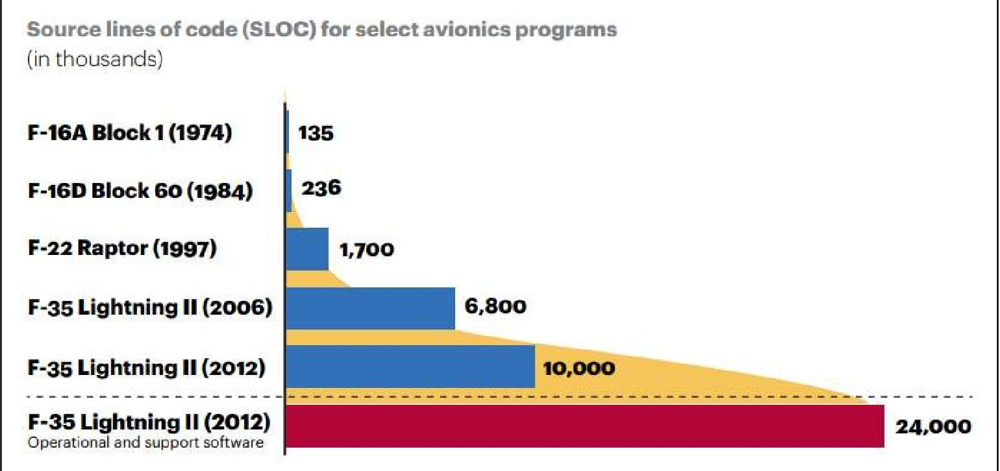


<div align="center">

Figure 1: SLOC for Select Avionics Programs [2]

</div>

Additionally, modern software engineering practices often do not provide support for the management of regression testing necessary to ensure software quality [3]. With the growing complexity of modern systems and a focus on relatively new aspects of system development such

<!-- PDF_PAGE: 16 -->

as cybersecurity, which can add significant testing requirements to normal verification efforts, traditional testing methods are in need of optimization and innovation.

## 1.1. Statement of the Problem

As of 2007, "data from industry show that the size of the software for various systems and applications has been growing exponentially for the past 40 years" [4]. This type of exponential growth directly flows into the size and complexity of the procedures used to test those systems. Also, as products mature and as they are sustained over time, the size of the test suite developed for the product can and will increase significantly [5]. Typically, this type of growth results in a large set of test procedures that evolves over time to create a test suite that could be treated, in some ways, as a product itself. The evolution of this test suite has possibly been carried out by multiple test engineers, adding to a potentially inconsistent style and an additional layer of complexity. This high level of complexity creates the potential for a variety of test-related issues:

- Long test execution times [6]

- Confusing test procedures [7]

- Incomplete test coverage [8]

- Duplicate test procedures with overlapping test scope [9]

- Incomplete requirements tracing [10]

- Inability to focus regression testing on specific functionality [11]

If left uncorrected, these issues have the potential to impact the overall development process in the following ways:

- Inability to quickly release new updates [12]

- Inability to adapt to design changes [13]

- Release of inadequately tested products [14]

<!-- PDF_PAGE: 17 -->

- Wasted test effort for components that did not change [15]

## 1.2. Motivation

The researcher is a Senior Research Engineer in the Quality Control and Test Branch (QCTB) in one of the divisions of the Georgia Tech Research Institute (GTRI) in Atlanta, Georgia, and has associate management responsibilities over the Test Engineering personnel and activities of the branch. As part of those responsibilities, it is within the researcher's purview to provide leadership for test process and technology improvement.

Over the past several years, there has been a significant increase in the amount of Test Engineering work assigned to QCTB. That, along with the researcher's goal of increasing productivity and efficiency, led to the following objectives for the branch:

- Improve the maintainability of test procedure suites

o Smaller systems may have test procedures that total less than 100 pages, while larger systems may have test procedures that span hundreds to thousands of pages.

O Some test procedures have become bloated and confusing, leading to more investigation time when something goes wrong.

- Improve traceability between requirements and test procedures

Requirements mapping is not always consistent among systems.

Depending on the history of the program and customer requirements, some systems have no requirements tracing, while others have requirements tracing to the test steps.

- Reduce test execution times for both minor and major releases

o For simpler or more informal systems (i.e., minor), formal test execution time averages a few days to a few weeks.

<!-- PDF_PAGE: 18 -->

o For the most complex systems (i.e., major), formal test execution time (dry runs and formal acceptance) can reach 18 weeks or more.

- Introduce test automation

Historically, all testing has been performed manually.

Within the last several years, the researcher has been spearheading an effort towards test automation.

- Reduce test engineer training time

Depending on the engineer, proper training (i.e., understanding the system and test process) can take between six to eight months for a complex embedded system and between one to three months for a support tool.

Thus, the researcher has been investigating the application of a combination of Agile development processes, automated testing, and Systems Engineering methodologies to the Test and Evaluation (T&E) domain as a potential solution to some of these factors.

## 1.3. Overview of Solution

The research described herein is an attempt to resolve the issues discussed previously. The solution is attained through three measures:

1. The change to an Agile development process

2. The implementation of test automation

3. The incorporation of Model-Based Systems Engineering (MBSE) concepts

Transitioning to an Agile process modifies the manner in which a product is developed, but it also provides benefits such as increasing the overall product quality, increasing project visibility, and reducing risk. Additionally, including some concepts from DevOps like Continuous Integration (CI) can increase deployment speed by streamlining the process. Specifically for this

<!-- PDF_PAGE: 19 -->

dissertation, the focus of an Agile transition was the impacts to system access for test engineers, team productivity, engineer training time, and the importance of requirements.

While test automation typically refers to the transitioning of test procedures from a manual process (i.e., a test engineer physically completes the steps in a procedure and records the results) to an automated process (i.e., a test engineer develops scripts that perform the actions of the test procedures and automatically record results), the benefits of test automation are far more numerous than only the gains associated with a machine executing the test procedures as fast as possible. These benefits, which are discussed further in later sections, include an increased organization of test artifacts, a higher quality in both the testing of the product and the product itself, decreased test execution times, and the generation of several opportunities to optimize the overall product development process.

The incorporation of MBSE concepts and techniques into the T&E domain provides the potential for a greater understanding of the system, a method of mapping functionality and components of the system, and a strategy for targeting regression testing to increase its efficiency. A system model created for test purposes has the potential to be utilized effectively in ways such as:

- Identifying efficient test points based on stressing operational conditions [16]

- Defining the context for test cases in terms of items such as dependencies, external interactions, and applicable policies and standards [17]

- Analyzing and understanding ambiguous test results [18]

- Providing traceability between system components [19]

- Managing and communicating the scope of regression testing [20]

<!-- PDF_PAGE: 20 -->

## CHAPTER 2: RESEARCH AREA BACKGROUND

The word "testing" has several different nuanced meanings across multiple industries and professions. The definitions of the typical components of testing, validation and verification, have been discussed and elaborated to the point of confusion. For purposes of this research, it becomes necessary to define key terminology and concepts related to the area of testing in order to provide a foundation for the discussion that will follow.

## 2.1. Overview of Testing

Testing involves the evaluation of an item (i.e., a product or system), ascertaining the extent to which it performs its intended role. The general purpose of testing is to identify and eliminate as many defects as possible within the project's resource and time constraints [21]. It also includes the evaluation of quality measures such as defect density, reliability, maintainability, usability, and security.

Testing is typically discussed as being comprised of the validation and verification components [22]. Validation can be defined as checking to make sure that the item that has been produced meets the expectations of its customers. Stated another way, validation assures that the developed product is suitable for its intended role. Verification can be defined as checking that the product conforms to its defined requirements. In other words, verification assures that the developed product performs as designed [21].

## 2.1.1. Traditional Testing Levels

The following sections describe four traditional levels of testing that are typically employed during the development life cycle of a system.

<!-- PDF_PAGE: 21 -->

## 2.1.1.1. Unit Level Testing

Testing performed at the unit level focuses on the lowest level of the system. According to Clune and Rood, "a unit test exercises a single unit (i.e., a function or subroutine) by comparing output generated from a set of synthetic input values with corresponding output values" [23]. Testing at this level generally shows that the individual pieces of software or hardware perform as expected, while ignoring the overall system functionality.

Many modern software applications take advantage of automated unit testing frameworks that encourage developers to create unit tests while initially writing software code [24]. These automated unit testing frameworks, such as CruiseControl or MSBuild, allow unit tests to be planned during the writing of the functional units and repeatedly executed on command. These types of tests help to ensure that a change in the application code did not adversely affect the performance of a separate section of code.

## 2.1.1.2. Integration Level Testing

Testing performed at the integration level focuses on the middle level of the system. This is the point at which the smaller pieces of the system have been unit tested and are ready to be combined into their larger functional blocks. Testing at this level generally shows that all of the smaller pieces of the system can interface with each other and perform according to the specifications for that specific larger element of the system [25].

## 2.1.1.3. System Level Testing

Testing performed at the system level focuses on the highest level of the system. This is normally the point at which functional requirements are tested. Test engineers demonstrate that the system performs the tasks it was designed to perform, typically through a series of stimuli to

<!-- PDF_PAGE: 22 -->

generate a specific behavior. Testing at this level shows functionality of the end-product and satisfies high-level objectives of the system [26].

## 2.1.1.4. Acceptance Level Testing

The purpose of acceptance testing is to prove that the developed system satisfies customer or business requirements in order to qualify for final delivery to the end user [27]. Additionally, acceptance testing can refer to the verification that delivered products from subcontractors or vendors meet the specifications and requirements provided to them. The process of acceptance testing typically refers to a formal event with some degree of participation by the customer. This type of activity is usually summarized in a final test report as part of the formal deliverables for the system.

## 2.1.2. Traditional Verification Methods

Typically, requirements are assigned one or more methods of verification at the time of creation, indicating a general approach to how the requirement will be satisfied. The four traditional verification methods are Demonstration, Inspection, Analysis, and Test.

Demonstration is when verification that the properties, characteristics, and parameters of the item are determined by observation alone. Pass or fail criteria are simple accept or reject indications of functional performance since no quantitative values exist.

Inspection is when verification that a specified requirement is met through visual methods, including physical measurements in order to determine that no deficiencies exist. Emphasis is placed on cables and cabling, safety features, configuration, design requirements, and workmanship.

Analysis is verification through technical evaluations of calculations, computations, models, analytical solutions, reduced data, and representative data to determine if the item

<!-- PDF_PAGE: 23 -->

conforms to the specified requirements. Analyses are not limited to raw data but must contain justification as to how the data verifies that the requirement will be met.

Test is the verification that a specified requirement is met by exercising the applicable item under specified conditions using appropriate instrumentation in accordance with test procedures. Actual measured values are recorded and pass or fail criteria is determined by comparing the measured value to the specified value.

## 2.1.3. Types of Testing

There are several types of testing used to verify the correct operation of a product or system. Some of the more traditional types are discussed below.

## 2.1.3.1. Regression Testing

As parts of a system are modified to add new features or to correct discovered issues, the possibility of inadvertently modifying other related or unrelated components of the system exists. Regression testing involves the execution of a large portion, or sometimes all, of the test procedures of the modified system to provide confidence that those modifications to the system did not unintentionally change the behavior of the other unmodified components of the system [28]. This is typically a significantly time-intensive process, requiring a large effort from the Test Engineering team [29]. It has been estimated that regression testing activities account for up to 50% of software maintenance costs [30]. Therefore, it is important to be able to down-select or prioritize test cases chosen for regression testing to produce the most efficient strategy for verification of the system under test.

<!-- PDF_PAGE: 24 -->

## 2.1.3.2. Black-Box vs. White-Box Testing

The concepts of black-box and white-box testing are related to the test engineer's insight as to the inner workings of the system under test. These terms define from what aspect the test engineer performs the verification of the system.

In black-box testing, the test engineer does not have an understanding of how the system is performing its tasks; they do not have access to its source code [31]. From the tester's perspective, the system responds to inputs with specific behaviors or outputs as defined by the requirements of the system.

Alternatively, in white-box testing, the test engineer is more concerned with the way the system is performing its tasks [31]. White-box testing may include inspections of code to determine the quality of programming logic and the lack of errors. It is a verification that the internal structure of the system meets its specifications.

Both black-box and white-box testing are an important part of the testing process and are focused on different aspects of the system being tested. White-box testing is typically more a part of low-level testing, sometimes performed by the system developers, while black-box testing is traditionally more in line with formal system-level testing performed by test engineers.

## 2.1.3.3. Security Testing

Security testing refers to the exercising of a system in order to identify and correct risks and vulnerabilities that could lead to a compromise of the system. It involves probing system interfaces and connections for exploitable pathways into the system, but it also includes analyzing the internal structure of the system to identify critical programming mistakes or errors that could open the possibility for an attacker to change the way the system works or behaves [32]. For systems with sensitive data, security testing helps develop the body of data needed to support an

<!-- PDF_PAGE: 25 -->

Authorization to Operate certification or approval under the Department of Defense's Risk Management Framework.

With the massive number of networked devices and the daily increase in the number and rate of cybersecurity threats and attacks, a large effort has been increasingly dedicated towards the development of secure systems [33]. The use of a Secure Software Development Life Cycle (SSDLC) promotes the incorporation of secure software practices from the inception of the product [34]. SSDLC processes generally enhance and complement the existing development life cycle chosen for the project by bringing security concerns and design to the forefront of early development discussions.

Verification activities occur at all points along the development process, including "threat modeling for security risk identification during the software design phase, the use of static analysis code-scanning tools and code reviews during implementation, and security focused testing including 'fuzz testing' during the test phase" [35]. Due to the sensitivity of cybersecurity threats, verification that security designs and implementations are correct is necessary to ensure the integrity of the system after development has been completed.

## 2.1.3.4. Functional Testing

Functional testing is typically considered the most basic type of testing. As system functions are highly visible to the end user and are the reason the system was created in the first place, generally a large effort is expended by the test team to make sure the system performs its defined functions. Functional testing involves the examination of a system in order to prove that it can perform a listed set of functions, usually defined by system requirements [36]. Functional testing determines that the system behaves as expected and performs the tasks that it was designed to perform.

<!-- PDF_PAGE: 26 -->

## 2.1.3.5. Performance Testing

As discussed in the section above, a large portion of the testing effort of a system is devoted to the identification of defects that cause crashes or incorrect overall behavior, as these are generally easier to find and more visible to the end user. A specific type of functional testing, performance testing, involves the optimization of system processes, and is somewhat harder to characterize without clear and specific requirements defined against the system.

Performance testing attempts to identify degradation in the operation of the system over time, through an analysis of system behaviors and speed, or through the measured allocations of required attributes such as available memory or processing power [37]. It also examines factors such as robustness, resiliency, and stability in the presence of abnormal environments and conditions. This type of testing often makes use of test cases that introduce various levels of stress to the system by injecting stimuli to which the system must respond. Being able to measure system performance at those various levels of stress help characterize scenarios in which there may be potential for optimization.

An additional purpose of performance testing can be to characterize the maximum performance of the system in extreme conditions. This provides feedback to the design to understand the true capabilities of the system, allowing designers to balance resources or identify opportunities to include additional capabilities.

## 2.1.3.6. Safety Testing

Safety testing focuses on the identification of defects that impact the system's ability to operate safely with regard to its operating environment, end users, maintainers, or other related personnel [38]. These tests may deal with the system's conformance to accepted safety standards

<!-- PDF_PAGE: 27 -->

or codes, or the inclusion of safeguards to protect from unintended consequences of the system operation at inappropriate times.

## 2.1.4. Testing Processes

A discussion of the aspects of the test process is provided below.

## 2.1.4.1. Test Phases

There are various methods of performing the test process defined throughout literature [39]; therefore, it becomes necessary to describe the organization of the test process expected by this research. For this discussion, the test process will be organized into four phases: Test Planning, Test Development, Test Execution, and Test Reporting. These phases are discussed further below.

## 2.1.4.1.1. Test Planning

Proper Test Planning involves full use of a test engineer's abilities to document:

- Organization of testing into sections or groups, typically done to the test case level

- High-level descriptions of the testing to be performed (i.e., pseudo-steps)

- Test case alignment with and tracing to the given requirements for the system under test

- Explanation and rationale for the testing being designed

- Necessary equipment, data, or artifacts to procure or create during later phases

Typically, test plans are organized into a document that describes each planned test case in detail. The information described above is included to present the test engineer's approach to the testing of the system. It is here that the test engineer most utilizes their creativity and experience in order to craft testing that both covers the necessary functionality and stays within the project's budget and time constraints [40].

The Test Planning phase is widely considered one of the most important parts of the test process, but often it is rushed or skipped due to various reasons such as time constraints, lack of

<!-- PDF_PAGE: 28 -->

test engineer training, or insistence by management to see results quickly [41]. Unfortunately, it is sometimes viewed as an optional part of the Test Engineering process, due to the creation of only a preliminary test design, rather than the executable test product. However, investment in the Test Planning phase is vital to an organized, coherent test design that leads to a more sustainable and understandable test suite.

## 2.1.4.1.2. Test Development

The primary purpose of the Test Development phase is to transform the more abstract test plans defined previously into specific, executable, step-by-step test procedures. Minimally, test procedures that are developed contain a list of actions to be performed, a list of expected results that must be observed in order to pass, and a trace to the requirements that drive the purpose of that test case. These test procedures should exercise the functionality of the system under test as described in the Test Planning phase.

To fully understand how the system under test works, usually part of the Test Development phase includes hands-on exploratory or focused testing with the system being developed, depending on the availability of access or maturity of the system. The goal of this early exposure to the system is to:

- Increase test engineers' experience with the system to help guide the creation of test procedures

- Identify any blatant or easily-discovered defects in early builds

- Identify any missing or defective test equipment, data, or artifacts

- Provide feedback on user-experience of the system to developers

During the Test Development stage, test engineers also create any necessary test data or artifacts that are necessary for the execution of the developed test cases.

<!-- PDF_PAGE: 29 -->

## 2.1.4.1.3. Test Execution

The Test Execution phase involves running the tests that were created previously, either by manual or automated means. Test procedures are normally executed a minimum of two times: once to perform an initial test to identify any problems with the test procedures themselves or preliminary defects in the system (i.e., dry run testing), and again for formal acceptance of the system. Any additional runs of the test procedures help build confidence in both the system under test and the procedures used to test the system.

During this phase, any defects that are identified are documented and either resolved through the re-development of functionality or not addressed due to conflicting factors. Both resolved and unresolved defects are logged for the next phase.

Similar to the Test Development phase, there is potentially a period of exploratory testing during the Test Execution phase; however, this testing has a different purpose than increasing test engineers' familiarity with the system. The purpose of exploratory testing during the Test Execution phase is to stress the system in ways that are outside of the bounds of the formal test procedure, with the intention of finding high-rarity or edge-case defects [42]. Due to time and budget constraints, these types of tests are not typically built in to the final set of formal test cases, and as such are generally performed in an ad-hoc manner to take most advantage of a test engineer's experience and creativity in discovering failure points of the system [43].

## 2.1.4.1.4. Test Reporting

In the Test Reporting phase, the results of testing are gathered and summarized in a manner suitable for presentation to internal and external customers. This may include copies of the actual test procedures that were executed, but minimally includes:

- A list of the test cases that were executed

<!-- PDF_PAGE: 30 -->

- The result (pass/fail) of each test case

- A list of defects that were discovered during testing

- A list of known defects

- Recommendations for the resolution of any defects

- A log of test case executions, including who ran the test, when, and where

This phase also includes any final cleanup and storage of test artifacts from the Test Execution phase and sometimes delivery of the test documentation.

## 2.1.4.2. Testing Methods

Testing is performed as either a manual process, an automated one, or one in which both methods are utilized. These methods are discussed below.

## 2.1.4.2.1. Manual Testing

Traditional testing is generally considered to be by a manual method, or by a test engineer physically interacting with the system under test to perform actions and record behavior. The test engineer follows predefined test procedures in order to provide a stimulus, observe a reaction to that stimulus, and record the result manually based on conformance to expected observations (i.e., pass/fail).

## 2.1.4.2.2. Automated Testing

Automated testing refers to the use of software and/or machinery to perform evaluation of a produced item without a human performing the actions necessary to stimulate the item. Generally, automated testing is preplanned by a human using a scripting language or framework to set up scenarios with which to exercise the functionality covered by the requirements [44]. The tester uses his or her knowledge of the system to define inputs and expected outputs to be covered

<!-- PDF_PAGE: 31 -->

by the automation code [45]. The automation framework executes the test scenarios and provides detailed feedback as to the results of the testing [46].

In some cases, automated testing refers to the ability of a piece of software to be pointed at an application and generate tests automatically through the use of machine algorithms [47]. This is typically performed as automatic unit tests or code coverage tests. For purposes of this research, this scenario will not be covered.

Automated testing takes the procedures that would be performed by a human via manual means and executes them automatically through the use of some equipment or application. In many cases, automated testing also relies on the use of software instrumentation messages to inform the testing framework that a specific checkpoint was reached or to output specific data needed for the targeted verification. It requires the creation of test scripts to take the place of manual test procedures [48].

The incorporation of automated testing on a project can produce some or all of the following benefits:

- Organization

Improves test organization and flow

- Increases maintainability of the test procedures [49]

Allows test cases to be maintained like source code

- Quality

Increases quality of test cases

Increases confidence of software under test [50]

Increases quality of the system [51]

Reduces variability of the test approach

<!-- PDF_PAGE: 32 -->

- Removes human error due to execution mistakes [52]

o Removes the need to repeat testing due to incomplete recording of results

- Execution

Allows execution of test cases during off-work hours

- Increases number of test executions significantly [53]

- Opportunity

Allows expansion of testing to components that were too costly to fully test [54]

- Removes the need for an extended, dedicated dry run period

Allows for dedicated exhaustive testing of most important components [55]

Allows for more exploratory testing [56]

## 2.1.4.2.3. Advantages and Disadvantages

Manual and automated testing both have inherent advantages and disadvantages; neither is better than the other, only different. Typically, automated testing complements the manual testing already being performed, and the best testing solution is one that utilizes both methods [57].

## 2.1.4.2.3.1. Perspective

Manual testing is performed in the same manner as an end user of the system would perform actions; therefore, it is a good approximation of the end user experience. Test engineers know how to use the system and can provide usability feedback regarding its design. This high-level (e.g., system-level, integration-level) testing is valuable, but is limited by its perspective. Lower-level testing performed manually, while possible, is generally limited to the Inspection verification method, which is typically the least preferred method of testing. Automated testing provides an opportunity to interact with the system at a deeper level (e.g., unit-level), going beyond what is considered a valuable use of manual testing efforts.

<!-- PDF_PAGE: 33 -->

## 2.1.4.2.3.2. Human Interaction

True exploratory testing, that is, testing without a predefined path, cannot be done in an automated environment. Automation forces testing to be locked into a specific set of predetermined parameters without the ability to change course if a test procedure technically passes [58]. This makes it hard to discover defects that are hiding at the edge of test coverage for that test. Automation thrives in a regression environment, where tests are expected to pass and just need to be executed frequently to ensure nothing has changed unexpectedly; however, it is not usually the best way to discover new issues with the system.

Frequently, experienced test engineers will notice a behavior of the system that, while not violating test expectations, does not seem appropriate for the parameters of the test [59]. Depending on the type of test being performed at the time (i.e., informal vs. formal), the test engineer can either divert from the current test procedures to investigate the issue further, or make a note to come back and investigate at a later time. This is a large source of discovered defects of systems and is a necessary part of the test process.

## 2.1.4.2.3.3. Speed

Automated testing increases the speed at which test procedures can be executed, and also does not require a human to be working while they are being executed [60]. Through the use of Continuous Integration (CI) methods, it is possible for testing to performed on demand, on a schedule, or with a predefined trigger (e.g., any change in the system under test) [61]. This allows for automated testing to be performed almost constantly, with or without a human presence. When comparing this potential to traditional manual testing methods, where a test case may be executed at most two to three times, test case executions are increased significantly [62].

<!-- PDF_PAGE: 34 -->

## 2.1.4.2.3.4. Costs

One of the main problems with a purely manual test process is the labor cost to execute the test procedures. As more tests are developed, it leads to a larger regression period at the end of a test cycle. The cost of executing the entire suite of test cases can be prohibitive, either forcing the development of the system to stop early to accommodate testing or cutting corners on testing and hoping that no show-stopping defects are identified after release [63]. Automated testing shortens that regression period significantly, potentially allowing development to continue further into the overall timeline of the project.

However, automated testing is not necessarily the solution to saving money on testing. While the value of incorporating automated testing generally increases exponentially over time, initial costs to incorporate it are high [64]. Also, for automated testing to be successful, it is necessary to maintain both the automation framework and the test cases themselves.

## 2.1.5. Testing within Traditional System Development Processes

The process of testing takes on different characteristics depending on the development process used. The application of testing within typical system development models is discussed below.

## 2.1.5.1. Waterfall Methodology

In the Waterfall Methodology, credited to Winston Royce in 1970, each step of the development process is performed in a sequential order, with one phase "falling" into the next in a specifically downward trajectory [65].

<!-- PDF_PAGE: 35 -->

A basic diagram of this methodology can be seen in Figure 2 below.


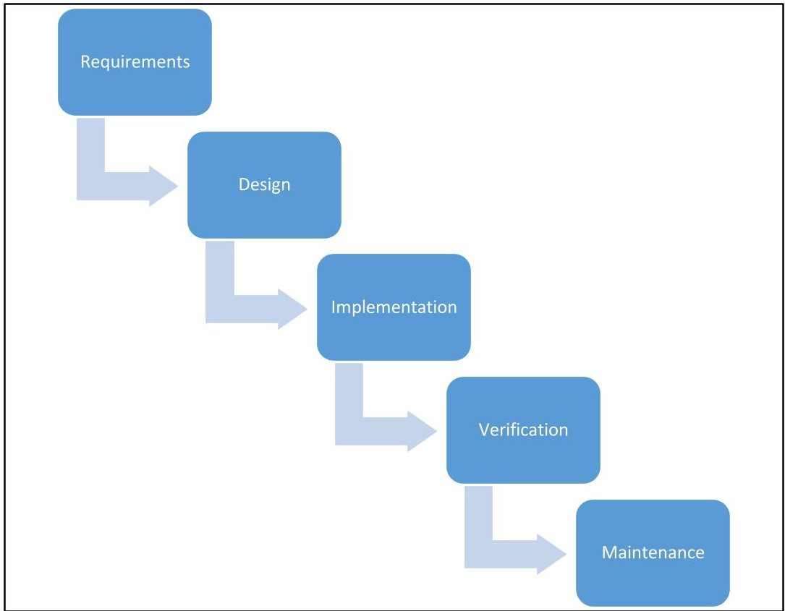


<div align="center">

Figure 2: Waterfall Methodology

</div>

As can be seen by the diagram, verification is the fourth phase in the process. The model assumes that the system being developed has been completely designed and implemented before testing activities can occur. Success of this methodology is highly dependent on well-defined requirements as inputs to design, implementation, and verification. An inherent problem with this model is that it is extremely difficult and costly to move backwards to a previous phase, and even more so to move backwards multiple phases [66]. A basic principle of testing is that the earlier a defect is identified, the less costly it is to fix. Defects found during the system testing phase of a project typically cost around ten times more to correct than defects found during the requirements or design phase [67]. This methodology does not allow for defects to be caught early in the process, therefore causing all identified defects to have a high cost to correct.

Regarding the Test Phases described previously, under the Waterfall methodology, each phase is performed in sequence for all requirements or functionality being tested at once. In other

<!-- PDF_PAGE: 36 -->

words, the test engineer plans all test cases at one time based on requirements and design, then transitions to developing all of the planned test cases, then executes them all together, and finally reports on the entire suite. This method makes it hard to rework test cases based on late-stage changes to the system and requires the test engineer to know everything about the system up front, which is rarely a true assumption that can be made.

## 2.1.5.2. Spiral Methodology

Originally proposed by Barry Boehm, the Spiral Methodology iterates through the following distinct phases:

1. Determine objectives, alternatives, and constraints

2. Evaluate alternatives, identify and resolve risks

3. Develop and verify next-level product

4. Plan the next phase

<!-- PDF_PAGE: 37 -->


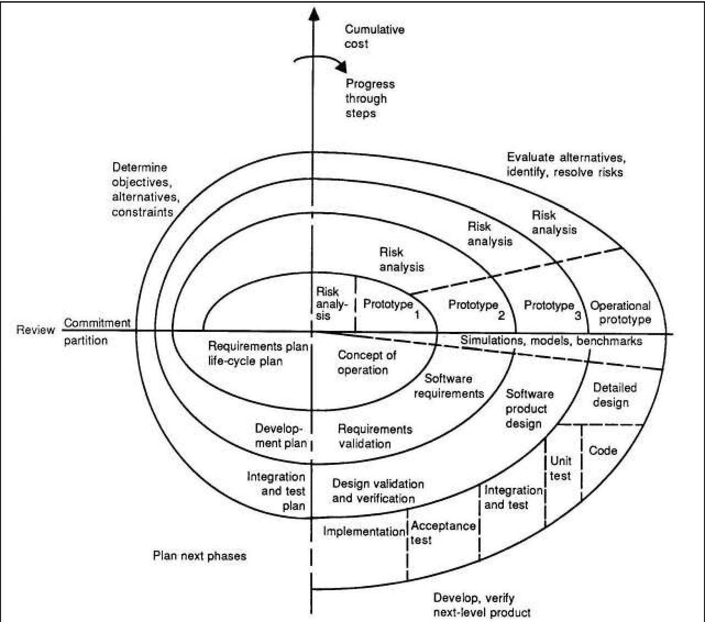


<div align="center">

Figure 3: Spiral Methodology [68]

</div>

This model centers on risk analysis and prototyping in order to qualify the design of the product. A primary motivation for this approach is the idea that requirements are unable to be fully and correctly stated at the beginning of a project, necessitating requirements and design to evolve together as the system matures. Testing within this framework is done within the third stage of the process and is performed iteratively within the sequential cycles of the spiral using the prototype available at the time of the iteration [69]. The test engineer is still responsible for completing all four phases of the test process in order and at the same time, similar to Waterfall, but in multiple iterations as a prototype is built upon over time. This model builds in a way to overcome the problem of late defect identification inherent to the Waterfall Methodology by making several

<!-- PDF_PAGE: 38 -->

passes at testing during the various stages of maturity of the product. However, building in several rounds of iteration through the different stages can be costly, causing this model to work best for large, long-term projects where there is a high likelihood of significant risk [70].

## 2.1.5.3. Agile Development

An Agile development approach is similar to the Spiral Methodology, but with less focus on risk analysis. It is also an iterative approach, sometimes breaking the development of a product into Sprints that are distinct measures of time, usually lasting between one to four weeks [71]. Alternatively, some Agile methodologies break development into small incremental features that are not time-bound. During development, the goal of the team is to focus on specific functionality at a given time rather than the entire planned release. The team generates requirements, creates design, implements the functionality, tests for defects, and releases a build including that functionality added to the core build. As each feature is accomplished, the product gains more features that have been prioritized before beginning the development effort. A fundamental principle of Agile is that each feature or Sprint delivers working code that is fully tested and documented. As a new feature or Sprint is started, the feature list is typically reviewed to verify that priorities have not shifted since the last review.

Testing within an Agile methodology is performed iteratively as part of each Sprint or feature being developed. For each small piece of functionality that is added at a time, the team accomplishes the four phases of the test process before development ends for that piece. A key idea of Agile is that all team members can and should be testers, effectively verifying their own work before it gets officially passed to members of the Test Engineering team [72]. As defects are found, it is intended by the methodology that they are corrected as soon as possible, with the goal of releasing builds without any known issues. The expectation of Agile methods is that the product

<!-- PDF_PAGE: 39 -->

will be fully verified at the end of final development since all new features were verified as they were implemented. However, it is usually good practice to complete a full regression test at the end of new feature development, to verify that no unintended defects were introduced. This is either accomplished through a final test-only Sprint or a period of regression testing after all Sprints have been completed [73].

## 2.2. Overview of Modeling and Model-Based Systems Engineering

The following section provides a brief discussion of modeling and Model-Based Systems Engineering, as this topic is vital to the research described herein.

## 2.2.1. Engineering Modeling

The concept of modeling within the field of engineering refers to the creation of "an abstract generalization or representation of a system" [74], usually for analysis or descriptive purposes. Models can help to describe a system that may be overly complex as a whole; they allow for more in-depth analysis of the interactions between smaller modules of the system. Some types of models include the following:

- Iconic: A scaled down physical representation of the original system

- Visual: A representation of the system graphically

- Mathematical: A representation of the system using mathematical techniques [74]

- Data Processing: A representation of how data flows through the system and is processed by the system

- Composition: A representation of the parts of the system and their related interfaces

- Architectural: A representation of the major subsystems and how they are architected [75] Although several different types of models exist, they are generally categorized into two classifications: descriptive and prescriptive [76]. Descriptive models attempt to define an existing

<!-- PDF_PAGE: 40 -->

system so that it can be studied, possibly for improvement. Prescriptive models attempt to define a system that does not yet exist and can be used as a type of plan for the creation of the system.

Because of their ability to be applied to almost all systems, models are greatly used throughout several types of industries. As an example, mathematical models can be used to describe the interaction of network packets [77]. Different protocols such as TCP, IP, and TELNET can be modeled to help identify possible problems with certain network architectures. Models also play a major role in the oil and gas industry. "Modeling can be a critical success factor in oil and gas company performance because it is a highly efficient means for identifying, planning, and managing production facilities and the corresponding infrastructure" [78]. Using models at these earlier stages of a project, such as requirements definition and system planning, has the potential to create the greatest benefit in terms of program cost and risk. Models have also been used to describe trends in global air pollution, specifically "the intercontinental transport and chemical transformation of O3 between North America, Europe, and Asia using a global chemical transport model" [79]. These models allow scientists to link pockets of air pollution to environmental changes.

## 2.2.2. Model-Based Systems Engineering

The field of Systems Engineering makes great use of models. Through the use of the Unified Modeling Language (UML), and more specifically SysML, systems engineers are able to define models in a standard form. SysML was created as a profile of UML, adding and deprecating specific language features, to more specifically address the needs of Systems Engineering for activities such as requirements management and performance analysis. SysML contains the framework for the creation of several aspects of modeling and includes the following nine types of diagrams [80]:

<!-- PDF_PAGE: 41 -->

- Package Diagram: Provides organization of the model's elements

- Requirement Diagram: Provides textual requirements statements and shows connections between requirements and other model elements

- Activity Diagram: Provides flow-based behavior, including the execution order of actions and inputs, outputs, and controls

- Sequence Diagram: Provides message transmissions between model elements

- State Machine Diagram: Provides depiction of how a model element transitions between states based on events

- Use Case Diagram: Provides functionality of system uses from the perspective of external entities

- Block Definition Diagram: Provides structural model elements, including classification and composition

- Internal Block Diagram: Provides internal structure of a model element, including connections and interfaces

- Parametric Diagram: Provides mathematical/formulaic constraints or relationships used for engineering analysis

<!-- PDF_PAGE: 42 -->

The inheritance relationship between diagrams can be seen in Figure 4 below.


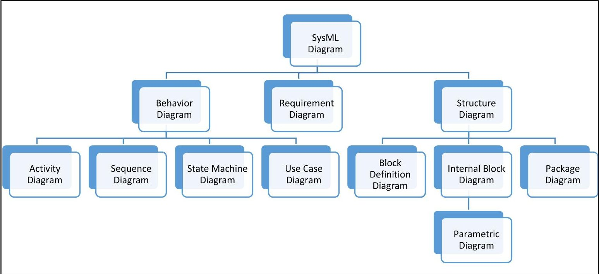


<div align="center">

Figure 4: SysML Diagrams

</div>

These types of diagrams help to define the end system in a way that is recognizable by anyone familiar with SysML. MBSE takes advantage of the power of this modeling language to define a model-driven approach to the development of systems that contrasts the traditional document-driven approach [80]. The International Council on Systems Engineering (INCOSE) provides the following definition of MBSE: "the formalized application of modeling to support system requirements, design, analysis, verification and validation activities beginning in the conceptual design phase and continuing throughout development and later life cycle phases" [81].

While the roots of model-based approaches to engineering are grounded in mid-twentieth century large-scale system development, the concept of MBSE was not introduced formally until Wayne Wymore proposed "a mathematical formulism" for the approach in 1993 [80]. Relying on the increasing power of computing technology and the development of standard modeling languages like UML and its Systems Engineering extension SysML, MBSE has become an increasingly adopted approach since its inception [82].

<!-- PDF_PAGE: 43 -->

The MBSE approach attempts to transition from traditional document-centered system development to a model-based approach to support all system development activities [80]. Under the MBSE approach, the output of the Systems Engineering team is a complete model of the system that can be used to perform activities such as describing system behaviors, specifying relationships between system components, and enhancing the quality of specification and design in a way that is more detailed and dynamic than a set of independent design documents [80].

An example Block Definition Diagram (BDD) and State Machine Diagram are provided in Figure 5 and Figure 6 below.


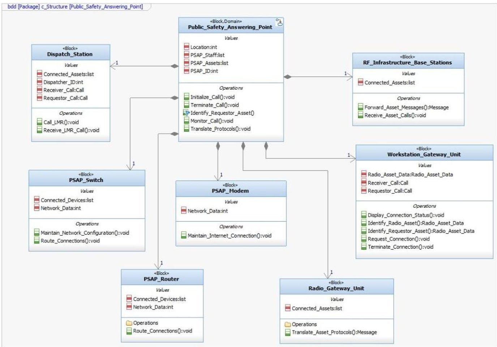


<div align="center">

Figure 5: Example Block Definition Diagram

</div>

<!-- PDF_PAGE: 44 -->


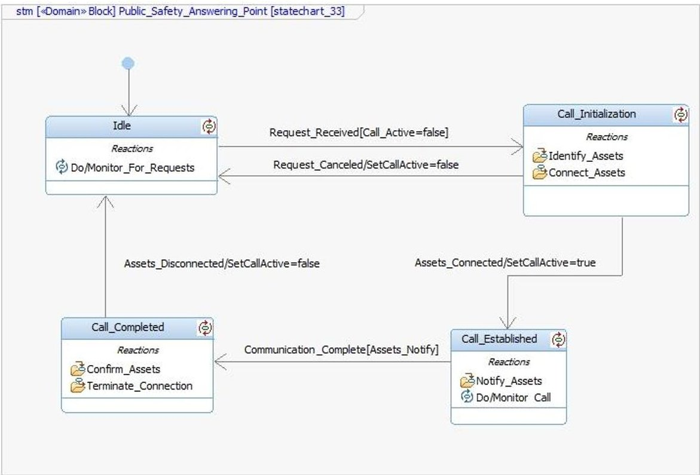


<div align="center">

Figure 6: Example State Machine Diagram

</div>

## 2.2.2.1. Benefits

System modeling is very useful in that it allows for easier analysis of complex systems. Davis, Hertz, and Nelson identify five benefits of modeling [78]. First, it makes resource allocation visible. Modeling helps with resource allocation and management through its ability to set up a framework to identify and record system performance and costs for later analysis. This data can be used to reallocate resources and provide a central management location for several concurrent projects that may share resources. Second, it improves communication. Since a well-defined model should be an easily understood snapshot of the system, it can allow team members to communicate efficiently. Third, it increases collaboration. Models allow all stakeholders to have a detailed description of the system. Decision-making at all levels of the management process for a large system can be performed efficiently and accurately when everyone involved understands the system. Fourth, it increases productivity and quality. A model can help to provide an accurate estimate of required resources. Since modeling helps with resource allocation, productivity and

<!-- PDF_PAGE: 45 -->

quality will increase due to apt application of those resources. Fifth, it provides cost savings. Through the improved resource allocation, communication, collaboration, productivity, and quality, models help to reduce costs. They allow for less waste with regard to resources, materials maintenance, as well as engineering and system redesign.

Friedenthal, Moore, and Steiner extend the benefits of MBSE described above to include three more benefits [80]. First, development risk is reduced. Under MBSE, validation and verification of design and requirements is an ongoing process, leading to a better understanding of the risks associated with the development of the system. Second, knowledge transfer is enhanced. Describing the system in a standard way allows for faster access, analysis, and reuse of domain knowledge. Standard descriptions of the system provide the ability to quickly train engineers new to the system. Third, models can be reused downstream in the process. As the system model is kept up-to-date in near real-time, the models are still accurate after the development of the system has been completed. These models can be used to support downstream lifecycle phases such as operator training, troubleshooting, maintenance, modification, upgrading, and technology obsolescence mitigation.

Finally, Douglass provides three additional benefits of a model-based approach [73]. First, the precision of engineering data is increased. Traditional engineering describes data inputs in terms of textual statements that are open to interpretation. A model restricts that interpretation and removes possible ambiguities. Second, there is greater consistency across work products. A model provides for formal traceability to other information within the model, but also across related information. This traceability within components leads to the ability to fully assess the impact of a change in design or requirements. Third, a model exists as the common source for engineering truth. The development of a model used by the entire team provides a single source for final design

<!-- PDF_PAGE: 46 -->

and specification information. This reduces time wasted due to analysis of conflicting specifications or problems that arise from conflicting documentation of the system.

## 2.2.2.2. Limitations

The limitations of modeling are usually based around the implementation of the model. Models are only as good as the descriptive details used to create them. Faulty models can be caused by bad original source data or even sloppy implementation by the modeler. When a model is created using bad source data, the end result will always be a model that does not represent the original system well. It is important to gather as much pertinent and accurate information about the system as possible before modeling begins; this will guide the model in the correct direction during its creation.

If a system modeler gets too focused on small details, the final model of the system can be overly complex and not understandable to a normal system user [75]. This can also lead to the model becoming too expensive and time-consuming to maintain as the system evolves, leading to its eventual abandonment. Conversely, if a system modeler gets too focused on the high-level details, a model can be created that does not give any useful information about the system. If either of these becomes true, the model has failed its purpose. Lastly, if the model is designed well, there is the additional risk of confusion between the original system and the model [76]. As Ludewig states, "Good models can replace the original very well. Therefore, good models tend to be confused with the original" [76].

A limitation of the model can also be the modeling language itself. If engineers or other stakeholders are not trained to understand the meaning of the different aspects of SysML (or the modeling language chosen), it may be difficult to comprehend the information within the model [83].

<!-- PDF_PAGE: 47 -->

## 2.2.3. Model-Based System Architecture Process Methodology

The primary approach to system modeling used in this research is based on the Model-Based System Architecture Process (MBSAP) methodology as proposed by Dr. John M. Borky and Dr. Thomas H. Bradley in Effective Model-Based Systems Engineering [84]. This process will drive the strategy for how the action of system modeling is performed but attempt not to limit the results of the research. The adoption of a system modeling method is intended to apply a standard technique across all researched systems in order to focus the research on the derived improvements to the Test Engineering domain rather than the implementation of system modeling itself. The MBSAP methodology is summarized in the sections below.

## 2.2.3.1. Overview

MBSAP is an object-oriented Systems Engineering methodology used "as the engine for translating customer needs into delivered solutions that are both effective and elegant and that remain so over the lifetime of the system or enterprise" [84]. It uses the SysML profile of UML as its modeling language standard. This process is an approach to system modeling that focuses on system architecture but has a strong integration with an overall MBSE development approach. MBSAP is a framework, based on proven practices and techniques, developed with the goal of providing systems engineers and architects a methodology for more successful implementation of MBSE concepts [84]. It is an ideal method for demonstrating the benefits of the application of system modeling to the Test Engineering discipline.

## 2.2.3.2. Basic Principles

MBSAP incorporates the following basic principles into its implementation [84]:

- Use of Object-Orientation (OO)

<!-- PDF_PAGE: 48 -->

O A core idea of the framework is the reuse of modules when applicable. If a component has been designed and modeled once, it should still be the same component no matter how many times it is used. This provides for consistency and adherence to the principles of OO such as abstraction, encapsulation, generalization, and others.

- Use of Architectural Models as Core Systems Engineering Process Materials

O The system model should be the basis for understanding, communication, and collaboration when referring to the system. This provides a constant, core knowledgebase that protects against issues due to conflicting information.

- Rigorous Traceability from Requirements to Architecture Components

O A system model should show how the design and specifications of the system flow into the lower level components. Accuracy and clarity of the model must be maintained in order to facilitate proper use of the model.

- Support for Service-Oriented Architecture (SOA)

Many modern systems provide interfaces that behave as services. MBSAP must support this type of architecture.

- Enforcement of Quality Attributes

o Non-functional requirements are not typically well tracked by modeling frameworks. However, to completely cover requirements MBSAP relies on Quality Attributes (e.g., accessibility, modifiability, relevance) to describe and trace these types of requirements.

- Incorporation of Simulation when Applicable

<!-- PDF_PAGE: 49 -->

O The use of simulation is encouraged and supported to resolve architectural issues and to evaluate design.

- Linkage of Architecture to Physical and Virtual Prototypes

O The model of the system is ever evolving and must be flexible to adjust to feedback from the development of prototypes.

- Consistency with Current and Emerging Standards

o Conforming to best practices and established standards in the industry is important to the creation of a relevant architecture.

- Adaptability to Wide Range of Architecture Categories

o As MBSAP is developed as a system architecture process, it must adapt to the current range of architecture types in use today.

- Provide for External Standards and Reference Architectures

- Multiple standards exist that are in use by different segments of the industry for different purposes. The framework should not prevent conformance with those standards.

## 2.2.3.3. Approach

Generally, MBSAP focuses effort on defining the system at the highest level first before drilling down into the lower level components of the system [84]. This is performed by describing the system in terms of three levels or viewpoints.

First is the Operational Viewpoint. At this level, customer requirements are transformed into model elements, creating the foundation for system design [84]. An attempt should be made to keep the design at this stage abstract, focusing instead on overall structure, behavior and information content [84].

<!-- PDF_PAGE: 50 -->

Second is the Logical/Functional Viewpoint. This stage of the process includes decomposing the high-level elements created at the Operational Viewpoint into individual elements with more detailed design information. At this point, the details of how a system performs its tasks is designed, without specifying a specific technology or product [84].

Third is the Physical Viewpoint. At this final level, decisions are made about specific hardware/software used to build the designs from the Logical/Functional Viewpoint. Standards are introduced and the specifics of the implementation of the system are modeled.

Each of the viewpoints described above is further broken down and organized into the following perspectives [84]:

- Behavioral

O Describes action-based functionality of the system (e.g., system functions, class functions)

- Structural

o Describes partitioning of elements and relationships between elements (e.g., components, interfaces, high-level organization)

- Data

o Describes any structure that pertains to specific information within the model (e.g. XML schemas, databases, information categories)

- Services

o Describes behaviors pertaining to a service-oriented function (e.g., message registration, domain services)

- Contextual

o Describes supporting information (e.g., graphics, design documents)

<!-- PDF_PAGE: 51 -->

These perspectives are captured through the use of specific types of model elements that correspond to each perspective [84].

## 2.3. Overview of Model-Based Testing Activities

There are two different aspects of test activities in a model-based environment that are valuable for discussion regarding the proposed research. First is the actual implementation of model-based testing through the use of simulation software. Second are the gains made through the availability of the model when performing test activities. These are discussed further in the sections below.

## 2.3.1. Execution of Modeled Elements

Model-Based Testing (MBT) refers to the use of system representations (i.e., models) to perform verification of system design and/or requirements by generating predefined, executable test scenarios and running them against the model [73]. MBT can also refer to the automatic generation of test cases based on algorithmic extrapolation of modeled pathways [85], but for purposes of this research, MBT is discussed in terms of the first definition.

A core concept of MBSE is the continual verification of model elements throughout the design and implementation phases of system development [73]. MBT accomplishes this by providing a method for verification of design and requirements before the system has been developed [86]. Many leading SysML tools contain utilities for performing validation and verification of the model through items such as automated checking for language violations and using simulation to ensure completeness and correctness. MBT relies on the generation of models that describe system or component behavior, depending on the level of testing being performed [87]. While MBT does not assume that an MBSE approach will be used, MBT and MBSE are complementary practices since they share much of the same data. If a strategy of MBT is to be

<!-- PDF_PAGE: 52 -->

pursued on a project, it certainly reduces the Test Engineering burden if the Systems Engineering or Systems Architecture team is already creating models that support simulation. In terms of SysML, these types of models typically come from the Behavior diagrams subset (i.e., Activity, Sequence, State Machine, Use Case), as they define system behaviors that are verifiable.

With support from MBSE practices, simulation can be a useful tool for Test Engineering when applied at various levels of abstraction of the system. At the operational level, simulation refines the operating environment by identifying factors that provide external stress to the system, which is an important input into creating valid test cases. At the process/workflow level, simulation describes major system behaviors and allows the manipulation of input characteristics; this especially useful when the system has a human-interaction element. At the logical architecture level, simulation provides early feedback as to the accuracy of timing, dependencies, and other internal architecture logic. At the physical level, simulation provides a data source for predicted test outcomes and can help diagnose and investigate issues that arise during testing.

The process of MBT is highly dependent on the method of modeling chosen and the simulation tool used to perform the execution of test cases. Therefore, discussion of this concept will continue only in the general sense.

<!-- PDF_PAGE: 53 -->


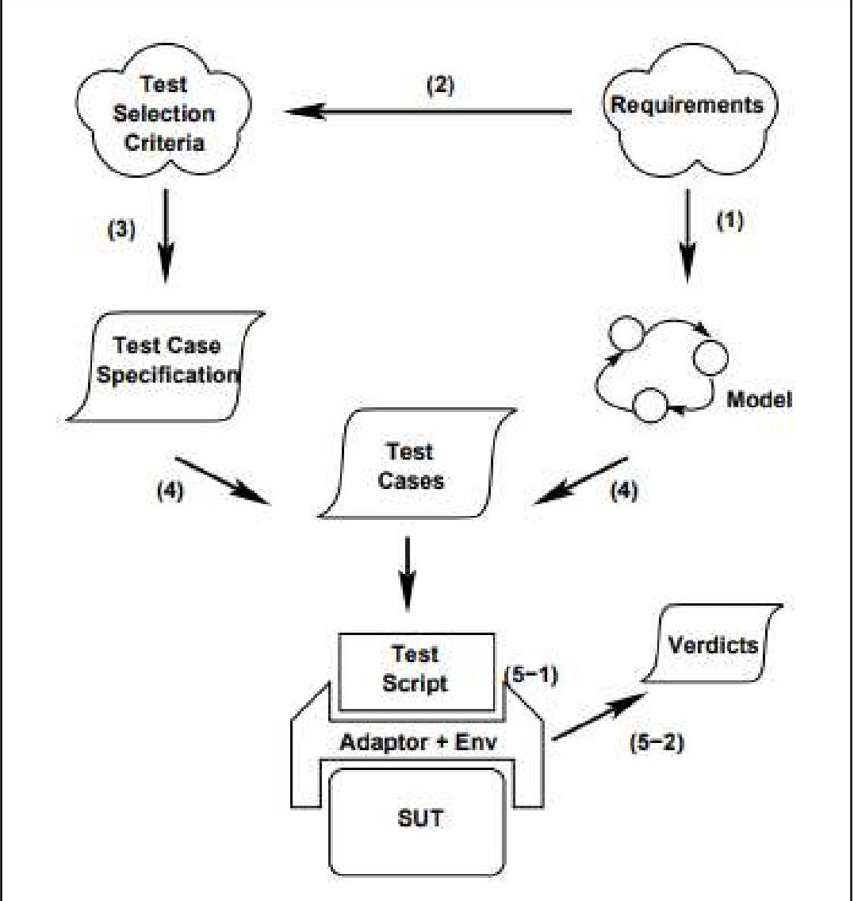


<div align="center">

Figure 7: Model-Based Testing Process [17]

</div>

In this process, Requirements are used as inputs to both the Model (1) and the Test Selection Criteria (2). The Test Selection Criteria are used to guide the creation of a Test Case Specification (3) that defines scope and boundary conditions for certain model elements, components, or interfaces. From there, the Model and the Test Case Specifications lead to the creation of Test Cases (4) that are direct inputs to the executable model driven by the Test Script (5-1). The execution of the model generates a verifiable list of Verdicts (5-2) that determine pass or failure of the original Test Case Criteria selected at the beginning of the process [17].

The intent of MBT is to provide quicker verification that the design is conforming to the requirements by logically checking that the cases defined by the behavioral models are an accurate

<!-- PDF_PAGE: 54 -->

and complete representation of the original requirements. As this is typically performed early in the development process, it helps to find defects potentially before any prototype has been created, reducing costs and rework [88]. Additionally, as these types of tests are driven by software through the model, it lends itself easily to some form of automation. This creates the potential for large increases in test efficiency and coverage due to the replacement of manual testing with automated testing.

## 2.3.2. Benefits of Testing in a Model-Based Environment

In addition to the direct benefits of being able to simulate the execution of the system from the developed models, there are more indirect side effects of testing within a model-based environment that provide additional benefits to the Test Engineering team.

The field of system testing can take advantage of the concept of modeling through the use of simplifying complex systems. A test engineer, especially at the unit and integration levels, needs to be able to analyze the system at a much more detailed level than the end user. Using the concept of abstraction through modeling, these lower-level details can be magnified, possibly allowing a test engineer to see elements that need to be tested further.

Modeling also allows the test engineer to understand the overall system as a whole, giving a greater opportunity to increase efficiency when testing. If a tester is introduced to a new complex system without being able to see well-defined models of it, more time will be taken to understand the system. If accurate smaller-scale models (possibly of modular system elements) are in place, the tester can use these to define test cases before fully understanding the complexity of the system. Especially if the new test engineer already has the ability to understand the modeling language used by the system model, having the system fully defined in a standard way decreases spin-up and training time for new projects.

<!-- PDF_PAGE: 55 -->

The creation and maintenance of a living model of the system also fosters preservation of system behavior descriptions [87]. In many cases, this can be a problem for follow-on efforts if the test cases and scenarios were not properly documented (e.g., not using well-formed and properly stereotyped SysML blocks). The test engineer new to the project may have to spend valuable time examining the test case itself or the test scripts in order to analyze the purpose of the test case. If the model clearly defines system behavior and traces to those test cases appropriately, this type of uncertainty is managed.

Lastly, provided that appropriate dependencies are captured in the model, full traceability between requirements and modules of the system allows for the team to quickly analyze the effects of a requirement or design change, all the way to impacts to test procedures [89]. This traceability also allows the Test Engineering team to more accurately assess which test cases should be executed when a module has been modified, due to the ability to build traceability between test cases and all model elements [90].

## 2.4. Overview of Agile Development Methodologies

Agile refers to a set of values and principles originally described in the Manifesto for Agile Software Development published in 2001 [91]. This document was an attempt by 17 leaders in the software development industry to find common ground among the various trends and processes in the industry at the time. This resulted in the creation of the Agile Manifesto, which provides four value statements discussing the relative priorities of the authors, as well as a list of 12 principles intended to provide helpful guidance for the successful development of software.

Overall, the Agile concept stresses adaptability to change through incremental development to provide customers with high-quality, working software that takes customer feedback into consideration while allowing development teams to use the methods and processes

<!-- PDF_PAGE: 56 -->

that work best for them [92]. Agile is not supposed to be a methodology by itself, but rather a set of guidelines for the creation of an Agile development process that captures the spirit of the original manifesto authors' intentions. While there are several development methodologies that have adopted and built upon the core components of the Agile Manifesto, the two specific Agile methodologies described below are referred to later by this research.

## 2.4.1. Scrum

Scrum is an Agile development methodology that intends for product development to be performed both iteratively and incrementally. It focuses development around periods of time called Sprints which are at most one month long. The expectation of Scrum is that at the end of each Sprint, the developed product is deployable, meaning fully designed, developed, documented, and tested [93]. The product could be delivered to the customer as-is at the end of the Sprint with all included features properly working.

<!-- PDF_PAGE: 57 -->

Figure 8 below displays key roles, components, and activities within the Scrum process [94]. These items are also discussed in more detail below.


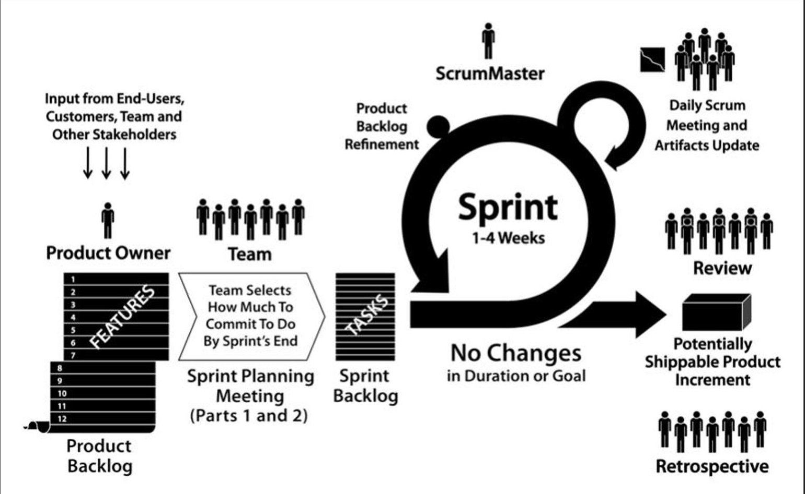


<div align="center">

Figure 8: Scrum Development Process [94]

</div>

## 2.4.1.1. Roles

Roles are important and specific under the Scrum process and are defined further below.

## 2.4.1.1.1. Product Owner

The Product Owner is responsible for the product under development and has final authority for the decisions made with regard to the direction of the product. They are tasked with continually identifying and prioritizing features that the product will have, which feed directly into the work that the team will perform. The Product Owner has to have knowledge of what features will provide the most value for the product, taking into consideration items such as satisfying customers, meeting strategic objectives, and managing risks [94].

<!-- PDF_PAGE: 58 -->

## 2.4.1.1.2. Scrum Team Member

The Scrum Team is responsible for building the product that the Product Owner describes through the list of features. Ideally, the team is between five to nine people with cross-functional skills that provide the ability to accomplish any task given to them without bringing in external help. The team is also responsible for organizing and managing itself without the need for a traditional project or functional manager [95].

## 2.4.1.1.3. Scrum Master

The Scrum Master is responsible for providing Scrum expertise to empower and facilitate the rest of the Scrum Team to function optimally. They serve as a coach and mentor, protecting the team from external interference and solving facilitation problems that may arise throughout the project [96]. They are not a manager and do not have any power over the team other than to ensure that the Scrum process is followed. They support the team however they can.

## 2.4.1.2. Components

The components of the Scrum process are described below.

## 2.4.1.2.1. Product Backlog

The Product Backlog is the entire list of features or tasks for the product that is managed by the Product Owner. This is where the Product Owner prioritizes items for the team to work. Each item typically includes at least a description of the work to be done and an estimate to complete it. The Product Owner continually assesses the priorities of the Product Backlog to ensure that the highest value items are at the top of the list (i.e., to be worked before other items).

<!-- PDF_PAGE: 59 -->

## 2.4.1.2.2. Sprint Backlog

The Sprint Backlog is the subset of the Product Backlog that the Scrum Team is actively working in a Sprint. Each item is typically broken into smaller tasks to facilitate easier conceptualizing of the work that is to be performed.

## 2.4.1.2.3. Velocity

Velocity refers to the amount of work a Scrum Team can accomplish in a Sprint. It is dependent on estimates assigned to each item that is worked and is the mechanism by which a team understands how much work can be committed to in an upcoming Sprint.

## 2.4.1.3. Activities

Activities of the Scrum process are described below.

## 2.4.1.3.1. Sprint Planning

Sprint Planning is the process by which the items to be worked in a Sprint are chosen. This activity involves the entire team. The Scrum Master facilitates the meeting and provides Scrum guidance when necessary. The Product Owner communicates the highest priority items in the Product Backlog and explains their perspective with regard to these items. The team determines how they will break up the items in the Product Backlog and decides how many items they will commit to completing for the upcoming Sprint. Those items are transferred to the Sprint Backlog and work begins on the Sprint.

## 2.4.1.3.2. Daily Scrum

During execution of the Sprint, the Scrum Team gathers for a quick meeting every day called the Daily Scrum. The purpose of this meeting is for each team member to communicate the following three items to the rest of the team:

## 1. What did you accomplish since the last meeting?

<!-- PDF_PAGE: 60 -->

2. What do you plan to accomplish by the next meeting?

3. Is there anything blocking you from accomplishing work?

The Daily Scrum is supposed to help the team coordinate their actions and identify any problem areas that need to be discussed further or resolved. It typically will lead to follow-on meetings with less than the full team to help other team members or resolve problems.

As the team is supposed to be self-managing and mostly self-sufficient, Scrum discourages managers from attending the Daily Scrum. It is expected that if the team has a problem that must be resolved by a manager or someone with authority in that area, the team will seek out that person when needed.

## 2.4.1.3.3. Backlog Refinement

At some point during the Sprint, the entire team meets again for the Backlog Refinement activity. This purpose of this activity is to look forward to ensure that the next one or two Sprints are adequately defined and prepared to be pulled into a future Sprint. This could include requirements analysis, item decomposition, and estimation activities. Backlog Refinement is necessary to keep the team's operation running smoothly for future Sprints.

## 2.4.1.3.4. Sprint Review

At the end of a Sprint, the Sprint Review activity is an opportunity for the entire team to communicate about the direction of the product. It is to encourage discussion between the team and the Product Owner, through the use of a demonstration of developed functionality, to align the vision for the product with what is being built. It is also an opportunity to invite other stakeholders to a discussion about the product to solicit feedback on the current state of the product.

<!-- PDF_PAGE: 61 -->

## 2.4.1.3.5. Sprint Retrospective

While the Sprint Review is product-focused, the Sprint Retrospective is process-focused. The purpose of this activity is to identify process-related successes to be celebrated and improvement opportunities that should be worked. It occurs at the end of a Sprint after the Sprint Review. There are many possible ways of performing the Sprint Retrospective, but the basic concept is to identify a list of things that went well (i.e., successes) and things that could have gone better (i.e., improvement opportunities) [97]. The end result is to define an action plan to try to make the process better in the next Sprint.

## 2.4.2. Kanban

Kanban is also an incremental development methodology; however, instead of focusing on a strict time period to complete a set amount of work, restrictions are placed on how many items can be worked at a time [98]. This is referred to as limiting work-in-progress (WIP) and is a core principle of the Kanban methodology. Kanban is not an iterative process (i.e., there are no Sprints), but rather focuses on pushing features through the process with an end result of deployment for that feature. In Kanban, the product can be ready to deploy at any time, but only with those features that have been fully transitioned through the entire process.

## 2.4.2.1. Kanban Board

The Kanban board is the central organization mechanism for the Kanban process. A basic Kanban board includes three columns: To-Do, In Progress, and Done. Each column has a limit for how many items can be in a column at a time, with the goal of maximizing productivity by keeping everyone focusing and working while also limiting the scope of what team members should be working on at any given time [99]. More complex Kanban boards could have additional columns

<!-- PDF_PAGE: 62 -->

to further refine the process, but the basic idea remains the same: a Kanban team should only be working on a set number of items at a time in order to keep them focused and productive.

## 2.4.2.2. Roles

Unlike Scrum, in Kanban there are no specific roles for team members. Teams are not necessarily cross-functional and can bring in needed resources as required. A Product Owner may still be involved, but only to prioritize the Product Backlog that feeds the Kanban board. Teams are expected to manage themselves as necessary to get the work done.

## 2.4.2.3. Cycle Time

The main metric for the Kanban estimation is Cycle Time. This refers to the amount of time it takes for a feature to travel through the entire process. It is used to estimate how much work can be done over a time period, forecasting how long it might take to build a set of features for a specific product.

<!-- PDF_PAGE: 63 -->

## CHAPTER 3: SYSTEM DESCRIPTION

The system used as the basis for this research, named System X for discussion purposes in this dissertation, is an Electronic Warfare Management System (EWMS), which interfaces with onboard and offboard aircraft systems to receive and process the threat environment, providing the pilot or crew with a response solution for the protection of the aircraft. It also controls integrated systems to provide a unified response to threats.

System X is fielded on multiple aircraft platforms that have major differences in installed avionics and other mission specific systems. While System X hardware is mostly common across platforms, System X software includes significant differences between platforms due to the uniqueness of each platform and the preferences of operators. A major challenge in the development of System X is the maintenance of common functionalities while also adapting to these differences among platforms.

GTRI's role in the development of the system is to upgrade and sustain the internal software, and on occasion the hardware, of System X, providing modern EW capabilities for the older aircraft platforms that operate with System X installed.

## 3.1. Previous Development Process

The development process for System X has historically been Waterfall. The overall project included a typical set of milestone events (e.g., System/Software Requirements Review (SRR), Preliminary Design Review (PDR), Critical Design Review (CDR), Formal Dry Run Testing, Test Readiness Review (TRR), Formal Testing, Release), with a customer-provided list of Change Requests (CRs) for a specific release. Those requirements were translated into system and component-specific requirements, which were used as the basis for design, development, and

<!-- PDF_PAGE: 64 -->

testing. Representatives from each functional discipline (i.e., Systems Engineering, Software Engineering, Test Engineering) performed their respective tasks to complete the list of CRs. At the end of development, the Test Engineering team performed a formal test procedure dry run and an acceptance test to verify functionality in a lab environment before release. Formal validation of the release was performed at Flight Test after delivery to the customer.

## 3.2. Process Improvement Opportunities

System X has been an on-going project at GTRI for more than 20 years. While GTRI has remained modern with regard to technology used during the development lifecycle (e.g., process management software, lifecycle development software, coding practices and standards), the overall development process for System X had mostly remained the same Waterfall approach. Additionally, the longevity and increased scope of System X over the years resulted in a few shifts in the process that provided opportunities for improvement.

## 3.2.1. Multiple Releases

When System X was first developed, it supported only one aircraft platform. Over time, with the success of the System X project, it expanded to a total of four aircraft platforms. Each of these platforms included a different version of System X for a release, due to the differences inherent to the aircraft. These platforms all had different schedules that needed to be coordinated, leading to multiple releases of similar, but different, versions of System X that were continuously in work.

The history of the development of System X created an environment where each release for each platform was treated as a separate project. The top level of project management stayed the same, but the teams were almost always on parallel and separate paths. Sharing of related

<!-- PDF_PAGE: 65 -->

functionality and documentation was performed, but always required a port of functionality rather than pulling from a truly common baseline.

This provided an opportunity to deliberately consolidate the multiple paths of System X development, creating a common basis for all supported platforms.

## 3.2.2. Requirements

At the beginning of System X, the customer did not provide any requirements beyond an initial mandate to provide a set of new capabilities. Eventually, as the project matured, it was treated less as an experiment and more as a formal product. This led to an inherent problem where requirements development was always trying to catch up with the state of the system. Over the years, multiple pushes to perform proper requirements analysis and rework were mostly successful; however, requirements must be constantly maintained. Periodic rework is costly and cannot keep current with the state of the system. The customer and the development team found themselves in a place where requirements were no longer the driving force behind the development of System X; rather, CRs from the customer became the basis of discussion regarding system functionality. Requirements development was still performed, but less emphasis was placed on keeping them consistent or properly traced to documentation.

This provided an opportunity to rethink the development, tracking, and maintenance of requirements.

## 3.2.3. Documentation

Historically, documentation is a problem area for most large-scale engineering projects. While there is usually a large amount of documentation that is created, it tends to be overwhelming, low-quality, and constantly out-of-date [100]. The documentation for System X suffered from these problems as well. Documentation was typically performed after the project was mostly

<!-- PDF_PAGE: 66 -->

developed, rather than at the time of development, leading to extra cost, potentially forgotten aspects of functionality, and rushed work.

With regard to the test documentation, the test procedures had been worked and reworked multiple times throughout the history of the project. This created a variety of different testing styles and strategies incorporated into the test documentation. Additionally, the test suite included multiple test cases that should have been one-time tests (e.g., testing a corrected defect), but were left in the core of the regression test. While this created highly thorough and detailed tests, it also created bulky, confusing, and overall less valuable test procedures.

This provided an opportunity to develop a new method of documentation that would be more sustainable.

## 3.2.4. Regression Timeline

Due to the size of the test procedures being developed for System X, the time to execute the full suite of test procedures was incredibly long. As an example, 18 weeks was dedicated to the regression period for the last release of System X performed with the old process. This was time dedicated to dry run and formal acceptance testing, with the expectation that no new development was on-going. To put this in perspective, an overall period of performance (i.e., project initiation to release) for a System X project is normally 6-18 months.

This provided an opportunity and desire to decrease test execution times from both GTRI and the customer.

## 3.2.5. Team Knowledge and Training

The development of System X was highly technical, requiring its engineers to attain a depth of knowledge that only comes through years of experience. That, combined with the size and scope of the project, made training new engineers to the project a time-intensive and costly experience.

<!-- PDF_PAGE: 67 -->

Jumping in and being productive quickly was very difficult, especially when only a small number of people knew everything important about the system. The Waterfall process did not make this any easier, as coming on to the team in the middle of the project meant the new engineer had missed all of the important conversations and meetings about all of the functionality changes.

Additionally, due to the nature of project organization, there was a lack of cross-functional teams. While the integrated teams worked well together and were successful, the representatives from each discipline (i.e., Systems Engineering, Software Engineering, and Test Engineering) worked on the tasks that were related to that functional team only. This style of system development created many experts who were highly knowledgeable about their specific function but did not have much knowledge at all about the rest of the project.

This provided opportunities to lower the learning curve for new engineer productivity and share knowledge cross-functionally.

<!-- PDF_PAGE: 68 -->

<div align="center">

# CHAPTER 4: CONCEPT APPLICATION

</div>

A potential solution to the Test Engineering process challenges mentioned previously is provided through the application of Agile development, automated testing, and MBSE concepts.

## 4.1. Agile Transition

The first concept applied to the development of System X was a transition to an Agile development method. The history of Agile within System X's organizational division and the specifics of the implemented process are described below.

## 4.1.1. Organizational History of Agile

Traditional projects within System X's organizational division have always been performed using the Waterfall development process, mainly due to the strict set of milestones and deliverables associated with a project in the defense industry. However, with the rising popularity of Agile development methodologies, some new projects over the past few years were identified as being good candidates to try an Agile process instead. During the researcher's involvement as a Test Engineering manager with these projects, the following characteristics were observed as being common among each:

- Limited customer involvement

- Limited deliverables

- No expectation of formal milestones

- No adherence to a strict formal meeting schedule

- A single delivery at the end of the project

- Relatively smaller scale and scope

<!-- PDF_PAGE: 69 -->

Theseсистемичности allowed for a flexibility that would facilitate the adoption of an Agile approach much more easily than a project that had rigidly formal timelines and delivery expectations. Therefore, it was decided to experiment with some variety of Agile, typically Scrum or Kanban, to organize and execute the development process.

In the end, all of these projects were successful in terms of customer satisfaction with the delivery of the end product; however, most of these projects failed with respect to their adherence to and implementation of Agile methodologies. For the most part, these projects defaulted back to a predominantly Waterfall approach with a variety of loosely adhered to Agile components. Through an analysis of why Agile was discarded, certain trends appeared. For these projects, the adoption of Agile mostly failed due to:

- A project manager unfamiliar with, and unwilling to learn, Agile principles

- A project team that was dedicated to multiple projects at varying percentages

- Inept implementation of Agile (e.g., too strict or too loose)

- Lack of understanding and training

- Improper planning (e.g., too much or too little)

- Unwillingness or lack of buy-in from the project team

For these projects, when the execution of the project with an Agile process became too tedious, plans were quickly discarded and the team returned to a familiar process that would facilitate the results necessary to get the job done, albeit less efficiently.

On the other hand, a few projects succeeded both at project execution and the application of an Agile process. Those projects differed due to:

- Experienced and dedicated leadership on both the project management and technical sides

- A project team dedicated only to that project

<!-- PDF_PAGE: 70 -->

- Willingness among the project team to learn new concepts and put them into practice

- Structured, but flexible, planning of the project

- Complete buy-in from the project team

- Customer awareness of the implemented Agile process

The combination of the previously listed project characteristics and the above positive trends provided a scenario in which the adoption of Agile processes on these projects could succeed.

## 4.1.2. Change to Agile

Before the transition to Agile for System X, there was not a large-scale, sustained program that had decided to fully adopt and transition to an Agile development methodology within System X's organizational division.

With the knowledge of the history of Agile implementations described above, there were several considerations that factored into the way Agile methodologies were applied to System X. It was clear that, for a development effort to be successful for System X, the following needed to be true:

- Knowledgeable project management and technical leadership

- Agile training for team members

- A dedicated team with limited obligations to other projects

- A clear process that was structured while still flexible

- Clear communication with customers regarding the changes to historical processes

Additionally, several aspects of the project's process needed to change to best foster an environment that supported Agile development.

<!-- PDF_PAGE: 71 -->

## 4.1.2.1. The Researcher's Role

Before describing the process modifications that were made, it is necessary to define the role of the researcher during the Agile transition. Before the change to Agile, the researcher served as the Test Engineering manager for System X, providing supervision and leadership for all Test Engineering activities for System X. The main push to change to an Agile process was initiated by the System X Lead Engineer at the time, who designed most of the initial structure of the process. As part of System X leadership, the researcher helped the Lead Engineer with this initial design and was the driving force for several of the process improvement that occurred during the initial steps of the transition. After the transition, the researcher assumed the role of Lead Test Engineer on the System X Discipline Leadership Team that is described further below.

## 4.1.2.2. First Steps

To support a new process, the following prerequisite tasks needed to be accomplished, either before, or at least concurrently with, the adoption of an Agile methodology in order to support the new process.

## 4.1.2.2.1. Product Reorganization

System X supported multiple aircraft platforms in different configurations. The first task was to consolidate the multiple System X variants into a common releasable product, keeping the following goals in mind:

- Document commonality of features among all platforms

- Merge code that should be shared

- Unify interface menu structures and displays

<!-- PDF_PAGE: 72 -->

This was a large task that was mostly worked in the background before transitioning to an Agile process. It was a necessary step to lay the groundwork for requirements reanalysis and test restructuring.

## 4.1.2.2.2. Release Timelines

In the past, each release had different timelines and development schedules. Each of these releases necessitated a lengthy regression testing period to ensure that the product was still working as expected in addition to the formal testing of new features. To support the new process, the various schedules were purposely aligned into a single, yearly release. With the product becoming common to all platforms, this delivery schedule was intended ensure a formal delivery in a regular rhythm that could be anticipated. It also allowed for regression testing to be performed for all platforms at the same time, reducing the number of test cycles per year.

## 4.1.2.2.3. Development Tools

Historically, System X used a single, monolithic development lifecycle tool in combination with Microsoft Office to perform within a Waterfall development process. This tool was outdated and not adequate for supporting a modern product development process.

There are several development tool suites available that are helpful for productivity in an Agile environment [101]. GTRI as an organization had decided on the Atlassian suite of tools (e.g., Confluence, BitBucket, Jira) to support future Agile projects, so those tools were chosen to support future System X development.

## 4.1.2.2.4. Documentation Methods

Constantly updated documentation is an expectation in an Agile environment; however, traditional tools to create documentation (e.g., Microsoft Office) take significant time to use and can be burdensome with regard to formatting. In order to increase documentation productivity,

<!-- PDF_PAGE: 73 -->

traditional word-processor developed documentation was reworked. The team transitioned to a process of using lightweight markup languages such as LaTeX or reStructuredText to build documentation automatically from team-developed plaintext content into polished deliverables. In this way, when a change occurs in the future, the team would just have to edit the source material for the change and will not have to worry about correctly formatting a document.

## 4.1.2.2.5. Employee Commitment

Based on the examples of Agile development within System X's organizational division, having the team's time dedicated to one project for its duration was an important factor in the project's successful implementation of an Agile method. Leadership for the System X project worked with organizational managers to obtain a commitment for a core part of the System X team to stay dedicated to that one project per release cycle (i.e., one year). The expectation was that more team members could be added if necessary, but the core set would not be pulled off to do something else unless there was no other choice.

## 4.1.2.2.6. Agile Knowledge and Training

Strong leadership in Agile concepts and training for involved personnel was also seen to be an important factor for success. The Lead Engineer for System X was the driving force in the push to adopt Agile practices and was a key developer for the process that implemented. He was also a certified Scrum Master, providing a large amount of knowledge for the transition. Additionally, the core team members were provided with formal training in the Scrum process, which provided a good foundation for the change in processes.

## 4.1.2.2.7. Automated Testing

To support quick turnaround of features and an Agile development methodology, testing had to move from a manual process to an automated one. Test automation was already completed

<!-- PDF_PAGE: 74 -->

for one of the support tools for System X, and so that automation framework was deployed for the testing of System X itself. Automated testing is discussed in later sections, but it is mentioned here as it is interconnected with the change in System X's development process.

## 4.1.2.3. New Process

With the previous prerequisite steps resolved, it was necessary to define a new process that would support the development of System X and embrace the concepts of Agile methodologies. The core of the new process that was created inherited features of the Scrum methodology, but with adjustments to fit the unique aspects of System X's development requirements and necessary processes. Additionally, some DevOps techniques were also incorporated to streamline the build process. The details of the new process are described below.

## 4.1.2.3.1. Team Organization

Under the traditional Waterfall process, the different discipline teams (i.e., Systems Engineering, Software Engineering, Test Engineering) functioned mostly on their own to accomplish the discipline-specific tasks associated with the features being developed. Each team was siloed according to their function, with limited interaction until a component was passed from one group to another (e.g., system requirements passed from Systems Engineering to Software Engineering to work software requirements, or software passed from Software Engineering to Test Engineering after a formal build was created). This is the natural way that teams interact when using a Waterfall methodology.

For the new process, functional discipline teams were broken up to create cross-functional teams consisting of at least one systems engineer, one software engineer, and one test engineer. The new team organization structure for System X is shown in Figure 9 below.

<!-- PDF_PAGE: 75 -->


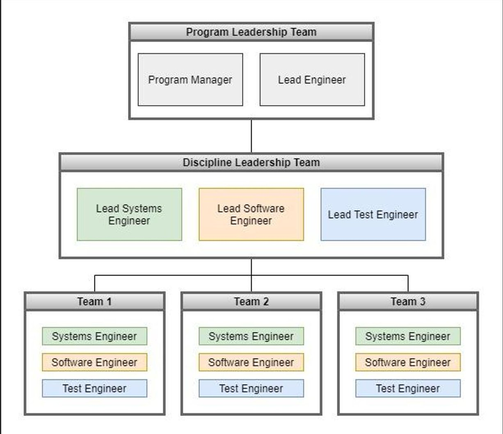


<div align="center">

Figure 9: New Team Organization

</div>

Based on the number of available team members and the amount of backlog work to be performed, the number of teams could grow or shrink; the only requirement was that each team must have at least one engineer from each discipline.

## 4.1.2.3.1.1. Roles and Responsibilities

As in traditional Scrum, specific roles must exist to support the process. A description of each role and their expected responsibilities is detailed below.

## 4.1.2.3.1.1.1. Program Manager

The Program Manager is responsible for high-level budgeting, scheduling, contract management, facilitating formal customer meetings, and other project support activities. They help

<!-- PDF_PAGE: 76 -->

bring in future work and secure resources and personnel to accomplish the work; however, they have almost no interaction with the Scrum process or project teams.

## 4.1.2.3.1.1.2. Lead Engineer

The Lead Engineer functions as the Product Owner for System X. They are also the primary technical interface with the customer. As in a traditional Scrum process, in the role of Product Owner, the Lead Engineer is responsible for translating customer requests into items in the Product Backlog and keeping that list of items prioritized. The Lead Engineer is the main source of technical expertise on System X, and as such, has the final say with the technical direction and decisions made for the project.

## 4.1.2.3.1.1.3. Discipline Leads

The Discipline Leadership Team consists of three experts in the respective fields of Systems Engineering, Software Engineering, and Test Engineering. They are responsible for providing guidance in their areas of expertise for the Scrum Teams working on items in the backlog. They are not officially part of a Scrum Team that works on specific Tasks, but rather they are expected to help any team that needs it. The Discipline Leads also help the Lead Engineer with Product Owner tasks when necessary.

## 4.1.2.3.1.1.4. Scrum Teams

As mentioned above, a Scrum Team consists of at least one representative from each discipline. However, they are encouraged to share responsibilities across disciplines and learn how to perform tasks for other team members. As in traditional Scrum, the team is expected to be crossfunctional, ensuring that all necessary skills to perform Tasks are located within the team. Team members work together to accomplish Tasks from the Product Backlog within a team-specific Sprint.

<!-- PDF_PAGE: 77 -->

## 4.1.2.3.1.1.5. Scrum Master

Unlike the traditional Scrum process, there is no Scrum Master role specifically carved out in this process. The System X program could not support separate Scrum Masters for each team dedicated to that role, there was a lack of trained Scrum Masters available, and the needs of the project did not support that type of role. Therefore, the process expects that the Lead Engineer and the Discipline Leads would share the responsibilities of Scrum Master for each of the Scrum Teams.

## 4.1.2.3.2. Components

The components of the new Agile process are described below.

## 4.1.2.3.2.1. Sprints

Each Scrum Team performs work under its own, independent Sprint. These Sprints are planned to be two weeks, with the ability to shift duration as necessary to adjust for holidays, project milestones, and other schedule-impacting events. It is expected that each team will stay consistently aligned with regard to Sprint start and end dates. Maintaining and coordinating Sprint timeframes is a responsibility of the Leadership Team.

## 4.1.2.3.2.2. Product Backlog

The Product Backlog is the full list of all Tasks to be performed for System X. This feeds the backlogs of each of the Scrum Teams and is managed by the Lead Engineer with the help of the Discipline Leads. The Product Backlog helps the Lead Engineer communicate priorities with the team.

<!-- PDF_PAGE: 78 -->

## 4.1.2.3.2.3. Team Backlog

The Team Backlog is the list of Tasks that a single Scrum Team has been assigned. It is a subset of the Product Backlog and helps the Leadership Team queue Tasks that are to be accomplished by a specific Scrum Team in upcoming Sprints.

## 4.1.2.3.3. Activities

All activities from the traditional Scrum process are preserved under this new process, but with some modifications to support the new team organization. The differences are described below.

## 4.1.2.3.3.1. Sprint Planning

Sprint Planning happens at the beginning of each Sprint. Each Scrum Team conducts their own planning meetings and decides what work the team will commit to for the next Sprint. Ideally, the team pulls items from the top of their Team Backlog, as the Team Backlog should contain a prioritized list of items assigned to that Scrum Team. The Lead Engineer and the Discipline Leads are expected to attend each of the team's Sprint Planning meetings to provide guidance when necessary.

## 4.1.2.3.3.2. Daily Scrum

Each team meets daily, similar to traditional Scrum, to discuss previous accomplishments, plans, and roadblocks. Daily Scrum meetings are mandatory for team members, and optional for the Leadership Team. It is expected that at least one member of the Leadership Team attends each Daily Scrum, so that the Scrum Team has quick resolution to any potential roadblocks that may be discussed.

<!-- PDF_PAGE: 79 -->

## 4.1.2.3.3.3. Backlog Refinement

For the Backlog Refinement activity, all teams, including leadership, meet as one group to perform the traditional refinement process. However, the initial part of the meeting is dedicated to whole group discussion so that anything that needs to be covered for the entire System X team (e.g., a change in customer direction) can be discussed. Also, the Lead Engineer uses that time to make sure all teams are aware of the highest priority Tasks that have been queued for assignment. This is a time for the Scrum Teams to ask any specific technical questions as a group about those items to aid in their future refinement.

After the initial whole group meeting is completed, each team breaks from the whole and performs their own Backlog Refinement activity with their individual groups. In these breakout sessions, each team has the following goals:

- Identify or reassess the next set of Tasks that will fill the next two to three Sprints for that team

- Define Subtasks that will be performed under each of those Tasks

- Identify any potential blockers for those Tasks and Subtasks so that the Leadership Team can address them before the Task is assigned to a Sprint

During this time, members of the Leadership Team float between the different breakout sessions and provide guidance when needed. This guarantees the Scrum Teams access to members of the Leadership Team on a weekly basis to discuss any technical questions they may have about future Tasks.

<!-- PDF_PAGE: 80 -->

## 4.1.2.3.3.4. Sprint Review

For Sprint Review meetings, all teams come together to demonstrate what they accomplished during the Sprint. It is a combined meeting so that all teams are able to keep current on the work being performed by the other teams.

## 4.1.2.3.3.5. Sprint Retrospective

All teams meet for a combined Sprint Retrospective meeting that is performed in a way similar to traditional Scrum. Conducting a combined meeting allows all teams to discuss and contribute to everyone's successes and improvement opportunities.

## 4.1.2.3.4. Schedule

As previously described, the schedule for System X was changed to a yearly release to accommodate the change to an Agile methodology. This change in schedule necessitated a new rhythm for customer interaction due to the lack of regular Waterfall milestones around which traditional meetings could be planned.

## 4.1.2.3.4.1. Traditional Waterfall Process

Traditionally throughout a typical development cycle, the following customer events would be scheduled to align with the phases of Waterfall development:

- Project Kickoff Meeting

O Initial planning to start the project and determine the initial expectations for what will be accomplished

## Requirements Review

O A review of product requirements that have been created based on the features expected to be developed

## Preliminary Design Review

<!-- PDF_PAGE: 81 -->

O. A review of the initial design of functionality based on requirements that were created

- Critical Design Review

O A review of the final design of functionality for features that will be created

- Test Readiness Review

A review of the state of the developed product before beginning formal verification activities

- Integration Test Events

Periodic test events on-site with customers to perform integration testing with real (i.e., non-simulated) systems

- Acceptance Test

O The formal verification process to prove that product meets expectations and satisfies requirements

The development efforts for each platform would happen concurrently, with each having their own set of customer events throughout the development period. Figure 10 below shows an example of the typical schedule of the three platform releases being worked under a Waterfall process.

<!-- PDF_PAGE: 82 -->


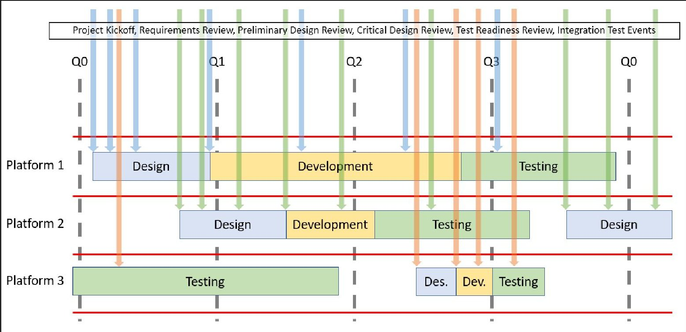


<div align="center">

Figure 10: Typical Waterfall Schedule

</div>

Each of the vertical arrows corresponds to a customer event. As can be seen from the diagram, the events were occurring almost constantly throughout the year. Each meeting was held to discuss only a specific subset of features in a specific state at a time. In this process, meeting fatigue can easily occur due to the overwhelming number of customer events.

Another issue with this schedule is the gaps of time between specific platform releases and the start of the next update. Teams were expected to switch between platforms to help with other releases during the downtime, which led to high switching costs and decreased productivity.

Finally, Figure 10 can be used to show how the Waterfall methodology delays the ability to deploy developed features, since features are not complete until the testing phase is complete. For the first platform, features that were designed in the first quarter will probably not be deployable until the fourth quarter.

## 4.1.2.3.4.2. New Modified Scrum Process

Under the new process, many of the customer events are replaced by a different type of meeting. Since features are being developed iteratively, there will never be a point early in the

<!-- PDF_PAGE: 83 -->

schedule where all requirements or design has been completed for all features. This makes the specific review meetings unable to be performed in their traditional manner. Instead, quarterly customer meetings are scheduled during the development phase of the project. At these quarterly meetings, all features that have been completed are presented for review. The customer then has an opportunity to provide feedback on completed features in case these need to be redesigned and inserted back into the Product Backlog. Figure 11 below shows the layout of customer events with the new process, and how the teams work Tasks throughout the timeframe.


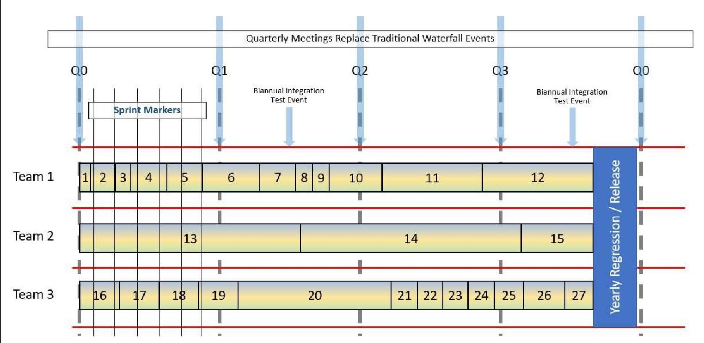


<div align="center">

Figure 11: New Process Schedule

</div>

As can be seen above, the number of meetings is significantly reduced by the new process. Integration Test events are still necessary but are reduced to twice per year. There are no longer gaps in the schedule, where teams must incur switching costs by shifting to the development of a new platform. Additionally, all development stops at the end of the year to make room for a sixweek Yearly Regression period and final release. This period of regression testing is required by the process to provide a final verification that the system under test is ready for release. Each

<!-- PDF_PAGE: 84 -->

numbered block in the diagram corresponds to an Epic, or feature, that is being worked by the specific team at that time.

## 4.1.2.3.5. Process Walkthrough

To illustrate the process, the following sections provide a walkthrough of an example feature from conception through release.

## 4.1.2.3.5.1. Epic Creation

An Epic is the highest level of Task that can get created in the process. Items at the Epic level are typically large, multi-task features that will probably take multiple Sprints to accomplish. Epics are the primary level at which features are discussed with the customer and are usually more of a big idea or request rather than a detailed set of Tasks.

While the list of Epics is maintained by the System X team, the customer is primarily responsible for creating and prioritizing them. Epics are typically the center of communication between the customer and the System X team. The list of Epics that will be targeted for the yearly release are identified and discussed at the Project Kickoff Meeting. These Epics would be entered into the Product Backlog with a status of "Triage."

For this example, a theoretical Epic is "Add support for Subsystem Y to System X." Subsystem Y might be any particular system that can integrate with System X, but for this discussion, Subsystem Y is a new Radar Warning Receiver (RWR) that has never been integrated with System X's environment. New subsystem support is a common addition for the System X project, so this example will illuminate a typical scenario.

## 4.1.2.3.5.2. Epic Breakdown

After the list of Epics is decided in the Project Kickoff Meeting and prioritized against other Epics, the Lead Engineer makes an initial attempt at breaking up the Epic into smaller, more

<!-- PDF_PAGE: 85 -->

manageable Tasks. The goal of this activity is not necessarily to break the Epic into small enough Tasks to go into a Sprint, but to serve as a starting point for the Backlog Refinement process. For the example Epic, some initial Tasks could be:

- Create communication interface for Subsystem Y

- Process sensor tracks from Subsystem Y

- Support loading of Subsystem Y data files

These Tasks are entered into the Product Backlog with a status of "Triage." After being prioritized against each other by the Lead Engineer, their status is changed to "Prioritized." This is the signal that they are ready for further refinement in the future.

## 4.1.2.3.5.3. Task Refinement

The Tasks created by the Lead Engineer remain mostly untouched in the Product Backlog until they are close enough to the top of the Product Backlog to get refined in one of the weekly Backlog Refinement meetings. When that occurs, Scrum Teams take those Tasks and attempt to break them up further to prepare them to be pulled into future Sprints. The goal of this activity is to:

1. Split Tasks into small enough pieces to be accomplishable in a single Sprint

2. Provide a Story Point estimation for each Task for future Sprint planning

3. Identify any potential roadblocks or other items necessary to complete those Tasks in the future

4. Begin defining pseudo-requirements to get a jumpstart on the requirements process To further describe the example, a breakdown of the first Task is defined below:

- Epic: Add support for Subsystem Y to System X

Original Task 1: Create communication interface for Subsystem Y

<!-- PDF_PAGE: 86 -->

Refined Tasks:

- Update bus controller to initialize Subsystem Y message traffic

- Define message structure for Subsystem Y

- Add Subsystem Y message traffic to Bus 2

- Create translation protocol files for Subsystem Y messages

Taking the first refined Task (Update bus controller to initialize Subsystem Y message traffic) as a further example, a team might determine the following during Backlog Refinement:

- Story Points: 5

- Roadblocks: Support tool updates are required to simulate and monitor Subsystem Y traffic. These tool updates are a prerequisite for this Task.

- Pseudo-Requirements:

Initialize Message 1 with proper size and rate

Initialize Message 2 with proper size and rate

4. 1.2.3.5.3.1. Story Points

Story Points are assigned by the team as a work estimate in Scrum. They allow the teams to anticipate how much work they can accomplish in a Sprint in order to aid the Sprint Planning activity. Story Points are not strictly time-based, rather they are supposed to be a relativistic measurement to compare Tasks to each other. A Story Point estimate of "2," for example, is considered to be twice the effort of a "1." When determining Story Points, teams should take time, complexity, and risk into account.

At the beginning of the transition to Scrum, the teams involved were asked to describe a simple Task that could be used as a comparison for Story Point estimates. That Task became a "1" and was used as the basis for estimating Story Points until the teams got familiar with the scale. In

<!-- PDF_PAGE: 87 -->

this example case, this Task is estimated as a "5," meaning it should be roughly five times the effort of the original "1," as judged by a combination of time, complexity, and risk.

The rationale for using Story Points over a traditional time estimation is to attempt to remove the human element of estimation. If a time-bounded estimation is provided, it is human nature to finish a Task in that amount of time. If it actually takes less time to complete the Task than was estimated, there is a chance that the effort could be slowed down to match the expectation. In the opposite case, if the Task takes more effort than was originally estimated, it is probable that the work would be rushed to meet the deadline. This could lead to sloppy work and less than ideal product quality. As Story Points are not intended to be time-bound, the estimated Task will hopefully take as long as required to perform the work to the expected standard. Story Point estimations should be reviewed at the end of a Sprint, not to cast blame if something was not finished, but to assess if the Story Point estimates were accurate after the work has been finished. This hopefully is a learning opportunity for the team to become more accurate with Story Point estimates in the future.

## 4.1.2.3.5.3.2. Roadblocks

The team also takes the opportunity during Backlog Refinement to anticipate any future blockers to accomplishing the Task. In the example, it is necessary to create a simulation of Subsystem Y so that System X can communicate with it, as real hardware is not always provided. This work must be accomplished first so that the example Task can be fully completed within the future Sprint to which it will be assigned.

<!-- PDF_PAGE: 88 -->

## 4.1.2.3.5.3.3. Pseudo-Requirements

The final step for the Task in Backlog Refinement is to generate pseudo-requirements to help when it is time to create real requirements. This activity is generally illuminating as well, helping to break down the Task and identify unknowns.

## 4.1.2.3.5.3.4. Status Change

When refinement of the chosen Tasks is complete, their status is changed from "Prioritized" to "Queued." This signals that each of the Tasks have been refined are ready to be assigned to a Sprint.

## 4.1.2.3.5.4. Task Assignment

The Task remains in the Product Backlog until it becomes assigned to a team in a Sprint Planning meeting. When one of the teams decides to commit to working the Task, it gets pulled into that team's Team Backlog and is worked once the Sprint is started. The Task's status is set to "In Progress," meaning that a team is actively working it.

## 4.1.2.3.5.5. Task in Progress

Once the Task is being worked, the team performs normal development activities for the feature. The description of the example Task (Update bus controller to initialize Subsystem Y message traffic) is continued below.

As each artifact/activity is completed in follow-on steps, the rest of the team is encouraged to review the other team members' work, both as a peer review and to manage interdependencies among Tasks by increasing visibility among teams. The Leadership Team is also expected to review the artifacts as they are completed.

<!-- PDF_PAGE: 89 -->

## 4.1.2.3.5.5.1. Requirements Definition

Requirements must be the first step, as they are the drivers for all follow-on activities when performing the Task. The following requirements might be created for the example Task:

- System Requirement:

System X shall interface with Subsystem Y

System X shall process tracks from Subsystem Y

- Software Requirements:

O The bus controller shall initialize Subsystem Y Message 1 at Remote Terminal 2 Subaddress 4

O The bus controller shall initialize Subsystem Y Message 2 at Remote Terminal 4 Subaddress 3

The bus controller shall poll Subsystem Y Message 1 at a 12 Hertz rate

The bus controller shall poll Subsystem Y Message 1 at a 200 Hertz rate

All team members are expected to be involved in the requirements creation process. The team should be able to function independently to define the requirements but can pull in someone from the Leadership Team if they need help. The final requirements are submitted for final approval by the Leadership Team.

## 4.1.2.3.5.5.2. Design/Planning

Using the requirements previously created, each team member focuses on their respective disciplines to plan/design their approach to the feature. The following artifacts are created during this step:

- Systems Engineering: System Design

- Software Engineering: Software Design

<!-- PDF_PAGE: 90 -->

- Test Engineering: Test Plan

## 4.1.2.3.5.5.3. Development

Similar to the previous step, each Scrum Team member continues to focus on their discipline-specific part of the Task. The following activities are performed during this step:

- Systems Engineering: Preliminary Testing, Documentation

- Software Engineering: Software Development, Documentation

- Test Engineering: Test Procedure Creation, Documentation

## 4.1.2.3.5.5.4. Testing

After initial development is complete, a build is created and passed to the rest of the team. This is the opportunity for the systems engineer and test engineer to perform integration testing with the developed components. At the same time, the test engineer also uses the previously created test procedures to perform a dry run test execution with the build. As defects are found, they are documented and communicated to the rest of the team. The team assesses if defects will be fixed within the Sprint or if they are large enough to become Tasks that will be worked in future Sprints. After the Task has been fully developed and a final working build is created, the test engineer performs a final execution of the test procedures associated with the Task.

## 4.1.2.3.5.6. Task Ready for Regression

When the functionality in a Task passes dry run testing, the Task is transitioned to the "Ready for Regression" state and effectively shelved until the Yearly Regression period. The assumption made at this point is that the functionality in the Task works as expected and was proven to be working in the Sprint, so the Task can be merged into the main development path for the release.

<!-- PDF_PAGE: 91 -->

## 4.1.2.3.5.7. Task in Regression

When the Yearly Regression period begins, all Tasks are executed formally against the final build. Since all of the Tasks that are in the "Ready for Regression" state have been verified previously against a previous build, the expectation is that this final test execution is more of a formality (i.e., the test procedures pass with minimal issues). However, since Tasks are developed concurrently by different Scrum Teams and are merged together over time, there is a potential that a future Task could break the implementation of a previous Task. Finding these issues and fixing them is a major goal of the Yearly Regression period, along with formally qualifying the release. Ideally, as more of the testing becomes fully automated, regression testing can be performed multiple times at regular intervals throughout the development process in order to earlier identify problems stemming from these types of interdependencies between team Tasks. Currently, integration issues are either discovered and fixed during the testing of a build during a development Sprint or identified during the Yearly Regression period.

## 4.1.2.3.5.8. Task Released

After the Yearly Regression period, the status all Tasks and Epics that were formally verified is changed to "Closed" and the final build is released.

## 4.1.2.3.6. Task Status Workflow

The Task Status Workflow for Tasks described above is summarized in Figure 12 below.

<!-- PDF_PAGE: 92 -->


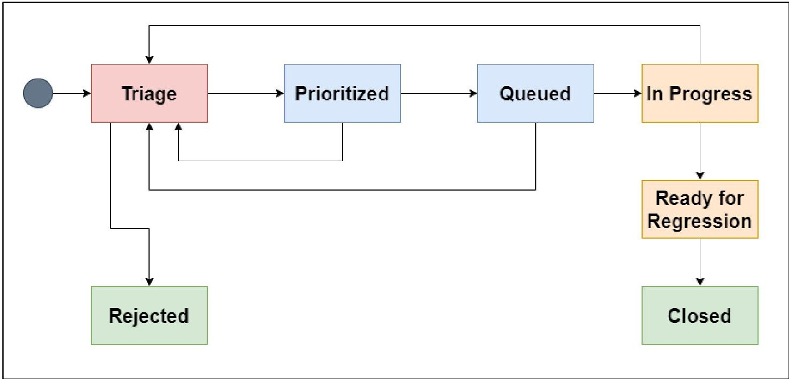


<div align="center">

Figure 12: Task Status Workflow

</div>

As can be seen by the diagram, if a status needs to be reverted to a previous state, it must return to "Triage" to be reassessed. "Triage" is highlighted red to show that it is the starting state and needs to be refined. Blue states are those in which the Task is going through a period of refinement. Orange states indicate work is being performed by a Scrum Team. Lastly, green states indicate terminal states, either finished or rejected.

## 4.2. Test Automation

Automated testing is essential for supporting an incremental development process [102]. It allows for releases to be quickly verified and regression tested multiple times over the development period. The automated testing system used by System X is discussed further below.

## 4.2.1. Organizational History of Test Automation

System X's organizational division has been interested in test automation for a long time. However, with the way funding works for GTRI, it is very hard to get projects off the ground that are not directly tied back to a customer contract. The researcher was originally involved as part of a team focused on test automation of System X, and after that became the driving force for test

<!-- PDF_PAGE: 93 -->

automation within the division. The timeline and history of test automation efforts for System X are described below.

## 4.2.1.1. 2012: Master Test Application

In 2012, the researcher's team developed a white paper for one of GTRI's primary sponsors to introduce the concept of test automation and an estimate of initial costs. The white paper described a plan to use an open source Python module called Robot Framework as the basis for a single tool called the Master Test Application that would drive all the various simulation/analysis applications for System X. This tool would be where test cases were written, managed, and executed. The initial estimate, just to get the application built with foundational pieces laid out, but with no real results, was $500,000. While this estimate was not unreasonable based on the typical budgets for System X, the cost was too high for the customer, especially when no actual automated test cases would be delivered as part of it. The sponsor declined to move forward, and it appeared that test automation would die before it ever even started for System X.

## 4.2.1.2. 2013-2014: Pure AutoIt

After the failure of the white paper, the push to develop the capability basically evaporated. There was not much support to try again with a different sponsor on a different project. However, the researcher decided to continue to pursue test automation, but from a different viewpoint. Instead of trying to build a large application for automating all of System X that would require input and effort from multiple stakeholders, the researcher decided to attack it from the perspective of the individual support tools that would have been driven by the Master Test Application. This would provide a much less expensive avenue and potentially provide some real results to be used as evidence for a later push into full test automation. The researcher had control of the test budgets for System X's tools, and was able to allocate some funding towards leading a small team of

<!-- PDF_PAGE: 94 -->

students to experiment with test automation, both as a learning opportunity for the students and to see what could possibly be accomplished.

Since funding was not available to pay for any internal tool developer support to provide back-end support for automation, test automation had to be attacked from the top-down. The AutoIt scripting language was used to perform Graphical User Interface (GUI) manipulation of Windows controls as a proof of concept for test automation. It was used successfully for two releases, saving two weeks of manual execution time per run the first release, and three weeks for the second release.

Even though the team produced good results, they also ran into many problems, most of which were self-inflicted. The team approached it as an experiment without thinking about long-term goals from the beginning. It was not sustainable, as the AutoIt language is somewhat hard to understand, and the team was not coding in a maintainable way. AutoIt does not provide much feedback or control of the testing that is occurring. The team was without a real way to verify or have much control with regard to test management.

## 4.2.1.3. 2015: C# Wrapped AutoIt

After the team gained experience using only AutoIt, they decided to try and build their own automated testing framework around AutoIt in order to give more feedback and control. They decided to wrap the AutoIt functions in C# to provide that capability. With this method they had more success. For the next release of the target application, they were able to save four weeks per run and had some success at restructuring the test procedures to better accommodate automation. Also, they proved the usefulness of test automation by automating a test for a different embedded system that needed up to a five minute task to be run potentially hundreds of times looking for

<!-- PDF_PAGE: 95 -->

specific results (i.e., a perfect case for automation). They were able to save approximately 32 hours of manual testing time per run and provide specific results that they were expecting to see.

Once again, however, they ran into more problems. Wrapping AutoIt functions in C# provided better management, but extremely high overhead costs to build. The team would never be able to sustain that type of work over multiple projects. Because the team absorbed so much of the previous work, they still had the problem of the test automation application being treated like an experiment instead of a real product. There was also no high-level organization of the test automation effort built in. It was just a collection of automated tests rather than an organized test capability.

## 4.2.1.4. Early 2016: Robot Framework Rediscovery

After the dissolution of the Master Test Application, the team abandoned thoughts of using Robot Framework as the test management middleware for test automation efforts. At the time, the researcher thought it entailed too much overhead to be usable in an inexpensive way (i.e., able to be accomplished with the funding reserved for student work), and the team wanted to show results quickly. However, around April 2016, another engineer told the researcher he had been using Robot Framework with great success to do some simple automation for an isolated task. He knew what the team had been doing with AutoIt and suggested that they look back into Robot Framework.

By 2016, Robot Framework was more mature than it had been in 2012, and upon reinvestigation, the team came to the conclusion that it already had all of the functionality that they were trying to build into their C# test framework.

<!-- PDF_PAGE: 96 -->

## 4.2.1.5. Mid 2016: Internal Funding for Investigation

Around June 2016, the researcher secured a small amount of internal funding to research the feasibility of using Robot Framework as the test management middleware for test automation efforts. Using this funding, the researcher started developing the vision for the Test Automation Framework (TAF), including defining a formal strategy for test automation and an internal standard for its development. During this time, the team also successfully used Robot Framework to automate some specific testing as a proof of concept.

## 4.2.1.6. Late 2016-2017: Development of the TAF Infrastructure

After the completion of the internal research, the team fully embraced Robot Framework as their test management core. The team dropped all of the C# wrapping they were building and, for the most part, had to completely rebuild from scratch based on the new strategy. However, this was different. The team now had a formal strategy and a mature product to drive the test automation capability. Using student resources once again, the team started rebuilding previously automated test cases, but using the newly branded Test Automation Framework. It took almost a year of part-time student development to get the TAF infrastructure to a mature and stable state and to get test cases rewritten using the new tool.

## 4.2.1.7. 2018-Current: The TAF Product

The first official use of the TAF was to support the release of one of System X's support tools in March of 2018. For this application, the manual test procedures, more than 2,200 pages, typically took somewhere between five to six weeks for a test engineer to execute. Using the TAF, the execution time for running the entire procedures, with a small percentage of manual test cases, was two to three days. In a manual paradigm, the entire test procedures are typically executed twice, one dry run and one formal execution, for a release. Therefore, the automation of these

<!-- PDF_PAGE: 97 -->

procedures saved somewhere between 9-11 weeks of time, equating to roughly $60K in sponsored funds per release. Also, this provided the ability to constantly execute test procedures during development, potentially pushing the discovery of issues far to the left.

Later in 2018, with these types of results, the researcher was finally able to start securing dedicated money from sponsors that would directly support the test automation capability for System X. At peak development times, the researcher is able to support a team of around seven to eight people, a mixture of full-time engineers and part-time/full-time students, on the TAF project. The team now supports automated testing in various capacities on five different products with the TAF, with the goal of expanding to all products within the division.

## 4.2.2. Overview of the Test Automation Framework

The TAF is a GTRI-developed framework for the management and execution of automated test cases. It is centered around the open source Python module Robot Framework, which provides a framework for the translation of code to user-defined actions/methods/functions, automatic test execution, and results reporting [103]. The TAF team has wrapped the Robot Framework component in usability features such as standard ways of defining test cases, an application to execute test sessions, a custom Integrated Development Environment (IDE) with syntax highlighting and keyword autocompletion, and other helpful features for test engineers. The other core component that the team develops is the various libraries that define the interfaces between Robot Framework and the target systems or applications.

## 4.2.2.1. The Researcher's Role

The researcher has been involved in his organizational division's push for automated testing since the beginning. He has been the Product Owner of the TAF since its creation and is responsible for providing and maintaining its vision, making architectural and strategic decisions

<!-- PDF_PAGE: 98 -->

for its development, and directing the TAF development team. This background provided the core research for the implementation of test automation for System X.

## 4.2.2.2. Objectives

Based on the history of test automation described previously, the original driving objectives of the TAF were:

- Develop an automation capability that mimics the real-time actions of manual testing performed by a test engineer.

- Provide a framework that can coordinate the actions of multiple machines.

- Develop an automation capability that can control the actions of a machine while the display is locked.

- Create a maintainable framework that can be easily updated for future versions of the software under test given normal time constraints.

- Create a sustainable architecture that can be updated and expanded without affecting existing automation capabilities.

- Provide an adaptable automation capability for future expansion into other GTRI-developed applications.

- Promote understandability of test cases and automation libraries by utilizing standard structures, standard naming conventions, and natural language.

- Minimize the need for significant coding experience for automated test case developers.

## 4.2.2.3. Basic Architecture

A core feature of Robot Framework is the ability to create keywords that call specific, predefined segments of code, with the ability to pass in parameters [104]. In typical uses of Robot Framework, these keywords are simple instructions such as, "Print X," "Press X," or "Modify X."

<!-- PDF_PAGE: 99 -->

One of the unique features of the TAF is that it takes advantage of this ability and overloads keywords to write natural language statements that are executable. In this way, a "keyword" in TAF is actually an executable test step written to look like a normal sentence; it includes an action to perform, any necessary parameters that can be passed in, and any explanatory text that makes the statement more readable.

A basic architectural view of the TAF can be seen in Figure 13 below.


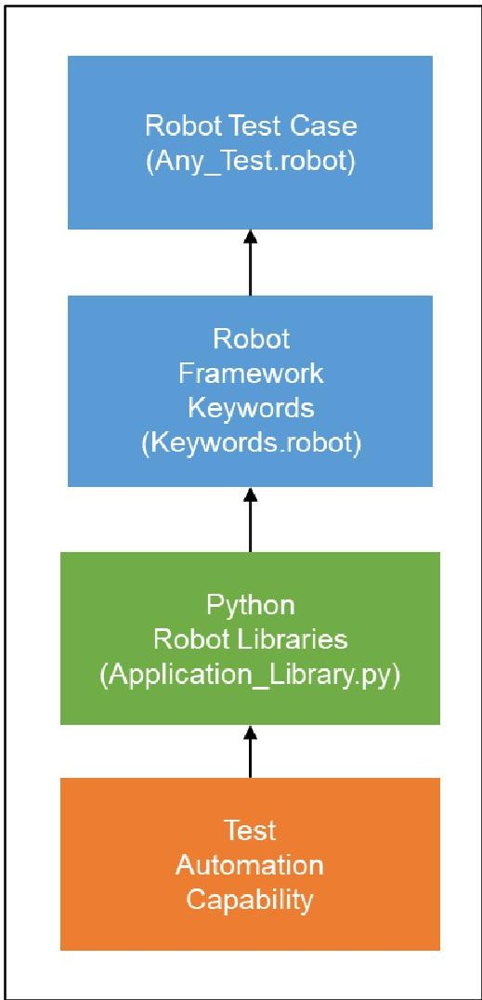


<div align="center">

Figure 13: Basic TAF Architecture

</div>

Starting at the bottom of the diagram, to create a Test Automation Capability targeting a specific application or system, Robot Libraries are written to interface with the system under test. These libraries contain functions that define methods for interacting with the system. In the Robot Framework Keywords file, the methods from the Robot Libraries are mapped to commands that

<!-- PDF_PAGE: 100 -->


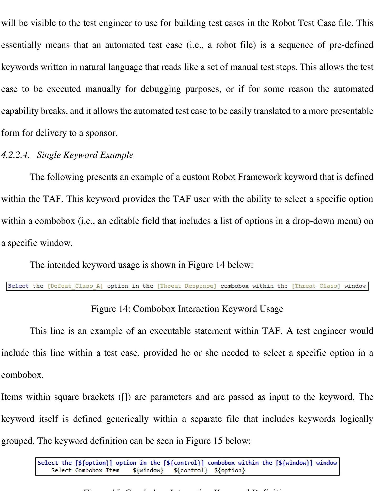


<div align="center">

Figure 15: Combobox Interaction Keyword Definition

</div>

<!-- PDF_PAGE: 101 -->

To make this keyword actually perform its function, a method of interacting with the target system has to be created. For this example, the previously mentioned AutoIt scripting tool, translated to a Python module called PyAutoIt for easier use, was used to perform the automation necessary to generically interact with a combobox. This function can be seen in Figure 16 below.

```python

def select_combobox_item(self, json_title, control_name, item_to_be_found):

    window_title = self.json_parser.get_window_title(json_title)

    control_id = self.json_parser.get_control_id_with_type(json_title, control_name, 'combobox')

    previously_selected_item = ""

    while (True):

        currently_selected_item = baseline.autoit_control_get_text(self, window_title, control_id)

        print(currently_selected_item)

        if currently_selected_item == item_to_be_found:

            return True

        elif currently_selected_item == previously_selected_item:

            assert False, "Selection [" + item_to_be_found + "] could not be found in the [" + control_name + "] combobox"

        else:

            previously_selected_item = baseline.autoit_control_get_text(self, window_title, control_id)

            baseline.autoit_control_send(self, window_title, control_id, "{DOWN}")

```

<div align="center">

Figure 16: Combobox Interaction PyAutoIt Method

</div>

It accepts the parameters passed from the keyword usage through the keyword definition to the final method. It uses the passed values to identify the actual names associated with those values as stored in the code by looking them up in a JavaScript Object Notation (JSON) file that associates aliased labels (i.e., the word/phrase that the test engineer wants the specific item to be known by) with the code-based name (i.e., the name that the developer used for the specific object). An example of a JSON table to perform this aliasing can be seen in Figure 17 below.


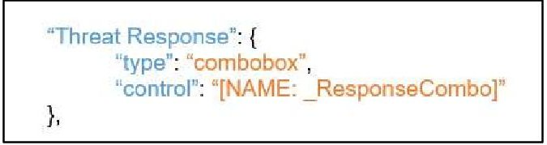


<div align="center">

Figure 17: JSON Combobox Label Association

</div>

The main purpose of the JSON file is to:

- Maintain a list of supported objects outside of the code to interact with them

- Allow aliasing so that the final test procedures are not reliant on standardized control names to make sense to an external representative

<!-- PDF_PAGE: 102 -->

- Define an object type to use in the event of a collision of preferred name (e.g., a textbox and combobox that use the same label property)

## 4.2.2.5. Example Test Case

Figure 18 below is a screenshot of an example automated test case representative of System X test procedure.

<!-- PDF_PAGE: 103 -->


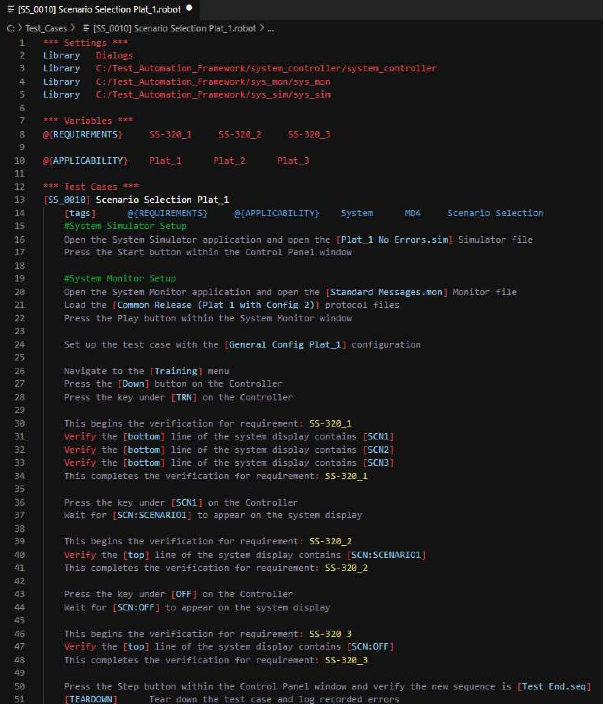


<div align="center">

Figure 18: Example TAF Test Case

</div>

The different sections of the test case are described below.

<!-- PDF_PAGE: 104 -->

## 4.2.2.5.1. Settings Section (Lines 1-5)

The Settings section is used to declare TAF Keyword libraries that are expected to be used in this test case. The TAF architecture encapsulates keyword libraries by function or component for easier management. In this section, the test engineer imports the libraries that include keywords they need to perform the actions of the test case.

## 4.2.2.5.2. Variables Section (Lines 7-10)

The Variables section provides the ability to declare groups to be used later in the test case. Currently, the only use of this is to group requirements traced to this test case and aircraft platforms that are applicable for this test case. These labels are used to make it easier to identify these items quickly.

## 4.2.2.5.3. Test Cases Section (Lines 12-51)

The Test Cases section contains the body of the test procedure that will be executed. Subsections are further discussed below.

## 4.2.2.5.3.1. Title (Line 13)

The title of the test case is declared after the Test Cases section header. In this example, a global test case number, its specific name, and the platform this test case uses (Plat_1) during the execution of the test case are listed. Note that the platform denoted here is only one of the applicable platforms listed in the Variables section. This test case verifies common functionality across three platforms, but only uses one of them to test that functionality. Since it is common, it is unnecessary to test for all three platforms.

## 4.2.2.5.3.2. Tags (Line 14)

Tags are a feature of Robot Framework that allow test cases to be queried/executed based on custom phrases that are included in the test case. For example, a test engineer could target the

<!-- PDF_PAGE: 105 -->

entire test suite and command all test cases that include the tag "Requirement-01" to be executed. Robot Framework is able to identify which test cases those are and execute them.

In this specific example, the variables previously defined are also tagged so that a query can be run based on requirements, functionality, or platform applicability.

## 4.2.2.5.3.3. Comments (Lines 15; 19)

Comments are allowed with the TAF in order to provide explanatory text for a specific section of test steps. Comments are not executable and are ignored by the TAF when running a test case.

## 4.2.2.5.3.4. Setup (Line 24)

This line is a custom keyword that sets up a test case for System X after being provided a configuration. There are many actions rolled into this singular keyword that prepare the system under test for user input, such as loading the System X hardware, verifying that configuration loaded correctly, and clearing the catalog of errors. Configurations are defined by test engineers in a separate file that TAF can read. This keyword also prints the details of the specific configuration used for this execution of the test case for future reference.

## 4.2.2.5.3.5. Actions (Lines 16-17, 20-22, 26-28, 36-37, 43-44, 50)

These lines are typical actions that would be defined in a manual test case as steps that a user should perform.

## 4.2.2.5.3.6. Requirements Declarations (Lines 30, 34, 39, 41, 46, 48)

While requirements are traced to the test case using the Tags section, more specificity is often required by the customer or project. The TAF provides a method for defining the specific steps that satisfy requirements through defining where the verification of the requirement begins and ends.

<!-- PDF_PAGE: 106 -->

## 4.2.2.5.3.7. Expected Results (Lines 31-33, 40, 47)

Expected results are defined using a keyword that begins with the word, "Verify." This was purposely defined when building the TAF so that expected results would be evident throughout the test case. Syntax highlighting is also used to draw attention to these lines.

## 4.2.2.5.3.8. Teardown (Line 51)

The teardown keyword is used here to prepare the System X hardware for the execution of the next test case. Errors that occurred are logged in the test results and the environment is cleaned to reduce any variability that may affect the results of future test cases.

## 4.2.2.6. Example Test Execution Output

Figure 19 below shows an example of a test log that is output from a TAF execution.


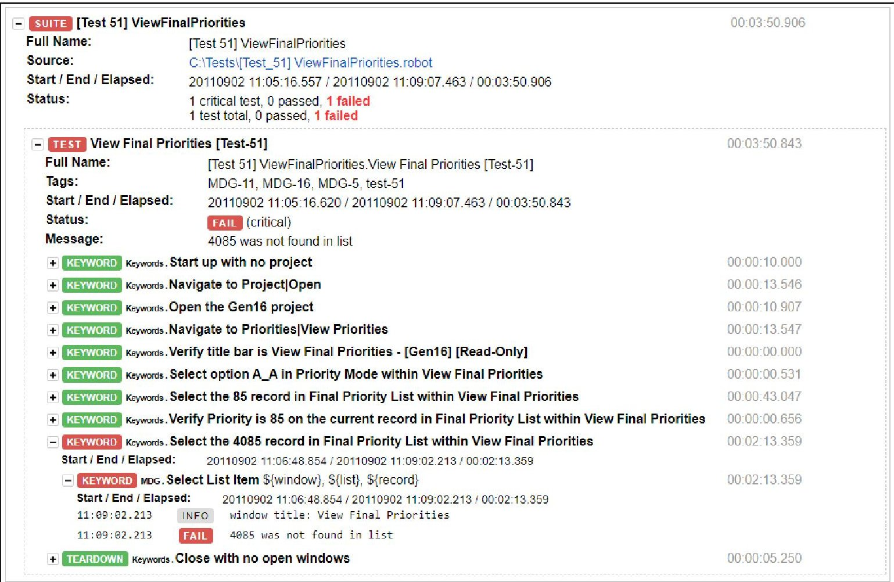


<div align="center">

Figure 19: Example TAF Output

</div>

<!-- PDF_PAGE: 107 -->

As can be seen above, many critical metrics are logged in order to fully report on the test execution and help identify any problems when troubleshooting the test case.

## 4.2.2.7. Development Process

The TAF project is an ongoing project, constantly developing features and automation libraries to support the products that use its capabilities for automated testing. It is developed using the Scrum methodology with two-week Sprints. Requests for new functionality are submitted via input into a sorted backlog and assessed on a regular basis. The TAF development team works with test engineers using the TAF to coordinate the development of keywords in time for them to be used on a specific project within a certain timeframe.

## 4.2.2.8. Deployment Strategy

The TAF is packaged in an installer that includes all libraries and usability features necessary for its use. As features are developed, they are automatically pushed into a new build upon review and approval.

## 4.2.3. Test Automation Strategy

The strategy employed when implementing test automation for System X was to utilize as much existing functionality and as many existing components as possible in order to minimize costs, limit the impact to System X, maintain the ability to execute existing manual testing, provide an easier transition to automated testing, and provide automated testing capabilities faster.

These goals provided for the establishment of an automated testing framework that supported System X without the need to change its development path or schedule. The approach centered around providing automation capabilities through the existing suite of support tools that were used to interact with System X. These tools were used manually through a GUI by the System X team to provide simulation and monitoring of the System X execution environment. The initial

<!-- PDF_PAGE: 108 -->

approach was to create automation libraries that could control and monitor these tools via their respective GUIs, which would mimic the exact actions of a test engineer performing a manual test.

While this approach succeeded at providing test automation capabilities while adhering to the goals provided above, it was not the most impactful approach. However, other initial approaches would have been too costly or could have affected the development of System X. These observed inefficiencies combined with the difficulties of implementing test automation on a project as complex and established as System X necessitated a long-term automation strategy that would eventually result in an optimized test automation solution.

This led to the concept of a phased approach to test automation, which is described below.

- Phase 0

No test automation implemented.

- Phase 1

O Develop GUI-based test automation capabilities for new System X features being developed for the next release.

Create test cases for new features in the new automated format.

- Phase 2

Develop GUI-based test automation capabilities for existing manual test cases.

- Reassess existing test cases for adherence to items such as requirements, applicability, length, and complexity.

Convert manual test cases into the new automated format, making any necessary improvement steps based on the previous assessment.

- Phase 3

<!-- PDF_PAGE: 109 -->

o Develop headless (i.e., no visible GUI) test automation capabilities for existing automated test cases, to remove the latency involved with commanding a GUI to perform an action.

Convert existing GUI-based automated test cases into headless automated test cases.

- Phase 4

o Develop lower-level test harnesses that can talk directly to software components within System X, providing the ability to perform testing on each component in isolation from the rest of the system.

Develop automation capabilities to stimulate and monitor lower-level components.

- Create headless test cases that target component-level functionality.

- Phase 5

- Introduce high-level commands that provide more capability to the tester (e.g., move threat 1 to location 5 within 20 minutes using route 2, maintain ownship altitude and fly in a circle with radius of 10 miles), allowing more natural and realistic test scenarios in a lab environment.

It should be noted that these phases are not necessarily completed sequentially; some could be worked concurrently, while some could be skipped altogether. For example, on System X, TAF currently supports a mixture of Phase 0 through Phase 4, depending on the component. System X may never need TAF capability at Phase 5, but it has been discussed as a future option.

<!-- PDF_PAGE: 110 -->

## 4.3. Model-Based Test Planning and Documentation

Test modeling can provide standardization and organization to the test documentation of a project. The model-based test documentation methodology used by System X is discussed further below.

## 4.3.1. Organizational History of MBSE

Even though some divisions within GTRI have a rich history of using MBSE, it is not typically used on projects within System X's organizational division. This is due to a variety of factors, including:

- Program maturity

- Small project budgets

- Short project timelines

- Lack of MBSE expertise

- Lack of a dedicated Systems Architect

Implementing MBSE on a project can be a large investment, especially for complex systems that have been established for years [105]. As these are the majority of the division's projects, there has been little enthusiasm from sponsors to provide funding to implement MBSE on projects that are successful with their current Systems Engineering paradigms and processes. Most of the other projects in the division are smaller and more experimental in nature. These projects would not lend themselves well to MBSE as their initial budgets are relatively small and could not support using MBSE.

Two projects within System X's organizational division have used MBSE, one to enhance the Systems Engineering process, and another where a systems model was the main output of the project. The first of these projects used MBSE concepts to describe the behavior of the system, but

<!-- PDF_PAGE: 111 -->

the models were more supplementary to a design rather than the design itself. The second project was the division's first real foray into formalized MBSE. While the project was a success, it did not generate additional enthusiasm for using MBSE on future projects. Overall, within the division, MBSE is viewed as a method to enhance current Systems Engineering activities, but not necessarily as a Systems Engineering process by itself.

## 4.3.2. Implementation

MBSE was never part of the Systems Engineering process for System X. Therefore, its application detailed below is specific to the benefits that can be gained by the implementation of some MBSE concepts as part of the test process. The defined model-based test process assumes that a larger system model does not exist, but it also does not preclude the integration with a full model if it were to exist.

## 4.3.2.1. The Researcher's Role

As part of his Test Engineering leadership role, the researcher created the process defined below as a solution to some of the issues described previously. He created the process, defined the methodology, and designed the mechanism for how the process would work. The process was executed by the System X Test Engineering team with the researcher's oversight.

## 4.3.2.2. Objectives

The main goal of incorporating MBSE concepts into the test process was to promote the organization and structure of test artifacts in a standard, formalized way. As mentioned previously, many aspects of System X's test process were in a less than ideal state. Utilizing a model-based approach provided a paradigm that was intended to promote the following objectives:

- Improve the structure and clarity of test case documentation

- Improve rapid comprehension of test procedure contents

<!-- PDF_PAGE: 112 -->

- Reestablish a formal method of requirements traceability

- Provide a method of assessing impact of upstream changes

- Increase understanding of inter-dependencies between test cases

- Facilitate easier review of test planning documentation

- Provide a method to quickly identify test cases for targeted regression testing

## 4.3.2.3. Model Overview

The new process that was developed is not a solution for model-based testing. There are many aspects of System X that make true model-based testing a hard reality to achieve, and this is not within the scope of this research. Instead, this process adopts concepts of MBSE and applies them to a method of test documentation, specifically for the system's test plans and procedures. It is intended to be a lightweight model-based solution to formalize the documentation of those test artifacts to make future analysis easier and to satisfy the goals stated previously.

In this approach, the test documentation for a system lives in a standalone model. All requirements, inputs, messages, data, and any other components necessary to the testing of the system are referenced as model elements. However, to be resilient to changes to any component related to the test cases in the model, the detail on modeled elements external to the test engineer's control is minimized. This is usually accomplished by referencing only the name of the element, but any stable details could be included in the model. If a larger system model existed or was created later, the test model could easily be linked to the larger model by sharing objects that exist in both.

## 4.3.2.3.1. Model Organization

The model is organized into packages, as can be seen in the high-level view of the model in Figure 20 below.

<!-- PDF_PAGE: 113 -->


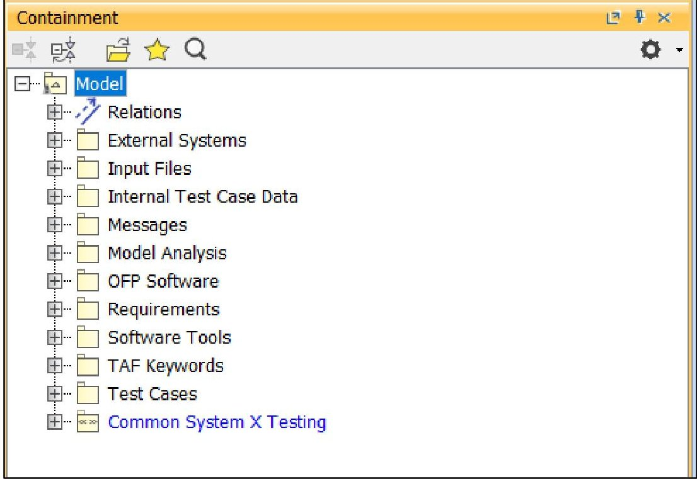


<div align="center">

Figure 20: Containment Tree

</div>

In the modeling tool used for this research, No Magic Cameo Systems Modeler $ ^{\mathrm{T M}} $ , the Containment Tree is the main point of interaction with the model. Other modeling applications contain similar mechanisms for viewing the organization of the model. While diagrams in a SysML model provide a visual overview of the content of a model, the truth of element characteristics and relationships are accessed there. Each set of elements is contained within its own package. Most packages are used to contain groups of elements that will be used within test cases. The Test Cases package is the primary location where the artifacts of this process reside.

## 4.3.2.3.2. Activity Diagram

The Activity Diagram is used to create a test plan. An example test plan from the System X model can be seen in Figure 21 below.

<!-- PDF_PAGE: 114 -->

act [Activity] MD4_0001 [MD4_0001]


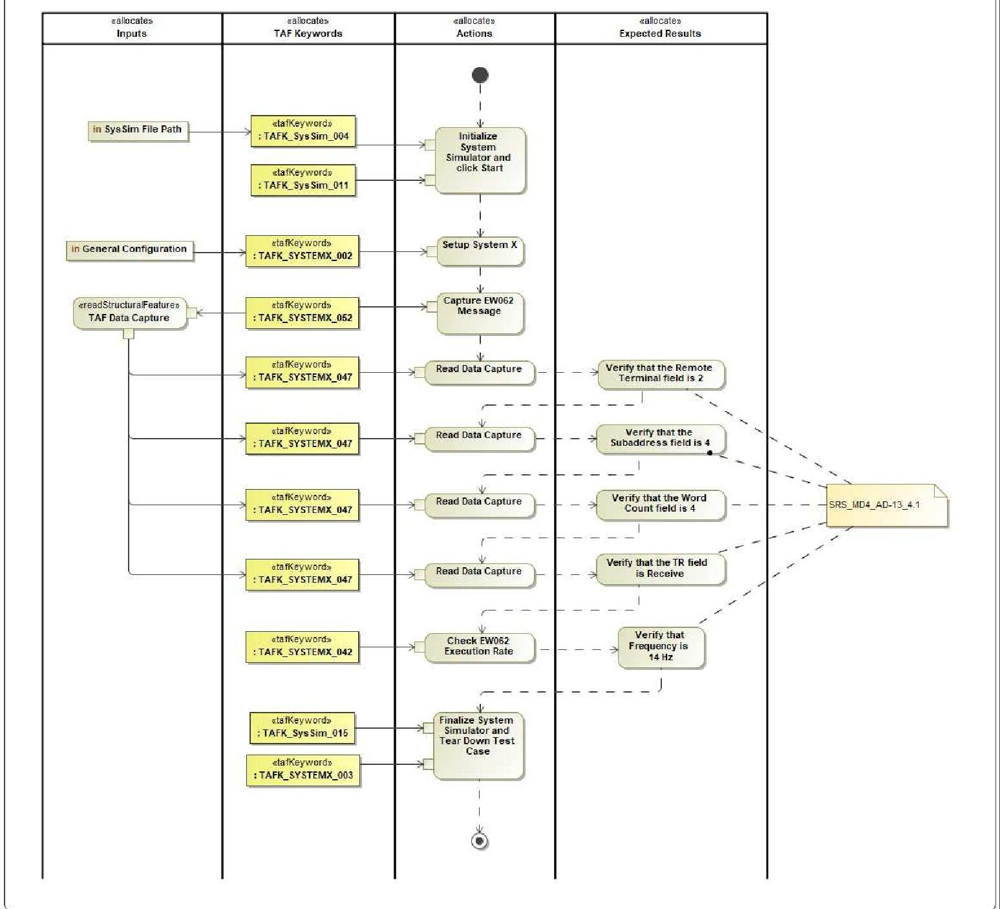


<div align="center">

Figure 21: System X Activity Diagram

</div>

The intent of this diagram is to describe the flow of the test case. When reading the Actions and Expected Results swimlanes, this diagram should look similar to a list of pseudo-steps that would normally be created when planning a test case.

## 4.3.2.3.2.1. Components

The four swimlanes on these diagrams are defined as Part Properties of the Test Case block that will be used in the BDD. The purpose of these swimlanes is to group the elements of the test

<!-- PDF_PAGE: 115 -->

case according to their function. Actions tie to Action Keywords, while Expected Results tie to Verify keywords. The TAF Keywords swimlane is used for identifying those associated keywords, while the Inputs swimlane is used to hold inputs to keywords (i.e., the exact usages of the variables that are contained within keywords).

Items in the Actions swimlane are Action elements. Actions are used to describe the different steps that need to be performed by the test engineer or test automation software in order to perform the test. These actions would typically appear in the left column (Actions) on a typical test case.

Items in the Expected Results swimlane are Action elements. Actions in this swimlane are used to describe the different verification steps that must be performed. These actions would typically appear in the right column (Expected Results) on a typical test case.

Items in the TAF Keywords swimlane are Object Node elements. These items are added to the diagram as generic elements. Then the TAF Keyword block representing the indicated TAF Keyword is dragged onto the Object Node. This creates an instance of that TAF Keyword used to perform the action to which it is linked.

Items in the Inputs swimlane are either Activity Parameter Node elements or Flow Properties of a Test Case block. Activity Parameter Nodes are used to create static inputs to TAF Keywords (e.g., fields, values, file paths). The goal is to create an Activity Parameter Node that lists the actual input planned to use as a variable to a TAF Keyword. Flow Properties are used when there is data that is created within the test case, as opposed to external inputs to the test case. The case in the example above is the capture of data initiated by a TAF Keyword that is later analyzed further within the test case.

<!-- PDF_PAGE: 116 -->

Notes, like the one on the right of the diagram, are being used to provide additional information as well as indicate where requirements are being satisfied. This helps during review, so the rest of the team can quickly see how and where the test engineer intended to satisfy the requirements. Notes should be used freely to provide additional information wherever necessary.

## 4.3.2.3.2.2. Relationships

There are two different types of relationships used on this diagram. Control Flow relationships are used to show how the Action elements flow (i.e., how Actions are accomplished and generate Expected Results). Object Flow relationships are used to show how the Object Node elements move to provide input to the Action elements.

## 4.3.2.3.3. Block Definition Diagram

The Block Definition Diagram (BDD) is used to document the important items connected to a specific test case. An example BDD for a System X test case can be seen in Figure 22 below.

<!-- PDF_PAGE: 117 -->


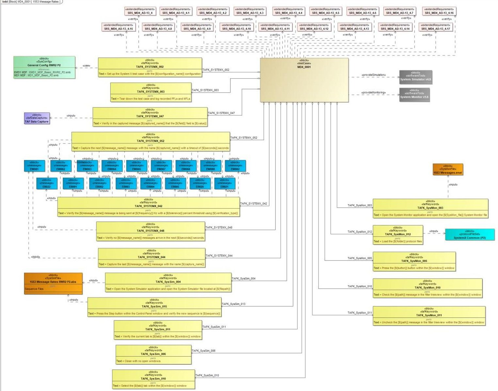


<div align="center">

Figure 22: System X Block Definition Diagram

</div>

## 4.3.2.3.3.1. Components

Each component is represented as an individual element within the model. Custom Stereotypes are applied along with a custom color scheme to easily determine the difference between elements. The test case is represented by the gold-brown block near the middle top of the diagram. Other documented components in the System X example above include:

- Requirements (Pink)

Specific "shall statements" that are satisfied by the test case

- System X Software Configurations (Green)

<!-- PDF_PAGE: 118 -->

- Specific list of software packages loaded on System X used by TAF to validate and load the correct set of software before beginning execution of the test case

- TAF Keywords (Yellow)

Action/Verify statements provided by TAF to perform automated testing

- Recorded Data Captures (Purple)

Data recorded during the execution of a test case to be processed by TAF to determine pass/fail when necessary in specific instances

- System Messages (Blue)

External/Internal message traffic used to verify System X behaviors through TAF

- Input Files (Orange)

o Software for external hardware/software that drive or configure those systems

- Protocol Files (Light Blue)

Files used by the system monitor to decode message traffic into human-readable form

- External Hardware/Software (Grey)

External hardware or software systems used to stimulate or monitor System X

This is not necessarily a comprehensive list, but it is what was deemed helpful to associate with this test case. Generally, any items that are important to trace to a test case, potentially for later impact analysis, should be modeled and associated with the test case. The elements that need to be traced for a specific project are determined by the test environment of that particular system. Blocks should be created and organized according to a scheme that makes it easy to find and reuse elements, such as the package structure presented earlier.

<!-- PDF_PAGE: 119 -->

## 4.3.2.3.3.2. Relationships

There are three different relationship types used in the BDD. The dashed line from the Test Case block to Requirements is a Dependency relationship with the Verify stereotype. It means that the test case verifies the requirements linked to it. The dashed line to multiple different types of elements is a Dependency relationship with the Usage stereotype. In most, if not all, cases, the Usage stereotype is not displayed on the connector, as a custom stereotype has been applied. The solid line with an open diamond is a Directed Aggregation. This line means that, structurally, the test case is made up of those keywords, but the keywords exist independently, outside of that specific test case.

## 4.3.2.4. Process Overview

The following provides a description of how a test engineer creates and interacts with the test model. This process assumes both the implementation of the Agile methodology and the TAF automation described in detail in previous sections.

## 4.3.2.4.1. Test Preplanning

The first step before a test engineer is able to begin working with the model is the generation of requirements for a specific Task. These requirements are worked first by the team to provide the foundation for the associated Subtasks that must be performed for its completion. Once the requirements are drafted and unique numbers are assigned, even if they are not in their final form, the test engineer adds the requirements to the model. Figure 23 below shows an example of a requirements table for System X.

<!-- PDF_PAGE: 120 -->

<table border="1"><tr><td>#</td><td>△Name</td><td>Text</td><td>Verified By</td><td>Verify Method</td></tr><tr><td>191</td><td>SRS_MD4_AD-13_4.5</td><td></td><td>MD4_0001</td><td>Test</td></tr><tr><td>192</td><td>SRS_MD4_AD-13_4.6</td><td></td><td>MD4_0001</td><td>Test</td></tr><tr><td>193</td><td>SRS_MD4_AD-13_4.7</td><td></td><td>MD4_0001</td><td>Test</td></tr><tr><td>194</td><td>SRS_MD4_AD-13_4.8</td><td></td><td>MD4_0001</td><td>Test</td></tr><tr><td>195</td><td>SRS_MD4_AD-13_4.9</td><td></td><td>MD4_0001</td><td>Test</td></tr><tr><td>196</td><td>SRS_MD4_AD-13_4.10</td><td></td><td>MD4_0001</td><td>Test</td></tr><tr><td>197</td><td>SRS_MD4_AD-13_4.11</td><td></td><td>MD4_0001</td><td>Test</td></tr><tr><td>198</td><td>SRS_MD4_AD-13_4.12</td><td></td><td>MD4_0001</td><td>Test</td></tr><tr><td>199</td><td>SRS_MD4_AD-13_4.13</td><td></td><td>MD4_0001</td><td>Test</td></tr><tr><td>200</td><td>SRS_MD4_AD-13_4.14</td><td></td><td>MD4_0001</td><td>Test</td></tr><tr><td>201</td><td>SRS_MD4_AD-13_4.15</td><td></td><td>MD4_0001</td><td>Test</td></tr><tr><td>202</td><td>SRS_MD4_AD-13_4.16</td><td></td><td>MD4_0001</td><td>Test</td></tr><tr><td>203</td><td>SRS_MD4_AD-13_4.17</td><td></td><td>MD4_0001</td><td>Test</td></tr></table>

<div align="center">

Figure 23: System X Requirements Table

</div>

The requirement text was not entered above for two reasons. The first is that the text of the requirement might continually change slightly during a Sprint due to constant refinement. However, the requirement usually has the same basic idea, which is enough to complete a test plan. The second reason is that the source for requirements for System X is not actually within the model, but rather in a separate document configuration managed in a different system. In this case, it is not necessary to enter the requirement text, as that would cause the problem of potentially having two different systems not synchronized with each other. It is better in this case to only use the ID of the requirements as a manual reference between the two systems. If the model is the source of requirements, then the actual requirement text would appear in the table.

## 4.3.2.4.2. Test Planning

The importance of the Test Planning phase of the test process along with its goals were discussed previously. It is a fundamental step in the creation of proper testing that both satisfies requirements and fully exercises the system under test. Too often, Test Planning gets skipped or rushed so that test procedures can be pushed through to completion before the test scenarios themselves are fully understood. This can lead to situations such as mediocre test procedures or even important test cases being completely overlooked. Even when it is performed, Test Planning

<!-- PDF_PAGE: 121 -->

is not always completed in a standard, manageable way. The artifacts of planning, unless the test plan is a customer deliverable, are typically informal and only provide short-term utility that dissolves after the accompanying test procedures have been created.

Migrating Test Planning to a SysML model resolves the issue of standardization and, with more formal expectations on the test engineers, provides an artifact that can be referenced in the future as a summary of the developed test cases.

Under this process, Test Planning is documented in the model using Activity Diagrams. After requirements are added to the model under the Requirements package, the test engineer creates the Test Case blocks or identifies existing Test Case blocks that will satisfy the requirements for the Task. Under each new block, an Activity Diagram is created that represents the test plan for that specific case. The test engineer creates high-level actions that represent the different steps that will be taken and the expected results that will be verified during the test case.

During Test Planning, the test engineer is expected to identify test dependencies, especially those that have not yet been developed. This includes, but is not limited to, test automation functionality, support tool functionality, and system instrumentation needs. Since the process is being performed in two-week Sprints, it is expected that the teams responsible for developing these additional items are highly responsive to needs and will provide necessary functionality before the end of the Sprint.

In a TAF-driven test case, the content of the test case is a sequence of TAF keywords with specific input parameters. High-level Actions defined during Test Planning should be able to be tied to the keywords that drive them. After Actions and Expected Results are defined, the test engineer identifies the TAF keywords that will be used during the test. If the keywords do not exist, the test engineer proposes drafted versions and creates a ticket for the TAF team for

<!-- PDF_PAGE: 122 -->

implementation. The test engineer also identifies the parameters that will be input to the keyword and adds them to the Activity Diagram.

The final step is to make sure that requirements satisfied by specific Expected Results are tagged appropriately within the Activity Diagram. This is to facilitate easier review of the plan. These tags will be carried over to the written test procedures as in-line TAF requirements tags using the custom requirements keywords described in the TAF section.

After the test plan is drafted, the test engineer provides the plan to the rest of the team for a review. The intent of the review is to make sure that everyone agrees on the strategy for the test case, that it has been planned correctly, and that the requirements will be fully satisfied by the planned test scenarios. The test plan is revised as necessary with feedback from the reviews. After the test plan is approved, the test engineer transitions to the Test Development phase.

## 4.3.2.4.3. Test Development and Documentation

In the Test Development phase, test engineers translate the approved test plans into test cases with associated test procedures. Test Documentation is not necessarily its own phase, but it is an important part of the process. Ideally, documentation is performed throughout the entire process as each test case is forming. In practice, it becomes a step that is performed towards the end of a Sprint as each developed test case is solidifying. This allows the test case to be more fluid as it is being developed, without having to continually keep the model synchronized with the changing procedure.

Documentation of each test case is performed through the creation of a BDD as described previously. The purpose of this diagram is to document all items related to a single test case, which could be performed either before or after the test case has been written. Each item is stored as a

<!-- PDF_PAGE: 123 -->

separate entity, categorized into the proper place in the model, and used as necessary to complete the BDD. Any items not available in the model already are created during this process.

## 4.3.2.4.4. Test Execution and Reporting

During Test Execution for a specific Sprint, the test procedures developed during the Sprint are run against an available system build to verify that the requirements have been satisfied. As functionality is developed and published in beta form to the team, the test engineers attempt to run their developed test cases and tweak as needed. Any changes to the test procedure that impact the model are addressed by updating the model when necessary. The results of the Test Execution phase are configuration managed and later summarized for the specific tickets within the Sprint when Test Reporting is accomplished.

## 4.3.2.5. Using the Model

While existence of a test model can help test engineers more easily understand the details of test artifacts, its main purpose is to be used for later analysis. This may take a variety of forms, but the overall use is to identify how an upstream change affects the testing of the system. For example, the modification of a message (e.g., adding data bits for additional information, changing the format to align with a new system) is a common occurrence for System X. When an aspect of the system is changed, it is important to perform full regression testing for impacted components. Without the test model, or a similar level of documentation of test cases in some other manner, identifying how a changed message impacts the system is difficult. Significant time could be wasted trying to find each test case that uses a specific message if not documented properly.

Making use of aspects of the modeling tool allows test engineers to easily identify impacted components. Some of those useful features are described below. The examples are illustrated using

<!-- PDF_PAGE: 124 -->

Cameo Systems Modeler, as that was the tool used to create the System X model. These types of features are common across most modeling tools.

## 4.3.2.5.1. Model Navigation

The most basic type of analysis is to open a diagram, select an element, and use the context menu to navigate to other usages of the element within the entire model. In Cameo Systems Modeler, this is performed by right clicking and selecting "Go To" and "Usage in Diagrams" in the context menu structure. This action provides a list of all diagrams that contain a specific element. In this way, a test engineer can quickly identify which test cases use a specific message, when referring back to the previous example. In the same way, a test engineer can use the tool to trace an element from a diagram to its actual location in the Containment Tree. This would allow the test engineer to view all of the various relations from that element to other elements.

## 4.3.2.5.2. Relation Map

A Relation Map shows the connections between elements based on a given starting point. Filters and queries can be applied to only display elements with specific characteristics in order to pare down the data being displayed. An example Relation Map is displayed in Figure 24 below.

<!-- PDF_PAGE: 125 -->


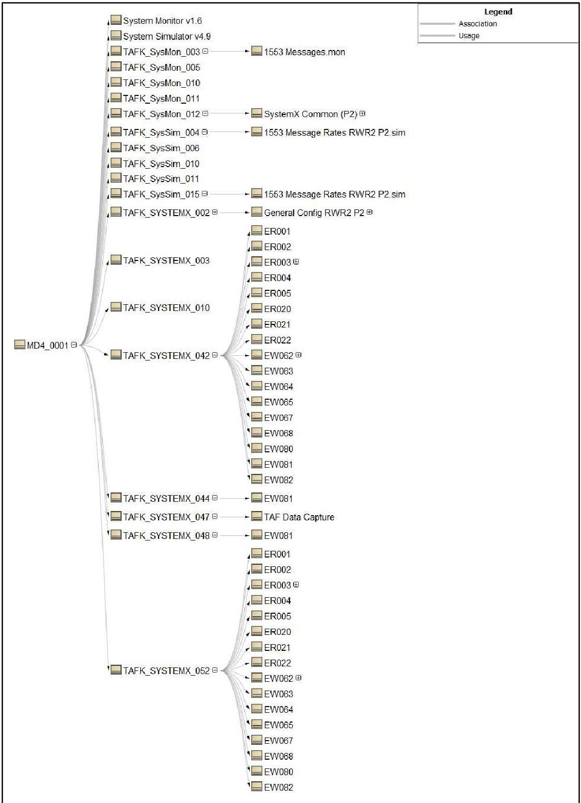


<div align="center">

Figure 24: Test Case Relation Map

</div>

## 4.3.2.5.3. Lookup Tables

Most modeling tools allow the user to create tables to display data in traditional rows and columns, to facilitate easier viewing of the data. A specific example of this type of table is used to enter requirements into the model, seen previously in Figure 23.

<!-- PDF_PAGE: 126 -->

## 4.3.2.5.4. Dependency Matrices

Dependency Matrices allow a user to display the relationships between two different element sets in table form. Most tools provide a wide variety of filters to help customize this specific type of display. A specific type of Dependency Matrix is the Requirements Traceability Matrix. If the Requirements Table is created appropriately, this table is created automatically by most tools. The purpose of this table is to show how requirements are satisfied within the model.

## 4.3.2.5.5. Data Export

In some cases, it may be helpful to extract the data out of the model and translate it to a different form for easier analysis (e.g., Microsoft Excel). Most modeling tools have mechanisms for this, either through dedicated export capabilities, or through the creation of plugins that interface with an available Application Programming Interface (API).

<!-- PDF_PAGE: 127 -->

The following section walks through a simple project, tracing a set of example requirements from creation to verification, highlighting the various artifacts created during the process. It is intended to be a basic example in order to easily illustrate outputs of the defined process.

The overall process, showing how the different concepts line up with the phases of testing, is displayed in Figure 24 below.


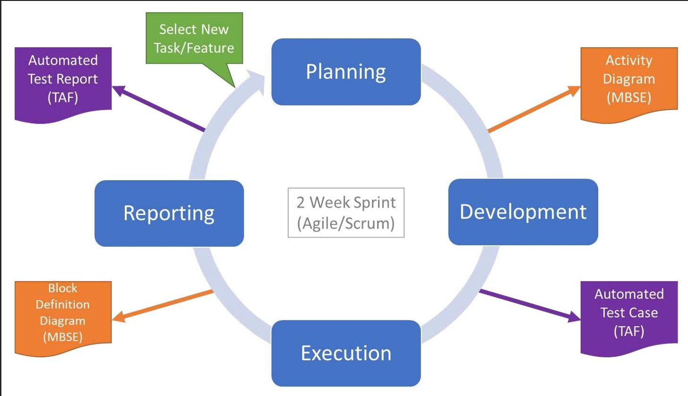


<div align="center">

Figure 24: Overall Process Diagram

</div>

## 5.1. System Description

For this example, the system under test is a simple calculator software application, similar to those that come standard with most operating systems on personal computers, tablets, or phones. A mockup of its user interface is shown in Figure 25 below.

<!-- PDF_PAGE: 128 -->


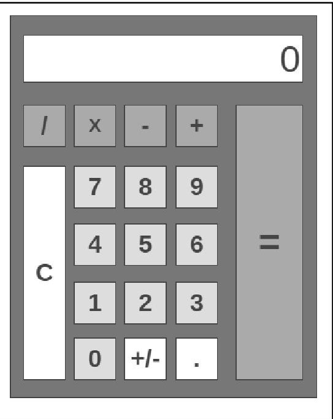


<div align="center">

Figure 25: Calculator Application

</div>

The user can either type the corresponding the key on the keyboard or click the software buttons in the application with a mouse or their finger, depending on the target device's capabilities.

## 5.2. New Features

Suppose that the customer wants to add new functionality to the existing calculator application that will provide quick conversions between imperial and metric measurements for volume, distance, and mass. Specifically, they want to be able to convert the displayed value between gallons and liters, miles and kilometers, and pounds and kilograms by touching a single button. They also want the panel that includes these buttons to be able to be hidden or visible when a "convert" button is clicked.

The team will take these features and create tickets to hold the requests. The tickets will be added to the project's backlog and prioritized against other features.

<!-- PDF_PAGE: 129 -->

## 5.3. New Requirements

As they get closer to the top of the backlog, the tickets for the requested features will be further refined during the normal backlog refinement activities performed by the team. Once the tickets have been refined and assigned to a team, the first step is to define the requirements that will cover the new features.

The following requirements could be created for the customer's request:

- CALC-301: The calculator application shall toggle display of the Conversion Panel upon user action.

- CALC-302: The calculator application shall convert the displayed value from liters to gallons when initiated by the user.

- CALC-303: The calculator application shall convert the displayed value from gallons to liters when initiated by the user.

- CALC-304: The calculator application shall convert the displayed value from kilometers to miles when initiated by the user.

- CALC-305: The calculator application shall convert the displayed value from miles to kilometers when initiated by the user.

- CALC-306: The calculator application shall convert the displayed value from kilograms to pounds when initiated by the user.

- CALC-307: The calculator application shall convert the displayed value from pounds to kilograms when initiated by the user.

- CALC-308: The calculator application shall round all converted numbers to no more than three decimal places (thousandths).

<!-- PDF_PAGE: 130 -->

After requirements are completed, the team would create an initial design of the Conversion Panel. A mockup of the new calculator user interface can be seen in Figure 26 below.


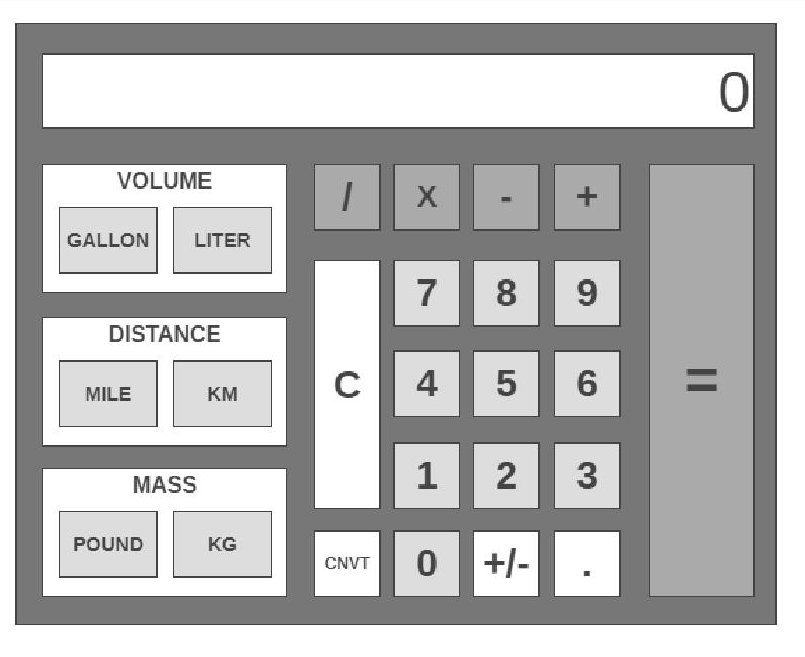


<div align="center">

Figure 26: Calculator Application with Conversion Buttons

</div>

The "CNVT" button is used to hide/display the Conversion Panel. When one of the six conversion buttons are pressed, the number displayed in the textbox is converted to that unit. For example, if the user wanted to convert three gallons to liters, they would enter "3" in the calculator and press the "LITER" button, resulting in a converted value of "11.356."

## 5.4. Test Plan Activity Diagram

After requirements have been defined for these features and an initial design has been approved, the test engineer on the team develops the test plan as an Activity Diagram in the test model for the system. In this example, all of the requirements defined for the Conversion Panel will be included in a single test case. The Activity Diagram for this test case is shown in Figure 27 below.

<!-- PDF_PAGE: 131 -->


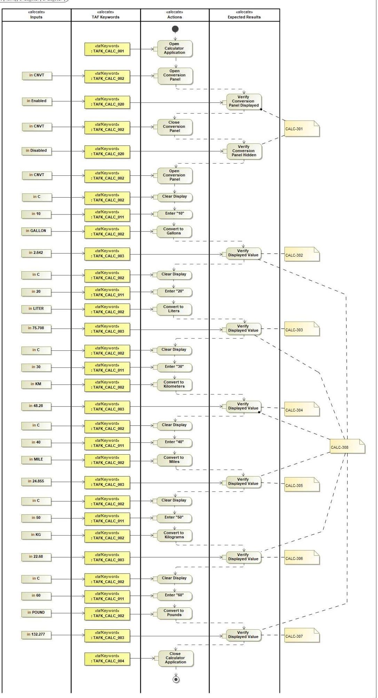


<div align="center">

Figure 27: Conversion Panel Test Plan Activity Diagram

</div>

<!-- PDF_PAGE: 132 -->

Assuming that the original version of the Calculator Application was fully tested using TAF, all of the TAF Keywords listed in the Activity Diagram would already exist except TAFK_CALC_020. As the Conversion Panel is new for this task, TAFK_CALC_020 would need to be created to verify its enabled/disabled status. Also, depending on its implementation, the code for TAFK_CALC_002 might need to be updated to include the seven new possible inputs (CNVT, LITER, GALLON, KM, MILE, KG, POUND). If the keyword were implemented in a way where it could identify buttons dynamically through the GUI based on their label or name, it is possible this keyword would not need an update. As there could be several different implementations with a variety of GUI interaction languages, it depends on the robustness of the background code. The test engineer would create tickets to formally request any new keywords or updates from the TAF team.

When building the Activity Diagram, the test engineer would pull in the existing TAF Keywords and create the block representing TAFK_CALC_020 when needed. Since Requirements in an Activity Diagram are only represented as Notes in this scheme, they do not get created as official Requirements yet.

After this test plan is created and reviewed by the team, the test engineer moves ahead and starts writing the test procedure.

## 5.5. Test Procedure

The test procedure can be written using any text editor. However, TAF provides several tools that make working with Visual Studio Code the best choice. The test procedure, shown as two Visual Studio Code screenshots, is displayed below in Figure 28.

<!-- PDF_PAGE: 133 -->


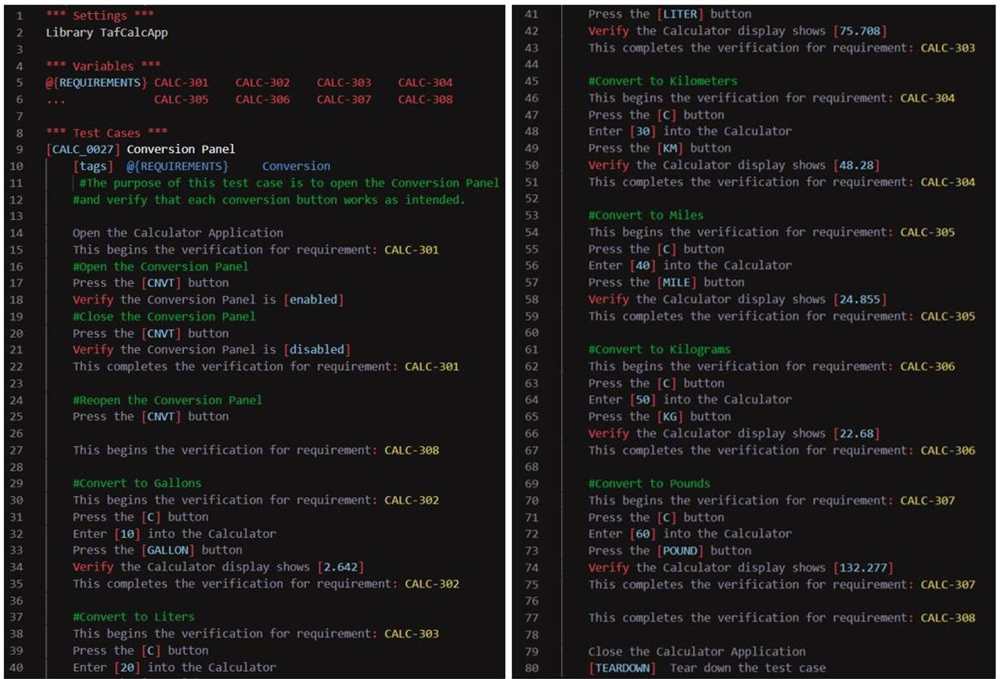


<div align="center">

Figure 28: Conversion Panel Test Procedure

</div>

Some important items to note above are:

- Line 2: The keyword library imported for this test case is specific to the Calculator Application. If there were any common GUI functions utilized, it would also need to import a common Library.

- Line 10: The only tags for this test case are the Requirements being tested and "Conversion." This tag would allow a test engineer to query on that specific word if some functionality changed that affected the Conversion Panel. If multiple test cases used the Conversion Panel, TAF could run all affected test cases based on that query.

- Line 15, Line 22, etc.: Requirements keywords are used to provide "to the test step" traceability, so that where a requirement is satisfied can be easily found.

<!-- PDF_PAGE: 134 -->

- Line 16, etc.: Comments are used throughout the test case to provide explanatory information.

- Line 80: "Teardown" is used here to reset the environment for a clean run of the next test case.

The created test case follows the original test plan closely. After the initial creation of the test procedure, it would be informally executed to work out any test issues or identify problems with integration builds of the new feature. After the test procedure is complete and verified that it has no issues, it receives a final review by the team. Any issues identified by the team at this point are discussed and corrected by the test engineer.

## 5.6. Test Documentation Block Definition Diagram

Before the end of the Sprint that implements the feature, the test engineer is responsible for creating the BDD that documents the developed test case. Usually, this happens after the test procedure is mostly finalized so that rework does not have to be performed in the model. The BDD for the Conversion Panel test case is displayed in Figure 29 below.

<!-- PDF_PAGE: 135 -->


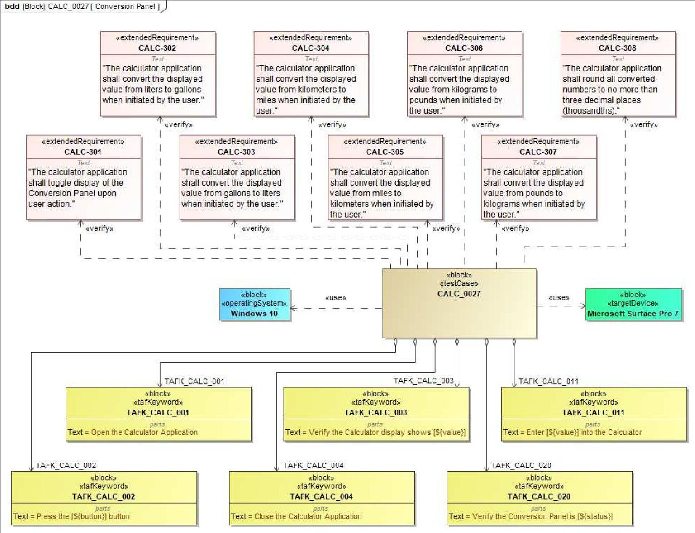


<div align="center">

Figure 29: Conversion Panel Block Definition Diagram

</div>

As this example is much simpler than System X, the BDD for this test case is also less complex. However, this example shows the versatility of the test modeling process. While this BDD traces some items that are similar to the System X model, it also traces new items that are specific to the testing of the Calculator Application. In this way, the modeling scheme for documenting test cases can flex to become more applicable to the system under test.

For the Calculator Application, the following items are traced to the test case:

- Requirements

- TAF Keywords

- Target Device

<!-- PDF_PAGE: 136 -->

## Operating System

One item to note is that the keywords that specify requirements traceability are not included in this BDD. As each test case will always use at least one pair of those requirements, it is assumed that all test cases would need to be checked if those keywords were modified in some way, and so they are not deemed necessary to link to the test case.

## 5.7. Test Execution Log

After the test case has been executed formally, its corresponding Test Execution Log is saved for future delivery as a test artifact and summarized within the Test Report. The Test Execution Log for the Conversion Panel test case can be seen below in Figure 30.


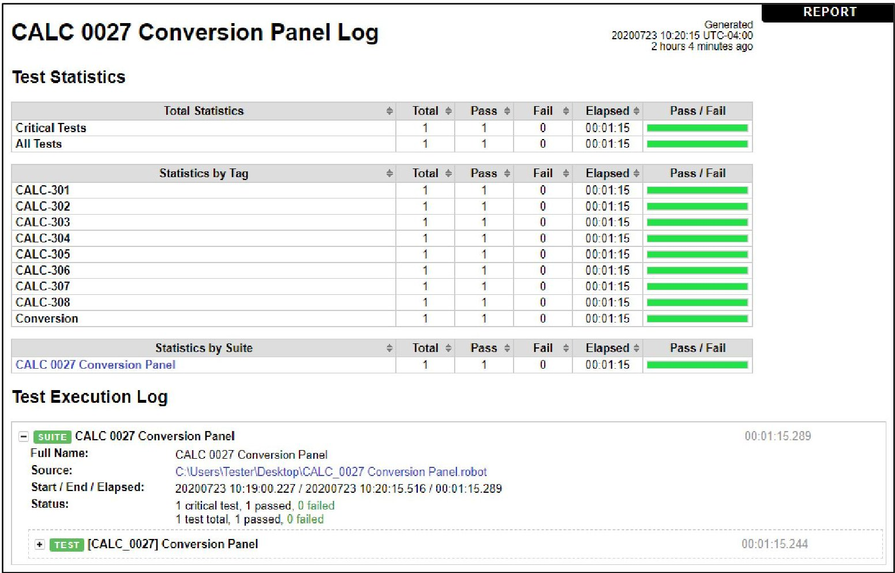


<div align="center">

Figure 30: Conversion Panel Test Execution Log

</div>

An expanded version of the same Test Execution Log showing the full list of steps can be seen below in Figure 31.

<!-- PDF_PAGE: 137 -->


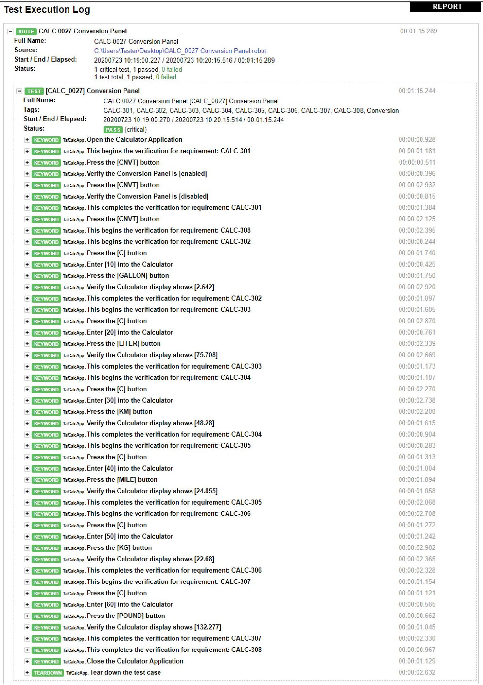


<div align="center">

Figure 31: Conversion Panel Expanded Test Log

</div>

<!-- PDF_PAGE: 138 -->

<div align="center">

# CHAPTER 6: RESULTS AND ANALYSIS

</div>

The results of applying all three concepts to the development process of System X are provided below, in addition to an analysis of the results and a discussion of lessons learned while implementing the new processes. While the application of these concepts impacted the entire development process, including all engineering disciplines, this discussion of results will center on the impacts to the test and evaluation domain.

## 6.1. Qualitative Results

Due to the integrated nature of the implemented concepts, it is difficult to quantitatively review the results of each in isolation. Before providing quantitative results for the overall process, a qualitative discussion is provided below for each concept.

## 6.1.1. Agile Transition

The transition from Waterfall to Agile, while adequately planned, was still a difficult paradigm shift to accomplish, especially in conjunction with the organizational changes required to support it. While some team members were resistant to the changes at first, others fully embraced it. The first several weeks of transition were filled with constant adjustment and tweaking of the planned Scrum process in order to work out unforeseen issues and to further refine specific parts of the process that had only been outlined. It did ultimately stabilize into the process described previously, but, in the spirit of Agile and continuous improvement, it has remained open to further change if necessary.

## 6.1.1.1. Test Quality

Under the traditional Waterfall process, the test team typically worked for weeks to prewrite test cases based on planned designs without ever seeing a software build. This led to

<!-- PDF_PAGE: 139 -->

significant rework of the test procedures once a build was available near the start of the Test Execution phase. This type of risk can result in a less than ideal level of quality for the test suite. Under the new process, features were usually available for testing concurrently with the creation of the test procedures. Since the test engineers were working closely with the systems engineers and developers to fulfill that specific Task, the initial test procedures were often very close to their final form. Additionally, according to the new process, test procedures, like all other artifacts of feature development, had to undergo a review by the entire team before being approved. It was rare for the other disciplines to review test procedures under the older process, sometimes leading to inadequately tested features. Because of the greater number of reviews by the entire team, the overall test suite quality was positively impacted by the change to Agile.

## 6.1.1.2. Product Quality

The transition to Scrum had a direct impact on the quality of System X. Constant testing of software can increase confidence in its quality [106]. By ensuring that an initial test was performed by the test engineer before the end of a feature's development Sprint, defects were identified much earlier in the overall process. Instead of waiting until the testing phase began, defects for a specific feature were able to be corrected even before the feature was fully complete. Additionally, since a preliminary build of the software was available for use at the end of each Sprint, the entire System X team had the opportunity to exercise all implemented functionality throughout the development period instead of only at the end.

## 6.1.1.3. Productivity

The team structure of the new process encouraged the training and learning of team members. Team members strong in a particular skill shared their knowledge with the rest of the team on a regular basis. This team mentality helped with onboarding new engineers, decreasing

<!-- PDF_PAGE: 140 -->

their training times and increasing their productivity faster within the process.Additionally, focusing only on a small, well-planned Task allowed for high productivity. However, this Taskfocused approach did occasionally result in making mistakes due to not taking the bigger picture into account. It was possible to offset those types of mistakes by maintaining a strong leadership team that was regularly involved with each of the teams.

## 6.1.1.4. Team Dynamics

Changing to a Scrum process affected team structure and the dynamics between team members. Under the Waterfall process, team members mostly worked independently to accomplish a large set of Tasks by a given deadline for their specific disciplines on the project to which they were assigned. Most interaction between disciplines happened out of necessity or in regularly scheduled status meetings. Team members of the same discipline occasionally worked together on larger Tasks, but usually performed Tasks independently. However, the Agile transition broke those barriers and forced each team member to work closer with each other than they ever had before. The members of each team were planned from the beginning of the transition and were only intended to be adjusted at the end of each yearly cycle. Team members were expected to work together towards the goal of cross-functionality, so that each member could contribute to and review the team's tasking as a whole.

This higher level of interaction within a smaller team, combined with potential frustrations from stretching less used skillsets, inevitably led to personality conflicts and disagreements. With occasional intervention from leadership and opportunities to increase familiarity with each other, these types of conflicts were typically resolved without the need to restructure teams. In contrast, some team members generated stronger bonds from the increased interaction and used the opportunity to grow their technical and interpersonal skills.

<!-- PDF_PAGE: 141 -->

## 6.1.1.5. Responsiveness

One of the goals of changing to an Agile process is to increase responsiveness to customer requests. Due to the timeboxing method of using Sprints, the focus of each of the teams was able to be shifted quickly when a higher priority Task presented itself. This occurred multiple times during the last two years of System X's development, with the most critical being a release of beta builds to the customer three times within a six-week period to perform hotfixes of problems found during preliminary field tests. The new development structure supported this considerably more than the old Waterfall process, leading to a much higher quality from an incremental build release.

## 6.1.1.6. Visibility

The organization of work items and the constant refining of issues within the Agile process with the entire team resulted in an unprecedented level of visibility into the process. Team members, not just management, were now able to see the future roadmap for the development of System X and provide direct feedback regarding the path ahead. This provided team members with a stake in the process, allowing them to feel more included in the direction of System X's development.

## 6.1.1.7. Test Awareness

As previously stated, under the old process, test team members were mostly isolated from other disciplines, unless they specifically sought them out. Not many members of the other disciplines understood the test process or the specifics of what test engineers needed. Through the creation of cross-functional teams and by promoting the sharing of responsibilities between disciplines, both test engineers' awareness of design decisions and other engineers' awareness of the test process were increased. Working closely with each team member provided the insights to the entire team that they would not have had otherwise.

<!-- PDF_PAGE: 142 -->

## 6.1.2. Test Automation

The struggles to create a test automation capability within System X's organizational division have been discussed previously. The TAF's creation was an arduous path, suffering from a number of false starts along the way in addition to a general lack of support in the early stages. However, after the stabilization of the mature TAF product, its incorporation into System X's test process was relatively seamless, except for the occasional implementation challenge and test environment roadblock. The TAF has become an integral part of System X's development process, supporting its chosen Agile methodology extremely well.

## 6.1.2.1. Test Quality

The incorporation of test automation increased the overall quality of the test suite, due to improved flow and organization, increased maintainability, and reduced variability between test approaches. When the actions that can be performed are controlled through the use of automated keywords, the test cases become more standardized, leading to a greater level of understanding. Instead of freeform text that could be written in any number of ways, there are a set of specific tools and actions available to a test engineer. As with the development of software, different test engineers may take different approaches while still solving the problem, but the variations of how this can be accomplished are easier to comprehend. Additionally, significant work was performed to define standard approaches to the structure of test cases, such as how to perform in-line requirements tracing, how to comment test steps, and how to start and end a test case. Defining and enforcing this standard helped to make all of the automated test procedures have a consistent look and feel, reducing potential for confusion and increasing the maintainability of the test artifacts.

<!-- PDF_PAGE: 143 -->

## 6.1.2.2. Product Quality

Test Automation increased the overall quality of the product by allowing additional test executions within a given time period. A large part of the value of an automated testing method is the engineer time saved by not having to perform manual regression testing [107]. This allows more time to be spent manually exercising problematic or high priority functions of the system.

## 6.1.2.3. Productivity

The standard approach to test case creation, in conjunction with TAF usability features and predefined keywords, allowed for test cases to be developed faster than ever before. Storing each test case as a separate plaintext file and managing them with professional development tools made it easier to identify and reuse test logic patterns that could be applicable to future test cases.

## 6.1.2.4. Team Morale

The field of Software Engineering can be subject to a high level of burnout, due to a variety of factors [108]. For a test engineer, running the same set of regression tests manually over and over again can become tedious, especially if that effort takes significant time in comparison to other, more creative or skill-intensive tasks [109]. Test automation can reduce this burnout, as it removes some of the monotonous aspects of the job of a test engineer. In place of the time usually spent on regression testing, it may provide the potential for more exploratory testing to be performed, which has been found to identify more defects that scripted testing [110]. Exploratory testing, along with the creation of new test cases, makes higher use of a test engineer's creativity and potentially reduces the staleness associated with performing repetitive tasks [42]. Because of the addition of test automation to the System X process, it was possible for the test engineers to spend more time on exploratory testing rather than traditional scripted testing.

<!-- PDF_PAGE: 144 -->

## 6.1.3. MBSE Concepts

While the main goal of performing the test modeling process, to provide a standard method of impact analysis, was accomplished successfully, this concept application was the least impactful of the three. It was generally agreed upon by the team that it was important to know how individual components connected to each test case; however, performing the documentation task within the model was considered to be unnecessarily time consuming. The frustrations with this process were primarily due to the following factors:

- Only a limited number of licenses were available for the modeling tool, making it difficult to perform the modeling activities required.

- The aforementioned license issue prevented timely review of created diagrams, unless they were extracted out of the tool and pasted to a collaborative area as a picture.

- The main set of tools used by the team were integrated together and worked to support the development process; however, the modeling tool was a separate, standalone application with its own dedicated server-based storage.

- The modeling tool provided a plethora of options that were unnecessary for the lightweight process, leading to user frustration.

To counter most of these issues, a plugin was created for the modeling tool that would import a TAF test case and convert it to a BDD based on the defined methodology. This plugin saved significant engineer time when creating the model artifacts, but it also relegated the test model as just another step to perform in the process. In this way, the model became something that existed but was rarely used during the development process, which was not the intent.

Using this plugin still had the desired effect of creating better documentation of test cases, and the model was used successfully to trace which test cases should be executed based on

<!-- PDF_PAGE: 145 -->

upstream changes. However, other methods of test case documentation, such as extracting the information to a large spreadsheet automatically from a test case, may have been more efficient.

Performing Test Planning within the model was largely dropped by the test team along the way, as it took too long to create an Activity Diagram within the model to support an Agile process. Additionally, the importance of maintaining test plans for each test case was questioned due to the improved readability and understandability of test cases written with the TAF. However, as Test Planning is a vital part of the test process, a substitute method, creating pseudo Activity Diagrams with simplified diagramming software within the working pages of Tasks, was found to be the preferred method of preserving the intent of this methodology. In this way, the team was able to create and review test plans in line with the requirements, design, and other necessary development prework at a much faster pace.

Two major factors in the application of this concept were the lack of general modeling knowledge among the team and the lack of any preexisting model elements. If this concept were to be applied to a project already having a solid foundation of SysML, modeling tool experience, and an existing model, it is the researcher's opinion that the test modeling process described herein would have a higher level of acceptance and overall use.

## 6.1.3.1. Test Quality

The maintenance of documentation on an engineering project is a common problem [100]. Standardizing the documentation and test planning approach facilitated easier creation and review of test artifacts. Test engineers knew what was expected of them and how to perform their tasks, leading to a higher quality output. Even though this specific method of documentation was not fully embraced, it resulted in an acknowledgement that maintaining this information was

<!-- PDF_PAGE: 146 -->

important. Having a similar level of documentation defined by this process led to a higher test suite quality overall.

## 6.1.3.2. Productivity

Because test cases are all documented in the same manner with this process, training new test engineers was faster. Once the methodology was learned, these new engineers could use the model to see how the actions of a test case flow to exercise specific functionality and exactly which functionality components are linked to the execution of that test case.

## 6.1.3.3. Regression Testing

It is not always possible to perform a full regression test for a release, potentially due to items such as shortened timelines, customer deadlines, or lack of funding [41]. Without a method of understanding how key system components relate to each other, determining which functionality should be exercised in that limited time period is not always an easy process. It usually relies on the experience of the engineers on the team, which can potentially lead to the following:

- Missed testing of system functionality that is actually related to the change [111]

- Over-testing of functionality that was not necessary [112]

- Wasted time and effort to make the decision at the time of each beta release [113]

Because this process provides a systematic way of determining how individual components are linked to test cases, not just through requirements tracing, it provides a method for limiting the regression time available to the most important test cases.

The model created by this process was used multiple times to support the scoping of regression testing for quick beta releases to customers. Historically, performing this type of regression scoping task would necessitate calling a meeting with many members of the project

<!-- PDF_PAGE: 147 -->

team in order to review the needs of the test event and select specific test procedures to be executed. While productive, this meeting required several man-hours to perform, potentially wasting time when compared to the new process. The model-based process allowed a targeted regression test to be executed within a specific timeline based on changes or added features. Selecting test cases for regression testing was much easier than before, as the test cases were tied back to specific functionality. However, with the goal of attaining a near 100% automated test transition, there is a chance that maintaining this information becomes less important in the future due to the potential ability to execute the entire test suite in very short time period.

## 6.2. Quantitative Results

The results from the implementation of all three concepts that can be quantitatively described are provided below.

## 6.2.1. Test Automation Capability and Test Completion

As the automation of embedded systems is inherently more complicated than simple software applications [114], which is the case with System X, the transition to automated testing is still ongoing, even after two years of a functional test automation solution. This is partly because feature development of the system was not stopped to implement this transition and partly due to the reworking of test cases to better support automation. Additionally, due to the phased approach limiting impact to the system under test, the transition was less impactful than it could have been or will be in the future. Regardless, significant gains were produced within the first two release cycles, as shown in Table 1 below.

<!-- PDF_PAGE: 148 -->

<div align="center">

Table 1: Developed Capability vs. Completed Tests

</div>

<table border="1"><tr><td>Component</td><td>2019 Capability</td><td>2020 Capability</td><td>2019 Completed</td><td>2020 Completed</td></tr><tr><td>System Tests</td><td>75%</td><td>85%</td><td>5%</td><td>20%</td></tr><tr><td>Module 1 Tests</td><td>90%</td><td>95%</td><td>5%</td><td>15%</td></tr><tr><td>Module 2 Tests</td><td>75%</td><td>75%</td><td>20%</td><td>50%</td></tr><tr><td>Module 3 Tests</td><td>95%</td><td>95%</td><td>75%</td><td>75%</td></tr><tr><td>Module 4 Tests</td><td>75%</td><td>90%</td><td>50%</td><td>80%</td></tr><tr><td>Module 5 Tests</td><td>100%</td><td>100%</td><td>5%</td><td>6%</td></tr><tr><td>All(Weighted Average)</td><td>84%</td><td>90%</td><td>23%</td><td>38%</td></tr></table>

The second and third columns in Table 1 provide a comparison of the percentage of automation capability that was developed per component within the first two years. During the first year, the development team created automation infrastructure to support approximately 84% of System X functionality, when weighting the percentages by relative size of component. During the second year of development, the team increased the automation infrastructure to support approximately 90% of System X functionality.

The fourth and fifth columns in Table 1 provide a comparison of the percentage of the expected test suite that was transitioned to automated testing within the first two years for each component. Ideally, these percentages would match the capability percentages in columns two and three; however, reworking existing manual test cases into automated ones can be a significant effort. This is especially true when the team is doing more than just automating existing test cases, but rather rebuilding them to more properly support a sustainable automated paradigm.

In the first year of transition, the team completed 76 test cases, approximately 23% of the expected total test procedures based on the functionality of System X at the time. As System X is continuously in development, the size of the final test suite will also continue to grow, impacting the overall percentages when compared across releases. However, even with adding additional functionality to System X, in the second year the team was able to increase the percentage of

<!-- PDF_PAGE: 149 -->

automated testing to approximately 38% of the entire expected test suite, which equated to 166 test cases.

## 6.2.2. Test Execution Time Savings

By consolidating the different platforms, reassessing the existing test procedures for duplicates or unnecessary testing, and limiting dry run testing, the test team was able to reduce the baseline regression test period to 12 weeks for the first common release in 2019. The 76 automated test cases developed during the first year reduced that baseline timeframe by an additional three weeks, equating to a cost savings of approximately $15,000 per test run. The increased total of 166 automated test cases completed after the second year reduced the baseline by a total of six weeks, equating to a cost savings of approximately $30,000 per test run.

## 6.2.3. Defect Identification

Under the original Waterfall process, it was rare for test engineers to have early access to preliminary builds of System X. Formal, fully integrated builds were usually only available to the Test Engineering team slightly before the Test Execution phase was scheduled to begin. This made the early identification of defects almost impossible. Historically, for releases under the original process, between 80% to 90% of all previously undiscovered defects were identified during the Test Execution phase or after. This late discovery of issues regularly led to the need for a pre-release hotfix and limited retesting, which was costly under a Waterfall development method.

With the new process changes, System X builds were continually available for testing. Automated tests were executed on a regular basis very early in the development process before the beginning of the Test Execution phase. Identified defects were either fixed within the Sprint where the functionality under test was developed, corrected in a future Sprint, or documented for later reporting and acceptance by the customer. For the first Agile release of System X in 2019, 100%

<!-- PDF_PAGE: 150 -->

of defects associated with the 76 automated test cases were identified before the Yearly Regression period. Similar results are expected for the Yearly Regression period for the 2020 release of System X later this year.

## 6.2.4. Test Process Impacts

While the application of the three concepts had a major impact on the Test Execution phase, the process optimization, automation, and standardization brought about by the application of the three concepts impacted the entire test process overall. To illustrate this, a sample of 12 test cases, two from each module, were chosen from the existing set of 166 automated test cases. The time taken to complete each of the four test phases with the new process was recorded for each. Then, using data from previous release cycles under the old process and the experience of the Test Engineering team, the estimated time that it would have taken to complete each of the four test phases with the old process was also recorded for each of the sample test cases. Figure 32 below shows the comparison data for each test case.

<!-- PDF_PAGE: 151 -->


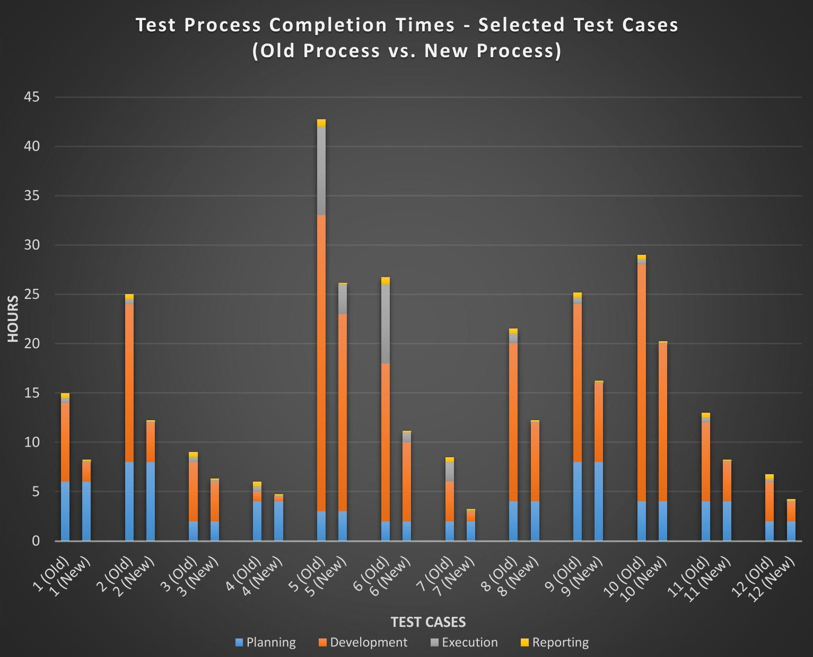


<div align="center">

Figure 32: Old Process vs. New Process Completion Times

</div>

The average reduction in time across all test phases for all sampled test cases, or the reduction to the overall test process, was 41%. Further analysis of each test phase is provided below.

## 6.2.4.1. Planning

Regardless of the method used to perform the Test Planning activity, it is a vital step that takes dedicated engineering time to perform properly [115]. There was no change in the hours taken to perform this activity across all test cases.

<!-- PDF_PAGE: 152 -->

## 6.2.4.2. Development

The Test Development phase was reduced by 52%. This was due to the following reasons:

- Closely aligning the different disciplines through the formation of cross-functional teams provided faster answers to design and functionality questions.

- Changing to an iterative development process allowed test engineers earlier access to working software.

- More detailed and standardized documentation provided greater understanding of the system and intended functionality.

- Writing test procedures in a plaintext format with a keyword-based automation framework like the TAF provided a faster method of test case development.

- The user-friendly and unambiguous TAF test case format provided easier reuse of common test steps.

## 6.2.4.3. Execution

The Test Execution phase was reduced by 82%. This was primarily because the automated testing performed with the TAF executed much faster than manual testing performed by a test engineer. One item of importance about this reduction is that the data being compared are only the times taken to run the test cases (i.e., manual execution vs. automatic execution). This does not factor in the additional savings when automated test cases are performed during non-working hours such as nights or weekends. If working hours were considered for this data set, the reduction would be much closer to 100%, as the cost to perform testing would only be for a test engineer to initiate the tests and review the results.

## 6.2.4.4. Reporting

The Test Reporting phase was reduced by 69%. This was due to the following reasons:

<!-- PDF_PAGE: 153 -->

- Test log outputs from the execution of automated test cases with the TAF needed no additional interpretation.

- The test log output format was easier to translate to a formal test report than manual execution logs.

- Optimization of the reporting process decreased the time necessary for reporting activities.

## 6.2.5. Example Test Budget Impact

The time reductions to each test phase documented above provide data that can be applied to a theoretical test budget example for illustrative purposes. This example assumes a project that has fully implemented an Agile development methodology, test automation, and a standardized test documentation strategy. This example will also use historical data from previous System X releases to provide realism; however, this budget data is purely theoretical.

For this example, the theoretical project has a testing budget of $1,000,000. Using historical data from System X for the costs of each test phase, Table 2 below shows a breakdown of the testing budget allocated to each test phase and how the budgets are reduced when applying the observed reductions.

<div align="center">

Table 2: Test Phase Budget Comparison

</div>

<table border="1"><tr><td>Test Phase</td><td>Budget Percent</td><td>Original Budget</td><td>Reduction Percent</td><td>Final Budget</td></tr><tr><td>Planning</td><td>25%</td><td>$250,000</td><td>0%</td><td>$250,000</td></tr><tr><td>Development</td><td>50%</td><td>$500,000</td><td>52%</td><td>$240,000</td></tr><tr><td>Execution</td><td>20%</td><td>$200,000</td><td>82%</td><td>$36,000</td></tr><tr><td>Reporting</td><td>5%</td><td>$50,000</td><td>69%</td><td>$15,500</td></tr><tr><td>TOTAL</td><td>100%</td><td>$1,000,000</td><td>46%</td><td>$541,500</td></tr></table>

As can be seen above, applying the reductions to the weighted budgets results in an overall test budget reduction of $458,500, or approximately 46%. This type of reduction is considerable and creates the potential for budgetary options such as increasing the amount of testing performed,

<!-- PDF_PAGE: 154 -->

increasing the number of features developed, reducing the project timeline, bidding lower on contract proposals, or reallocating budgets to perform other important activities.

## 6.3. Lessons Learned

During the implementation of these concepts, it was inevitable that issues would arise. A compilation of lessons learned is provided below.

## 6.3.1. Agile Transition

Lessons learned that are associated with the transition from Waterfall to Agile are provided below.

## 6.3.1.1. Expect the Process to Change

An Agile process is intended to be constantly improved [116]. Especially during a transition in development methodologies, processes put into practice will not always function as designed; they will need to be molded and adapted to the needs of the project and the team. The team should be flexible and expect that changes to the process, even significant ones, will be necessary.

For engineers completely new to an Agile methodology such as Scrum, the process may be very different from their previous experiences. The transition process will take time. New concepts such as story pointing can be hard to grasp at first [117]. Adjusting to the boundaries of a Sprint can be difficult. It can also be hard to change engineering mentalities to accept that planned rework is acceptable and that building a product incrementally can still lead to a fully integrated solution [118]. For the System X transition, it took several Sprints for the methodology to stabilize and even longer for the teams to completely understand and embrace it.

<!-- PDF_PAGE: 155 -->

## 6.3.1.2. Document the Process

Even though the specifics of a chosen Agile methodology will probably change frequently after initial implementation, it is important to maintain documentation of the process [119]. Without having a reference to the current details of the process, a complete breakdown can occur, leading to the team falling back to the most familiar or easiest path to complete work. It can be hard to recover from such a breakdown in process and still preserve the planned project schedule.

Work item management is an important part of the process that must be documented. Examples of questions that should be answered in process documentation include:

- How are tickets defined?

- What is the ticket workflow?

- What is the minimum information that must be included in a ticket?

- When a ticket is complete?

- What is necessary for a ticket to be transitioned to another state?

- How large a Task should a ticket cover?

## 6.3.1.3. Find Opportunities for Team Building

In an Agile environment, teams are expected to work closely with each other on a daily basis. This close interaction has the potential to lead to stronger bonds between team members, but it also can create frustration and disagreements [120]. To try to avoid these types of conflicts, look for opportunities for teams to have fun and build team comradery. Usually, increasing team members' knowledge of one another increases their cooperation, which potentially leads to a higher level of productivity and job satisfaction. Leadership should find ways to increase interpersonal knowledge among teams. On System X, rather than creating generic "Team 1/2/3" labels for teams, each team was expected to create their own team name. Additionally, each team

<!-- PDF_PAGE: 156 -->

named their individual Sprints every two weeks, which generated some fun each Sprint at the planning meetings. Finally, taking time for more traditional team building activities may also create better team bonds.

The value of recognizing individuals for their achievements should not be overlooked. The researcher created custom trophies that were representative of each team (e.g., the TAF team trophy was a small metal toy robot) and used them to recognize an individual from the team at the Sprint Retrospective meeting. The receiving team member would keep the trophy for the next Sprint but was expected to award another team member with it in the next Sprint Retrospective meeting, citing the specific reason it was being awarded. Then, the cycle would be repeated in future Sprint Retrospective meetings. This provided some small incentive to be recognized, but also helped create some positive feedback for team members.

## 6.3.1.4. Encourage Variety

A core concept of Agile is to promote the cross-functionality of teams [121]. The team is considered an individual unit and is expected to possess the skills necessary to complete any task for the project. However, performing the same type of tasks on a regular basis can get stale. Encouraging cross-functionality allowed team members to exercise skills in different disciplines, increasing the variety of daily tasks.

The large number of regular meetings associated with the Scrum process also provided an opportunity to reduce staleness for the teams. Each team was encouraged to occasionally vary meeting locations, methods, and leaders. For example, there are many different methods of running a Sprint Retrospective. Some methods might focus the meeting on a larger scope, while other methods could use a different perspective to extract unique insights from the teams. Another example was when one of the teams met for breakfast at a diner for their daily standup meeting

<!-- PDF_PAGE: 157 -->

instead of in the office. The occasional off-site or outdoor meeting encouraged variety while also providing opportunities for the team members to interact more personally.

## 6.3.1.5. Automate the Process

The Scrum process creates the expectation that a releasable build is potentially ready for deployment every two weeks. However, to officially deploy software, a large amount of documentation is usually required. By converting documents to plaintext and using a markup language like LaTeX or reStructuredText to automatically create the final document, this process can be accomplished much faster [122]. Additionally, documentation is usually not the preferred task of most engineers, especially when working though intensive formatting issues. Allowing them to create the content in plaintext and automatically building the document led to less frustration on System X. Partially automating other items such as ticket workflows, the creation of builds, and the review process also reduced the time spent dealing with the process and more time working to create additional functionality.

## 6.3.2. Test Automation

Lessons learned from the creation and implementation of the TAF are provided below.

## 6.3.2.1. Treat Test Automation as a Product

Even if it is never intended to be delivered to an external customer, the developed automation code and the accompanying test procedures that use it should be treated like a real, releasable product. It should be designed and documented well, conforming to standard practices and procedures. This leads to a higher level of maintainability, which is a common issue with the longevity of test automation infrastructure [123]. Treating the test procedures as code also allows for the use of development tools, which can be an exceptional aid to productivity.

<!-- PDF_PAGE: 158 -->

## 6.3.2.2. Start Small and Advertise Results

Management, customers, and other stakeholders that control project funding can be hard to convince that test automation is worth the effort, especially if a set of manual procedures already exist that work as expected. If it truly makes sense for the project and would provide value, the team should find a way to incorporate automation somewhere along the process in a small way as an example of future potential [124]. Then that example can be used as evidence for the value that can be created by transitioning to an automated world.

## 6.3.2.3. Automate Functionality That Makes Sense

Not everything should be automated; sometimes test cases are too difficult or just too small to make sense [125]. Sometimes an automated approach does not always result in the most efficient method of testing [126]. Discretion and experience should be used to identify when functionality should be tested automatically. Also, the right balance between automation infrastructure development and test case development should be found. Not much benefit is gained by having great potential but no actual results.

## 6.3.2.4. Standardize the Approach

Significant effort should be put into the automation language being created. Standardizing the approach to the keywords that will be visible to the end users is an important part of providing value. If a test engineer trying to use the test automation framework has trouble identifying what functionality is available, it can impact productivity and result in confusion.

Not all test engineers have programming skills. If the test automation language behaves more like a traditional programming language, it may make the transition from manual testing to automated testing harder. If the automation language reads similarly to manual steps, the only roadblock to using it is the tools rather than the syntax of the language.

<!-- PDF_PAGE: 159 -->

Additionally, creating usability features that wrap the automation framework make the end-user experience better, resulting it faster test case generation. Creating features such as creating a custom editor, integrating with the configuration management tool, highlighting keyword syntax, autocompleting keywords, and autogenerating test procedure frames can add significant value to the automation framework.

## 6.3.2.5. Focus on Maintainability

A consistent problem with test automation projects is that they tend to become unmanageable [127]; they are sometimes created in haste without much design or documentation [128]. To help ensure the success of an automation framework, maintainability should be a high priority. Also, the maintainability of the test procedures created with the framework is important. Test case length and scope should be considered for consistency during the creation of the procedures.

## 6.3.3. MBSE Concepts

Lessons learned from the implementation of MBSE concepts are provided below.

## 6.3.3.1. Reduce Unnecessary Details

Too much detail can profoundly impact prolonged maintainability of documentation. Including small details that are unnecessary to the task at hand can lead to endless rework. For artifacts such as test plans, which are intended to be malleable throughout the creation of the test procedures, it is necessary to find a balance between understandability and thoroughness. However, a model is only as good as its accuracy and level of detail, so it is important to make sure enough details exist within the model to properly serve its intended purpose.

<!-- PDF_PAGE: 160 -->

## 6.3.3.2. Automate the Process

Generally, automation helps improve the efficiency and speed of processes [129] (Bosch, 2014). This model-based methodology is no different. Most modeling tools have rich APIs or other automation interfaces that can help perform simple, potentially monotonous tasks faster. Automating key aspects, such as generating a test case skeleton based on a test plan or programmatically building a BDD from a created test procedure can help reduce time spent on documentation while still maintaining the objectives of this process.

## 6.3.3.3. Enforce a Standard

Creating and documenting a standard approach to any process has the potential to improve efficiency by providing organization as well as a pattern to follow for future additions. If this methodology is adopted on a project, the details of its expected use should be documented and advertised to the entire team. This documentation of the process includes items such as how to define elements, a plan for Stereotyping, relationships that will be used, and rules for global numbering of items between systems or projects. Having a well-defined process can help clear confusion and disorganization that would harm productivity and maintenance.

## 6.3.3.4. Provide Training

Modeling tools intended to fully support MBSE can be cumbersome to use and the amount of options can be overwhelming. If a model-based approach is taken, training is necessary to reduce the burden of learning such a complicated tool and methodology. It also helps to have expertise and knowledge of engineers familiar with the chosen method.

## 6.3.3.5. Easier with an Existing Model

While the test document strategy described in this paper is intended to be a standalone modeling methodology, it can also work in cooperation with an existing system model. For System

<!-- PDF_PAGE: 161 -->

X, if a system model had existed, it would have made the new process easier, as existing components would not have needed to be created. Additionally, if the entire team were using a system model rather than just the test team for test-specific items, it would have increased the overall importance of the model.

<!-- PDF_PAGE: 162 -->

## CHAPTER 7: CONCLUSIONS

As the purpose of this research and implementation was to enhance the test process, the results discussion primarily focused on items related to the testing of System X. However, the impact of these changes was significant to the entire development process and not exclusive to the test and evaluation domain. Modernizing the approach to software and system development is vital to increasing the efficiency of the process, ensuring the quality of the product, and providing value to the customer through responsiveness and adaptability.

Transitioning to an Agile methodology such as Scrum has the potential to reduce development cycle times, leading to faster deployment to the field. It also provides a higher confidence in the system under test, due to an increased frequency of testing and earlier identification of defects. However, the transition is not without cost; strong leadership, planning, flexibility, and dedication is needed to complete a successful paradigm shift in development methodologies. A failed transition could have several negative consequences and could result in a less effective process than the original.

A core benefit of automated testing is the ability to execute more testing, either faster than a human can perform or over longer test sessions as automated testing has no time restraint. This allows complex functionality to be more thoroughly tested, and potentially provides the test engineer more time to perform targeted testing for new features. A typical expectation is that as builds are being generated, a battery of automated regression test cases is executed automatically, showing that the change that was made did not break some other functionality of the system. The creation of an automated testing framework can be a valuable, but also costly, venture that should be carefully considered before pursuing. While initial costs for developing the capability are

<!-- PDF_PAGE: 163 -->

typically high, those initial costs can be amortized over the lifetime of the framework. The more it is used to perform test activities, the faster the initial costs are recouped. An automated testing framework can provide significant reductions in test execution times, but the benefits must be weighed against the costs involved.

While the test modeling methodology defined in this document had limited success in practice, the goals of the process were largely maintained. A standard method of performing test planning activities, documentation of test cases, and impact analysis is an important aspect of building a highly understandable and sustainable test suite. It is necessary to continue providing a high-quality and adequately tested product, especially for highly complex systems with long lifespans. The process described in this article is one method of organizing the potential chaos and would work well for a project that is already incorporating MBSE concepts into their development process.

## 7.1. Research Contributions

The research activities presented within this dissertation provide the following contributions to the fields of Systems Engineering and Test Engineering:

1. This research presented an assessment of the impacts to the T&E process of a practical implementation of Agile development when transitioning from a traditional Waterfall development process on a large scale, aerospace project. Metrics of this impact included as-implemented measurements of T&E activity, changes in project timelines, and earlier defect identification.

2. This research proposed a systematic integration and transition strategy for the migration of manual T&E efforts to an automated testing paradigm within an embedded software engineering environment. The value of this strategy was demonstrated through its

<!-- PDF_PAGE: 164 -->

implementation and subsequent evaluation as detailed under the following research contribution.

3. This research developed a sustainable, customer-focused automated testing approach using Robot Framework that includes novel mechanisms for requirements traceability, syntax standardization, natural language formatting, and incorporation into an Agile development process. Together these advancements provide test automation capabilities that support a modern Systems Engineering process, as validated through their effectiveness measures when implemented, such as test documentation, percentage of automated testing, and test execution timeframes.

4. This research performed an assessment of the value of MBSE concepts by mapping the traditionally-asserted benefits of MBSE to the T&E domain, specifically through the use of SysML models to perform the Test Planning activity and to document relationships between test procedure contents.

5. This research provided a measurement of the effectiveness, through the analysis of quantitative and qualitative results in practice, of an integrated T&E process that combines Agile development, test automation, and MBSE concepts to enhance the development process of a large aerospace project.

Together these research contributions describe an overall enhancement to the T&E process through the implementation of Agile development, test automation, and MBSE to help manage the exponential growth of test documentation on large and complex projects in the aerospace industry.

## 7.2. Future Work and Expectations

The process and its implementation described in this dissertation are specific to a singular project that, while representative of a large aerospace system, does not necessarily encompass all

<!-- PDF_PAGE: 165 -->

factors of engineering projects in practice. While many of the aspects of this process are intended to be transferrable, the implementation of this process must adapt to the specifics of the targeted project. Using this methodology to enhance the T&E process on additional projects, while documenting the necessary adaptations, could result in further useful research contributions to the field. Additionally, this dissertation focused on the results pertaining to the T&E field only; however, the changes made to the System X process impacted all disciplines, not just T&E. Expanding this research to capture results of its application to all disciplines could provide additional value.

Future work could also be performed with regard to each applied concept. The Agile process documented by this dissertation provided an alternate version of Scrum that did not include the Scrum Master role. Additional research could be performed to document the differences in effectiveness of the process if Scrum were implemented in a way that included a Scrum Master. Second, the phased approach to test automation presented by this dissertation could benefit from a study of the implementation of test automation across the industry in order to provide evidence for how projects transition to automated testing, how they transition between phases, and which phases are implemented or skipped after a mature test automation solution has been established. Finally, the model-based Test Planning and documentation methodology was implemented on a project that had no existing MBSE practices or procedures. It is expected that if the modeling process documented by this dissertation were implemented on a project that had embraced MBSE, it would have been more successful. Future work could be performed to implement a similar strategy on a project with an existing system model to document the differences in results between their implementations.

<!-- PDF_PAGE: 166 -->

Based on the last two years of results so far and by continuing the strategy documented by this research, it is expected that within two to four more release cycles, the Yearly Regression period for System X will be reduced to less than one week. This type of reduction, from an original timeline of 18 weeks, shows the potential improvement that an Agile transition, the development of an automated testing capability, and a standard approach to test documentation can provide.

<!-- PDF_PAGE: 167 -->

[1] West, T. D., & Blackburn, M. (2017). Is digital thread/digital twin affordable? A systemic assessment of the cost of DoD's latest Manhattan Project. Procedia Computer Science, 114, 47-56. https://doi.org/10.1016/j.procs.2017.09.003

[2] Hagen, C., Kearney, A. T., Hurt, S., & Williams, A. (2015). Metrics that matter in software integration testing labs. CrossTalk, 24.

[3] Bertolino, A. (2007). Software testing research: Achievements, challenges, dreams. 2007 Future of Software Engineering, 85-103. https://doi.org/10.1109/FOSE.2007.25

[4] Lyu, M. R. (2007). Software reliability engineering: A roadmap. 2007 Future of Software Engineering, 153-170. https://doi.org/10.1109/FOSE.2007.24

[5] Dvorak, D. (2009). NASA study on flight software complexity. AIAA Infotech@Aerospace Conference, 1882, 1-20. https://doi.org/10.2514/6.2009-1882

[6] Fewster, M. (2001). Common mistakes in test automation. Proceedings of Fall Test Automation Conference.

[7] Kasoju, A., Petersen, K., and Mantylä, M. (2013). Analyzing an automotive testing process with evidence-based software engineering. Information and Software Technology, 55(7), 1237-1259. https://doi.org/10.1016/j.infsof.2013.01.005

[8] Whittaker, J. A. (2000). What is software testing? And why is it so hard? IEEE Software, 17(1), 70-79. https://doi.org/10.1109/52.819971

[9] Garousi, V., & Küçük, B. (2018). Smells in software test code: A survey of knowledge in industry and academia. Journal of Systems and Software, 138, 52-81. https://doi.org/10.1016/j.jss.2017.12.013

<!-- PDF_PAGE: 168 -->

[10] Hayes, J. H., Dekhtyar, A., & Osborne, J. (2003). Improving requirements tracing via information retrieval. Proceedings of the 11th IEEE International Requirements Engineering Conference, 138-147. https://doi.org/10.1109/ICRE.2003.1232745

[11] Kazmi, R., Jawawi, D. N., Mohamad, R., & Ghani, I. (2017). Effective regression test case selection: A systematic literature review. ACM Computing Surveys, 50(2), 1-32. https://doi.org/10.1145/3057269

[12] Herzig, K., Greiler, M., Czerwonka, J., & Murphy, B. (2015). The art of testing less without sacrificing quality. 2015 IEEE/ACM 37th IEEE International Conference on Software Engineering, 483-493. https://doi.org/10.1109/ICSE.2015.66

[13] Mirzaaghaei, M., Pastore, F., & Pezze, M. (2012). Supporting test suite evolution through test case adaptation. IEEE 5th International Conference on Software Testing, Verification, and Validation, 231-240. https://doi.org/10.1109/ICST.2012.103

[14] Borjesson, E., & Feldt, R. (2012). Automated system testing using visual GUI testing tools: A comparative study in industry. IEEE 5th International Conference on Software Testing, Verification, and Validation, 350-359. https://doi.org/10.1109/ICST.2012.115

[15] Fiondella, L., & Gokhale, S. (2012). Optimal allocation of testing effort considering software architecture. IEEE Transactions on Reliability, 61(2), 580-589. https://doi.org/10.1109/TR.2012.2192016

[16] France, R., & Rumpe, B. (2007). Model-driven development of complex software: A research roadmap. 2007 Future of Software Engineering, 37-54. https://doi.org/10.1109/FOSE.2007.14

<!-- PDF_PAGE: 169 -->

[17] Utting, M., Pretschner, A., & Legeard, B. (2012). A taxonomy of model-based testing approaches. Software Testing, Verification, and Reliability, 22(5), 297-312. https://doi.org/10.1002/stvr.456

[18] Kramer, A., & Legeard, B. (2016). Model-based testing essentials. Wiley.

[19] Zech, P., Felderer, M., Kalb, P., & Breu, R. (2012). A generic platform for model-based regression testing. International Symposium on Leveraging Applications of Formal Methods, Verification, and Validation, 112-126. https://doi.org/10.1007/978-3-642-34026-0_9

[20] Bhuyan, P., Prakash, C., & Mohapatra, D. (2012). A survey of regression testing in SOA. International Journal of Computer Applications, 44(19), 0975-8887. https://doi.org/10.5120/6371-8779

[21] Engel, A. (2010). Verification, validation and testing of engineered systems. John Wiley & Sons.

[22] Burnstein, I. (2006). Practical software testing: a process-oriented approach. Springer Science & Business Media.

[23] Clune, T., & Rood, R. (2011). Software testing and verification in climate model development. IEEE Software, 28(6), 49-55. https://doi.org/10.1109/MS.2011.117

[24] Wang, S., & Offutt, J. (2009). Comparison of unit-level automated test generation tools. 2009 International Conference on Software Testing, Verification, and Validation Workshops, 210-219. https://doi.org/10.1109/ICSTW.2009.36

[25] Ta'an, S. (2013). Towards test focus selection for integration testing using software metrics [Doctoral dissertation, North Dakota State University]. NDSU Repository. https://hdl.handle.net/10365/27189

<!-- PDF_PAGE: 170 -->

[26] Luo, L. (2001). Software testing techniques. Institute for Software Research International, Carnegie Mellon University, 15232, 1-19.

[27] Sawant, A. A., Bari, P. H., & Chawan, P. M. (2012). Software testing techniques and strategies. International Journal of Engineering Research and Applications, 2(3), 980-986.

[28] Yoo, S., & Harman, M. (2012). Regression testing minimization, selection and prioritization: a survey. Software Testing, Verification, and Reliability, 22(2), 67-120. https://doi.org/10.1002/stvr.430

[29] Wegener, J., Grimm, K., Grochtmann, M., Sthamer, H., & Jones, B. (1996). Systematic testing of real-time systems. 4th International Conference on Software Testing Analysis and Review (EuroSTAR 96).

[30] Rothermel, G., Untch, R. H., Chu, C., & Harrold, M. J. (2001). Prioritizing test cases for regression testing. IEEE Transactions on Software Engineering, 27(10), 929-948. https://doi.org/10.1109/32.962562

[31] Nidhra, S., & Dondeti, J. (2012). Black box and white box testing techniques-a literature review. International Journal of Embedded Systems and Applications, 2(2), 29-50.

[32] Potter, B., & McGraw, G. (2004). Software security testing. IEEE Security & Privacy, 2(5), 81-85. https://doi.org/10.1109/MSP.2004.84

[33] Abomhara, M. (2015). Cyber security and the Internet of Things: vulnerabilities, threats intruders and attacks. Journal of Cyber Security and Mobility, 4(1), 65-88.

[34] Khan, M. U. A., & Zulkernine, M. (2009). On selecting appropriate development processes and requirements engineering methods for secure software. 33rd Annual IEEE International Computer Software and Applications Conference, 353-358. https://doi.org/10.1109/COMPSAC.2009.206

<!-- PDF_PAGE: 171 -->

[35] Davis, N. (2005). Secure software development life cycle processes: A technology scouting report (Document No. CMU/SEI-2005-TN-024). Software Engineering Institute, Carnegie Mellon University. https://doi.org/10.1184/R1/6583649.v1

[36] Mathur, A. P. (2013). Foundations of software testing ( $ 2^{\mathrm{nd}} $ ed.). Pearson Education India.

[37] Weyuker, E. J., & Vokolos, F. I. (2000). Experience with performance testing of software systems: Issues, an approach, and case study. IEEE Transactions on Software Engineering, 26(12), 1147-1156. https://doi.org/10.1109/32.888628

[38] Liggesmeyer, P., & Trapp, M. (2009). Trends in embedded software engineering. IEEE Software, 26(3), 19-25. https://doi.org/10.1109/MS.2009.80

[39] Afzal, W. (2007). Metrics in software test planning and test design processes [Master's thesis, Blekinge Institute of Technology]. Digitala Vetenskapliga Arkivet. https://www.diva-portal.org/smash/get/diva2:833623/FULLTEXT01.pdf

[40] Myers, G. J., Badgett, T., Thomas, T. M., & Sandler, C. (2004). The art of software testing (volume 2). John Wiley & Sons.

[41] R. D. Craig, & Jaskiel, S. P. (2002). Systematic software testing. Artech House Publishers.

[42] Whittaker, J. A. (2009). Exploratory software testing: Tips, tricks, tours, and techniques to guide test design. Pearson Education.

[43] Itkonen, J., & Mantylä, M. V. (2014). Are test cases needed? Replicated comparison between exploratory and test-case-based software testing. Empirical Software Engineering, 19(2), 303-342. http://dx.doi.org/10.1007/s10664-013-9266-8

[44] Taipale, O., Kasurinen, J., Karhu, K., & Smolander, K. (2011). Trade-off between automated and manual software testing. International Journal of System Assurance Engineering and Management, 2(2), 114-125. https://doi.org/10.1007/s13198-011-0065-6

<!-- PDF_PAGE: 172 -->

[45] Fewster, M., & Graham, D. (1999). Software test automation. Addison-Wesley.

[46] Lewis, W. E. (2017). Software testing and continuous quality improvement. CRC press.

[47] Aniculaesei, A., Howar, F., Denecke, P., & Rausch, A. (2018). Automated generation of requirements-based test cases for an adaptive cruise control system. 2018 IEEE Workshop on Validation, Analysis, and Evolution of Software Tests, 11-15. https://doi.org/10.1109/VST.2018.8327150

[48] Pan, J. (1999). Software testing. Dependable embedded systems. Carnegie Mellon University.

[49] Rankin, C. (2002). The software testing automation framework. IBM Systems Journal, 41(1), 126-139. https://doi.org/10.1147/sj.411.0126

[50] Rafi, D. M., Moses, K. R. K., Petersen, K., & Mäntylä, M. V. (2012). Benefits and limitations of automated software testing: Systematic literature review and practitioner survey. 7th International Workshop on Automation of Software Test, 36-42. https://doi.org/10.1109/IWAST.2012.6228988

[51] Garousi, V., & Mantylä, M. V. (2016). When and what to automate in software testing? A multi-vocal literature review. Information and Software Technology, 76, 92-117. https://doi.org/10.1016/j.infsof.2016.04.015

[52] Ammann, P., & Offutt, J. (2016). Introduction to software testing. Cambridge University Press.

[53] Methong, S. (2012). Model-based automated GUI testing for Android web application frameworks. 2nd International Conference on Biotechnology and Environment Management, 106-110.

[54] Hayes, L. G. (2004). The automated testing handbook. Software Testing Institute.

<!-- PDF_PAGE: 173 -->

[55] Kasurinen, J., Taipale, O., & Smolander, K. (2010). Software test automation in practice: empirical observations. Advances in Software Engineering.

[56] Farrell-Vinay, P. (2008). Manage software testing. CRC Press.

[57] Ramler, R., & Wolfmaier, K. (2006). Economic perspectives in test automation: Balancing automated and manual testing with opportunity cost. Proceedings of the 2006 International Workshop on Automation of Software Test, 85-91. https://doi.org/10.1145/1138929.1138946

[58] Alegroth, E., Feldt, R., & Kolström, P. (2016). Maintenance of automated test suites in industry: An empirical study on visual GUI testing. Information and Software Technology, 73, 66-80. https://doi.org/10.1016/j.infsof.2016.01.012

[59] Andrade, J., Ares, J., Martínez, M. A., Pazos, J., Rodríguez, S., Romera, J., & Suárez, S. (2013). An architectural model for software testing lesson learned systems. Information and Software Technology, 55(1), 18-34. https://doi.org/10.1016/j.infsof.2012.03.003

[60] Strandberg, P. E., Afzal, W., Ostrand, T. J., Weyuker, E. J., & Sundmark, D. (2017). Automated system-level regression test prioritization in a nutshell. IEEE Software, 34(4), 30-37. https://doi.org/10.1109/MS.2017.92

[61] Dösinger, S., Mordinyi, R., & Biffl, S. (2012). Communicating continuous integration servers for increasing effectiveness of automated testing. Proceedings of the 27th IEEE/ACM International Conference on Automated Software Engineering, 374-377. https://doi.org/10.1145/2351676.2351751

[62] Dustin, E., Garrett, T., & Gauf, B. (2009). Implementing automated software testing: How to save time and lower costs while raising quality. Pearson Education.

<!-- PDF_PAGE: 174 -->

[63] Hutcheson, M. L. (2003). Software testing fundamentals: Methods and metrics. John Wiley & Sons.

[64] Wiklund, K., Eldh, S., Sundmark, D., & Lundqvist, K. (2017). Impediments for software test automation: A systematic literature review. Software Testing, Verification and Reliability, 27(8), e1639. https://doi.org/10.1002/stvr.1639

[65] Mahalakshmi, M., & Sundararajan, M. (2013). Traditional SDLC vs Scrum methodology a comparative study. International Journal of Emerging Technology and Advanced Engineering, 3(6), 192-196.

[66] Alshamrani, A., & Bahattab, A. (2015). A comparison between three SDLC models waterfall model, spiral model, and incremental/iterative model. International Journal of Computer Science Issues, 12(1), 106.

[67] Tassey, G. (2002). The economic impacts of inadequate infrastructure for software testing. (Planning Report 02-3). National Institute of Standards and Technology. https://www.nist.gov/system/files/documents/director/planning/report02-3.pdf

[68] Boehm, B. W. (1988). A spiral model of software development and enhancement. Computer, 21(5), 61-72. https://doi.org/10.1109/2.59

[69] Boehm, B., Lane, J. A., Koolmanojwong, S., & Turner, R. (2014). The incremental commitment spiral model: Principles and practices for successful systems and software. Addison-Wesley Professional.

[70] Munassar, N. M. A., & Govardhan, A. (2010). A comparison between five models of software engineering. International Journal of Computer Science Issues, 5, 95-101.

[71] Rising, L., & Janoff, N. S. (2000). The Scrum software development process for small teams. IEEE Software, 17(4), 26-32. https://doi.org/10.1109/52.854065

<!-- PDF_PAGE: 175 -->

[72] Talby, D., Keren, A., Hazzan, O., & Dubinsky, Y. (2006). Agile software testing in a large scale project. IEEE Software, 23(4), 30-37. https://doi.org/10.1109/MS.2006.93

[73] Douglass, B. P. (2015). AGILE systems engineering. Morgan Kaufmann.

[74] Sage, A. P., & Armstrong Jr, J. E. (2000). Introduction to systems engineering. Wiley and Sons.

[75] Sommerville, I. (2011). Software engineering. Pearson Education.

[76] Ludewig, J. (2003). Models in software engineering-an introduction. Software and Systems Modeling, 2(1), 5-14. https://doi.org/10.1007/s10270-003-0020-3

[77] Paxson, V., & Floyd, S. (1995). Wide area traffic: the failure of Poisson modeling. IEEE/ACM Transactions on Networking, 3(3), 226-244. https://doi.org/10.1109/90.392383

[78] Davis, R., Hertz, R., & Nelson, M. (2012). Five ways modeling can improve efficiencies in hot plays. Exploration and Production.

[79] Akimoto, H. (2003). Global air quality and pollution. Science, 302(5651), 1716-1719. https://doi.org/10.1126/science.1092666

[80] Friedenthal, S., Moore, A., & Steiner, R. (2014). A practical guide to SysML: the systems modeling language. Morgan Kaufmann.

[81] Crisp, H. E. (2007). Systems engineering vision 2020 (Document No. INCOSE-TP-2004- 004-02). http://www.ccose.org/media/upload/SEVision2020_20071003_v2_03.pdf

[82] Dickerson, C. E., & Mavris, D. (2013). A brief history of models and model based systems engineering and the case for relational orientation. IEEE Systems Journal, 7(4), 581-592. https://doi.org/10.1109/JSYST.2013.2253034

[83] Forder, R., & Woodcock, H. (2012). INCOSE UK Z9. 1(1).

<!-- PDF_PAGE: 176 -->

[84] Borky, J. M., & Bradley, T. H. (2018). Effective model-based systems engineering. Springer.

[85] Dalal, S. R., Jain, A., Karunanithi, N., Leaton, J. M., Lott, C. M., Patton, G. C., & Horowitz, B. M. (1999). Model-based testing in practice. Proceedings of the 21st International Conference on Software Engineering, 285-294. https://doi.org/10.1145/302405.302640

[86] Utting, M., & Legeard, B. (2010). Practical model-based testing: a tools approach. Elsevier.

[87] Apfelbaum, L., & Doyle, J. (1997). Model based testing. Software Quality Week Conference, 296-300.

[88] Boberg, J. (2008). Early fault detection with model-based testing. Proceedings of the 7th ACM SIGPLAN Workshop on ERLANG, 9-20. https://doi.org/10.1145/1411273.1411276

[89] Piaszczyk, C. (2011). Model based systems engineering with Department of Defense architectural framework. Systems Engineering, 14(3), 305-326. https://doi.org/10.1002/sys.20180

[90] Nielsen, C. B., Larsen, P. G., Fitzgerald, J., Woodcock, J., & Peleska, J. (2015). Systems of systems engineering: Basic concepts, model-based techniques, and research directions. ACM Computing Surveys, 48(2), 18. https://doi.org/10.1145/2794381

[91] Fowler, M., & Highsmith, J. (2001). The Agile manifesto. Software Development, 9(8), 28-35.

[92] Lonetti, F., & Marchetti, E. (2018). Emerging software testing technologies. Advances in Computers, 108, 91-143. https://doi.org/10.1016/bs.adcom.2017.11.003

<!-- PDF_PAGE: 177 -->

[93] Srivastava, A., Bhardwaj, S., & Saraswat, S. (2017). SCRUM model for Agile methodology. 2017 International Conference on Computing, Communication, and Automation, 864-869. https://doi.org/10.1109/CCAA.2017.8229928

[94] Sutherland, J., & Schwaber, K. (2007). The Scrum papers: Nuts, Bolts and origins of an Agile process. Scrum Inc.

[95] Cervone, H. F. (2011). Understanding Agile project management methods using Scrum. OCLC Systems & Services: International Digital Library Perspectives, 27(1), 18- 22. https://doi.org/10.1108/10650751111106528

[96] Bass, J. M. (2014). Scrum master activities: process tailoring in large enterprise projects. IEEE 9th International Conference on Global Software Engineering, 6-15. https://doi.org/10.1109/ICGSE.2014.24

[97] Marshburn, D., & Sieck, J. P. (2019). Don't break the build: Developing a Scrum retrospective game. Proceedings of the 52nd Hawaii International Conference on System Sciences. https://doi.org/10.24251/HICSS.2019.838

[98] Saleh, S. M., Huq, S. M., & Rahman, M. A. (2019). Comparative study within Scrum, Kanban, XP focused on their practices. 2019 International Conference on Electrical, Computer, and Communication Engineering, 1-6. https://doi.org/10.1109/ECACE.2019.8679334

[99] Wakode, R. B., Raut, L. P., & Talmale, P. (2015). Overview on Kanban methodology and its implementation. International Journal for Scientific Research & Development, 3(02), 2321-0613.

<!-- PDF_PAGE: 178 -->

[100] Lethbridge, T. C., Singer, J., & Forward, A. (2003). How software engineers use documentation: The state of the practice. IEEE Software, 20(6), 35-39. https://doi.org/10.1109/MS.2003.1241364

[101] Mihalache, A. (2017). Project management tools for Agile teams. Informatica Economica, 21(4), 85-93.

[102] Collins, E. F., & de Lucena, V. F. (2012). Software test automation practices in Agile development environment: An industry experience report. 7th International Workshop on Automation of Software Test, 57-63. https://doi.org/10.1109/IWAST.2012.6228991

[103] Bisht, S. (2013). Robot Framework test automation. Packt Publishing Ltd.

[104] Stresnjak, S., & Hocenski, Z. (2011). Usage of Robot Framework in automation of functional test regression. Proceedings of the 6th International Conference on Software Engineering Advances, 30-34.

[105] Madni, A. M., & Purohit, S. (2019). Economic analysis of model-based systems engineering. Systems, 7(1), 12. https://doi.org/10.3390/systems7010012

[106] Mohammad, S. M. (2016). Continuous integration and automation. International Journal of Creative Research Thoughts, 4(3), 938-945.

[107] Black, R. (2016). Pragmatic software testing: Becoming an effective and efficient test professional. John Wiley & Sons.

[108] Sonnentag, S., Brodbeck, F. C., Heinbokel, T., & Stolte, W. (1994). Stressor-burnout relationship in software development teams. Journal of Occupational and Organizational Psychology, 67(4), 327-341. https://doi.org/10.1111/j.2044-8325.1994.tb00571.x

[109] Deak, A., Stalhane, T., & Sindre, G. (2016). Challenges and strategies for motivating software testing personnel. Information and Software Technology, 73, 1-15.

<!-- PDF_PAGE: 179 -->

[110] Shah, S. M. A., Torchiano, M., Vetrò, A., & Morisio, M. (2013). Exploratory testing as a source of technical debt. IT Professional, 16(3), 44-51. https://doi.org/10.1109/MITP.2013.21

[111] Jeffrey, D., & Gupta, N. (2007). Improving fault detection capability by selectively retaining test cases during test suite reduction. IEEE Transactions on Software Engineering, 33(2), 108-123. https://doi.org/10.1109/TSE.2007.18

[112] Pietrantuono, R., Russo, S., & Trivedi, K. S. (2010). Software reliability and testing time allocation: An architecture-based approach. IEEE Transactions on Software Engineering, 36(3), 323-337. https://doi.org/10.1109/TSE.2010.6

[113] Li, Z., Harman, M., & Hierons, R. M. (2007). Search algorithms for regression test case prioritization. IEEE Transactions on Software Engineering, 33(4), 225-237. https://doi.org/10.1109/TSE.2007.38

[114] Arcuri, A., Iqbal, M. Z., & Briand, L. (2010). Black-box system testing of real-time embedded systems using random and search-based testing. IFIP International Conference on Testing Software and Systems, 95-110.

[115] Calp, M. H., & Kose, U. (2019). Planning activities in software testing process: A literature review and suggestions for future research. Journal of Science, 31(3), 801-819.

[116] Gregory, J., & Crispin, L. (2014). More Agile testing: Learning journeys for the whole team. Addison-Wesley Professional.

[117] Salmanoglu, M., Hacaloglu, T., & Demirors, O. (2017). Effort estimation for Agile software development: Comparative case studies using COSMIC functional size measurement and story points. Proceedings of the 27th International Workshop on

<!-- PDF_PAGE: 180 -->

Software Measurement and 12th International Conference on Software Process and Product Measurement, 41-49. https://doi.org/10.1145/3143434.3143450

[118] Patel, S. (2011). A software engineering team's perspective on the switch to Agile software development. KU ScholarWorks, University of Kansas.

[119] Stettina, C. J., & Heijstek, W. (2011). Necessary and neglected? An empirical study of internal documentation in Agile software development teams. Proceedings of the 29th ACM International Conference on Design of Communication, 159-166. https://doi.org/10.1145/2038476.2038509

[120] Howard, K., & Rogers, B. (2011). Individuals and interactions: An Agile guide. Pearson Education.

[121] Duka, D. (2013). Adoption of Agile methodology in software development. 36th International Convention on Information and Communication Technology, Electronics, and Microelectronics, 426-430.

[122] Burden, H., Heldal, R., & Ljunglöf, P. (2013). Opportunities for Agile documentation using natural language generation. 8th International Conference on Software Engineering Advances.

[123] Martin, D., Rooksby, J., Rouncefield, M., & Sommerville, I. (2007). Good organisational reasons for bad software testing: An ethnographic study of testing in a small software company. 29th International Conference on Software Engineering, 602-611. https://doi.org/10.1109/ICSE.2007.1

[124] Berner, S., Weber, R., & Keller, R. K. (2005). Observations and lessons learned from automated testing. Proceedings of the 27th International Conference on Software Engineering, 571-579. https://doi.org/10.1145/1062455.1062556

<!-- PDF_PAGE: 181 -->

[125] Sabev, P., & Grigorova, K. (2015). Manual to automated testing: An effort-based approach for determining the priority of software test automation. International Journal of Computer, Electrical, Automation, Control, and Information Engineering, 9(12), 2456- 2462. https://doi.org/10.5281/zenodo.1110734

[126] Karhu, K., Repo, T., Taipale, O., & Smolander, K. (2009). Empirical observations on software testing automation. 2009 International Conference on Software Testing Verification and Validation, 201-209. https://doi.org/10.1109/ICST.2009.16

[127] Dobles, I., Martinez, A., & Quesada-Lopez, C. (2019). Comparing the effort and effectiveness of automated and manual tests. 14th Iberian Conference on Information Systems and Technologies, 1-6. https://doi.org/10.23919/CISTI.2019.8760848

[128] Wiklund, K., Eldh, S., Sundmark, D., & Lundqvist, K. (2012). Technical debt in test automation. IEEE Fifth International Conference on Software Testing, Verification, and Validation, 887-892. https://doi.org/10.1109/ICST.2012.192

[129] Bosch, J. (2014). Continuous software engineering. Springer.