<!-- PDF_PAGE: 1 -->

# Space environment investigation using a space debris index

Andrea Muciaccia $ ^{a,*} $ , Lorenzo Giudici $ ^{a} $ , Mirko Trisolini $ ^{a} $ , Camilla Colombo $ ^{a} $ , Borja del Campo Lopez $ ^{b} $ , Francesca Letizia $ ^{c} $ , Stijn Lemmens $ ^{c} $

$ ^{a} $Dipartimento di Scienze e Tecnologie Aerospaziale (DAER), Politecnico di Milano, Via La Masa, 34, Milano, 20156, Italy, Italy $ ^{b} $Deimos Space UK Ltd., AIRSPEED 1, 151 Eighth Street, Harwell Campus, Oxfordshire, , United Kingdom, United Kingdom $ ^{c} $European Space Agency, Space Debris Office, Robert-Bosch-Str. 5, Darmstadt, 64293, Germany, Germany

## Abstract

The sustainability of the space around the Earth is becoming an increasingly important issue in the space sector. Indeed, given the introduction of large constellations that place many satellites in specific orbital regions and the occurrence of breakup events (e.g., the CZ-6A breakup occurred on the $ 1 2^{th} $ of November 2022) that increase the background population of inactive (and hence potentially dangerous) objects, new mitigation policies and careful mission design (with special focus to end-of-life strategies) are essential. Parallel to this, several risk metrics are being developed to assess the impact of missions on the space environment, each of which seeks to capture the main elements influencing it. The results of this type of investigation could improve current mitigation guidelines. In this work, the impact that already in-orbit satellites have on the space environment is evaluated using the THEMIS software tool, developed at Politecnico di Milano in collaboration with Deimos Space within a project funded by the European Space Agency. The model investigates the likelihood and associated effects of fragmentations of the satellite(s) during each phase of a generic mission, selecting specific study parameters based on the orbital region of interest. The work focuses on the investigation of the large constellations, capturing the influence they have (and will have in the future) on the space environment.

Keywords: Space Sustainability, Space Traffic Management, Debris index, Constellations

## 1. Introduction

The short and long term sustainability of the space is becoming a priority in the space sector. The number of launches, the number of satellites and the number of space debris is increasing rapidly in the recent years, threatening the future stability of the space environment. Thus, it is essential to define world wide mitigation rules to regulate the evolution of the space population. Several risk metrics [1] [2] [3] [4] [5] [6] are being developed to assess the impact of missions on the space environment and the space carrying capacity, each of which seeks to capture the main elements influencing it.

In this context, the THEMIS (Track the Health of the Environment and Missions in Space) tool [7] is under developed by Politecnico di Milano and Deimos UK

within a project funded by the European Space Agency. Two modes are available in THEMIS:

- the space debris mode, to assess the impact (here called "space debris index") of a space mission on the space environment

- the capacity mode, to determine the share of space capacity used by the mission under analysis

The model investigates the likelihood and the associated effects of fragmentation of the satellite(s) during each phase of a mission. Te computation is performed selecting specific study parameters based on the orbital region of interest, and knowing the mission profile, the spacecraft characteristics, the orbit characterisation and operational aspects (e.g., the collision avoidance manoeuvre efficacy, the post mission disposal capabilities and reliability). The tool will be freely available via a Web User Interface (WUI) to raise awareness and encourage the whole Space community to pursue sustainable practices.

<!-- PDF_PAGE: 2 -->

In this work, THEMIS is used to investigate the influence of large constellations on the space environment. The deployment of such a large number of objects is a challenge and represents a change in the way space around the Earth is used. It is thus necessary to understand the interaction between the constellations, the already in-orbit population of satellites and the background population of space debris. This is investigated in this work by analysing the effects of fragmentations, considering as study parameters the size of the constellation (number of deployed satellites) and its location (in terms of semi-major axis and inclination).

The paper is organised as follows. Section 2 describes the main workflow of the computation of the THEMIS index, Section 3 describes the evolution of the space environment studying the deployment of a large constellation, while Section 4 presents the main results in terms of space debris index. Section 5 summarises the main conclusions and future works.

## 2. THEMIS environmental index

The THEMIS environmental index follows the formulation of the Environmental Consequences of Orbital Breakups (ECOB) index [2] and is defined as a risk indicator. The metric includes a probability term (p), which quantifies the collision probability due to the space debris background population and the explosion probability of the analysed object, and a severity term (e), associated to the effects of the fragmentation of the analysed object on the population of objects orbiting around the Earth. The evaluation is performed along the entire lifetime of a mission as

$$
\begin{array}{l} I _ {t} = \int_ {t _ {0}} ^ {T _ {E O L}} I (t) d t + \alpha \cdot \int_ {t _ {E O L}} ^ {T _ {e n d}} I (t) d t \\ + (1 - \alpha) \cdot \int_ {t _ {E O L}} ^ {T _ {e n d}} I (t) d t \\ \end{array}
$$

where I is the index at each epoch, $ t_{0} $ is the starting epoch, $ t_{EOL} $ is the epoch at which the operational phase ends, $ t_{end} $ is the epoch at which the objects is re-entered, and $ \alpha $ is the Post Mission Disposal (PMD) reliability (set between 0 and 1). The first term is associated to a generic phase of the mission (e.g., operational phase), while the second term refers to PMD phase, taking also into account a non-successful re-entry.

Then, at each epoch the index is computed as

$$
I = p _ {c} \cdot e _ {c} + p _ {e} \cdot e _ {e}
$$

where $ p_{c} $ is the collision probability, $ p_{e} $ is the explosion probability, $ e_{c} $ is the effect of collision, and $ e_{e} $ is the effect of explosion. Each of these components will be briefly described in the following paragraphs.

The tool also takes into account Callision Avoidance Manouver (CAM) capabilities for active objects. Whenever this information is available, the index at each epoch is computed as follows

$$
I (t) = \beta \cdot I _ {C A M} (t) + (1 - \beta) \cdot I _ {n o - C A M} (t)
$$

where $ I_{CAM} $ is the index at a single epoch when CAM capabilities are considered, $ I_{no-CAM} $ is the index at a single epoch when no-CAM capabilities are considered, and $ \beta $ is the CAM efficacy that can either be set between 0 and 1 by the user, or can be computed using the ESA ARES tool. In the latter case, the fractional risk reduction is considered as a measure of the efficacy of the avoidance strategy [8].

## 2.1. Collision probability

A flux-based model of the background space debris population and an analogy with the kinetic gas theory [9] are used to evaluate the collision probability $ \left(p_{c}\right) $ as

$$
p _ {c} (t) = 1 - e ^ {\left(\phi \cdot A _ {c} \cdot \Delta t\right)}
$$

with $ \phi $ the average flux of space debris in $ 1 / \mathrm{m}^{2} / \mathrm{years}, $ $ A_{c} $ the cross-sectional area of the object in $ \mathrm{m}^{2} $ , and $ \Delta t $ the time span considered in year. The distribution of the debris flux and the average impact velocity are collected from the ESA MASTER 8 on a grid in Keplerian orbital elements. The latter are selected depending on the orbital region under analysis. For the Low Earth Orbit (LEO) region, semi-major axis and inclination are considered as study parameters.

## 2.2. Explosion probability

The explosion probability $ ( p_{e} ) $ is estimated from historical fragmentation data stored in ESA DISCOS database [10]. The computation is performed on specific fragmentation event types (accidental, propulsion, electrical, and unknown events) and object classes (Payload and Rocket Body). The latter are subdivided in families to identify objects more prone to fragmentation.

In this work, the Kaplan-Meyer estimator [11] is used to estimate the survival rate as

$$
\hat {S} (t) = \prod_ {i: t _ {i} \leq t} \left(1 - \frac {d _ {i}}{n _ {i}}\right)
$$

<!-- PDF_PAGE: 3 -->

where $ t_{i} $ is the time when at least one explosion happened, $ d_{i} $ the number of explosions at time $ t_{i} $ , and $ n_{i} $ the survived objects up to time $ t_{i} $ ; the probability of explosion is evaluated as

$$
p _ {e} = 1 - \hat {S} (t)
$$

## 2.3. Fragmentation effect

The collision $ ( e_{c} ) $ and explosion $ ( e_{e} ) $ effect terms are computed through two main steps.

The first step of the procedure requires the definition of reference targets, representative of the entire population of active satellites. The physical properties and orbital characteristics of the satellites are collected from ESA DISCOS database. The definition is performed, as for the collision probability, on a grid in Keplerian orbital elements. As this study focuses on the LEO region, the grid is defined on a semi-major axis (25 km step) and inclination $ ( 5^{\circ} ) $ grid. The cumulative cross-sectional area in each bin of the grid is computed and a target is identified in the cells containing up to 90% of the total cross-sectional area of the population.

The second step consists in evaluating the effect of fragmentation on the reference targets. This is done by generating a fragmentation (either a collision or an explosion) in each bin of the grid using the NASA standard breakup model [12] (reformulated in a probabilistic manner [13]), by propagating the generated cloud of fragments using a continuum approach [14], and by evaluating the cumulative collision probability over time between the fragments and all the reference targets. The latter is computed over a timespan of 15 years as

$$
e = \frac {1}{A _ {t o t}} \sum_ {j = 1} ^ {N _ {t}} p _ {c} (t) A _ {j}
$$

with $ A_{tot} $ the overall spacecraft's' cross-section in $ m^{2}, $ $ A_{i} $ the cumulative cross-section in $ m^{2} $ of the objects belonging to the j-th bin, and $ p_{c} $ the collision probability. Three different maps are generated with this process: one for the catastrophic collision (collision effects map), one for the explosion of a payload (payload explosion effects map), and one for the explosion of a rocket body (rocket body explosion effects map).

## 3. Deployment of large constellation

The first goal of this work is to investigate the influence of large constellations on the populations of objects already in orbit, especially those active. In this view, a sensitivity analysis on the fragmentation effects

term of the index is performed.

1 the analysis of the impact of a single large constellation during its deployment phase

The study can be divided into two parts:

2 the analysis of the impact of the location of the constellation (in terms of semi-major axis and inclination) when fully deployed

The following Sections describe the main results.

## 3.1. Constellation deployment

The first study is devoted to the examination of the effects maps generated during the deployment of a large constellation. During this phase of the mission, the number of satellites of the constellation will grow and many new satellites will be put in the same semi-major axis and inclination region. The orbital elements of the constellation are inspired from already in orbit or planned missions, taking the data from [15]. Table 1 summarises the main information about the constellation under investigation.

<table border="1"><tr><td>h[km]</td><td>1200</td></tr><tr><td>i[deg]</td><td>89.7</td></tr><tr><td>mass[kg]</td><td>200</td></tr><tr><td>area[m2]</td><td>5</td></tr></table>

Table 1: Constellations location.

The constellation is considered to be deployed in 4 years, placing 30 new satellites every month. In total, the constellation will have 1440 satellites.

As described in Section 2.3, a set of reference targets is needed to generate the effects maps. Here, the core population is composed by all the active satellites in orbit on 1st January 2023, by removing the Starlink and OneWeb constellations, in such a way as to have a set of objects without large constellations. In this way, the first map is generated and it is shown in Figure 1, where the targets (the red dots in the picture) where generated with this base population.

Two peaks can be identified: a first one at low altitude (around 800 km) and the in sun-synchronous orbit region, and a second one at a higher altitude (around 1400 km). The former is due to the high number of objects orbiting in the sun-synchronous region, while the latter is generated because of the presence of a small constellation (Globalstar). Note that the peaks are symmetric with respect to the $ 9 0^{\circ} $ inclination with respect to the location of the representative targets. However, also the target regions are characterised by smaller local peaks.

<!-- PDF_PAGE: 4 -->

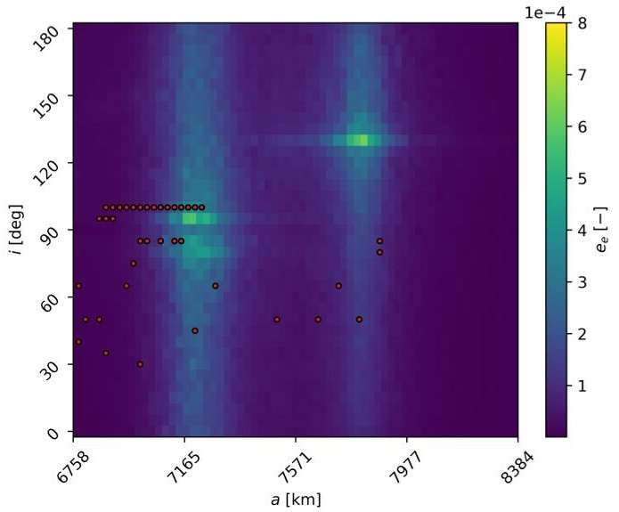

Figure 1: Payload explosion effects map evolution with the deployment of the constellation - without large constellation

Then, new populations of active objects are generated by adding each year 360 satellites in the location of the constellation, and the maps are generated accordingly. The results are shown from Figure 2 to Figure 5.

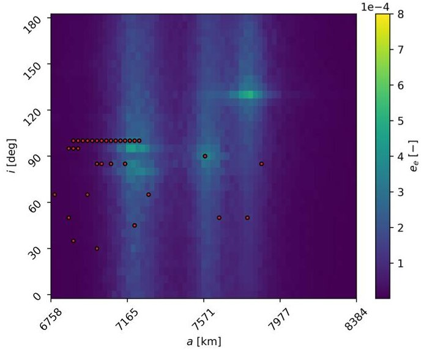

Figure 2: Payload explosion effects map evolution with the deployment of the constellation - 1 year (360 satellites).

In Figure 2, two important changes are found: the disappearance of some reference targets, and the appearance of a "third vertical band" in terms of effect at the constellation altitude. This behaviour is repeated in all the new maps, where the value of the maximum peak tends to move towards the region of the constellation and to increase in absolute value. This is connected to the change of the reference targets, as the shape of the map and the location of the peak values is connected to the collision probability between fragments generated

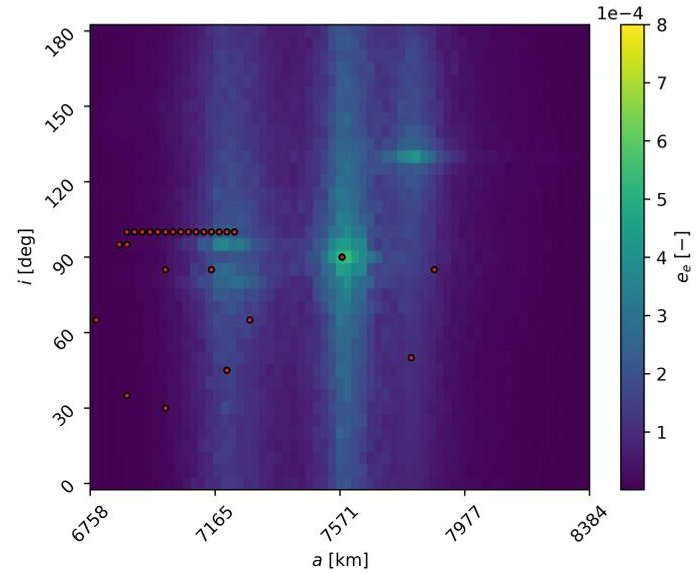

Figure 3: Payload explosion effects map evolution with the deployment of the constellation-2 years (720 satellites).

in the bins and the targets; hence, if new targets appear or disappear, the map will change accordingly. It is also important to note that in this case, the effects peak value is in the same semi-major axis and inclination position of the constellation. This because the target of the constellation is generated at $ 9 0^{\circ} $ , which represent a special case as it will be possible to observe in Section 3.2.

## 3.2. Constellation orbit location

In addition to the number of objects and the physical properties of the satellite, the position of the constellation (in terms of semi-major axis and inclination) also plays an important role. Indeed, placing a single or many satellites in a specific region of the space can have a significant effect on the space environment. This can be seen by looking at the results of this second analysis. The same constellation (in terms of number of satellites and physical properties) is used, but four possible locations (in terms of semi-major axis and inclination) are considered. The orbital parameters are again taken from information of already in orbit or planned missions [15], and the values for each case are listed in Table 2. The regions have been selected to have three cases at about the same mean-altitude but different inclination, and one case with a different mean-altitude.

The results are show in Figure 6, Figure 7, Figure 8, and 9.

As expected, the peak in terms of fragmentation effect moves together with the position of the target generated by the constellation. In addition, looking at all

<!-- PDF_PAGE: 5 -->

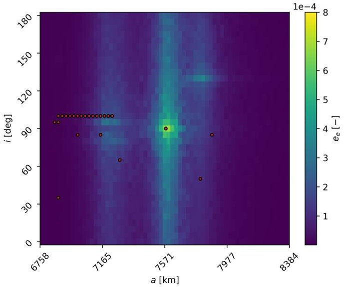

Figure 4: Payload explosion effects map evolution with the deployment of the constellation-3 years (1080 satellites).

<table border="1"><tr><td></td><td>C1</td><td>C2</td><td>C3</td><td>C4</td></tr><tr><td>h[km]</td><td>1200</td><td>1150</td><td>1145</td><td>830</td></tr><tr><td>i[deg]</td><td>89.7</td><td>55</td><td>30</td><td>55</td></tr></table>

Table 2: Constellations orbit location.

the maps, it is possible to observe that the peak is symmetric with respect to the $ 9 0^{\circ} $ inclination with respect to the location of the representative targets. This behaviour could suggest that adding new satellites in an already crowded region does not pose a threat to other satellites. However, a second peak (smaller than the other one) is always generated in the region of the target, and thus the inclusion of a large number of objects would also increase that peak.

Another interesting result is the change in the peak absolute value. Looking at Figure 6, Figure 7 and Figure 8, the peak value increase as the orbit inclination decrease. This is partially associated to the higher impact velocity between objects in retrograde-prograde (and vice-versa) orbits. The latter will characterise fragmentation with a higher energy and thus a greater number of generated objects (hence a higher effect on the environment). This result highlights how the design of the constellation, in particular its location around the Earth, not only poses a risk in neighbouring areas but also in other specific areas that are related to each other by the dynamics of celestial bodies.

This section is dedicated to the results of the computation of the THEMIS index over several objects. The

## 4. Evolution of the total index

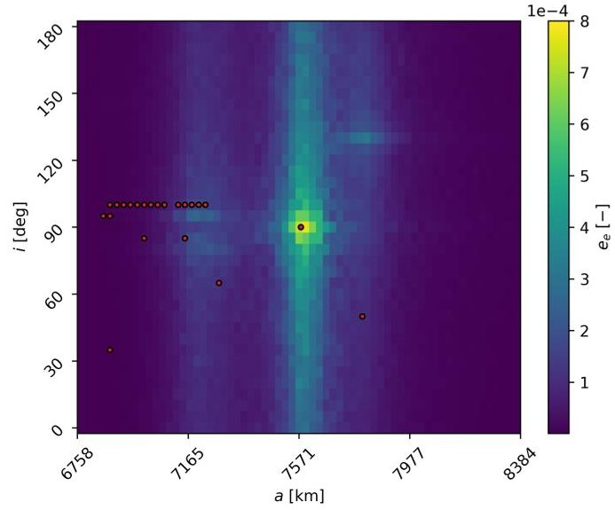

Figure 5: Payload explosion effects map evolution with the deployment of the constellation - 4 years (1440 satellites).

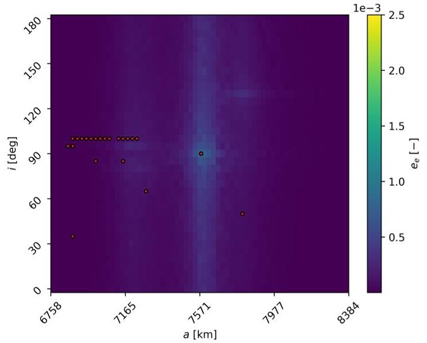

Figure 6: Payload explosion effects maps according to the location of the constellation - C1.

goal, as in Section 3.1, is to capture the evolution of the index following the deployment of a constellation, considering a feedback-like effect through the update of the effect maps when introducing new satellites. The large constellation considered is the one analysed in Section 3.1, whose characteristics are listed in Table 1. The fragmentation effects maps shown in previous sections are used here for the computation of the index. The debris index is computed for

- 1812 Inactive Payloads

- 2278 Active Payloads

- 918 Rocket Bodies

- 1440 Satellites of the constellation (total)

<!-- PDF_PAGE: 6 -->

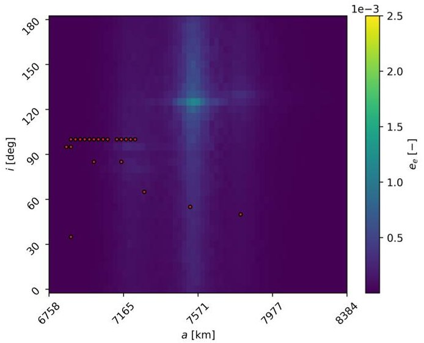

Figure 7: Payload explosion effects maps according to the location of the constellation - C2.

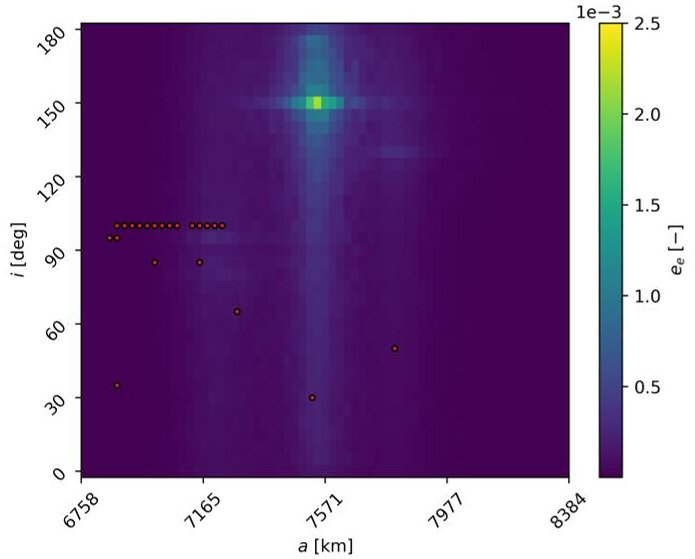

Figure 8: Payload explosion effects maps according to the location of the constellation - C3.

whose physical properties and orbital information are retrieved from ESA DISCOS database. A single mission phase, that is a natural decay, is considered for inactive payloads and rocket bodies. The evolution of the orbital elements is computed using a King-Hele model [16] for the re-entry propagation. Instead, for all the active objects two mission phases are defined. First, an operational orbit is defined, whose lifetime is estimated as

$$
l i f e t i m e = 8 - \left(y _ {a n} - y _ {l}\right)
$$

where $ y_{an} $ is the year of the analysis, and $ y_{l} $ is the launch year of the satellite. If the lifetime is less than 1 year, 1 year is considered. Then, for the end-oflife phase, the King-Hele model is used to estimate the

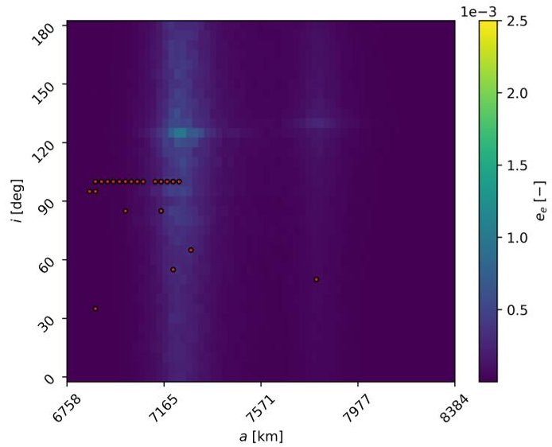

Figure 9: Payload explosion effects maps according to the location of the constellation - C4.

mean-altitude (assuming a circular orbit) that allows the re-entry in less than 25 years with the area-to-mass of the satellite. This altitude is the one considered at the beginning of the end-of-life phase of the active satellites mission.

The computation of the THEMIS index is preformed during the deployment of the constellation, with a snapshot of 1 year, including each time the new satellites of the constellation that have been put in orbit.

Figure 10 shows the results when large constellations are not included. The figure displays the index with circles (where the marker size is proportional to the value of the index) on a semi-major axis inclination grid where each object is located considering their its original orbital elements. As with the effects maps, the sunsynchronous region at about 800 km groups objects with the highest index value.

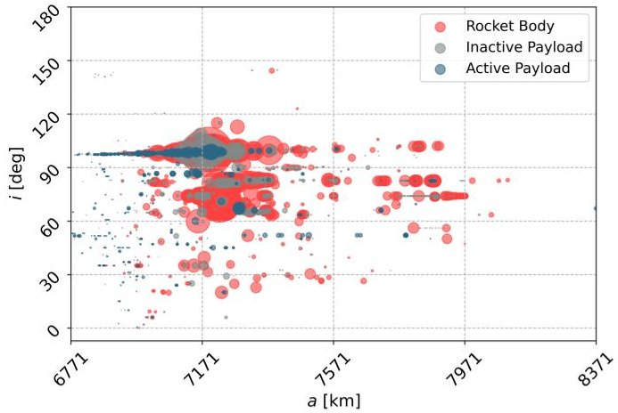

Figure 10: Index value for objects in LEO over time - without large constellation.

<!-- PDF_PAGE: 7 -->

Moreover, Figure 11 shows that the rocket bodies, despite being the minority, account for most of the total index (more that 70%) , while active payloads the smallest. This is because, on the one hand they are inactive (thus no CAM can be performed), typically with an high cross-sectional area (higher collision probability), and perform a slower re-entry with respect to active objects which can perform powered end-of-life.

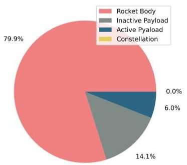

Figure 11: Distribution of the total index among object categories without constellation.

After introducing half of the constellation (i.e., after 2 years with 720 satellites), the index is computed again. The results are shown in Figure 12 and Figure 13. In Figure 12 one can immediately notice the appearance of a new circle (in yellow) representing the index of the constellation, while in Figure 13 it can be observed that the share of the index of the constellation is almost equal to the one of the aggregated inactive objects (and much higher than that of active payloads). This result is a direct consequence of the change in the effects map. Indeed, the peak in terms of fragmentation effect is moving in the region of the constellation (see Figure 1 and Figure 3) increasing its impact for satellites in the constellation region and lowering that associated to the objects in other region.

The behaviour just described is much more evident when the constellation is fully deployed (Figure 14 and Figure 15). Indeed, the share of the constellation alone exceeds that of all the other satellites (both active and inactive) aggregated.

## 5. Conclusion

The sustainability of the space around the Earth is becoming an increasingly important issue in the space sector. The large increase in the number of uncontrollable objects (e.g., space debris) and active satellites is going to change the population of the objects orbiting around the Earth and threatens the future stability of the space.

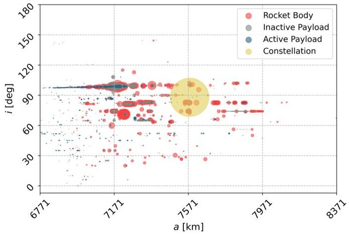

Figure 12: Index value for objects in LEO over time - constellation half deployed.

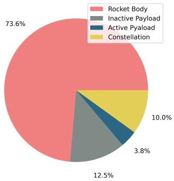

Figure 13: Distribution of the total index among object categories constellation half deployed.

This work was devoted to the analysis of large constellation, highlighting their potential effects on the population of objects already in orbit. This type of mission architecture will for sure bring benefits. However, their design must be properly executed and looking at the long-term sustainability of the space.

The results showed that the mission design parameters of a generic constellation make a difference to their potential influence. Indeed, their deployment will account for a large part of the capacity share (as can be deduced from the results in Section 4). Moreover, they can generate area at risk both in the region of the space where they are located, but also in other regions (mainly in terms of orbit inclination), thus influencing the selection of the location of future mission.

Thus, it is essential to define properly mitigation rules and to think about the space as resource to be managed, using tool like the one presented in this work (which will be open to the whole space community) or other formulations defined to characterise the capacity of the space environment, to have a sustainable future evolution of the space environment around the Earth.

<!-- PDF_PAGE: 8 -->

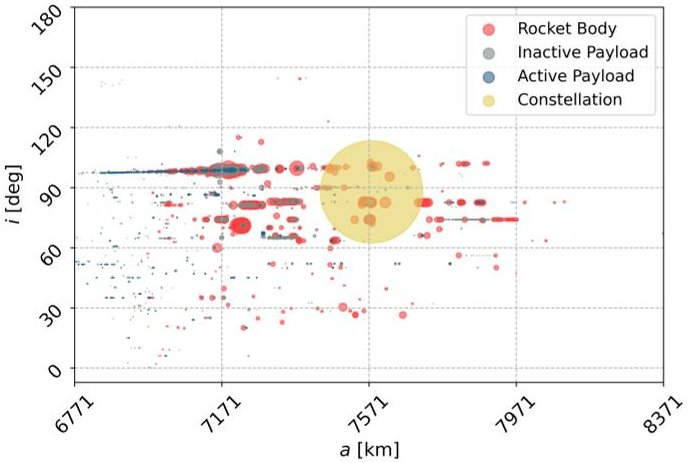

Figure 14: Index value for objects in LEO over time - constellation fully deployed.

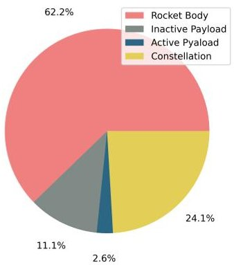

Figure 15: Distribution of the total index among object categories constellation fully deployed.

## Acknowledgements

This project has received funding from the European Space Agency contract 4000133981/21/D/KS.

## References

[1] A. Rossi, G. Valsecchi, E. Alessi, The criticality of spacecraft index, Advances in Space Research 56 (3) (2015) 449-460. doi:https://doi.org/10.1016/j.asr.2015.02.027.

[2] F. Letizia, S. Lemmens, B. Bastida Virgili, H. Krag, Application of a debris index for global evaluation of mitigation strategies, Acta Astronautica 161 (2019) 348-362. doi:https://doi.org/10.1016/j.actaastro.2019.05.003.

[3] H. G. Lewis, S. G. George, B. S. Schwarz, H. Stokes, Space debris environment impact rating system, in: Proc. 6th European Conference on Space Debris, Darmstadt, Germany, 2013.

[4] P. Omaly, N. Pillet, V. Ruch, B. Revelin, Cnes space sustainability index, Advances in Space Research (2023). doi:https://doi.org/10.1016/j.asr.2023.01.062.

[5] T. Maury, C. Colombo, M. T. P. Loubet, A. Gallice, G. Sonnemann, Assessing the impact of space debris on orbital resource in life cycle assessment: a proposed method and case study, Science of Total Environment 667 (1964) 780-791. doi:10.1016/j.scitotenv.2019.02.438.

[6] G. L. Somma, H. G. Lewis, C. Colombo, Space debris: Analysis of a large constellation at 1200 km altitude, in: Proc. 69th International Astronautical Congres, Bremen, Germany, 2018.

[7] C. Colombo, M. Trisolini, A. Muciaccia, L. Giudici, J. L. Gonzalo, S. Frey, B. D. Campo, F. Letizia, S. Lemmens, Evaluation of the space capacity share used by a mission, in: Proc. 73nd International Astronautical Congress, Paris, France, 2022.

[8] N. Sánchez-Ortiz, R. Domínguez-González, H. Krag, T. Flohrer, Impact on mission design due to collision avoidance operations based on tle or csm information, Acta Astronautica 116 (2015) 368-381. doi:https://doi.org/10.1016/j.actaastro.2015.04.017.

[9] D. McKnight, A phased approach to collision hazard analysis, Advances in Space Research 10 (3) (1990) 385-388. doi:https://doi.org/10.1016/0273-1177(90)90374-9.

[10] ESA, Discosweb, https://discosweb.esoc.esa.int/objects.

[11] M. Jankovic, F. Kirchner, Taxonomy of leo space debris population for adr capture methods selection, Stardust Final Conference (2018) 129-144.

[12] N. L. Johnson, P. Krisko, J. c. Liou, P. Anz-meador, Nasa's new breakup model of evolve 4.0, Advances in Space Research 28 (2001) 1377-1384.

[13] S. Frey, C. Colombo, Transformation of satellite breakup distribution for probabilistic orbital collision hazard analysis, Journal of Guidance, Control, and Dynamics 44 (1) (2021) 88-105. doi:10.2514/1.G004939.

[14] L. Giudici, M. Trisolini, Colombo, Phase space description of the debris' cloud dynamics through continuum approach, in: Proc. 73nd International Astronautical Congress, Paris, France, 2022.

[15] J. C. McDowell, Jonathan's space report, https://www.planet4589.org/space/jsr/jsr.html.

[16] D. King-Hele, Theory of satellite orbits in an atmosphere, Butterworths 4 (1964).