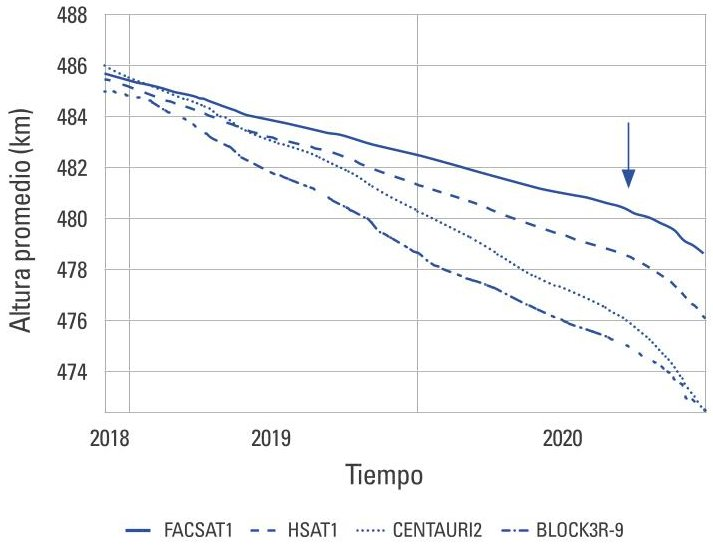
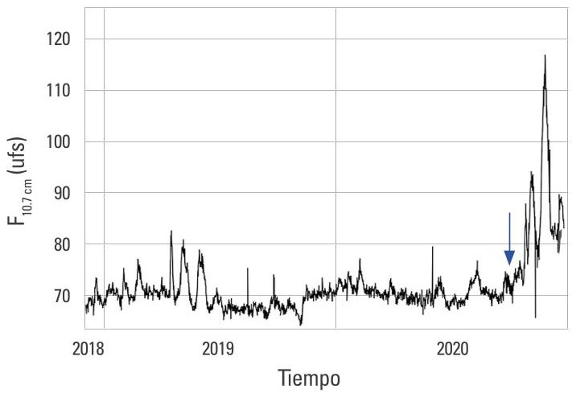
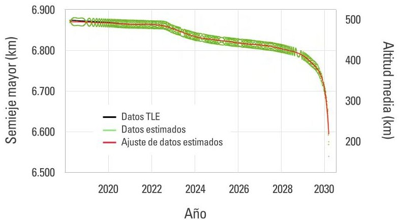
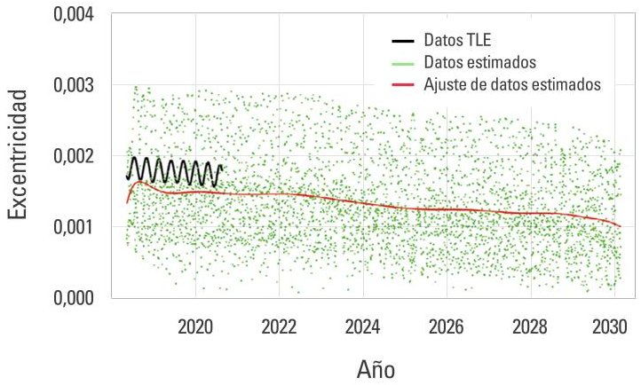
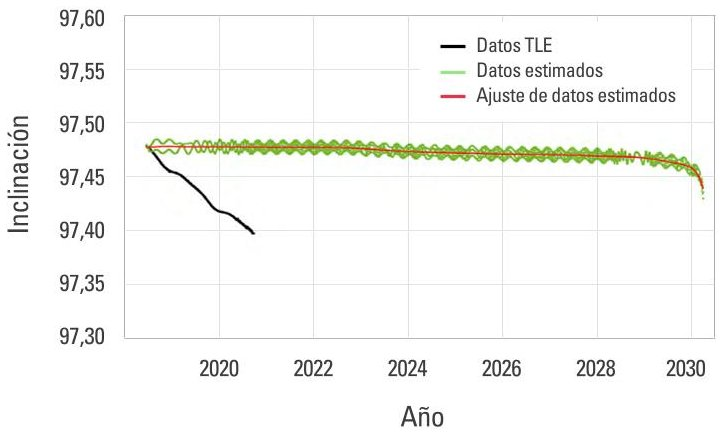
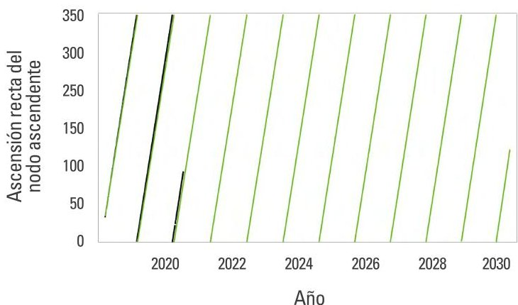
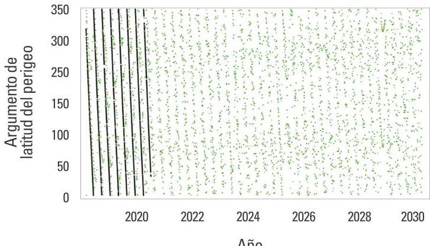

<!-- PDF_PAGE: 1 -->

## Evolución orbital del satélite FACSAT-1 y estimación de su tiempo de reentrada

Fecha de recibido: 3 de marzo del 2021 | Fecha de aprobación: 10 de abril del 2021 |

José Gregorio

Portilla Barbosa

Doctorado en Física Teórica

Universidad Nacional de Colombia

Colombia

Grupo de Investigación: Astronomía,

astrofísica y cosmología

Rol de investigador: téorico y escritura

https://orcid.org/0000-0002-4649-5972

jgportillab@unal.edu.co

Jhonathan Orlando

Murcia Piñeros

Doctorado en Ingeniería y Tecnología Espacial

Instituto Nacional de Investigaciones

Espaciales del Brasil

Brasil

Grupo de Investigación: Grupo

matemática pura y aplicada

Rol de investigador: téorico y escritura

https://orcid.org/0000-0002-7013-6515

jhonathan.pineros@unifesp.br

<!-- PDF_PAGE: 2 -->

Resumen: El presente trabajo tiene como propósito exponer algunos datos relacionados con la puesta en órbita del satélite FACSAT-1 —primer satélite perteneciente a una institución gubernamental colombiana—, así como estimar la tasa de decaimiento en sus primeros dos años de funcionamiento. Para ello se utilizaron datos de los elementos orbitales desde su puesta en órbita (finales de noviembre del 2018) hasta finales del 2020. Se evidenciaron dos etapas de decaimiento bien diferenciadas: la primera, de 8 m/d y, la segunda —desde finales de septiembre del 2020— de 18 m/d, esto último a causa de un aumento de la actividad solar que se aprecia en el flujo de la emisión solar en 2,8 GHz. También se muestran los resultados de la utilización de un propagador de alta fidelidad que permite modelar la evolución de los elementos orbitales en los próximos años, lo que no solo permitió estimar el reingreso del satélite FACSAT-1 para el primer semestre del 2030, sino también observar el comportamiento de los elementos orbitales en los próximos nueve años.

Palabras clave: CubeSat; decaimiento orbital; órbita terrestre baja; propagación orbital; resistencia atmosférica

Abstract: This work presents data related to the launch of the FACSAT-1 satellite into orbit the first property of a Colombian government institution and the estimates on its decay rate during the first two years of operation. For this purpose, we used data of the orbital elements from the date of its launching (late November 2018) until the end of 2020. Two well-differentiated decay stages were observed: 8 m/d and 18 m/d (from late September 2020); the latter due to increased solar activity by a rise of 2.8 GHz in the solar emission flux. This work also reports the results obtained after the implementation of a high-fidelity propagator, which allows modeling the evolution of orbital elements in the upcoming years. Said modeling also made it possible to estimate the re-entry of the FACSAT-1 satellite for the first half of 2030 and predict the behavior of orbital elements in the next nine years.

Keywords: CubeSat; orbital decay; low earth orbit; orbital propagation; atmospheric resistance.

Resumo: O presente trabalho tem como finalidade expor alguns dados relacionados à locação em órbita do satélite FACSAT-1 - primeiro satélite pertencente a uma instituição governamental colombiana-, bem como fazer uma estimativa da taxa de decaimento em seus primeiros dois anos de funcionamento. Para isso, foram utilizados dados de elementos orbitais desde a sua colocação em órbita (final de novembro de 2018) até o final de 2020. Evidenciaram-se duas etapas de decaimento bem diferenciadas: a primeira, de 8 m/d e, a segunda, desde o final de setembro de 2020, de 18 m/d, o que se deve a um aumento da atividade solar que se observa no fluxo da emissão solar em 2,8 GHz. Também são apresentados os resultados da utilização de um propagador de alta fidelidade que permite modelar a evolução dos elementos orbitais nos próximos anos, o que não so permitiu estimar a reentrada do satélite FACSAT-1 para o primeiro semestre de 2030, mas também observar o comportamento dos elementos orbitais nos próximos nove anos.

Palavras-chave: CubeSat; decaimento orbital; órbita terrestre baixa; propagação orbital; resistência atmosférica

<!-- PDF_PAGE: 3 -->

A más de seis décadas del inicio de la era del espacio por parte de la Unión de Repúblicas Socialistas Soviéticas (URSS), cuando puso en órbita terrestre el primer satélite artificial, Sputnik-I —una esfera con un diámetro inferior a 60 cm—, Colombia es poco lo que ha tenido que mostrar en la incursión de este tipo de tecnologías de frontera, y en desarrollo tecnológico en general. Solo hasta el 2007 se desarrolló el primer proyecto en el país, el pico-satélite Libertad-1, lanzado desde el cosmódromo de Baikonur en Kazajistán (Portilla, 2012), un pequeño cubo de aproximadamente 10 cm de lado (CubeSat de 1 unidad), financiado y adaptado por la Universidad Sergio Arboleda. Desde entonces, se ha dicho que esta universidad planea poner un segundo satélite llamado Libertad-2, pero hasta el presente esto no ha ocurrido.

En todo caso, proyecto como el Libertad-1 y otros muchos que se han verificado en otras partes del planeta, se han concretado gracias a los avances en la miniaturización de la electrónica y la amplia oferta de vehículos lanzadores—a causa de la privatización del sector espacial que comenzó a finales de la década de los 80—, lo que les permite ser desarrollados a un bajo costo si se comparan con el desarrollo tradicional de grandes satélites (Fernholz, 2018). Con esta apertura de la industria espacial, incluso los colegios de secundaria de los países en vías de desarrollo pueden ensamblar sus propios satélites y cargas útiles para sus proyectos de ciencias estudiantiles, tal y como es el caso del pico-satélite brasilero Tancredo-1 (Tikami et al., 2017).

Los denominados CubeSats son satélites minúsculos de apenas unos cuantos kilogramos de peso, por lo que son clasificados dentro de los nanosatélites debido a su escasa masa (Stakem, 2020). Dichos CubeSats han permitido que naciones con poca trayectoria en el desarrollo aeroespacial tales como Colombia y Ecuador, accedan de algún modo a este tipo de tecnologías aun cuando su intervención en el diseño y construcción de algunos de sus componentes sea nula o, en el mejor de los casos, marginal. Inicialmente, la forma como llegaban a órbita los CubeSats era casi de “aventón” por su tamaño, lo que reducía formidablemente los costos del uso del cohete (Woellert et al., 2011). En la actualidad, los vehículos lanzadores al igual que los

satélites han sido reducidos en tamaño, costos y tiempo de producción garantizando lanzamientos dedicados para este tipo de satélites.

Al observar la evolución de los proyectos de Cube-Sats, se identifican dos periodos importantes en el desarrollo de esta tecnología: el primero se extiende desde 1998 hasta el 2011 y comprende una etapa en la que la academia dominó por entero el desarrollo; el segundo, inicia en el 2012 y se extiende hasta el presente, y se caracteriza por el surgimiento y dominio de las aplicaciones comerciales a gran escala (Kulu, 2021; Bryce, 2020). En la primera etapa, las instituciones comenzaron a adaptar esta tecnología para proyectos espaciales de bajo costo, se capacité a los estudiantes de pregrado, se adquirió la experiencia (know-how), se desarrollaron misiones de demostración tecnológica, y se obtuvo una madurez satisfactoria de diversos componentes y subsistemas con fines comerciales. Es en ese periodo que entró a operar el proyecto del satélite Libertad-1, una época muy favorable para lanzar este tipo de tecnología (ciclo de sobreexpectación).

Gracias al trabajo del grupo de profesionales que desarrolló el Libertad-1 y a su visión, el proyecto es visto como un referente en la región al ser pionero y, por ende, servir de inspiración para otros proyectos de pequeños satélites en los países vecinos; además, divulgó las tecnologías espaciales dentro del medio, adaptó las metodologías de ingeniería de sistemas espaciales y capacité a los primeros profesionales en el país. Finalmente, originó un espacio para la incubación de la empresa Sequoia Space, la primera en el país dedicada al desarrollo de satélites.

Para finales del 2018, el satélite FACSAT-1 se constituyó en el segundo satélite artificial puesto en órbita por iniciativa de una institución colombiana, y el primero por parte de un organismo gubernamental, específicamente la Fuerza Aérea Colombiana (FAC). Ello lo ubica en el segundo periodo de desarrollo de los CubeSats —ya mencionado— y en el que se generan los primeros productos comerciales por parte de empresas privadas.

El FACSAT-1 fue construido en asociación con la empresa danesa GOMspace. Se puso en órbita conjuntamente con otros numerosos satélites a finales de

<!-- PDF_PAGE: 4 -->

noviembre del 2018, por medio de un cohete Polar Satellite Launch Vehicle (PSLV) de fabricación india. El satélite propiamente dicho es un CubeSat 3U (compuesto de tres unidades) cuyo peso es del orden de 4 kg y con una vida útil proyectada de cinco años (León-Lozada, 2018). De acuerdo con sus gestores, el objetivo principal de la misión consiste en la toma de fotografías de la superficie terrestre con una resolución de 30 m, de modo que se pueda ir consolidando una "autonomía" de país en el proceso de poseer conocimiento casi en tiempo real de la situación del territorio colombiano y de otros lugares de la superficie terrestre que merezcan el interés de la nación.

Como es apenas claro, tratándose de un país como Colombia, notablemente atrasado en este tipo de tecnologías, se persigue también con la construcción, seguimiento y control del FACSAT-1, una consolidación de procesos de transferencia tecnológica que involucre a varios actores de la FAC en un proceso continuado de asimilación técnica que permita cimentar en un futuro próximo iniciativas espaciales auspiciadas por la nación.

Es evidente que las recientes investigaciones en tecnología espacial y la puesta en operación del satélite FACSAT-1, son una muestra del interés de las instituciones y profesionales del país por acceder y hacer uso de las aplicaciones espaciales, tales como la recepción de datos para monitoreo de recursos naturales, valoración de desastres naturales, vigilancia del territorio nacional y un largo etcétera, así como la capacitación de profesionales en desarrollo y operaciones de nano-satélites. Como consecuencia del éxito del FACSAT-1 y de incentivar de algún modo la participación del sector privado nacional en asuntos aeroespaciales, a inicios del 2020 salió a la luz el Documento Conpes 3983 $ ^{[1]} $ y se obtuvo la financiación tanto de los proyectos FACSAT-2 (Centro de Investigación en Tecnologías Aeroespaciales [Citae], 2020) como del montaje de una estación de comunicaciones en la Antártida (Departamento Estratégico de Comunicaciones [DEC],

2020) . Puesto que Colombia es un país "novato" en asuntos espaciales, con deficiencias en su entramado industrial y que adolece de un fuerte rezago en investigación científica de base, se espera que la visión a mediano y largo plazo con tales iniciativas sea fortalecer el desarrollo de una industria nacional que incluya una gran inversión de riesgo en las instituciones para fomentar y financiar proyectos de desarrollo de tecnología espacial, capacitar personal, impulsar la creación de empresas de base tecnológica, identificar los potenciales clientes y usuarios de esta tecnología, los productos derivados y, la comercialización de los mismos a nivel nacional e internacional; es decir, apremiar la adquisición de conocimientos y experiencia para estar a la par, al menos, de países que han acelerado su desarrollo en materia espacial en la última década, como por ejemplo Dinamarca, Luxemburgo, Nueva Zelanda y Australia.

En ese marco, es importante socializar y poner en relevancia lo que se ha avanzado en materia de la puesta de satélites artificiales fomentados por la nación y examinar los elementos de su evolución orbital, que ayuden a familiarizar y poner en contexto a todos aquellos interesados en aspectos puntuales de dinámica satelital, como uno de los muchos aspectos a tener en cuenta para que el país vaya asimilando y apropiando este tipo de estudios.

Aunado a lo anterior —y como se espera que los satélites puestos en órbita por parte de instituciones privadas o gubernamentales colombianas sigan siendo del estándar CubeSat u otros tipos de satélites pequeños—, se hace necesario conocer el comportamiento orbital de estos objetos, ya que al final de sus vidas útiles pasarán a engrosar el listado de objetos que conforman la basura espacial, temática importante de actualidad, debido al gran incremento del número de pequeños satélites en Low Earth Orbit (órbita baja terrestre) (LEO por sus siglas en inglés) experimentado en los últimos años, tales como el establecimiento de la constelación Dove para observación terrestre (Safyan, 2020), la constelación Starlink para llevar Internet a sitios remotos del planeta (Giuliari et al., 2020) y el riesgo que ello puede implicar, por la posibilidad de colisiones cada vez más alta que puede poner en

<!-- PDF_PAGE: 5 -->

peligro la continuidad del entramado satelital y las operaciones orbitales tripuladas (Reiland et al., 2020).

Debido a esto, la estimación de tiempos de reentrada es un dato deseable en el estudio de la población de satélites en LEO. Infortunadamente tal predicción no es una tarea sencilla, a causa de las numerosas fuentes de incertidumbre que conlleva a que, después de décadas de investigación, aún se sigan presentando errores relativos cercanos al 20% (Pardini & Anselmo, 2013). Entre las variables que hacen difícil una predicción acertada de los tiempos de reentrada están los datos de rastreo inexactos y dispersos, formas complejas de los objetos, inexactitudes en los valores de la densidad atmosférica a las altitudes de interés, errores de predicción de actividad solar y geomagnética, modelamiento incorrecto de los coeficientes de resistencia, etcétera (Choi et al., 2017). Esto es, demasiadas incertidumbres que complican un cálculo acertado.

El objetivo del presente artículo es estudiar la evolución orbital del satélite FACSAT-1 durante los poco más de dos años que ha estado ubicado en órbita terrestre, suministrar información más técnica tanto de sus parámetros orbitales como de sus condiciones de puesta en órbita, datos que no han sido lo suficientemente diseminados por sus gestores, y que, sin embargo, son importantes para la conformación de una memoria histórica sobre las primeras iniciativas espaciales de la nación. Así mismo, se presentan estimaciones del tiempo en que el satélite continuará en órbita antes de que reingrese y se destruya en las capas altas de la atmósfera terrestre.

## Método

En primera instancia se describe la puesta en órbita del satélite FACSAT-1, para luego comentar el tipo de órbita en la que quedó. Después, con ayuda de los elementos de dos líneas reportados para el satélite se halla su tasa de decaimiento experimentada en sus dos primeros años. A partir de esos mismos elementos y con ayuda de un código escrito en Fortran —un propagador de alta fidelidad— se modelará la evolución de los

elementos orbitales en los próximos años, y así, se podrá estimar un posible tiempo de reingreso del satélite.

En la mañana del jueves 29 de noviembre del 2018 a las 9 h, 57 min, 30 s, hora local de la India (4 h, 27 min, 30 s, Tu; 23 h, 27 min, 30 s, del miércoles 28, hora de Colombia), despegó un cohete PSLV portando al FACSAT-1 conjuntamente con otros 30 satélites (Clark, 2018), que en total sumaban una carga útil de 641 kg. El hecho se realizó desde el centro de lanzamiento Satish Dhawan ubicado en la isla Sriharikota ($\phi=13^{\circ}43'11.8"$ N, $\lambda=80^{\circ}13'49.5"$ Este), conocido comúnmente como SHAR y situado en la costa este de la India.

Como ya se dijo, el vehículo de lanzamiento fue un cohete PSLV (vehículo lanzador de satélites polares). El cohete, de 44 metros de altura y cerca de 320 toneladas de peso, está conformado por cuatro etapas: la primera y la tercera son de combustible sólido; las restantes de combustible líquido. El PSLV goza de buenos palmares, ya que desde su primer intento de lanzamiento a finales de 1993 y hasta noviembre del 2020, ha realizado 51 vuelos, 49 de ellos exitosos.

Continuando con el lanzamiento del FACSAT-1, el cohete después de su despegue tomó dirección sureste. Menos de dos minutos después entró en operación la segunda etapa que duró en funcionamiento otros dos minutos y medio. En este proceso el cohete ajustó su curso y tomó dirección sur, para evitar el sobrevuelo en la isla de Sri Lanka. Finalmente, la tercera y cuarta etapa se encargarán de dotar la velocidad suficiente para poner en órbita a la carga útil principal del cohete: el satélite HySIS (satélite de imagen hiperespectral, por sus siglas en inglés). De tamaño y masa relativamente modesto (no excede las 0,4 toneladas), este satélite de construcción india —con la habilidad de realizar observaciones de la Tierra en varias regiones del espectro electromagnético—, fue puesto en una órbita heliosincrónica² con inclinación de 97,96° a una altura promedio cercana a los 636 km sobre la superficie terrestre (EoPortal Directory, 2018). Quedó

<!-- PDF_PAGE: 6 -->

registrado con el número 43.719 dentro de la catalogación del North American Aerospace Defense Command (Norad) o Comando de Defensa Aeroespacial de Norteamérica, al igual que como primera pieza (A) del lanzamiento 96 realizado en el transcurso del 2018.

Posterior a la colocación de la carga principal de la misión, la última etapa del PSLV procedió a reencender sus motores, pero ahora con el propósito de disminuir la altura (en unos 150 km) e iniciar la liberación de los satélites restantes pensados para orbitar la Tierra a alturas menores, de modo que, al final de sus vidas útiles, la atmósfera no tarde mucho en el proceso de decaimiento de la altura y la consiguiente reentrada y destrucción de estos (Madi & Sokolova, 2021). Fueron 30 satélites, la mayoría CubeSats, la mitad de los cuales pasaron a engrosar la red Dove de la empresa Planet, así como satélites pequeños de varias empresas estadounidenses, canadienses, así como de Países Bajos, Finlandia, Australia, España y Colombia.

El FACSAT-1 quedó registrado como la tercera pieza (C) en quedar en órbita de ese lanzamiento con el número 43.721 de la catalogación del Norad. En la tabla 1 se muestra el primer conjunto de elementos orbitales $ ^{3} $ que registra Celestrak.

Tabla 1

Primer conjunto de elementos orbitales del satélite FACSAT-1

<table border="1"><tr><td>Ascensión recta del nodo ascendente</td><td>38.6324°</td></tr><tr><td>Argumento de latitud del perigeo</td><td>313.6880°</td></tr><tr><td>Inclinación</td><td>97.4864°</td></tr><tr><td>Excentricidad</td><td>0.0015676</td></tr><tr><td>Anomalía media</td><td>161.6758°</td></tr><tr><td>Semieje mayor(km)</td><td>6863.789</td></tr><tr><td>Altura del perigeo(km)</td><td>474.9</td></tr><tr><td>Altura del apogeo(km)</td><td>496.4</td></tr><tr><td>Periodo orbital(horas)</td><td>1.57305</td></tr></table>

Nota. Correspondientes al instante de tiempo 29 de noviembre del 2018 a las 15 h, 24 min, 7 s de TU, esto es, unas 11 horas después de su puesta en órbita. Fuente: Celestrak.

De acuerdo con las condiciones de inserción orbital, el FACSAT-1 —y los otros satélites compañeros— quedaron en órbitas que permiten desplazar la línea de los nodos en dirección antihoraria —vista desde el polo norte celeste—, con un incremento diario cercano a la tasa de movimiento aparente del Sol visto desde la Tierra, lo que permite que el satélite sobrevuele siempre el sitio de interés con las mismas condiciones de iluminación solar. En otros términos, en órbitas heliosincrónicas.

Teniendo en cuenta que la tasa de desplazamiento del nodo ascendente ( $ \Delta\Omega $ ) causada por el achatamiento terrestre está dada por, $ \Delta\Omega=-\frac{3\left( \frac{180}{\pi} \right) \sqrt{GM} J_{2} R^{2} \cos i}{2 a_{2}^{7}\left( 1-e^{2} \right)^{2}} $ en unidades de grados por día, donde G es la constante de Gravitación o de Cavendish (6,67428 x $ 10^{-11} $ m $ 3 $ $ kg^{-1} $ s $ ^{-2} $ ), M la masa de la Tierra (5,9722 x $ 10^{24} $ kg), $ J_{2} $ el armónico zonal terrestre (0,001083), i la inclinación orbital con respecto al Ecuador, R el radio terrestre (6.378,14 km), a el semieje mayor y e la excentricidad (Portilla, 2018). Para el FACSAT-1, utilizando los datos de la tabla 1, se tiene un valor igual a $ \Delta\Omega=1,0045 \,^{\circ}/\mathrm{d} $ . Este valor es ligeramente superior al valor ideal (0,985 $ ^{\circ}/\mathrm{d} $ ), pero lo suficientemente cercano a él como para lograr su cometido.

El FACSAT-1 quedó recién puesto en órbita en una trayectoria que le permite sobrevolar el sector occidental del país (en dirección norte a sur), principalmente sobre los litorales Atlántico y Pacífico, lo que se verifica poco después de las 10:00 a. m. hora legal colombiana.

El tiempo que tarda el satélite en pasar casi exactamente por la misma región geográfica, se puede estimar de la siguiente forma: puesto que el planeta Tierra se desplaza gracias a su movimiento de rotación de oeste a este, por cada órbita descrita el satélite se desplaza en un ángulo en dirección hacia el oeste con relación a un observador situado en la superficie de la Tierra. Dicho ángulo se puede calcular a través de $ \Delta \psi=-3 6 0^{\circ} $ $ (T/Tt) $ , donde T es el periodo de traslación del satélite en días solares medios y Tt es el periodo de rotación sideral de la Tierra (0,99727 en unidades de día solar medio) (Portilla, 2009).

En este caso: T=1,57305/24=0,0655. De ese modo: $ \Delta \psi=-2 3, 6 5^{\circ}. $

<!-- PDF_PAGE: 7 -->

La condición de paso sucesivo por el mismo punto de la superficie terrestre está dada evidentemente por $ n | \Delta \psi|=m 3 6 0^{\circ} $ , en donde n y m representan dos números enteros. En el caso que nos ocupa tendremos entonces que: $ n / m=1 5, 2 2 $ . Este número es casi igual a la frecuencia del satélite, esto es, el número de revoluciones que hace en un día, ya que $ 1 / 0, 0 6 5 5=1 5, 2 6 $ Y Puesto que $ n / m=1 5, 2 2 \approx 6 1 / 4 $ , lo que significa que para realizar un paso sucesivo por el mismo punto de la superficie de la Tierra se deben completar 61 revoluciones del satélite, lo cual es posible al cabo de transcurridos cuatro días.

De este modo, el FACSAT-1 pasa aproximadamente sobre el mismo territorio de interés cada cuatro días. En el caso de la toma de fotografías sobre el territorio colombiano, el paso de norte a sur del satélite es el que se ha de utilizar para ello, por la obvia condición de contar con luz solar, pues existe otro paso del satélite en dirección sur a norte —casi sobre la misma región señalada—, pero que se verifica poco después de las 10:00 p.m. hora legal colombiana.

## Resultados

En la figura 1 se observa la evolución de la altura promedio sobre la superficie terrestre en función del tiempo tanto del FACSAT-1 como de algunos de sus compañeros que fueron puestos en órbita casi de forma simultánea. Para la realización de esa gráfica se utilizaron los Two Line Elements (TLE) (elementos de dos líneas) y la forma estándar como el Norad que expresa los elementos orbitales de los objetos que se encuentran en órbita. Entre esos compañeros se han puesto los siguientes satélites que también son CubeSats: Hsat-1, Centauri-2 y el Flock 3R-9. El primero es el más masivo (13 kg), ya que se trata de un satélite integrado por 6U; los restantes están conformados por 3U, como el FACSAT-1, cuyas masas también oscilan entre 4 y 5 kg.

En el periodo estudiado —finales de noviembre del 2018 y finales de diciembre del 2020— se puede observar para los cuatro satélites dos tasas de decaimiento claramente definidas. La primera comprendida

entre el momento de su puesta en órbita y finales del mes de septiembre del 2020; la segunda, desde esta fecha hasta el último día del 2020, el límite de tiempo del presente estudio.

Este comportamiento está relacionado con un incremento de la actividad solar, iniciado a finales de septiembre del 2020, tal y como se puede observar en la figura 2, donde se ha puesto la variación del flujo solar en la longitud de onda de 10,7 cm, un conocido indicador directo de la actividad del Sol.

Figura 1. Decaimiento orbital del FACSAT-1 y varios satélites compañeros a lo largo de los primeros dos años en órbita

Nota. La flecha indicada señala el 27 de septiembre del 2020.

Fuente: elaboración propia.

Figura 2. Variación del flujo del Sol observado en 10,7 cm (2.8 GHz) en unidades de flujo solar (ufs = $ 1 0^{-2 2} $ joules $ m^{-2} $ $ \mathrm{H z}^{-1} $ )

Nota. La flecha indicada señala el 27 de septiembre del 2020.

Fuente: elaboración propia con base en datos tomados del Laboratory for Atmospheric & Space Physics (LASP, 2017).

<!-- PDF_PAGE: 8 -->

Entre su puesta en órbita y finales del mes de septiembre del 2020, el FACSAT-1 experimentó un decaimiento constante de su altura promedio de unos 8 metros por día; desde finales de septiembre, dicha caída pasó a ser del orden de unos 18 metros por día, lo que es un reflejo del aumento importante en el flujo de radiación proveniente del Sol que se ve traducido en una mayor resistencia de la atmósfera terrestre, lo cual acelera la tasa de decaimiento de los satélites en LEO.

En contraste, el satélite Hsat-1 tuvo una tasa de decaimiento mayor, de unos 15 metros por día en la primera etapa y de 36 metros diarios en la segunda. Lo anterior puede evidenciarse de la figura 1 y es el resultado de un área proyectada A significativamente mayor, debido a sus paneles solares aun cuando posee una masa m de 13 kg, que hace entonces que la relación A/m sea mayor, incrementado así su resistencia atmosférica, más que la que genera el FACSAT-1, y de ahí un decaimiento más pronunciado. En lo que sigue, se expondrá lo relacionado con la previsión de la reentrada atmosférica del satélite.

Desde la puesta en órbita del FACSAT-1 hasta el 1.° de febrero del 2021, se han generado más de 3.000 reportes de TLE, esenciales para el propósito de analizar la evolución de la órbita del satélite y estimar la fecha de su reentrada atmosférica. Al finalizar la vida útil de sus componentes, el satélite FACSAT-1 pasará a su estado no operacional y será considerado basura orbital, Orbital Debris (OD). Actualmente los OD son considerados elementos peligrosos para las operaciones espaciales porque incrementan la densidad de objetos en órbita, lo cual aumenta el riesgo de colisión con satélites operativos y restringe las operaciones en su posición orbital.

Otra aplicación de los reportes de TLE, es su uso en algoritmos para determinar el paso del satélite sobre las estaciones de rastreo y control, y las estaciones de comunicación para descarga de los datos de la carga útil. A futuro, estos mismos algoritmos de determinación orbital pueden servir como modelo para ser embarcados en los computadores a bordo de satélites para el sistema de determinación de órbita y control de actitud (Odacs), esencial en futuras misiones de constelaciones, vuelos en formación y experimentos

de direccionamiento de alta precisión (Wertz et al., 2011; Kelecy et al., 2007).

Para realizar el análisis de vida útil del satélite FACSAT-1 se usó el histórico de los TLE, pues al ser datos públicos son de fácil acceso. Sin embargo, es esencial complementar con datos de las estaciones de monitorreo (obtenidos por el operador del satélite) para mejorar la precisión de los algoritmos y de las predicciones. Hay que tener en cuenta que los TLE presentan errores generados por la baja precision del modelo de perturbaciones, falta de información sobre la actitud del satélite, sus propiedades específicas: masa, materiales, dimensiones y, ruidos y bias de la señal, entre otros (Xu & Xiong, 2018; Levit & Marshall, 2011; Vallado & Cefola, 2012; Lee, 2002). Aun así, los datos obtenidos a partir de los TLE sirven para generar una predicción aceptable de la posición del satélite en los próximos tres días al último reporte de TLE, siempre y cuando se implementen en un modelo simplificado de perturbaciones tal como el SGP4 $ ^{[4]} $ .

Una forma de mejorar la precisión de las predicciones, o estimación del estado, es a través de un propagador $ ^{5} $ de alta fidelidad, tal como indica la norma ISO 27852:2016 (ISO, 2016). Este fue el método escogido para propagar los elementos orbitales del FACSAT-1 desde el momento de su inserción en órbita hasta su posible reentrada.

Los propagadores de alta fidelidad son sofisticados integradores numéricos para efectos de resolver las complicadas ecuaciones de movimiento; en ellos están incluidos las fuerzas ambientales que por periodos extendidos de tiempo afectan la trayectoria del satélite tales como el complejo campo gravitacional terrestre —modelado a través de una serie de armónicos esféricos— y la atmósfera terrestre, lo que requiere un modelo atmosférico que permita ante todo conocer la densidad del aire en función de la altura para efectos de encontrar la fuerza de resistencia que afecta

<!-- PDF_PAGE: 9 -->

notablemente los satélites en LEO (Hintz, 2015). Dependiendo del sistema a estudiar, los propagadores bien pueden incluir, además la atracción gravitacional del sol y la luna, el efecto de la presión de radiación proveniente del sol y el que refleja la misma Tierra.

En particular, el propagador de alta fidelidad aquí utilizado incluyó un integrador numérico RKF-7/8, el modelo gravitacional terrestre EGM-08 con armónicos de orden 10x10 y el modelo atmosférico Nrlmsise-00 que incorporó los coeficientes geomagnéticos observados de los últimos cinco años y los estimados hasta el 2033 (Vallado, 2013). Así mismo, para el cálculo del coeficiente de arrastre se utilizó el método de los paneles en fluido enrarecido, obteniendo un coeficiente balístico medio de 0,1515 kg/m² (Piñeros et al., 2021).

De las figuras 3 a la 7 se presentan los resultados de los elementos orbitales diarios, representados en color verde; los datos filtrados del histórico de los TLE están representados por los puntos de color negro y los ajustes de la órbita media calculada de los puntos propagados se presentan como líneas de color rojo. De la misma forma que los TLE contienen errores, es necesario que el propagador incluya datos de alta precisión en las condiciones iniciales, para disminuir la diferencia entre los datos estimados y los obtenidos de los TLE, también, para reducir el error de la propagación.

Figura 3. Evolución del semieje mayor y la altitud media en función del tiempo

Fuente: elaboración propia.

En la figura 3 se presentan los resultados de la evolución del semieje mayor y altitud media como función del tiempo. En el periodo desde noviembre del

2018 hasta febrero del 2021 se observa una buena correlación entre la órbita media calculada y los datos obtenidos de los TLE. Debido a la interacción con la atmósfera terrestre, se estima que el FACSAT-1 empezará un decaimiento rápido a partir del 2029, para reentrar en el primer semestre del 2030. Las ondulaciones observadas en los datos estimados son generadas por una combinación de los harmónicos del modelo gravitacional en una inclinación y semieje mayor determinados.

Figura 4. Evolución de la excentricidad en función del tiempo

Fuente: elaboración propia.

En la figura 4 se presentan los datos de la excentricidad. En este caso es evidente la diferencia entre el ajuste de los datos estimados con la información de los TLE. Esa diferencia se debe a la falta de precisión del orden de metros en los datos iniciales, que se propaga a lo largo de las estimaciones; no obstante, los resultados muestran el comportamiento esperado al reducir la excentricidad media por la caída del semieje mayor, es decir, el arrastre atmosférico tiende a circularizar la órbita.

Figura 5. Evolución de la inclinación en función del tiempo

Fuente: elaboración propia.

<!-- PDF_PAGE: 10 -->

En el caso de la inclinación (figura 5) se observa una diferencia significativa entre los datos de los TLE y los datos estimados. Esto se debe a que el elemento orbital es altamente perturbado por la dirección del fluido atmosférico, puesto que, al encontrarse en una órbita heliosincrónica, la dirección del satélite es básicamente perpendicular a la rotación de la atmósfera, lo que hace que el modelo utilizado tanto de vientos como atmosférico, no describa adecuadamente la interacción y, en consecuencia, el propagador genere algunas diferencias.

Como se explicó, el cambio de la ascensión recta del nodo ascendente es influenciado por la perturbación del achatamiento terrestre y, en este caso, los resultados simulados son muy cercanos a los datos obtenidos del histórico de TLE, mostrando el comportamiento esperado. El mismo comportamiento se observa con la evolución del argumento de latitud del perigeo (figuras 6 y 7).

Figura 6. Evolución de la ascensión recta del nodo ascendente en función del tiempo

Fuente: elaboración propia.

Figura 7. Evolución del argumento de latitud del perigeo en función del tiempo

Fuente: elaboración propia.

## Conclusiones

El FACSAT-1 se constituyó en el primer satélite puesto en órbita por iniciativa de una institución gubernamental colombiana. Gracias a los procesos de miniaturización, estandarización y disminución de costos de puerta en órbita terrestre, naciones de escasos recursos como Colombia, pueden, a través de la contratación con empresas privadas del primer mundo, incursionar en este tipo de tecnologías y emprender así los primeros pasos en la adquisición de algún grado de independencia en el dominio de un campo que tiene cada vez más importancia económica, social, científica, cultural y política, como es el caso de las tecnologías aeroespaciales.

Sin embargo, el gran crecimiento en el número de pequeños satélites en LEO que se ha venido experimentado en los últimos años, trae como consecuencia un aumento no deseado de basura espacial, así como una posibilidad cada vez más creciente de colisiones, lo que pone en riesgo no solo la integridad de numeros satélites funcionales, sino también las vidas de las personas en misiones tripuladas. De modo que los análisis de decaimiento orbital y la búsqueda de estrategias para disminuir la población de objetos una vez finalizan su vida útil, al igual que los estudios de predicción de reentrada, han venido cobrando especial relevancia.

El presente estudio tuvo como objeto la evolución orbital del satélite FACSAT-1 a lo largo de dos años desde su puesta en órbita. Con base en el registro de sus TLE se estableció la tasa de decaimiento orbital a causa del arrastre generado por la atmósfera. Desde su puesta en órbita hasta finales de septiembre del 2020 se observó una tasa de caída de 8 m/d en su altitud promedio; sin embargo, debido a un aumento importante de la actividad solar a partir de esa fecha, la tasa de caída se incrementó a 18 m/d en la altitud promedio.

Por otra parte, mediante la utilización de un propagador de alta fidelidad se realizó un estudio sobre la evolución orbital del FACSAT-1 para los años venideros, el cual permitió observar la evolución de los

<!-- PDF_PAGE: 11 -->

elementos orbitales (semieje mayor, excentricidad, inclinación, ascensión recta del nodo ascendente y argumento de latitud del perigeo) y, posibilitó estimar una fecha probable de reingreso del satélite para el primer semestre del 2030.

En consecuencia, se espera que este tipo de estudios se consoliden dentro de la aún escasa comunidad astronáutica nacional, si hemos de tener presente el advenimiento en un futuro cercano de satélites como el Libertad-2 y el FACSAT-2, que se espera sean más versátiles, potentes y permitan con su desarrollo y puesta en órbita no solo una apropiación más adecuada y directa de este tipo de tecnologías, sino también mejorar el monitoreo del territorio colombiano (con los obvios beneficios en seguridad, prevención de desastres, minería, agricultura, catastro, etcétera) y sea posible disminuir el uso de los servicios de proveedores extranjeros.

Por último, es evidente que el desarrollo de este tipo de proyectos satelitales permite aumentar las capacidades tecnológicas del país y ayuda a identificar las dificultades internas y externas que tienen las instituciones para llevar a buen término los proyectos de esta naturaleza. Dado el contexto nacional y comparando su desarrollo tecnológico con el de países más avanzados, se recomienda el uso de estrategias que permitan identificar las necesidades claras de las empresas y el Gobierno para fomentar la inversión en este tipo de tecnologías, concientizar a los tomadores de decisiones sobre las ventajas de invertir en este tipo de proyectos para contribuir al desarrollo del país aun cuando hay que tener en cuenta que ellos constituyen inversiones de riesgo que demandan fuertes presupuestos, y cuyo desarrollo y resultado abarcan grandes extensiones de tiempo. Si bien la tecnología está avanzando aceleradamente, el proceso de desarrollo como nación debe ser necesariamente equivalente, o más rápido, para así disminuir la enorme brecha que se tiene con otros países, incluso del medio local.

## Referencias

Bryce. (2020). Smallsats by the Numbers 2020. Bryce space and technology. https://brycetech.com/reports/report-documents/Bryce_Smallsats_2020.pdf

Centro de Investigación en Tecnologías Aeroespaciales. (2020, 9 de noviembre). Desarrollo de segunda plataforma satelital: FACSAT-2. Citae; Fuerza Aérea Colombiana. http:// www.fac.mil.co/inicia-desarrollo-de-segunda-plataforma-satelital-de-su-fuerza-aérea-colombiana-facsat-2

Choi, E, J., Cho, S., Lee, D., Kim, S., & Jo, J. H. (2017). A study on reentry predictions of uncontrolled space objects for space situational awareness. Journal of Astronomy and Space Sciences, 34(4), 289-302. https://doi.org/10.5140/JASS.2017.34.4.289

Clark, S. (2018, 29 de noviembre). Indian rocket launches 31 satellites. Spaceflight Now. http://spaceflightnow. com/2018/11/29/indian-rocket-launches-31-satellites/

Departamento Estratégico de Comunicaciones. (2020, 23 de enero). IV campaña antártica de la Fuerza Aérea en su recta final. DEC; Fuerza Aérea Colombiana. http://www fac.mil.co/iv-campaña-antártica-de-la-fuerza-aérea-en su-recta-final

EoPortal Directory. (2018). HySIS (HyperSpectral Imaging Satellite). EO Sharing Earth Observation Resources. https://directory.eoportal.org/web/eoportal/satellite-missions/h/hysis

Fernholz, T. (2018). Rocket billionaires: Elon Musk, Jeff Bezos, and the new space race. Houghton Mifflin Harcourt.

Giuliari, G., Klenze, T., Legner, M., Basin, D., & Perrig, A. (2020) Internet backbones in space. ACM SIGCOMM Computer Communication Review, 50(1), 25-37. https://doi.org/ 10.1145/3390251.3390256

Hintz, G. R. (2015). Orbital Mechanics and Astrodynamics. Springer.

International Organization for Standardization, iso. (2016). ISO 27852:2016. Space systems - Estimation of orbit lifetime. iso. https://www.iso.org/standard/68572.html#: ~:text=ISO%2027852%3A2016%20describes%20a,debris%20in%20LEO%2Dcrossing%20orbits.

Kelecy, T., Hall, D., Hamada, K., & Stocker, D. (2007). Satellite maneuver detection using two-line elements data. En S. Ryan (Ed.), Proceedings of the Advanced Maui Optical

<!-- PDF_PAGE: 12 -->

and Space Surveillance Technologies Conference (p. E19). https://ui.adssabs.harvard.edu/abs/2007amos.confE..19K/ abstract

Kulu, E. (2021). Nanosats database. https://www.nanosats.eu/ Laboratory for Atmospheric & Space Physics, LASP. (2017). Penticton Solar Radio Flux at 10.7cm, Time Series. LASP. https://lasp.colorado.edu/lisird/data/penticton_radio_flux/

Lee, B. S. (2002). NORAD TLE conversion from osculating orbital element. Journal of Astronomy and Space Sciences, 19(4), 395-402. https://doi.org/10.5140/JASS.2002.19.4.395

León-Lozada, F. (2018, 3 de diciembre). La Fuerza Aérea de Colombia lanzó FACSAT-1. Latam Satelital. http://latamsate lital.com/la-fuerza-aerea-colombia-lanzo-facsat-1/

Levit, C., & Marshall, W. (2011). Improved orbit predictions using two-line elements. Advances in Space Research, 47(7), 1107-1115. https://doi.org/10.1016/j.asr. 2010.10.017

Madi, M., & Sokolova, O. (2021). Space debris peril: pathways and opportunities. CRC Press.

Pardini, C., & Anselmo, L. (2013, 21-23 de mayo). Re-entry predictions for uncontrolled satellites: results and challenges [conferencia]. Actas de la $ 6^{\mathrm{th}} $ conferencia IAASS, Noordwijk, Países Bajos.

Piñeros, J. O., Dos Santos, W. A., & Prado, A. F. (2021). Analysis of the orbit lifetime of CubeSats in low Earth orbits including periodic variation in drag due to attitude motion. Advances in Space Research, 67(2), 902-918. https://doi.org/10.1016/j.asr.2020.10.024

Portilla, J. G. (2009). Elementos de astronomía de posición. Universidad Nacional de Colombia.

Portilla, J. G. (2012). La órbita del satélite Libertad 1. Revista de la Academia Colombiana de Ciencias Exactas, Físicas y Naturales, 36(141), 491-500. http://www.scielo.org.co/scielo.php?script=sci_arttext&pid=S0370-39082012000400002

Portilla, J. G. (2018). Principios de mecánica celeste. Proceditor.

Reiland, N., Rosengren, A. J., Malhotra, R., & Bombardelli, C. (2020). Assessing and minimizing collisions in satellite mega-constellations. Advances in Space Research, 67(11), 3755-3774. https://doi.org/10.1016/j.asr.2021.01.010

Safyan, M. (2020). Planet's Dove Satellite Constellation. En J. Pelton (Eds.), Handbook of Small Satellites (pp. 1-17). Springer. https://doi.org/10.1007/978-3-030-20707-6 64-1

Stakem, P. H. (2020). History & Future of Cubesats. Edición Kindle.

Tikami, A., Moura, C. O., & Dos-Santos, W. A. (2017). First on-orbit results from the Tancredo-1 Picosat mission. Session (Vol. 2). Proceedings of the 1st IAA Latin American Symposium on Small Satellites: Advanced Technologies and Distributed Systems. http://mtc-m21b.sid.inpe.br/col/sid.inpe.br/mtc-m21b/2017/06.28.19.06/doc/tikami_first.pdf

Vallado, D. A. (2013). Fundamentals of Astrodynamics and Applications. Wertz.

Vallado, D. A., & Cefola, P. J. (2012, October). Two-line element sets-practice and use [ponencia]. 63rd International Astronautical Congress, Nápoles, Italia.

Wertz, J. R., Everett, D. F., & Puschell, J. J. (2011). Space mission engineering: the new SMAD. Microcosm Press.

Woellert, K., Ehrenfreund, P., Ricco A. J., & Hertzfeld, H. (2011). Cubesats: Cost-effective science and technology platforms for emerging and developing nations. Advances in Space Research, 47(4), 663-684. https://doi.org/10.1016/j.asr.2010.10.009

Xu, X. L., & Xiong, Y. Q. (2018). Orbit error characteristic and distribution of TLE using CHAMP orbit data. Astrophysics and Space Science, 363(2), 1-6. https://doi.org/10.1007/s10509-018-3251-z