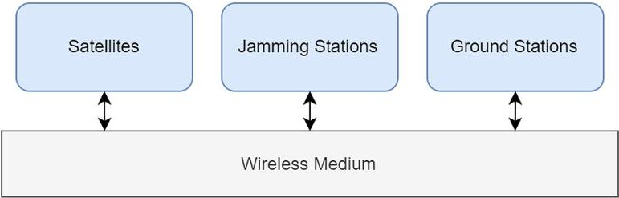
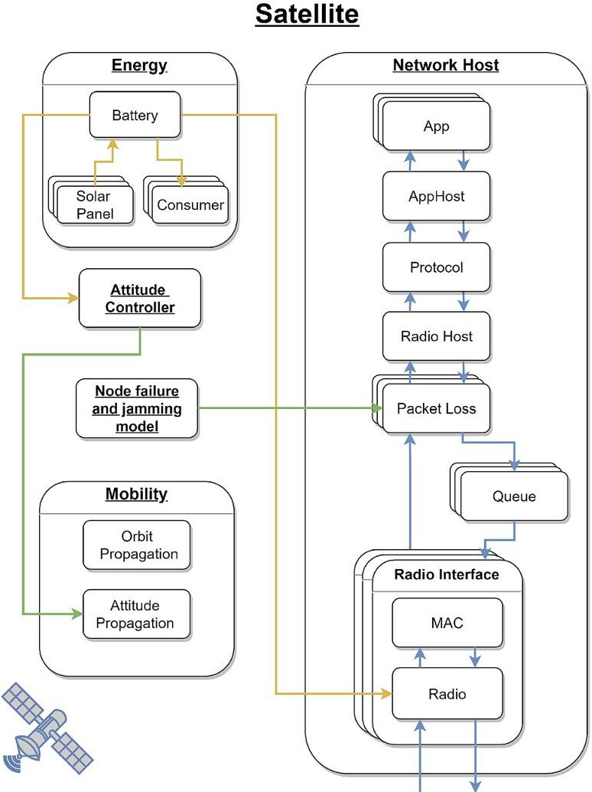
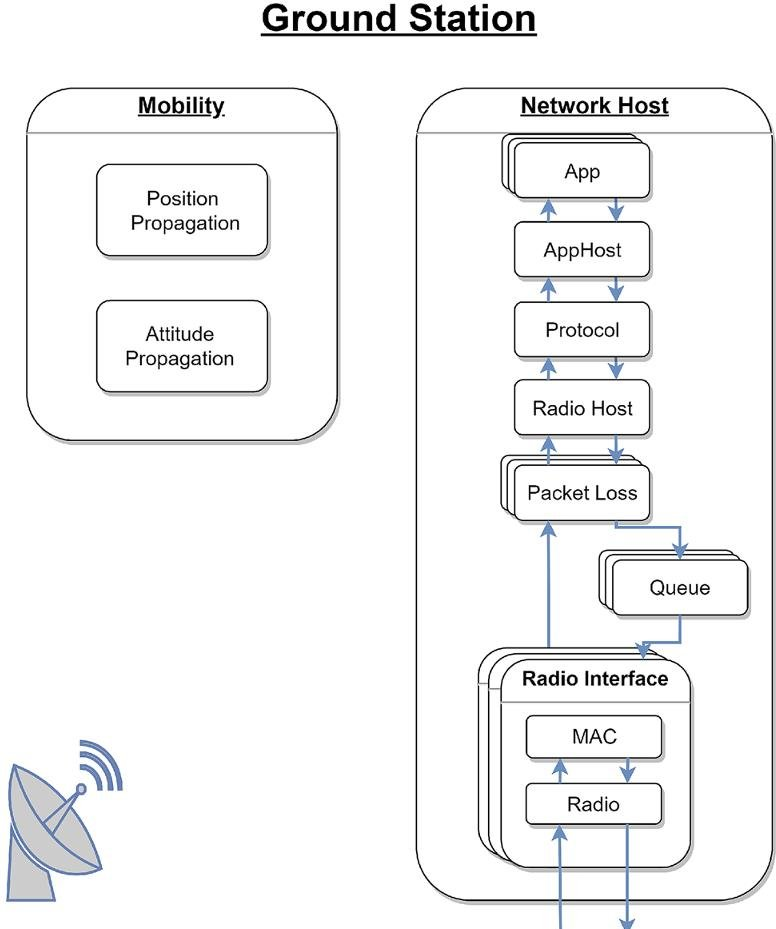
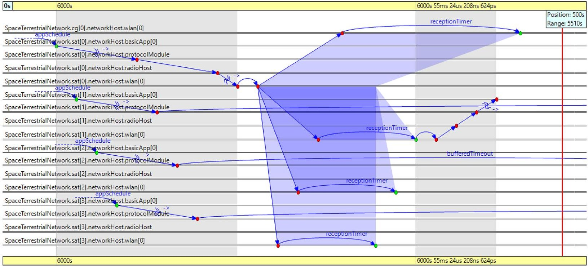
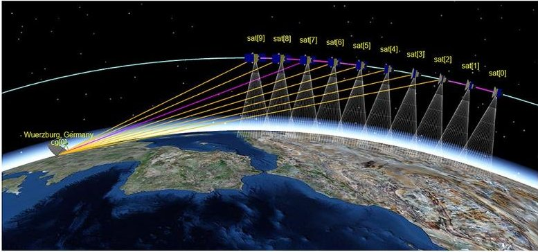
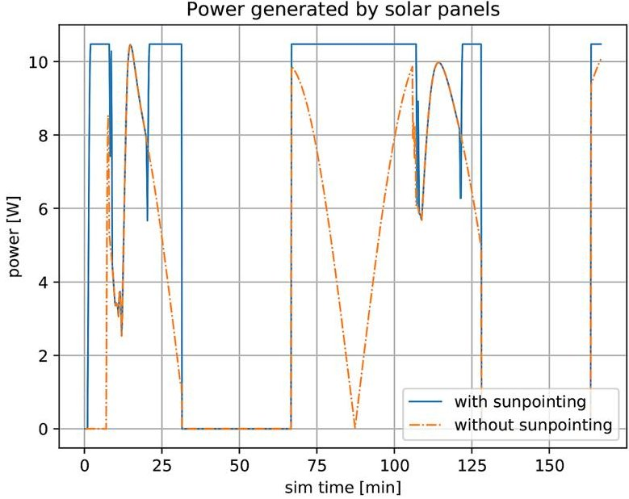
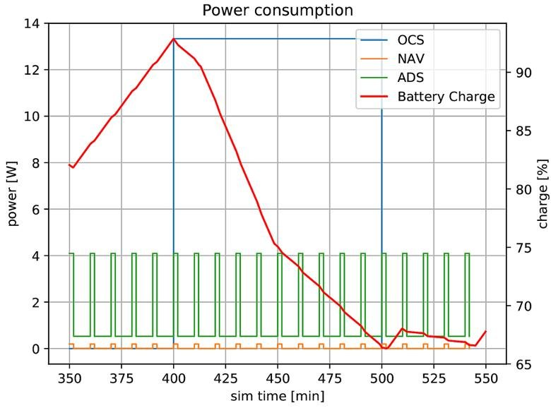
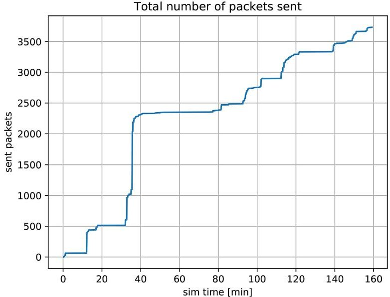
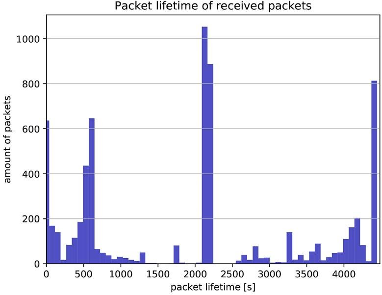

<!-- PDF_PAGE: 1 -->

ORIGINAL PAPER

# ESTNeT: a discrete event simulator for space-terrestrial networks

A. Freimann $ ^{1} $ · M. Dierkes $ ^{1} $ · T. Petermann $ ^{1} $ · C. Liman $ ^{1} $ · F. Kempf $ ^{2} $ · K. Schilling $ ^{1} $

Received: 31 January 2020 / Revised: 14 April 2020 / Accepted: 23 April 2020 / Published online: 26 May 2020 © The Author(s) 2020

## Abstract

The capabilities of small satellites have improved significantly in recent years. Specifically multi-satellite systems become increasingly popular, since they allow the support of new applications. The development and testing of these multi-satellite systems is a new challenge for engineers and requires the implementation of appropriate development and testing environments. In this paper, a modular network simulation framework for space-terrestrial systems is presented. It enables discrete event simulations for the development and testing of communication protocols, as well as mission-based analysis of other satellite system aspects, such as power supply and attitude control. ESTNeT is based on the discrete event simulator OMNeT++ and will be released under an open source license.

Keywords space-terrestrial networks·Wireless communication·System simulation

## 1 Introduction

As small satellites are becoming more capable and affordable, there is a rising interest in the development of multisatellite systems, mainly for Earth observation and communication services. The implementation of these systems is a new challenge for engineers, as well as their operation. An important aspect thereby is the wireless communication between the nodes, that enables a system of single satellites to pursue common goals and fulfill a shared mission such as distributed measurements or data forwarding. The characteristics of Space-Terrestrial Networks (STNs) are considerably different from purely terrestrial networks. Robust and efficient communication protocols need to be developed for these challenging networks. Testing and verification of communication protocols for STNs are especially challenging, since the geometric configuration and the relative movement of satellites and ground stations cannot be replicated in hardware test beds in a laboratory. Therefore, software simulation environments are required enabling the modeling

of the dynamics of nodes and the environmental conditions of STNs.

Existing simulation frameworks cover only parts of the required features for the simulation and analysis of the wireless communication in STNs. There are network simulators such as NS-3 and OMNeT++ that support various kinds of network simulations. And there are tools for geometry-based analysis of ground and space systems, e.g., Systems Toolkit (STK) from AGI. Users of STK can add modules to the baseline package to enhance specific functions. In this way, STK supports calculations for communications systems based on constraining conditions. Therefore, it can be used to generate position and attitude information and perform communication system analysis, e.g., determining contact ranges based on specific orbit and antenna models. However, it lacks a possibility to simulate digital wireless communication between nodes such as satellites and ground stations. STK further does not support the integration of custom modules implemented by users such as link and network protocols. To overcome this restriction, DtnSim [1] was developed, which uses STK to perform geometric and communication range calculations and import resulting contact plans into an OMNeT++ simulation. A drawback of this approach is that directional antennas, interference, and attitude simulations cannot be integrated in the network simulation, since the contact plan only contains topology information. During network simulation, no data are available on the

<!-- PDF_PAGE: 2 -->

position and orientation of the nodes. Other simulators support the analysis of specific aspects such as satellite power generation [2] or attitude and formation dynamics such as Orekit and GMAT. However, the analysis of a satellite mission and the evaluation of algorithms for formation control or network communication require a simulation environment that combines all system aspects such as orbit propagation, network simulations, and energy models in a single tool. The simulation of formation control for example requires the simulation of orbit dynamics, attitude dynamics, and also the network communication to model the exchange of status information between multiple satellites for use by control algorithms. The presented simulation tool integrates all relevant system models in a single tool and thereby enables the analysis of new software and hardware concepts in user-defined mission scenarios based on a detailed system model. The focus of the authors is the development of network communication protocols for STNs, but the presented simulator has been designed in a way that makes it also a valuable tool for other researchers with a different focus.

The presented Event-driven Space-Terrestrial Network Testbed (ESTNeT) is based on the popular simulation framework OMNeT++ and the INET libraries [3], an open-source OMNeT++ model suite for wired, wireless, and mobile networks. ESTNeT extends these software libraries by an STN model including detailed models of the main system components, e.g., satellites, ground stations, communication systems, electrical power systems, and attitude control systems. It provides a comfortable graphical user interface for designing, analyzing, and testing various satellite mission scenarios, and can be used on Windows, Linux, and Mac OS X platforms. ESTNeT offers an interface for the integration of existing as well as new user-defined communication protocols and utilizes a physical wireless communication model that allows detailed modeling of wireless channels. An orbit propagator based on the SGP4 model for Low Earth Orbit (LEO) propagation and an attitude propagator allow the simulation of user-defined orbits and existing two-line element set (TLE) data. The event-driven simulation scheduler of OMNeT++ allows efficient simulation of space-terrestrial systems. On one hand, the discrete event simulation supports a very high temporal resolution to realistically simulate the signal propagation in wireless channels and, on the other hand, the simulation is fast enough to simulate several days within just a few minutes to analyze long-term effects such as ground station passes of LEO satellites that occur only several times a day. A rich 3D visualization provides a quick overview of Earth, satellites, orbits, ground stations, and wireless communication links.

evaluation of network connectivity as well as for use in medium access and routing algorithms.

ESTNeT is already in use for the development of Delay Tolerant Network (DTN) protocols. Thus, it also supports the generation of contact and interference plans for the

Future releases envisage further features such as interfaces for integration with other simulation tools and hardware-in-the-loop simulation for the implementation of integrated system testing environments.

In the following section, the available system models are described in more detail. Section 3 provides an overview of the structure and the dependencies of the software modules. In Sect. 4, the capabilities of the simulation framework are demonstrated by example simulations before Sect. 5 concludes this paper.

## 2 Simulation models

Network simulations are often performed on highly simplified models to be able to analyze the entire system mathematically. By extending and detailing simulation models, the accuracy of evaluations can be increased and further problems can be identified allowing developers to improve their algorithms. Especially STNs are complex and highly dynamic systems. To model their behavior orbit dynamics, attitude dynamics, power consumption and generation, communication devices and channels, as well as data generation appropriate models have been implemented. These individual models are described in more detail in the following sections. Some of the described models have been implemented by extending existing models of the OMNeT++ framework.

## 2.1 Dynamics models

The dynamics of satellites is essential for a communication simulation, since position and attitude of satellites are constantly changing. Both are important to model the wireless channel between nodes. The attitude, for example, vastly impacts the gain of directional antennas. Therefore, a module was implemented to actively control the attitude of satellites by a dedicated attitude controller. The change of the node positions affects the propagation loss between nodes and leads to a changing network topology, e.g., during a ground station pass or while two satellites in communication range to each other at crossing points of two orbits.

## 2.1.1 Orbit propagation

The satellite orbits can be defined in two ways, either by Kepler parameters or by TLE files. The Kepler parameterbased propagation does not include any orbit perturbations. The TLE propagator includes orbit perturbations based on the Simplified General Perturbation 4 (SGP4) model and enables compatibility with the popular TLE format. The SGP4 propagator implementation is based on the code of

<!-- PDF_PAGE: 3 -->

David Vallado [4]. An interface of the mobility model further enables updating satellite positions by external tools.

## 2.1.2 Attitude model

The attitude simulation of a satellite is used to perform maneuvers in orbit for a variety of scenarios. Maneuvers could be constantly orienting the solar panels to the sun, tracking another satellite with a directional antenna, or tracking a point on Earth for sensing applications. The attitude of a satellite is described by a quaternion for its current orientation, an angular velocity, and an angular acceleration. Both the angular velocity and acceleration are also described by a quaternion where the real part is zero. This structure is inherited from INETs' way of describing the mobility of an object. Quaternions are used to avoid the gimbal lock problem of Euler angels.

## Attitude propagation

Attitude propagation happens whenever a module requests the current attitude of a satellite and the difference to the previous calculated attitude is smaller then a predefined accuracy. This helps maintaining performance of the simulation while still achieving sufficient accuracy. Upon request, if the accuracy threshold is passed, the new attitude is calculated based on the previous attitude $ q_{\mathrm{old}} $ , the angular velocity $ \omega $ , and the time difference $ \Delta t $ since the last update, see Eq. (1):

$$
q _ {\mathrm {n e w}} = q _ {\mathrm {o l d}} + \frac {1}{2} \cdot q _ {\mathrm {o l d}} \cdot \omega \cdot \Delta t.
$$

The angular velocity $ \omega $ has the structure:

$$
\omega = \left( \begin{array}{c} 0 \\ \omega_ {x} \\ \omega_ {y} \\ \omega_ {z} \end{array} \right),
$$

and is propagated based on the angular acceleration $ \alpha $ which has the same structure as $ \omega $ , see Eq. (2):

$$
\omega_ {n e w} = \omega_ {o l d} + \alpha \cdot \Delta t.
$$

At the beginning of each simulation, the satellites tumbles with a random angular velocity in space. This behavior can be disabled by the user.

Attitude controller

The attitude controller enables the satellite to perform different maneuvers while calculating the required power to perform a maneuver by actuators such as reaction wheels. The controller uses a defined target to which a specific axis of the local satellite coordinate frame is to be pointed. The user can also define a time limit for the duration of a maneuver which also affects the concerning power consumption. For each maneuver, the attitude

control module calculates the necessary angular velocity to change the satellite orientation to the desired value in the given time interval. The only limiting factor is the maximum angular acceleration $ \alpha_{\mathrm{m a x}} $ . If this limit is reached, the satellite can only partially perform the maneuver.

As an example, for an ideal 1U CubeSat with an edge length of a = 100 mm, a mass of m=1 kg which is evenly distributed in the body, and three reaction wheels in the center, the moment of inertia for each axis is:

$$
I = \frac {1}{6} \cdot m \cdot a ^ {2} = \frac {1}{6 0 0} \left[ \mathrm {k g} \times \mathrm {m} ^ {2} \right].
$$

A typical reaction wheel for a 1U CubeSat has a maximum torque of about M=0.2 mNm. In this case, the maximum angular acceleration is:

$$
\alpha_ {\max } = \frac {M}{I} = 0. 1 2 \left[ \frac {\mathrm {r a d}}{s ^ {2}} \right].
$$

To perform a maneuver, the attitude controller executes the following steps:

1. Determine the required orientation change to orient the satellite to the target.

2. Calculate the angular velocity needed to perform the maneuver.

3. Subtract this necessary angular velocity from the current angular velocity of the satellite.

4. Calculate the angular acceleration derived from the angular velocity.

5. If maximum acceleration is reached, decrease the angular velocity accordingly.

6. Calculate the consumed power for this maneuver based on the angular acceleration.

7. Apply the new angular velocity.

The power calculation assumes a linear correlation between power consumption and angular acceleration. At maximum torque, the maximum consumption $ P_{\mathrm{m a x}} $ of the actuators is assumed. The power consumed by a maneuver is then:

$$
W = \frac {P _ {\max}}{\alpha_ {\max}} \cdot \alpha \cdot \Delta t [ J ].
$$

The values of $ \alpha_{\mathrm{m a x}} $ and $ P_{\mathrm{m a x}} $ can be defined individually for each satellite in the configuration file. An additional idle power consumption can be specified by the user. The pointing target, $ \Delta t $ , and the pointing axis can be changed during the entire simulation.

The attitude controller supports multiple pointing modes.

The default mode is NIL, where no target is tracked. The satellite's attitude is just propagated through time based on the initial orientation and angular velocity.

<!-- PDF_PAGE: 4 -->

For Earth observation scenarios, there is the Earth Center tracking mode, in which the satellite is always pointing at the center of the Earth, called nadir pointing.

When communicating with other satellites or the ground station, a Node Number can be defined. This mode is required if directional antennas are used for communication.

The Sun pointing mode can be used for maximum charging of the on-board batteries by solar panels.

When the desired target is none of the above-mentioned ones, any point can be defined by Earth-centered inertial (ECI) coordinates as tracking target, for example to track an area of interest on Earth by on-board sensors.

## 2.2 Power model

To simulate the available electrical energy on-board of satellites, the satellite module is equipped with an energy module, that contains solar panels and a consumer module, containing a configurable set of consumers. The power consumers and generators are connected to an energy storage, which can be implemented by a battery module from the INET library. The battery tracks the current power consumption and generation of all modules, and calculates the energy balance by integrating the power balance over time.

## 2.2.1 Energy generation

The energy generation of satellites by solar panels is calculated according to the geometrical configuration of solar panels and the orientation of the satellite towards the sun. Solar panels can be attached in any desired configuration to the satellites. For simulating multiple solar panel configurations, the satellites' energy module can be equipped with a user-defined amount of solar panels. The orientation of the panels with respect to the satellite's coordinate frame is expressed by Euler angles. The number of solar cells per panel can be defined individually. The power that is generated by the whole panel is updated periodically and calculated using the sun vector component, that is pointing orthogonal to the panel. Based on the total area of the solar panel A, the efficiency of the solar cells $ \eta_{\mathrm{sc}} $ , the Sun intensity at 1AU $ B_{0} $ , the incidence angle of the sun $ \gamma $ , and the system's efficiency $ \eta_{\mathrm{sys}} $ , the generated power P is calculated by Eq. (6). Additionally, the solar panel's surface reflectivity $ \rho(\gamma) $ according to Frenel's law is taken into account:

$$
P = A \cdot \eta_ {\mathrm {s c}} \cdot B _ {0} \cdot \eta_ {\mathrm {s y s}} \cdot \cos (\gamma) (1 - \rho (\gamma)).
$$

As a more simplified model, a basic implementation with a given maximum power $ P_{\mathrm{max}} $ is implemented, using $ P=P_{\mathrm{max}}\cdot\cos(\gamma). $ At every point in time, at which the generation changes, the battery is notified about the current power generation P.

## 2.2.2 Energy consumption

To model the power consumption of satellites, a dynamic model for different kinds of consumers was developed and implemented in ESTNeT. The basic approach is that each subsystem of the satellite that consumes energy is contained in the consumer module if its energy consumption is not already simulated by the respective satellite subsystem module itself. Various consumer types which model the power that is required by each of the subsystems are offered by ESTNeT. Essential subsystems, such as on-board computers, which are active all the time except for failure states are described as constant consumers.

Other subsystems that are active in regular intervals can be modeled by a constant duty-cycle consumer. A duty cycle is defined for the subsystem that exactly defines after which time the system switches between on and off. Using the varying duty-cycle consumer, only the average percentages of time during which a system is active are defined. The switching occurs based on a random process.

As some system activities are dependent on other systems, ESTNeT provides the coupled consumer. The system modeled by this consumer is activated if another specific subsystem is active.

As many payloads are operating Earth-related, the target tracking consumer is used to model payloads like cameras, that are active when passing a certain point of interest on Earth. This point is defined by its latitude and longitude.

For complex systems or systems that are simulated by other tools, a detailed consumption schedule can be given for the activity of the system, using the time and power consumption data saved in a csv file.

The energy module can also use the energy consumption published in modules that are simulating the consumption based on the simulated activity of the subsystem. As the communication system is modeled precisely and changes its state based on events occurring during the simulation, only consumption values for each state need to be defined in the state-based consumer offered by INET. For the attitude controller, a maximum power consumption value is used to linearly calculate its consumption depending on the simulated torque.

The subsystem can consist of multiple consumer types. Each consumer type proposes a power consumption, from which the subsystem is choosing the maximum as power consumption $ P_{\mathrm{subsystem}} $ , which is published to the battery.

## 2.3 Communication model

The main application of ESTNeT is the development of communication protocols and performance evaluations. INET provides various models for the simulation of

<!-- PDF_PAGE: 5 -->

wireless communication. Based on these models, satellite communication channels were implemented in ESTNeT.

The modeling of packet reception is a crucial part of predicting connectivity and simulation of packet loss. A simple way to model packet reception is using range models. While these models do not take the actual reception process into account, physical models allow to reproduce packet loss more accurately by calculating the power of received signals and the noise power. Using the physical model, bit error rate and packet loss are calculated based on the signal-to-noise ratio (SNR) of a received packet. While the signal power mainly depends on the transmit power of the source node and the free-space path loss, the noise at the receiver can additionally be increased by interfering signals on the channel. Therefore, the definition of the SNR can be extended to the more detailed signal-to-interference-and-noise ratio (SINR), which is the basis for the implemented wireless transmission model. A packet is received successfully if the received signal meets two thresholds, given in Eqs. (7) and (8). The receiving threshold $ thr_{r} $ is the minimum signal strength at the receiver that is required for successful reception of a packet. The received signal power depends on the transmitted power $ (P_{\mathrm{t}}) $ , the gain of amplifiers and antennas at the transmitter $ (G_{\mathrm{t}}) $ , the gain of the receiver $ (G_{\mathrm{r}}) $ , obstacle losses $ (L_{\mathrm{o}}) $ if present, as well as the free-space path loss $ (L_{\mathrm{p}}) $ and further losses in the system. The second threshold to be met is the capture threshold $ thr_{\mathrm{c}} $ , which defines the required ratio of received signal power and the sum of the power of noise and interfering signals. For the SINR calculation also, the noise power $ (P_{\mathrm{N}}) $ as well as the transmit power $ (P_{i}) $ and gain $ (G_{i}) $ of interfering nodes is taken into account:

$$
P _ {\mathrm {t}} G _ {\mathrm {t}} L _ {\mathrm {p}} G _ {\mathrm {r}} L _ {\mathrm {o}} \geq t h r _ {\mathrm {r}}
$$

$$
\frac {P _ {\mathrm {t}} G _ {\mathrm {t}} L _ {\mathrm {p}} G _ {\mathrm {r}} L _ {\mathrm {o}}}{P _ {\mathrm {N}} + \sum_ {\forall i} P _ {i} G _ {i} L _ {\mathrm {p}} G _ {\mathrm {r}} L _ {\mathrm {o}}} > t h r _ {\mathrm {c}}.
$$

An exemplary set of parameters, that is used for the example simulations presented later, can be found in Table 1.

For robustness evaluations, node failure models, bit error models, and jammers are implemented.

The node failure model is implemented as a submodule of the satellite. This model simulates time intervals in which a node is unavailable, e.g., due to a reboot of the on-board computer caused by radiation-induced errors like single event upsets (SEU). Failures are modeled using parameters called mean time to failure (MTTF) and mean time to repair (MTTR). These values describe exponentially distributed time intervals needed by a satellite to recover after failures and the time interval until the next failure event.

To simulate external jamming signals, that cause link failures, ground-based jamming nodes can be used. When

Table 1 Example of typical UHF radio model parameters for CubeSats and ground stations (GS)

<table border="1"><tr><td>Model parameter</td><td>Value</td></tr><tr><td>Frequency</td><td>437.385MHz</td></tr><tr><td>Bandwidth</td><td>14.4kHz</td></tr><tr><td>Noise floor</td><td>-132.39dBm</td></tr><tr><td>Bitrate</td><td>9600bps</td></tr><tr><td>Modulation</td><td>GMSK</td></tr><tr><td>RequiredSINRthr$_{c}$</td><td>6.4dB</td></tr><tr><td>Sat transmit power$P_{t}$</td><td>0.5W</td></tr><tr><td>Sat antenna radiation pattern</td><td>Isotropic</td></tr><tr><td>GS transmit power$P_{t}$</td><td>25W</td></tr><tr><td>GS antenna type</td><td>Cross YaGi</td></tr><tr><td>GS antenna gain$G_{t}$</td><td>18.9dBi</td></tr><tr><td>GS antenna beamwidth</td><td>21°</td></tr></table>

a satellite is within a user-defined elevation range of the jamming node, all receptions fail with a specific probability.

Another reason for packet loss could be the Doppler shift due to the relative velocities of sending and receiving nodes. However, this effect is not modeled in ESTNeT yet, since it is usually compensated either by automatic frequency control of receivers or by adapting the transmit frequency based on geometrical calculations, so it has usually no significant effect. Nevertheless, users can model the Doppler effect by adding custom bit error models.

## 2.4 Data generation

Customizable data traffic generation models can be used to evaluate the network performance, including location-based models. There is a simple model which generates data at a fixed rate and more complex ones based on the satellite position. The import of geo-coordinate-based user-node densities enables the simulations of various communication service application scenarios. Based on the position of the satellite and the beamwidth of the receiving antenna, a cone is calculated in which the node density is calculated to model the estimated data traffic at this position. According to this traffic model, packets are generated on the satellite and send to a predefined target node. For a more complex scenario, the model memorizes nodes it already got data from.

## 3 Structure

The simulator is based on the OMNeT++ framework and its library for wireless communication network simulations INET. OMNeT++ uses a component-based architecture, where the behavior of the individual components is implemented in C++. Modules can then be assembled into more

<!-- PDF_PAGE: 6 -->

Fig.1 Simulation module overview

complex modules and entire network models using the NED language. At the top level of the modules in ESTNeT is a STN module. It contains the physical environment (e.g., the Earth) and the medium in which the wireless signals will be propagated. It also contains a number of ground stations, satellites, and jammers as displayed in Fig. 1.

## 3.1 Communication

As both ground stations and satellites can communicate, they both have a submodule called networkHost, in which their communication models are implemented. The network-Host itself consists of a number of submodules, which model the generation, reception, transmission, and processing of packets as shown with the blue arrows in Figs. 2 and 3.

## 3.1.1 App

The Apps create and receive the payload packets according to be defined scenario. ESTNeT comes with two different apps, a standard app, where an interval and a packet size of the dummy payloads can be configured. The second app generates packets based on the location of the satellite. Different configurations are possible, AIS data can be simulated for example using a ship density data set. The modules add headers to the payloads containing the IDs of the source app and the sink app.

## 3.1.2 AppHost

The AppHost is responsible for managing all apps present in a node. Packets being send from an app to the lower layers will just be passed to the protocol module. Packets coming from the lower layer are inspected to read the ID of the sink app and forward the packet to the respective module.

## 3.1.3 Protocol

The Protocol module holds protocol implementations. It is mainly responsible for selecting the desired next hop of the

Fig.2 Satellite module overview

packet, which will be used by the radio to determine the MAC address of the next hop node. ESTNeT comes with a simple protocol module, which just sets the destination of the package as the next hop. The protocol module can easily be replaced by own implementations to evaluate the performance of protocols in space-terrestrial networks.

## 3.1.4 RadioHost

The RadioHost manages all the radios of a node. For packets coming from the upper layer, it decides the best way for the packet to be sent, checking multiple scenarios. If the RadioHost is located on a ground station and the destination is another ground station, the packet will not be send over a wireless channel but directly to the destination ground station module without a delay, since an Internet connection is usually available at ground stations in a real-world scenario. If the packet should be send via an antenna, the RadioHost determines the best radio and antenna by calculating the angles between the antenna direction and the destination node and choosing the one with the smallest deviation. Packets from the lower layer are just passed to the protocol module.

<!-- PDF_PAGE: 7 -->

Fig.3 Ground station module overview

## 3.1.5 MAC

The MAC module controls the access of the wireless medium. If the radio is able to transmit a packet, it requests one from the Queue. There are simple but also advanced Multiple Access Control (MAC) protocols available such as CSMA.

## 3.1.6 Radio

For packets being send out, the radio sets the corresponding modulation and header, and passes the packet to the wireless medium. The wireless medium is responsible for simulation of the wireless transmission of signals taking into account the propagation and positions of receiver, transmitter, and obstacles. For packets being received, the radio removes the respective headers and passes the packet to the MAC module.

## 3.2 Power

Satellites have an energy module to simulate the consumption and generation of energy on-board the satellite. The energy module consists of three types of submodules: a battery, solar panels, and consumers. INET offers interfaces that model the different parts of a power circle and integrate the components via a publisher subscriber model. The battery

manages the power level in the satellite, altered by solar panels and consumers. In Fig. 2, the energy flow between the modules is visualized with the yellow arrows. The solar panels generate energy which is fed into the battery. The consumers consists of several submodules, that model the different energy-consuming satellite subsystems as described in Sect. 2.2.2. The battery also provides energy to simulated subsystems such as radios or an attitude control system.

## 3.3 Extensibility

OMNeT++ and ESTNeT are designed to be easily extendable. This can be used to give certain models the exact desired behavior for a simulation, to test various mission configurations. In general, every module can be extended or replaced by an own implementation, but in the following, some modules will be highlighted that encourage this.

## 3.3.1 Solar panels

ESTNeT comes with an implementation of solar panels for CubeSats, but generally offers an interface, which can be extended to implement other behaviors and energy generation calculations for the solar panels. To do this, the interface offers methods to get the sun angle and whether or not the panel is in eclipse.

## 3.3.2 Consumers

The consumer module of a satellite can be configured in multiple ways. It has predefined modules, that are combinations of the beforehand mentioned consumer types (see Sect. 2.2.2). If these behaviors cannot fulfill the requirements for the simulation, own consumer modules can be added.

## 3.3.3 Communication protocols

As one of the main use cases of ESTNeT is to test different communication protocols for satellite networks, own protocols can be implemented in ESTNeT. A base class is provided, which offers integration into the communication chain. The desired next hop needs to be set on the packet; next to this, the protocol can operate freely and add new headers for example. ESTNeT comes with a tool to generate contact plans for given scenarios, which can be used to develop routing protocols. Custom protocols can also be used within the MAC module.

## 3.4 Usage

Specific simulation scenarios in OMNeT++ are defined in the so-called ini files. Modules can have parameters, that

<!-- PDF_PAGE: 8 -->

can be set in these ini files. This can be used to configure the modules to modify the simulation scenario; for example, set the orbit of a satellite, the gain of an antenna, or protocol parameters. The ini file can then be executed in OMNeT++, bringing up a 3D visualization of the scenario. Alternatively, the simulation can be run through the console, allowing batch runs of multiple scenarios and a faster execution.

Each module can define signals, through which it can publish data, for example to be recorded by OMNeT++. As this can produce large files its possible to configure in the ini file which signals will be recorded. The recorded data can be plotted in OMNeT++ or the files can be converted to different formats such as SQLite, that can be plotted and evaluated with external tools.

During the entire simulation, each event is recorded and saved in a separate file. These can later be viewed and analyzed in a sequence chart, to gain a better insight in the simulation and the flow of data. An exemplary chart can be seen in Fig. 4. It shows the flow of a packet through the submodules and the wireless transmission between the satellites.

## 4 Example simulations

For demonstration purposes, the following section contains several example simulations. Since ESTNeT has been primarily implemented for Delay/Disruption Tolerant Network (DTN) protocol development, the first use case scenario shows the generation of contact and interference plans, as well as features to analyze the network topology and the data flow within and between the network nodes. Further

use cases are presented that show power generation and consumption investigations as well as application-specific data generation.

## 4.1 Space-terrestrial network communication

As described in Sect. 3.1, ESTNeT contains various communication models and is capable of simulating communicating nodes such as satellites and ground stations. The detailed simulation of the contacts can be used for example to create the so-called contact and interference plans. An entry of a contact plan consists of a source and sink node, a period of time, and a bit rate. An extract of a contact plan for a scenario like the CloudCT mission [5] with ten satellites is shown in Fig. 5. With ESTNeT, the contact plan entries can be visualized in a 3D model as displayed in Fig. 6. This feature allows quick and easy analysis of communication scenarios.

Interference plan entries consist of a period of time, a source, and a sink node of the contact and one or multiple interfering nodes. In Fig. 7, an example of an interference plan calculated by ESTNeT is shown. The contact plan in the example is a postprocessed version of a basic contact plan. It has been modified to include only contacts, that can be used simultaneously without any interference.

## 4.2 Power generation and consumption

In this example, a 3U CubeSat in a polar orbit points to the sun, so it generates as much power as possible with its solar panels by actively maintaining this attitude. The solar panels

Fig.4 Section of a sequence chart

<!-- PDF_PAGE: 9 -->

<table border="1"><tr><td colspan="5">Satellites:1-10
Ground Stations:11-11
sim-time-limit:10000</td></tr><tr><td>start(sec)</td><td>end(sec)</td><td>source</td><td>sink</td><td>rate(bps)</td></tr><tr><td>350</td><td>360</td><td>1</td><td>2</td><td>9600</td></tr><tr><td>350</td><td>360</td><td>1</td><td>3</td><td>9600</td></tr><tr><td>350</td><td>360</td><td>8</td><td>6</td><td>9600</td></tr><tr><td>350</td><td>360</td><td>8</td><td>7</td><td>9600</td></tr><tr><td>350</td><td>360</td><td>8</td><td>9</td><td>9600</td></tr><tr><td>350</td><td>360</td><td>8</td><td>10</td><td>9600</td></tr><tr><td>350</td><td>360</td><td>8</td><td>11</td><td>9600</td></tr><tr><td>360</td><td>370</td><td>6</td><td>3</td><td>9600</td></tr><tr><td>360</td><td>370</td><td>6</td><td>4</td><td>9600</td></tr><tr><td>360</td><td>370</td><td>6</td><td>5</td><td>9600</td></tr><tr><td>360</td><td>370</td><td>6</td><td>7</td><td>9600</td></tr><tr><td>360</td><td>370</td><td>9</td><td>8</td><td>9600</td></tr><tr><td>360</td><td>370</td><td>9</td><td>10</td><td>9600</td></tr></table>

Fig. 5 Contact plan created by ESTNeT

Fig. 6 3D visualization of a contact plan with ESTNeT

<table border="1"><tr><td>start(sec)</td><td>end(sec)</td><td>interferer</td><td>source</td><td>sink</td></tr><tr><td>2100</td><td>2220</td><td>1,2</td><td>4</td><td>3</td></tr><tr><td>2100</td><td>2340</td><td>1,2</td><td>3</td><td>4</td></tr><tr><td>2280</td><td>7980</td><td>2</td><td>4</td><td>3</td></tr><tr><td>2280</td><td>7860</td><td>1</td><td>4</td><td>3</td></tr><tr><td>2280</td><td>7920</td><td>1</td><td>3</td><td>4</td></tr><tr><td>2280</td><td>7920</td><td>2</td><td>3</td><td>4</td></tr><tr><td>6180</td><td>6480</td><td>1</td><td>2</td><td>5</td></tr><tr><td>6180</td><td>6480</td><td>1</td><td>3</td><td>5</td></tr><tr><td>6180</td><td>6480</td><td>1</td><td>4</td><td>5</td></tr></table>

Fig.7 Interference plan with additive interference created by EST- NeT

are only attached to the four large sides of the CubeSat and include seven cells each, like in the Netsat mission [6]. When passing over a ground station, the satellite antenna tracks it. This leads to higher power consumption and a decline in power generation. By changing the tracking mode in the simulated scenario, the impact of sun-pointing is shown. Two orbits are traversed in the simulation period, where two eclipse transits and two ground station contacts occur. When crossing the ground station, antenna pointing has priority and, therefore, the power generation is decreased. When comparing to the case where no active sun pointing is performed, one can see (Fig. 8) that the full potential of the solar panels is not used. Figure 9 shows the state of charge

Fig.8 Power generation of a 3U CubeSat with and without sun pointing

Fig.9 Power consumption on the satellite and battery charge

of the battery and selected consumers of one of the satellites. The satellite carries an Orbit Control System (OCS) to compensate for orbit perturbations. When the thrusters are active, the power consumption exceeds the generation and the battery charge starts to drop quickly. The other consumers do not have such high power consumption and allow the battery to be charged. Figure 9 also shows how a Constant Duty Cycle Consumer can be used to model regular tasks like attitude determination.

## 4.3 Geo-coordinate-based traffic generation

This example scenario includes a Walker constellation with six orbital planes, three satellites per orbital plane, and a single ground station. The satellites generate data traffic

<!-- PDF_PAGE: 10 -->

Fig.10 Number of packets forwarded by one satellite

Fig.11 Histogram of packet latencies

based on their position. A global ship density distribution has been imported into ESTNeT to simulate the reception of Automatic Identification System (AIS) packets and the forwarding of those to a ground station. In Fig. 10, the number of sent packets is shown over two orbital periods. When the satellites pass an area with a high ship density, a steep slope is visible. During periods in which satellites travel across a continent, the number of sent packages stagnates. As there is only one ground station, the latencies of the packets vary significantly, as displayed in Fig. 11, since satellites have to carry the data until the next ground station pass. In this way, the number of satellites and ground stations is needed to meet certain requirements, such as coverage and observation time. The exact traffic load for each node can be evaluated and the influence of different routing and medium access protocols can be analyzed.

## 5 Conclusions

In this paper, a simulation tool for STNs was presented. By implementing a complete system model for satellites, ground stations and the environment ESTNeT allow the modeling and implementation of all aspects of an STN in scenarios that can be defined by the user. While the development of communication protocols is the main use case for ESTNeT, it can also be used for the implementation of other novel software concepts, e.g., orbit and formation controllers. The event-driven simulation framework of OMNeT++ and the implemented satellite models offer a basis for the configuration, execution, and analysis of all kinds of LEO satellite systems. The solar cell-based energy generation model and the subsystem-based energy consumption enable the simulation of the power supply, which is an important factor for operation concepts. Interfaces for the import of geo-coordinate-based data generation models allow the simulations of use cases such as vessel tracking or IoT applications. The modularity and extensibility make sure that ESTNeT can be adapted to future use cases. Interfaces for the integration of ESTNeT into existing simulation environments and hardware test beds will be included in future releases.

Acknowledgements Open Access funding provided by Projekt DEAL. This research was supported by Deutsche Forschungsgemeinschaft (DFG) under grant number SCHI 327/29-1. We would like to thank Tobias Thiel, Christoph Kühne, Anton Bredenbeck, and Nikolai Widowski for their contributions to this work.

Open Access This article is licensed under a Creative Commons Attribution 4.0 International License, which permits use, sharing, adaptation, distribution and reproduction in any medium or format, as long as you give appropriate credit to the original author(s) and the source, provide a link to the Creative Commons licence, and indicate if changes were made. The images or other third party material in this article are included in the article's Creative Commons licence, unless indicated otherwise in a credit line to the material. If material is not included in the article's Creative Commons licence and your intended use is not permitted by statutory regulation or exceeds the permitted use, you will need to obtain permission directly from the copyright holder. To view a copy of this licence, visit http://creativecommons.org/licenses/by/4.0/.

## References

1. Fraire, J.A., Madoery, P., Raverta, F., Finochietto, J.M., Velazco, R.: Dtnsim: Bridging the gap between simulation and implementation of space-terrestrial dtns. In: 2017 6th International Conference on Space Mission Challenges for Information Technology (SMC-IT), pp. 120-123. IEEE (2017)

2. Etchells, T., Berthoud, L.: Developing a power modelling tool for cubesats. In: Proceedings of the Small Satellite Conference, WP1, 16 (2019)

3. Virdis, A.: Recent Advances in Network Simulation: The OMNeT++ Environment and its Ecosystem. Springer, Berlin (2019)

<!-- PDF_PAGE: 11 -->

4. Vallado, D.A.: Fundamentals of Astrodynamics and Applications. Microcosm Press (2013)

5. Koren, I., Schilling, K., Schechner, Y.: CloudCT — Computer Tomography of Clouds by a Small Satellite Formation. In: Proceedings 12th IAA Symposium on Small Satellites for Earth Observation, IFAC (2019)

6. Schilling, K., Bangert, P., Busch, S., Dombrovski, S., Freimann, A., Kramer, A., Nogueira, T., Ris, D., Scharnagl, J., Tzschichholz, T.: Netsat: a four pico/nano-satellite mission for demonstration of autonomous formation flying. In: 66th International Astronautical Congress, (2015)

