<!-- PDF_PAGE: 1 -->

2015 IEEE. Personal use of this material is permitted. Permission from IEEE must be obtained for all other uses, in any current or future media, including reprinting/republishing this material for advertising or promotional purposes,creating new collective works, for resale or redistribution to servers or lists, or reuse of any copyrighted component of this work in other works. DOI 10.1109/JSTARS.2016.2574717

# $ ^{3} $CAT-2; an Experimental Nano-Satellite for GNSS-R Earth Observation: Mission Concept and Analysis

Hugo Carreno-Luengo $ ^{(1),\ast} $ , Member, IEEE, Adriano Camps $ ^{(1),\ast} $ , Fellow, IEEE, Pol Via $ ^{(1)} $ , Juan Francisco Munoz $ ^{(1)} $ , Alex Cortiella $ ^{(1)} $ , David Vidal $ ^{(1)} $ , Jaume Jané $ ^{(1)} $ , N. Catarino $ ^{(2)} $ , M. Hagenfeldt $ ^{(3)} $ , P. Palomo $ ^{(3)} $ , and S. Cornara $ ^{(3)} $

$ ^{(1)} $ Universitat Politècnica de Catalunya - BarcelonaTech Remote Sensing Laboratory and IEEC/CTE-UPC Campus Nord, D3, 08034 Barcelona, Spain, Tel. +34 93 4017362, Fax +34 93 4017232,

E-mail (*): hugo.carreno@tsc.upc.edu, camps@tsc.upc.edu

$ ^{(2)} $ Deimos Engenharia, Av. D. Joao II, Lote 1.17.01 - $ 10^{\circ} $ , Edifício Torre Zen, 1998-023 Lisboa, Portugal

(3) Deimos Space, Ronda de Poniente 19, Edificación Fiteni VI, 28760 Tres Cantos (Madrid), Spain

Abstract—Global Navigation Satellite System Reflectometry (GNSS-R) is a multi-static radar using navigation signals as signals of opportunity. It provides wide-swath and improved spatio-temporal sampling over current space-borne missions. The lack of experimental datasets from space covering signals from multiple constellations (GPS, GLONASS, Galileo and Beidou) at dual-band (L1 and L2), and dual-polarization (Right and Left Hand Circular Polarization: RHCP and LHCP), over the ocean, land and cryosphere remains a bottleneck to further develop these techniques. $ ^{3} $Cat-2 is a 6 unit （3 x 2 elementary blocks of 10 $ \times10\times10 $ cm $ ^{3} $ ）CubeSat mission designed and implemented at the Universitat Politecnica de Catalunya-BarcelonaTech to explore fundamental issues towards an improvement in the understanding of the bistatic scattering properties of different targets. Since geolocalization of the specific reflection points is determined by the geometry only, a moderate pointing accuracy is still required to correct for the antenna pattern in scatterometry measurements. This manuscript describes the mission analysis and the current status of the Assembly, Integration and Verification (AIV) activities of both the Engineering Model (EM) and the Flight Model (FM) performed at Universitat Politecnica de Catalunya (UPC) NanoSatLab premises. $ ^{3} $Cat-2 launch is foreseen for the second quarter of 2016

into a Sun-Synchronous orbit of 510 km height using a Long March II D rocket.

Index Terms—Cubesat, Earth Remote Sensing, GNSS-R scatterometry, altimetry, PYCARO.

## I. INTRODUCTION

In previous decades aerospace engineering was focused on the development, design, and manufacturing of mostly large satellites. Nowadays, with advances in microelectronics and computing, following the advances in cell phones technologies many of the functions of a satellite can be implemented in a few integrated circuits. Small satellites are therefore becoming a true alternative for some Earth Observation techniques [1] with reduced dimensions and weight of the spacecraft and payloads. Missions based on small satellites can be conceived, implemented and launched at a reasonable cost. The CubeSat concept [2] was originally devised by Prof. Jordi Puig-Suari at California Polytechnic State University (Cal Poly) and Prof. Bob Twiggs at Stanford University's Space Systems Development Laboratory. CubeSats of 1, 2 or 3 units (roughly $ 1 0 \times1 0 \times1 0 \mathrm{c m}^{3}, 1 0 \times1 0 \times2 0 \mathrm{c m}^{3}, 1 0 \times1 0 \times3 0 \mathrm{c m}^{3} $ [2]) offer an standard approach to develop pico and nano-satellites and provided a standard to launch them into space, especially for research groups. In 2011, a second standardization including 6, 12 and 27 units CubeSats was carried out [3]. By enabling constellations of satellites, these architectures have the potential to combine the temporal resolution of GEostationary Orbit (GEO) missions with the spatial resolution of Low Earth Orbit (LEO) missions, thus changing the traditional trade-off in Earth Observation mission design

<!-- PDF_PAGE: 2 -->

[1]. At present, numerous CubeSats for technology and scientific demonstration, as well as for Earth Observation have already been launched [1]. Even constellations of 3U CubeSats are planned for Optical Earth Observation or for Radio-Occultation (RO) [4].

The intrinsic multi-static nature of GNSS-R techniques provides improved spatio-temporal resolution [5]. The first space-borne measurement of an Earth-reflected GPS signal took place during the Space-borne Imaging Radar-C (SIR-C) mission in 1994 [6] using an L-band antenna of 12 x 2.7 m $ ^{2} $ The collected data helped to estimate the Signal-to-Noise Ratio (SNR) during the preparatory activities of the SAC-C [7] and CHAMP [8,9] missions. CHAMP collected reflected GPS signals during the GPS-RO operational mode at very low elevation angles. The first space-borne proof-of-concept of GNSS Reflectometry from space took place with the data logger on-board the UK-DMC [10]. Samples of GPS signals reflected over ocean, land and ice were collected, downloaded and processed on-ground. The nadir-looking antenna was composed of three LHCP GPS patches at L1 (1575.42 MHz), with a total gain at boresight of ~12 dB. In July $ 8^{th} $ 2014 the UK TechDemoSat-1 from SSTL was launched [11] and at present, at least three other space-borne missions are approved or under-study: the Cyclone Global Navigation Satellite System (CYGNSS) from NASA [12] to be launched in October 2016, the Passive Reflectometry and Interferometry System In-Orbit Demonstrator (PARIS-IoD) from the European Space Agency (ESA) [13], and the GNSS rEffectometry Radio Occultation and Scatterometry experiment on-board the International Space Station (GEROS-ISS) [14]. The CYGNSS mission consists of a constellation of 8 microsatellites (1470 mm x 430 mm x 200 mm) and it is expected to be launched in 2016. The TechDemoSat-1 is a multi-payload microsatellite (770 mm x 500 mm x 900 mm) including the SGR-ReSI GNSS-R instrument [15], which is the precursor of the CYGNSS payloads. The Technology Experiment Carrier-1 (TET-1) platform [16] was selected for PARIS-IoD (1100 mm x 900 mm x 880 mm). An additional deployable structure was considered for the accommodation of the antenna array. Table I summarizes the main specifications of the different subsystems for these missions: TechDemoSat-1, CYGNSS and PARIS-IoD. Additionally, Phase A studies have been done at Germany to perform GNSS-R and GNSS-RO in parallel using smaller platforms [17]: MicroGEM (Microsatellite for GNSS Earth Monitoring, 130 kg, 2009), NanoGEM (50 kg, 2012), and NanoX (50 kg, 2012).

This work presents the mission concept and analysis of $ ^{3} $Cat-2: a 6U CubeSat performing multi-constellation, dualband (L1, L2), and dual-polarization (RHCP, LHCP) GNSS-R to be launched in July 2016. The $ ^{3} $Cat-2 mass is $ \sim $ 7 kg, the average power generated on-board per orbit period is $ \sim $ 6 W, and the expected payload data volume is up to $ \sim $ 10 MB per day. Section II describes the scientific objectives, Section III presents the mission concept, and the architecture of the instrumentation is described in Section IV including a detailed explanation of the different subsystems of the spacecraft.

Section V summarizes the mission analysis. Finally, Section VI summarizes the main conclusions of this study.

## II. MISSION OBJECTIVES

The main goals of the $ ^{3} $Cat-2 are two-fold: 1) to explore new GNSS-R techniques, and 2) to acquire data over different targets to obtain algorithms to derive geophysical parameters. $ ^{3} $Cat-2 is a modest research and demonstration mission to advance our understanding of the main state-of-the art techniques for space-borne GNSS-R ocean and ice altimetry and scatterometry for sea state determination, soil moisture measurements, and biomass monitoring. The main mission objectives of $ ^{3} $Cat-2 mission are:

1. To demonstrate the capabilities of nano-satellites for Earth Observation, and in particular those based on the CubeSat standard.

2. To perform an inter-comparison of the achievable altimetric precision using conventional GNSS-R (cGNSS-R), interferometric GNSS-R (iGNSS-R), and reconstructed code GNSS-R (rGNSS-R) [18] for methodology demonstration, error budget validation, and study of the spatio-temporal resolution, and its comparison with data of traditional monostatic radar altimeter data.

3. To evaluate the sensitivity of GNSS-R for sea state determination as a function of the wind speed or sea state conditions.

4. To evaluate the potential application of GNSS-R over land surfaces, and in particular to infer soil moisture and vegetation biomass, with special focus over boreal forests, where other missions (e.g., ESA's Biomass mission [19]) are expected to have restrictions.

5. To perform an inter-comparison of the GNSS-R scattering properties as a function of the autocorrelation properties of the different available GNSS signals of opportunity (GPS, GLONASS, Galileo and Beidou). In particular, to map the performance of the different scientific applications as function of the center frequency, receiver bandwidth, signal polarization, access technique, chipping rate, coherent and incoherent integration times and satellite elevation angle.

6. To empirically evaluate the coherent-to-incoherent scattering ratio over land, ocean and cryosphere, and

7. To evaluate the potential synergy between closed- and open-loop correlation techniques [20, 21].

## III. MISSION CONCEPT

## A. Orbit Selection

The fundamental mission objective is to collect scattered GNSS signals over land, ocean and cryosphere surface targets in a nadir-looking configuration. The satellite will operate in a Sun-Synchronous Orbit (SSO) with a Local Time of Ascending Node (LTAN) of 00:00 h, and an orbit reference height of ~ 510 km. As it will be shown (Section V) the altitude decay is 10 km, and the LTAN increment is 4 min in a 1 year extended mission

<!-- PDF_PAGE: 3 -->

Table I. Overview of the more relevant subsystems for TechDemoSat-1, CYGNSS and PARIS-IoD.

<table border="1"><tr><td></td><td>TechDemoSat-1</td><td>CYGNSS</td><td>PARIS-IoD</td></tr><tr><td>GNSS-R instrument</td><td>SGR-ReSI</td><td>DMR</td><td>(Under development)</td></tr><tr><td>ADCS</td><td>3-axes(CubeSat technology)</td><td>3-axes</td><td>3-axes</td></tr><tr><td>TT&amp;C</td><td>Down-link:X-band400Mbps(science)S-band8Mbps(housekeeping)Uplink:S-Band10kbps</td><td>Down-link:S-band1.25Mbps(science)S-band2-64kbps(housekeeping)Up-link:S-band125-2kbps</td><td>Down-link:X-band95Mbps(science)S-band137.5kbps(housekeeping)Up-link:S-band5kbps</td></tr><tr><td>Battery</td><td>Saft</td><td>3AhrLi-Ion</td><td>NA</td></tr><tr><td>Determination</td><td>Sun sensors, magnetometers,gyroscopes</td><td>Pitch/roll horizon sensors,3 magnetometers(Precision=2.10,3-σ)</td><td>Star trackers(Precision=30arcsec)</td></tr><tr><td>Control</td><td>Magnetorquers</td><td>Pitch momentum wheel(30mMns@5600rpm,2mNm torque)(Precision=2.30,3-σ),and3 magnetorquers(1Am2,residual moments&lt;0.1Am2)</td><td>Reaction wheels(Precision=5arcmin)和 magnetorquers</td></tr><tr><td>Position</td><td>NA</td><td>NA</td><td>Dual frequencyGNSS receiver(Accuracy=0.3m,1-σ)</td></tr><tr><td>Thermal</td><td>Heaters</td><td>Multi-LayerInsulation(MLI),surfacefinishes,andheaters</td><td>Insulation layers,thermalfillers,heaters,andthermistors</td></tr><tr><td>Mass</td><td>150kg</td><td>17.6kg</td><td>170kg</td></tr><tr><td>Zenith antenna</td><td>1RHCPL1/L2(1patch),2RHCPL1(1patcheachone)</td><td>1RHCPL1(1patch)</td><td>19RHCPradiators</td></tr><tr><td>Nadir antenna</td><td>1LHCPL1/L2(4patches),dielectricair</td><td>2LHCPL1(3patcheseach),dielectricair</td><td>19LHCPradiators</td></tr><tr><td>Duty cycle</td><td>NA</td><td>100%</td><td>97%(non-eclipse),75%(eclipse)</td></tr><tr><td>Radiation Total Dose</td><td>NA</td><td>&gt;5krad</td><td>NA</td></tr><tr><td>Solar panels</td><td>52W</td><td>Celleff.(EOL)28.5%,0.22m2,Triplejunction(InGaP/InGaAs/Ge)</td><td>166W(After5years)</td></tr><tr><td>Platform</td><td>1microsatellite</td><td>8separatemicrosatellites</td><td>1microsatellite(TET-1)</td></tr></table>

<!-- PDF_PAGE: 4 -->

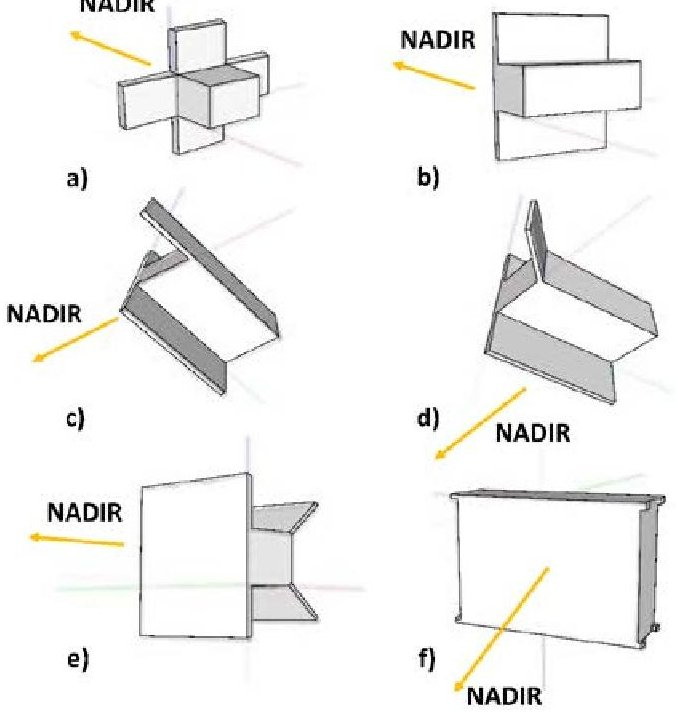

Fig. 1. Artist view of the 1U, 2U, and 6U CubeSat configurations considered during the $ ^{3} $Cat-2 mission feasibility study: 1U (a), 2U, (b,c,d,e), 6U (f).

lifetime. Therefore, the orbit is stable, and there is no need to use a propulsion subsystem. A 10 day revisit time goal is also achieved with a down-looking antenna array beamwidth of $ 7 0^{\circ} $

## B. Platform Selection

In GNSS-R the access to the geophysical information is cast in the so-called Delay Doppler Maps (DDMs) [18]. The performance of the scientific objectives depends on the SNR which benefits from a high antenna directivity. On the other hand, the $ ^{3} $Cat-2 mission (Table II) is constrained to a CubeSat platform, which imposes serious constraints on the size of the downlooking antenna, and the size of the solar panels required for power generation. During $ ^{3} $Cat-2 feasibility study several configurations were analyzed from 1U to 6U CubeSat platforms (Fig.1 and Table III). After a careful study, it was found that configurations (e) (using a passive magnetic Attitude Determination and Control System ADCS) and (f) Earth Centred Inertial ECI velocity alignment with nadir or Sun constraint ADCS and Earth Centred Fixed ECF velocity alignment with nadir or radial constraint ADCS) satisfy the link and the power budget requirements, although the configuration (e) requires deployable solar panels, and downlooking payload antenna (to be designed). Due to the lower risk the final selected configuration for $ ^{3} $Cat-2 platform was a 6U CubeSat [22], (f) in Fig. 1 without any deployables.

## C. Payload

The $ ^{3} $Cat-2 payload is the so-called P(Y) & C/A ReflectOmeter (PYCARO) [23]. It was designed and developed

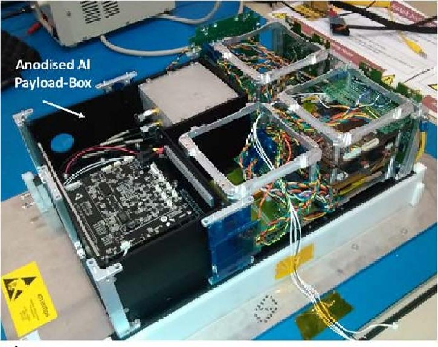

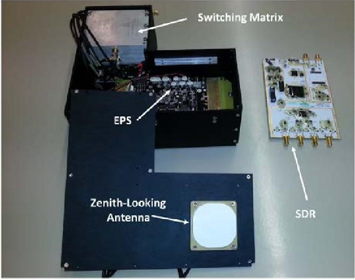

Fig. 2. (a) Image of the $ ^{3} $Cat-2 Engineering Model (EM) with the payload inside an anodized Aluminum box with 3 mm thick walls (in black). (b) Elements inside the box: Switching matrix, payload EPS, SDR, and zenith-looking antenna.

in parallel to the platform and tested in several groundbased, airborne and stratospheric balloon field experiments. The definitive proof of concept of payload took place in two ESA-sponsored stratospheric balloon experiments from Esrange Space Center (Sweden). The apogee was ~ 27,000 m, and PYCARO collected GNSS-R reflections mostly over boreal forests, and some lakes [24-26]. The $ ^{3} $Cat-2 payload comprises a set of subsystems accommodated on the upper 3U volume of the structure (Figs. 2a,b). All of these elements provide the mechanical and electrical interface between the payload and the platform (Figs. 3a,b). To reach the mission objectives outlined in Section II, the $ ^{3} $Cat-2 payload must be capable of receiving multiple GNSS reflected signals coming from different directions within a wide angular range. In addition, the signals have to be received with a sufficiently high antenna gain so as to guarantee range measurements, crucial for the first priority mission objective (altimetry). The selected antenna type is a six dual-frequency (L1 and L2) and dual-polarization (RHCP and LHCP) patch array whose output

<!-- PDF_PAGE: 5 -->

signals are combined to form

Table II. Key mission requirements.

<table border="1"><tr><td>Orbit</td><td>SSO,meanLTAN=00:00hAM,450＜Href＜650km</td></tr><tr><td>Revisit Time</td><td>12days</td></tr><tr><td>ADCS maximum error</td><td>7.5°(3-σ)in nominal mode including guidance,determination and control</td></tr><tr><td>Antenna Nadir</td><td>Dual frequency(L1,L2)antenna array</td></tr><tr><td>Antenna Nadir</td><td>Dual polarization(RHCP,LHCP)antenna array</td></tr><tr><td>Antenna Nadir</td><td>Minimum gain antenna array of11dB</td></tr><tr><td>Payload duty cycle</td><td>Payload duty cycle ofat least10%orbit period</td></tr></table>

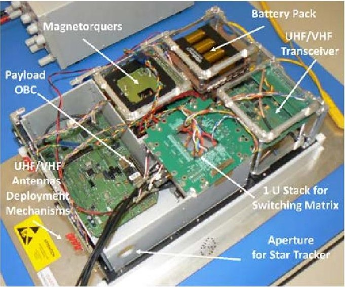

a)

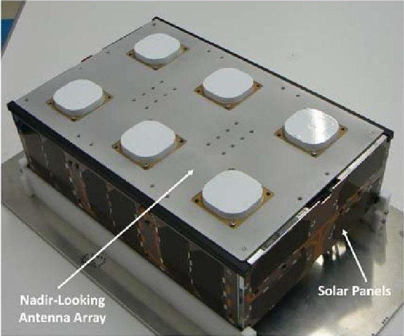

b)

Fig. 3. (a) Image of the $ ^{3} $Cat-2 Engineering Model (EM): Payload OBC, magnetorquers, battery pack, UHF/VHF transceiver, 1U stack for the switching matrix, Aluminum box with 3 mm thick walls (3U stacks), aperture for star tracker, and UHF/VHF antennas deployment mechanisms. (b) Image of the $ ^{3} $Cat-2 EM with the nadir-looking antenna array integrated at the top of the structure.

a single high gain beam pointing to the array boresight. In order to optimize the Noise Figure (NF), each element of the antenna array includes a Low Noise Amplifier (LNA), necessary to ensure optimal SNR (G = 33 dB, NF = 2.2 dB). A switching matrix routes the up/down signals at the appropriate polarization to the payload receiver. The Radio Frequency

## (RF) signals are converted to baseband before entering the PYCARO

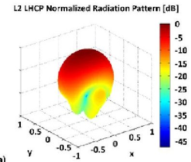

L1 LHCP Normalized Radiation Pattern [dB]

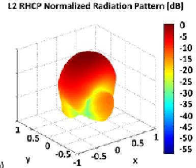

L1 RHCP Normalized Radiation Pattern [dB]

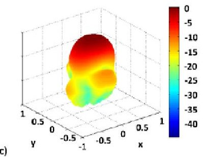

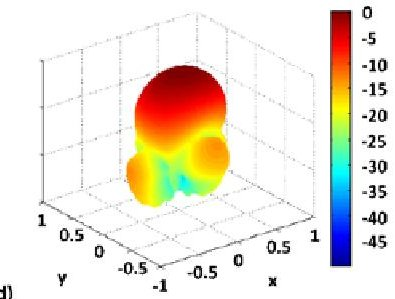

Fig. 4. Antenna array radiation patterns and gain values for both frequencies (L1, and L2) and for both polarizations (LHCP and RHCP).

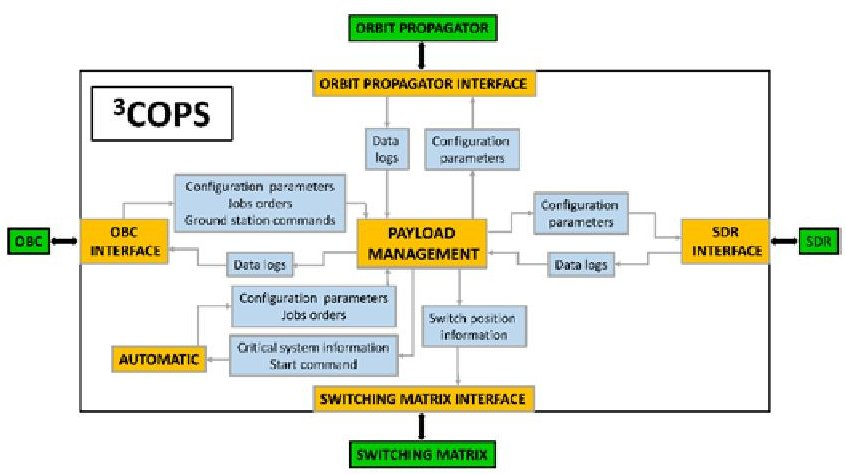

Fig. 5. Sketch of the main modules of the $ ^{3} $COPS orchestrator. It identifies the internal modules (Payload Managment Module (PMM), Automatic Module (AM) and Log Module (LOG)) and the internal/external interfaces. The black arrows represent the connections with the payload subsystems, related with hardware interfaces. The grey arrows are related with the internal software interfaces. Image credits Deimos Engenharia.

<!-- PDF_PAGE: 6 -->

back-end in which the different observables for the various applications are obtained. Table III. Different satellite configurations considered during the feasibility study.

<table border="1"><tr><td>N°U</td><td>1</td><td>1</td><td>1</td><td>1</td><td>1</td><td>1</td></tr><tr><td>Configuration</td><td>a</td><td>a</td><td>a</td><td>a</td><td>a</td><td>a</td></tr><tr><td>Mass(g)</td><td>1345</td><td>1545</td><td>1345</td><td>1522</td><td>1522</td><td>1522</td></tr><tr><td>Generated Power(W)</td><td>1.6</td><td>2.6</td><td>0.9</td><td>1.4</td><td>0.3</td><td>1.3</td></tr><tr><td>Attitude Determination and Control System</td><td>Passive magnetic</td><td>Passive magnetic</td><td>Passive magnetic</td><td>ECI velocity alignment with nadir constraint</td><td>ECI velocity alignment with nadir constraint</td><td>Spin about nadir</td></tr><tr><td>N° solar cells</td><td>8</td><td>16</td><td>8</td><td>8</td><td>8</td><td>8</td></tr><tr><td>N°U</td><td>1</td><td>2</td><td>2</td><td>2</td><td>2</td><td>2</td></tr><tr><td>Configuration</td><td>a</td><td>b</td><td>b</td><td>b</td><td>c</td><td>d</td></tr><tr><td>Mass(g)</td><td>1522</td><td>1593</td><td>1770</td><td>1770</td><td>1693</td><td>1693</td></tr><tr><td>Generated Power(W)</td><td>0.3</td><td>2.6</td><td>2.6</td><td>2.5</td><td>3.4</td><td>3.3</td></tr><tr><td>Attitude Determination and Control System</td><td>Spin about nadir</td><td>Passive magnetic</td><td>ECI velocity alignment with nadir constraint</td><td>Spin about nadir</td><td>Passive magnetic</td><td>Passive magnetic</td></tr><tr><td>N° solar cells</td><td>8</td><td>14</td><td>14</td><td>14</td><td>18</td><td>18</td></tr><tr><td>N°U</td><td>2</td><td>6</td><td>6</td><td>6</td><td>6</td><td>6</td></tr><tr><td>Configuration</td><td>e</td><td>f</td><td>f</td><td>f</td><td>f</td><td>f</td></tr><tr><td>Mass(g)</td><td>2274</td><td>4100</td><td>4100</td><td>4100</td><td>4100</td><td>4100</td></tr><tr><td>Generated Power(W)</td><td>5.3</td><td>6.6</td><td>6.2</td><td>6.6</td><td>6.6</td><td>4.3</td></tr><tr><td>Attitude Determination and Control System</td><td>Passive magnetic</td><td>ECI velocity alignment with nadir constraint</td><td>ECI velocity alignment with Sun constraint</td><td>ECF velocity alignment with radial constraint</td><td>ECF velocity alignment with nadir constraint</td><td>Spin about nadir</td></tr><tr><td>N° solar cells</td><td>30</td><td>32</td><td>32</td><td>32</td><td>32</td><td>32</td></tr></table>

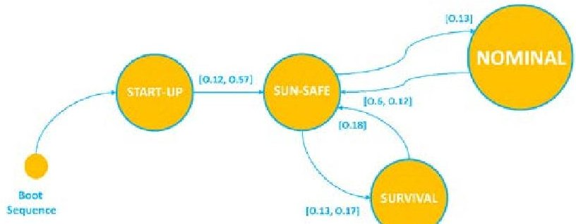

Fig. 6. Satellite state diagram. The satellite operational modes are: Start-Up (SU), Sun-Safe (SS), Nominal and Survival. [O.6] The exits of the Nominal mode shall be: a) Exit to SS mode upon SS mode triggers (autonomously), b) exit to SS mode through Ground Station (GS) commands, c) exit to Survival mode upon Survival mode triggers (autonomously), d) exit to Survival mode through GS commands. [O.12] The triggers of the SS mode shall be: a) EPS fault: Battery voltage < 90%, b) ADCS fault: Any failure that endangers power so that battery voltage < 90%., c) CDHS

fault. [0.13] The SS mode exist shall be only possible by GS commands to: a) Nominal mode, b) Survival mode, c) SU mode. [0.17] The triggers of the Survival mode shall be: a) EPS critical fault: Battery voltage < 80%, b) ADCS critical fault: Any failure that endangers power so that battery voltage < 80%, c) CDHS critical fault. [0.18] The Survival mode exist shall only possible to SS mode by GS commands. [0.57] The exits of the SU mode shall be: a) exit to Nominal mode upon SU mode triggers (autonomously), b) exit to Nominal mode through ground station commands, c) exit to SS mode upon SU mode triggers (autonomously), d) exit to SS mode through GS commands, e) exit to Survival mode upon SU mode triggers (autonomously), f) exit to Survival mode through GS commands.

The $ ^{3} $Cat-2 payload consists of the following subsystems:

1. A dual-band (L1, L2), dual-polarization (RHCP, LHCP) zenith-looking antenna patch to collect the direct GNSS signals (Fig. 2b), and a nadir-looking 3 x 2 patch antenna array

<!-- PDF_PAGE: 7 -->

(Fig. 3b) to collect the Earth-reflected signals. Figure 4 shows the measured antenna patterns at the UPC anechoic chamber [27]. The total gain of the array was 12.9 dB at L1-LHCP, 13.3 dB at L1-RHCP, 11.6 at L2-LHCP and 11.6 dB at L2-RHCP (Fig. 4).

2. A dual-channel Software Defined Radio (SDR) that samples data collected from the up and down-looking antennas, both in-phase and quadrature, with 8 bits precision, at a rate of 5 Msamples/s $ ^{1} $

3. A Gumstix Overo IronStorm On Board Computer (OBC) manages the payload, configures the SDR and computes the DDMs. This OBC has flight heritage [28], low power consumption, and volume. It runs a Linux operating system, the CPU is an ARM Cortex 8 A8 up to 1 GHz, and the RAM is 512 MB. The OBC runs the so-called $ ^{3} $COPS （ $ ^{3} $Cat-2 Orchestration Payload System) orchestration payload system to perform the complete scheduling of the data handing activities, and to command the payload subsystems (Fig. 5).

4. A self-designed Electrical Power System (EPS) for the payload operations using Commercial Off The Shelf (COTS) components to allow turning on and off the different payload modules for improved power management.

The complete payload is embedded into an Aluminum box with three mm thick walls (Fig. 2) to keep the effect of the total ionization dose below 10 krad for an extended mission lifetime of 3 years.

## D. In-Orbit Operations

The planned in-orbit operations will follow the following sequence (Fig. 6):

1. Boot sequence.

2. Start-Up mode: In this mode the Command and Data Handling System (CDHS) is in its nominal mode, the EPS only provides electrical power to the main OBC, and to the deployment system of the communications antenna. The beacon is activated allowing to track the satellite from ground.

3. Sun-Safe mode: This is the first level of bus contingency operations. The different subsystems are turned-on and checked sequentially from the ground station, the ADCS performs the detumbling, and once rotations have stopped, the Sun-tracking is activated to increase the energy storage in the batteries.

4. Nominal mode: The satellite will turn into this mode if the battery voltage is higher than 90 % of the nominal value, and the platform angular rate is lower than 0.5 $ ^{\circ} / \mathrm{s} $ . The Nominal mode possesses contingency operations for extended loss of communications. In particular, the system is capable to automatically generate scientific data, and store them onboard. On the other side, the ground segment is capable of inhibiting any on-board automatic function, and to take full control of the schedule by telecommands, i.e. selection of the satellite operational mode, selection of the payload mode,

upload new ADCS configurations, upload configuration files to the payload OBC, to reset the payload, and to downlink the housekeeping, and the scientific data.

5. Survival mode: The satellite will switch into this mode if the battery voltage is lower than 80 % of the nominal value and/or if a critical ADCS or on-flight software error is detected. In this mode only sequences of highest priority are executed, and it is only possible to exit this mode by telecommands.

In nominal mode the satellite will perform on-board data pre-processing, and the downlink of compressed datasets to the ground segment. The compression will be performed using an innovative software called FAPEC [29], which achieves lossess compression ratios of ~1.5 and lossy compression ratios up to 40 [30]. The PYCARO payload [23] will be operated in closed- and open-loop modes, and for cGNSS-R, iGNSS-R and rGNSS-R modes. Dual-band (L1, L2) measurements will be acquired for the ionospheric delay correction [13] in altimetry. Direct and reflected signals will be acquired at dual-polarization (LHCP and RHCP) by switching the up- and down-looking antennas for biomass studies. The payload will also be operated using different (optimized during the commissioning phase) configurations (e.g. coherent and incoherent integration times, optimum tracking loop parameters), for each surface target (ocean, land and cryosphere). The criteria for using different payload configuration files are determined by the mission objectives, in particular, the evaluation of: maximum coherence time over ocean surface, the potential saturation of the reflected signals at L-band over Amazon rain forests (biomass density up to ~ 500 t/ha), coherent-to-incoherent ratio of the scattered field, and dual-band measurements over sea ice to demonstrate ice altimetry. Telecommands will be sent from the ground segment to schedule data collections (latitude and longitude of relevant areas of study).

## IV. PLATFORM SUBSYSTEMS

## A. Mechanical Structure

The structure is composed of six 1U PCB stacks and structural brackets sandwiched between two side frames. The structural brackets provide mechanical strength to the platform as well as mechanical interfaces. The 6U shape （340.5 x 226.3 x 100 mm $ ^{3} $ ）is optimum for the dual-band (L1 and L2) 6-patch antenna array. A single-patch antenna is placed in the opposite side for collection of the direct GPS signals (Fig. 2b). The satellite is configured without moving mechanisms or propulsion subsystem. The only deployable structures are the monopoles used for communications: (2 at UHF, 2 at VHF: nominal and redundant, 1 at S-band). Two pairs of orthogonal monopoles (Figs. 7 and 8) with wide antenna beams ensure communications with the ground station even in case of ADCS failure. The avionics is placed in the 3U volume at the bottom of the structure (Fig. 3a). The upper 3U volume is dedicated to the PYCARO payload. Primary shear and axial loads are carried by the nano-satellite primary structure,

<!-- PDF_PAGE: 8 -->

providing full compliance with the dynamic launch vehicle envelope. The thermal control design provides thermal stability and minimizes thermal gradients through surface treatments, but also patch heaters are used to maintain the batteries in their operational

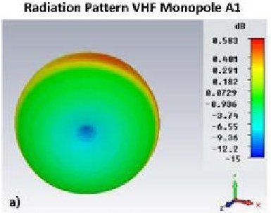

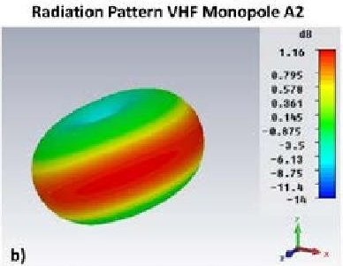

Radiation Pattern UHF Monopole A1

Radiation Pattern UHF Monopole A2

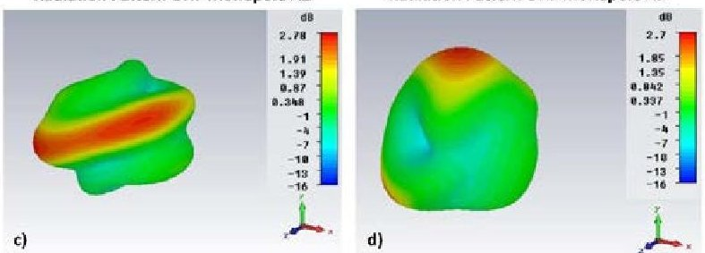

Fig. 7. Antennas radiation pattern of the two pairs (UHF-uplink, VHF-downlink) of orthogonal monopoles: (a) VHF A1, (b) VHF A2, (c) UHF A1, and (d) UHF A2. This configuration mitigates the risk of communications failure with the ground segment in case of ADCS malfunction, due to the wide antenna beams. In Nominal mode z axis points to Nadir so that the maximum antenna gain of the AntS1 A2 and AntS2 A2 monopoles will point to Nadir while that of AntS1 A1 and AntS2 A1 to the Earth limb. Image credits Isis Space.

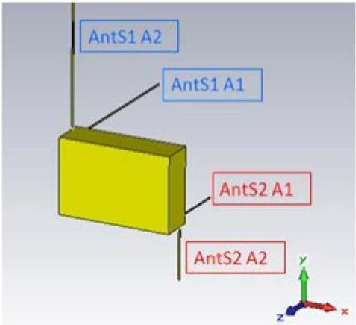

Fig. 8. Configuration of the VHF (Ant S1 A1 and Ant S1 A2) and UHF (Ant S2 A1 and AntS2 A2) monopoles in the CubeSat. The deployment of the VHF/UHF monopoles will be performed automatically in the Start-Up mode. Image Credits: Isis Space.

temperature range.

## B. Telemetry, Tracking and Command

The scientific data downlink is performed at S-band (2100 MHz), using a Binary Phase Shift Keying (BPSK) modulation,

with a data rate up to 115 kbps. Housekeeping data is downlinked at VHF (145.995 MHz) with a BPSK modulation at a data rate up to 9.6 kbps, while the uplink of telecommands is performed at UHF (437.940 MHz) with a Multiple Frequency Shift Keying (MFSK) modulation, at a data rate up to 1.2 kbps. The UHF receiver is always on, and always decoding AX.25 frames. The ground segment is located at UPC premises (Barcelona, Spain) and at present a contract preparation with GFZ German Research Centre for Geosciences is taken place to allow the use of the ground station at Ny Alesund (Svalbard, Norway) premises. The ground station at UPC includes one S-band dish, and two dualpolarization UHF/VHF yagi antennas. The Telemetry Unit collects and formats at high level the housekeeping and scientific data. These data are stored for later downlink respectively at VHF and S-bands. The storage software controls the data acquisition, recording, and playback of housekeeping and scientific data using respectively 2 GB, and 8 GB on-board memories for data storage. Data storage allows for more than 5 days of continuous scientific operations without downlink, providing significant margin for contingency operations. The Flight Model (FM) includes a second redundant UHF/VHF transceiver as a back-up system in case of failure of the nominal one. Additionally a beacon mode will be used to find and track the satellite (e.g. when the satellite has been ejected from the launch vehicle or when the satellite is in Sun-Safe mode). It will be active during all the satellite operations without requiring intervention of any other subsystems.

## C. Attitude Determination and Control System

The total ADCS error (guidance, navigation and control) shall be lower than $ 7. 5^{\circ} $ (3- $ \sigma $ ). The ADCS uses a 3-axes magnetorquer system providing $ 0. 2 \mathrm{A m}^{2} $ of nominal magnetic dipole per actuator [31]. The combination of two torque rods (0.2 W of actuation power) with a flat air core torquer (0.57 W) reduces the required volume and provides equal magnetic moments in all the three dimensions. The necessary condition for power optimality of a control law is that the magnetic moment lies on a 2-dimensional manifold perpendicular to the geomagnetic field vector. The attitude determination strategy includes (one) 3-axes gyroscope, (two) 3-axes magnetometer, and (six) photodiodes located each side of the platform.

The ADCS has three primary states of operation: detumbling, Sun-tracking, and nadir-pointing (nominal mode).

The detumbling is performed after separation from the CubeSat deployer, and for anomaly recovery if the rotation rate exceeds 0.5 %s. The detumbling state uses a B-dot algorithm to drive magnetic dipole moments opposed to the rate of change of the magnetic vector (both measured in body coordinates). It only uses the sensed magnetic field to determine a rough attitude. The satellite changes to nadir acquisition once the body rates are damped if the battery state is high enough (> 90 %).

During scientific observations, the satellite motion can be regarded as in the vicinity of the reference. Thus an application of a linear model of the satellite equations of

<!-- PDF_PAGE: 9 -->

motion is selected [32]. Multiple sensors of different types can be used to update the estimated state vector [33]. When a low accuracy measurement is used to update the state vector, it will be weighted lower than the predicted model. On the other side, when a high accuracy measurement is used to update the state vector, it will be weighted much more heavily than the predicted model. The result is an estimation that when properly implemented can provide more an accurate state estimation than the direct measurements alone. In order to cope with different sensors producing data at different rates for the Extended Kalman Filter (EKF) [34] superposition of the updates is used [35] because it linearizes the propagation and updates equations about the current state estimate [33]. This technique consists of updating the gain, error covariance, and state error vector with each successively available measurement. The EKF will propagate the estimated state and covariance matrix until the next measurement or set of measurements are available. This also significantly reduces the OBC requirements because a 3x3 matrix inverse is required n times, instead of a 3nx3n matrix inverse to compute a gain matrix [34]. The EKF used is based in the work done by Tuthill [33]. This EKF creates an accurate attitude estimation using the sensors selected for the $ ^{3} $Cat-2, but also the performance will be appropriate for implementation in the OBC.

Computation of the infinite and finite horizon attitude controllers are not optimum to be implemented in a real-time OBC. A simple constant gain attitude controller is selected. The designed algorithm replaces the time varying parameters of the satellite by its averaged values evaluated over a period of one orbit. A Linear Quadratic Regulator (LQR) is used for the constant gain controller design. The system is linear, time invariant and controllable thus a control law can be based on the solution of the steady state Riccati equation [32].

## D. Command Data Handling System

The platform CDHS computer is based on an 40 MHz clock speed ARM7 embedded processor with a memory of 2 MB static RAM, 4 MB flash memory (data storage), 4 MB flash memory (code storage), and a 2 GB microSD card. The system operates the FreeRTOS real-time operating system. Modularity and reusability are valuable software architectural goals achieved using a star architecture. All payload processing is provided by a Gumstix Iron Storm (see Section III. C) running Linux because of the wide support and documentation available, and the existing software packets that are tested and that can be reused.

## E. Electrical Power System

The EPS [36] can perform the Li-Ion battery (29 Wh) charging without interrupting scientific data acquisition. The outer satellite surface is covered by GaAs solar panels except in the nadir-looking side where the antenna array is located (Fig. 3b). The top panel also provides space to locate a single patch GPS antenna $ ( 5 2 \times5 4 \mathrm{~ mm}^{2} ) $ . The triple junction GaAscell efficiency is 28%, and the average efficiency of the input converter is 93%. There are three individual photovoltaic input

channels each having its own Maximum Power Point Tracking (MPPT). This enables the voltage to be set independently on all panels thus capturing the exact maximum power point at all illuminated cells. Finally it is worth pointing out that there are three regulated power buses of 3.3 V, 5V, and 6V for the payload and other satellite subsystems.

## V. MISSION ANALYSIS

## A. Orbit Evolution Analysis

The launch campaign of the $ ^{3} $Cat-2 is scheduled for the second quarter of 2016. $ ^{3} $Cat-2 nominal orbit is Sun-Synchronous (SSO) with a Local Time of Ascending Node (LTAN) of 00:00 h (baseline), and an orbit height of $ H_{\mathrm{ref}}= $ 510 km. The orbit evolution analysis is performed for an orbit height range of $ H_{\mathrm{ref}}=[510,613]$ km and takes into account the atmospheric drag (Jachhia- Bowman model [37]), the solar activity [38], the Earth's gravity up to J4 zonal harmonic (NASA-MSFC-MSAFE geomagnetic activity [39]; EIGENGL04C Earth's gravity model [40]), and perturbations by third bodies (Sun and Moon).

The $ ^{3} $Cat-2 effective drag area for GNSS-R operations is $ A_{\mathrm{eff}}=0.0226 \mathrm{~mm}^{2} $ (equal to the smallest CubeSat surface), while for GNSS-RO (secondary mission objective) is $ A_{\mathrm{eff}}= 0.0771 \mathrm{~mm}^{2} $ (equal to a cross-section of 226.3 mm x 340.5 mm). To complete the CubeSat configuration, the mass is considered in the analysis. It is in the range m = [7,12] kg. The analysis is performed as a function of the ballistic coefficient $ B_{\mathrm{c}} $ as:

$$
B _ {c} = \frac {m}{A _ {\mathrm {e f f}} C _ {D}},
$$

where $ C_{D} $ is the drag coefficient. Two effective drag areas have been used, the first equal to the smallest surface and the second equal to the smallest surface increases by its 20% to account for transition from GNSS-R (nominal mode) to GNSS-RO (secondary mode) operations. Results show that even in the most critical case $ B_{c}=117.17 \mathrm{~kg} / \mathrm{m}^{2} $ and an altitude $ H_{\mathrm{ref}}=510 \mathrm{~km} $ the altitude decay is $ \sim10 \mathrm{~km} $ (Figs. 9a,b) and the LTAN increment (Figs. 9c,d) is just $ \sim4 $ min in a 1 year time period. Therefore, the orbit is stable and there is no need to use a propulsion subsystem.

GNSS-R coverage mission requirements have been evaluated using the baseline nominal orbit. Figure 10 shows the across-track angle required to achieve the goal of global coverage within a revisit time from 6 to 10 days as a function of the orbit altitude in the range $ H_{\mathrm{ref}} $ = [500 km, 750 km]. SSOs with a Repeat Cycle $ ^{2} $ (RC) of 20 days or less have been considered. There is a range $ H_{\mathrm{ref}} $ = [536, 584] km with very

<!-- PDF_PAGE: 10 -->

short RC orbits and large revisit time. In this altitude range there are no orbits that enable the fulfillment of the coverage requirement

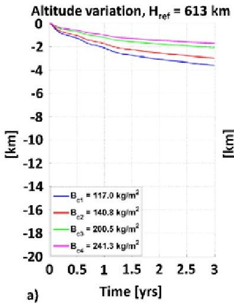

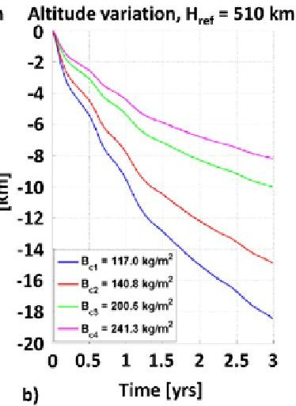

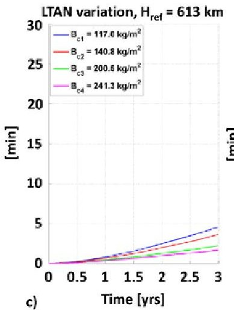

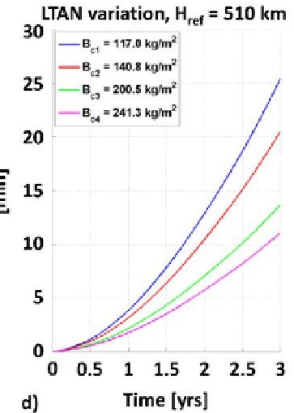

Fig. 9. Orbit evolution analysis as a function of the ballistic coefficient and the lifetime: Variation of the orbit mean altitude for (a) $ H_{\mathrm{ref}}=6 1 3 $ km, and (b) $ H_{\mathrm{ref}}=5 1 0 $ km. Mean LTAN variations for (c) $ H_{\mathrm{ref}}=6 1 3 $ km, and (d) $ H_{\mathrm{ref}}=5 1 0 $ km. Image credits Deimos Space.

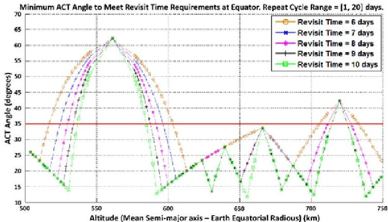

Fig. 10. Maximum across-track angle required for global coverage from 6 to 10 days of revisit time as a function of the reference orbit altitude. Image credits Deimos Space.

with an across-track angle of $ 3 5^{\circ} $ imposed by the nadirlooking antenna array beamwidth. If the injection orbital altitude is $ H_{\mathrm{ref}}=5 1 0 \mathrm{k m} $ , the operational orbit does not cross the exclusion range for revisit time $ \leq 1 0 $ days. These results

show that the main mission objective (GNSS-R) is satisfied with at least 12 days of revisit time with a down-looking antenna array

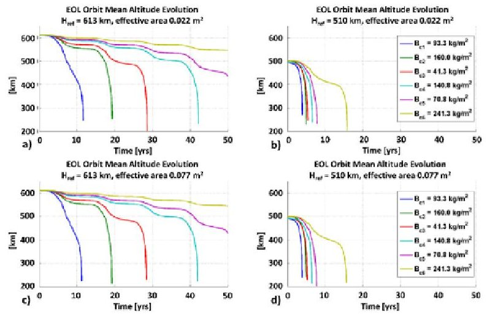

Fig.11. EOL orbit mean altitude decay for (a) $ H_{\mathrm{ref}}=6 1 3 $ km and $ A_{\mathrm{eff}}=0. 0 2 2 \mathrm{m}^{2} $ , (b) $ H_{\mathrm{ref}}=5 1 0 $ km and $ A_{\mathrm{eff}}=0. 0 2 2 $ $ m^{2} $ , (c) $ H_{\mathrm{ref}}=6 1 3 $ km and $ A_{\mathrm{eff}}=0. 0 7 7 \mathrm{m}^{2} $ , and (d) $ H_{\mathrm{ref}}=5 1 0 $ km and $ A_{\mathrm{eff}}=0. 0 7 7 \mathrm{m}^{2} $ . Image credits Deimos Space.

beamwidth of $ 7 0^{\circ} $ . Furthermore, if the orbit altitude is maintained in the nominal range during the mission lifetime, even a revisit time of 10 days can be achieved.

The satellite does not use a propulsion subsystem, therefore it is required to check whether it performs a natural uncontrolled re-entry within 25 years timeframe. Solar and geomagnetic activity models are chosen so that they represent a conservative scenario. The $ ^{3} $Cat-2 configuration for the EndOf-Life (EOL) disposal is assumed to be defined by a tumbling satellite. EOL simulations have been performed with three cross-sections corresponding to the satellite surfaces (0.0226, 0.0341 and 0.0771 $ m^{2} $ ). Figure 11 shows the orbit mean altitude profiles over the EOL simulation time for the considered ballistic coefficient (Eqn.1) and orbit altitudes. The lower references altitude （ $ H_{\mathrm{ref}}=510 $ km) allows compliance with the space debris mitigation standards for any value of the satellite ballistic coefficient. In fact, the re-entry time is well below the 25 years specified by the standards [41].

## B. Mission Budgets

The selected $ ^{3} $Cat-2 configuration satisfies the mass (Table IV), power (Table V and VI), link (Table VII, VIII and IX) and data (Table X) budgets. In this Section the mission budgets are described.

The EPS provides, stores, distributes, and controls the spacecraft electrical power. The most important sizing requirements are the demands for average and peak electrical power and the orbital parameters. It is required to identify the electrical power loads for the mission operations at the Beginning-Of-Life (BOL), and End-Of-Life (EOL). The

<!-- PDF_PAGE: 11 -->

power that the solar arrays shall provide during a complete orbit is calculated as:

Table IV. Mass budget

<table border="1"><tr><td>Subsystem</td><td>Mass(g)</td><td>Margin(%)</td><td>TotalMass(g)</td></tr><tr><td>ADCS</td><td>194</td><td>5</td><td>204</td></tr><tr><td>CDHS</td><td>530</td><td>5</td><td>586</td></tr><tr><td>Mechanical</td><td>1160</td><td>10</td><td>1276</td></tr><tr><td>Payload</td><td>1200</td><td>10</td><td>1320</td></tr><tr><td>Antennas</td><td>1000</td><td>10</td><td>1100</td></tr><tr><td>Power</td><td>1265</td><td>5</td><td>1328</td></tr><tr><td>TT&amp;C</td><td>349</td><td>5</td><td>366</td></tr><tr><td>Thermal</td><td>25</td><td>5</td><td>26</td></tr><tr><td>Subtotal</td><td>5723</td><td>483</td><td>6206</td></tr><tr><td>SystemMargin</td><td>x</td><td>10</td><td>620</td></tr><tr><td>Total</td><td>x</td><td>x</td><td>6826</td></tr></table>

Table V. Power budget without ground station access.

<table border="1"><tr><td>Subsystem</td><td>Peak time(%)</td><td>Average(mW)</td></tr><tr><td>ADCS</td><td>25</td><td>200</td></tr><tr><td>CDHS</td><td>59</td><td>368</td></tr><tr><td>Mechanical</td><td>0</td><td>0</td></tr><tr><td>Payload</td><td>15</td><td>1200</td></tr><tr><td>Antennas</td><td>15</td><td>150</td></tr><tr><td>Power</td><td>100</td><td>250</td></tr><tr><td>TT&amp;C</td><td>0</td><td>0</td></tr><tr><td>Thermal</td><td>0</td><td>0</td></tr><tr><td>Average Power Consumed</td><td>x</td><td>2168</td></tr><tr><td>Efficiency Losses</td><td>x</td><td>910</td></tr><tr><td>Degradation(1 year of life)</td><td>x</td><td>1127</td></tr><tr><td>Total Average Power Consumed</td><td>x</td><td>4205</td></tr><tr><td>Average Power Generated</td><td>x</td><td>5790</td></tr><tr><td>Margin</td><td>x</td><td>1585</td></tr></table>

$$
P _ {\mathrm {s a}} = \frac {\left(\frac {P _ {\mathrm {e}} T _ {\mathrm {e}}}{X _ {\mathrm {e}}} + \frac {P _ {\mathrm {d}} T _ {\mathrm {d}}}{X _ {\mathrm {d}}}\right)}{T _ {\mathrm {d}}},
$$

where the subscripts e and d denote eclipse and daylight. $ P_{e} $ and $ P_{d} $ are power requirements, $ T_{e} $ and $ T_{d} $ are the lengths

of eclipse and daylight periods per orbit, $ X_{\mathrm{e}} $ is the efficiency of the path from the solar arrays through the batteries to the loads, and $ X_{\mathrm{d}} $ is the efficiency of the path directly from the

Table VI. Power budget with 1 ground station access.

<table border="1"><tr><td>Subsystem</td><td>Peak time(%)</td><td>Average(mW)</td></tr><tr><td>ADCS</td><td>25</td><td>200</td></tr><tr><td>CDHS</td><td>100</td><td>368</td></tr><tr><td>Mechanical</td><td>0</td><td>0</td></tr><tr><td>Payload</td><td>15</td><td>1200</td></tr><tr><td>Antennas</td><td>15</td><td>150</td></tr><tr><td>Power</td><td>100</td><td>250</td></tr><tr><td>TT&amp;C</td><td>6</td><td>312</td></tr><tr><td>Thermal</td><td>0</td><td>0</td></tr><tr><td>Average Power Consumed</td><td>x</td><td>2480</td></tr><tr><td>Efficiency Losses</td><td>x</td><td>1041</td></tr><tr><td>Degradation(1 year of life)</td><td>x</td><td>1289</td></tr><tr><td>Total Average Power Consumed</td><td>x</td><td>4810</td></tr><tr><td>Average Power Generated</td><td>x</td><td>5910</td></tr><tr><td>Margin</td><td>x</td><td>1100</td></tr></table>

arrays to the loads. The efficiency values for the daylight and the eclipse depend on the power regulation: direct energy transfer $ \left( X_{\mathrm{e}}=0.65 \right. $ and $ \left. X_{\mathrm{d}}=0.85 \right) $ or MPPT $ \left( X_{\mathrm{e}}=0.6 \right. $ and $ \left. X_{\mathrm{d}}=0.8 \right). $

Additionally to the efficiency of paths from the solar arrays to the batteries, the inherent degradation due to design, temperature of the array and shadowing of cells, have to be considered. For many missions, the EOL power demands must be reduced to compensate for solar array performance degradation. The $ ^{3} $Cat-2 has been designed for a nominal operational life of 1 year. A 2% [42] of degradation per year ( $ \xi $ ) due to thermal cycling, in/out eclipses, micrometeoroid strikes and radiation has been considered during the design process. Then, the EOL power generated on-board is derived as:

$$
P _ {\mathrm {E O L}} = P _ {\mathrm {B O L}} \left(1 - \xi\right) ^ {n},
$$

where $ P_{\mathrm{BOL}} $ is the BOL array's power per unit area, and n is the number of years in orbit. The mean effective area $ A_{\mathrm{sa,eff}} $ required for the mission is calculated as:

$$
A _ {\mathrm {s a , e f f}} = \frac {P _ {\mathrm {s a}}}{P _ {\mathrm {E O L}}} = 0. 0 2 5 8 \mathrm {m} ^ {2}.
$$

This value is lower than the mean effective area of the CubeSat $ ( 0.0312 \mathrm{~ m}^{2} ) $ as derived using Systems Tool Kit

<!-- PDF_PAGE: 12 -->

(STK). Additionally, the EOL power margins using triple payload duty junction GaAs solar cells of 28% of efficiency and for a Table VII. Link budget: Downlink telemetry.

<table border="1"><tr><td>DOWNLINK TELEMETRY</td><td>Symbol</td><td>Units</td><td>Source</td><td>Value</td></tr><tr><td>Frequency</td><td>f</td><td>MHz</td><td>Defined</td><td>146</td></tr><tr><td>Transmitter Power</td><td>Pt</td><td>dBW</td><td>Data</td><td>-8</td></tr><tr><td>Transmitter Line Loss</td><td>Lt</td><td>dB</td><td>Estimated</td><td>-1</td></tr><tr><td>Peak Transmit Antenna Gain</td><td>Gt</td><td>dB</td><td>Data</td><td>0.5</td></tr><tr><td>Effect Isotropic Radiated Power</td><td>EIRP</td><td>dB</td><td>Pt+Gt+Lt</td><td>-8.5</td></tr><tr><td>Transmitter Antenna Half Power Beamwidth</td><td>θt</td><td>deg</td><td>Calculated</td><td>80</td></tr><tr><td>Transmitter Antenna Pointing Error</td><td>e t</td><td>deg</td><td>Estimated</td><td>30</td></tr><tr><td>Transmitter Antenna Pointing Loss</td><td>Lpt</td><td>dB</td><td>-12(e t/θt)</td><td>-4.5</td></tr><tr><td>Free Space Path Loss</td><td>Ls</td><td>dB</td><td>Calculated</td><td>-143.5</td></tr><tr><td>Polarization Loss</td><td>La</td><td>dB</td><td>Estimated</td><td>-3</td></tr><tr><td>Receiver Antenna Peak Gain</td><td>Gr</td><td>dB</td><td>Data</td><td>12.3</td></tr><tr><td>System Noise Temperature</td><td>Ts</td><td>K</td><td>Estimated</td><td>1295</td></tr><tr><td>Data Rate</td><td>DR</td><td>bps</td><td>Defined</td><td>5000</td></tr><tr><td>Bit Energy/Noise Ratio</td><td>Eb/N0</td><td>dB</td><td>Calculated</td><td>14.4</td></tr><tr><td>Bit Error Rate</td><td>BER</td><td>-</td><td>Defined</td><td>0.01</td></tr><tr><td>Required Bit Energy/Noise Ratio</td><td>Eb/N0</td><td>dBHz</td><td>BPSK</td><td>4</td></tr><tr><td>Implementation Loss</td><td>-</td><td>dB</td><td>Estimated</td><td>-2</td></tr><tr><td>Margin</td><td>-</td><td>dB</td><td>Calculated</td><td>8.4</td></tr></table>

cycle of the 15% of the orbit period are 1585 mW and 1100 mW respectively for an orbit without ground station access and for an orbit with one ground station access (Table V and Table VI). Therefore the CubeSat configuration satisfied the power requirements of the mission.

The link equation used to size the data link of a communications system is:

$$
\frac {E _ {\mathrm {b}}}{N _ {0}} = \frac {P _ {\mathrm {t}} L _ {\mathrm {I}} G _ {\mathrm {t}} L _ {\mathrm {s}} L _ {\mathrm {a}} G _ {\mathrm {r}}}{k T _ {\mathrm {s}} D R},
$$

where $ E_{\mathrm{b}} / N_{0} $ is the ratio of the received energy per bit to noise density, $ P_{\mathrm{t}} $ is the transmitter power, $ L_{1} $ is the transmitter-to-antenna line loss, $ G_{\mathrm{t}} $ is the transmit antenna gain, $ L_{\mathrm{s}} $ is the space loss, $ L_{\mathrm{a}} $ is the transmission path loss, $ G_{\mathrm{r}} $ is the receiver antenna gain, k is the Boltzmann constant, $ T_{\mathrm{s}} $ is the system noise temperature, and DR is the data rate.

The simulated radiation patterns of the VHF monopoles (Ant S1 A1 and Ant S1 A2) and UHF monopoles (Ant S2 A1 and AntS2 A2) are shown in Fig. 7. The peak transmit antenna gain is: 0.58 dB (Ant S1 A1), 1.16 dB (Ant S1 A2), 2.78 dB (Ant S2 A1) and 2.7 dB (AntS2 A2). For the simulations it is assumed a maximum antenna pointing error of $ 3 0^{\circ} $ . The free space path loss is calculated as:

$$
\mathrm {L} _ {\mathrm {s}} = 1 4 7. 5 5 - 2 0 \log (\mathrm {S}) - 2 0 \log (\mathrm {f}),
$$

where S is the distance from the ground station and the satellite and f is the transmitted frequency. It is considered the satellite with an elevation angle of $ 1 5^{\circ} $ . The system noise temperature, the required bit energy to noise ratio, the transmitter line loss and the implementation loss are estimated as per [42]. The margins for housekeeping, scientific data and telecommands are 8.4 dB (Table VII), 4.9 dB (Table VIII) and 32 dB (Table IX) respectively considering a high ADCS error of $ 3 0^{\circ} $ . In nominal conditions, the margins should be higher up to 4.5 dB more.

The $ ^{3} $Cat-2 operations will be controlled using an ad-hoc designed ground station located at UPC premises. It is located

<!-- PDF_PAGE: 13 -->

Table VIII. Link budget: Downlink scientific data.

<table border="1"><tr><td>DOWNLINK PAYLOAD</td><td>Symbol</td><td>Units</td><td>Source</td><td>Value</td></tr><tr><td>Frequency</td><td>f</td><td>MHz</td><td>Defined</td><td>2100</td></tr><tr><td>Transmitter Power</td><td>Pt</td><td>dBW</td><td>Data</td><td>-2</td></tr><tr><td>Transmitter Line Loss</td><td>Lt</td><td>dB</td><td>Estimated</td><td>-1</td></tr><tr><td>Peak Transmit Antenna Gain</td><td>Gt</td><td>dB</td><td>Data</td><td>5</td></tr><tr><td>Effect. Isotropic Radiated Power</td><td>EIRP</td><td>dB</td><td>Pt+Gt+Lt</td><td>3</td></tr><tr><td>Transmitter Antenna Half Power Beamwidth</td><td>θt</td><td>deg</td><td>Calculated</td><td>80</td></tr><tr><td>Transmitter Antenna Pointing Error</td><td>e t</td><td>deg</td><td>Estimated</td><td>30</td></tr><tr><td>Transmitter Antenna Pointing Loss</td><td>Lpt</td><td>dB</td><td>-12(e t/θt)</td><td>-4.5</td></tr><tr><td>Free Space Path Loss</td><td>Ls</td><td>dB</td><td>Calculated</td><td>-166.7</td></tr><tr><td>Polarization Loss</td><td>La</td><td>dB</td><td>Estimated</td><td>-3</td></tr><tr><td>Receiver Antenna Peak Gain</td><td>Gr</td><td>dB</td><td>Data</td><td>31.5</td></tr><tr><td>System Noise Temperature</td><td>Ts</td><td>K</td><td>Estimated</td><td>1800</td></tr><tr><td>Data Rate</td><td>DR</td><td>bps</td><td>Defined</td><td>50000</td></tr><tr><td>Bit Energy/Noise Ratio</td><td>Eb/N0</td><td>dB</td><td>Calculated</td><td>10.9</td></tr><tr><td>Bit Error Rate</td><td>BER</td><td>-</td><td>Defined</td><td>0.01</td></tr><tr><td>Required Bit Energy/Noise Ratio</td><td>Eb/N0</td><td>dBHz</td><td>BPSK or GMSK</td><td>4</td></tr><tr><td>Implementation Loss</td><td>-</td><td>dB</td><td>Estimate</td><td>-2</td></tr><tr><td>Margin</td><td>-</td><td>dB</td><td>Calculated</td><td>4.9</td></tr></table>

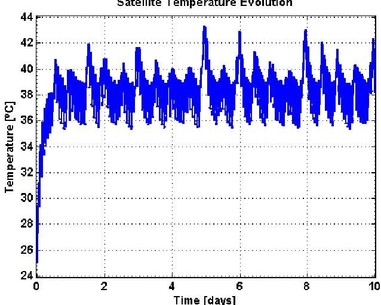

Fig. 12. Satellite temperature evolution as a function of the time. Initial temperature is set to be $ 2 5^{\circ} \mathrm{C} $

at Building D3 of UPC Campus Nord (latitude: 41° 23' 20" North; longitude: 2° 6' 43" East; altitude: 175 m), Barcelona (Spain). A mean of 20 min of communications with the CubeSat per day will be possible taking into account the 15°

of minimum elevation angle constraint imposed by the Collserola mountains at the East of the city. In case of ADCS error free conditions, it will be possible to downlink ~1.2 MB of housekeeping data and ~11.9 MB of payload data per day. On the other side the maximum uplink volume will be ~0.18 MB per day (Table X).

Finally, a thermal evaluation is performed for the $ ^{3} $Cat-2 configuration using an ad-hoc mission simulation tool [43]. The input parameters in the simulation were the emittance (0.85 for solar panels, 0.77 for Al chasis), the absorbance (0.92 for solar panels, 0.5 for Al chasis), the Sun radiation power （1400 W/m $ ^{2} $ ）and the Earth albedo (average value 0.3 [44]). Results show that the in-orbit CubeSat temperature fluctuates in the range [36, 44] $ ^{\circ} \mathrm{C} $ , being the initial temperature set to 25 $ ^{\circ} \mathrm{C} $ . This temperature range allows to operate the satellite in nominal conditions.

## VI. CONCLUSIONS

$ ^{3} $Cat-2 is a 6U CubeSat demonstration mission for Earth Observation using GNSS-R. The ADCS approach is similar to that used in TechDemoSat-1 (Sun and magnetic field sensors for attitude determination, and 3-axes magnetorquer to control the platform's attitude) aiming for a pointing accuracy of $ 7.5^{\circ} $

<!-- PDF_PAGE: 14 -->

Table IX. Link budget: Uplink telecommands.

<table border="1"><tr><td>UP TELECOMMANDS</td><td>Symbol</td><td>Units</td><td>Source</td><td>Value</td></tr><tr><td>Frequency</td><td>f</td><td>MHz</td><td>Defined</td><td>438</td></tr><tr><td>Transmitter Power</td><td>Pt</td><td>dBW</td><td>Data</td><td>20</td></tr><tr><td>Transmitter Line Loss</td><td>Lt</td><td>dB</td><td>Estimated</td><td>-1</td></tr><tr><td>Peak Transmit Antenna Gain</td><td>Gt</td><td>dB</td><td>Data</td><td>12.3</td></tr><tr><td>Effect. Isotropic Radiated Power</td><td>EIRP</td><td>dB</td><td>Pt+Gt+Lt</td><td>31.3</td></tr><tr><td>Receiver Antenna Half Power Beamwidth</td><td>θt</td><td>deg</td><td>Calculated</td><td>80</td></tr><tr><td>Receiver Antenna Pointing Error</td><td>e t</td><td>deg</td><td>Estimated</td><td>30</td></tr><tr><td>Receiver Antenna Pointing Loss</td><td>Lpt</td><td>dB</td><td>-12(e t/θt)</td><td>-4.5</td></tr><tr><td>Free Space Path Loss</td><td>Ls</td><td>dB</td><td>Calculated</td><td>-153.1</td></tr><tr><td>Polarization Loss</td><td>La</td><td>dB</td><td>Estimated</td><td>-3</td></tr><tr><td>Receiver Antenna Peak Gain</td><td>Gr</td><td>dB</td><td>Data</td><td>2.7</td></tr><tr><td>System Noise Temperature</td><td>Ts</td><td>K</td><td>Estimated</td><td>375</td></tr><tr><td>Data Rate</td><td>DR</td><td>bps</td><td>Defined</td><td>1200</td></tr><tr><td>Bit Energy/Noise Ratio</td><td>Eb/N0</td><td>dB</td><td>Calculated</td><td>50</td></tr><tr><td>Bit Error Rate</td><td>BER</td><td>-</td><td>Defined</td><td>0.00001</td></tr><tr><td>Required Bit Energy/Noise Ratio</td><td>Eb/N0</td><td>dBHz</td><td>AFSK or MFSK</td><td>13</td></tr><tr><td>Implementation Loss</td><td>-</td><td>dB</td><td>Estimated</td><td>-2</td></tr><tr><td>Margin</td><td>-</td><td>dB</td><td>Calculated</td><td>32</td></tr></table>

Table X. Data budget of the $ ^{3} $Cat-2 (ADCS error free).

<table border="1"><tr><td>Ground Station Contact Time(min/day)</td><td>20</td></tr><tr><td>VHF Downlink Rate(kbps)</td><td>9.6</td></tr><tr><td>Downlink Volume(MB/day)</td><td>1.4</td></tr><tr><td>S Band Downlink Rate(kbps)</td><td>70</td></tr><tr><td>Housekeeping Data(MB/day)</td><td>10.5</td></tr><tr><td>Expected Payload Data Volume(MB/day)</td><td>11.9</td></tr><tr><td>Uplink Rate(kbps)</td><td>1.2</td></tr><tr><td>Uplink Volume(MB/day)</td><td>0.18</td></tr></table>

(3- $ \sigma $) , needed for the antenna pattern correction in scatterometry measurements. The payload duty cycle will be up to $ \sim 15\% $ , and the expected data volume up to $ \sim 10 $ MB per day, which will be downloaded to the UPC ground station using a S-band scientific data downlink up to 115 kbps. $ ^{3} $ Cat-2 payload has been designed with a dual-band (L1, L2) and dual-polarization (LHCP, RHCP) $ 3\times2 $ patch antenna array to perform GNSS-R measurements over the ocean, land and

cryosphere using multi-constellation signals (GPS, GLONASS, Galileo and Beidou). The key point towards a more effective integration campaign has been a simple, modular and robust design and the fact that payload and platform have been validated independently from each other. The evaluation of the achievable performances (both for altimetry and scatterometry) vs. payload parameters will provide useful information for upcoming missions and experiments (e.g. GEROS-ISS). $ ^{3} $Cat-2 aims also at providing

<!-- PDF_PAGE: 15 -->

scientifically valuable data in a very cost-effective manner, which may open the door to future constellations of GNSS-R instruments.

## ACKNOWLEDGMENT

The authors would like to thanks Mrs. Pons and Khoe from the administration of the Department of Signal Theory and Communications (TSC). Additionally we acknowledge the support of GFZ for the planned satellite data reception at Ny- Ålesund/Spitsbergen.

## REFERENCES

[1] D. Selva, and D. Krejci,"A survey and assessment of the capabilities of cubesats for Earth observation", Acta Astronautica, vol.74, pp.50-68, 2012.

[2] S. Lee, A. Hutputanasin, A. Toorian, W. Lan, and R. Munakata, "Cubesat Design Specification, Rev. 12", California Polytechnic State University, 2009.

[3] R. Hevner, W. Holemans, J. Puig-Suari, and B. Twiggs, "An advanced standard for cubesats", in Proceedings of the $ 25^{\mathrm{th}} $ annual AIAA/USU Conference on Small Satellites, Logan, UT, USA, August 2011.

[4] Planet Iabs Spire Web Site. Available online: https://www.planet.com/solutions/#satellites (acceded on 10 09 2015).

[5] A. Camps, H. Park, E. Valencia, D. Pascual, F. Martín, A. Rius, S. Ribó, J. Benito, Ana Andrés-Beivide, P. Saameno, M. Martín-Neira, S. D'Addio, and P. Willemsen, "Optimization and performance analysis of interferometric GNSS-R altimeters: application to the PARIS IoD mission", IEEE Journal of Selected Topics in Applied Earth Observations and Remote Sensing, vol.7, n.5, pp. 1436-1451, 2014.

[6] S.T. Lowe, J.L. LaBrecque, C. Zuffada, L.J. Romans, L.E. Young, and G.A Hajj, "First spaceborne observation of an Earth-reflected GPS signal", Radio Science, vol.37, no.1, pp.7-1-7-28, 2002.

[7] G.A. Hajj, C.O. Ao, B.A. Iijima, D. Kuang, E.R. Kursinski, A.J. Mannucci, T.K. Meehan, L.J. Romans, M. de la Torre-Juárez, and T.P. Yunk, "CHAMP and SAC-C atmospheric occultation results and intercomparisons", Journal of Geophysical Research, vol.109, no. D06109, 2004.

[8] G. Beyerle, K. Hocke, J. Wickert, T. Schmidt, C. Marquardt, and C. Reigber, "GPS radio occultations with CHAMP: A radio holographic analysis of GPS signal propagation in the troposphere and surface reflections", Journal of Geophysical Research, vol.107, no. D24, pp.ACL 27-1-ACL 27-14, 2002.

[9] E. Cardellach, C.O. Ao, M. de la Torre-Juárez, and G.A. Hajj, "Carrier phase delay altimetry with GPS-reflection/occultation interferometry from Low Earth Orbiters", Geophysical Research Letters, vol.31, no.10, L10402, 2004.

[10] S. Gleason, S. Hodgart, Y. Sun, C. Gommenginger, S. Mackin, M. Adjrad, and M. Unwin, "Detection and processing of bistatically reflected GPS signals from low Earth orbit for the purpose of ocean remote sensing", IEEE Transactions on Geoscience and Remote Sensing, vol.43, no.6, pp.1229- 1241, 2005.

[11] M. Unwin, "TechDemoSat-1 and the GNSS Reflectometry experiment", TechDemoSat-1 User Consultation Meeting, National Oceanography Centre, Southampton, United Kingdom, May 2015. Available online: http://www.merrbys.co.uk:8080/CatalogueData/Documents/TDS- 1%20SGRReSI%20Experiment.pdf (accessed on 05 06 2015).

[12] R. Rose, W. Wells, D. Rose, C. Ruf, A. Ridley, and K. Nave, "Nanosat technology and managed risk; an update of the CYGNSS microsatellite constellation mission development", in Proceedings of the $ 28^{\mathrm{th}} $ AIAA/USU Conference on Small Satellites, SSC14-VI-4, pp.1-12, Logan, UT, USA, August 2014.

[13] M. Martín-Neira, S. D'Addio, C. Buck, N. Floury, and R. Prieto-Cerdeira, "The PARIS ocean altimeter in-orbit demonstrator", IEEE Transactions on Geoscience and Remote Sensing, vol.49, no.6, pp. 2209- 2237, 2011.

[14] J. Wickert, G. Beyerle, E. Cardellach, C. Förste, T. Gruber, A. Helm, M.P. Hess, P. Hoeg, N. Jakowski, M. Kern, O. Montenbruck, A. Rius, M. Rothacher, C.K. Shum, and C. Zuffada, "GEROS-ISS - GNSS rEflectometry, Radio Occultation and Scatterometry onboard the International Space Station", URSI Commission F Microwave Signatures 2013 Specialist Symposium on Microwave Remote Sensing of the Earth, Oceans, and Atmosphere, Espoo (Helsinki), Finland, October 2013.

[15] M. Unwin, J. Pales, P. Blunt, S. Duncan, M. Brummitt, and C. Ruf, "The SGR-ReSI and its application for GNSS Reflectometry on the NASA EV-2 CYGNSS mission", in Proceedings of the 2013 IEEE Aerospace Conference, Big Sky, MT, USA, March 2013.

[16] S. Eckert, S. Ritzmann, S. Roemer, and W. Barwald, "The TET-1 satellite bus - a high reliability bus for earth observation, scientific and technology verification missions in LEO", in Proceedings of the 2010 ESA Small Satellites, Systems & Service Symposium, Madeira, Portugal, June 2010.

[17] J. Wickert, "Space based GNSS atmosphere sounding: radio occultation", GfG $ ^{2} $ Summer School, GFZ Potsdam, July 2013. Available online http://www.gfg2.eu/sites/gfg2.eu/files/wickert_radio_occultation.pdf (accessed on 20092015).

[18] V. Zavorotny, S. Gleason, E. Cardellach and A. Camps, "Tutorial on remote sensing using GNSS bistatic radar of opportunity", IEEE Geoscience and Remote Sensing Magazine, vol.2, no.4, 2014.

[19] M. Arcioni, P. Bensi, M.W.J. Davidson, M. Drinkwater, F. Fois, C.C. Lin, R. Meynart, K. Scipal, and P. Silvestrin, "ESA's Biomass mission candidate system and payload overview", in Proceedings of the 2012 IEEE International Geoscience and Remote Sensing Symposium, pp.5530-5533, Munich, Germany, July 2012.

[20] H. Carreno-Luengo, and A. Camps, "Empirical results of a surface level GNSS-R experiment in a wave channel", MDPI Remote Sensing, vol.7, no.6, pp.7471-7493, 2015.

[21] O. Nogués-Correig, E. Cardellach, J. Sanz, and A. Rius, "A GPS reflections receiver that computes doppler/delay maps in real time", IEEE Transactions on Geoscience and Remote Sensing, vol.45, no.1, pp.156-174, 2007

[22] H. Carreno-Luengo, A. Camps, G. Forte, R. Onrubia, and R. Díez, $ ^{3} $ Cat2: A P(Y) and C/A GNSS-R experimental nano-satellite mission", in Proceedings of the 2013 IEEE International Geoscience and Remote Sensing Symposium, pp.843-846, Melbourne, Australia, July 2013.

[23] H. Carreno-Luengo, A. Camps, I. Ramos-Perez, and A. Rius, "Experimental evaluation of GNSS-Reflectometry altimetric precision using the P(Y) and C/A signals", IEEE Journal of Selected Topics in Applied Earth Observations and Remote Sensing, vol.7, n.5, pp.1493-1500, 2014.

[24] H. Carreno-Luengo, A. Camps, J. Querol, and G. Forte, "First results of a GNSS-R experiment from a stratospheric balloon over boreal forests", IEEE Transactions of Geoscience and Remote Sensing, 2015. DOI: 10.1109/TGRS.2015.2504242

[25] H. Carreno-Luengo, and A, Camps, "First dual-band multi-constellation GNSS-R scatterometry experiment over boreal forests from a stratospheric balloon", IEEE Journal of Selected Topics in Applied Earth Observations and Remote Sensing, 2015. DOI: 10.1109/JSTARS.2015.2496661

[26] H. Carreno-Luengo, A. Amèzaga, D. Vidal, R. Olivé, J.F. Munoz, and A. Camps, "First polarimetric GNSS-R measurements from a stratospheric flight over boreal forests", MDPI Remote Sensing, vol.7, no.10, pp.13120-1313, 2015.

[27] Antenna Lab Web Site, Universitat Politècnica de Catalunya. Available online: http://www.tsc.upc.edu/antennalab/ (accessed on 10 09 2015).

[28] Gumstix Web Site. Available online https://www.gumstix.com/embedded-design/gumstix-in-space/ (accessed on 01 08 2015).

[29] DAPCOM Data Services Web Site. Available online http://www.dapcom.es/fapec.html (accessed on 8/9/2015).

[30] R. Olivé, A. Amèzaga, H. Carreno-Luengo, and A. Camps, "GNSS-R software payload for cubesat missions", submitted to IEEE Journal of Selected Topics in Applied Earth Observations and Remote Sensing (GNSS-R Special Issue).

[31] ISIS Magnetorquer board. Available online: http://www.cubesatshop.com/index.php?page=shop.product_details&flypage= flypage.tpl&product_id=102&category_id=7&option=com_virtuemart&itemid=69 (accessed on 15 09 2015).

[32] R. Wisniewski, Satellite Attitude Control Using Only Electromagnetic Actuation, Ph.D. Dissertation, Department of Control Engineering Aalborg University, Aalborg, Denmark, 1996. Available online: http://citeseerx.ist.psu.edu/viewdoc/download?doi=10.1.1.467.832&rep=rep1 &type=pdf (accessed on 6/8/2015)

[33] J. Tuthill, Design and Simulation of a Nanosatellite Attitude Determination System, M.St. Thesis, Naval Postgraduate School, Monterrey, CA, USA, 2009.

[34] E.J. Lefferts, F.L. Markley, and M.D. Shuster, "Kalman filtering for spacecraft attitude estimation", in Proceedings of the AIAA $ 20^{\mathrm{th}} $ Aerospace Sciences Meeting, Orlando, Florida, USA, January 1982.

<!-- PDF_PAGE: 16 -->

[35] J.W. Murrell, "Precision attitude determination for multimission spacecraft", in Proceedings of the AIAA Guidance, Navigation, and Control Conference, Palo Alto, CA, USA, 1978.

[36] GomSpace P31u Nanopower module. Available online: http://gomspace.com/index.php?p=products-p31u (accessed on 20 09 2015).

[37] B.R. Bowmann, W.K. Tobiskab, F.A. Marcos, and C. Valladares, "The JB2006 empirical thermospheric density model", Journal of Atmospheric and Solar-Terrestrial Physics, vol.70, no.5, pp.774-793, 2008.

[38] ECSS-E-ST-10-04C, "Space Environment, European Coordination for Space Standardization", ESA Publications Division, ESA-ESTEC, Issue 2.0, 15 Nov. 2008.

[39] R.J. Suggs, H.C. Euler, and S.W. Smith, "Future solar activity estimates for use in prediction of space environmental effects on spacecrafts orbital lifetime and performance", NASA, Marshall Space Flight Center, Huntsville, Alabama, 2013.

[40] C. Förste, R. Schmidt, R. Stubenvoll, F. Flechtner, U. Meyer, R. König, H. Neumayer, R. Biancale, J.M. Lemoine, S. Bruinsma, S. Loyer, F. Barthelmes, and S. Esselborn, "The GeoForschungsZentrum Potsdam/Groupe de Recherche de Géodésie Spatiale satellite-only and combined gravity field models: EIGEN-GL04S1 and EIGEN-GL04C", Journal of Geodesy, vol.82, no.6, pp. 331-346, 2008.

[41] Space debris mitigation. Available online: http://www.esa.int/Our_Activities/Space_Engineering_Technology/Clean_Space/Space_debris_mitigation (accessed on 17 09 2015).

[42] W.J. Larson, and J.R. Wertz. Space Mission Analysis and Design. Space Technology Library. ISBN: 0-7923-5901-1, 2005.

[43] J. Castellvi and A. Camps, "MEPS SUM 1.01 MOS End-to-end Performance Simulator Software User Manual", Universitat Politècnica de Catalunya and Institut Cartographic i Geologic de Catalunya, 2014.

[44] D. Dinh, Thermal Modelling of Nanosat, M.St. Thesis, San Jose State University, San Jose, CA, USA, 2012. Available online: http://scholarworks.sjsu.edu/cgi/viewcontent.cgi?article=7740&context=etd_theses (accessed on 25 09 2015).

Hugo Carreno-Luengo (S'12-M'14) received the M.St. degree in aeronautical engineering (specialization in spacecrafts) from the E.T.S.I.Aeronauticos, Universidad Politécnica de Madrid (UPM), Madrid Spain, in July 2010. In 2011, he joined the Remote Sensing Laboratory at the Universitat Politécnica de Catalunya

(UPC), Barcelona, Spain, where he is developing his Ph.D with a fellowship of the Institute for Space Studies of Catalonia (IEEC). In 2012 to 2015, he was the team leader of the TORMES and TORMES 2.0 teams in the frame of the European Space Agency (ESA) Balloon EXperiments for University Students (BEXUS) 17 and 19 stratospheric flight campaigns. In 2015 he was session chair at IEEE IGARSS 2015. At present he is with the UPC team in the E-GEM - European GNSS-R Environmental Monitoring PF7 project. His current research activities involve the use of Global Navigation Satellite Systems Reflectometry (GNSS-R) techniques to perform Earth Remote Sensing from nanosatellites.

Adriano Camps (S'91-A'97-M'00-SM'03-F'11) was born in Barcelona, Spain, in 1969. He received the degree in telecommunications engineering and Ph.D. degree in

telecommunications engineering from the Universitat Politecnica de Catalunya (UPC), Barcelona, Spain, in 1992 and 1996, respectively. In 1991 to 1992, he was at the ENS des Télécommunications de Bretagne, France, with an Erasmus Fellowship. Since 1993, he has been with the Electromagnetics and Photonics Engineering Group, Department of

Signal Theory and Communications, UPC, where he was first Assistant Professor, Associate Professor in 1997, and Full Professor since 2007. In 1999, he was on sabbatical leave at the Microwave Remote Sensing Laboratory, of the University of Massachusetts, Amherst. Since 1993, he has been deeply involved in the European Space Agency SMOS Earth Explorer Mission, from the instrument and algorithmic points of view, performing field experiments, and more recently studying the use of GNSS-R techniques to perform the sea state correction needed to retrieve salinity from radiometric observations. His research interests are focused in microwave remote sensing, with special emphasis in microwave radiometry by aperture synthesis techniques and remote sensing using signals of opportunity (GNSS-R).

Dr. Camps was Chair of u Cal 2001, Technical Program Committee Cochair of IGARSS 2007, and co-chair of GNSS-R '10. Currently, he is Associate Editor of Radio Science and the IEEE Transactions on Geoscience and Remote Sensing, and President-Founder of the IEEE Geoscience and Remote Sensing Society Chapter at Spain. In 1993, he received the Second National Award of University Studies; in 1997, the INDRA award of the Spanish Association of Telecommunication Engineers to the best Ph.D. in Remote Sensing; in 1999 the Extraordinary Ph.D. Award at the Universitat Politiccnica de Catalunya; in 2002, the Research Distinction of the Generalitat de Catalunya for contributions to microwave passive remote sensing; and in 2004 he received a European Young Investigator Award, and in 2009 the ICREA Academia award. Moreover, as a member of the Microwave Radiometry Group, UPC, he received in 2000, 2001, and 2004: the 1st Duran Farell and the Ciutat de Barcelona awards for Technology Transfer, and the "Salvà i Campillo" Award of the Professional Association of Telecommunication Engineers of Catalonia for the most innovative research project for MIRAS/SMOS related activities, and in 2010 the 7th Duran Farell award for Technological Research for the work on GNSS-R instrumentation and applications. He has published nearly 100 papers in peer-reviewed journals, and more than 200 international conference presentations.