<!-- PDF_PAGE: 1 -->

# AstroBio-CubeSat: A lab-in-space for chemiluminescence-based astrobiology experiments

Donato Calabria $ ^{a,b,1} $ , Ilaria Trozzi $ ^{a,1} $ , Elisa Lazzarini $ ^{a} $ , Andrea Pace $ ^{a} $ , Martina Zangheri $ ^{a} $ , Lorenzo Iannascoli $ ^{c} $ , Nithin Maipan Davis $ ^{c} $ , Sagar Sarvad Gosikere Matadha $ ^{c} $ , Thiago Baratto De Albuquerque $ ^{c} $ , Simone Pirrotta $ ^{d} $ , Marta Del Bianco $ ^{d} $ , Gabriele Impresario $ ^{d} $ , Liyana Popova $ ^{e} $ , Nicola Lovecchio $ ^{f} $ , Giampiero de Cesare $ ^{f} $ , Domenico Caputo $ ^{f} $ , John Brucato $ ^{g} $ , Augusto Nascetti $ ^{c,**} $ , Massimo Guardigli $ ^{a,b} $ , Mara Mirasoli $ ^{a,b,*} $

$ ^{a} $ Department of Chemistry "Giacomo Ciamician", Alma Mater Studiorum - University of Bologna, Via Selmi 2, I-40126, Bologna, Italy $ ^{b} $ Interdepartmental Centre for Industrial Aerospace Research (CIRI AEROSPACE), Alma Mater Studiorum - University of Bologna, Via Baldassarre Canaccini 12, I- 47121, Forli, Italy

$ ^{c} $ School of Aerospace Engineering, Sapienza University of Rome, Via Salaria 851, I-00138, Rome, Italy

$ ^{d} $ Italian Space Agency (ASI), Via del Politecnico, I-00133, Roma, Italy

e Kayser Italia s.r.l., Via di Popogna 501, I-57128, Livorno, Italy

$ ^{f} $ Department of Information Engineering, Electronics and Telecommunications, Sapienza University of Rome, Via Eudossiana 18, I-00184, Rome, Italy

$ ^{8} $ INAF-Astrophysical Observatory of Arcetri, Largo E. Fermi 5, I-50125, Florence, Italy

## ARTICLEINFO

Keywords:

Bioassay

Chemiluminescence

CubeSat

Lab-on-chip technology

Paper-based analytical devices

Space exploration

## ABSTRACT

Space exploration is facing a new era in view of the planned missions to the Moon and Mars. The development and the in-flight validation of new technologies, including analytical and diagnostic platforms, is pivotal for exploring and inhabiting these extreme environments. In this context, biosensors and lab-on-chip devices can play an important role in many situations, such as the analysis of biological samples for assessing the impact of deep space conditions on man and other biological systems, environmental and food safety monitoring, and the search of molecular indicators of past or present life in extra-terrestrial environments. Small satellites such as CubeSats are nowadays increasingly exploited as fast and low-cost platforms for conducting in-flight technology validation. Herein, we report the development of a fully autonomous lab-on-chip platform for performing chemiluminescence-based bioassays in space. The device was designed to be hosted onboard the AstroBio CubeSat nanosatellite, with the aim of conducting its in-flight validation and evaluating the stability of (bio) molecules required for bioassays in a challenging radiation environment. An origami-like microfluidic paperbased analytical format allowed preloading all the reagents in the dried form on the paper substrate, thus simplifying device design and analytical protocols, facilitating autonomous assay execution, and enhancing the stability of reagents. The chosen approach should constitute the first step to implement a mature technology with the aim to conduct life science research in space (e.g., for evaluation the effect of deep space conditions on living organisms or searching molecular evidence of life) more easily and at lower cost than previously possible.

## 1. Introduction

Human space exploration is facing a new era. The planned missions to the orbit and the surface of the Moon and of Mars, as indicated in the Global Exploration Roadmap (GER, 2018), and the entry in the space

economy of private companies offering commercial spaceflights to non-professional travellers will lead to an exponential growth in number and duration of manned missions. This scenario will prompt the development and in-flight validation of technologies suitable for sustaining life and protecting the health of humans in space.

<!-- PDF_PAGE: 2 -->

Manned missions, especially beyond Low Earth Orbit (LEO), will expose astronauts to the spaceflight environment (altered gravity, high levels of ionising radiation, isolation, altered diet and circadian rhythms, etc.) for long periods of time, with possible negative outcomes on their health and performance. Biosensors can play an important role in monitoring astronauts' health (Kanapskyte et al., 2021; Roda et al., 2018). Portable and wearable biosensors could be used for quantitative detection of biomarkers of clinical interest in biological fluids. Biosensing devices would represent valuable tools for environmental and food safety monitoring, both whilst on board the spacecraft and during human permanence on the Moon or Mars (Amalfitano et al., 2020). Biosensors could also be employed to assess the impact of deep space conditions on biological systems (e.g., microbial, fungal, and plant communities) that would be used to sustain the life of the crew in artificial habitats on the Moon and Mars and for In-Situ Resource Utilisation (ISRU), i.e., for obtaining/producing onsite materials that would otherwise be brought from Earth (Cousins and Cockell, 2016). Finally, biosensors would help in investigating the traces of past or present life in extra-terrestrial environments, thus evaluating their potential habitability. It is widely accepted that unambiguous life detection in planetary exploration requires a suite of techniques providing complementary information (Blanco et al., 2017) and various wet chemistry analytical suites were proposed for the search of extant or extinct life markers (Blanco et al., 2017; Moreno-Paz et al., 2018; Nascetti et al., 2019).

As of today, bioanalytical and biomonitoring capabilities in space are limited (GER, 2018), thus significant technological advancements in this field are required in a relatively short time frame. Analytical devices suitable for spaceflight must be small and lightweight, use little resources (e.g., power, reagents and other consumables, data bandwidth) and operate in harsh conditions (e.g., reduced or null gravity, high radiation levels) with the highest possible autonomy (GER, 2018; Kanapskyte et al., 2021; Roda et al., 2018). Such requirements could be addressed by exploiting Lab-on-Chip (LoC) technologies, which enable the miniaturisation of analytical devices while still maintaining good analytical performance. This would also improve the efficiency of the analytical process in terms of sample size, reagents consumption, response time, analytical productivity, integration, and automation (Blanco et al., 2017; ESA, 2020, ISS National Laboratory, 2020; Mora et al., 2020; Nascetti et al., 2019; Roda et al., 2018). Microfluidic analytical devices relying on capillary flow are particularly promising for space applications, as they are remarkably simple and their operation is unaffected by altered gravity (ESA, 2020, ISS National Laboratory, 2020; Xu et al., 2017; Zangheri et al., 2019). We recently developed PLEIADES, a chemiluminescence (CL)-based integrated analytical platform for the detection of biomarkers suitable for astrobiological applications (Nascetti et al., 2019). Such analytical platform employed a capillary force-driven microfluidic network and an array of photosensors to perform CL bioassays for the highly sensitive detection of life biomarkers in a simple and compact LoC configuration.

Since space conditions cannot be completely reproduced on ground, validation of analytical devices in space is pivotal to their successful application (Ferranti et al., 2021). Altered gravity conditions influence many physical phenomena, including fluid dynamics, which can jeopardize the correct operation of fluidic devices and negatively affect their performance (Roda et al., 2018; Xu et al., 2017). Additionally, space radiations can damage both hardware components and chemical and biochemical reagents (Freissinet et al., 2019). This aspect is particularly relevant for missions beyond LEO, where payloads would be exposed to constant low-flux, and high-energy ionising radiations, such as those from galactic cosmic rays and solar particle events (Kanapskyte et al., 2021).

The International Space Station (ISS) is a unique opportunity for testing analytical devices in real space conditions and their usability by astronauts. However, the crew time available for scientific experiments onboard the ISS is limited and, since its orbit lies within the Earth's magnetosphere, the ISS is still shielded from radiations. At present,

technologies can be validated in the deep space radiation environment only in unmanned missions. Besides conventional, large-sized satellites, small satellites such as CubeSats are nowadays increasingly used as fast and low-cost platforms for conducting experiments in space. CubeSats were first developed in 1999 by Stanford and California Polytechnic State Universities for educational purposes. They have a modular configuration, in which the base unit (U) is a 10 cm-cube with a mass up to 1.33 kg. Larger spacecrafts have a form factor corresponding to the given number of 1U CubeSats that were combined. Thanks to the standardised format, engineering and production costs of CubeSats are consistently reduced. Launch and deployment of CubeSats are also cheaper, since CubeSats are often launched as secondary payloads of other missions, employing a common deployment system that is independent of the CubeSat manufacturer (Poghosyan and Golkar, 2017). However, the development of payloads for CubeSats is constrained by the limited size, mass, and power. Moreover, the experiments must be performed automatically without any human supervision, and no sample-return is possible (Padgen et al., 2021). Despite these constraints, CubeSats are broadly used, and the scientific community has been advancing the development of miniaturized instruments able to operate on CubeSats (National Academies of Sciences, 2016).

In this paper, we report the development of a fully autonomous LoC platform for conducting chemiluminescence (CL)-based bioassays in space, built as heritage of the PLEIADES project (Nascetti et al., 2019). CL detection is particularly advantageous for implementation in miniaturized, integrated analytical devices (Al Mughairy and Al-Lawati, 2020, Roda et al. 2020) and its performance in real space conditions has already been shown (Zangheri et al., 2019). We employed the origami-like microfluidic paper-based analytical device ( $ \mu $ PAD) format (Calabretta et al., 2021, Tong, 2021), which allowed preloading of all the reagents in the dried form on the paper substrate. This simplified analytical protocols, as the assays were initiated by injecting a buffer solution in the $ \mu $ PAD, and facilitated autonomous assay execution. The device to be hosted in the AstroBio CubeSat (ABCS) nanosatellite has the aim of validating the technology in space, as well as to test the device operation and the stability of (bio)molecules employed in the assays in a radiation environment. This project constitutes the first step to develop a mature technology to conduct research in space, e.g., evaluating the effect of deep space conditions on living organisms or searching molecular evidence of life, at lower cost and with greater frequency than previously possible.

## 2. Materials and methods

## 2.1. Chemicals

Peroxidase from horseradish (HRP, EC 1.11.1.7, Type VI, specific activity $ \geq 2 5 0 $ U $ \mathrm{m g}^{-1} $ solid), microbial xanthine oxidase (XO, EC 1.17.3.2, specific activity $ \geq 7 $ U $ \mathrm{m g}^{-1} $ solid), glucose oxidase (GO, EC 1.1.3.4, from Aspergillus niger, specific activity $ \geq 2 5 0 $ U $ \mathrm{m g}^{-1} $ solid), luminol sodium salt, glucose, xanthine, bovine hemin, potassium hexacyanoferrate (III), sodium perborate, pullulan from Aureobasidium pullulans, and poly (allylamine) hydrochloride (average $ \mathrm{M_{w}}=5 0, 0 0 0 $ Da) were purchased from Sigma Aldrich (St Louis, MO). Whatman CHR 1 chromatographic paper $ (2 0 \times 2 0 \mathrm{c m}^{2} $ sheets) was also bought from Sigma-Aldrich. Buffer loading pads were cut from cellulose fibre pads purchased from Millipore (Billerica, MA). All the other chemicals were of the highest analytical grade.

## 2.2. Fabrication of the origami device

To produce the origami $ \mu $PAD device the pattern of the hydrophobic areas drawn in PowerPoint (Fig.1a) was printed on chromatographic paper using a commercial solid ink Phaser 8560DN printer (Xerox Co., Norwalk, CT). The $ \mu $PAD was cut from the paper sheet (Fig.1c, left) and heated at $ 110^{\circ} \mathrm{C} $ for 10 min in an oven to melt the wax-based ink and

<!-- PDF_PAGE: 3 -->

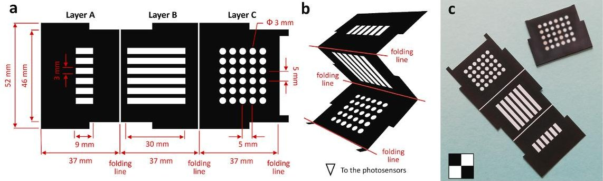

Fig.1. The ABCS $ \mu $PAD. (a) Layout of the $ \mu $PAD with hydrophobic areas printed in black. (b) Folding of the $ \mu $PAD for insertion in the assembly holder. (c) Photo of the $ \mu $PAD, before (left) and after (right) heating, preloading of reagents and folding (the yellow colour of some "wells" in layer C is due to the potassium hexacyanoferrate (III) CL catalyst).

generate the hydrophobic areas. Then, the reagents were loaded into the $ \mu \mathrm{P A D} $ by dispensing their solutions into the hydrophilic channels in layer B, and the hydrophilic areas in layers A and C (the reagents deposited in the $ \mu \mathrm{P A D} $ for the different experiments are reported in Table 1). Finally, after air drying at room temperature in the dark for 1 h, the $ \mu \mathrm{P A D} $ was folded as shown in Fig. 1b to its final configuration (Fig. 1c, right). The separation lines between the sections corresponding to the layers of the device aided folding since after heat treatment they remained more flexible than the wax-printed areas. During the installation of the origami $ \mu \mathrm{P A D} $ six $ 3 \times 9 \mathrm{~mm}^{2} $ buffer loading pads were applied over the hydrophilic areas of layer A to avoid the spreading of the buffer. Pads were kept in place by the assembly holder, which also applied pressure to the $ \mu \mathrm{P A D} $ to guarantee a tight contact between the layers.

## 2.3. Optimization of experimental conditions

The optimization of the experimental conditions was carried out using a ground model of the ABCS CL measurement subsystem. The system was equipped with a removable origami $ \mu $PAD assembly holder to allow for the rapid replacements of the $ \mu $PAD. The CL measurement

Table 1

Reagents employed for the experiments developed for the origami $ \mu $PAD.

<table border="1"><tr><td rowspan="2">Experiment</td><td rowspan="2">Reagent reservoir $ ^{a} $</td><td colspan="3">Origami $ \mu $PAD$ ^{b} $</td></tr><tr><td>Layer A</td><td>Layer B</td><td>Layer C (for each “well”)</td></tr><tr><td>$ #1 $</td><td>ca. 200 μL PB$ ^{c} $</td><td>0.6 μmol NaBO$ _{3} $ in 20 μL PB</td><td>2.0 μmol luminol in 40 μL PB</td><td>0.8 μmol K$ _{3} $ Fe(CN)$ _{6} $ in 4.0 μL PB</td></tr><tr><td>$ #2 $</td><td>ca. 200 μL PB</td><td>0.6 μmol NaBO$ _{3} $ in 20 μL PB</td><td>2.0 μmol luminol in 40 μL PB</td><td>0.2 μmol hemin in 4.0 μL PB</td></tr><tr><td>$ #3 $</td><td>ca. 200 μL PB</td><td>0.6 μmol NaBO$ _{3} $ in 20 μL PB</td><td>2.0 μmol luminol in 40 μL PB</td><td>0.1 U HRP in 4.0 μL PB with 1 mg mL$ ^{-1} $ pullulan</td></tr><tr><td>$ #4 $</td><td>ca. 200 μL PB</td><td>0.2 μmol glucose in 20 μL PB</td><td>12 U GO and 2.0 μmol luminol in 40 μL PB with 1 mg mL$ ^{-1} $ pullulan</td><td>0.5 U HRP in 4.0 μL PB with 1 mg mL$ ^{-1} $ pullulan</td></tr><tr><td>$ #5 $</td><td>ca. 200 μL PB</td><td>0.1 μmol xanthine in 20 μL PB</td><td>8 U XO and 2.0 μmol luminol in 40 μL PB with 1 mg mL$ ^{-1} $ pullulan</td><td>0.5 U HRP in 4.0 μL PB with 1 mg mL$ ^{-1} $ pullulan</td></tr><tr><td>$ #6 $ (blank)</td><td>ca. 200 μL PB</td><td>0.6 μmol NaBO$ _{3} $ in 20 μL PB</td><td>2.0 μmol luminol in 40 μL PB</td><td>4.0 μL PB</td></tr></table>

a This reagent (in excess to the amount used in the experiments) was loaded in the reagent reservoirs.

$ ^{b} $ The reagents in the origami $ \mu $ PAD were dispensed in the hydrophilic areas of the layers, then air-dried.

subsystem was shielded from the ambient light and connected via an USB cable to a laptop that powered the photocurrent readout board and recorded the CL signals measured by the photosensors. To perform an experiment, the PB buffer was injected in the $ \mu $PAD using a fluid transfer line connected to a miniature peristaltic pump (modified as those installed in ABCS) and inserted in the desired fluid inlet of the assembly holder. The kinetic profile of the CL emission of each "well" was recorded by plotting the photocurrent (in pA) measured by the corresponding photodiode against time. The analytical CL signal was obtained by integrating the area under the curve (AUC).

CL imaging experimentswere performed to assess the spatial distribution of the CL emission, employing an ATIK 11000 Charge-Coupled Device (CCD) camera (ATIK Cameras, New Road, Norwich). The camera was equipped with a large format, high resolution Kodak KAI 11002 monochrome sensor cooled by a two-stage Peltier element to reduce thermal noise.

## 2.4. Mission scenario and protocol of experiments

The AstroBio CubeSat (Fig. 2a) is a 3U $ (100\times 100\times 340\mathrm{mm}^{3}) $ nanosatellite that has been launched with the Vega-C qualification maiden flight on July 13th, 2022, as a "piggy-back" of the Italian Space Agency (ASI) LARES-2 main satellite. It was deployed in a circular orbit at about 5850 km of altitude and $ 70^{\circ} $ of inclination, thus spending a significant amount of its orbital period within the internal Van Allen belt, very close to its radiation peak zone. The ABCS ground operations were mainly performed by the School of Aerospace Engineering of the Sapienza - University of Rome (SIA Ground Station). A network of radio amateurs and third part ground stations was also involved for collection of telemetry and science data packages.

For the in-flight experiment, three CL-based reactions were chosen, namely those reported as experiments #1, #3, and #4 in Table 1. Since each channel of the $ \mu $PAD can be independently activated, each experiment will be carried out in duplicate. The general experimental procedure can be summarised as follows.

a) Injection of buffer solution (40 $ \mu\mathrm{L} $ ) from the reservoir to the fluid inlet of the assembly holder and $ \mu\mathrm{PAD} $ . The wetness sensor is used to confirm the delivery of the buffer solution and to control the volume dispensed (after detection of the arrival of the buffer to the fluid inlet the pump, providing a $ 120\ \mu\mathrm{L}\ \mathrm{min}^{-1} $ flow, is maintained active for further 20 s).

b) Dissolution of reagents and transport to the reaction sites of the $ \mu $PAD by capillary action.

c) Activation of the CL reactions.

d) Detection of photons emission and acquisition of CL signal readout.

The recorded photon emission data is transmitted to ground and then analysed to investigate both the intensity of the CL emission and the kinetics of the CL reactions, as compared with parallel experiments

$ ^{c} $ PB: 0.1 M phosphate buffer, pH 7.5.

<!-- PDF_PAGE: 4 -->

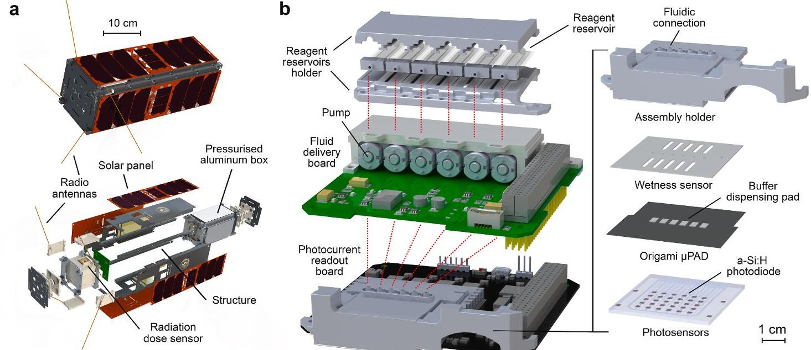

Fig. 2. The ABCS and its subsystems for bioanalytical experiments. (a) Scheme of the ABCS nanosatellite. (b) Scheme of the ABCS subsystems used for bioanalytical experiments. The red dotted lines represent the buffer transfer lines.

performed on ground. To consider the effect of temperature on the stability of reagents and, more importantly, on the kinetics of the reactions, thus on the intensity of the CL emission, reference ground experiments will be conducted reproducing the temperature profile of the payload monitored during in-flight operation.

## 3. Results and discussion

## 3.1. Rationale of experiment design

The main aim of ABCS is the in-flight test of an integrated multiparametric analytical platform for the implementation of CL-based bioassays. Both the proper functioning of the device (e.g., delivery of buffer, transportation and mixing of reactants, detection of CL emission, electronics, data storage and transmission) and the stability in space conditions of the chemicals and the biomolecules required to perform the bioassays will be evaluated. The ability to autonomously handle various adverse events (low power, low temperature, system resets) will be also assessed. A significant challenge for the proper function of ABCS is represented by the high radiation environment (i.e., within the internal Van Allen belt) in which it will operate. It has been estimated that ABCS will be exposed to a radiation dose of more than 16 Gy for 24 h (Brucato et al., 2021). For reference, the typical daily dose inside the ISS ranges from 0.0002 to 0.0005 Gy (Kodaira et al., 2021). Additional transient, non-predictable off-nominal sources of charged particle radiation would be solar particle events, where particles are ejected from the sun in prompt and short-lived bursts of energy. As in ABCS all reagents are deposited in dried form onto a paper substrate, the main events causing their degradation would be the primary ionisation occurring directly in the hit molecules. As concerns proteins, it has been reported that every molecule that suffered a direct ionisation is destroyed (Kempner, 2011). Furthermore, there is a limited possibility for controlling the payload temperature during the phase of integration of ABCS into the launcher as well as during the time between integration and experiment execution in orbit, which can be days to months long. This can pose a serious threat to biological experiments' success, thus requiring careful optimization of reagents' stability (Robson and Cappelletti, 2022).

We studied for implementation in ABCS a range of CL reactions in which light emission is derived from the oxidation of luminol by reactive oxygen species (ROS). The luminol $ \mathrm{H_{2}O_{2}} $ reaction catalysed by HRP was chosen as a model, being a well-established and widely studied CL system, easily implemented in miniaturized analytical devices. In addition,

it provides intense and long-lasting CL signals, which facilitates signal measurement in extreme environments. Furthermore, employment of coupled enzyme reactions could represent a promising approach for the detection of those life markers of astrobiological interest which are not easily recognized by antibodies, such as sugars or enzyme cofactors.

The selected reactions (Table 2) follow an "evolutionary" approach, aimed at reproducing a model for the development of catalytic activity in iron-containing catabolic enzymes, which can be extended in principle to other metal-porphyrin prosthetic groups. It was indeed reported that the catalytic ability of ferric iron progressively increases when combined with protoporphyrin, and when the iron-porphyrin group is further combined with a protein moiety (Ball and Brindley, 2019). It is also worth noting that it is commonly recognized that life on Earth evolved in the presence of hydrogen peroxide, and other peroxides also emerged before and with the rise of aerobic metabolism (Ball and Brindley, 2019).

It should be also noted that experiments #4 and #5 simulated analytical devices for detecting model astrobiological markers: glucose, used as a representative example of biomolecules such as carbohydrates (but also a routine physiological marker in view of possible diagnostic applications of the technology), and xanthine, an intermediate in nucleobases metabolism (He et al., 2019).

Table 2

CL reactions implemented in the ABCS origami $ \mu $PAD.

<table border="1"><tr><td>Experiment</td><td>Oxidant-producing reaction</td><td>Oxidant</td><td>Catalyst</td><td>CL reactant</td></tr><tr><td>$#1</td><td></td><td>NaBO_{3}$^{a}$</td><td>$K_{3}Fe(CN)_{6}$ (inorganic)</td><td>Luminol</td></tr><tr><td>#2</td><td></td><td>NaBO_{3}$</td><td>Hemin (organic)</td><td>Luminol</td></tr><tr><td>#3</td><td></td><td>NaBO_{3}$</td><td>HRP (enzyme)</td><td>Luminol</td></tr><tr><td>#4</td><td>Oxidation of glucose by GO</td><td>$(H_{2}O_{2})^{b}$</td><td>HRP (enzyme)</td><td>Luminol</td></tr><tr><td>#5</td><td>Oxidation of xanthine by XO</td><td>$(H_{2}O_{2})$</td><td>HRP (enzyme)</td><td>Luminol</td></tr></table>

$ ^{a} $ $ \mathrm{N a B O}_{3} $ releases hydrogen peroxide by reacting with water.

$ ^{b} $ The oxidant $ \mathrm{H_{2}O_{2}} $ is produced by the enzyme reactions catalysed by GO and XO.

<!-- PDF_PAGE: 5 -->

## 3.2. The AstroBio CubeSat and the subsystems for bioanalytical experiments

## 3.2.1. Bioanalytical payload requirements and implemented solutions

To meet the requirements arising from the mission scenario, several innovative solutions, ranging from peculiar system-level arrangements to optimized experimental protocol, have been implemented. In this process, the design choices have been driven by system requirements and by the binding constraints of CubeSat missions.

The subsystems for performing the bioanalytical were contained in an aluminium payload box $ (1 0 6 \times1 6 0 \times7 1 \mathrm{~ m m}^{3}) $ together with all the satellite-bus electronics (i.e., electrical power system, batteries, onboard computer, and radio). The box was hermetically sealed with an indium wire gasket and pressurized with air (1 bar) at room temperature to ensure an ambient pressure environment suitable for bioassays once in orbit. Apart from avoiding evaporation of fluids, the sealed box design provided additional advantages. The most obvious advantage of the aluminum box is its partial radiation shielding effect thanks to the 3-6 mm thick aluminum walls (Burgio et al., 2022). In addition, the pressurized environment facilitates the thermal control of the payload since it improves temperature uniformity inside the box and provides for heat exchange by air conduction (no natural convection can take place in the weightlessness environment). Indeed, in accordance with the mission scenario, in absence of any control the expected satellite internal temperature range would have been between $ - 4 0 \mathrm{~} ^ {\circ} \mathrm{C} $ and $ - 2 0 \mathrm{~} ^ {\circ} \mathrm{C} $ To maintain the payload temperature within an acceptable range (the target temperature is from $ 1 2 \mathrm{~} ^ {\circ} \mathrm{C} $ to $ 1 6 \mathrm{~} ^ {\circ} \mathrm{C} $ , while the maximum acceptable temperature excursion is between $ + 4 \mathrm{~} ^ {\circ} \mathrm{C} $ and $ + 2 8 \mathrm{~} ^ {\circ} \mathrm{C} $ ) the power dissipation of the satellite-bus electronics and communication system has been exploited in an active thermal control approach. Since the radio represents the main contribution of the dissipated power, the beacon repetition time is dynamically modulated according to the box internal temperature: the lower the temperature the shorter the beacon interval. To make this temperature control strategy more effective, the payload box is thermally decoupled from the CubeSat structure through Teflon elements.

To comply with the need to preserve the chemicals from degradation, the board stack-up has been designed to allow the late integration of the $ \mu $PAD and the liquid reagents just right before the box sealing procedure. In addition, the whole satellite structure features a modular design that enables the assembly of the sealed box in a later stage and stowage of the sealed box in a controlled temperature environment (i.e., in the range 4-9 $ ^{\circ} \mathrm{C} $ ), until the satellite is due for final integration.

## 3.2.2. ABCS subsystems for bioanalytical experiments

The AstroBio CubeSat has been developed using commercial off-the-shelf (COTS) as well as in-house designed parts to deliver a highly integrated analytical platform for autonomous execution of bioanalytical experiments in space. Special attention has been given to the on-board software design to ensure a high level of fault tolerance. The firmware of the on-board computer includes a scheduler that starts each experiment at a defined time, and a finite state machine that controls all the steps required for the execution of an experiment, considering system feedbacks, such as the reading of the wetness sensor. Data is automatically transmitted to the ground and can also be downloaded via telecommand from the ground. Reliable software design techniques have been used to ensure correct experiment execution, even in the event of system reboots or power cycles, low battery voltage, or anomalous temperature situations. In the case of anomalies, the recovery action taken depends on the current step of the experiment (for example, if the fluid has already been delivered to the origami $ \mu $ PAD, data acquisition will proceed also in case of low battery by saving power from other subsystems).

The technology subsystems of ABCS designed to perform the experiments (Fig. 2b) include the following components.

a) $ \mu $PAD. The $ \mu $PAD (Fig.1) has been designed exploiting the origami approach and contains all the reagents and CL catalysts in a dried form to reduce their possible degradation due to exposure to a high radiation environment. The $ \mu $PAD is composed of three layers: A (buffer injection/reagent storage), B (fluid transport/reagent storage), and C (CL catalyst storage/CL signal production). During the experiment, the buffer is dispensed on the buffer dispensing pads applied to layer A, then, the buffer migrates by capillarity into the $ \mu $PAD and dissolves the reagents, transporting them to the hydrophilic "wells" of layer C, in which the CL reactions take place. For each channel of the $ \mu $PAD there are five hydrophilic "wells" in layer C, thus in the $ \mu $PAD there are a total of 30 hydrophilic "wells", each of them coupled with a photosensor for measuring its CL emission.

b) Wetness sensor. This element is a printed circuit board containing two sensors, each of them consisting of two interdigitated, goldfinished conductive traces in contact with the buffer dispensing pads. The sensors confirm the correct delivery of the phosphate buffer to the $ \mu $ PAD through monitoring the increase of the electrical conductivity of the buffer dispensing pads: each sensor measures the overall conductivity of three dispensing pads, and the geometry of the interdigitated traces has been optimized to have a constant relative drop of the measured electrical resistance every time a new pad has been wetted.

c) Assembly holder. This 3D-printed element holds the $ \mu $PAD, the buffer dispensing pads and the wetness sensor. This element attaches to the photocurrent readout board and guarantees the close contact between the buffer dispensing pads, the $ \mu $PAD and the glass chip with the photosensors (since the CL detection system does not use optics, a tight contact between the $ \mu $PAD and the glass chip with the photosensors is critical to improve light detection efficiency and minimise the cross-talks between adjacent photosensors). The assembly holder also accepts the fluid transfer lines for injection of the phosphate buffer in the $ \mu $PAD.

d) Photosensors and photocurrent readout board. The CL emission is detected by a $ 6 \times5 $ array of $ 2 \times2 \mathrm{mm}^{2} $ high sensitivity and low dark current noise a-Si:H photosensors deposited on a $ 50 \times50 \mathrm{mm}^{2} $ borosilicate glass chip inserted in the photocurrent readout board (Lovecchio et al., 2018; Mirasoli et al., 2014, 2018; Nascetti et al., 2019; Zangheri et al., 2016). The readout board (MARIE, Multichannel Array Readout Integrated Environment) is an extended and improved version of a previously developed one and employs a custom low noise electronics for the biasing of the photodiodes and the measurement of the photocurrents generated by the incident light (Nascetti et al., 2015).

e) Fluid delivery board. The fluid delivery board contains six miniature peristaltic pumps (RP-Q1, Aquatec International Inc., Irvine, CA), each of them connected to a reagent reservoir. When activated, the pumps deliver the phosphate buffer to the buffer dispensing pads of the $ \mu $PAD. The pumps have been modified by installing a 3D-printed pump head to accommodate a 0.5 mm i. d. silicone tubing. This decreased the flow rate from the nominal value of $ 4 5 0 \, \mu\mathrm{L} \, \mathrm{m i n}^{-1} $ to $ 1 2 0 \, \mu\mathrm{L} \, \mathrm{m i n}^{-1} $ , thus allowing an easier control of the volume of buffer transferred to the $ \mu $PAD.

f) Reagent reservoirs. Six 200 $ \mu\mathrm{L} $ -volume reagent reservoirs enclosed in a 3D-printed dedicated holder contain the phosphate buffer. Each reservoir is a small polyethylene bag (length 35 mm, width 12 mm) obtained by a polyethylene foil by thermal sealing and it is mounted on a 3D-printed support for easy connection to the fluid transfer line.

The fluid transfer lines of ABCS are made of flexible silicone rubber tubing (0.5 mm i. d., 1.0 mm o. d.). A commercial bicomponent epoxy glue has been used to seal all fluidic connections.

## 3.3. Optimization of origami $ \mu P A D $ and experimental protocols

As stated before, one of the aims of the ABCS mission is to evaluate

<!-- PDF_PAGE: 6 -->

the stability in space conditions of the reagents used to perform the CLbased assays. We focused our investigation on the stability of CL catalysts (potassium hexacyanoferrate (III), hemin, and HRP) and of the enzymes (GO and XO) employed in the coupled enzyme systems. Therefore, a large excess of CL reactant (luminol), oxidant $ \mathrm{(N a B O_{3})} $ , and enzyme substrates (glucose and xanthine) was used, while the amounts of CL catalysts and enzymes were selected within the dynamic range of the assays to observe a decrease of the CL signal due to the possible degradation of such species.

The amount of oxidant $ \mathrm{(N a B O_{3})} $ was optimized considering experiment #3 as a model, in which HRP is employed as the CL catalyst (this experiment gave the highest CL signals, thus the highest consumption rate of oxidant). Fig. 3a shows the CL signals measured for different amounts of $ \mathrm{N a B O_{3}} $ loaded in the hydrophilic areas of layer A of the $ \mu \mathrm{P A D} $ . According to the experimental results, $ 0. 6 \ \mu \mathrm{m o l} $ has been selected as the amount of $ \mathrm{N a B O_{3}} $ for the preparation of the $ \mu \mathrm{P A D} $ . In the case of luminol, which has a relatively low solubility (about 0.2 M) in phosphate buffer at pH 7.5, we used a saturated solution further diluted 1:4 (v/v) with PB to guarantee its dissolution during the experiments. It must be noted that luminol solubility increases with pH, but pH 7.5 was selected as a common value for all assays. Indeed, the overall performance of the CL system depend on both the influence of pH on the enzyme activity and the effect of pH on the generated CL signal. While the luminol CL reaction is more favoured under alkaline conditions, the optimal pH values for the used enzymes are lower, i.e., between pH 6.0 and 6.5 for HRP (Oosthuizen et al., 1997) and between pH 6.0 and 6.5 for GO from A. niger (Bankar et al., 2009). The working pH was therefore chosen as a compromised optimum due to the combination of elements with different pH optimal values.

For experiments #1, #2, and #3 the highest amounts of CL catalysts comprised in the dynamic range of the assays were selected, in order to obtain a high CL signal still maintaining, as stated before, the ability to detect a possible degradation of the catalyst. Fig. 3 shows the CL signals measured for different amounts of CL catalysts, i.e., potassium hexacyanoferrate (III) (Fig. 3b), hemin (Fig. 3c), and HRP (Fig. 3d), loaded in the "wells" of layer C of the $ \mu $PAD. According to the results, the optimal amounts selected for the preparation of the $ \mu $PAD were 0.8, $ \mu $mol well $ ^{-1} $ , 0.2 $ \mu $mol well $ ^{-1} $ , and 0.1 U well $ ^{-1} $ for potassium hexacyanoferrate (III), hemin, and HRP, respectively.

A similar approach was used to optimize the amounts of the enzymes GO and XO involved in the coupled enzyme reactions exploited in

experiments #4 and #5 (these reactions also involved HRP, which was used in excess with respect to the amount individuated for experiment #3). Fig. 4 showed the CL signals measured for different amounts of GO (Fig. 4a) and XO (Fig. 4b) loaded in the layer B of the $ \mu $PAD. According to the results, the amounts selected for the preparation of the $ \mu $PAD were 12 U and 8 U for GO and XO, respectively.

We also investigated in detail the correlation between the CL signal and the amount of enzyme substrates (glucose and xanthine) used in experiments #4 and #5. Indeed, besides the selection of the amount of glucose and xanthine for the preparation of the ABCS $ \mu $ PAD, we were also interested in the possibility to quantify these substrates in view of possible applications of this technology for the search of astrobiological markers or in diagnostics. Fig. 4 also shows the calibration curves generated by analysing $ \mu $ PADs prepared with different amounts of glucose (Fig. 4c) and xanthine (Fig. 4d) loaded in the hydrophilic areas of layer A. For both substrates linear calibration curves were obtained extending up to 50 nmol for glucose and 30 nmol for xanthine, indicating the possibility to quantify these substances. The limits of detection (LODs), calculated as the amount of substrate giving a signal corresponding to the mean of blank plus 3 standard deviations, were about 4 nmol and 2 nmol for glucose and xanthine, respectively. For the preparation of the $ \mu $ PAD for ABCS, amounts of glucose and xanthine well above the upper limits of the calibration curves (i.e., 200 nmol for glucose and 100 nmol for xanthine) were used.

Besides the intensity of the CL signals, we also evaluated their distribution on the $ \mu $PAD. Indeed, the photosensors measure the intensity of the CL signal but do not give any information about their actual spatial distribution in each "well" nor on the presence of CL emissions in other areas of the $ \mu $PAD, e.g., due to fluid leaks towards the hydrophobic areas. To investigate these aspects, we performed CL imaging measurements of the $ \mu $PAD by using a high sensitivity CCD camera. Fig. 5 shows the results of a CL imaging experiment performed by injecting the buffer in the channel of the $ \mu $PAD containing potassium hexacyanoferrate (III) as the CL catalyst. Comparison of the images of the $ \mu $PAD (Fig. 5a) and of the CL emission (Fig. 5b) clearly indicated that CL is generated only in the hydrophilic "wells" of the active $ \mu $PAD channel. Furthermore, a detailed investigation of the spatial distribution of the CL signal (Fig. 5c) showed a homogeneous distribution of the CL signal in each "well" and a good reproducibility (the variation of the CL signals of the different "wells" is less than 5%).

a

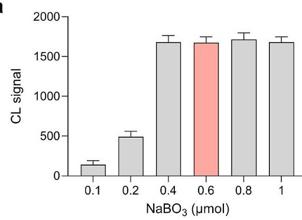

b

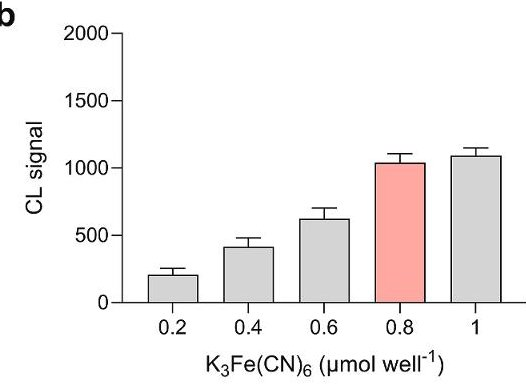

C

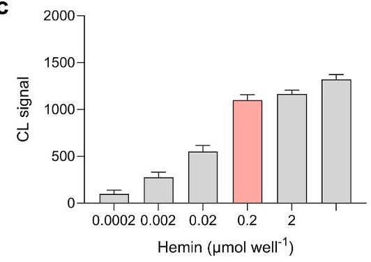

d

Fig. 3. Optimization of amount of $ \mathrm{N a B O_{3}} $ oxidant and of experimental conditions of the experiments involving $ \mathrm{K_{3} F e ( C N )_{6}} $ hemin and HRP as CL catalysts. (a) CL signals obtained for experiment #3 performed in $ \mu \mathrm{P A D s} $ prepared with different amounts of $ \mathrm{N a B O_{3}} $ and for (b) experiment #1, (c) experiment #2, and (d) experiment #3 performed in $ \mu \mathrm{P A D s} $ prepared with different amounts of CL catalyst (potassium hexacyanoferrate (III), hemin, and HRP, respectively). All the other reagents were used at their optimal amounts. Each data is the mean $ \pm $ SD of CL signals measured in the "wells" of three $ \mu \mathrm{P A D} $ channels. The amounts of reactants selected for the preparation of the $ \mu \mathrm{P A D} $ are highlighted in red.

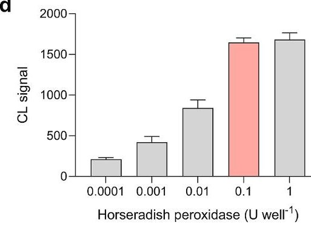

<!-- PDF_PAGE: 7 -->

a

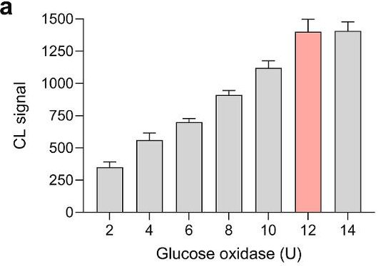

b

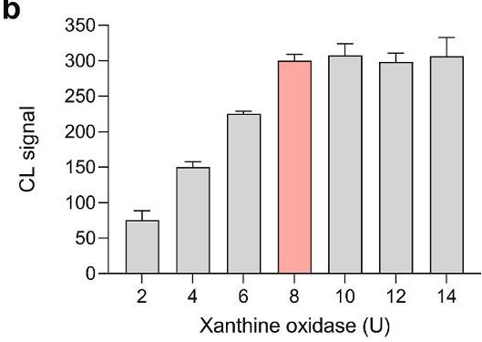

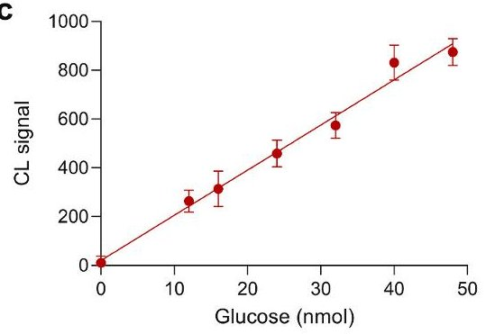

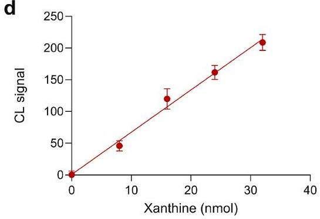

Fig. 4. Optimization of experimental conditions of the experiment involving the GO/HRP system. Panels (a) and (b) show the CL signals obtained for experiment #4 and experiment #5, respectively, performed in $ \mu $PADs prepared with different amounts of GO and XO. The amounts of enzymes selected for the preparation of the $ \mu $PAD are highlighted in red. Panels (c) and (d) show the calibration curves generated for experiment #4 and experiment #5, respectively, by analysing $ \mu $PADs prepared with different amounts of enzyme substrates. All the other reagents were used at their optimal amounts. The equations of the linear calibration curves were $ Y=(18.5\pm 2.5)X+(20.2\pm 70.2) $ $ (R^{2}=0.989) $ and $ Y=(6.66\pm 1.14)X+(0.67\pm 22.52) $ $ (R^{2}=0.991) $ for glucose and xanthine, respectively. Each data is the mean $ \pm $ SD of CL signals measured in the "wells" of three $ \mu $PAD channels.

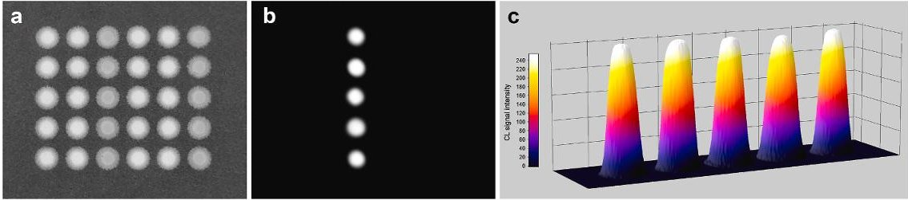

Fig. 5. Study of the spatial distribution of the CL signal. (a) Images of the $ \mu $PAD and (b) of the CL emission obtained when PB was injected in one of the channels containing potassium hexacyanoferrate (III) as the CL catalyst (i.e., the third channel from the left). To allow localization of the CL emission, both images were acquired using the same CCD camera. (c) 3D profiles of the distribution of the CL signal along the active channel of the $ \mu $PAD.

To prevent science loss, it was agreed with ESA that the payload would be conserved at 4 $ ^{\circ} \mathrm{C} $ before integration, allowing a maximum 2-week period at ambient temperature during integration and pre-launch activities (nevertheless, it was not possible to exclude a longer integration-to-launch waiting time). We thus used protective agents to reduce the thermal degradation of the enzymes (HRP, GO, and XO) deposited in the $ \mu $ PAD. We tested either poly (allylamine) hydrochloride, a polyelectrolyte polymer used in layer-by-layer (LBL) enzyme immobilisation and as coating agent to preserve enzymes deposited on solid supports (Cejudo-Sanches et al., 2020), and pullulan, a natural polysaccharide that has already proved capable to increase the stability of enzymes in the dried state (e.g., in tablets) (Jahanshahi-Anbuhi et al., 2016) or immobilised on paper (Balamurali et al., 2015). To assess the effect of protective agents we compared the CL signals of $ \mu $ PADs prepared with and without the protective agents and stored for various times at temperatures ranging between 4 $ ^{\circ} \mathrm{C} $ and 37 $ ^{\circ} \mathrm{C} $ . Fig. 6 reports the CL signals obtained for experiment #3, in which HRP was used as the CL catalyst. The results clearly show that pullulan significantly increased the stability of the enzyme, since it reduced the decrease in enzyme activity to approximately 10% even after 4 weeks of storage at 37 $ ^{\circ} \mathrm{C} $ . A similar improvement in enzyme stability has been obtained also for experiments #4 and #5 employing the enzyme coupled systems GO/HRP and XO/HRP, respectively (data not shown).

## 3.5. Test experiments performed on the ground model of ABCS

As a final test, the experiments selected for ABCS were performed in the ground model of the nanosatellite according to the experimental protocol outlined in Section 2.4. Representative CL kinetic profiles obtained for such experiments are shown in Fig. 7. The blank experiment (experiment #6 in Table 1) displayed no significant CL emission (data not shown). All the experiments were correctly executed, and it was possible to follow the time course of the CL emission, therefore possible changes in emission intensity and/or kinetics during in-flight experiments could be observed. Since each experiment was independently optimized, the comparison of CL emission intensities is not so straightforward. Nevertheless, the nature of the CL system remarkably affected the emission kinetics. It can be observed that the CL emissions of the systems employing either potassium hexacyanoferrate (III) or HRP as catalysts suddenly reached the peak intensity, while the onset of the CL emission for the experiment based on the GO/HRP system was slower. This can be easily explained considering that the peroxide oxidant required for CL emission was immediately available for the first two systems, while it was gradually produced by the GO-catalysed reaction in the GO/HRP system. In addition, the decay of the CL signal was faster for the reaction catalysed by potassium hexacyanoferrate (III) with respect to that catalysed by HRP. This can be ascribed to a more rapid substrate consumption, as indicated by the higher CL emission intensity reached by the first CL system (this is not in contrast with the highest catalytic activity expected for HRP with respect to potassium hexacyanoferrate (III), since the molar amount of the inorganic catalyst deposited on the $ \mu $PAD was much higher than that of HRP).

<!-- PDF_PAGE: 8 -->

a

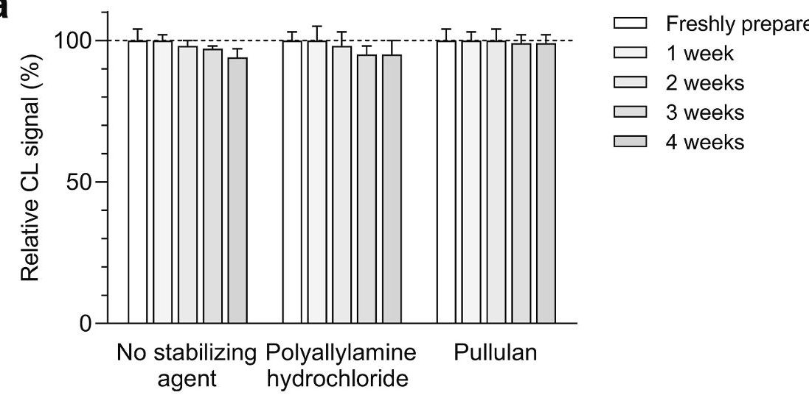

b

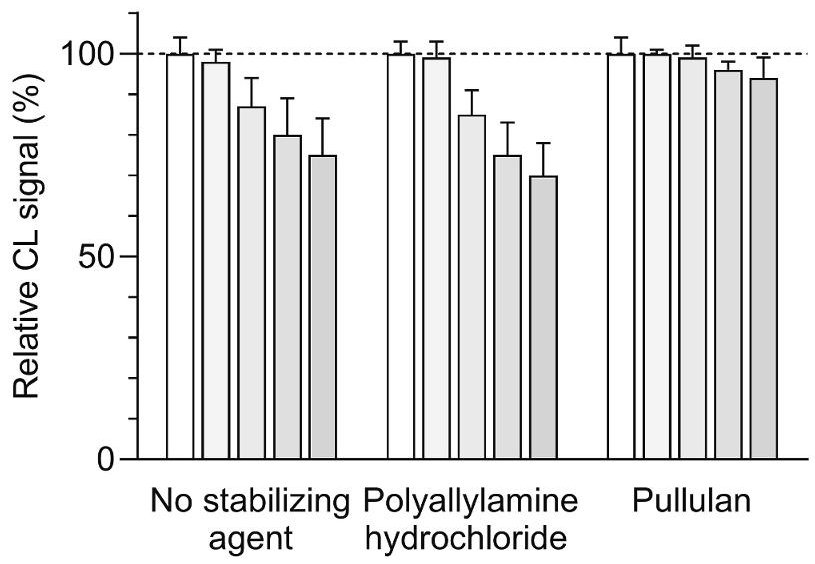

C

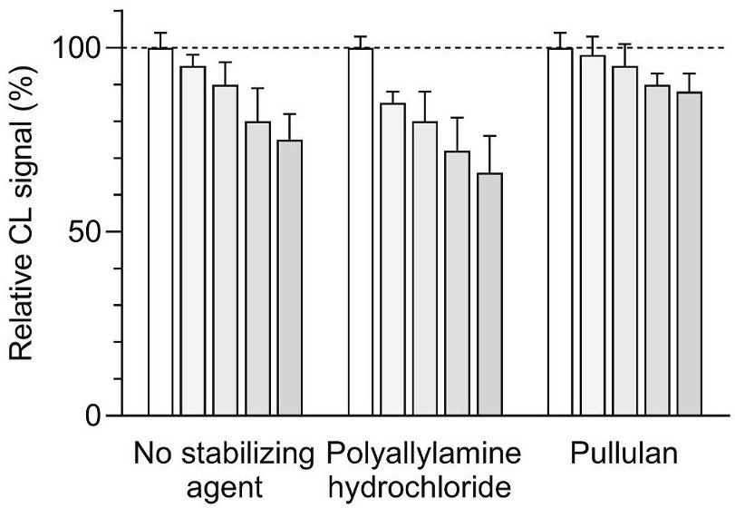

## 4. Conclusion

In conclusion, the ABCS payload demonstrated able to autonomously perform different CL-based bioassays involving systems with increasing chemical complexity, from a single inorganic catalyst to coupled enzymes. The selected CL systems provided intense, easily detectable CL emissions, whose intensities depended on the amounts of reagents and catalysts loaded into the $ \mu $PAD. This will allow the monitoring of the CL reactions in in-flight experiments as well as (thanks to the comparison with parallel ground experiments) the assessment of a possible degradation of reagents due to the space radiation environment. Assessment of enzymes' stability will be of particular interest, as coupling of enzyme reactions would be a promising approach for the biodetection of astrobiological life markers that are not easily recognized by antibodies.

Fig. 6. Study of stability of the $ \mu $PAD upon storage. The CL signals obtained for experiment #3 performed in $ \mu $PADs prepared with and without protective agents (the concentration of both protective agents in the enzyme solutions deposited in the $ \mu $PAD was 1.0 mg mL $ ^{-1} $ ) and stored for various times at (a) $ 4^{\circ} \mathrm{C} $ , (b) $ 25^{\circ} \mathrm{C} $ , and (c) $ 37^{\circ} \mathrm{C} $ are reported. Each data is the mean $ \pm $ SD of the values obtained in the "wells" of three $ \mu $PAD channels (in all graphs the signal intensity was normalised to that measured immediately after preparation of the $ \mu $PAD).

Finally, the paper-based origami-like analytical format allowed to simplify the architecture of the analytical platform, since all the reagents were preloaded on the paper substrate and triggering of the CL reactions only required injection of phosphate buffer with a miniaturized peristaltic pump. Upon in-flight validation, this approach should constitute the first step to implement a mature technology with the aim to conduct life science research in space more easily and at lower cost than previously possible.

## Funding

This work was supported by ASI-INAF grant agreement n. 2019-30 HH.0.

<!-- PDF_PAGE: 9 -->

a

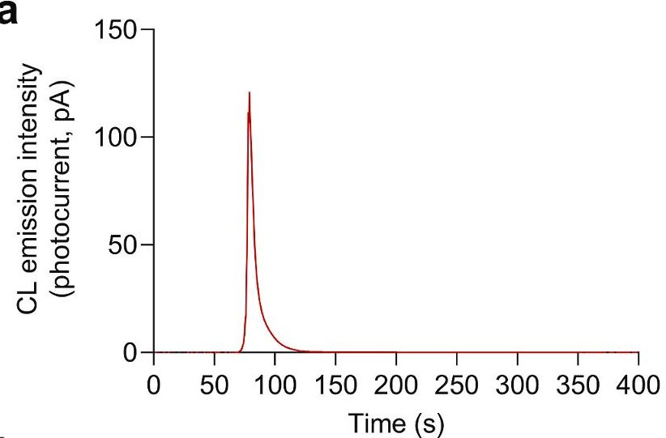

b

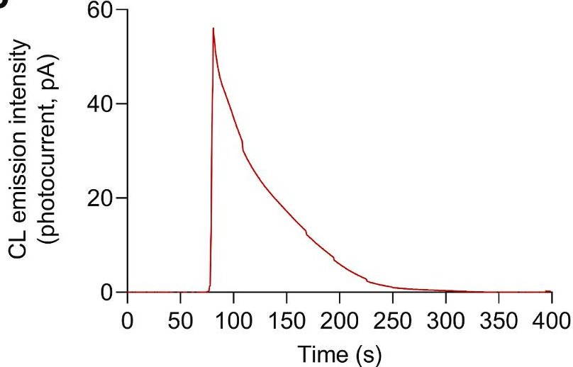

C

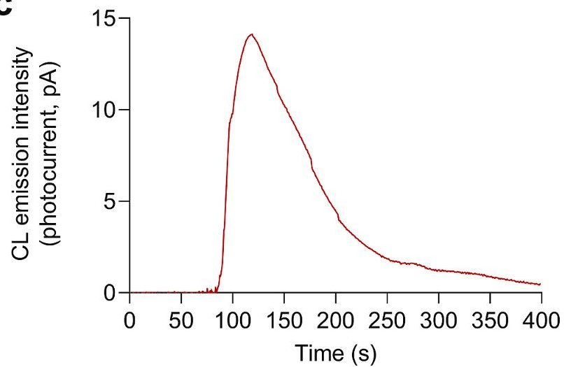

Fig. 7. Measurements performed using the ground model of ABCS. The figure shows representative CL kinetic profiles obtained for (a) experiment #1, (b) experiment #3, and (c) experiment #4. The CL signal acquisition started 10 s before the activation of the pump, while buffer delivering was continued for 20 s after the wetness sensor indicated the arrival of the buffer to the $ \mu $PAD.

## CRediT authorship contribution statement

Donato Calabria: Methodology, Formal analysis, Writing - original draft. Ilaria Trozzi: Investigation, (Bioassays), Writing - original draft. Elisa Lazzarini: Investigation, (Bioassays), Data curation. Andrea Pace: Investigation, (Bioassays). Martina Zangheri: Data curation, Validation. Lorenzo Iannascoli: Investigation, (Lab-on-chip), Visualization. Nithin Maipan Davis: Investigation, (Lab-on-chip), Data curation. Sagar Sarvad Gosikere Matadha: Investigation, (Lab-on-chip). Thiago Baratto De Albuquerque: Software, Data curation. Simone Pirrotta: Project administration, Funding acquisition. Marta Del Bianco: Project administration, Funding acquisition. Gabriele

Impresario: Project administration, Funding acquisition. Liyana Popova: Investigation, (Fluidic actuation). Nicola Lovecchio: Investigation, (Lab-on-chip). Giampiero de Cesare: Investigation, (Lab-on-chip). Domenico Caputo: Investigation, (Lab-on-chip). John Brucato: Conceptualization, Project administration, Funding acquisition. Augusto Nascetti: Conceptualization, Software, Writing - review & editing, Supervision. Massimo Guardigli: Formal analysis, Writing - review & editing, Visualization. Mara Mirasoli: Conceptualization, Writing - review & editing, Supervision.

## Declaration of competing interest

The authors declare that they have no known competing financial interests or personal relationships that could have appeared to influence the work reported in this paper.

## Data availability

## Acknowledgements:

We are grateful to Antonio Bardi, Michele Balsamo, and Alessandro Donati (Kayser Italia s.r.l.), Andrea Meneghin (INAF-Astrophysical Observatory of Arcetri), Claudia Pacelli (Italian Space Agency) for fruitful discussion.

## References

Al Mughairy, B., Al-Lawati, H.A.J., 2020. Trac. Trends Anal. Chem. 124, 115802.

Amalfitano, S., Levantesi, C., Copetti, D., Stefani, F., Locantore, I., Guarnieri, V., Lobascio, C., Bersani, F., Giacosa, D., Detsis, E., Rossetti, S., 2020. Water Res. 177, 115787.

Ball, R., Brindley, J., 2019. Astrobiology 19, 5.

Balamurali, K., Jahanshahi-Anbuhi, S., Pelton, R.H., Yingfu, L., Carlos, D.M.F., Brennan, J.D., 2015. Anal. Chem. 87, 9288-9293.

Bankar, S.B., Bule, M.V., Singhal, R.S., Ananthanarayan, L., 2009. Biotechnol. Adv. 27, 489-501.

Blanco, Y., Gallardo-Carreno, I., Ruiz-Bermejo, M., Puente-Sanchez, F., Cavalcante-Silva, E., Quesada, A., Prieto-Ballesteros, O., Parro, V., 2017. Astrobiology 17, 10.

Brucato, J.R., Nascetti, A., Iannascoli, L., Meneghin, A., Paglialunga, D., Poggiali, G. Pirrotta, S., Pacelli, C., Impresario, G., Carletta, S., Schirone, L., Anfossi, L. Mirasoli, M., Calabria, D., Popova, L., Donati, A., Bardi, A., Balsamo, M., 2021. Astrobio-cubesat: a highly integrated laboratory to test in space immunoassay techniques to detect biomolecules, 15-19 March. In: 52nd Lunar and Planetary Science Conference. LPI Contribution No. 2548, id.2494.

Burgio, N., Cretara, L., Corcione, M., Frullini, M., Iannascoli, L., Nascetti, A., Santagata, A., Palmerini, G., Quintino, A., Brucato, J.R., Meneghin, A., Paglialunga, D., 2022. Radiat. Detect. Technol. Methods 6, 262-279.

Calabretta, M.M., Zangheri, M., Calabria, D., Lopreside, A., Montali, L., Marchegiani, E., Trozzi, I., Guardigli, M., Mirasoli, M., Michelini, E., 2021. Sensors 21, 4309.

Cejudo-Sanches, J., Orrego, A.H., Jaime-Mendoza, A., Ghobadi, R., Moreno-Perez, S., Fernandez-Lorente, G., Rocha-Martin, J., Guisan, J.M., 2020. Process Biochem. 92, 156-163.

Cousins, C.R., Cockell, C.S., 2016. Acta Astronaut. 118, 286-295.

ESA, 2020. https://www.esa.int/Enabling_Support/Space_Engineering_Technology/Sha ping_the_Future/Space_cholesterol_A_new_testing_technology. November 2022. Ferranti, F. Del Bianco, M. Pacelli, C. 2021. Appl. Sci. 11, 68.

Ferranti, F., Del Bianco, M., Pacelli, C., 2021. Appl. Sci. 11, 68.

Freissinet, C., Millan, M., Glavin, D.P., Li, X., Grubisic, A., Eigenbrode, J.E., Stern, J.C. Dworkin, J.P., Buch, A., Szopa, C., Guzman, M.A., Carts, M.A., Getty, S.A. Brinckerhoff, W.B., 2019. Planet. Space Sci. 175, 1-12.

GER, 2018. https://www.globalspaceexploration.org/wordpress/wp-content/isec g/GER_2018_small_mobile.pdf. November 2022.

He, Y., Buch, A., Morisson, M., Szopa, C., Freissinet, C., Williams, A., Millan, M., Guzman, M., Navarro-Gonzalez, R., Bonnet, J.Y., Coscia, D., Eigenbrode, J.L., Malespin, C.A., Mahaffy, P., Glavin, D.P., Dworkin, J.P., Lu, P., Johnson, S.S., 2019. Talanta 204, 802-811.

ISS National Laboratory, 2020. https://www.issnationallab.org/iss360/1drop-diagnostics-leverage-microgravity-improve-medical-diagnostics/. November 2022.

Jahanshahi-Anbuhi, S., Kannan, B., Leung, V., Pennings, K., Liu, M., Carrasquilla, C., White, D., Li, Y., Pelton, R.H., Brennan, J.D., Filipe, C.D.M., 2016. Chem. Sci. 7, 2342-2346.

Kanapskyte, A., Hawkins, E.M., Liddell, L.C., Bhardwaj, S.R., Gentry, D., Santa Maria, S. R., 2021. Biosensors 11, 38.

Kempner, E.S., 2011. J. Pharm. Sci. 90, 1637-1646.

Kodaira, S., Naito, M., Uchihori, Y., Hashimoto, H., Yano, H., Yamagishi, A., 2021. Astrobiology 21, 1473-1478.

<!-- PDF_PAGE: 10 -->

## D. Calabria et al.

Lovecchio, N., Costantini, F., Parisi, E., Nardecchia, M., Tucci, M., Nascetti, A., de Cesare, G., Caputo, D., 2018. IEEE Trans. Biomed. Circuits Syst. 12, 1337-1344.

Mirasoli, M., Nascetti, A., Caputo, D., Zangheri, M., Scipinotti, R., Cevenini, L., de Cesare, G., Roda, A., 2014. Anal. Bioanal. Chem. 406, 5645-5656.

Mirasoli, M., Bonvicini, F., Lovecchio, N., Petrucci, G., Zangheri, M., Calabria, D. Costantini, F., Roda, A., Gallinella, G., Caputo, D., de Cesare, G., Nascetti, A., 2018. Sensor. Actuator. B Chem. 262, 1024-1033.

Mora, M.F., Kehl, F., Costa, E.T., Bramall, N., Willis, P.A., 2020. Anal. Chem. 92 12959-12966.

Moreno-Paz, M., Gomez-Cifuentes, A., Ruiz-Bermejo, M., Hofstetter, O., Maquieira, A., Manchado, J.M., Morais, S., Sephton, M.A., Niessner, R., Knopp, D., Parro, V., 2018. Astrobiology 18, 1041-1056.

Nascetti, A., Colonia, G., Caputo, D., De Cesare, G., 2015. Sophie: a general purpose subpicoamps current readout electronics. In: Compagnone, D., Baldini, F., Di Natale, C., Betta, G., Siciliano, P. (Eds.). Sensors. Lecture Notes in Electrical Engineering, 319. Springer, Cham. https://doi.org/10.1007/978-3-319-09617-9_50.

Nascetti, A., Mirasoli, M., Marchegiani, E., Zangheri, M., Costantini, F., Porchetta, A., Iannascoli, L., Lovecchio, N., Caputo, D., de Cesare, G., Pirrotta, S., Roda, A., 2019. Biosens. Bioelectron. 123, 195-203.

National Academies of Sciences, Engineering, and Medicine, 2016. Achieving Science with CubeSats: Thinking inside the Box. The National Academies Press, Washington, DC. https://doi.org/10.17226/23503.

Oosthuizen, M.M.J., Engelbrecht, M.E., Lambrechts, H., Greyling, D., Levy, R.D., 1997. J. Biolumin. Chemilumin. 12, 277-284.

Padgen, M.R., Liddell, L.C., Bhardwaj, S.R., Gentry, D., Marina, D., Parra, M., Boone, T., Tan, M., Ellingson, L., Rademacher, A., Benton, J., Schooley, A., Mousavi, A., Friedericks, C., Hanel, R.P., Ricco, A.J., Bhattacharya, S., Santa Maria, S.R., 2021. Astrobiology in Press. https://doi.org/10.1089/ast.2020.2305.

Poghosyan, A., Golkar, A., 2017. Prog. Aero. Sci. 88, 59-83.

Robson, D.J., Cappelletti, C., 2022. Acta Astronaut. 191, 394-403.

Roda, A., Mirasoli, M., Guardigli, M., Zangheri, M., Caliceti, C., Calabria, D., Simoni, P., 2018. Biosens. Bioelectron. 111, 18-26.

Roda, A., Arduini, F., Mirasoli, M., Zangheri, M., Fabiani, L., Colozza, N., Mankhonov, F., Siriou, M., Macaron, P. 2020. Biosciences.

Marchegiani, E., Simoni, P., Moscone, D., 2020. Biosens. Bioelectron. 155, 112093. Tong, X., Ga, L., Zhao, R.G., Ai, J., 2021. RSC Adv. 11, 8793-8820.

Xu, T., Shi, W., Huang, J., Song, Y., Zhang, F., Xu, L.-P., Zhang, X., Wang, S., 2017. ACS Nano 11, 621-626.

Zangheri, M., Di Nardo, F., Mirasoli, M., Anfossi, L., Nascetti, A., Caputo, D., De Cesare, G., Guardigli, M., Baggiani, C., Roda, A., 2016. Anal. Bioanal. Chem. 408, 8869-8879.

Zangheri, M., Mirasoli, M., Guardigli, M., Di Nardo, F., Anfossi, L., Baggiani, C., Simoni, P., Benassai, M., Roda, A., 2019. Biosens. Bioelectron. 129, 260-268.