<!-- PDF_PAGE: 1 -->

# Compact spectral irradiance monitor flight demonstration mission

Compact spectral irradiance monitor flight demonstration mission Erik Richard $ ^{*} $ a, Dave Harber $ ^{a} $ , Ginger Drake $ ^{a} $ , Joel Rutkowski $ ^{a} $ , Zach Castleman $ ^{a} $ , Matthew Smith $ ^{a,b} $ , Jacob Sprunck $ ^{a} $ , Wengeng Zheng $ ^{a} $ , Paul Smith $ ^{a} $ , Melanie Fisher $ ^{a} $ , Alan Sims $ ^{a} $ , Beth Cervelli $ ^{a} $ Maxwell Fowle $ ^{a} $ , Marc Miller $ ^{a} $ , Michael Chambliss $ ^{a} $ , Tom Woods $ ^{a} $ , Peter Pilewskie $ ^{a,c} $ Christopher Yung $ ^{d} $ , Michelle Stephens $ ^{d} $ , Nathan Tomlin $ ^{d} $ , Malcolm White $ ^{d,f} $ , John Lehman $ ^{d} $ $ ^{a} $ Laboratory for Atmospheric and Space Physics, 1234 Innovation Drive, Boulder, CO, USA 80303- 7814; $ ^{b} $ Blue Canyon Technologies, 5330 Airport Blvd, Boulder, CO, USA 80301 USA; $ ^{c} $ Dept. of Atmospheric and Oceanic Sciences, 4001 Discovery Drive, Boulder, CO, USA 80309-0311; $ ^{d} $ National Institute of Standards and Technology, 325 Broadway, Boulder, CO, USA 80305-3337; $ ^{f} $ Department of Physics, University of Colorado, Boulder, CO, USA 80309

## ABSTRACT

Accurate, long-term solar spectral irradiance (SSI) measurements are vital for interpreting how solar variability impacts Earth's climate and for validating climate model sensitivities to spectrally varying solar forcing. The Compact Spectral Irradiance Monitor (CSIM) 6U CubeSat successfully launched on Dec. $ 3^{\mathrm{rd}} $ , 2018 as part of the SpaceX SSO-A: SmallSat Express Mission ultimately achieving a sun-synchronous 575 km orbit. CSIM brings new, emerging technology advancements to maturation by demonstrating the unique capabilities of a complete SSI mission with inherent low mass and compact design. The instrument is a compact, two-channel prism spectral radiometer incorporating Si, InGaAs, and extended InGaAs focal plane photodiodes to record the solar spectrum daily across a continuous wavelength region spanning 200-2800 nm (>97% of the total solar irradiance). A new, novel electrical substitution radiometer (ESR) using vertically aligned carbon-nanotube (VACNT) bolometers serves as an absolute detector for periodic on-orbit spectral calibration corrections. Pre-launch component level performance characterizations and final instrument end-to-end absolute calibration achieved low combined standard uncertainty $ ( u_{C}<0.5\%) $ in irradiance. These calibrations were performed in the LASP Spectral Radiometer Facility (SRF), a comprehensive spectral irradiance calibration facility utilizing a tunable laser system tied to an SI-traceable cryogenic radiometer. On-orbit, optical degradation corrections to better than 0.05% / year uncertainty are achieved by comparing periodic, simultaneous solar measurements of the two CSIM channels operating with significantly different solar exposure duty cycles. Operational overlap of CSIM with existing SSI measurements validate concepts for maintaining critical long-term solar data records.

Keywords: solar spectral irradiance, CubeSat, electrical substitution radiometer, carbon nanotubes, radiometer

## 1. INTRODUCTION

The Sun is the dominant source of energy for the Earth's climate system establishing the terrestrial environment that supports all life on the planet. The influence of solar spectral irradiance (SSI) is recognized as being increasingly important to the Sun-climate connection $ ^{1,2} $ . The wavelength and height dependence of solar radiation deposition, including ozone absorption in the stratosphere, absorption in the ocean mixed layer, and water vapor absorption in the lower troposphere, all contribute to the "top-down" and "bottom-up" mechanisms that have been proposed as possible amplifiers of the solar signal $ ^{3,4} $ . To this end, accurate and continuous, long-term measurements of SSI with broad wavelength coverage from the UV to the IR is essential to advance scientific understanding of these processes and to quantify the solar impact on climate.

Central to elucidating the processes and connections of the solar influence is the quality and continuity of solar irradiance data records. Observational continuity is the key without sufficient mission overlap of critical data records, there will be little chance of tying them together with the necessary accuracy to observe true climate signatures $ ^{5,6} $

<!-- PDF_PAGE: 2 -->

The Compact Spectral Irradiance Monitor (CSIM) is a solar radiometer concept proposed to mitigate potential risks associated with large mission delays - resulting in observational data gaps - by developing a cost effective, reduced-size solar spectral irradiance instrument. This instrument offers significant implementation flexibility for future alternative flight opportunities. The objective was to develop and demonstrate a mission concept that address new NASA priorities $ ^{7} $ namely: develop and demonstrate new measurement technologies that make significant contributions to Earth science measurements and reduce the risk, cost, size, volume, mass and development time of Earth science instruments.

The CSIM-Flight Demonstration (CSIM-FD) mission specifically addresses the design, development, and demonstration of a new integrated satellite concept for obtaining high priority Earth Science measurements of SSI and providing an SI-traceable tie to existing and future satellite records. Building on successful NASA ESTO IIP and ACT developments to advance TRL of an inherent low mass and compact SSI instrument design (CSIM), we matured the technology that integrated the compact instrument concept into a fully qualified, small satellite (6U CubeSat) system and have demonstrated its performance against existing SSI observatory capabilities.

## 1.1 CSIM-FD Objective and Benefits

The objective of the CSIM instrument development was to produce a compact SSI monitor covering 200-2800 nm with NIST-traceable accuracy and on-orbit stability to meet the solar input measurement requirements established for the long-term SSI data record. Building upon our experiences and resources from the first Total and Spectral Solar Irradiance Sensors (TSIS-1) program, CSIM-FD reduces the cost and size of a solar spectral irradiance monitor with NIST-traceable absolute pre-launch calibration at $ \leq 0.5\% $ (k=1) uncertainty while also increasing implementation flexibility for future flight accommodation opportunities. For example, with low-cost CSIM instruments the SSI could be measured by a continually refreshed constellation of highly calibrated instruments with operational overlap. The loss of an individual instrument would then carry a much smaller impact, and the long-term stability of the SSI record would be maintained by a series of short-life (2-3 year) instruments with operational overlap rather than a single high-risk long-lived instrument $ ^{8} $ .

The success of the CSIM flight opportunity will produce several valuable outcomes. First, it demonstrates a viable 6U CubeSat SSI instrument that can potentially maintain the SSI data record, particularly as a data gap mitigation strategy to provide continuity bridging older and newer large missions $ ^{9} $ . Second, it raises the TRL of several new technologies that are applicable design approaches to implement in future instruments. Finally, the timing of this flight allows overlap with the TSIS-1 Spectral Irradiance Monitor (SIM) instrument. Operational overlap between these instruments is unique because both TSIS-1 SIM and CSIM have their unit-level calibrations and end-to-end validations tied to the same spectral irradiance traceability scale and therefore provide verification of the absolute SSI uncertainties $ ^{10} $ .

## 2. INSTRUMENT DESIGN

The size reduction of CSIM was enabled by a redesigned optical path, a mechanical and electrical design that integrates and combines functionality, and incorporating new technology where it would improve or simplify the instrument. Ultimately, the compact size allowed it to fit into a 6U CubeSat. The instrument was designed to meet the SSI measurement requirements for the long-term solar irradiance climate record presently being met by the TSIS-1 SIM.

The CSIM instrument is a two-channel solar spectral radiometer that covers 200 nm through 2800 nm - an integrated wavelength range that accounts for >97% of the total solar irradiance (TSI). The CSIM optical layout separates the collimation, dispersion, and focusing optics utilizing a folded geometry for two, independent instrument channels. Figure 1 shows a layout of the CSIM instrument. Superior optical performance is achieved by using discrete optical elements. The primary photodiode detectors are Si (200-950 nm), InGaAs (900-1700 nm), and extended InGaAs (1600-2800 nm). Having full-spectral coverage using these photodiodes allows CSIM to capture a solar spectrum in 35 minutes. In addition, there is an electrical substitution radiometer (ESR) that carries the absolute calibration of the instrument, and can track optical degradation (inter-channel) and calibrate the photodiodes (intra-channel) to maintain the long-term relative stability of the instrument. The CSIM ESR is a bolometric detector that covers the full 200-2800 nm spectral range. Due to its basic thermal operation it has a very flat spectral response and is robust to degradation on orbit.

Two key instrumental components dominated the CSIM development effort to ultimately achieve a compact SSI instrument without sacrificing performance. The first was the design and development of the precision rotation stage for the prisms. Wavelength stability and repeatability is critical to achieving high radiometric stability. For CSIM we are using a commercial off-the-shelf (COTS) rotary encoder. The MicroE Mercury $ \mathrm{I I}^{\mathrm{TM}} $ 6000V is compact and allows rotary feedback stability $ < 0.1 $ arc-second in angle. We demonstrated the performance of this encoder to achieve 100 ppm relative

<!-- PDF_PAGE: 3 -->

stability in irradiance during spectral scans that achieved a noise performance < 0.1 arc-sec. The second major advancement was the development of a low-noise, high efficiency miniature electrical substitution radiometer (ESR). The CSIM ESR utilizes new, emerging technologies and is a significant departure from the designs employed on previous ESR versions $ ^{11} $ . The entire bolometer is fabricated by NIST-Boulder (Sources and Detectors Group) from micro-machined silicon and silicon nitride. By utilizing the highly developed semiconductor processing techniques the physical properties and dimensions of the bolometers are very well controlled. The "black" optical absorber consists of Vertically-Aligned Carbon Nanotubes (VACNTs), grown on the silicon bolometer. We have demonstrated that this new bolometer is less costly and faster to fabricate, more compact, lower noise, and is more optically absorptive than the previous designs $ ^{12,13} $ The ESR is described in further detail in section 2.3.

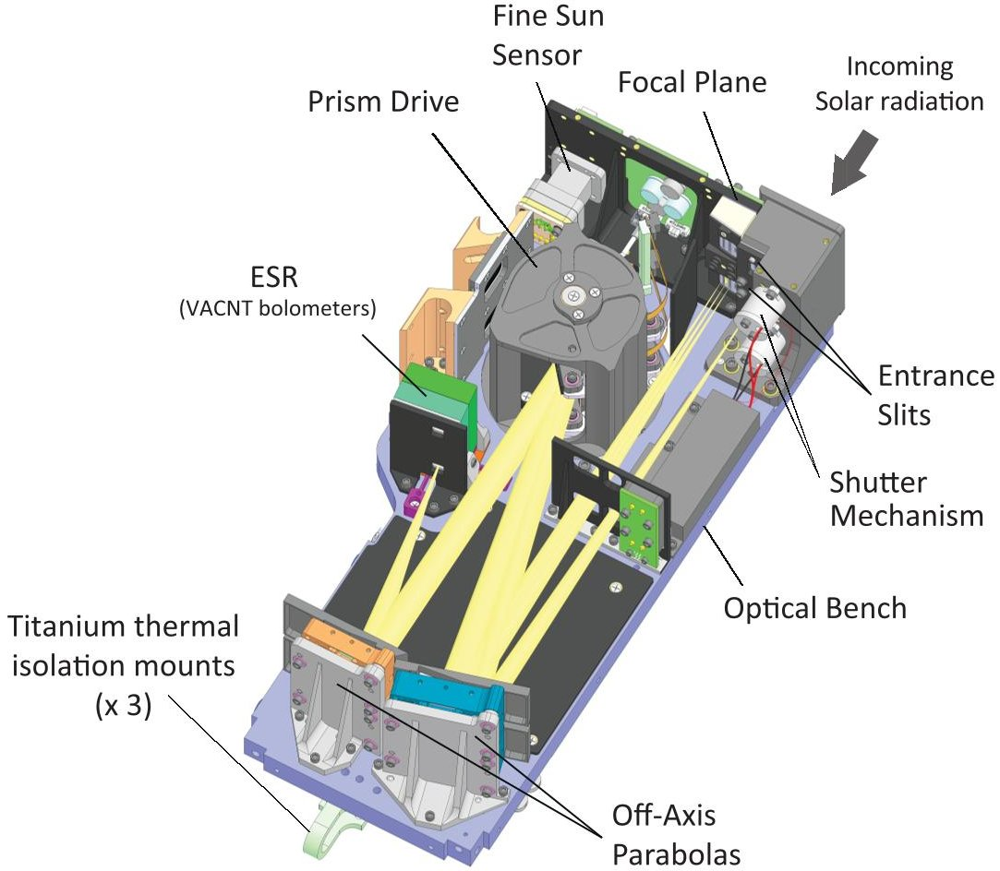

Figure 1: The Compact Spectral Irradiance Monitor (CSIM) has two identical, full spectral channels covering 200-2800 nm (continuous). A fused silica plano-prism on a rotation stage provides the required spectral dispersion to scan the full spectrum across UV, Vis and IR photodiode detectors and a separate Electrical Substitution Radiometer (ESR) absolute detector. Periodic solar exposure duty-cycled operations between the separate ESR channels allows for optical degradation corrections in the SSI long-term spectrum. These irradiance corrections are then applied to the daily photodiode spectra through near simultaneous ESR - photodiode solar viewing scans. All instrument mechanisms have undergone full life-cycle testing, thermal vacuum, and vibration cycles (per NASA GSFC-STD-7000). The instrument dimensions are approx. 280 mm long x 115 mm wide x 80 mm tall allowing for integration into a 6U CubeSat form factor.

## 2.1 Optical Layout

CSIM is a constant-deviation monochromator where the entrance slit and detector exit slits are fixed in position and wavelength selection for each detector is accomplished by physically rotating a refracting-reflecting prism. Optically, the prism angle to wavelength relationship is determined by the index of refraction solution for the given entrance slit-prism angle-exit slit geometric relationship. Specifically, the solution for the prism index is determined by the definition of the incident angle of light on the prism, and the deviation angle of the outgoing refracted-reflected light. Since we are working in vacuum (either in space or in a vacuum tank in the lab) the external medium index of refraction is by definition $ n_{\mathrm{vac}}= $ 1. The deviation angle from the prism to each detector is fixed and invariant since all detectors are fixed. The only free parameter to the solution to the index, $ n_{\mathrm{i}} $ , for the $ \mathrm{i}^{\mathrm{th}} $ detector is the prism incidence angle. This angle is accurately

<!-- PDF_PAGE: 4 -->

determined by knowledge of the prism first surface normal to an optical rotation encoder. Therefore, we establish a functional relationship between the index of refraction solution to encoder DN.

To obtain the wavelength solution, we use the Sellmeier index to wavelength relationship for Suprasil $ ^{\circ} \mathrm{C} $ 3001 fused silica with temperature corrections (from the reference temperature of $ 20^{\circ} \mathrm{C} $ ) applied over the narrow operational temperature range $ ^{14} $ . These dispersion and temperature dependencies have been described in detail previously $ ^{11} $ . There are two refractive measurement geometries used for CSIM. These relate to the photodiode mode and the ESR mode and are shown in the ray-trace in Figure 2a, and b, respectively.

(a)

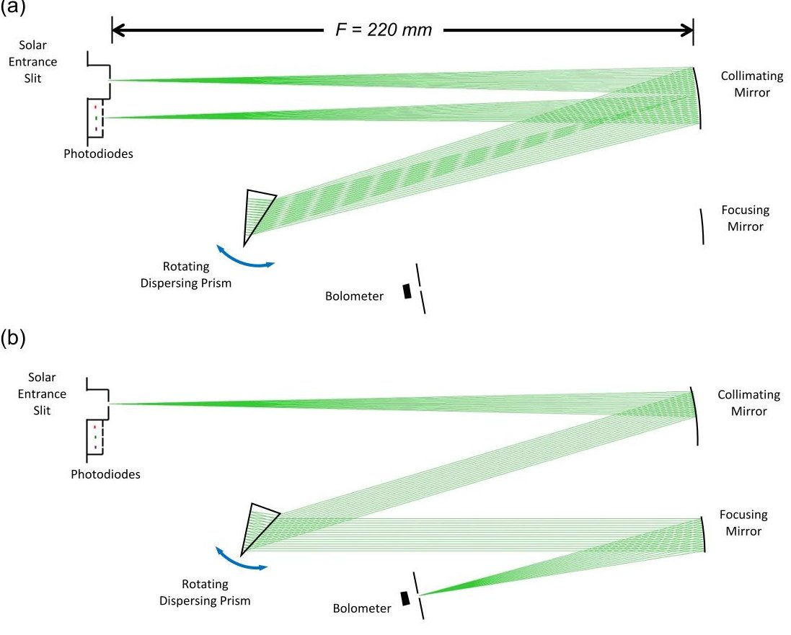

Figure 2: 2-D optical ray-trace of the two CSIM refractive measurement geometries. (a) Daily photodiode acquisition mode where the spectrum is scanned over focal plane photodiodes, and (b) the weekly ESR scan mode that can scan in small intervals the full spectrum onto the bolometer of the ESR. The ray trace shows the full acceptance FOV $ \sim 2. 3^{\circ} $ $ \sim 2. 3^{\circ} $ , the true solar image lies within $ (0. 5^{\circ}) $ . It is important to note that in incoming solar image and the outgoing (dispersed) solar image do not spatially overlap on the collimating mirror. This avoids the issue of overlap with the primary degradation spot on the collimating mirror. Also note that both detector modes share the common optical path from entrance slit to collimating mirror to prism first surface.

## 2.2 Photodiode Detectors

There are three different types of photodiodes located in the focal plane to cover the full 200-2800 nm scan regions. These are Si, InGaAs, and extended InGaAs. Both the Si and InGaAs photodiodes have heritage from previous programs and have undergone extensive qualification testing over the last two decades. However, the extended-InGaAs detector is a new development and implementation for CSIM. Figure 3 shows a cross sectional detail of the photodiode assembly at the focal plane defined by the exit slits. These assemblies are identical for both CSIM A and B measurement channels (see Figure 1 focal plane for context).

Within the scope of the CSIM instrument development, we performed several additional tests to quantify the uncooled extended-InGaAs performance for our application. Of particular concern with these photodiodes is the rather low values of the shunt resistance $ \mathrm{R_{sh}} $ typ. $ < 1 \mathrm{K} \Omega). $ Achieving low noise operation precluded the use of a large area detector and also required utilizing a different (low voltage-noise) operational amplifier in the TIA circuit. Figure 4 shows the choice of the LMP2012 low voltage-noise op-amp over others choices considered. For our operational frequencies and application for the IR scans we achieve over an order of magnitude improvement in noise performance from previous heritage op amps. Ultimately, we are able to use an uncooled extended-InGaAs detector because of this very low voltage-noise op- amp that can render detectors with inherently low-shunt resistances usable.

<!-- PDF_PAGE: 5 -->

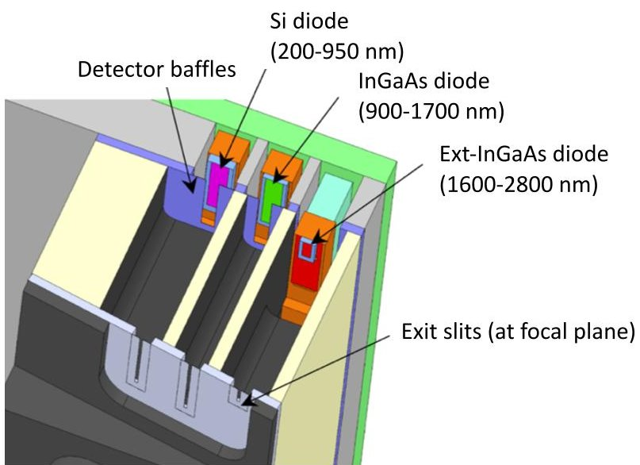

Figure 3: Cross-sectional detail showing focal plane view of the three photodiodes with independent baffling and exit slit locations. For Si and InGaAs photodiodes, the solar image of the entrance slit underfills the exit slits in the cross-dispersion direction ensuring all light from entrance slit image is captured, however for the small Extended InGaAs detector, the solar image overfills the exit slit and therefore required direct calibration against the cryogenic radiometer for radiometric response correction.

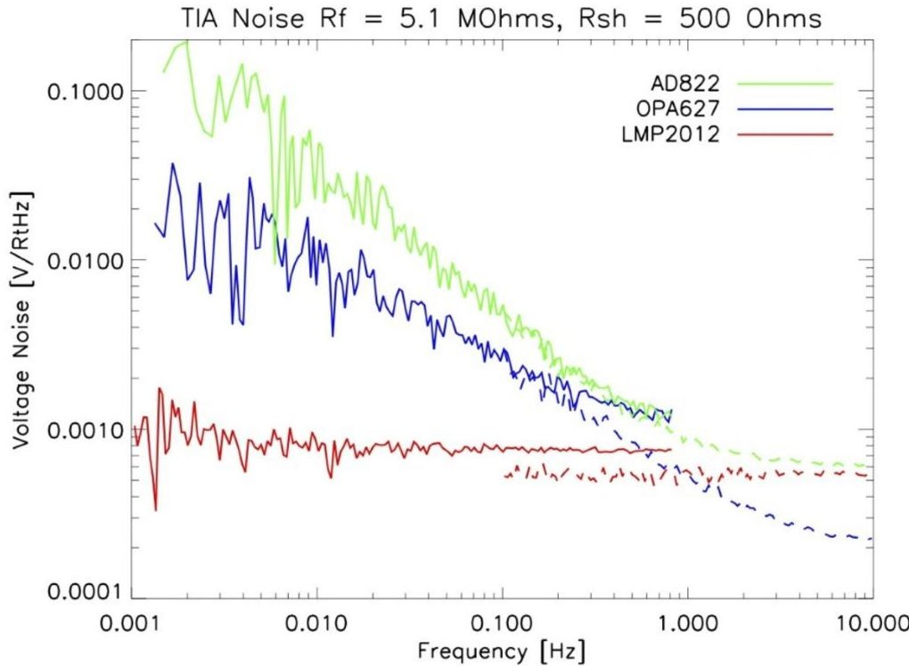

Figure 4: Measured voltage noise for extended-InGaAs detector operational amplifier trades. The LMP2012 was chosen for the uncooled extended-InGaAs photodiode based on excellent low voltage noise performance over the CSIM operational ranges.

Ultimately, the inclusion of this detector allows us to scan the entire solar spectrum, from 200 nm to 2800 nm, rapidly using only the photodiodes (typical scan times are 35 minutes, allowing one full spectrum to be acquired in one sun-lit orbit). Previous SIM instruments had a long wavelength photodiode cutoff at 1700 nm using the InGaAs photodiode, and therefore had to rely on the much slower ESR to measure the full near-IR region for wavelengths greater than 1700 nm. The photocurrents are used directly in the full measurement equation to generate SSI in $ \mathrm{W / m^{2} / nm} $ by incorporating the individual, pre-calibrated radiant sensitivities (A/W). To accurately calibrate the photodiodes on-orbit, near simultaneous ESR scans are completed to measure the absolute solar spectral power though the common entrance slit.

<!-- PDF_PAGE: 6 -->

## 2.3 CSIM Electrical Substitution Radiometer (ESR)

The CSIM Electrical Substitution Radiometer (ESR) is a bolometric detector that covers the full 200-2800 nm spectral range. Due to its basic thermal operation it has a very flat spectral response and is robust to degradation on orbit. The purpose of the ESR is to carry the absolute calibration and to maintain the long-term stability of the instrument. The ESR is an absolute detector tied directly to an SI-traceable cryogenic radiometer in power (W). Periodic scans of the solar spectrum are taken with the ESR to track solar exposure related optical degradation and used to calibrate the photodiodes.

The CSIM ESR is micro-machined from a silicon wafer $ ^{15} $ . It has 2-micron thick silicon nitride membranes as the weak thermal link, and vertically aligned carbon nanotubes (VACNTs) as the optical absorber. The VACNTs are a comparable or superior absorber in nearly every way relative to the Nickel-Phosphorus (NiP) black that was used for previous SSI ESR's. The CNTs have higher absorptance ( $ \geq0.99 $ ), have a flatter spectral response, are more reliable and repeatable to manufacture, have a higher optical damage threshold, and have higher thermal conductivity - all highly favorable characteristics for an absolute thermal bolometer.

By utilizing the highly developed semiconductor processing techniques the physical properties and dimensions of the bolometer are very well controlled. Figure 5 shows the bolometer itself, a 1.2 x 7 x 0.275 mm piece of silicon, is supported by a pair of 2-micron thick Silicon Nitride (SiN) membranes on each end. The replacement heater and wiring is tungsten (W) thin-film traces. The "black" optical absorber consists of Vertically-Aligned Carbon Nanotubes (VACNTs), grown on the silicon bolometer.

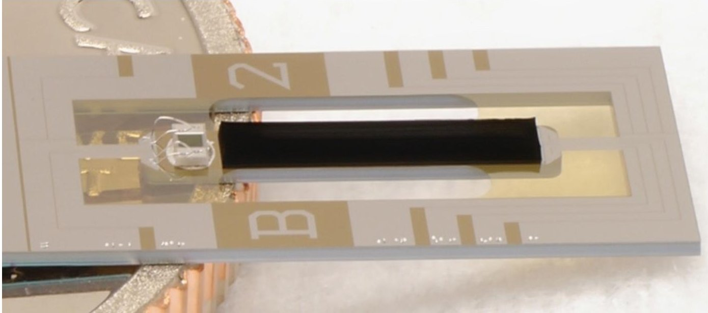

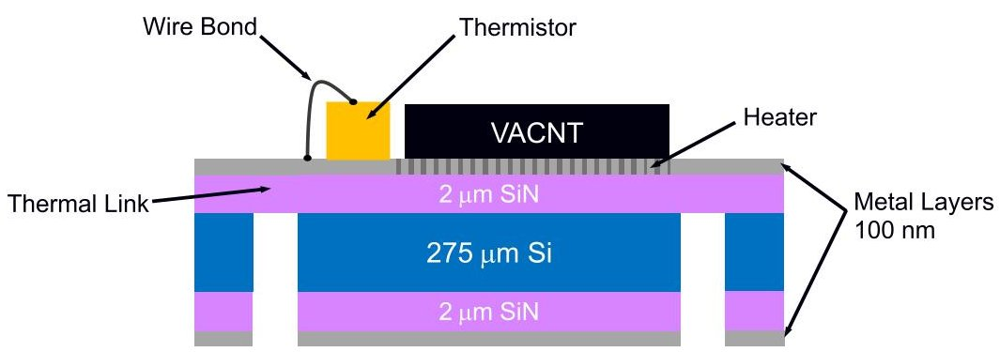

Figure 5: (Upper) Close up of the ESR bolometer (half of a balanced pair) shown on the edge of a US Quarter. Visible in the image are the black VACNT absorbers on Si-substrate supported on each end by a thin SiN layer (thermal link). Thermistor and wire bonds are also located on the central bolometer. (Lower) The cross-section diagram showing the details of the bolometer fabrication.

<!-- PDF_PAGE: 7 -->

## 3. CHARACTERIZATION AND CALIBRATION

Based on the different measurement geometries shown in Figure 2, we have two separate measurement equations used to derived the solar spectral irradiance. Briefly, the SSI measurement equation (in units of $ \mathrm{W / m^{2} / nm} $ ) for the photodiode detectors and the absolute ESR detector can be written, respectively, as

$$
E _ {P D} \left(\lambda_ {p}, t\right) _ {S u n} = \frac {\frac {1}{R _ {f}} \left[ V \left(\lambda_ {p} , t\right) _ {S u n} - V \left(\lambda_ {p} , t\right) _ {D a r k} \right]}{A _ {s l i t} \cdot \bar {\mathcal {R}} (\lambda , T , t) \cdot \bar {\mathcal {T}} (\lambda , t) \cdot \bar {\phi} (\lambda) \cdot \Delta \lambda} \quad E _ {E S R} \left(\lambda_ {p}, t\right) _ {S u n} = \frac {\mathcal {P} \left(\lambda_ {p} , t\right) _ {E S R}}{A _ {s l i t} \cdot \bar {\alpha} (\lambda , t) \cdot \bar {\mathcal {T}} (\lambda , t) \cdot \bar {\phi} (\lambda) \cdot \Delta \lambda}
$$

## 3.1 Photodiode equation

The photodiode instrument equation applies the SSI measurement geometry shown in figure 2 (a). In the numerator of the photodiode equation the solar generated photocurrents are converted to a measured voltage through the individual transimpedance amplifier (TIA) located at the diodes on focal plane circuit board. The measured voltage signal, $ \mathrm{V}(\lambda_{\mathrm{p}}) $ allows us to derive the solar measured photocurrent from the accurately calibrated feedback resistors, $ \mathrm{R_{f}} $ , on the TIA. To achieve high bit resolution over the large solar dynamic range, the analog-to-digital conversion of the measured solar voltage signal is accomplished through custom designed, low-noise voltage to frequency conversion utilizing an AD650 voltage-to-frequency converter (VFC). This circuit provided true signal integration over the 0.5 second measurement times per prism angle step with high voltage resolution. For a reference frequency of 1 MHz we achieve near 20-bit dynamic range over the measured voltage ranges. Direct voltage calibration measurements with temperature compensation were made over the expected voltage ranges.

The photocurrents are used directly in the full photodiode SSI measurement equation, $ \mathrm{E}_{\mathrm{P D}}(\lambda_{\mathrm{p}},\mathrm{t}) $ , to generate SSI in $ \mathrm{W / m^{2} / n m} $ by incorporating the individual pre-calibrated photodiode radiant sensitivities, $ \mathcal{R}(\lambda_{\mathrm{p}},\mathrm{T},\mathrm{t}) $ , in units of Amps/Watt. In this equation, $ \lambda_{\mathrm{p}} $ is the prism selected central wavelength, $ \mathrm{A}_{\mathrm{s l i t}} $ is the area of the entrance slit (NIST calibrated to better than 500 ppm uncertainty in area), $ \phi(\lambda) $ is the full system diffraction correction, $ \mathcal{T}(\lambda ,\mathrm{t}) $ is the full optical path prism transmission, and finally, $ \Delta \lambda=\mathrm{S}(\lambda_{\mathrm{p}},\lambda) $ is the instrument response function defining the spectral bandpass at each $ \lambda_{\mathrm{p}} $ . Note that both $ \mathcal{R}(\lambda_{\mathrm{p}},\mathrm{T},\mathrm{t}) $ and $ \mathcal{T}(\lambda ,\mathrm{t}) $ have explicit time dependence - dependent on the mission length (calendar time) and cumulative solar exposure time, respectively. Because of the changes in $ \mathcal{R}(\lambda_{\mathrm{p}},\mathrm{T},\mathrm{t}) $ due to radiation exposure in space and the changes in response with wavelength, the photodiodes are not absolute detectors and do not maintain the long-term optical power calibration on-orbit. For this we rely on the ESR to periodically correct the photodiode responsivities through near simultaneous solar measurements over common wavelength intervals. The time and wavelength dependent corrections are determined by common (temporal and spectral) comparisons with the ESR measurements through intrachannel, for $ \mathcal{R}(\lambda_{\mathrm{p}},\mathrm{T},\mathrm{t}) $ correction, and inter-channel, for $ \mathcal{T}(\lambda ,\mathrm{t}) $ corrections. For example, radiation damage to the photodiode detectors from energetic particles occurs independent of solar exposure and preferentially affects the long wavelength portion of the detector response range.

## 3.2 ESR equation

The ESR solar irradiance measurement equation applies to the measurement geometry in figure 2(b) and is similar to the phodiode measurment equation, but the numerator is now the directly measured ESR power in Watts, $ \mathcal{P}_{\mathrm{ESR}}(\lambda_{\mathrm{p}}) $ . This detected power is corrected by a spectral efficiency term, $ \alpha(\lambda,t) $ , that is near unity and is measured directly by calibrating the ESR against a NIST-traceable cryogenic radiometer in power. This efficiency term relates to the spectral absorptivity of the VANCT absorber surface and the physical geometry of the bolometer and exit slit location, both robust and invariant. In operation, the ESR detected spectral power is derived by maintaining the balance of electrical power with optical power in a closed loop, null balanced design. Briefly, electrical substitution radiometers are by definition thermal detectors; optical power is detected by the measurement of the amount of electrical substitution necessary to generate an equivalent change in the measured temperature. For our applications, the replacement power applied to the ESR is directly measured through the following equation

$$
\mathcal {P} \left(D N\right) = R _ {H} \left(\frac {V _ {R e f}}{R _ {T o p} + R _ {H}}\right) ^ {2} \frac {D N}{6 2 , 5 0 0}
$$

<!-- PDF_PAGE: 8 -->

where $ R_{H} $ is the value of the heater resistance, $ V_{Ref} $ is the value of the 7.1 volt reference (LTZ1000), $ R_{Top} $ is the value of the "top" precision resistor in series with $ \mathrm{R_{H}} $ , and DN is the output data number. The output data number is divided by 62,500 (defined by the master clock frequency) to convert it to a PWM duty-cycle; an output of 62,500 is a duty cycle of 100% or 1.0, and an output of 0 is a duty cycle of 0% , or 0. This PWM duty cycle approach has been used extensively in previous successful flight ESR's (SORCE, Glory, TCTE, TSIS-1) and maintains a linear relationship in the feedback loop with a constant, highly accurate reference voltage, as opposed to having a problematic quadradic relationship with a changing reference voltage in the feedback loop.

Various calibrations and characterizations must be completed on the ESR system to quantity key parameters in the ESR replacement power equation related to thermal, electrical and optical properties based on the phase-sensitive detection scheme utilized for low-noise optical power measurements, including thermal impedance, gain and phase factors, as well as standard voltages and resistances to provide the standard Watt for electric replacement. The standard Watt circuit and PWM circuit for duty-cycled replacement power measurements are direct variants of the SORCE, Glory, TCTE, and TSIS1 heritage circuits. However, based on the new VACNT bolometer design and implementation, thermal, gain, and phase factors must be directly measured to quantify the ESR time dependent noise performance. Based on the ESR power loop gain quantifications, the CSIM ESR power noise spectrum was determined over the operational frequency range required (as defined by the shutter frequency). Figure 6 shows the measured noise performance improvement of the new CSIM ESR relative to the TSIS -1 SIM ESR.

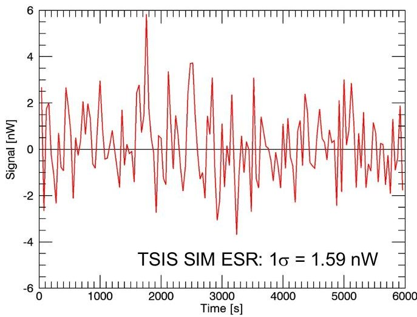

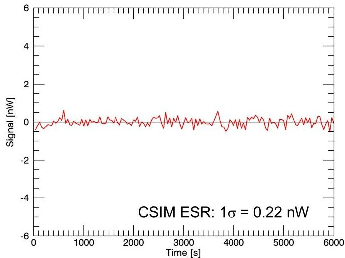

Figure 6: Noise level comparison for a 40 second signal integration for a 1-hour and 40-minute measurement period. The new CSIM ESR (right) has a noise reduction by a factor of 7.2 over the TSIS SIM ESR (left); 1-sigma noise of 0.22 nW compared to 1.59 nW.

## 3.3 Spectral Radiometer Facility (SRF)

The LASP Spectral Radiometer Facility (SRF) was used for the CSIM instrument calibration for obtaining radiometric accuracy traceable to international standards in power and irradiance. This involved performing both unit-level (subsystem) and instrument level end-to-end quantifications. The SRF ties its calibration to a NIST-traceable cryogenic radiometer and SIRCUS stabilized laser sources fully tunable between 206 nm $ - $ 3000 $ nm^{16} $ . The measurements are completed in both power (underfilled aperture) and irradiance (overfilled aperture) approaches. All critical apertures are measured with low uncertainty (typ. $ < $ 500 ppm) at the NIST Aperture Measurement Facility (AMF) in Gaithersburg, MD. Figure 7 shows an overview of the SRF and the two measurement configurations used to validate the CSIM instrument equations against the NIST-traceable cryogenic radiometer.

There are several contributions to the combined uncertainty of the SRF related to the cryogenic radiometer operating in irradiance mode and the end-to-end laser measurement comparison. Of the individual contributions to the cryogenic radiometer operating in power, both power calibration and cone reflectivity are direct measurements and are ultimately traceable though NIST calibrated Si-trap standards. Operating in irradiance mode, the dominant uncertainty is due to the introduction of the precision entrance aperture before the cryo-cavity. Of all the contributions, the NIST reported uncertainty ( $ \sim0.05\% $ ) in the area determination of the cryo-cavity entrance slit is the largest single source of uncertainty. The combined standard uncertainty of the cryogenic radiometer operating in irradiance mode is 0.07% (k=1). This is depicted in Figure 7 with the turning mirror path to the cryogenic radiometer (solid line from turning mirror).

<!-- PDF_PAGE: 9 -->

Full SRF calibrations include quantifying the absolute wavelength scale, instrument line profiles, spectral resolution, the ESR absolute power accuracy (W) against a cryogenic radiometer power (W), the calibration of the photodiode radiant sensitivities (A/W) to the cryogenic radiometer power, and the final end-to-end validation of the CSIM spectral irradiance scale.

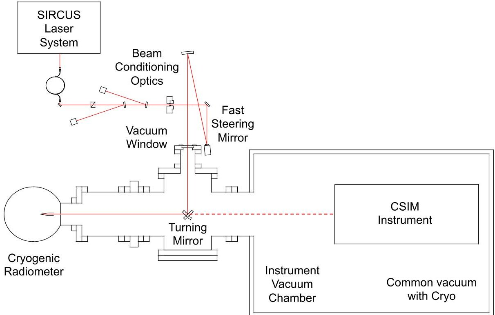

Figure 7: LASP SRF showing optical layout including SIRCUS laser system coupled to the cryogenic radiometer and instrument vacuum chamber. All beam conditioning optics, including laser stabilization, shuttering and polarization control are located outside vacuum. The laser then passes through a single vacuum window (common to cryogenic radiometer and instrument). An accurately calibrated precision turning mirror (in vacuum) selects the calibration path - cryogenic radiometer or instrument.

## 3.4 Wavelength, instrument line profile, and spectral resolution

The SRF provides frequency and intensity stabilized laser sources that are used to calibrate the absolute wavelength scale of CSIM with respect to the prism incidence angle. By scanning the prism across the central laser wavelength we are able to determine the CSIM center wavelength (spectral centroid) of the response functions and calibrate against the central laser wavelength. Figure 8 shows a typical photodiode scan across the Si and InGaAs photodiode detectors at a 532 nm central laser wavelength.

Full SRF calibration involved stabilized laser wavelengths covering the range 206 nm to 2800 nm for all detectors, both s- and p-laser polarizations and both CSIM channels. This was also repeated over all off-axis field angles up to and including $ \pm 2 0 $ arc-min (just over the 15 arc-minute half disc of the sun). The measured instrument line shape (ILS) functions allow for the wavelength scale calibrations and optical refinement of the 2D ray-trace model of the system. The SRF laser linewidth is generally much narrower than the CSIM spectral response and allowed for the quantification of the ILS functions; for each wavelength the laser linewidth is known and deconvolved from the measured ILS signal to obtain the true instrument ILS function. The centroid of the CSIM spectral ILS functions fit the wavelength scale in the instrument dispersion model for the Suprasil 3001 fused silica prism and verifies the spectral resolution. Figure 9 shows the results of the CSIM wavelength scale mapping to prism angle for each photodiode detector as well as the ESR. Also shown is the derived spectral resolution for the photodiodes and a comparison to the photodiode resolution of the TSIS-1 SIM instrument.

## 3.5 Wavelength dependent contributions to derived spectral irradiance

The high fidelity 2D ray trace model is refined by the unit-level metrology characterizations (entrance slit area, baffle edges, prism transmission, exit slit locations) and instrument level calibrations (wavelength scale, FOV definition, measured instrument line shapes, spectral resolution, scattered light). The final model refinement is then used for the full

<!-- PDF_PAGE: 10 -->

radiometric model and allows for the calculation of the diffraction loss and Fresnel reflection losses to add to the full spectral transmission correction factors.

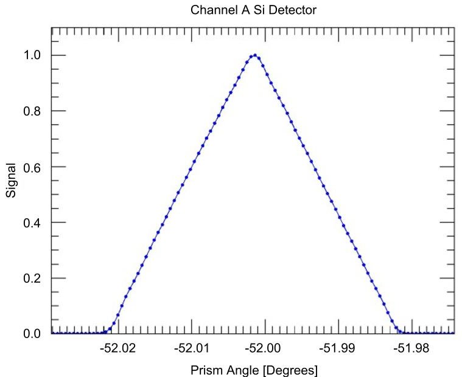

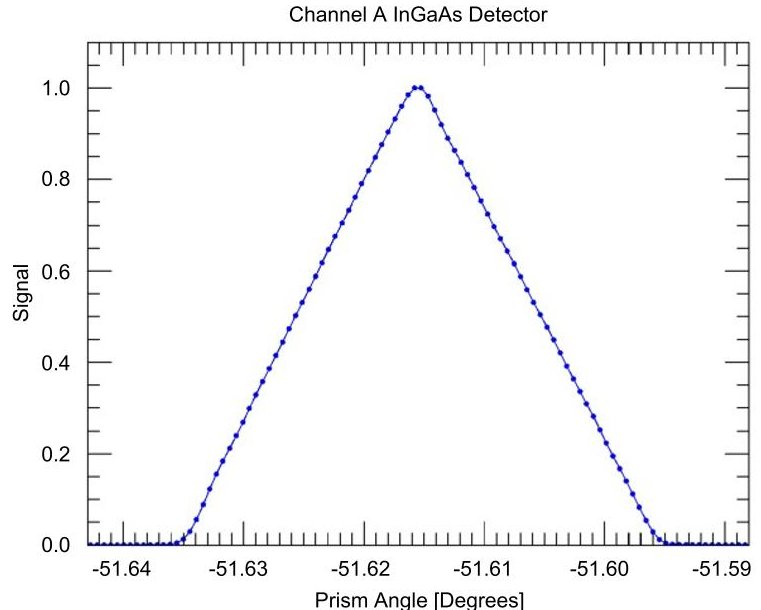

Figure 8: Photodiode instrument line shapes measured at 532 nm as a function of prism incidence angle (as calibrated by the optical encoder DN). Points are the direct measurements the line is the result of the optical model. Correlation of the centroid with the optical model of the prism dispersion allowed for accurate wavelength scale calibration to the prism incidence angle as defined by the optical encoder DN.

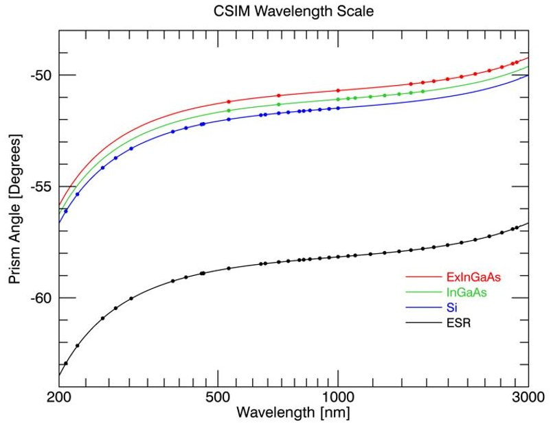

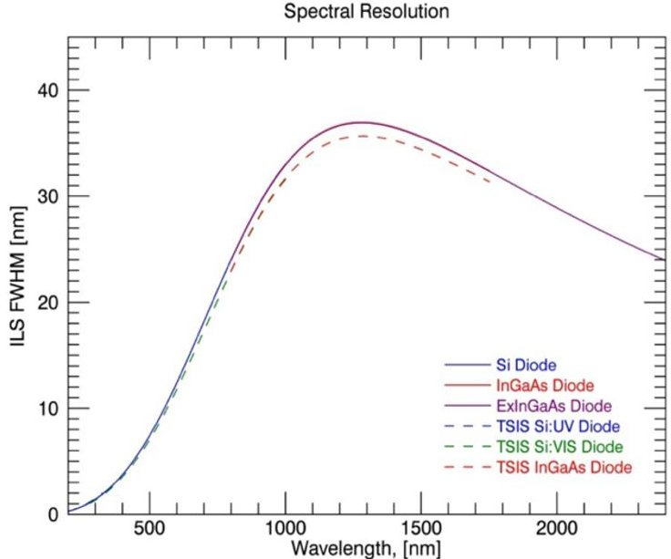

Figure 9: (a) CSIM wavelength scale calibration, comparison of direct laser measurements (solid dots) to CSIM spectral model. Global uncertainty for all wavelengths is < 2 arc-seconds in prism angle. Note the offset in the curves for the photodiode detectors is due to the relative positions of the detectors in the focal plane. The ESR offset is due to the larger incidence angle to scan the spectrum across the ESR exit slit at the location opposite the photodiode focal plane (see figure 2b). (b) Spectral resolution across the full spectrum (also shown is the TSIS-1 SIM resolution; CSIM is slightly lower resolution, but still meets established requirements).

Once the wavelength scale and spectral resolution have been established, the full radiometric solution to the measurement equation can be completed. This includes unit-level wavelength and polarization dependent correction terms to the denominator in the ESR measurement equation. These include the full path transmission and diffraction evaluations. The transmission in particular has many individual contributions relating to the reflection from the aluminum OAP (collimating mirror) as well as the transmission and reflection of the prism. For the prism there are polarization dependent Fresnel reflections (both external and internal), bulk absorption loss, and aluminum reflection at the back surface (second-surface reflectivity). These measured and derived throughput correction factors are shown in Figure 10 and have be refined in the full CSIM radiometric model.

<!-- PDF_PAGE: 11 -->

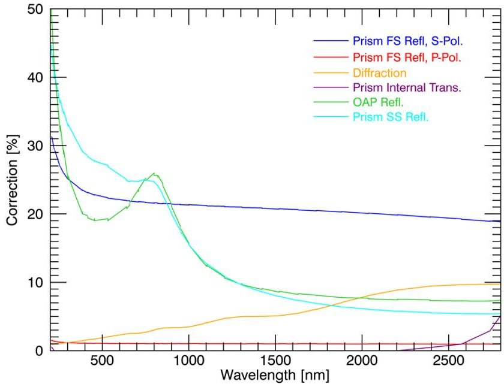

Figure 10: Known spectral corrections functions to the full radiometric measurement equation used to derive the spectral irradiance for the ESR measurement path from 200-2800 nm. These are the spectrally dependent terms in the measurement equations (1 a, b).

## 3.6 Absolute irradiance scale tied to cryogenic radiometer

Bracketing the stabilized measurements of the cryogenic radiometer are the direct spectral measurements of the CSIM instrument with the same undisturbed intensity and frequency stabilized selected laser wavelength. This is depicted in figure 7 with the turning mirror path selected to direct laser light to the CSIM instrument (dashed line from turning mirror). Both CSIM and the cryogenic radiometer are under vacuum and no optical elements (other than the common turning mirror) are introduced between vacuum measurement paths.

We can now combine the cryogenic radiometer irradiance uncertainty with the measured and derived uncertainties of the SRF laser parameters specific to the CSIM measurement path (including turning mirror stability, laser intensity stability, laser pattern uniformity). The dominant uncertainty in the measurement equation validation against the cryogenic radiometer in irradiance mode is related to the CSIM ESR instrument line shape integration based on the limited sampling points of the ESR measured instrument profiles. Figure 11 shows a typical cryogenic radiometer to CSIM ESR power comparison. For the cryogenic radiometer, the laser is shuttered at 50% duty cycle and the power is a direct measure of the shutter open to the shutter closed difference. For the CSIM ESR, we again shutter the laser at 50% duty cycle, but scan the prism angle across the full spectral response for the laser wavelength. Various techniques were used to numerically integrate the data yield a best result of $ \sim 0.15\% $ （k=1）uncertainty in integrated irradiance. With this reflected in the end-to-end calibration uncertainty budget for the SRF to CSIM comparison, we can achieve on the order of 0.2-0.5% uncertainty in the cryo-calibration of the absolute spectral irradiance accuracy.

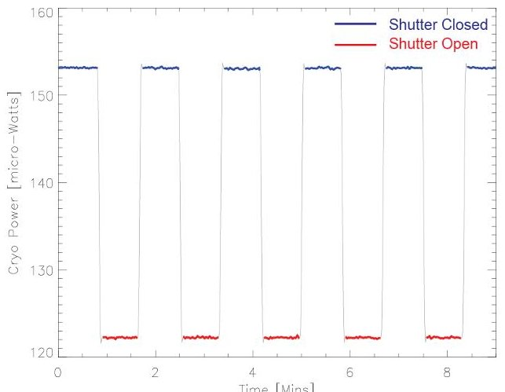

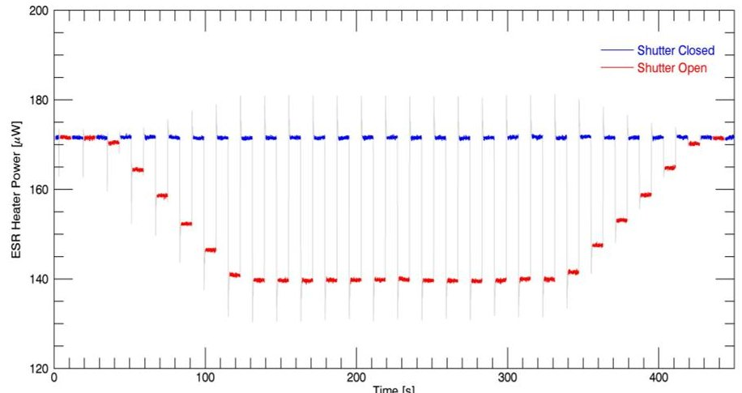

Figure 11: Direct measurement of laser power by the cryogenic radiometer (left) and the CSIM ESR (right). For the CSIM measurement, the full spectral profile must be scanned and then spectrally integrated to validate against the cryogenic radiometer result.

<!-- PDF_PAGE: 12 -->

Finally, CSIM end-to-end validation against the cryogenic radiometer in irradiance provides an assessment of the quality of the full radiometric model to account for all spectral corrections and ultimately correct any residual systematic biases at the $ \sim0.5\% $ uncertainty level.

The result of this SRF validation of the CSIM radiometric model against the cryogenic radiometer is shown in Figure 12. The results in figure 12(a) show there is a common systematic bias in the radiometric model based on all the unit-level correction factors accounted for in the measurement equation (Equation 1b). This is common for both channels and both polarizations. Figure 12(b) shows that the difference from the mean for both channels and both polarizations is $ <\pm0.5\% $ for all wavelengths between 300-2800 nm (and indeed $ <\pm0.25\% $ for most of the visible and all the near IR wavelengths). The final absolute calibration against the cryogenic radiometer then applies a common bias correction to functionally fit the difference seen in Figure 12(a). The physical origin of the residual bias is most likely the result of small errors in the direct unit-level measurements of the OAP aluminum reflectivity in combination with slight errors in the prism first surface Fresnel reflection losses. This is consistent with the spectral polarization dependence seen in the difference from the mean error in the UV for 200-300 nm range (note in figure 12(b), the p-polarization error for both channels is positive, whereas the s-polarization error is negative). An additional clue is in the "Al-dip" region in the 800-900 nm region seen in figure 12(a) consistent with a residual error in the aluminum reflectivity correction. We apply final corrections to the 200-300 nm region also, but due to the sharp gradient with wavelength in this region we expect the absolute calibration in shortest UV region here to be no better than $ \pm2-3\% $.

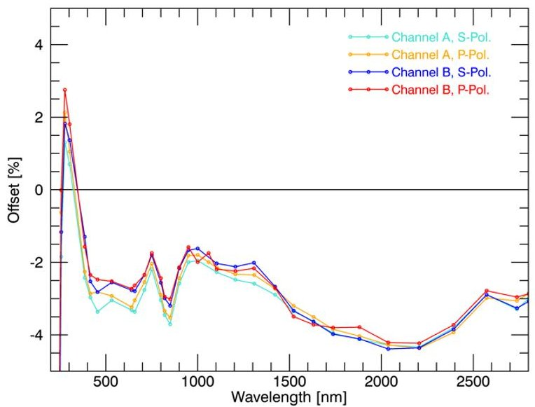

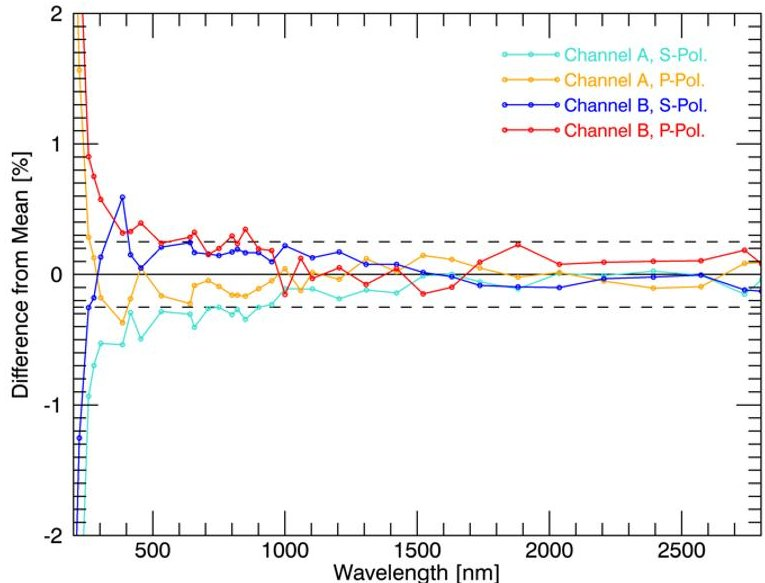

Figure 12: (a) shows the final, full spectrum CSIM radiometric model residual from the cryogenic radiometer result in irradiance showing a common bias of 2-4%. (b) shows the difference from the mean differences in (a) for all channels and both polarizations.

## 3.7 In-situ (on-orbit) calibration of prism incidence angle to encoder value

The first surface Fresnel reflection off of the prism allows for the periodic, in-situ calibration of the measurement geometry to verify the prism angle encoder positions for each detector exit slit location. The fused silica prism first surface is superpolished ( $ \sim1 $ A rms) and uncoated (no AR coating applied). Therefore, based on the dominant visible light signal and the corresponding index of refraction $ \mathrm{n_{2}}\sim1.46 $ of fused silica and vacuum $ \mathrm{n_{1}=1.0} $ , we expect the solar white-light reflectivity at normal incidence angle to be $ \sim3.5\% $ . This reflected (undispersed) light can then be scanned across the detectors at the focal plane to provide a geometric fiducial of the exit slit locations against the measured centroid encoder position. Figure 13 shows the measured and modeled signal of the first surface Fresnel reflection scan across each detector exit slit at the CSIM focal plane for the photodiodes and ESR. These spectrally independent point spread functions provide a unique angle centroid that can be used to track and correct changes (on-orbit) in the relative position of the encoder to the prism angle (fiducial re-calibration). Changes can be the result of mechanical launch shifts from pre-launch values or temperature variations experienced during the mission. By accurately calibrating these centroid angles against encoder DN pre-flight, corrections can be made on-orbit to re-calibrate the actual encoder DN to prism angle functions. These calibrations were done pre- and post-vibe and over predicted operational temperature ranges. On-orbit, resolved UV solar absorption lines (that are accurate wavelength standards) are used to verify the wavelength to encoder mapping.

<!-- PDF_PAGE: 13 -->

Si Diode Fresnel ILS: Nom Prism Angle = 2.022 $ ^{\circ} $

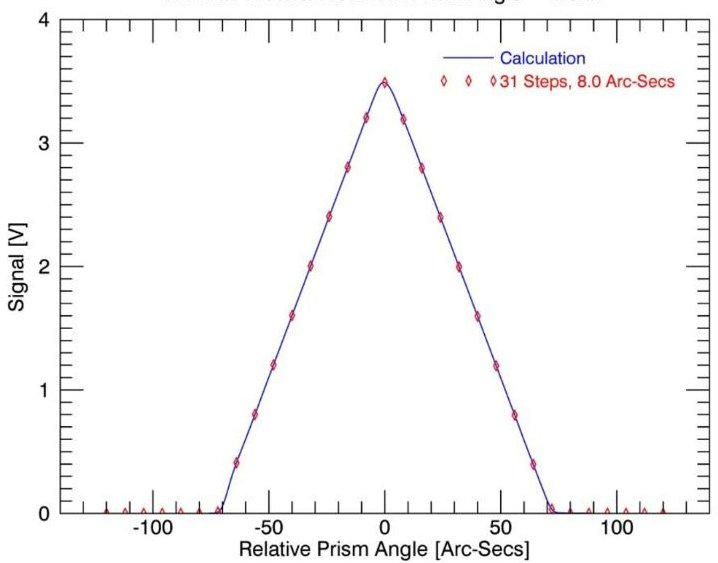

InGaAs Diode Fresnel ILS: Nom Prism Angle = 1.646 $ ^{\circ} $

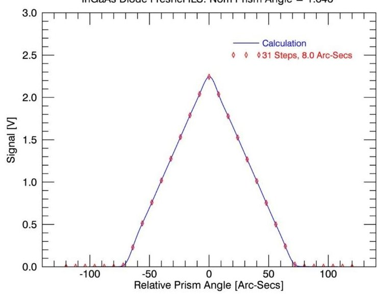

ExInGaAs Diode Fresnel ILS: Nom Prism Angle = 1.269°

ESR Diode Fresnel ILS: Nom. Prism Angle = 8.000°

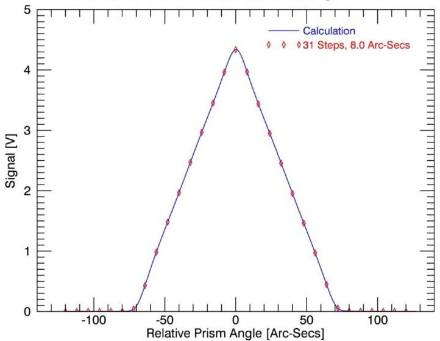

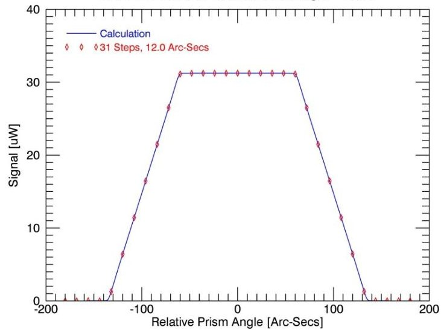

Figure 13: Scans of the CSIM first surface Fresnel reflection across each photodiode and also the separate ESR optical path. There is no wavelength dependence here since the reflection is undispersed white-light. The data for each detector shows both the measurements (red diamonds) and the CSIM spectral model calculation based on the fixed prism incidence angle to encoder angle. These scans are completed prior to each scan on-orbit to verify the angle to encoder fiducial for each scan.

## 3.8 Spectral sampling

Correct spectral sampling of the SSI spectrum requires a sampling interval of 6 samples per resolution element (6 prism steps per exit slit width). Figure 14(a) shows the prism angular step size in arc-sec to provide 6-point sampling as a function of wavelength recorded by the corresponding photodiode detector. The sampling intervals follow the dispersion curves for the fused silica prisms, resulting in larger step sizes in the UV were the spectral dispersion is largest. Based on a minimum step size of 11.8 arc-sec requires 2041 steps to cover the full $ 6. 7^{\circ} $ prism incidence angle range that defines the 200-2800 nm region. At a 1 second dwell time per step (0.5 sec signal integration time + 0.5 second prism step settling time) the full scan can be recorded in under 35 min of solar viewing time.

For the ESR detector there is a trade off on scan time and signal integration time. To achieve the desired noise performance requires integration times 20-40 seconds per sample (prism dwell time per position). Because of the longer scan times and the wider exit slit width relative to the diodes, the sampling was reduced to 5 samples per resolution element. This resulted in prism step sizes of around 44 arc-sec (requiring 500 steps to cover the full 6.1 $ ^{\circ} $ scan range). Figure 14(b) shows the exact step sizes to achieve 5-point sampling for the ESR across the full spectrum.

Based on these step sizes and the total number of steps required to scan the full photodiode spectrum as well as the total number of steps used for the less frequent ESR scans we established the total prisms steps per day of operation. Based on a three-year (2 year prime, one year extended) mission and including a year ground testing, we performed an effective

<!-- PDF_PAGE: 14 -->

(accelerated) life-test for the prism drive mechanism (one month of continuous testing). This effective 200-week life test showed no degradation or trending in the prism step positional error.

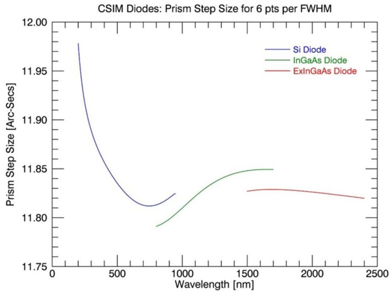

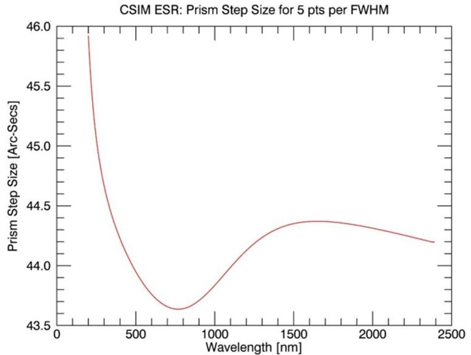

Figure 14: The CSIM full spectrum prism step sizes for the (a) photodiode scan to achieve 6 samples per resolution element, and (b) the ESR scan to achieve 5 samples per resolution element. These sampling values are used in on-orbit scan operations to maintain the uniform spectral sampling.

## 3.9 Spectral Heliostat calibrations

Heliostat calibrations include establishing the CSIM optic axis bore-sight to the internal fine sun sensor (FSS) quad diode, verifying the scattered light suppression (since no UV wavelengths through the atmosphere so this allows for quantification of visible and near infrared scattered light in UV detection ranges < 310 nm), verify dynamic range performance with true solar signal, and evaluate closed loop observatory pointing performance. For this pointing performance test the complete CSIM 6U CubeSat was mounted on a 1-axis air bearing and verified the correct BCT XB1 reaction wheels phasing and closed loop performance to the FSS error signal during induced pointing disturbances.

The optic bore-sight analysis involved elevation and azimuthal off-pointing scans with the prism fixed at $ \sim 8 0 0 $ nm. The 50% detector power points were measured using the FSS and the angular encoder and then applied an offset to zero the FSS output at the CSIM bore-sight. The full-width half maximum (FWHM) defines the instrument FOV at 137.8 arc-min $ (2.3^{\circ}) $ in the dispersion direction and 148.3 arc-min $ (2.5^{\circ}) $ in the cross-dispersion direction as shown in Figure 15. These scans are repeated periodically on-orbit to verify FFS to boresight alignment.

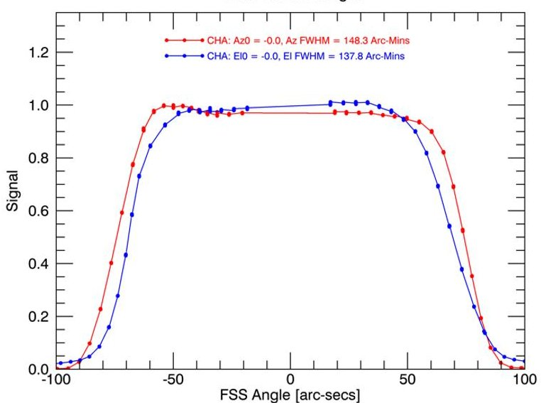

Figure 15: The CSIM (Channel A) optic bore-sight scans in the LASP Heliostat. Both elevation (El) and azimuth (Az) scans were completed to map the full detector response as a function of FSS pointing angle. The FWHM defines the instrument FOV at 137.8 arcmin $ (2.3^{\circ}) $ in the dispersion direction (El) and 148.3 arc-min $ (2.5^{\circ}) $ in the cross-dispersion direction (Az).

<!-- PDF_PAGE: 15 -->

For scattered light analysis in the heliostat, we exploit the absence of UV radiation below 310 nm due to upper atmospheric absorption of solar radiation. By repeated UV scans over the 200-300 nm ranges the measured signal shows the scattered light. For this range the scattered light suppression was $ \sim 1 0^{-3} $ for 260-300 nm and $ \sim 1 0^{-2} $ for 210-260 nm. For the shortest detected solar wavelengths (200-210 nm) the solar signal decreases to $ < 0.01 $ W/m $ ^{2} $ /nm and here we have determined that the scattered light signal will be a $ \sim 30\% $ effect requiring further refinements to dark measurements on orbit.

## 4. OBSERVATORY SYSTEM IMPLEMENTATION

The CSIM demonstration mission accommodates a wide variety of orbits and was designed to fly in any low earth orbit (LEO) between 450 and 625 km with an inclination above a 40 $ ^{\circ} $ . While the spacecraft and communications are designed to operate in any LEO orbit below 800 km, the maximum orbit altitude is limited by the orbital debris requirements contained in NASA STD 8719.14A. Preliminary orbital lifetime and debris analyses were performed for CSIM using DAS version 2.0.2 debris assessment software provided by the Orbital Debris Program Office at NASA's Johnson Space Center (JSC). CSIM is compliant with NS 8719.14 process for limiting orbital debris requirements. No objects reach the ground upon reentry and the spacecraft will reenter within 15.1 years of launch from a 625km orbit. Ultimately CSIM-FD was manifested on the SSO-A SpaceX Falcon 9 Spaceflight Dedicated Rideshare Mission, that launched on December 3, 2018. The CSIM design is fully compliant with the Canisterized Satellite Dispenser (CSD) from Planetary Systems Corporation (PSC). Spaceflight Industries, LLC (Auburn, WA) provided the CSD along with the launch vehicle integration services. Table 2 summarizes the mission design requirements and the actual mission specifications.

Table 1: CSIM-FD mission specifications

<table border="1"><tr><td>Mission Element</td><td>Requirement</td><td>Actual</td></tr><tr><td>Launch</td><td>Q4,2018</td><td>December 3,2018(actual)SpXSSO-A</td></tr><tr><td>Orbit Altitudes:CircularSSO</td><td>Ranges(km)450-625450-625</td><td>Alt:575km(SSO)573-590kmEccentricity:0.001-0.003</td></tr><tr><td>Orbit Inclination</td><td>&gt;40°</td><td>97.77°</td></tr><tr><td>Payload</td><td>≤6U CubeSat</td><td>6U CubeSat</td></tr><tr><td>Mass</td><td>&lt;12kg</td><td>10.22kg</td></tr><tr><td>Power</td><td>&gt;49.3W</td><td>57W</td></tr><tr><td>Communications:UHF(uplink)UHF(downlink)S-Band(downlink)</td><td>≥1.0kbps≥9.6kbps≥0.9Mbps</td><td>9.6kbps9.6kbps1Mbps</td></tr><tr><td>ADCS(3axis)</td><td>&lt;0.016°</td><td>0.002°(XB1)</td></tr><tr><td>Data VolumeUHFS-band</td><td>&gt;3.2Mbits/day&gt;160Mbits/day</td><td>5.8Mbits/day180Mbits/day</td></tr><tr><td>Mission Operations</td><td>LASP</td><td>LASP</td></tr><tr><td>Total Contact TimeUHF DL TimeS-band DL Time</td><td>&gt;16minus/day≥5minutes/day≥3minutes/day</td><td>24minutes/day18minutes/day6minutes/day</td></tr><tr><td>Mission Life</td><td>&gt;0.5Years</td><td>1.5Years(Design-projected)</td></tr></table>

## 4.1 Payload Configuration

The CSIM 6U CubeSat consists of the 2-channel CSIM optical bench, the integrated fine sun angle sensor, and the support electronics. Packaged with the instrument is the UHF, and S-Band radio, the BCT XB1 unit, and four deployable solar panels. The UHF antenna is a deployable BCT antenna, and the S-Band radio uses a patch antenna. Figure 16 shows the full integration of the CSIM-FD 6U configuration.

## 4.2 XB1 Blue Canyon Technologies Spacecraft Bus

The spacecraft bus (XB1) was procured from Blue Canyon Technologies (BCT) and has flight heritage on RAVAN. The XACT ADCS unit has flight heritage on both MinXSS and RAVEN. The XB1 includes the XACT attitude control system, GPS receiver, communication systems, electrical power system, and solar arrays. Two separate star-trackers are mounted

<!-- PDF_PAGE: 16 -->

perpendicular to each other, internal to the XB1, and more than $ 9 0^{\circ} $ from the solar arrays. Solar arrays and the UHF monopole antenna are the only deployable systems on board. The solar arrays use Planetary Data Corporation's roller bearing design for stowage and deployment.

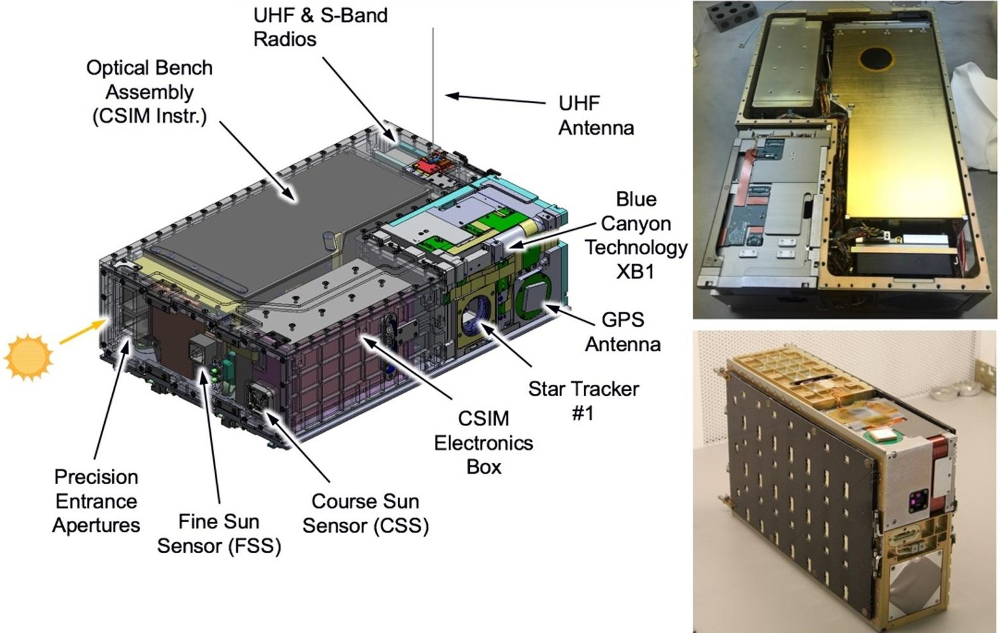

Figure 16: Full CSIM-FD payload configuration showing the arrangement of the observatory subassemblies in the 6U CubeSat volume. The figure on the right shows the observatory in operational mode with fully deployed solar panel arrays. These arrays are hinged at the edges of the faceplate and spring-loaded to deploy after ejection from the dispenser canister.

## 4.3 Command and Data Handling

The XB1 provides autonomous operation and flexible command modes to support a wide range of missions and was an ideal match for CSIM-FD. The XB1 incorporates a dual core ARM Cortex-A9 based Processing System (PS) with 8GB of onboard memory that supports user developed payload algorithms, with built in options for high rate, low rate, and asynchronous tasks, with access to all XB1 data, including star camera images if necessary. Approximately 7GB of onboard storage is available for the science and housekeeping data (HK) allowing science data to be stored and forwarded at a much higher cadence than baselined.

## 4.4 Power

The XB1 Electrical Power System (EPS) board provides spacecraft electrical power control and distribution. Functionality is included for solar array input power with peak power tracking, on board or external battery, charge control, voltage regulation and distribution, and data acquisition. The EPS board functions as a peripheral to the XB1 controller board; telemetry from the EPS board is provided to the controller board. Commands are provided by the controller board to the EPS board for configuration and control of the spacecraft EPS and heaters. Solar arrays are sized to achieve energy balance for the worst-case orbit including battery charging, 85% power system efficiency, 85% battery charging efficiency and data downlinks from both transmitters during eclipse. The battery maintains a 72.4% state of charge under normal on-orbit operations.

<!-- PDF_PAGE: 17 -->

## 4.5 Communications

Two communication systems are included in the XB1, the SpaceQuest TRX-U UHF transceiver and the BCT S-band transmitter. The UHF transceiver is used for spacecraft operations including beacons, the command uplink and low rate (9.6 kbps) telemetry for all spacecraft modes. The spacecraft contains a single, deployable monopole UHF antenna as used on CSSWE and MinXSS. A single S-band patch antenna is used on the spacecraft for high rate (500 kbps - 1Mbps) telemetry. While the UHF antenna is omnidirectional, the spacecraft rolls about sun vector while in view of the S-band dish at the ground station to maximize the link margin for the S-band downlink. The UHF ground stations contain additional margin with the capacity to increase command power on the on the uplink. The ground stations are located in the Small Sat Operations Center at LASP in Boulder, Colorado (S-band and UHF) and an additional ground station in Fairbanks, Alaska (UHF only).

## 4.6 Attitude Control and Determination System

The XB1 ADCS features 3-axis Stellar Attitude Determination (SAD) in a micro-package. Built-in flexible commanding allows for multiple pointing reference frames: Inertial, LVLH, Earth-Fixed, planet-fixed, and Solar. Precise 3-axis control is provided by dual star trackers, an IMU, low jitter reaction wheels, torque rods and integrated control algorithms. The XB1 pointing control loop can be closed with a $ 0.002^{\circ} $ accuracy (1-sigma), providing ample margin for the $ 0.033^{\circ} $ pointing requirement of the CSIM instrument.

## 4.7 CSIM Thermal Design

CSIM utilizes an active and passive, cold biased, two-zone thermal control system. Zone 1 consists of the optical bench assembly that utilize PID controlled operational heaters to maintain temperature stability. Zone 2 contains the remaining instrument and spacecraft components. While the most all components in zone 2 operate between $ - 2 0^{\circ} \mathrm{C} $ and $ + 5 0^{\circ} \mathrm{C} $ , heaters will maintain the battery temperatures above $ 0^{\circ} \mathrm{C} $ . Thermal Materials include typical thermal coatings such as electroplated gold and silver Teflon $ ^{\circ} $ tape. The heat rejection capability of the external surfaces is set by striping aluminized Kapton $ ^{\circ} $ tape to adjust the emissivity values. This provided for a flexible thermal design that was capable of modification and fine tuning during the thermal balance test program. The sun-pointing surface of the spacecraft is completely covered with silver Teflon tape to provide a measured absorption of solar energy. Survival heaters will be implemented for the spacecraft batteries. Battery temperatures are maintained within safe operating limits by software-controlled heaters with adjustable set points. All thermal engineering analyses for the mission was completed using Thermal Desktop. Figure 17 shows the on-orbit measured temperature stability within $ 0.2^{\circ} \mathrm{C} $ for the detectors and prisms.

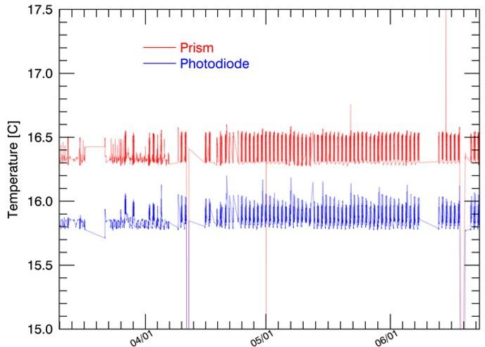

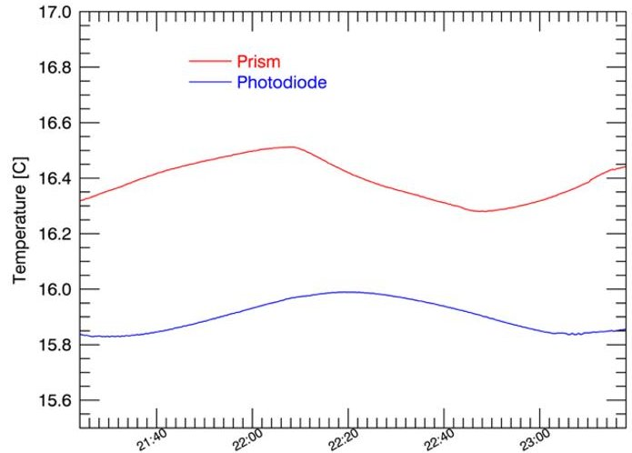

Figure 17: On-orbit measured temperature stability of the prisms and focal plane detectors for the mission to date (left) and during one full 90-minute orbit - sunlit and eclipse (right). Maximum temperature changes are on the order of $ 0. 2^{\circ} \mathrm{C} $ and correlate well with those modeled prior to launch.

## 5. CSIM-FD ON-ORBIT INSTRUMENT PERFORMANCE

CSIM acquires a continuous 200-2800 nm SSI spectrum twice per day, nominally every 12 hours. This measurement cadence matches the observational requirements established for SSI climate data record continuity. The daily operations plan includes both photodiode and ESR solar measurement activities. In this plan, the two photodiode scans are separated by ~12 hours (on orbits 1 & 9) and cover the entire 200-2800 nm range in 35 minutes in solar tracking mode. Following

<!-- PDF_PAGE: 18 -->

these scans on the next orbits (orbits 2 & 10), the scan sequence is repeated but with the channel shutter closed to acquire a full range dark correction spectrum. Using this approach, the dark spectrum is recorded in the same solar-loaded thermal environment as the previous measurements scan. These pairs of measurements are used in the photodiode measurement equation to generate the twice daily 1-AU distance corrected SSI data product. The final calibrated SSI data product is then generated by applying the radiant sensitivity and solar-exposure degradation functional corrections throughout the mission life. The degradation correction function is evaluated on a 30-day cadence and involves Channel A and Channel B ESR comparison scans. These scans occur between the photodiode scans (nominally on orbits 5 & 6, for Channel A & Channel B, respectively). The ESR is an inherently slow-response absolute detector and therefore requires many orbits to scan the full spectral range. For these ESR Channel A-to-B comparison scans, common spectral regions are scanned on adjacent orbits to effectively maintain a common (invariant) Sun. These scans require shuttered operation (at 50% shutter duty-cycle) with an integration time dependent on the magnitude of the solar signal; the UV scan regions typically have an integration time of 100 seconds whereas the Visible and near-IR are around 20-40 seconds.

Figure 18 shows a typical ESR signal measured during a prism step scan on-orbit. For the ESR measurements, the shutter operates at 50% duty cycle, and modulates the incoming solar radiation on the active bolometer. With the shutter closed, both the active and reference bolometers in the bridge circuit are balanced by applying the replacement power (DN) to the active bolometer to maintain thermal balance. When the shutter opens, solar radiation now impinges on the active bolometer causing it to heat up and change the thermal balance. To maintain the balance the applied replacement power on the active bolometer must be reduced (decrease the DN value to reduce the PWM duty-cycle). The decrease in the applied power is then a direct measure of the optical power of the solar radiation.

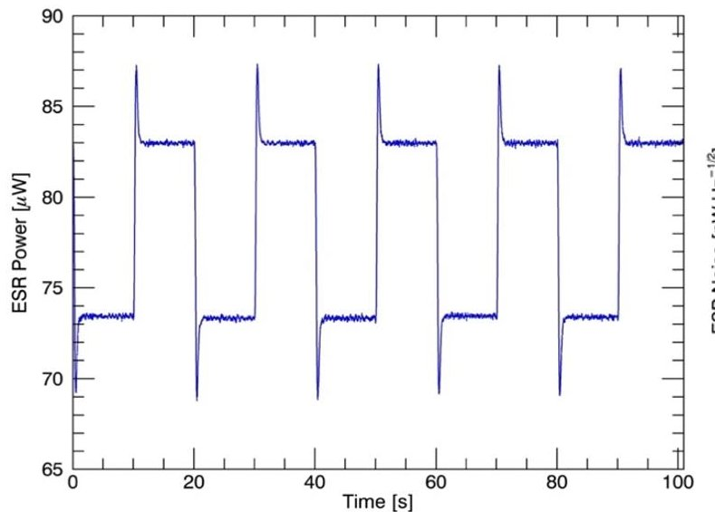

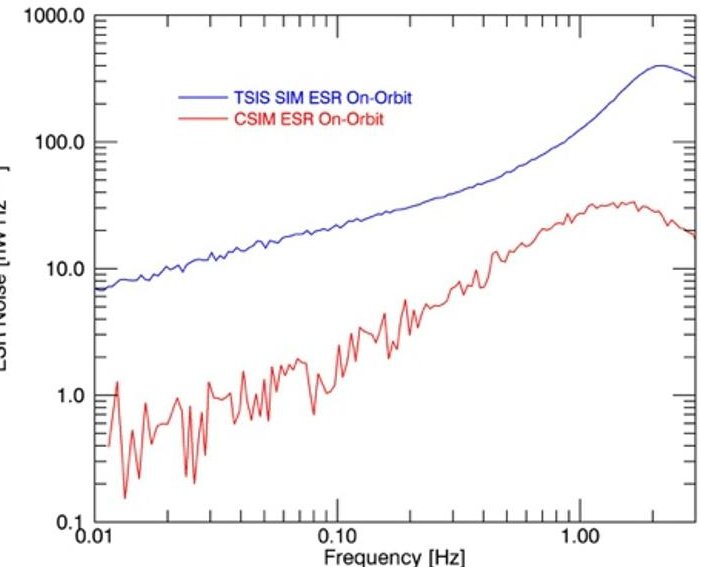

Figure 18: (Left) Measured Channel A ESR signal for a portion of the on-orbit solar scan near 420 nm. For this scan the shutter is open for 10 seconds and closed for 10 seconds showing a detected power of $ \sim 9. 5 $ $ \mu $ W. After a complete shutter cycle (every 20 seconds) the prism is rotated to select a new wavelength. The spikes show the closed loop response of the servo system to the thermal imbalance at the shutter transition times. (Right) Comparison of the on-orbit measured power noise performance between the new CSIM ESR and the heritage TSIS SIM ESR. For the shutter cycle frequencies of 10 -100 seconds $ (0.1-0.01 $ Hz) we are achieving better noise performance than the TSIS SIM ESR by nearly an order of magnitude.

With one spectral range scanned per day, the entire ESR spectrum for both channels is covered in 14 days. Note that while the full ESR spectrum requires 14 days, the common spectral regions between Channel A and Channel B are separated by only one orbit ( $ \sim $ 90 minutes) and are bracketed by the 12-hour diode scans on the same calendar day. The 14-day ESR scan sequence is repeated every 30 days. In addition to the ESR scans, a Channel B full photodiode scan is completed one per week. Based on this operational approach, the mission average solar exposure ratio is 7% B to A.

Figure 19 shows the first on-orbit SSI measurements for the CSIM photodiode and ESR channels compared to the TSIS-1 SIM measurements recorded during the same time period. Recall that for CSIM, the ESR exit slit is wider (by a factor of 3) than the TSIS-1 SIM ESR, therefore for the comparison the TSIS-1 SIM spectrum was convolved with the CSIM ESR instrument line shape. While still preliminary, the agreement between CSIM ESR and TSIS-1 SIM ESR absolute SSI is excellent, with a spectral average agreement of $ \sim0.5\% $ between 300-2400 nm (note that the TSIS-1 SIM long wavelength cutoff at 2400 nm.)

<!-- PDF_PAGE: 19 -->

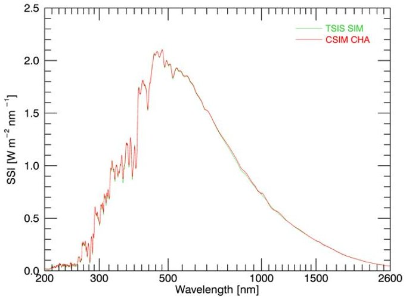

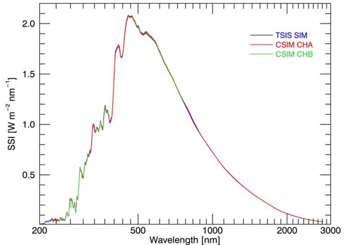

Figure 19: On-orbit measurements of the full SSI spectrum and comparison to the TSIS-1 SIM spectrum for the twice daily photodiode scan (left) and the absolute ESR scans (right). For the ESR comparison the TSIS SIM spectrum was convolved with the CSIM ESR instrument function (due to the factor of 3 lower CSIM ESR resolution). There is excellent agreement of $ \sim0.5\% $ differences between TSIS and CSIM SSI over the spectral range of 300-2400 nm.

## 5.1 CSIM-FD degradation corrections

CSIM uses redundant measurement channels to track and correct the solar-exposure related optical degradation throughout the mission. The approach involves using the primary measurement channel (channel A) frequently to obtain the required high cadence SSI spectral data. The secondary channel (channel B) is then used less frequently, and corrects the solar exposure optical degradation in the primary channel. Exposure to damaging short wavelength solar radiation will degrade the optical throughput of the prism optical path. Both the ESR and Photodiodes share the common optical path from the primary off-axis parabola (OAP-collimating mirror shown in Figure 2) to the front surface of the prism and therefore share the same input degradation path. Near simultaneous (temporal and spectral) ESR scans are completed periodically between the primary channel (channel A) and the secondary "calibration" channel (channel B) to correct for this optical degradation. This lesser used secondary channel B has a lower rate of solar exposure providing a stable monitor to correct the larger long-term optical degradation in the primary (higher measurement cadence) channel. In reality, the degradation correction derived from the A-to-B ratios is not unique to channel A, but includes the small but increasing degradation that channel B experiences as its cumulative solar exposure time increases with mission time. We functionally correct for the separate channel A and B degradation through their irradiance ratios (weighted by their cumulative exposure times) during periodic, near simultaneous solar measurements. These near simultaneous solar comparisons are key so as to avoid any real solar variability within the ratios.

Based on nearly two decades of experience with degradation corrections on previous missions we have a good understanding of the spectral functional form of the solar degradation of these optical materials. Therefore, between 200 2800 nm we calculate a posteriori the maximum Channel B correction uncertainty that allows us to meet the long-term stability requirements. Based on a 7% duty-cycle in solar exposure between the A and B channels, a 5% uncertainty in the channel B degradation correction will meet the stability requirements for all wavelengths, at 10% correction uncertainty we just exceed the stability requirements in the ultraviolet between 200-260 nm and near 400 nm. Note that a third channel (e.g. like with TSIS-1 SIM channel C) would allow for independent verification of the uncertainty in channel A to B degradation rate with exposure time. To this end, we plan to use direct comparisons of the CSIM degradation corrections with the extant TSIS-1 SIM results as an on-orbit validation of the CSIM stability uncertainty.

## 6. CONCLUSION

The CSIM-FD mission has been highly successful in demonstrating the new technology for CSIM and providing new, highly accurate SSI observations. Detailed comparisons between CSIM, SORCE SIM, and TSIS-1 SIM are being analyzed and will be published in a future paper. In addition, the CSIM observations will contribute reference solar spectra for the international Whole Heliosphere and Planetary Interactions (WHPI) campaigns in 2019-2020 that focus on solar cycle minimum conditions.

<!-- PDF_PAGE: 20 -->

## ACKNOWLEDGEMENTS

This work was funded through research grants from the NASA Earth Science Technology Office (ESTO) NNX15AC50G, NNH13ZDA001N, and NNX17AK22G whose support is gratefully acknowledged. The authors also would like to thank the many LASP engineers and technicians whose dedication and talents have made the entire project a success. NIST is an agency of the U.S. Government and this contribution is not subject to copyright. Use of commercial names is for reference and is not an endorsement by NIST.

## REFERENCES

[1] Haigh J. D., "The impact of solar variability on climate", Science, 272, 981-984 (1996).

[2] Gray, L, Beer, J., Geller, M., Haigh, J. D., Lockwood, M., Matthes, K., Cubasch, U., Fleitmann, C., Harrison, G., Hood, L., Luterbacher, J., Meehl, G., Shindell, D., van Geel, B., and White, W., "Solar influences on climate", Rev. Geophys., 48, RG4001 (2010).

[3] Pilewskie, P., Rottman, G., and Richard, E., "An overview of the deposition of solar radiation in the lower atmosphere: connections to the SORCE mission and climate change", Sol. Phys., 230, 55-69 (2005).

[4] Haigh, J., Winning, A. R., Toumi, R., and Harder, J. W., "An influence of solar spectral variations on radiative forcing of climate", Nature, 467, 696-699 (2010).

[5] Kopp, G. and Lean, J., "The Solar Climate Data Record: Scientific Assessment of Strategies to Mitigate an Impending Gap in Total Solar Irradiance Observations Between the NASA SORCE and NOAA TSIS Missions (Study B)", NRC Report, NOAA NCDC (2013).

[6] National Research Council, "Continuity of NASA Earth Observations from Space: A Value Framework", Washington, DC: The National Academies Press (2015).

[7] National Research Council, "National Research Council Committee on Earth Science and Applications from Space," Earth Science and Applications from Space: National Imperatives for the Next Decade and Beyond," ISBN: 0-309- 66900-6, p.4-10 (2007).

[8] Sparn, T., and Pilewskie, P., "Continuous Constellation for Total and Spectral Solar Irradiance (TSSI) in the next 35 Years", 96th AMS Meeting, Sixth Conference on Transition of Research to Operations, 10-14 January New Orleans, LA, USA (2016).

[9] National Academy of Sciences (NAS), "Achieving Science with CubeSats: Thinking Inside the Box", National Academies Press, doi:10.17226/23503 (2016).

[10] Richard, E., Harber, D., Rutkowski, J., O'Malia, K., Triplett, M., Drake, G., Harder, J., Pilewskie, P., Brown, S., Smith A., and Lykke, K., "Future Long-term Measurements of Solar Spectral Irradiance by the TSIS Spectral Irradiance Monitor: Improvements in Measurement Accuracy and Stability", Proceedings $ 1 1^{\mathrm{th}} $ International Conference on New Developments and Applications in Optical Radiometry, E. Ikonen and S. Park, Eds., Part A, paper INV004 (2011).

[11] Harder, J, Lawrence, G., Fontenla, J., Rottman, G., and Woods, T., "The spectral irradiance monitor: scientific requirements, instrument design, and operation modes", Solar Phys., 230, 141 (2005).

[12]D. Harber, E. Richard, N. Tomlin, and J. Lehman, "CNT Bolometer for Space-based Solar Spectral Irradiance Measurements", Nanotube Bolometer Workshop, NIST, July 22-24, Boulder, CO, USA (2015).

[13] Lehman, J, Yung, C., Tomlin, N., Conklin, D. and Stephens, M., "Carbon nanotube-based black coatings", Appl. Phys. Rev., 5(1), 11103 (2018).

[14] Heraeus Quartzglas GmbH & Co. KG, "Quartz Glass for Optics Data and Properties", https://www.heraeus.com

[15] Tomlin, N. A., White, M., Vayshenker, I., Woods, S., and Lehman, J. H., "Planar electrical-substitution carbon nanotube cryogenic radiometer," Metrologia, 52(2), 376-383 (2015).

[16] Brown, S., Eppeldauer, G., Rice, J., Zhang, J. and Lykke, K., "Spectral Irradiance and Radiance Responsivity Calibrations Using Uniform Sources (SIRCUS) Facility at NIST, Proc, SPIE, 5542, 363 (2004).