<!-- PDF_PAGE: 1 -->

# CONCEPT OF OPERATIONS FOR THE VISORS MISSION: A TWO SATELLITE CUBESAT FORMATION FLYING TELESCOPE

E. Glenn Lightsey, Ebenezer Arunkumar, Elizabeth Kimmel, Maximilian Kolhof, Antoine Paletta, William Rawson, Shanmurugan Selvamurugan, $ ^{a} $ John Sample, $ ^{b} $ Tommaso Guffanti, Toby Bell, Adam Koenig, Simone D'Amico, $ ^{c} $ Hyeongjun Park, $ ^{d} $ Douglas Rabin, Adrian Daw, $ ^{e} $ Phil Chamberlin, $ ^{f} $ Farzad Kamalabadi $ ^{g} $

The Virtual Super-resolution Optics with Reconfigurable Swarms (VISORS) is a National Science Foundation (NSF) space physics mission which will detect and study fundamental energy-release regions in the solar corona. The VISORS mission will image extreme ultraviolet (EUV) features on the Sun at a resolution of at least 0.2 arcseconds from Low Earth Orbit (LEO). To accomplish this objective, VISORS will use a pair of formation flying 6U CubeSats: one of which carries the observatory optics while the other contains the detector instrument. VISORS will serve as a proof of concept for this distributed instrument approach by obtaining at least one 10-second exposure image during its six-month mission lifetime. Meeting the strict relative orbit requirements during science observations will demonstrate several technologies key to precise formation flying including intersatellite link, relative navigation, and autonomous maneuver planning. To satisfy these stringent mission requirements, a concept of operations has been established that requires maneuvering between a standby orbit where housekeeping tasks are performed and an actively maintained science orbit where observations are conducted. Formation acquisition, re-acquisition, fault recovery, and escape operations are also planned. This paper provides a description of the VISORS formation flying concept of operations: explaining the function and rationale of each operation mode, how these modes are designed, and how they collectively meet the mission requirements. Specific challenges and mission trades related to performing precision formation flight with CubeSats are discussed. A Failure Mode Effects and Criticality Analysis (FMECA) is conducted to assess the risk of collision under the most probable fault scenarios, which is used to inform the development of operational mitigation strategies and on-board fault tolerant collision avoidance (COLA) logic.

<!-- PDF_PAGE: 2 -->

## INTRODUCTION

## Mission Overview

The VISORS mission is an NSF funded CubeSat project initiated from the CubeSat Ideas Lab in February 2019. $ ^{1} $ The goal of the project is to further knowledge of the solar corona and the heating processes that occur there by conducting a technology demonstration of precise formation flying technologies. This objective is to be fulfilled with a distributed telescope system composed of two 6U CubeSats, a Detector Spacecraft (DSC) and an Optics Spacecraft (OSC), which will align in Low Earth Orbit (LEO) to take high-resolution observations of the solar corona as shown in Figure 1. Each spacecraft consists of two segments: a commercial bus procured through a contract with Blue Canyon Technologies (BCT) and a payload composed of various subsystems which are necessary to carry out the mission. The bus flight computer also supports payload provided software as Hosted Software Applications (HSAs) including the formation flying Guidance, Navigation, and Control (GNC) software. The VISORS team is comprised of faculty and students from 9 educational institutions, as well as engineers from the Laboratory for Atmospheric and Space Physics (LASP) and NASA Goddard Space Flight Center (GSFC). VISORS is planned to be launch-ready by 2024, near solar maximum.

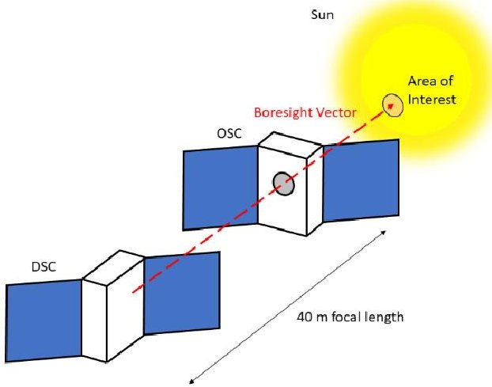

Figure 1. VISORS Formation Configuration.

The minimum success science goal of the VISORS mission is to obtain a single image of the Sun in the He II 304 $ \mathring{\mathrm{A}} $ line with a resolution of 0.2 arcseconds. Success will demonstrate several key technologies for the mission, including the photon sieve optics, the inter-satellite link, and the novel GNC algorithms for precise formation control. The extreme ultraviolet (EUV) wavelength is best for detecting the large quantities of ionized helium present in the corona, and use of an EUV photon sieve necessitates a 40-meter focal length to achieve diffraction limited image resolution, which cannot be achieved within manufacturing limits of conventional mirror-based optics onboard a single spacecraft. This motivates the use of a two-spacecraft formation with an off-axis photon sieve optic on one spacecraft to focus incoming light onto a detector located on the other. For infocus, on-target, unsmeared images to be collected, precise relative and inertial maneuvering and pointing are required. This is achieved using a flight-proven relative navigation algorithm alongside novel control laws to meet the formation flying requirements. $ ^{2,3} $ To enable this relative navigation algorithm to estimate the state of both spacecraft, an inter-satellite link (also called XLINK) is required to share global navigation satellite system (GNSS) data between the two spacecraft. The VISORS mission also uses a swappable chief-deputy architecture, which allows for a longer mission duration and higher level of redundancy since both spacecraft carry propulsion systems capable of executing the formation flying maneuvers. More specifically, the deputy-chief roles can be

<!-- PDF_PAGE: 3 -->

switched between the two spacecraft as necessary to balance propellant consumption or to manage faults that may occur throughout the mission.

In order to enable the success of this demanding formation flying mission, a detailed Concept of Operations (ConOps) strategy has been developed. This paper presents the ConOps for the VISORS mission, beginning with an overview of relevant requirements and the design of the two CubeSats. The spacecraft modes of operations will then be described in the context of how they enable safe and efficient execution of the mission requirements. The timeline of mission operations will then be discussed from deployment and commissioning to science operations and end-of-life. The fault analysis and associated mitigation of collision risk are presented to highlight the inherent hazards that arise from having the two spacecraft operate in close proximity during science operations. Recovery strategies and actions are detailed for identified fault scenarios. The development of the payload state machine (PSM) software, in the context of the mission ConOps, is discussed followed by concluding remarks.

## RELEVANT REQUIREMENTS

## Science Objectives

The complexity of the VISORS mission ConOps is a result of mission requirements which are needed to image the solar corona using this distributed telescope concept. The science goal of the mission is to obtain an in-focus EUV image of the Sun with an angular resolution of at least 0.2 arcseconds to observe and study energy-release regions within the solar corona. Three objectives must be met within prescribed bounds for a successful image to be collected. These objectives, which drive the position and attitude requirements for the mission, are listed below:

The image must be in focus: The focus of the image is primarily driven by the relative separation of the two spacecraft, which is targeted to be the focal length (40 m in this case for EUV imaging of the He II 304 $ \mathrm{\AA} $ emission line), minus a small correction for the position of the sieve and detector optics on the two spacecraft.

The image must be on target: The ability of the telescope to image specific areas of interest in the solar corona is determined by the relative lateral position and pointing abilities of the two spacecraft. The Attitude Determination and Control System (ADCS) and GNC systems must provide accurate enough state estimation and control for a useful image to be obtained.

The image must have no smearing: Smearing of the images is possible if the relative lateral drift of the two spacecraft is too large. This affects the magnitude and timing of propulsive maneuvers as the two spacecraft move into inertial pointing for science observations.

Due to the stringency of these requirements shown in Figure 2, it is not possible to guarantee they will all be met during every observation. The mission requirement of a 20% observation success rate allows the mission success criteria of at least one successful downlinked image to be achieved by planning multiple observation attempts.

<!-- PDF_PAGE: 4 -->

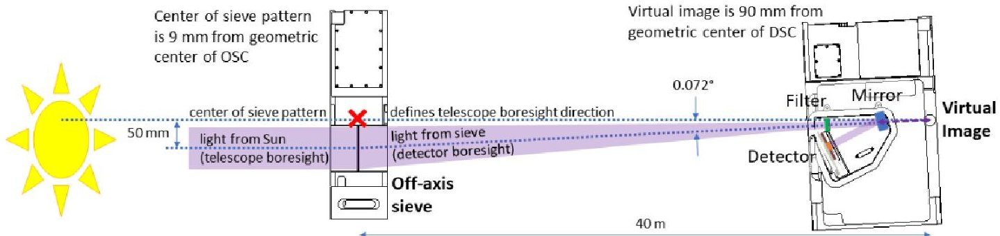

Figure 2. Required Observation Alignment Between the Spacecraft.

In addition to the science objectives, the GNC requirements for the VISORS mission are also driven by the need for orbit safety. Due to the close proximity of the two spacecraft during science observations, the risk of a potential collision must be addressed on two fronts: maintaining sufficient cross-track separation to lower collision risk from atmospheric drag and other perturbations (passive safety) and mitigating an active collision resulting from one or more errant maneuvers (active safety). Passive safety can be achieved for a known time interval using relative eccentricity/inclination-vector separation, and active safety can be accomplished with robust and flightproven GNC algorithms and on-board propulsion. $ ^{3,4} $

## GNC Requirements

For the science objectives to be met, the two spacecraft must be accurately positioned relative to one another or else the full capabilities of the instrument cannot be realized. The following GNC requirements flow down from the top-level science and mission objectives. The relevant requirements are addressed in Table 1. A graphical depiction of GNC requirements is shown in Figure 3.

Table 1. GNC Spacecraft Relative State Requirements.

<table border="1"><tr><td>Identifier</td><td>Requirement</td><td>Rationale</td></tr><tr><td>GNC-009</td><td>The longitudinal separation between the detector virtual image and the center of the photon sieve pattern shall be 40m±15mm throughout each observation attempt.</td><td>This 40m focal length is required to ensure the images are in focus.</td></tr><tr><td>GNC-012</td><td>The center of the photon sieve pattern shall remain within±17.5mm of the desired telescope boresight vector throughout each successful observation attempt.</td><td>This lateral tolerance between the sieve and detector boresight vector ensures that images are sufficiently on target to obtain a useful measurement.</td></tr><tr><td>GNC-013</td><td>The relative velocity of the center of the photon sieve pattern with respect to the center of the detector aperture in the plane perpendicular to the boresight vector shall be within±200um/s throughout each successful observation attempt</td><td>Large relative velocities between the two spacecraft would result in unacceptable blurring of the images.</td></tr></table>

<!-- PDF_PAGE: 5 -->

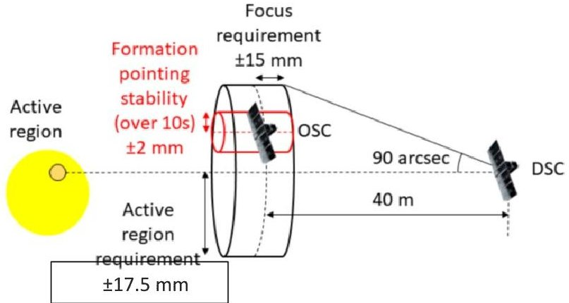

Figure 3. VISORS GNC Science Observation Requirements. $ ^{2} $

The other group of relevant GNC requirements is related to safety for the mission. A passive safety margin of at least 2 orbits without maneuvers is required at all times during the mission. This limits the minimum practical orbit altitude since higher atmospheric density causes the relative orbit to be perturbed faster. It also limits the solar beta angles at which science observations are possible since the required alignment during observation results in a minimum cross-track separation that is too small at some beta angles. $ ^{2} $ For this reason, it is preferable that VISORS operates in a sun-synchronous orbit with a beta angle that lies within the feasible range for science observations $ (\beta\sim1 3^{\circ}-6 2^{\circ}). $ Passive orbit safety alone, however, is insufficient to fully mitigate the risk of collision throughout the mission. Further requirements are imposed for the detection and avoidance of potential collisions as detailed in Table 2.

Table 2. GNC Spacecraft Safety Requirements.

<table border="1"><tr><td>Identifier</td><td>Requirement</td><td>Rationale</td></tr><tr><td>GNC-046</td><td>The GNC software shall provide a collision risk detection service that indicates the next time(if one exists in the next 24 hours) at which the minimum allowable separation in the RN-plane, including 3σ errors, is below 5m.</td><td>This requirement is used to determine if an escape maneuver is needed between the two spacecraft and specifies the condition where the risk of collision between the two spacecraft is unacceptably high.Further detail is included in the Fault Analysis section.</td></tr><tr><td>GNC-047</td><td>The GNC software shall provide an active collision avoidance function that computes a single maneuver to ensure that a safe minimum separation between spacecraft is established within one orbit.</td><td>As time goes on,the risk of collision between the two spacecraft increases if their relative position becomes more uncertain.Should an escape maneuver be needed,the GNC software will compute the time and magnitude of this maneuver.</td></tr></table>

## SPACECRAFT DESCRIPTION

## Detector Spacecraft Design

The DSC (Figure 4) and OSC (Figure 5) are both built using a commercial-off-the-shelf (COTS) BCT spacecraft bus named the XB1. $ ^{5} $ This bus provides the 6U chassis (30 cm x 20 cm x 10 cm) to house all subsystems onboard the spacecraft as well as a pre-installed (2U) avionics box. This avionics box contains all the fundamental subsystems required for a functional spacecraft. The onboard Electrical Power System (EPS) includes the necessary solar panels, batteries, and power

<!-- PDF_PAGE: 6 -->

regulators. The Command and Data Handling (CDH) subsystem includes a Xilinx processor, onboard memory, and communication line drivers. The ADCS subsystem includes a star camera, sun sensors, inertial measurement unit (IMU), and L1/L2 GNSS antenna. The DSC has a second star camera in the payload section to improve attitude estimation. Attitude control is performed with three reaction wheels for pointing and three torque rods for angular momentum desaturation. Finally, space-to-ground communications are achieved with an Ultra-High Frequency (UHF) radio system. The payload-provided GNC software is hosted in the HSA onboard the BCT bus along with the PSM.

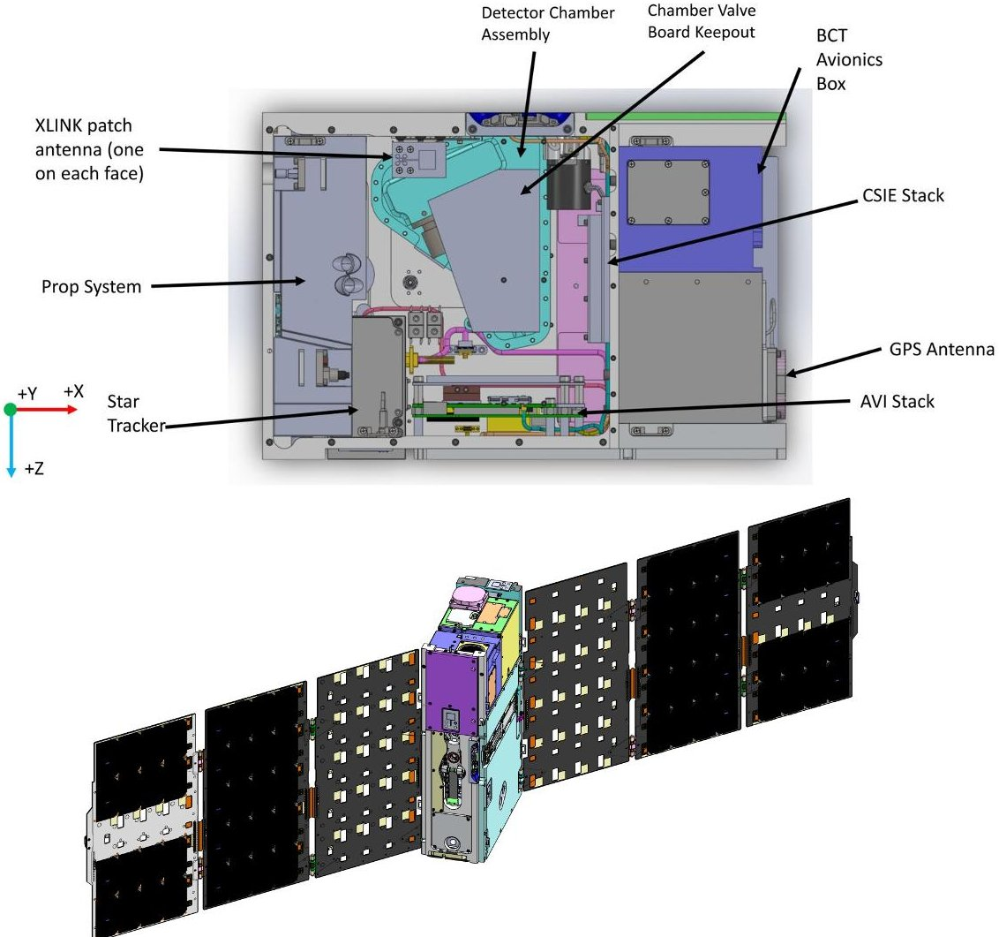

Figure 4. VISORS DSC Internal & External Views.

The 3D-printed propulsion system utilizes R-236fa cold gas propellant for impulsive maneuvers. $ ^{6} $ The nozzle impulse vectors are not coincident with the spacecraft center of mass, so reaction wheels must counteract the resultant moment, which limits the frequency and magnitude of propulsive maneuvers (as detailed in the Mission Timelines section of this paper). The propulsion system on the OSC has a larger tank, allowing for that spacecraft to provide almost two thirds of the total delta-V for the mission.

The avionics stack is made up of several XLINK circuit boards as well as the Payload Avionics Integration Board (PAIB). $ ^{7} $ The PAIB serves as a power and data interface between the BCT bus and various subsystems. It supplements the functionality available on the bus by expanding input/output and power monitoring capabilities. The PAIB also serves as a long-term/backup storage destination for the science data. The XLINK system operates at an unlicensed WiFi frequency band with a center frequency of 5.8 GHz. $ ^{8} $ The XLINK patch antennas are built into printed circuit boards (PCBs), with one fastened to each of the six external faces of both spacecraft.

<!-- PDF_PAGE: 7 -->

The Detector Instrument Assembly (DIA) filters light and collects images, and is comprised of the detector chamber, detector PCB, door mechanism, and the Compact Spectral Imaging Electronics (CSIE). $ ^{1} $ The CSIE includes a two-board stack located outside the detector chamber that can perform nearly lossless compression of images. Finally, the Chamber Valve Board (CVB) controls venting of the dry nitrogen in the chamber during commissioning, which is used to protect the optics.

## Optics Spacecraft Design

The OSC is comprised of an identical chassis and XB1 avionics box provided by BCT, as well as an avionics stack and a functionally identical propulsion unit. However, the OSC does not contain any of the DIA systems, which are instead replaced by the photon sieve and an experimental Laser Rangefinder (LRF) as shown in Figure 5.

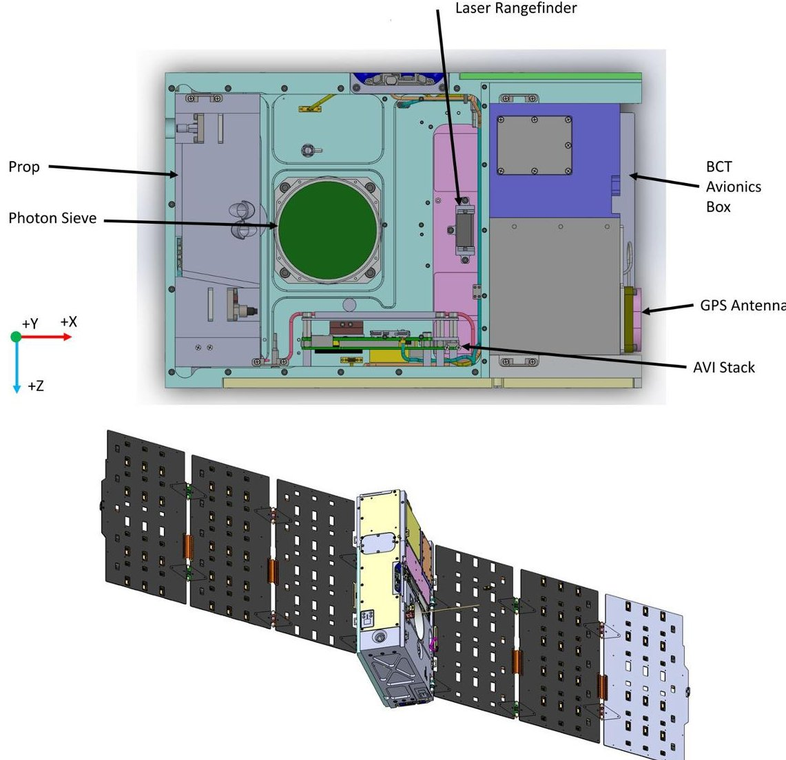

Figure 5. VISORS OSC Internal & External Views.

The photon sieve uses diffraction to focus light. $ ^{1} $ It is similar to a Fresnel zone plate but employs pinholes instead of concentric annuli for diffraction. This photon sieve is fabricated at GSFC out of a silicon wafer using microlithography and is mounted in an aluminum structure. The photon sieve used on VISORS is unusual in that it is asymmetrical, so the focal center of the sieve is not the same as its geometric center. As such, the sieve is mounted away from the center of mass of the OSC so that the optical center is located near the spacecraft's center of mass, which helps reduce the effect of jitter on image quality.

<!-- PDF_PAGE: 8 -->

The second unique subsystem aboard the OSC is the LRF. The LRF's ranging data between the OSC and DSC is used to supplement the GNSS data for determining the quality of images prior to downlink. It is not required for mission success and is intended to provide additional support telemetry for images. The DSC has a surface coated in white thermal control paint to provide a reflective target for the LRF.

## MISSION MODES

This novel mission concept of precise relative orbit station-keeping and formation flying requires careful crafting of the mission modes such that the two-spacecraft system can successfully and efficiently carry out its scientific operations without entering an unsafe state. The mission modes of the payload operate within the context of the spacecraft bus's state machine, which is a commercial product provided by BCT and standardized for the XB1. When the spacecraft first powers on and enters the Sun Point State, only the BCT bus subsystems will be powered on. The payload remains off until the bus transitions into the Fine Reference Point State. The payload mission modes operate only within the spacecraft bus's Fine Reference Point State, since that is the only state where the payload subsystems are powered on. The XB1 bus states and their transitions are shown in Figure 6.

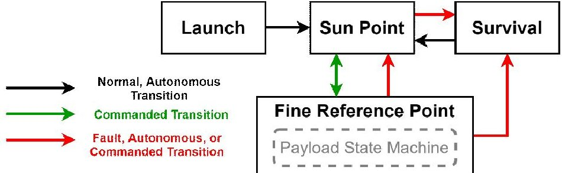

Figure 6. XB1 Spacecraft Bus States. $ ^{5} $

Once the spacecraft is in its Sun Point State, it can receive a ground command to transition into the Fine Reference Point State. Since the payload subsystems receive power when the spacecraft is in the Fine Reference Point State, this is when the payload state machine will begin functioning. The bus can also enter the Survival State from either the Sun Point or Fine Reference Point States if the battery voltage crosses below a critical level to minimize power consumption and recharge the batteries. Upon charging above a specified battery voltage threshold, the spacecraft bus will autonomously transition from Survival into the Sun Point State where it will wait for ground contact and commanding.

The payload mission modes and possible transitions between modes, which all occur within the bus's Fine Reference Point State, are shown in Figure 7. The mission modes, which define all operations of the spacecraft payload are: Preliminary Operations, Standby, Transfer, Science, Safe, and Escape. While the two spacecraft will be in the same mode at any given time during nominal operations, it is possible for the spacecraft to not be in the same mode when dealing with contingency scenarios. For example, one spacecraft may enter Safe mode while the other remains in another mode. Furthermore, while it is always possible to command a transition between any two modes, the transitions in Figure 7 are labeled as command if the only way to make the transition is by a ground command, meaning that transition cannot occur autonomously.

<!-- PDF_PAGE: 9 -->

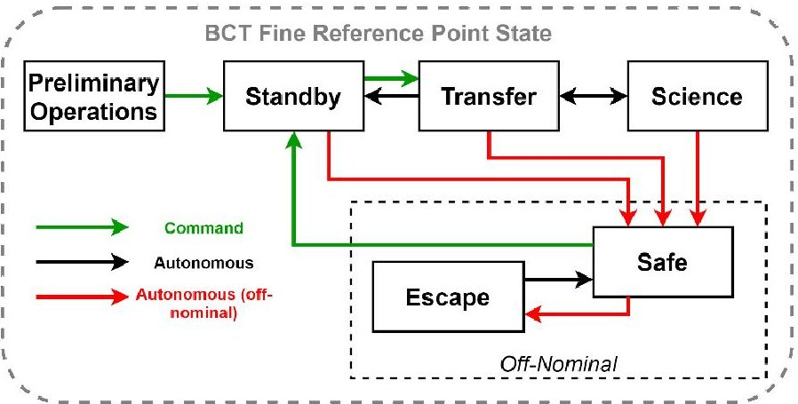

Figure 7. Payload Defined Mission Modes.

When the bus enters the Fine Reference Point State for the first time after deployment, the payload state machine enters its initial default mode, Preliminary Operations. In this mission mode, the payload subsystems are, by default, powered off so that each payload subsystem can be individually turned on during the commissioning phase of the mission, which is described in more detail in the Mission Operations Timelines section. It is important to note that after the conclusion of commissioning activities, the default mission mode on reboot will be changed to Safe mode, rendering the Preliminary Operations mode obsolete.

Once all commissioning activities are complete, each spacecraft is commanded to perform its initial formation acquisition and move into Standby mode. Within Standby mode, both spacecraft must be in the standby relative orbit with a constant cross-track separation of 200 m which provides several days of passive safety in the event of an anomaly. $ ^{8} $ The relative orbit formation configuration for this mode is shown in the radial-tangential-normal (RTN) reference frame in Figure 8. The diagram illustrates the relative orbit of the two spacecraft, with the chief located at the origin, and the deputy following the relative position arc shown in the RTN frame.

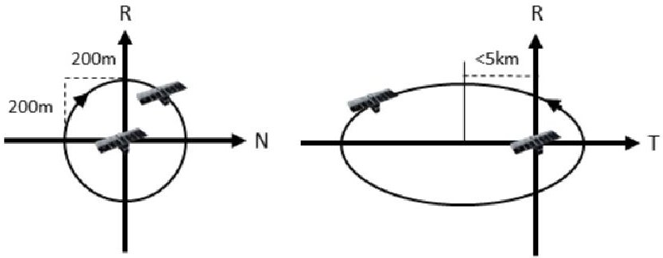

Figure 8. Standby Mode Formation Configuration. $ ^{2} $

In Standby mode, the spacecraft will carry out default operations such as downlinking health and science data, receiving uplink commands and maintaining passive safety through approximately weekly formation keeping maneuvers while waiting for operators to identify an observation opportunity. The spacecraft are sun-pointing in Standby mode with the secondary constraint being zenith pointing for the GNSS antenna.

The next nominal mission mode is Transfer mode, which is used to move the spacecraft into and out of the alignment required for science measurement. The function of this mode is to reconfigure the relative orbit geometry between Standby and Science mode over 5-10 orbits such that passive safety of at least two orbits is always maintained. The delta-V cost of this reconfiguration is fixed, but the design is flexible, allowing this fixed cost to be divided over enough orbits to

<!-- PDF_PAGE: 10 -->

prevent large maneuvers that could saturate the reaction wheels. During this mode, the spacecraft is oriented such that the GNSS antenna is pointed to zenith (to improve the quality of navigation data) and the sun-pointing of the solar arrays is maximized as a secondary pointing requirement. Additionally, the XLINK subsystem must maintain a continuous link throughout Transfer mode to enable the exchange of GNSS data between the spacecraft. $ ^{8} $ This allows the GNC software to update relative state estimates, conduct autonomous maneuver planning, and monitor formation safety. The formation relative orbit for this mode is shown in Figure 9.

Standby mode trajectory Science mode trajectory Transfer mode trajectory Maneuver

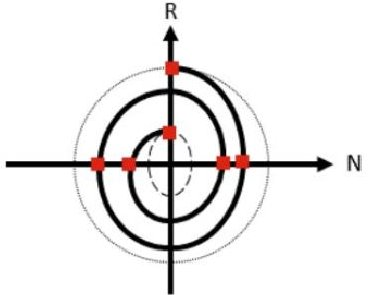

Figure 9. Transfer Mode Relative Orbit Formation Configuration. $ ^{2} $

There are three different conditions under which the spacecraft may enter Transfer mode. First, the spacecraft can be commanded to enter Science mode from its Standby mode, thus requiring the spacecraft to first enter Transfer mode. In this case the spacecraft will be reconfigured from the standby relative orbit into the science relative orbit which requires a smaller inter-spacecraft separation; an example of this trajectory is shown in Figure 9. The second entry condition occurs when the spacecraft has successfully completed the commanded number of observations in Science mode and is moving back into Standby mode. This transition will require the spacecraft to increase their minimum separation back to 200 meters over a predetermined number of orbits. The last condition for entry into Transfer mode is if the spacecraft receives a ground command to exit Science mode early. This scenario is unlikely since it is in the best interest of the science team to collect as much data as possible if the spacecraft is operating nominally. However, if this situation arises, there will be an orderly shutdown of science measurements and a return to Standby mode through an increase of the spacecraft minimum separation as previously discussed.

The purpose of Science mode is to maintain the relative orbit and pointing necessary to form the distributed telescope and to collect and store the science observation data. In order to take images of the sun when the alignment of the two spacecraft is within set requirements, defined in Table 1 on page 4 in the requirements section, the GNC software determines a small arc within the relative orbit where the spacecraft should take an observation. A notional science observation arc is highlighted in Figure 10. To achieve this alignment and acquire high quality scientific data, the two spacecraft require precise station keeping maneuvers within very small tolerances. Due to the station keeping and relative separation requirements during the Science mode, this phase of the mission faces the highest risk of collision.

<!-- PDF_PAGE: 11 -->

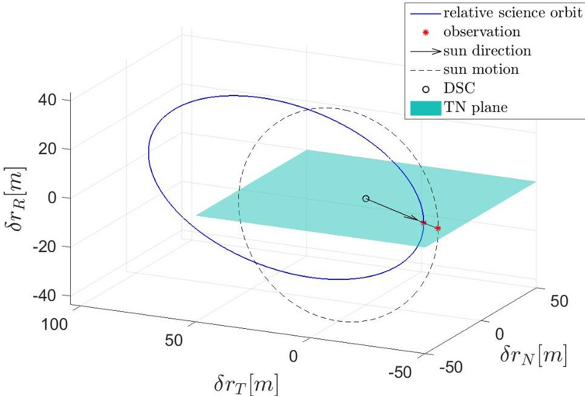

Figure 10. Science Mode Formation Configuration with DSC as Chief.

In nominal mission operations, the spacecraft will move from Standby mode to Transfer mode to Science mode, and back multiple times over the lifetime of the mission. As previously described, each of these nominal operating modes (Standby, Transfer, Science) is associated with a unique formation geometry. These geometries are summarized in Table 3 along with their descriptions.

Table 3. Mission Defined Relative Orbits.

<table border="1"><tr><td>Relative Orbit</td><td>Description</td><td>Conditions to Use the Orbit</td></tr><tr><td>Standby Orbit</td><td>Minimum cross-track separation of 200m, large passive safety margin (several days)(Figure 8)</td><td>Low formation-keeping costs for Standby or Safe mode and data downlink</td></tr><tr><td>Science Orbit</td><td>Minimum cross-track separation of 20m, propellant-expensive to maintain a 2-orbit passive safety margin(Figure 10)</td><td>Used during Science mode to provide necessary alignment for observations</td></tr><tr><td>Transfer Orbit</td><td>Relative orbit trajectory reconfigures formation over 5-10 orbits, fixed delta-V cost can be flexibly divided to prevent reaction wheel saturation(Figure 9)</td><td>Transition between Standby and Science orbits while maintaining passive safety</td></tr></table>

Off-nominal mission scenarios can be classified into two main types. The first type consists of formation passive safety violations (meaning that the spacecraft are at elevated risk of colliding). Even though the GNC algorithm designs its trajectories such that the safety of the formation is never compromised, there are a number of examples which could necessitate escape, as described in the Fault Analysis section. The second type is a payload subsystem hardware or software fault. The criticality of these faults is such that a transition into Safe mode, where the affected subsystems can be turned off and later debugged via ground commands, is required to ensure the safety of the formation and mission. The standard fault recovery sequence is identical for both types of anomalies. The sequence begins with the payload entering Safe mode from any of the nominal payload

<!-- PDF_PAGE: 12 -->

mission modes (Standby, Transfer, Science). Upon entering Safe mode, the state machine powers down all non-critical subsystems and the GNC software will check to see if an escape maneuver is necessary. If a maneuver is required, the payload will transition into Escape mode and the GNC algorithm will plan an active collision avoidance maneuver. $ ^{8} $ Once this escape trajectory is planned, the spacecraft will proceed to execute the maneuver. The function of Escape mode is to reconfigure the formation to increase separation following detection of an unacceptable collision risk. An example of this maneuver is shown in Figure 11. Note that the aforementioned sequence still holds for the case where the PSM boots into Safe Mode, the default state set after commissioning activities.

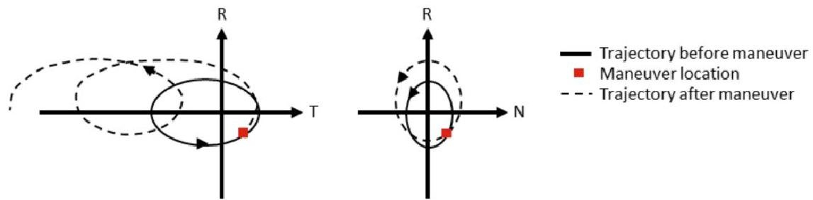

Figure 11. Relative position After an Escape Maneuver. $ ^{2} $

Once the GNC algorithm specifies that the maneuver is complete, the spacecraft will transition back to Safe mode. From this mode, the spacecraft telemetry will flag which error or fault prompted the transition to Safe mode, and other payload telemetry will be used as needed to diagnose the problem. Ground-based commands will troubleshoot a solution until the spacecraft is deemed ready to return to nominal operations. This will require functional checkouts of critical subsystems, similar to those performed during the commissioning phase. Once the functional checkouts are complete and the identified fault is addressed, the spacecraft will transition back to Standby mode (nominal operations) through a two-step process. First, depending on where the fault initially propagated and whether an escape maneuver was performed, a ground-planned formation re-acquisition sequence may need to be uploaded to the spacecraft to reacquire the proper formation. Secondly, once the standby relative orbit has been acquired, the spacecraft will be issued a command from the ground to transition the payload to Standby mode. The spacecraft cannot exit Safe mode without a ground command. This sequence can be applied generally to describe the recovery to nominal operating conditions and is shown in Figure 12.

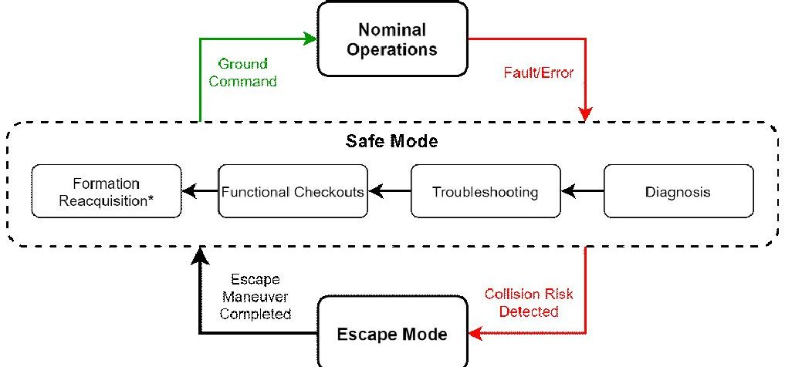

Figure 12. Sequence to Resume Nominal Operations Following an Escape Maneuver.

<!-- PDF_PAGE: 13 -->

## MISSION OPERATIONS TIMELINES

Mission operations for VISORS can be separated into two primary phases: the six-month baseline mission lifetime and a second six-month period of extended mission operations. The goal of the six-month baseline mission, outlined in the timeline in Figure 13, is planned to achieve the minimum mission success science goal of capturing and downlinking one image with resolution better than 0.2 arcsec. After the baseline mission is complete, extended mission operations will continue for as long as the spacecraft are functional, expected to be an additional six months or longer, and will include continued science observations to improve the quantity and quality of data generated by the mission until propellant is exhausted. At that point the formation flying portion of the mission will conclude and the spacecraft will be moved into permanently separated orbits. This section describes the baseline and extended mission phases with timelines of increasing detail.

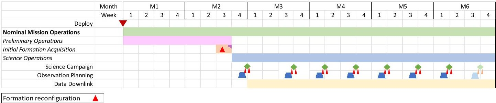

Figure 13. Baseline Minimum Mission Timeline.

The six-month minimum mission begins with deployment from the launch vehicle followed by a preliminary operations phase composed of spacecraft and payload commissioning and acquisition of the Standby relative orbit via a maneuver plan computed on the ground. After successful completion of preliminary operations, the remainder of baseline and extended mission operations consists of science operations. Science campaigns are the main unit of science operations consisting of a relative orbit transfer to Science mode followed by ten observation attempts and a transfer back to the Standby mode. The exact timing of these science campaigns is dependent on the level of science interest in current solar activity, requiring the operational plan to provide flexibility to wait for promising opportunities to arise. There will be at least enough time between science campaigns to gather the necessary input parameters to configure the campaign by identifying: a target region in the solar corona, desired observation timing, frame rate. At least ten science campaigns are accommodated in the operational plan and delta-V budget, allowing for tuning of the approach to improve results throughout the mission. Due to the relatively slow data rate of the UHF link, downlink of science data is expected to be nearly continuous following the first observation.

## Preliminary Operations

The first two months of the baseline mission include spacecraft and payload commissioning followed by formation acquisition via a maneuver sequence planned on the ground. This preliminary operations phase is a progressive sequence with about 1 week per subsystem allocated for commissioning and another week for formation acquisition with secondary checkouts of the XLINK at different ranges. The sequence of preliminary operations is illustrated in Figure 14.

<!-- PDF_PAGE: 14 -->

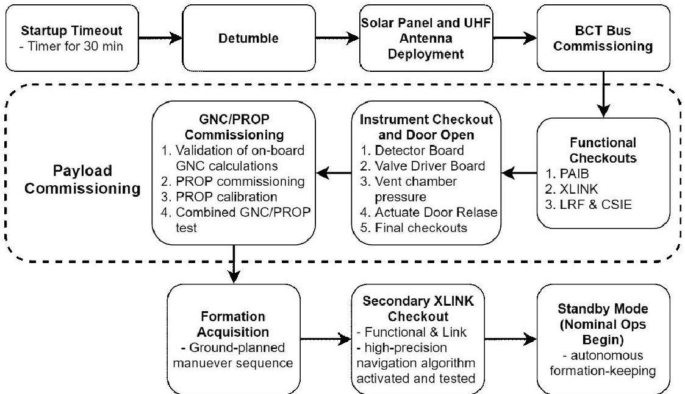

Figure 14. Preliminary Operations Timeline.

Commissioning begins with the BCT Bus which includes autonomous detumble and deployment of solar arrays and UHF antenna followed by space-to-ground beaconing. The bus includes the EPS, CDH, ADCS, and UHF communications subsystems which will all be commissioned prior to moving on to the payload. Payload commissioning begins with the PAIB, which provides the data and power interface between the bus and payload and thus is necessary in order to operate any of the payload subsystems. XLINK will be commissioned next due to its low TRL and critical role in the GNC algorithm's functionality. The next phase moves through the instruments beginning with the LRF and CSIE being commissioned simultaneously since they are on different spacecraft. After the CSIE is operational, the Chamber Valve Board is commissioned on the DSC which enables the detector chamber door to be opened. The door opening sequence requires operators to confirm all components are in their ideal operational ranges. Upon confirmation, mission operators will proceed to vent the pressure from the chamber and actuate the door-release mechanism. Once the door is open, commissioning of the detector board can be completed with light exposures to compare to the dark exposures taken with the door closed.

The final stage of commissioning is for the GNC software which will overlap with commissioning the PROP system and flow into the formation acquisition sequence. Normally, maneuver plans are generated by the GNC software and sent to the PSM which then sends firing commands to the PROP system. During preliminary operations, this architecture allows a maneuver plan to instead be downlinked and validated on the ground and enables ground commands to be sent directly to the PROP system. A series of small delta-V maneuvers commanded from the ground will be used to verify that the execution error of the PROP system is within acceptable bounds. If needed, the lookup table used to convert delta-V values into nozzle firing times based on the temperature and pressure in the propellant tank can be calibrated. Once this calibration of the PROP system is complete, a ground-based maneuver plan will be used to acquire the initial relative orbit formation over several days. Throughout the formation acquisition, additional checkouts of the XLINK system will be performed at various ranges as the separation closes and at all positions throughout the standby relative orbit. This final check of the system performance enables autonomous maneuver planning and execution to be activated, allowing the spacecraft to progress to the next phase of mission operations.

<!-- PDF_PAGE: 15 -->

## Science Campaign

After preliminary operations are completed, the rest of the baseline mission, excluding off-nominal scenarios, is composed of science operations. This phase of operations consists of Science Campaigns separated with standby periods to allow for data downlink and to wait for desirable observation opportunities. Figure 15 below shows the overall timeline for a single Science Campaign which flows between three mission modes: Standby, Transfer, and Science.

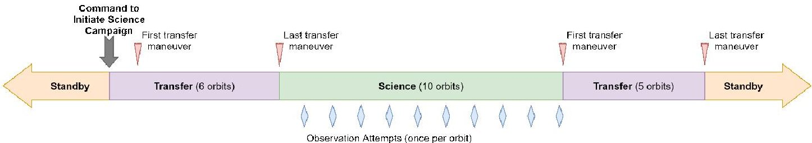

Figure 15. Individual Science Campaign High-Level Timeline.

Beginning from Standby mode, the formation receives a command to initiate a campaign and enters Transfer mode. From this point on, maneuvering and data collection proceed autonomously until the two spacecraft complete the campaign and return to Standby mode or an anomalous condition causes one spacecraft to enter Safe mode. After completing the transfer to Science mode, the formation performs 10 orbits in Science mode with one observation attempt per orbit. This number of science orbits was selected by considering the tradeoff between the probability of having a successful observation attempt and the delta-V cost for transfer against the relatively large rate of propellant consumption to maintain the science formation. Since the GNC requirements can only be met probabilistically with an expected 20% success rate, there is a 90% chance of at least one successful observation from 10 attempts. However, it is important to note that this rate of success is not expected over the first several science campaigns until the software and operations have been refined to account for biases such as uncertainty in the location of the spacecraft center of mass and GNSS antenna phase center or errors in maneuver execution. Upon completion of the last science orbit, the formation autonomously enters Transfer mode to transition back to Standby mode. The process of conducting a science campaign will be discussed with more detailed timelines beginning with the first transition from Standby through Transfer into Science mode as shown in Figure 16.

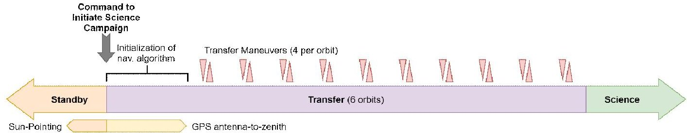

Figure 16. Science Campaign Initiation and Transfer from Standby to Science Formation.

The formation remains in Standby mode until a suitable observation opportunity is identified. Once a ground command to initiate a science campaign is received, the formation enters Transfer mode. First, the primary pointing constraint switches from sun-pointing to GNSS antenna-to-zenith which ensures that quality navigation data is continuously available for the high-fidelity navigation algorithm to be initialized. The process of obtaining a precise solution takes about one orbit, at which point the GNC software begins autonomous maneuver planning to execute the transfer trajectory into Science mode. The XLINK connection must be established to initialize the navigation

<!-- PDF_PAGE: 16 -->

algorithm and then maintained without interruption to exchange the navigation and health data necessary to enable autonomous maneuver planning and verify formation safety.

During the transfer into Science mode, the deputy spacecraft executes maneuvers in the along-track direction to adjust the relative eccentricity and in the cross-track direction to adjust the relative inclination. Each type of maneuver may be performed once or twice per orbit and the transfer can be performed over any number of orbits without violating the fixed delta-V cost of about 0.3 m/s. $ ^{3} $ A transfer duration of 5-10 orbits with 4-5 maneuvers per orbit is sufficient to limit maneuver magnitudes such that the impulses do not saturate the reaction wheels and provide the flexibility to gradually decrease the maneuver size as the transfer concludes. These smaller maneuvers have lower execution errors which improves the initial tracking error in Science mode. The transfer trajectory is constructed such that a passive safety margin of at least two orbits is maintained and the trajectory can be reversed back to the standby configuration at any point if necessary.

After the last maneuver of the transfer is completed and the science relative orbit has been successfully attained, the two spacecraft enter Science mode and begin the series of 10 observation attempts. Since each orbit in Science mode is functionally identical, Figure 17 shows the timeline for one of these orbits.

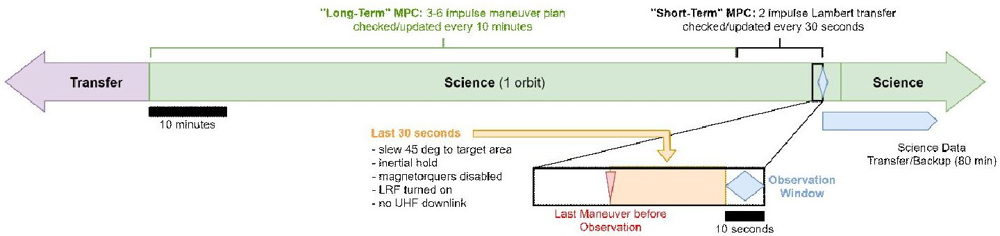

Figure 17. Science Orbit Timeline.

In order to meet the requirements for science relative orbit accuracy, the GNC algorithm switches from a deterministic maneuver plan used in Transfer mode to stochastic model-predictive control (SMPC) in Science mode. $ ^{2} $ The SMPC is itself separated into long-term and short-term maneuver planning modes. Until the last 10 minutes before an observation, the long-term maneuver planning mode creates a series of 3 to 6 impulses and checks the maneuver plan every 10 minutes. The goal of this maneuver plan is to drive the relative orbit states to the desired relative orbit at a specified time of observation alignment. To check the maneuver plan, the current state is propagated forward accounting for the currently planned maneuvers; if the predicted final state is not close enough to the desired state, the maneuver plan is recomputed. In the final 10 minutes prior to an observation, the GNC software uses a short-term maneuver planning mode designed to eliminate errors in the relative orbit developed during the long-term maneuver planning period. The maneuver sequences generated are 2-impulse Lambert solutions checked every 30 seconds using the same method of propagating the current relative state and covariance forward and comparing to the desired relative state at observation alignment. Maneuvers during short-term planning mode are restricted to less than 2 mm/sec delta-V per maneuver and a minimum of 30 seconds between maneuvers with the last maneuver no less than 30 seconds before the observation. The maneuver magnitude restriction guarantees that the PROP system can execute any commanded maneuver in a single actuation even at its worst-case performance limit.

After the last maneuver, the spacecraft switches to inertial pointing and slews to point toward the desired target location in the solar corona. At this time, the magnetorquers are disabled to provide better attitude control accuracy. Due to the formation orbit design and spacecraft geometry, the slew to target pointing is roughly 45 degrees about a single axis, allowing the spacecraft to slew

<!-- PDF_PAGE: 17 -->

and settle within the 30 seconds before the observation. In the final seconds leading up to the observation, the LRF will be turned on when the in-range condition (relative position within 70 meters and sufficiently aligned) is met. Additionally, UHF downlink is disabled during the period before an observation to prevent interference with the detector electronics.

The science relative orbit is designed to provide a 10 second observation window each orbit where the formation alignment and relative velocity requirements are met. During this observation window, the CSIE collects data from the detector board several times per second and creates image files. Multiple images will be taken during each observation attempt, and 10 observation attempts will be conducted in each science campaign. The delta-V budget, shown in Table 4, allows for at least 10 science campaigns throughout the mission. The ability to conduct several science campaigns provides the opportunity to iteratively improve the approach and obtain better performance by modifying some of the parameters of Science mode. If the data indicate a consistent bias in formation alignment, the spacecraft attitude profile and the estimated locations of the instruments or GNSS antenna phase center relative to the spacecraft center of mass in the GNC software can be tuned for future science campaigns to improve alignment. The volume of data generated can be managed by changing the frame rate between 2 and 7.5 Hz and limiting the amount of time data is collected within the 10 second observation window. The number of science orbits in each campaign may also be modified to provide higher probability of a successful attempt or to manage the propellant consumption per science campaign. The mission delta-V budget in Table 4 illustrates how the rate of propellant consumption in various mission modes impacts mission lifetime.

Table 4. VISORS Mission delta-V Budget. $ ^{2} $

<table border="1"><tr><td rowspan="2">Maneuver Type</td><td rowspan="2">delta-V(mm/s)</td><td colspan="2">Frequency</td><td rowspan="2">Contingency(%)</td></tr><tr><td>Baseline Mission</td><td>Extended Mission</td></tr><tr><td>Formation acquisition</td><td>1000</td><td>1</td><td>n/a</td><td>50</td></tr><tr><td>Standby mode station-keeping</td><td>110/wk</td><td>19 weeks</td><td>25 weeks</td><td>10</td></tr><tr><td>Transfer(Standby to Science)</td><td>300</td><td>10</td><td>10</td><td>10</td></tr><tr><td>Science mode station-keeping</td><td>8.14</td><td>100</td><td>100</td><td>20</td></tr><tr><td>Transfer(Science to Standby)</td><td>300</td><td>10</td><td>10</td><td>10</td></tr><tr><td>Collision Avoidance(Escape)</td><td>150</td><td>1</td><td>1</td><td>10</td></tr><tr><td>Standby mode reacquisition</td><td>300</td><td>1</td><td>1</td><td>10</td></tr></table>

<table border="1"><tr><td>Total Max Expected delta-V for Baseline Mission(m/s)</td><td>11.8708</td></tr><tr><td>Spacecraft delta-V Capacity(DSC/OSC)(m/s)</td><td>23(8.4/14.6)</td></tr><tr><td>Unallocated(Baseline Minimum Mission)(m/s)</td><td>11.1292(48.4%)</td></tr><tr><td>Additional delta-V for Extended Mission(m/s)</td><td>11.0986</td></tr><tr><td>Unallocated(Baseline+Extended Mission)(m/s)</td><td>0.0306(0.13%)</td></tr></table>

The values in Table 4 for Standby and Science mode are worst-case values and are expected to be lower on average lending further margin to this budget. $ ^{3} $ The fact that the baseline mission only uses half of the total available delta-V provides operational flexibility and nearly full redundancy. Even with the larger OSC propulsion system non-functional, 6 science campaigns can still be completed in the baseline mission, which is expected to be enough for mission success.

After completing the commanded number of orbits in Science mode and all associated observation attempts, the formation automatically enters Transfer mode and initiates the transition back to Standby mode. This transition is shown in Figure 18 and is nearly identical to the transfer into the

<!-- PDF_PAGE: 18 -->

science formation but performed in reverse and with the CSIE remaining powered on to complete the backup of the last observation's science image data to the PAIB.

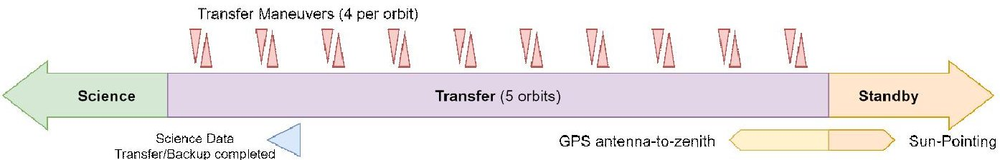

Figure 18. Transfer from Science Mode to Standby Mode and Backup of Science Data.

Once the standby relative orbit is reached, the spacecraft enter Standby mode and sun-pointing again becomes the primary pointing constraint. Due to the larger inter-spacecraft separation in Standby mode, the formation is passively safe for several days allowing formation-keeping maneuvers to be performed much less frequently. The GNC software switches to autonomous standby formation-keeping which plans a 4-maneuver sequence to correct the relative orbit once atmospheric drag and other disturbances have perturbed the formation beyond the specified bounds. $ ^{2} $ This is expected to occur approximately weekly at the initial orbit altitude of 600 km and increases in frequency as the orbit decays. The larger passive safety margin also provides more time to resolve any faults that prevent the GNC software from actively monitoring and maintaining the formation, such as an outage in the XLINK.

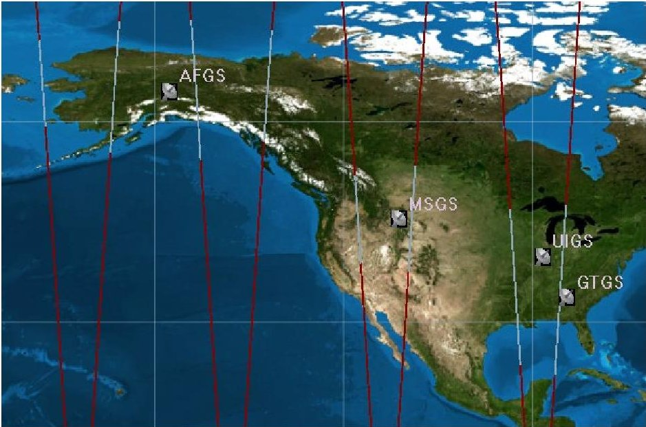

Figure 19. Ground Track for 24 Hours showing Line-of-Sight Contacts.

One of the primary activities conducted during Standby mode is the downlink of images obtained during science campaigns. Due to cost constraints, the mission was restricted to the use of UHF radios with a relatively low data rate of 19.2 kbps. Data throughput is improved by the use of a distributed network of four ground stations to increase contact time, shown in Figure 19 with a full day of ground track and line-of-sight coverage highlighted in white. Despite this, the downlink of a single full-resolution frame still requires roughly 1 to 2 days. In order to work around this bottleneck, a tiered approach to image selection and downlink is implemented using several different data products. Three types of image files are generated from the data collected in Science mode: full resolution images, 2x2 binned images for faster downlink, and 16x16 binned "thumbnails". Thumbnails for a handful of frames from each observation attempt provide a highly compact data product that can be easily downlinked to assess the quality of the observation alignment. All image files are sent from the CSIE to non-volatile memory on the BCT Bus. The thumbnails are used

<!-- PDF_PAGE: 19 -->

along with GNC data about the relative orbit during the observation on the ground to determine which image files stored on the Bus may yield the best science return and should be downlinked. Evaluation of this data seeks to verify whether the requirements presented in the Relevant Requirements section for a successful observation attempt have been met. Due to storage limitations on the bus, all image files are also backed up to non-volatile memory on the PAIB for long-term storage so that science data collected throughout the mission remains available for downlink at any time.

## Extended Mission

Science operations and data downlink will continue for at least the baseline mission duration of six months, but it is possible that unused propellant will be available for an extended mission following the operational plan shown in the timeline in Figure 20.

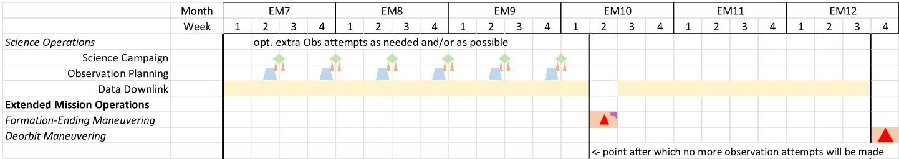

Figure 20. Extended Mission Timeline.

Extended mission operations provide the opportunity to pursue a range of additional science goals and demonstrations after completion of the baseline mission. Science campaigns and data downlink will continue throughout the extended mission to increase the quantity of data available to the science team. These observations will target different regions of the Sun and seek to gather data during a variety of environmental conditions. Another possible experiment would slightly increase the formation separation at alignment to obtain images in a different part of the EUV spectrum.

As shown in Figure 20, it may eventually be desired to execute a formation-ending maneuver to permanently disband the formation based on remaining propellant consumption. When there is no longer enough propellant to conduct another science campaign, this eliminates the need for continued formation-keeping maneuvers, allowing science data downlink to continue for as long as possible without risk of spacecraft collision. Based on the nominal mission delta-V budget presented earlier in Table 4, this formation-ending maneuver is expected to occur in the twelfth month of operations.

## FAULT ANALYSIS

A comprehensive fault analysis was performed as part of the ConOps development; it includes an FMECA as well as the development of operational mitigation strategies and on-board fault tolerant COLA logic. Due to the fact the formation spends the majority of its time without ground contact, any faults that occur need to be handled in a semi-autonomous manner to reduce the likelihood of a premature end of mission (EOM). The industry standard FMECA was modified to better suit the VISORS mission for this analysis by including two overarching EOM outcomes: a hardware/software related EOM and a collision EOM. $ ^{9} $ The latter must be analyzed separately as it can arise from a much less stringent combination of faults. In order to maintain safe formation flight, multiple on-board Formation Flying Functionalities (FFFs) on both spacecraft must be continuously operating nominally. Therefore, it only takes a combination of temporary rather than permanent - faults in these FFFs to cause a potential collision event. In terms of risk mitigation, the hardware/software EOM outcomes can be addressed by making design modifications to subsystems or software, whereas the collision risk EOM outcomes are better addressed with specific

<!-- PDF_PAGE: 20 -->

operational logic. This section will only focus on the collision risk EOM FMECA and the associated operational risk mitigation procedures.

## Risk Categorization

The two spacecraft have interchangeable roles in the formation architecture which allows for a "two-agent" fault handling approach where a collision risk in flight can be resolved by either spacecraft. This approach eliminates many single points of failure. However, it necessitates special considerations when performing the collision risk FMECA. There are five subsystems that function as FFFs and need to run continuously on-board each spacecraft to maintain safe formation flight: XLINK, GNSS, Prop, ADCS, and the GNC HSA. A temporary fault in any one of these FFFs can lead to a degradation of the formation's passive safety over time, leading to a collision risk. The severity of that risk is related to the fault's duration, the specific combination of faults occurring across either or both spacecraft, and to what extent each spacecraft's FFFs are affected. These temporary faults in FFFs can either occur suddenly or can have a 5-minute warning from the BCT Bus before it goes into the Bus Safe State.

Each combination of FFF faults is assigned to a failure scenario, which is then ranked using the Risk Priority Number (RPN) method. $ ^{10} $ Each scenario has three defining metrics: severity, likelihood, and observability, which are rated on a scale of 1-5 and multiplied together to obtain a RPN rated on a scale of 1-125. The severity metric rates the level of collision risk for each failure scenario's outcomes; for example, scenarios where an escape maneuver can easily be performed to increase spacecraft separation result in a low collision risk. The likelihood metric rates the probability of individual FFF faults occurring during the mission's lifetime and uses NASA Goddard's standard FMECA probability categorization scheme for the 1-5 rating. $ ^{11} $ The overall likelihood rating assigned to each failure scenario corresponds to the probability product of the individual faults making up that scenario. Finally, the observability metric rates the difficulty the GNC HSA experiences when attempting to properly diagnose and respond to faults occurring in each failure scenario given its limited perspective - i.e. if there is a sudden Bus Safe mode that switches off the payload, the GNC HSA cannot react to this fault and plan an escape maneuver.

FMECA Matrix and Analysis

<table border="1"><tr><td rowspan="3">Scenario #</td><td colspan="9">Formation Flying Functionalities</td><td rowspan="3">Severity</td><td rowspan="3">Likelihood</td><td rowspan="3">Observability</td><td rowspan="3">RPN</td></tr><tr><td colspan="5">Deputy</td><td colspan="5">Chief</td></tr><tr><td>XLINK</td><td>GNSS</td><td>Prop</td><td>ADCS</td><td>GNC(HSA)</td><td>XLINK</td><td>GNSS</td><td>Prop</td><td>ADCS</td><td>GNC(HSA)</td></tr><tr><td>1</td><td></td><td></td><td></td><td></td><td></td><td></td><td></td><td></td><td></td><td></td><td>4</td><td>5</td><td>4</td><td>80</td></tr><tr><td>3</td><td></td><td></td><td></td><td></td><td></td><td></td><td></td><td></td><td></td><td></td><td>5</td><td>4</td><td>4</td><td>80</td></tr><tr><td>4</td><td></td><td></td><td></td><td></td><td></td><td></td><td></td><td></td><td></td><td></td><td>5</td><td>3</td><td>4</td><td>60</td></tr><tr><td>9</td><td></td><td></td><td></td><td></td><td></td><td></td><td></td><td></td><td></td><td></td><td>4</td><td>3</td><td>5</td><td>60</td></tr><tr><td>5</td><td></td><td></td><td></td><td></td><td></td><td></td><td></td><td></td><td></td><td></td><td>5</td><td>2</td><td>5</td><td>50</td></tr><tr><td>8</td><td></td><td></td><td></td><td></td><td></td><td></td><td></td><td></td><td></td><td></td><td>5</td><td>2</td><td>5</td><td>50</td></tr><tr><td>10</td><td></td><td></td><td></td><td></td><td></td><td></td><td></td><td></td><td></td><td></td><td>5</td><td>2</td><td>5</td><td>50</td></tr><tr><td>22</td><td colspan="5"></td><td></td><td></td><td></td><td></td><td></td><td>3</td><td>4</td><td>4</td><td>48</td></tr><tr><td>26</td><td></td><td></td><td></td><td></td><td></td><td colspan="5"></td><td>3</td><td>4</td><td>4</td><td>48</td></tr><tr><td>2</td><td></td><td></td><td></td><td></td><td></td><td></td><td></td><td></td><td></td><td></td><td>2</td><td>5</td><td>4</td><td>40</td></tr><tr><td>12</td><td colspan="5"></td><td></td><td></td><td></td><td></td><td></td><td>4</td><td>2</td><td>5</td><td>40</td></tr></table>

Figure 21. Abbreviated FMECA Matrix (grey - sudden, yellow - with warning).

An abbreviated version of collision risk FMECA matrix with the top ten RPN scenarios is shown in Figure 21. A total of 29 failure scenarios resulting from a distinct combination of all the realistic FFF faults across the formation were considered for this analysis. $ ^{12} $ Not every FFF fault permutation needs to be considered due to the particular interdependencies of different FFFs. All failure

<!-- PDF_PAGE: 21 -->

scenarios ultimately need a corresponding system response dependent on which FFF's are experiencing faults on which spacecraft.

The 10 highest RPNs shown in Figure 21 represent the most important scenarios to address with operational logic. For example, temporarily experiencing a fault in the XLINK FFF on either spacecraft (Scenarios 1-3) results in a high RPN due to ratings of its three metrics. It would result in a relatively high collision risk, is fairly likely to occur at least once over the mission lifetime (due to the XLINK subsystem not having flight heritage), and the GNC HSA would have difficulty properly diagnosing where the fault is occurring since neither spacecraft would be aware of the other's status without an inter-satellite link.

## Fault Tolerant Collision Avoidance Logic

The on-board fault tolerant COLA logic that will run within the GNC HSA on each spacecraft and attempts to mitigate the severity of the most important failure scenarios identified in the FMECA. An "effective" COLA response is one where the FFF fault is quickly identified, and the correct spacecraft plans and executes an escape maneuver, leading to an increase in inter-spacecraft separation. $ ^{2} $ The design principle for this logic, reflected in Figure 22, follows from the two-agent fault handling approach: during a failure scenario each spacecraft performs a health assessment of the formation and the "healthier" spacecraft executes the most effective COLA response. However, in the event of an inter-satellite link problem, neither spacecraft will be able to assess the other's health, meaning that both need to act in a pre-determined manner to avoid unpredictable behavior that may increase the risk of performing an incorrect escape maneuver. It is important to note that this logic will run continuously during nominal operations as well as when the PSM enters Safe mode meaning that all subsystems providing the FFFs cannot be powered down unless they experienced the fault which caused the PSM Safe mode in the first place.

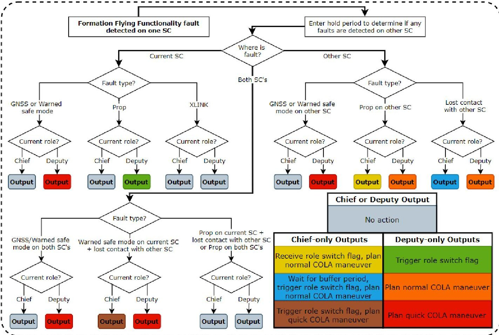

Figure 22. COLA Logic to Run Within the GNC HSA On-board Each Spacecraft.

<!-- PDF_PAGE: 22 -->

Specifically, the fault tolerant COLA logic must meet two basic requirements:

1. The formation shall be able to react to any failure scenario in a consistent and autonomous manner using identical COLA logic on each spacecraft.

2. Only one spacecraft (the deputy) shall be allowed to perform maneuvers at any given time.

Ensuring that the formation can react effectively to a multitude of collision risk failure scenarios is done by evaluating them in depth before the mission and determining the correct COLA response in a prescribed manner. Then, in the event of a collision risk detection on orbit, the logic must be able to effectively perform a health assessment of the formation and pinpoint the location of the FFF fault as accurately as possible in order to recognize the corresponding failure scenario and select the most effective COLA response. Such an assessment is easily performed when both spacecraft can share health data over the inter-satellite link. However, an accurate assessment is significantly more challenging to perform if the inter-satellite link is severed. For example, if the chief suddenly stops receiving data from the deputy, it is impossible to distinguish what caused a potential fault on the deputy. However, another possibility is that the deputy could be functioning normally, and in reality, a fault just occurred on the chief's XLINK hardware causing the inter-satellite link failure. These two failure scenarios clearly should be treated differently since the "healthier" spacecraft is the chief in the former and the deputy in the latter. Thus, it is important for each spacecraft to self-diagnose whether it is responsible for an inter-satellite link failure. Synchronization errors in fault detection across the formation must also be considered since faults on both spacecraft will never occur at exactly the same time. Therefore, logic is implemented to enter a holding period following the detection of a fault on one spacecraft to determine if a dual spacecraft fault scenario is occurring and the other spacecraft's fault has not yet been detected.

To meet the second COLA logic requirement, the formation needs to ensure both spacecraft are never allowed to start maneuvering simultaneously. Again, this is straightforward when inter-satellite link is available, as both spacecraft are aware of the other's role and must handshake to switch. However, in the event of a loss of the inter-satellite link, the formation must react to a collision risk scenario where the deputy is suffering a fault and is now "less healthy" than the chief. The solution is to allow the chief to auto-switch its role to become the new deputy without approval from the current deputy. Upon losing contact with the deputy, the chief performs a self-health assessment and determines that it is not responsible for the inter-satellite link failure, while the deputy performs the same assessment and determines that it is responsible for the link failure. Thus, the deputy remains in Safe mode (disallowing it from executing an escape maneuver), while the chief waits for a predefined buffer period (in case the fault on the deputy is short-lived) and then independently switches its role to become the new deputy. Then, the new deputy proceeds from Safe mode to Escape mode to perform an escape maneuver, without the risk of the old deputy maneuvering at the same time. Next, the new deputy broadcasts a flag indicating the role switch so that upon reestablishment of contact, the old deputy is made aware and avoids a role duplication. This COLA response is designed to allow an escape maneuver to be performed even when both spacecraft may be suffering FFF faults and the inter-satellite link is lost, allowing the VISORS mission to minimize collision risk over a broad range of fault scenarios. However, auto-switching needs to be limited only to scenarios where a collision risk exists and there is an inter-satellite link failure to prevent role duplication during nominal operations.

<!-- PDF_PAGE: 23 -->

## STATE MACHINE DEVELOPMENT

The analysis discussed in this paper will be used to develop the foundation for the PSM, which will be implemented within the HSA located on the BCT bus. The main purpose of the PSM is to control the operational state of every payload subsystem, which depends on the mission mode that the spacecraft operates in. For most subsystems, the operational state will be a simple ON or OFF, in which case the PSM will be able to toggle power to any subsystem. However, some subsystems have their own internal state machines that define specific functions that each subsystem will execute. The PSM must be used to command a payload subsystem's internal state machine to carry out those functions during the appropriate mission mode. For example, in Science mode, the PSM must send out a command to the CSIE subsystem to begin taking images of the Sun for a duration of 10 seconds and at the commanded frame rate.

The PSM will be designed to function semi-autonomously with human-in-the-loop feedback control to account for any unexpected mission contingencies. In other words, the PSM will be able to accept commands from the ground to manually toggle the state of any subsystem regardless of the mission mode. Moreover, any commands to manually initiate transitions between mission modes (for example, from Standby to Transfer mode) will be directed to the PSM. The PSM generates a timestamped beacon packet for downlink that contains status information about the current spacecraft mission mode as well as the operational state of each payload subsystem. For the most part, the PSM will autonomously dictate transitions between mission modes, which shall involve two-way communication between the PSM and the GNC subsystem. The PSM will continuously monitor telemetry from all payload subsystems to ensure that these transitions occur without error. In particular, the GNC subsystem will provide the PSM with messages about nominal orbital geometry changes, which is one of many vital pieces of information that can be used to indicate a successful mission mode transition, especially during science operations. Should a hardware/software fault or collision risk be detected, the PSM will transition the payload into Safe mode.

Because of the intricate nature of the mission ConOps, the PSM must be designed to be sufficiently robust to appropriately handle mission transitions under all operational scenarios. For nominal operations, not only must the internal behavior of the PSM be defined explicitly for all mission modes, but the logic associated with the entry and exit criteria for each mode must also be implemented to ensure proper transitions. Additionally, the PSM must be able to handle faults and errors encountered in any off-nominal scenario and change the mission mode as needed. The fault analysis conducted in this paper serves as a building block to help identify edge cases, from transient failures to simultaneous faults across various subsystems, which in turn can be used to test the ability of the PSM to respond appropriately to an off-nominal situation. Ultimately, these edge cases will be incorporated into the PSM software architecture as additional logic to provide coverage of a wide range of operational scenarios. A preliminary framework for the PSM has been designed within Simulink for initial model-in-the-loop (MIL) and software-in-the-loop (SIL) testing.

## CONCLUSION

The intricate nature of the VISORS mission warrants an extensive analysis of the concept of operations of the CubeSat formation in order to ensure that all technical objectives and mission constraints will be achieved while minimizing the risk of mission failure. The VISORS ConOps is established by a set of mission modes that dictate the operation of each payload subsystem and the behavior of the spacecraft formation. Transitions between mission modes, which are directly handled by the PSM can be performed via command or autonomously and are driven by key events during the operational timeline as well as by any emerging off-nominal circumstances.

<!-- PDF_PAGE: 24 -->

Mission operations for VISORS are split into two phases: a six-month baseline mission, where the spacecraft formation must accomplish the minimum mission success science goal of capturing and downlinking one image with resolution better than 0.2 arcseconds, and a period of extended operations. Nominal operations under the baseline mission timeline consist of a preliminary operations phase involving spacecraft and payload commissioning followed by an initial acquisition of a Standby relative orbit. After successful completion of preliminary operations, the VISORS mission transitions into the science operations phase, which primarily consists of at least 10 science campaigns where the formation transfers into a relative science orbit to form a distributed telescope that collects and stores science observation data. Each observation attempt in a science campaign is accompanied by standby periods in between to allow for data downlink and to plan for future observations. Over the course of a single science campaign, the CubeSat formation flows between three mission modes—Standby, Transfer, and Science—each of which are associated with a unique formation geometry, which in turn enables seamless science data collection, storage, and downlink.

Any detected off-nominal conditions, which extend to both payload hardware/software faults as well as collision risks, transitions the spacecraft(s) into Safe mode in which the PSM powers down all non-critical subsystems and performs an initial diagnosis of the situation. Should the GNC HSA detect an unacceptably high risk of collision during this Safe mode, the PSM will enter into Escape mode, allowing the GNC algorithm to plan and execute an escape maneuver that reconfigures the formation to increase inter-satellite separation. A rigorous analysis into the severity and probability of all possible FFF anomalies and collision risk scenarios is provided in this paper. The implications of FFF fault combinations on formation passive safety is examined and operational risk mitigation procedures for various failure scenarios are discussed. These findings are vital towards the design and implementation of a robust logic framework for the PSM, which is currently under development by the VISORS team.

## ACKNOWLEDGMENTS

The authors would like to thank Josh Kenji Geiser and Mason Murray-Cooper for their contributions to numerical results used to create the delta-V budget. This material is based upon work supported by the National Science Foundation under grant No. 1936576. Any opinions, findings, and conclusions or recommendations expressed in this material are those of the author(s) and do not necessarily reflect the views of the National Science Foundation.

<!-- PDF_PAGE: 25 -->

## REFERENCES

$ ^{1} $ Kamalabadi, F., Lightsey, E. G., & Rabin, D. M. (2019). VISORS Mission Proposal. Champagne: University of Illinois.

$ ^{2} $ Koenig, A. W., D'Amico, S., & Lightsey, E. G. (2021). Formation Flying Orbit and Control Concept for the VISORS Mission. SciTech 2021 Forum (pp. 2021-0423). San Diego: AIAA.

$ ^{3} $ D'Amico, S. (2010). "Autonomous Formation Flying in Low Earth Orbit . Delft: Delft University.

$ ^{4} $ D'Amico, S., & Montenbruck, O. (2006). Proximity Operations of Formation-Flying Spacecraft Using an Eccentricity/Inclination Vector Separation. Journal of Guidance, Control, and Dynamics, Vol. 29, No. 3, pp.554-563.

$ ^{5} $ Jacob Payne. (2021, 10 01). XB1 Spacecraft Bus ICD. Boulder, Colorado, United States of America.

$ ^{6} $ Carter, C., & Lightsey, E. (2020). CubeSat Slosh Dynamics and Its Effect on Precision Attitude Control for the VISORS Distributed Spacecraft Telescope Mission. Atlanta: Georgia Tech.

$ ^{7} $ Kolhof, M., & Lightsey, E. (2021). Design of a Payload Avionics Interface Board for the VISORS CubeSat Mission. Atlanta: Georgia Tech.

$ ^{8} $ Gundamraj, A., Thatavarthi, R., Carter, C., Lightsey, E. G., Koenig, A., & D'Amico, S. (2021). Preliminary Design of a Distributed Telescope CubeSat Formation for Coronal Observations. SciTech 2021 Forum (pp. AIAA 2021-0422). San Diego: AIAA.

$ ^{9} $ Duphily, R. (2009). Space Vehicle Failure Modes, Effects, and Criticality Analysis (FMECA) Guide. El Segundo: The Aerospace Corporation.

$ ^{10} $ Hirshorn, S. (2016). NASA Systems Engineering Handbook. Washington, DC: NASA.

$ ^{11} $ Lindsey, N. J. (2016). An Innovative Goddard Space Flight Center (GSFC) Methodology for using FMECA as a Risk Assessment and Communication Tool . Greenbelt, MD: NASA Goddard.

$ ^{12} $ Ryschkewitsch, M. (2012). NASA Fault Management Handbook. Washington, DC: NASA.