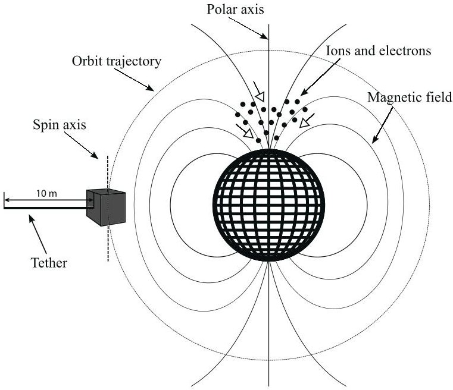
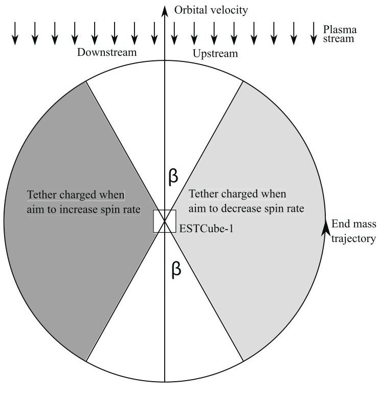
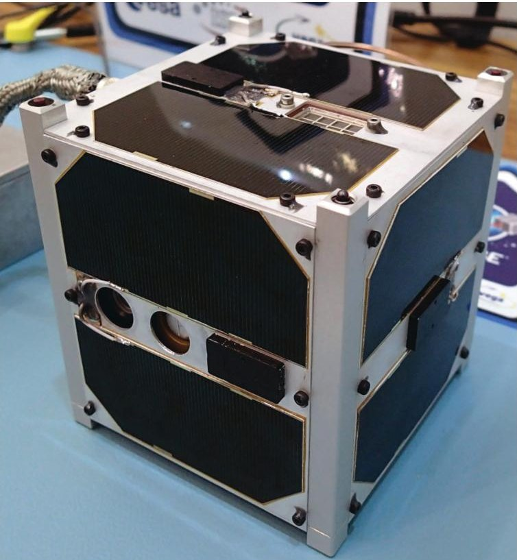
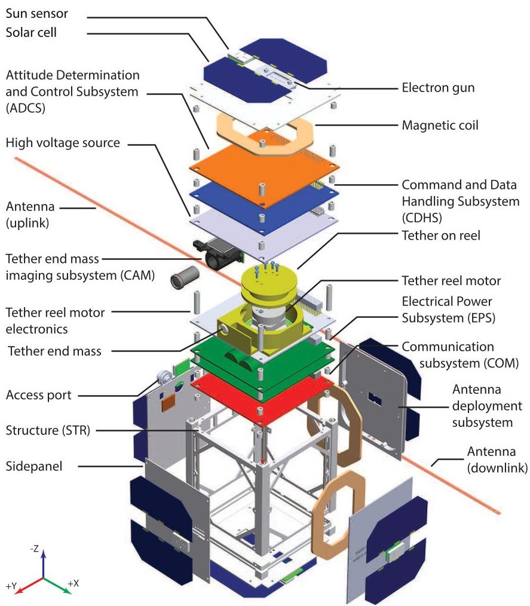

<!-- PDF_PAGE: 1 -->

# ESTCube-1 nanosatellite for electric solar wind sail in-orbit technology demonstration

Silver Lätt $ ^{a,b} $ , Andris Slavinskis $ ^{a,b} $ , Erik Ilbis $ ^{b} $ , Urmas Kvell $ ^{a,b} $ , Kaupo Voormansik $ ^{a,b} $ , Erik Kulu $ ^{a,b} $ , Mihkel Pajusalu $ ^{b} $ , Henri Kuuste $ ^{a,b} $ , Indrek Sünter $ ^{a,b} $ , Tõnis Eenmäe $ ^{a,b} $ , Kaspars Laizans $ ^{a,b} $ , Karlis Zalite $ ^{a,b} $ , Riho Vendt $ ^{a,b} $ , Johannes Piepenbrock $ ^{c} $ , Ilmar Ansko $ ^{a,b} $ , Ahto Leitu $ ^{b} $ , Andres Vahter $ ^{d} $ , Ants Agu $ ^{e} $ , Elo Eilonen $ ^{b} $ , Endel Soolo $ ^{b} $ , Hendrik Ehrpais $ ^{b} $ , Henri Lillmaa $ ^{b} $ , Ivar Mahhonin $ ^{b} $ , Jaak Mõttus $ ^{f} $ , Jaan Viru $ ^{a,b} $ , Jaanus Kalde $ ^{b} $ , Jana Šubitidze $ ^{f} $ , Janis Mucenieks $ ^{g} $ , Janis Šate $ ^{g} $ , Johan Kütt $ ^{a} $ , Juris Połevskis $ ^{g} $ , Jürgen Laks $ ^{a} $ , Kadi Kivistik $ ^{f} $ , Kadri-Liis Kusmin $ ^{b} $ , Kalle-Gustav Kruus $ ^{b} $ , Karl Tarbe $ ^{b} $ , Katrina Kalniqa $ ^{a,b,h} $ , Laur Joost $ ^{b} $ , Marko Lõoke $ ^{b} $ , Markus Järve $ ^{b} $ , Mart Vellak $ ^{b} $ , Martin Neerot $ ^{b} $ , Martin Valgur $ ^{b} $ , Martynas Pelakauskas $ ^{b} $ , Matis Averin $ ^{b} $ , Mats Mikkor $ ^{a,b} $ , Mihkel Veske $ ^{b} $ , Ott Scheler $ ^{b} $ , Paul Liias $ ^{d} $ , Priit Laes $ ^{b} $ , Ramon Rantsus $ ^{b} $ , Reimo Soosaar $ ^{b} $ , Risto Reinumägi $ ^{b} $ , Robert Valner $ ^{b} $ , Siim Kurvits $ ^{a} $ , Sven-Erik Mändmaa $ ^{b} $ , Taavi Ilves $ ^{b} $ , Tanel Peet $ ^{b} $ , Tavo Ani $ ^{b} $ , Teet Tilk $ ^{b} $ , Timothy Henry Charles Tamm $ ^{a} $ , Tobias Scheffler $ ^{i} $ , Toomas Vahter $ ^{d} $ , Tõnis Uiboupin $ ^{b} $ , Veigo Evard $ ^{d} $ , Andreas Sisask $ ^{j} $ , Lauri Kimmel $ ^{j} $ , Olaf Krömer $ ^{k} $ , Roland Rosta $ ^{k} $ , Pekka Janhunen $ ^{l} $ , Jouni Envall $ ^{a,l} $ , Petri Toivanen $ ^{l} $ , Timo Rauhala $ ^{m} $ , Henri Seppänen $ ^{m} $ , Jukka Ukkonen $ ^{m} $ , Edward Haeggström $ ^{m} $ , Risto Kurppa $ ^{m} $ , Taneli Kalvas $ ^{n} $ , Olli Tarvainen $ ^{n} $ , Janne Kauppinen $ ^{n} $ , Antti Nuottajärvi $ ^{n} $ , Hannu Koivisto $ ^{n} $ , Sergiy Kiprich $ ^{o} $ , Alexander Obraztsov $ ^{p,q} $ , Viljo Allik $ ^{a,b} $ , Anu Reinart $ ^{a} $ , and Mart Noorma $ ^{a,b} $

$ ^{a} $ Tartu Observatory, Observatooriumi 1, 61602 Tõravere, Tartumaa, Estonia

$ ^{b} $ Institute of Physics, University of Tartu, Tähe 4-111, 51010 Tartu, Estonia

$ ^{c} $ University of Applied Sciences, Kalverbenden 6, 52066 Aachen, Germany

$ ^{d} $ Tallinn University of Technology, Ehitajate tee 5, 19086 Tallinn, Estonia

$ ^{e} $ Institute of Technology, Estonian University of Life Sciences, Kreutzwaldi 1, 51014 Tartu, Estonia

f Estonian Aviation Academy, Lennu 40, 61707 Reola, Estonia

$ ^{g} $ Ventspils University College, Inženieru 101a, LV-3601 Ventspils, Latvia

$ ^{h} $ University of Latvia, Raina Blvd. 19, LV-1586 Riga, Latvia

$ ^{1} $ Bremen University of Applied Sciences, Neustadtswall 30, 28199 Bremen, Germany

$ ^{j} $ CGI Estonia, Söbra 54, 50106 Tartu, Estonia

$ ^{k} $ German Aerospace Center (DLR), Robert Hooke 7, 28359 Bremen, Germany

$ ^{1} $ Finnish Meteorological Institute, P.O. Box 503, FI-00101 Helsinki, Finland

$ ^{m} $ Electronics Research Laboratory, Department of Physics, University of Helsinki, P.O. Box 64, FI-00014 Helsinki, Finland

$ ^{n} $ Department of Physics, University of Jyväskylä, P.O. Box 35, FI-40014 Jyväskylä, Finland

$ ^{0} $ Kharkov Institute of Physics and Technology, National Science Center, Akademicheskaya 1, UA-61108 Kharkov, Ukraine

$ ^{p} $ Institute of Photonics, University of Eastern Finland, P.O. Box 111, FI-80101 Joensuu, Finland

$ ^{q} $ Department of Physics, MV Lomonosov Moscow State University, Leninskie Gory, 119991 Moscow, Russia

<!-- PDF_PAGE: 2 -->

Abstract. This paper presents the mission analysis, requirements, system design, system level test results, as well as mass and power budgets of a 1-unit CubeSat ESTCube-1 built to perform the first in-orbit demonstration of electric solar wind sail (E-sail) technology. The E-sail is a propellantless propulsion system concept that uses thin charged electrostatic tethers for turning the momentum flux of a natural plasma stream, such as the solar wind, into spacecraft propulsion. ESTCube-1 will deploy and charge a 10 m long tether and measure changes in the satellite spin rate. These changes result from the Coulomb drag interaction with the ionospheric plasma that is moving with respect to the satellite due to the orbital motion of the satellite. The following subsystems have been developed to perform and to support the E-sail experiment: a tether deployment subsystem based on a piezoelectric motor; an attitude determination and control subsystem to provide the centrifugal force for tether deployment, which uses electromagnetic coils to spin up the satellite to one revolution per second with controlled spin axis alignment; an imaging subsystem to verify tether deployment, which is based on a $ 6 4 0 \times4 8 0 $ pixel resolution digital image sensor; an electron gun to keep the tether at a high positive potential; a high voltage source to charge the tether; a command and data handling subsystem; and an electrical power subsystem with high levels of redundancy and fault tolerance to mitigate the risk of mission failure.

Key words: ESTCube-1, nanosatellite, CubeSat, satellite design, electric solar wind sail, E-sail, plasma brake.

## Acronyms and abbreviations

ADCS-Attitude Determination and Control Subsystem CAM-tether end mass imaging subsystem CDHS-Command and Data Handling Subsystem COM-Communication subsystem COTS-Commercial Off-The-Shelf CW-Continuous Wave EPS-Electrical Power Subsystem E-sail-Electric solar wind sail FRAM-Ferroelectric Random Access Memory $ \mathrm{I}^{2} \mathrm{C}- $ Inter-Intergrated Circuit

LEO - Low Earth Orbit

MCU - Microcontroller Unit

MPPT - Maximum Power Point Tracker

PL - Payload

RF - Radio Frequency

SPI - Serial Peripheral Interface

SRAM - Static Random-Access Memory

STR - Structure

UART - Universal Asynchronous Receiver/Transmitt

## 1. INTRODUCTION

Spacecraft propulsion is an important factor in space exploration. With the high cost of missions due to the mass and high safety risks of conventional chemical propulsion systems, other propulsion methods have started to become more popular in recent years. For example, solar sails have been studied and tested in the last decade [1-3]. An alternative method of spacecraft propulsion is to use the solar wind momentum flux. Zubrin and Andrews [4] suggested creating an artificial magnetosphere around the spacecraft to extract momentum by deflecting the solar wind from it. Another way of tapping solar wind momentum by using an electric sail is the electric solar wind sail (E-sail) invented by Janhunen [5-9]. The E-sail consists of a number of long and thin conductive wires or tethers, which are kept at a positive potential with the help of an onboard electron gun. The concept is promising because of a large effective sail area with a relatively low mass providing a high and constant level of thrust. However, in-orbit demonstrations of E-sail technology have not been carried out.

To validate the plasma physics aspect of the E-sail concept, it was planned to measure the electrostatic force acting on a charged tether in a moving plasma stream [8]. This validation can be performed in a Low Earth Orbit (LEO) where ionospheric plasma is moving relative to

the satellite due to its orbital motion. In order to carry out the experiment, a list of engineering and technological challenges have been solved:

- design and production of the tether [10,11];

- development of a tether deployment subsystem [12];

- development of an attitude determination and control subsystem for centrifugal tether deployment [13,14];

- development of a tether end mass (a mass at the end of the tether) imaging subsystem for monitoring tether deployment [15];

- development of an electron gun for keeping the tether at a high positive potential [12];

- development of a high voltage source for charging the tether and for powering electron guns [12].

A nanosatellite, ESTCube-1, has been developed to demonstrate the performance of the listed technologies and to perform the first in-orbit demonstration of the E-sail concept. ESTCube-1 is a 1-unit CubeSat built according to the CubeSat standard [16]. Its dimensions are $ \approx 1 0 \mathrm{c m} \times 1 0 \mathrm{c m} \times 1 0 \mathrm{c m} $ and the mass is 1.050 kg. The satellite is developed to perform the following tasks for the tether experiment.

1. Spin up to one revolution per second, with controlled spin axis alignment with the Earth polar axis (Fig. 1) to centrifugally deploy the tether.

2. Deploy a 10 m long tether while verifying it by imaging the end mass of the tether and by monitoring changes in the spin rate.

<!-- PDF_PAGE: 3 -->

Fig. 1. Orbit and spin plane orientation [8].

3. Charge the tether synchronously with the satellite spin and measure changes in the spin rate, in effect the E-sail force (Fig. 2).

The limited size sets strict requirements to the payload, which should fit in 3 cm $ \times $ 10 cm $ \times $ 10 cm. The peak power consumption should be less than 6 W. A 12 V power bus should be provided. To mitigate the risk of mission failure, high levels of redundancy and fault tolerance have been provided in a command and data handling subsystem [17] and an electric power subsystem [18,19].

Fig. 2. Top view of the satellite showing circular sectors indicating when to charge the tether.

In this article, we analyse the mission, describe the satellite design, and present the results of system level tests. The satellite design provides a detailed system level description and an overall subsystem level description, which includes the purpose, upper level requirements, and technical solutions. Detailed subsystem level descriptions and characterizations are presented in other articles in this issue [12,14,15,17,19].

## 2. MISSION ANALYSIS

The main mission of ESTCube-1 is to test technologies required for a full-scale E-sail mission and to perform the proof of concept measurement of the E-sail effect. The secondary mission is to use the same technology for the reduction of the orbital velocity of the satellite. The tether end mass imaging subsystem will be utilized to take images of the Earth.

ESTCube-1 will deploy a single 10 m long tether that uses a centrifugal force. Instead of the solar wind, ionospheric plasma will move relative to the satellite due to the orbital motion of the satellite. To provide the centrifugal force, the satellite is required to spin up to one revolution per second with controlled spin axis alignment with the polar axis of the Earth (Fig. 1) using electromagnetic coils. The tether will be charged synchronously with the satellite spin (Fig. 2). The electrostatic force acting on the charged tether will be estimated by measuring changes in the spin rate. If the tether is charged when moving in the opposite direction to the plasma stream, the spin rate will decrease over time, and if charged when moving in the same direction, the spin rate will increase. Due to the low mass of the tether $ \approx0.1 $ g) and the end mass (1.2 g), as well as the high spin rate of the satellite $ \approx20 \mathrm{deg}\cdot\mathrm{s}^{-1} $ after tether deployment), the gravity gradient effect (i.e. the gravity of the Earth pulling the tether and the end mass) is negligible.

The E-sail experiment will be run $ \pm 1 5^{\circ} $ from the geographical poles of the Earth where the spin axis is nearly parallel to the magnetic field of the Earth and the spin plane is nearly parallel to the plasma stream. With this set-up the spin axis will not tend to be turned because the magnetic Lorentz force and the E-sail force are both nearly parallel to the spin plane [8,13].

Compared with the solar wind environment at a distance of 1 AU, ESTCube-1 will face up to a $ 1 0^{5} $ times denser plasma stream, which will move 50-100 times slower at a speed of $ \approx 7. 5 \mathrm{~ k m} \cdot \mathrm{s}^{-1} $ . The expected total E-sail force in the ESTCube-1 case is $ \approx 1 $ $ \mu\mathrm{N} $ , which is $ \approx 1 0 $ times larger than the magnetic Lorentz force acting on the tether [8].

The change of the spin rate during one polar pass while running the E-sail experiment is given by

$$
\Delta \omega = \frac {r F \cos (\beta) t}{\pi I},
$$

where r is the length of the arm vector, F is the nominal

<!-- PDF_PAGE: 4 -->

E-sail force, $ \beta $ is the angle between the tether and the orbital velocity vector that defines the circular sector when the tether is charged (Fig. 2), t is the time of one polar pass, and I is the moment of inertia. The expected E-sail force is too small to be detectable by a single rotation but it accumulates and is measurable after a few passes over the polar regions of the Earth. The nominal E-sail force on ESTCube-1 is 1 $ \mu\mathrm{N} $ [8]. The length of the arm vector is 5 m (the middle of the tether). The moment of inertia is estimated to be 0.076 $ \mathrm{kg}\cdot\mathrm{m}^{2} $ [14]. The angle $ \beta $ is $ 20^{\circ} $ . One $ \pm 1 5^{\circ} $ polar pass lasts for 470 s (assuming the orbital period of 5640 s). Inputting all the given values to Formula (1) gives an angular velocity change of $ \approx 0.5\mathrm{deg}\cdot\mathrm{s}^{-1} $ during one polar pass.

When the charged tether interacts with the ionospheric plasma the orbital velocity of the satellite will decrease. This application is called the plasma brake [20-22]. After the validation of the E-sail effect the satellite will perform the plasma brake experiment by keeping the tether charged for a long period of time.

## 3. SATELLITE DESIGN

The expected mission lifetime in a 98° inclination 660 km altitude orbit is two years. The satellite is expected to de-orbit naturally within 23 years, but it is estimated that if the plasma brake experiment were run for two months in total, the de-orbiting period would decrease by 18 months.

ESTCube-1, which is shown in Fig. 3, has been developed to conform to the standards in CubeSat Design

Fig. 3. Assembled ESTCube-1 satellite at the Guiana Space Centre in French Guiana.

Specification rev. 12 [16]. This standard has been chosen for the best available launch opportunities and the ease of integration with a launch vehicle using standardized deployers.

The ESTCube-1 spacecraft consists of the following subsystems (Fig. 4): Attitude Determination and Control Subsystem (ADCS); Electrical Power Subsystem (EPS); Communication subsystem (COM); Command and Data Handling Subsystem (CDHS); Structure (STR); tether end mass imaging subsystem (CAM); and Payload (PL), which includes the tether deployment subsystem, the high voltage source, and cold cathode electron guns. There is no thermal control subsystem because analyses indicated that no special thermal control methods (passive or active) were required. The mass and power budgets are given in Tables 1 and 2, respectively.

A fault-tolerant system is critical to successfully carry out the ESTCube-1 mission. Two extremes of hardware redundancy are a completely hot or cold standby system where every critical subsystem is duplicated. The difference between them is whether the duplicate is powered on or off, respectively. On ESTCube-1, a mixed approach is implemented. On the CDHS one of the two Microcontroller Units (MCU) is on cold standby mode and the watchdog function is performed by the EPS. The satellite would remain functional even if two of the three power harvesting modules (Maximum Power Point Tracker, MPPT) of the EPS should stop working. MPPTs are also independent from the EPS's MCU. Power storage is divided into two completely redundant modules, each involving a battery and its protection/control circuitry. If a battery malfunction occurs, it can be permanently isolated from the power systems while leaving the satellite to be powered only by solar cells. For both the CDHS and the EPS, fault tolerance is being addressed at a software level as well. More detailed descriptions of all fault-tolerant methods used in the CDHS and the EPS can be found in [17-19].

The internal connection diagram of the nanosatellite ESTCube-1 is shown in Fig. 5. It includes all power and data buses between subsystems, which are stacked on top of each other using SAMTEC PC104+ connectors with four rows of 60 pins. The access port is a panel mounted Binder M9 IP67 series 712/702 with eight connections to various subsystems.

Table 1. Mass budget of the ESTCube-1 flight model

<table border="1"><tr><td>Component</td><td>Mass,g</td></tr><tr><td>Structure</td><td>287</td></tr><tr><td>Electrical power subsystem</td><td>291</td></tr><tr><td>Command and data handling subsystem</td><td>49</td></tr><tr><td>Communication subsystem</td><td>75</td></tr><tr><td>Payload</td><td>206</td></tr><tr><td>Tether end mass imaging subsystem</td><td>30</td></tr><tr><td>Attitude determination and control subsystem</td><td>112</td></tr><tr><td>Total</td><td>1050</td></tr></table>

<!-- PDF_PAGE: 5 -->

Fig. 4. Exploded view of the ESTCube-1 model.

Table 2. Power budget of the ESTCube-1 flight model. The mission average power marked with an asterisk is for subsystems that are used only for specific mission phases and can be scheduled if enough power is available

<table border="1"><tr><td>Component</td><td>Peak power,mW</td><td>Mission average power,mW</td></tr><tr><td>Attitude determination sensors</td><td>300</td><td>$\cdot$</td></tr><tr><td>Attitude control coils</td><td>840</td><td>$\cdot$</td></tr><tr><td>Tether end mass imaging subsystem</td><td>300</td><td>$\cdot$</td></tr><tr><td>Command and data handling subsystem</td><td>300</td><td>220</td></tr><tr><td>Communication subsystem</td><td>2000</td><td>550</td></tr><tr><td>Electrical power subsystem</td><td>150</td><td>150</td></tr><tr><td>Payload</td><td>4200</td><td>$\cdot$</td></tr><tr><td>Antenna deployment subsystem</td><td>4200</td><td>$\cdot$</td></tr></table>

<!-- PDF_PAGE: 6 -->

Fig. 5. Block diagram of the satellite system interfaces. Arrowheads denote data directions from a source to a target, bidirectional buses are denoted by bidirectional arrows. UART-Universal Asynchronous Receiver/Transmitter, SPI- Serial Peripheral Interface, $ \mathrm{I}^{2} \mathrm{C} $ - Inter-Integrated Circuit. Solid red lines denote electrical power, dotted green lines digital buses, and dashed blue lines general purpose input or output signals.

## 3.1. Structure

The mechanical frame of ESTCube-1 is made from aluminium (alloy AW 6082-T6) as a mono-block structure to provide a more rigid structure with respect to the frame mass. The rails of the frame are anodized. The mass of the frame is 78 g, and the structural components weigh 287 g in total. Side panels are manufactured from the same type of aluminium and are 1 mm thick. Figure 4 shows an overview of the structural design.

The antenna deployment system consists of antennas attached to the custom-made aluminium structure. This design allows two solar cells and a Sun sensor on all of the sides of the satellite. Two beryllium copper (type CuBe2) quarter wave monopole antennas are wound in the cavity of the antenna deployment system and fastened using a nylon wire, which is melted to deploy antennas using a resistive wire system. The antenna deployment system, located on side -Y, extends more than 6.5 mm along the surface normal, but is below the 9 mm maximum allowed by the ISIPOD CubeSat Deployer [23]. Deployment switches are Grayhill 391 and separation springs are from Heinrich Kipp Werk with the product number 03021-06.

## 3.2. Electrical power generation and distribution subsystem

The EPS of ESTCube-1 handles mainly power harvesting, storage, and distribution, and transmits the continuous wave (CW) beacon. The subsystem is powered by 12 solar cells, which produce a minimum of 2.4 W of combined electrical power at direct sunlight at the beginning of life. To harvest power from the cells efficiently, commercial Off-The-Shelf (COTS) MPPT integrated circuits from Linear Technologies (SPV1040) are used. This allows faster tracking speeds and better fault tolerance compared to MCU-based solutions while freeing up processor resources, since MPPT generally relies on the on-board processor to work [24].

Two cylindrical Li-ion battery cells (Panasonic PCGR18650C) are used for power storage, providing a total of 15.5 Wh of energy storage in the expected conditions. The EPS supplies power to other satellite subsystems via 3.3 V, 5 V, and 12 V buses, while each subsystem is connected to those buses through current-limiting power switches. These switches automatically cut the power to consumers if the current limit is reached, providing some protection against latch-ups. Radiation in a polar LEO will cause both cumulative and single-

<!-- PDF_PAGE: 7 -->

event damage to the components of the EPS (referenced cumulative radiation dose with 1 mm of aluminium shielding is about 10 kRad for 3-year operation [25]). To make a fatal failure due to radiation in the expected operational lifetime of two years less likely, several parts of the EPS were implemented in a redundant configuration (the regulators that power consumers were duplicated in a hot-redundant configuration and three MPPT integrated circuits were used). The EPS is controlled using an Atmega 1280 microcontroller, which has been previously tested for radiation dose damage [26] and found to be operable after doses of 18.3 kRad, making it suitable considering the expected mission lifetime. External Ferroelectric Random Access Memory (FRAM) is used to provide reliable operation via the provision of a non-volatile memory for data and firmware storage.

The power budget is presented in Table 2. The subsystem is described in detail in [18,19,27].

## 3.3. Command and data handling subsystem

The CDHS is the on-board computer, responsible for scheduling commands, logging mission and housekeeping data from active subsystems, storing images, and controlling payloads. The CDHS is based on two cold redundant STMicroelectronics STM32F103 microcontrollers that share three serial flash and six FRAM devices. The CDHS has three data interface types with other ESTCube-1 modules: Serial Peripheral Interface (SPI), Inter-Integrated Circuit （ $ \mathrm{I}^{2} \mathrm{C} $ ）, Universal Asynchronous Receiver/Transmitter (UART), which are organized into several logical buses. The FreeRTOS operating system is used to fulfil requirements of realtime operations, processing capacity, and memory footprint. The CDHS is described in detail in [17].

## 3.4. Communication subsystem

The ESTCube-1 Communication subsystem (COM) has an uplink on a 2-metre amateur radio band (145 MHz band, 1200 baud 2-frequency-shift keying (2-FSK) with deviation of $ \pm1 $ kHz) and high speed downlink on 70 cm amateur radio band (437.505 MHz, 9600 baud raised cosine filtered 2-FSK with deviation of $ \pm3.5 $ kHz) using two integrated transceiver circuits ADF7021 from Analog Devices. Both up- and downlink use AX.25 unnumbered information frames (http://www.tapr.org/pdf/AX25.2.2.pdf) as a transport protocol. A slow secondary downlink channel is implemented as a radio beacon on a 70 cm band (437.250 MHz) and uses a CW signal to transmit telemetry in Morse code, which is robust and easy to receive and decode. Quarter wave monopoles are used as antennas for both up- and downlink. A power amplifier on the satellite provides up to 500 mW for data downlink, and a preamplifier provides 18 dB amplification for

uplink. The transmit power of the CW beacon is 100 mW. Due to the shared Radio Frequency (RF) chain the beacon and the primary downlink cannot be transmitted simultaneously. The Texas Instruments MSP430F2418 MCU is used on the COM.

The primary downlink channel and radio beacon operation are divided between the COM and the EPS. They share the same downlink RF chain, which includes a power amplifier, a power measuring unit, and a transmitting antenna. In the case of a failure in the COM MCU or the transceiver circuit, the EPS would still be able to transmit the radio beacon because the final RF power amplifier stages are powered independently from the COM MCU.

Inside the satellite, antennas are connected to the COM PCB via 0.81 mm flexible coaxial cables. For downlink, an antenna impedance matching circuit has been used to achieve maximum transmission efficiency.

## 3.5. Attitude determination and control subsystem

The ADCS design has been driven by the requirement to spin up the satellite to one revolution per second, with controlled alignment with the polar axis of the Earth with a pointing error of less than $ 3^{\circ} $ . The attitude control subsystem uses electromagnetic coils developed in-house. Attitude estimation is performed on board using data from in-house developed Sun sensors and COTS gyroscopic sensors and magnetometers. Processed sensor readings are provided to an unscented Kalman filter to determine the attitude. Each Sun sensor is based on two analogue Hamamatsu S3931 position-sensitive detectors. An analogue solution provides low power consumption and sufficient sampling frequency. Sun sensors are lightweight and are able to measure Sun direction with an expanded uncertainty of $ 2.5^{\circ} $ Honeywell HMC5883L magnetometers and Invensense ITG-3200 gyroscopic sensors are used. ADCS calculations are performed on the CDHS. According to simulations, the ADCS is able to spin up the satellite in less than eight orbits. The subsystem is described in detail in [13,14].

## 3.6. Payload

The ESTCube-1 payload contains an aluminium E-sail tether, a motorized reel on which it is stored, and the motor drive electronics. During the experiment 10 m of the tether will be deployed. The two-filament tether consists of a 50 $ \mu\mathrm{m} $ base wire and 25 $ \mu\mathrm{m} $ loop wire. An additional mass of 1.2 g, called the end mass, has been added to the tip of the tether to assist with the centrifugal deployment of the tether. During the E-sail experiment the tether will be charged to a 500 V potential and both polarities will be tested separately. The voltage is provided by a dedicated high voltage source and delivered to the tether through a slip ring contact. When

<!-- PDF_PAGE: 8 -->

the positive voltage is applied, on-board cold cathode electron guns are needed to remove the excess electrons to maintain the positive voltage of the tether. The subsystem is described in detail in [12].

## 3.7. Tether end mass imaging subsystem

The CAM is a low power camera module capable of taking 10-bit images with a 640 $ \times $ 480 pixel resolution. The subsystem enables the monitoring of tether deployment by imaging the 12 mm diameter matt aluminium end mass. The CAM is also used to take images of the Earth for outreach and educational purposes. The design features an Aptina MT9V011 image sensor, a STMicroelectronics STM32F217ZG processor, an external ISSI IS61WV102416BLL-10TLI Static Random-Access Memory (SRAM), an Edmund Optics NT57-908 lens with a focal length of 4.4 mm, as well as a 25% neutral density (ND) filter and a 700 nm infrared (IR) cut-off filter. The subsystem is described in detail in [15].

## 4. SYSTEM LEVEL TESTING

ESTCube-1 has been tested to meet the requirements of the Vespa secondary payload platform of the Vega rocket [28]. The following system level tests were carried out to qualify for the launch: sine vibration, random vibration, shock, thermal cycling, and thermal vacuum. Individual tests performed separately on subsystems can be found in the relevant articles [12,14,15,17,19].

Parameters for sine and random vibration tests can be found in Tables 3 and 4, respectively. Levels must be applied along each of the three axes. In the case of the random vibration test, the duration was 4 min for each frequency. The satellite passed the tests.

Acceptance shock tests were performed at Testing Hammer for extraOrdinary Rough environments (THOR), the metal-to-metal impact shock test facility of the ISIS company [29]. The satellite had to qualify for three frequencies of 100 Hz, 800 Hz, and 1000 Hz in the shock response spectra with amplitudes of 30 g, 1410 g, and 1410 g. ESTCube-1 successfully passed two shocks at all frequencies in each of the three orthogonal axes without any remarks.

Table 3. Sine sweep test parameters

<table border="1"><tr><td>Frequency,Hz</td><td>Level(0-peak)</td><td>Sweep rate,oct·m-1</td></tr><tr><td>5-11</td><td>10mm</td><td>1/3</td></tr><tr><td>11-30</td><td>5g</td><td>1/3</td></tr><tr><td>30-70</td><td>22.5g</td><td>1/3</td></tr><tr><td>70-200</td><td>22.5g</td><td>2</td></tr><tr><td>200-2000</td><td>10g</td><td>2</td></tr></table>

Thermal vacuum test temperature levels ranged from $ - 1 0^{\circ} \mathrm{C} $ to $ + 7 0^{\circ} \mathrm{C} $ and two cycles had to be performed. The spacecraft had to be kept 2 h at minimum and maximum temperatures. The temperature rate when heating had to be less than $ 2 0^{\circ} \mathrm{C} $ per minute and when cooling 2-3 $ ^{\circ} \mathrm{C} $ per minute. The pressure was in the order of 10 mPa. The thermal cycling test had the same parameters except that the atmospheric pressure was normal. These tests were performed in laboratories at Tartu Observatory. No visual or performance degradation to satellite hardware was detected.

## 5. CONCLUSIONS

The satellite ESTCube-1 has been developed over a period of five years to perform the first in-orbit demonstration of E-sail technology. The satellite has passed all validation tests and was successfully launched on-board the Vega VV02 rocket on 7 May 2013, 2:06 UTC.

Satellite subsystems were verified during the early orbit phase. The EPS and the COM have been tested and found to be able to perform the required operations. The CDHS is fully functional. On-board attitude determination is fully functional, except that one Sun sensor is not working, but this is not a critical malfunction. Attitude control is being tested. More than 180 images of the Earth have been acquired by the CAM since the start of operations. Those images verify that the subsystem is able to control the exposure time and gain parameters for taking quality images of the Earth. The CAM sensor has not been damaged by exposure to direct sunlight. On-board images have also been used to verity attitude determination. The firmware of the EPS, CDHS, and CAM is updated from the ground station. The

Table 4. Random vibration test parameters

<table border="1"><tr><td>Frequency,Hz</td><td>Power spectral density,g2·Hz-1</td><td>Slope,dB·Oct-1</td><td>Power spectral density,gRMS</td></tr><tr><td>20</td><td>0.091</td><td>+3</td><td>18</td></tr><tr><td>60</td><td>0.2</td><td>+3</td><td>18</td></tr><tr><td>1000</td><td>0.2</td><td>-6</td><td>18</td></tr><tr><td>2000</td><td>0.068</td><td>-6</td><td>18</td></tr></table>

<!-- PDF_PAGE: 9 -->

satellite is being updated and tested for the experiment Flight results will be published later.

## ACKNOWLEDGEMENTS

The European Space Agency has supported ESTCube-1 via the European Space Agency Plan for European Cooperating States (PECS) project "Technology demonstration for space debris mitigation and electric propulsion on ESTCube-1 student satellite". The European Commission has supported ESTCube-1 through the EstSpace FP7 project, the ESAIL FP7 project, and through the Erasmus training programme. Madis Võõras and Ene Ergma are acknowledged for providing constant support throughout the project. The research by Andris Slavinskis, Kaupo Voormansik, and Karlis Zalite was supported by the European Social Fund's Doctoral Studies and the Internationalisation Programme DoRa. Travelling to conferences and studies abroad have been supported by the Kristjan Jaak scholarship programme and by the European Space Agency. Alexander Obraztsov is grateful for partial support from the FP7 Marie Curie Program (Grant PIRSES-GA-2011-295241). We would like to thank the following persons, institutions, and companies that helped by giving advice, by supporting the project, and by providing human, hardware, and software resources: colleagues from the University of Tartu, Tartu Observatory, Finnish Meteorological Institute, University of Helsinki, University of Jyväskylä, Tallinn University of Technology, Estonian Aviation Academy, and Estonian University of Life Sciences; Estonian Physical Society, CGI Estonia, Helsinki Institute of Physics, Brandner, AAUSAT team at Aalborg University, Stoneridge Electronics, Protolab Tartu, Regio, Rantelon, Väisälä Foundation, Magnus Ehrnrooth Foundation, Academy of Finland, Ventspils High Technology Park, Ventspils University College, Estonian Ministry of Education and Research, Estonian Ministry of Economic Affairs and Communication, Enterprise Estonia, Elvior, Defendec, Solenix, Villemos Solutions, Premier Farnell UK Limited, Atlassian, ITP Engines UK, and Surveer.

## REFERENCES

1. Johnson, L., Young, R., Barnes, N., Friedman, L., Lappas, V., and McInnes, C. Solar sails: technology and demonstration status. Int'l J. Aeronaut. Space Sci., 2012, 13(4), 421-427.

2. Ansdell, M., Ehrenfreund, P., and McKay, C. Stepping stones toward global space exploration. Acta Astronaut., 2011, 68(11-12), 2098-2113.

3. Macdonald, M. and McInnes, C. Solar sail science mission applications and advancement. Adv. Space Res., 2011, 48, 1702-1716.

4. Zubrin, R. M. and Andrews, D. G. Magnetic sails and interplanetary travel. J. Spacecr. Rockets, 1991, 28, 197-203.

5. Janhunen, P. Electric sail for spacecraft propulsion. J. Propul. Power, 2004, 20, 763-764.

6. Janhunen, P. and Sandroos, A. Simulation study of solar wind push on a charged wire: basis of solar wind electric sail propulsion. Ann. Geophys., 2007, 25, 755-767.

7. Janhunen, P. Increased electric sail thrust through removal of trapped shielding electrons by orbit chaotisation due to spacecraft body. Ann. Geophys., 2009, 27, 3089-3100.

8. Janhunen, P., Toivanen, P. K., Polkko, J., Merikallio, S., Salminen, P., Haeggström, E. et al. Electric solar wind sail: toward test missions. Rev. Sci. Instrum., 2010, 81, 111301:1-11.

9. Janhunen, P., Toivanen, P., Envall, J., Merikallio, S., Montesanti, G., del Amo, J. G. et al. Overview of electric solar wind sail applications. Proc. Estonian Acad. Sci., 2014, 63(2S), 267-278.

10. Seppänen, H., Kiprich, S., Kurppa, R., Janhunen, P., and Hæggström, E. Wire-to-wire bonding of $ \mu m $ -diameter aluminum wires for the Electric Solar Wind Sail. Microelectron. Eng., 2011, 88, 3267-3269.

11. Seppänen, H., Rauhala, T., Kiprich, S., Ukkonen, J., Simonsson, M., Kurppa, R. et al. One kilometer (1 km) electric solar wind sail tether produced automatically. Rev. Sci. Instrum., 2013, 84, 095102:1-4.

12. Envall, J., Janhunen, P., Toivanen, P., Pajusalu, M., Ilbis, E., Kalde, J. et al. E-sail test payload of the ESTCube-1 nanosatellite. Proc. Estonian Acad. Sci., 2014, 63(2S), 210-221.

13. Slavinskis, A., Kvell, U., Kulu, E., Sünter, I., Kuuste, H., Lätt, S. et al. High spin rate magnetic controller for nanosatellites. Acta Astronaut., 2014, 95, 218-226.

14. Slavinskis, A., Kulu, E., Viru, J., Valner, R., Ehrpais, H., Uiboupin, T. et al. Attitude determination and control for centrifugal tether deployment on the ESTCube-1 nanosatellite. Proc. Estonian Acad. Sci., 2014, 63(2S), 242-249.

15. Kuuste, H., Eenmäe, T., Allik, V., Agu, A., Vendt, R., Ansko, I. et al. Imaging system for nanosatellite proximity operations. Proc. Estonian Acad. Sci., 2014, 63(2S), 250-257.

16. CubeSat Design Specification Rev. 12. The CubeSat Program, Cal Poly SLO, California, 2009.

17. Laizans, K., Sünter, I., Zalite, K., Kuuste, H., Valgur, M., Tarbe, K. et al. Design of the fault tolerant command and data handling subsystem for ESTCube-1. Proc. Estonian Acad. Sci., 2014, 63(2S), 222-231.

18. Pajusalu, M., Rantsus, R., Pelakauskas, M., Leitu, A., Ilbis, E., Kalde, J. et al. Design of the Electrical Power System for the ESTCube-1 satellite. Latv. J. Phys. Tech. Sci., 2012, 49(3), 16-24.

19. Pajusalu, M., Ilbis, E., Ilves, T., Veske, M., Kalde, J., Lillmaa, H. et al. Design and pre-flight testing of the electrical power system for the ESTCube-1 nanosatellite. Proc. Estonian Acad. Sci., 2014, 63(2S), 232-241.

20. Janhunen, P. Electrostatic plasma brake for deorbiting a satellite. J. Propul. Power, 2010, 26, 370-372.

<!-- PDF_PAGE: 10 -->

21. Kvell, U., Cara, D. D., Janhunen, P., Noorma, M., and del Amo, J. G. Deorbiting strategies: comparison between electrostatic plasma brake and conventional propulsion. In Joint Propulsion Conferences. 2011, 1-9.

22. Khurshid, O., Tikka, T., Praks, J., and Hallikainen, M. Accommodating the plasma brake experiment onboard the Aalto-1 satellite. Proc. Estonian Acad. Sci., 2014, 63(2S), 258-266.

23. ISIS. ISIPOD CubeSat Deployer Product Specification.

24. Stras, L., Kekez, D. D., Wells, G. J., Jeans, T., Zee, R. E., Pranajaya, F. et al. The design and operation of the Canadian Advanced Nanospace eXperiment (CanX-1). In Proceedings of the AMSAT-NA 21st Space Symposium. 2003, 150-160.

25. Díaz-Michelena, M. Small magnetic sensors for space applications. Sensors, 2009, 9, 2271-2288.

26. Avery, K., Fenchel, J., Mee, J., Kemp, W., Netzer, R., Elkins, D. et al. Total dose test results for CubeSat electronics. In IEEE Radiation Effects Data Workshop. 2011.

27. Pajusalu, M., Ilbis, E., Kalde, J., Lillmaa, H., Reinumagi, R., Rantsus, R. et al. Electrical power system for ESTCube-1: a fault-tolerant COTS solution. In 63rd International Astronautical Congress. Naples, 2012, 7139-7144.

28. Arianespace. Vega User's Manual. Issue 3/Revision 0. 2006.

29. Jonsson, M. Development of a Shock Test Facility for Qualification of Space Equipment. Master thesis. Chalmers University of Technology, 2012.

# Nanosatelliit ESTCube-1 elektrilise päikesepurje tehnoloogia näitamiseks orbiidil

Silver Lätt, Andris Slavinskis, Erik Ilbis, Urmas Kvell, Kaupo Voormansik, Erik Kulu, Mihkel Pajusalu, Henri Kuuste, Indrek Sünter, Tõnis Eenmäe, Kaspars Laizans, Karlis Zalite, Riho Vendt, Johannes Piepenbrock, Ilmar Ansko, Ahto Leitu, Andres Vahter, Ants Agu, Elo Eilonen, Endel Soolo, Hendrik Ehrpais, Henri Lillmaa, Ivar Mahhonin, Jaak Mõttus, Jaan Viru, Jaanus Kalde, Jana Šubitidze, Jänis Mucenieks, Jänis Šate, Johan Kutt, Juris Połevskis, Jürgen Laks,

Kadi Kivistik, Kadri-Liis Kusmin, Kalle-Gustav Kruus, Karl Tarbe, Katrin Tuude, Katrina Kalniqa, Laur Joost, Marko Lõoke, Markus Järve, Mart Vellak, Martin Neerot, Martin Valgur, Martynas Pelakauskas, Matis Averin, Mats Mikkor, Mihkel Veske, Ott Scheler, Paul Liias, Priit Laes, Ramon Rantsus, Reimo Soosaar, Risto Reinumägi, Robert Valner, Siim Kurvits, Sven-Erik Mändmaa, Taavi Ilves, Tanel Peet, Tavo Ani, Teet Tilk, Timothy Henry Charles Tamm, Tobias Scheffler, Toomas Vahter, Tõnis Uiboupin, Veigo Evard, Andreas Sisask, Lauri Kimmel, Olaf Krömer, Roland Rosta, Pekka Janhunen, Jouni Envall, Petri Toivanen, Timo Rauhala, Henri Seppänen, Jukka Ukkonen, Edward Haeggström, Risto Kurppa, Taneli Kalvas, Olli Tarvainen, Janne Kauppinen, Antti Nuottajärvi, Hannu Koivisto, Sergiy Kiprich, Alexander Obraztsov, Viljo Allik, Anu Reinart ja Mart Noorma

On antud ülevaade 1-uhikulise kuupsatelliidi ESTCube-1 missiooni analuusist, nouetest, satelliidi ehitusest, testimisest ja massi ning voolutarbe jaotusest. Satelliidi eesmärk on näidata elektrilise päikesepurje tehnoloogiat madalal Maa orbiidil. Elektriline päikesepuri on kütusevaba tõukejõusüsteem, mis kasutab pikki peenikesi elektrostaatiliselt laetud metallkiude, mille abil muudetakse loodusliku plasma – näiteks päikesetuule – liikumisimpulss kosmoselaeva kiirenduseks. Pöörlema pandud ESTCube-1 kerib tsentrifugaaljõu abil välja 10 meetri pikkuse traadi, millele antakse elektrostaatiline laeng. Seejärel mõõdetakse satelliidi põörlemiskiiruse muutust, mis tuleneb satelliidi orbitaalliikumisel tekkivast Coulombi vastastikmõjust laetud traadi ja ionosfäari plasma vahel. Traadi väljakerimist juhitakse spetsiaalselt selleks ehitatud piesoelektrilisel mootoril põhineva süsteemiga. Traadi väljakerimiseks vajaliku tsentrifugaaljõu ja põörlemistelje stabiilsuse tagamiseks arendati välja satelliidi asendi mäaramise ning juhtimise alamsüsteem. Vajaliku põörlemiskiiruse – 1 pööre sekundis – saavutamiseks ja satelliidi asendi kontrollimiseks kasutatakse elektromagnetmähiseid. Kinnitus traadi eduka väljakerimise kohta saadakse kaamerast, mis pildistab traadi otsamassi. Kaamera põhineb $640\times 480$ pikslise lahutusvõimega digitaalsel pildisensoril. Traadi elektrostaatiliseks laadimiseks on välja toötatud elektronkahur ja körgepingeallikas. Missiooni riskide vähendamiseks on satelliidi käsu- ja andmehaldussüsteemi ning elektrienergia alamsüsteemi arendamisel pandud suurt rõhku veakindlusele.