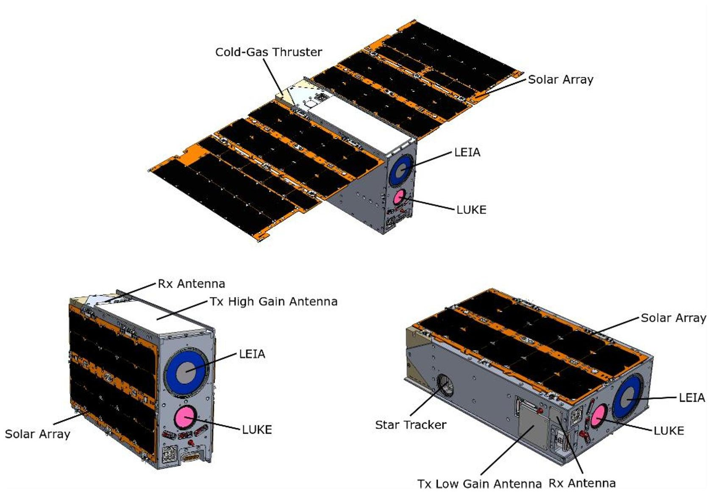
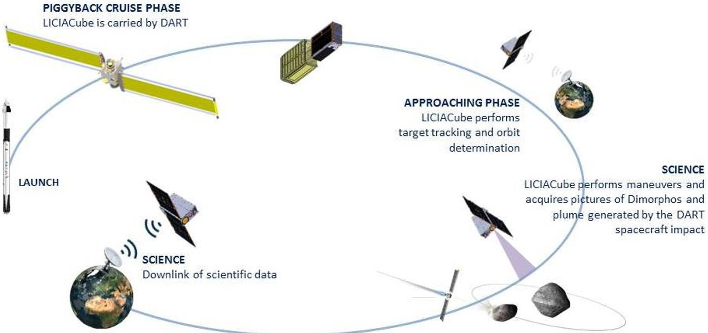
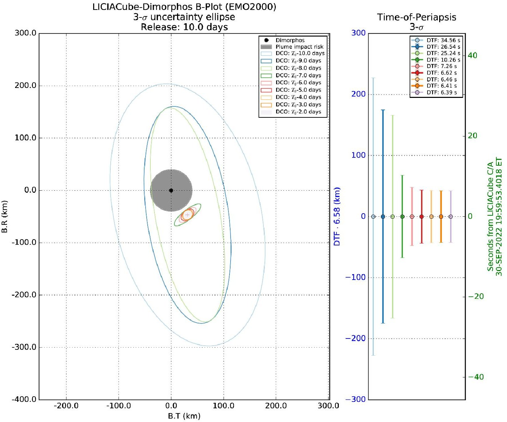
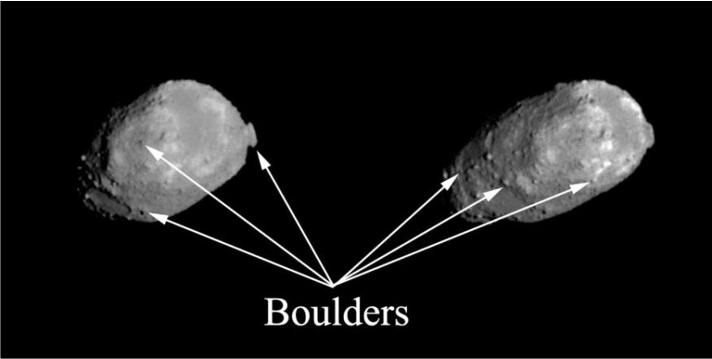
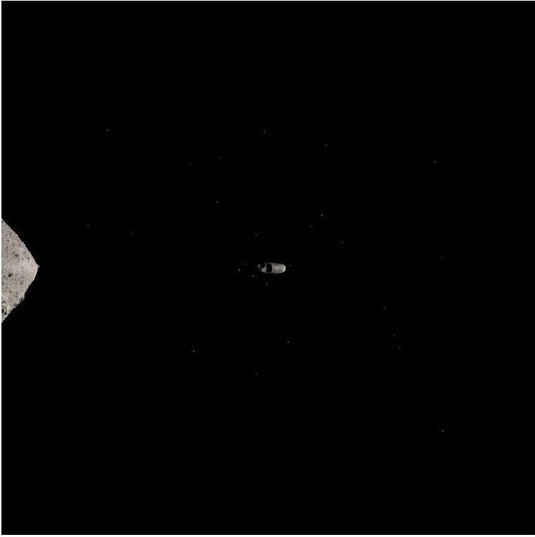

<!-- PDF_PAGE: 1 -->

## Post-Print

This is the accepted version of:

E. Dotto, V. Della Corte, M. Amoroso, I. Bertini, J.R. Brucato, A. Capannolo, B. Cotugno, G. Cremonese, V. Di Tana, I. Gai, S. Ieva, G. Impresario, S.L. Ivanovski, M. Lavagna, A. Lucchetti, E. Mazzotta Epifani, A. Meneghin, F. Miglioretti, D. Modenini, M. Pajola, P. Palumbo, D. Perna, S. Pirrotta, G. Poggiali, A. Rossi, E. Simioni, S. Simonetti, P. Tortora, M. Zannoni, G. Zanotti, A. Zinzi, A.F. Cheng, A.S. Rivkin, E.Y. Adams, E.L. Reynolds, K. Fretz LICIACube - The Light Italian Cubesat for Imaging of Asteroids In support of the NASA DART mission towards asteroid (65803) Didymos Planetary and Space Science, Vol. 199, 2021, 105185 (12 pages) doi:10.1016/j.pss.2021.105185

The final publication is available at https://doi.org/10.1016/j.pss.2021.105185

Access to the published version may require subscription.

When citing this work, cite the original published paper.

© 2021. This manuscript version is made available under the CC-BY-NC-ND 4.0 license http://creativecommons.org/licenses/by-nc-nd/4.0/

Perm are the instructions for the following task: Click the link to this version http://hdl.handle.net/11311/1174283

<!-- PDF_PAGE: 2 -->

# LICIACube - the Light Italian Cubesat for Imaging of Asteroids In support of the NASA DART mission towards asteroid (65803) Didymos

Dotto, E. $ ^{1} $ , Della Corte, V. $ ^{2} $ , Amoroso, M. $ ^{3} $ , Bertini, I. $ ^{4,2} $ , Brucato, J.R. $ ^{5} $ , Capannolo, A. $ ^{6} $ , Cotugno, B. $ ^{7} $ Cremonese, G. $ ^{8} $ , Di Tana, V. $ ^{7} $ , Gai, I. $ ^{9} $ , Ieva, S. $ ^{1} $ , Impresario G. $ ^{3} $ , Ivanovski, S.L. $ ^{10} $ , Lavagna, M. $ ^{6} $ , Lucchetti, A. $ ^{8} $ Mazzotta Epifani, E. $ ^{1} $ , Meneghin, A. $ ^{5} $ , Miglioretti, F. $ ^{7} $ , Modenini, D. $ ^{9} $ , Pajola, M. $ ^{8} $ , Palumbo, P. $ ^{4,2} $ , Perna, D. $ ^{1} $ Pirrotta, S. $ ^{3} $ , Poggiali, G. $ ^{5,11} $ , Rossi, A. $ ^{12} $ , Simioni, E. $ ^{8} $ , Simonetti, S. $ ^{7} $ , Tortora, P. $ ^{9} $ , Zannoni, M. $ ^{9} $ , Zanotti, G. $ ^{6} $ Zinzi, A. $ ^{13,3} $ , Cheng, A.F. $ ^{14} $ , Rivkin, A.S. $ ^{14} $ , Adams, E.Y. $ ^{14} $ , Reynolds E.L. $ ^{14} $ , Fretz K. $ ^{14} $

$ ^{1} $INAF Osservatorio Astronomico di Roma, via Frascati 33, 00078 Monte Porzio Catone (Roma), Italy.

$ ^{2} $INAF Istituto di Astrofisica e Planetologia Spaziali, via Fosso del Cavaliere 100, 00133 Roma, Italy.

$ ^{6} $Politecnico di Milano - Bovisa Campus, Dipartimento di Scienze e Tecnologie Aerospaziali, via La Masa 34, 20156 Milano, Italy.

<!-- PDF_PAGE: 3 -->

Keywords: kinetic impactor; NEA; binary asteroids; 65803 Didymos Dimorphos; planetary defense; asteroid impact hazards

## Abstract

"LICIACube - the Light Italian Cubesat for Imaging of Asteroids" is managed by the Italian Space Agency (ASI) and will be part of the NASA DART mission, with the aim of i) documenting the DART impact's effects on the secondary member of the (65803) Didymos binary asteroid system, ii) characterizing the shape of the target, and iii) performing dedicated scientific investigations on it. DART probe will be launched in mid 2021 and LICIACube will be hosted as piggyback during the 15 months of interplanetary cruise, then released 10 days before the impact, and autonomously guided along its fly-by trajectory. The LICIACube payload is composed by LEIA, a narrow FoV camera, and LUKE, a wide FoV imager with an RGB Bayer pattern filter, that will collect and transmit to Earth several unique images of the effects of the DART impact on the asteroid, such as the formation and the development of the plume potentially determined by the impact.

LICIACube will be the first deep space mission developed and autonomously managed by an Italian team: the design, integration and test of the CubeSat have been assigned by ASI to the aerospace company Argotec, while the LICIACube Ground Segment has a complex architecture based on the Argotec Mission Control Centre, antennas of the NASA Deep Space Network and data archiving and processing, managed at the ASI Space Science Data Center. The LICIACube team includes a wide Italian scientific community, involved in the definition of all the aspects of the mission: trajectory design; mission definition (and real-time orbit determination during operations); impact, plume and imaging simulation and modelling, in preparation of a suitable framework for the analysis and interpretation of in-situ data. The major technological mission challenge, i.e. the autonomous targeting and imaging of such a small body during a fast fly-by, to be accomplished with the limited resources of a CubeSat, is affordable thanks to a strong synergy of all the mentioned teams in support of the engineering tasks.

<!-- PDF_PAGE: 4 -->

Besides being objects of great scientific interest, Near-Earth Asteroids (NEAs) also represent a potential threat to human life and civilization (for a review of such topics, see e.g. Perna et al., 2013).

Several space mission concepts have been proposed to prevent the collision of a NEA on course towards Earth, most of them aiming to slightly deflect it from its catastrophic orbit. Among them, the so-called "kinetic impactor" is currently considered the most mature one (e.g., Rathke and Izzo, 2007). This technique is based on a momentum transfer imparted via an impactor spacecraft launched into an interplanetary intercept trajectory that crashes onto the asteroid at high velocity, changing its orbit. The NASA Deep Impact mission (A'Hearn et al., 2005) already demonstrated the technological capability to impact a small body at high velocity (10.3 km/s). However, no deflection of the heliocentric orbit could be measured in that case, also because of the very small impactor spacecraft (370 kg) with respect to the target comet Tempel 1 (equivalent diameter of about 6 km).

The NASA Double Asteroid Redirection Test (DART) will be the first mission demonstrating the applicability of the kinetic impactor method for planetary defense (Cheng et al., 2018). After being launched in 2021, the DART spacecraft will impact Dimorphos, the secondary member of the (65803) Didymos binary asteroid, in autumn 2022. With a mass of 650 kg and an impact velocity of about 6.6 km/s, DART is expected to change the binary orbital period of the 160-m Dimorphos by about 10 minutes, an effect that can be easily measured by ground-based telescopes.

The DART mission will carry the ASI Light Italian Cubesat for Imaging of Asteroid (LICIACube) as a piggyback (Figure 1): the 6U CubeSat will be released in the proximity of the target and will perform an autonomous fly-by of the Didymos system probing the DART impact and reaching several scientific goals, as described in the following sections. LICIACube will downlink images directly to Earth after the Didymos flyby.

In the framework of the Asteroid Impact & Deflection Assessment (AIDA) collaboration, the data obtained by DART and LICIACube will be combined with those obtained by the ESA Hera mission, that will be launched in

<!-- PDF_PAGE: 5 -->

2024 and will rendez-vous with Didymos in 2027 for a deeper characterization of the binary system and of the effects of the DART impact.

Fig. 1. Logo of LICIACube

## 1. Target

The target of LICIACube is the (65803) Didymos system (provisional designation 1996 GT), discovered on 1996 April 11 by the University of Arizona Steward Observatory's Spacewatch survey using its 0.9-meter telescope at Kitt Peak Observatory, Arizona. At epoch 2458959.5 (April 20, 2020), Didymos has the orbital parameters reported in Table 1 (based on the JPL Small-Body Database Browser) and it is classified as potentially hazardous asteroid (PHA).

Orbital parameters of Didymos at epoch 2458959.5 - April 20 2020 (JPL Small-Body Database Browser)

<table border="1"><tr><td>Semimajor axis</td><td>1.6446 au</td></tr><tr><td>Eccentricity</td><td>0.383</td></tr><tr><td>Orbital inclination</td><td>3.408°</td></tr><tr><td>Orbital period</td><td>2.1 years(770.33 days)</td></tr></table>

<!-- PDF_PAGE: 6 -->

Didymos is a binary system, as estimated for about 15% of the NEA population (e.g. Pravec et al., 2006). The presence of the secondary Dimorphos was confirmed with optical lightcurve analysis and Arecibo radar imaging in 2003 (Pravec et al., 2003), and the condition of low obliquity and retrograde rotator was later confirmed (Scheirich and Pravec, 2009; Osip et al., 2016; Rivkin et al., 2017; Thomas et al., 2018). The system's physical parameters are reported in Table 2.

Physical parameters of Didymos and Dimorphos (Fang and Margot, 2012; Michel et al., 2016; Cheng et al., 2018; Pravec et al., 2006; 2012; 2016).

## Table 2

<table border="1"><tr><td>Didymos rotation period</td><td>$P_{\mathrm{rot}}=2.2600\pm0.0001$ hours</td></tr><tr><td>Dimorphos orbital period</td><td>$P_{\mathrm{orb}}=11.920+0.004/-0.006$ hours</td></tr><tr><td>Distance between the center of Didymos and Dimorphos</td><td>$a_{\mathrm{orb}}=1.18+0.04/-0.02$ km</td></tr><tr><td>Total mass of the system</td><td>$M_{\mathrm{tot}}=(5.28\pm0.54)\times10^{11}$ kg</td></tr><tr><td>Mean absolute magnitude</td><td>H=18.16±0.04</td></tr><tr><td>Geometric Albedo</td><td>0.15±0.04</td></tr><tr><td>Diameter of Didymos</td><td>$D_{\mathrm{Didymos}}=0.780$ km(±10%)</td></tr><tr><td>Bulk density of Didymos</td><td>$\rho=2104$ kg m$^{-3}$(±30%)</td></tr><tr><td>Shape of Didymos</td><td>Spinning top</td></tr><tr><td>Diameter of Dimorphos</td><td>$D_{\mathrm{Dimorphos}}=0.163\pm0.018$ km</td></tr><tr><td>Bulk density Dimorphos</td><td>Not known</td></tr><tr><td>Assumed shape elongation of Dimorphos</td><td>a/b=1.3±0.2</td></tr><tr><td>Assumed shape of Dimorphos</td><td>Egg-shaped</td></tr></table>

The bulk density of the primary is compatible with known bulk density range for S-type objects (2000-2700 $ \mathrm{kg m}^{-3} $ ), and the S-type classification was recently confirmed (De León et al., 2010). Dunn et al. (2013) showed

<!-- PDF_PAGE: 7 -->

that it is spectroscopically most consistent with ordinary chondrites, with an affinity for L/LL-type meteorites. The bulk density of the secondary is not known: models of asteroid satellite formation predict that moons should have similar or smaller densities than their primary body (Richardson and Walsh, 2006; Walsh et al., 2012), so, even if Dimorphos may be a rubble pile, it should be relatively compact and with a density close to Didymos. The rotation state of Dimorphos is not constrained by observations and may be unstable (tumbling).

Using recent models of the Near Earth Objects (NEO) population (Granvik et al., 2015; 2016), Richardson et al. (2016) suggested some hypothesis about the dynamical origin of Didymos. The most probable is that the asteroid reached its current orbit by exiting the inner main belt near or within the v6 resonance between 2.1-2.5 au. Didymos likely originated from a high-albedo family (Nesvorny et al., 2015): its geometric albedo matches the mean albedo of the prominent Baptistina family in that zone, but its exact origin is still not clear, as several other families can be considered as plausible parents (e.g., Flora, Nysa, Massalia, Lucienne). For what concerns physical origin of Didymos, Walsh et al. (2008) showed that small binary asteroids are created by the slow spinup of a 'rubble pile' asteroid by means of the thermal YORP (Yarkovsky-O'Keefe-Radzievskii-Paddack) effect, but Didymos belongs to the special class of binary asteroids, whose primaries are at risk of rotational disruption.

A mission to Didymos has therefore an importance per se, allowing us to investigate nature and origin of such a weird object. Moreover, Didymos is an ideal test target for a Planetary Defense mission, since it poses no actual threat to Earth in the near-future, and the momentum transferred by DART is not high enough to change significantly the orbit of the binary system around the Sun; still, measuring the variation of the Dimorphos orbit about the primary body can be used as a demonstration of our capability to deflect the heliocentric orbit of a potential impactor threat, when this will be necessary.

## 2. LICIACube: Science Objectives

<!-- PDF_PAGE: 8 -->

DART and LICIACube will analyze for the first time the physical properties of a binary NEA, giving us the unique opportunity to investigate and understand its nature, and have hints on its formation and evolution. In particular, the images acquired by LICIACube will allow to study the structure and evolution of the ejecta volume produced by the impact, a fundamental task for the determination of the momentum transfer obtained by DART. LICIACube will also see both impact and non-impact sides of Dimorphos, performing observations of critical importance for modeling the outcome of the DART impact in terms of planetary defense science.

The scientific objectives of LICIACube are:

- Testify the DART impact;

- Obtain multiple (at least 3) images of the ejecta plume taken over a span of time and phase angle, that, with reasonable expectations concerning the ejecta mass and particle size distribution, can potentially:

    o Allow measurement of the motion of the slow (< 5 m/s) ejecta: this requirement is intended as the possibility to acquire images at spatial scale better than 5 m/pixel, with the possibility to distinguish the movements of the slowest particles of the plume by the sequence of images.

o Allow estimation of the structure of the plume, measuring the evolution of the dust distribution;

- Obtain multiple (at least 3) images of the DART impact site with a sufficient resolution to allow measurements of the size and morphology of the crater. These images will be taken sufficiently late after the impact that the plume can be reasonably expected to have cleared;

- Obtain multiple (at least 3) images of Dimorphos showing the non-impact hemisphere, hence increasing the accuracy of the shape and volume determination.

## 3. Spacecraft Overview

The LICIACube spacecraft design is based on a 6U CubeSat platform (i.e. HAWK), developed by Argotec in the framework of the ArgoMoon mission (Di Tana et al., 2018; 2019; Amoroso et al., 2019) for the Italian Space Agency (ASI), and customized to the LICIACube mission to achieve the specific mission objectives.

<!-- PDF_PAGE: 9 -->

Fig. 2. 3D view (also with deployed Solar Array, top) of the LICIACube spacecraft, with the two payloads LEIA and LUKE onboard (see text).

The satellite design has been optimized in order to fulfill the LICIACube scientific objectives: scientific payload has been therefore upgraded and adapted to the LICIACube mission profile in order to be able to acquire images of relatively distant celestial bodies (close approach at ~55 km) with a spatial scale close to 1.4 m/px (at the minimum distance) and at the same time able to acquire images aimed at investigating the plume evolution; the Attitude Determination and Control Subsystem (ADCS) has been improved, due to the needs of more powerful actuators; a high-performance Propulsion System (PS) has been included in the design, in order to allow the satellite to perform the requested orbital maneuvers.

<!-- PDF_PAGE: 10 -->

Design parameters of LEIA and LUKE

<table border="1"><tr><td></td><td>Focal length(mm)</td><td>FoV(°)</td><td>IFoV(μrad/px)</td><td>Spatial scale at 55.3km(m/px)</td></tr><tr><td>LEIA</td><td>220</td><td>±2.06</td><td>25</td><td>1.38</td></tr><tr><td>LUKE</td><td>70.55</td><td>±5</td><td>78</td><td>4.31</td></tr></table>

With a weight of approximately 14 kg, LICIACube spacecraft - represented in Figure 2 - is equipped with the following subsystems:

Payload, composed by two optical cameras (narrow and wide FoV) that allow acquiring significant images and evidence of the DART mission fulfillment (Figure 2). The primary instrument, named LEIA (Liciacube Explorer Imaging for Asteroid), is a catadioptric camera composed of two reflective elements and three refractive elements with a FoV of $ \pm 2.06^{\circ} $ on the sensor diagonal (see Table 3). The optic is designed to work in focus between 25 km and infinity and the detector is a CMOS sensor with 2048x2048 pixel. The latter is equipped with a Panchromatic filter centered at 650nm $ \pm 250 $ nm. The primary camera will acquire pictures from a high distance providing high level of details of the frame field.

The secondary instrument, named LUKE (Liciacube Unit Key Explorer), is the Gecko imager from SCS space, a camera with an RGB Bayer pattern filter (see Table 3), designed to work in focus between 400 m to infinity. The sensor unit is designed to contain the image sensor and interface with a NanoCU, and the optics consists of a ruggedized, mission configurable aperture, lens and required spectral filters. Moreover, the hardware is capable of directly integrating the image data to the integrated mass storage.

Structure Subsystem (SS), that provides the necessary physical support to place the hardware and to withstand all the loads that LICIACube will experience during the mission (e.g. launch, deployment, operational mechanical loads). The LICIACube structure was designed to minimize mass and maximize usable volume and offering the highest possible reliability at the same time, made of aluminum alloy 7075-T651. Since it shall ensure that the satellite is able to withstand the mechanical environment and space operational one, the SS can be subdivided into:

A primary structure, that provides the interface for all the satellite's subsystems;

<!-- PDF_PAGE: 11 -->

O A secondary structure, that provides support to the internal subsystems.

The two structure parts are linked by means of a set of 3x0.5 countersunk screws, leading to an easy structure assembly and dismount process.

- Thermal Control Subsystem (TCS), that is in charge to keep all the subsystems within the thermal requirements during the overall mission according to the changing thermal loads and environment. The TCS exploits a completely passive architecture due to the very compact configuration and the absence of eclipses. Thus, thermal paint is applied on the external part of the structure to lower the absorption coefficient and to increase the emissivity to the deep space sink. In addition, gap fillers and thermal spreaders are inserted.

- Electrical Power Subsystem (EPS), that provides, converts and conditions the power to all the subsystems. It includes the Battery (BAT), the Solar Panel Array (SPA) and the Power Conversions and Distribution Unit (PCDU), which is in charge to convert and distribute the power coming from the SPA to each subsystem, or store it in the BAT. Using three regulated voltages, the primary power source is provided by two wings of solar panels and the BAT will store enough energy to face events like eclipses or increased energy demand from the subsystems. The PCDU extracts the maximum electrical power available from the SPA, converting it in order to distribute the energy to the subsystems, protecting them from overcurrent.

- On-Board Computer and Data Handling (OBC&DH), that provides communication among all the subsystems allowing their interaction. It represents the core of the satellite since it runs the On-Board Software (OSW) in order to monitor and control the LICIACube satellite. In addition, the OBC&DH interfaces the payload and the platform subsystems for Telemetry and Telecommand to properly manage the satellite and acts as the satellite mass-memory.

- OSW, that is hosted in the OBC&DH, manages the system commands and telemetries and drives the autonomous navigation of the satellite. One of its main parts is represented by the Imaging System (IS) (see below).

<!-- PDF_PAGE: 12 -->

Attitude Determination and Control Subsystem (ADCS), that is able to determine and control the satellite's attitude, in order to properly orient it. The ADCS main function is to stabilize and direct LICIACube in the desired direction despite the external torques acting on it. Three-axis control is necessary to correct the execution of the photographic shooting and the relative maneuvers in the proximity of Dimorphos. Such a technique allows to achieve a very accurate pointing and stability in order not to deteriorate the acquired images. The LICIACube ADCS is composed of a star tracker, Inertial Measurement Unit (IMU) and two sun sensors, that provide their input to the Attitude Determination Block, whose task is to reconstruct the satellite's attitude. That block also feeds the Momentum Control Block, which maintains the spacecraft's momentum within a safe dead band for the Reaction Wheels (RWs). RWs are able to control and modify the satellite's attitude by providing a maximum spin rate of approximately 18 deg/s, considering the mass of 14 kg of the 6U CubeSat. If the limit is exceeded, the Propulsion Subsystem is required to desaturate the wheels.

Propulsion Subsystem (PS), which provides orbital maneuvers and corrections, station keeping and RWs desaturation. The PS is also required since LICIACube will have to perform both braking and correction maneuvers to reach the nominal baseline, approach the impact scene and perform the scientific phase during the asteroid's fly-by. Thus, a cold gas PS will be embarked on LICIACube; it has four double canted thrusters for attitude control and two axial thrusters for orbital maneuver.

- Telemetry Tracking & Command (TT&C), which is constituted by an X-Band Transponder connected to a Solid-State Power Amplifier (SSPA) and to a Low Noise Amplifier (LNA), providing power and signal to the 4 patch antennas. They are located on two opposite sides of the satellite (i.e. SPA side and radiator side), to provide the following information:

o Telemetry and remote-control data (e.g. health and status, in-orbit corrections);

Payload data (i.e. scientific data);

Ranging (i.e. pure tones for phase-based distance estimation).

- Harness (HNS), that is an assembly of electrical wires required to connect the subsystems, to transmit signals or electrical power.

<!-- PDF_PAGE: 13 -->

The ArgoMoon Imaging System (IS), which has been developed to perform the proximity flight around the Interim Cryogenic Propulsion Stage (ICPS) by means of autonomous imaging and tracking subsystem (Di Tana et al., 2018), has been also customized and improved for the LICIACube mission. The LICIACube IS will process the pictures acquired with the primary camera to recognize multiple objects in the Field of View (FoV), this will allow to provide the target identification, recognition and pointing to autonomously support trajectory adjustment and to drive the LICIACube autonomous navigation. The identification of the asteroid will allow to track the target and to maintain it in the center of the FoV.

The LICIACube IS is based on a series of two algorithms that cooperate to acquire the framed objects. The first algorithm will provide a visual confirmation that the object is in view, while the second one is able to ensure the level of the required pointing by exploiting a Multiple Target Identification (MTI) algorithm. The latter is capable of identifying multiple targets, label them and calculate their estimated centers of area and dispersion (Amoroso et al., 2019).

## 4. Asteroid proximity operations

The LICIACube nominal mission in shown in Figure 3.

After the release from the DART spacecraft, LICIACube will be autonomously guided to the target, reaching a minimum distance of about 55 km (Close Approach, C/A), and will acquire several images of the target impact and non-impact sides, as well as of the plume produced by the DART impact.

The asteroid proximity operation and image acquisition have been scheduled on the basis of the trajectory design and orbit determination constraints.

<!-- PDF_PAGE: 14 -->

RELEASE LICIACube is deployed

Fig. 3. Sketch of the LICIACube nominal mission phases.

## 4.1 Trajectory Design

The LICIACube trajectory has been designed taking into account constraints coming from the scientific objectives, described in Section 2, and additional restrictions due to both environmental and platform limitations.

The close approach distance $ d_{C/A} $ and the delay time $ t_{delay} $ drive baseline trajectory design. The former is defined as the LICIACube to Dimorphos minimum distance, while the latter represents the epoch of C/A occurrence, computed from the DART impact event.

The $ d_{C/A} $ distance is directly connected to the best resolution obtained for the acquisition of images, for which the closer the CubeSat is, the better. However, reducing $ d_{C/A} $ increases the instantaneous angular rate required to aim the target, overloading the ADCS equipment.

<!-- PDF_PAGE: 15 -->

Given the scientific objectives of Section 2, and the payload characteristics described in Section 3, the following close approach distance limits are derived:

$$
d _ {C / A} < 2 0 0 k m \mathrm {f o r l o w s p e e d p a r t i c l e s i m a g i n g}
$$

- $ d_{C/A}<4 0 \ km $ for crater imaging

$$
d _ {C / A} < 8 0 k m \mathrm {f o r D i m o r p h o s n o n - i m p a c t s i d e i m a g i n g}
$$

The variation of the delay time mainly reflects to the expansion state of the ejecta plume, which in an optimal scenario shall be spread enough to clear the crater's view at the C/A. Nevertheless, attention shall be paid in containing the delay time as far as it may lead to a too dispersed particles scene, making unfeasible their detection. The quantification of a correct value for such quantity is inherently dependent on a proper modelling of the ejecta formations. To address this, the widely used scaling laws (Housen and Holsapple, 2011) have been employed after a cross-validation with numerical simulations performed with Smooth Particle Hydrodynamics methods (Zanotti, 2019).

The admissible delay time range for the scientific objectives are:

$$
t _ {d e l a y} < 2 0 0 s \mathrm {f o r e j e c t a i m a g i n g}
$$

$$
t _ {d e l a y} > 3 4 0 s \mathrm {f o r c r a t e r i m a g i n g}
$$

The conflicting time requirements forced to give priority to one of the two objectives. In particular, higher importance is given to the ejecta imaging, and related scientific requirements are considered for trajectory design. Nevertheless, crater imaging would still be performed, although a reduced quality of the images is expected.

An additional relevant constraint, connected to the platform safety during the flyby, is derived from the combined effect of $ d_{C/A} $ and $ t_{delay} $ . In a scenario characterized by a short $ d_{C/A} $ , and a high delay time, the probability of ejected particles impacts on LICIACube becomes high. The minimum distance directly correlates the delay time to the $ d_{C/A} $ , such that:

$$
\min \left(t _ {d e l a y}\right) = 0 \mathrm {s}, \min \left(d _ {C / A}\right) = 0 \mathrm {k m}
$$

<!-- PDF_PAGE: 16 -->

$$
\max \left(t _ {d e l a y}\right) = 2 0 0 \mathrm {s}, \min \left(d _ {C / A}\right) \sim 4 8. 3 \mathrm {k m}
$$

In a simplified model, developed from the scaling laws for spacecraft safety simulations, a monolithic basalt structure has been assumed for the asteroid as a worst-case scenario (particles speed up to 325 m/s, ejecta cone angle around 45-50 degrees). Considering a constant target pointing, the close approach distance will affect the spin rate of the CubeSat and, hence, the load on attitude control subsystem. Ideally, a maximum spin rate of 18 deg/s is allowed (Section 3), constraining the C/A to be at a distance larger than 20-21 km. In practice, curves of the real behavior of control actuators, and update frequency of the control commands, will require a further distance margin.

The final allowed ranges for the design of the trajectory are:

- 0 s < t delay < 200 s

- (from 21 km to 48.3 km) $ < d_{C/A} < 80 $ km (allowed minimum distance depends on the delay time) In practice, the actual trajectory is subjected to several uncertainties from platform and dynamics model, therefore a robustness analysis is carried out, and the baseline shall be such that the 3-sigma value of the close approach distance shift is within the range.

278 The designed trajectory foresees the following operations sequence:

278 The designed trajectory foresees the followin

279 release from DART

280 Commissioning

281 Braking maneuver (OM1)

282 Coasting (CP1)

283 Corrective maneuver (OM2)

284 Coasting (CP2)

285 Corrective maneuver (OM3)

286 Coasting (CP3)

287 Science phase (Target observation)

288 End of Mission

<!-- PDF_PAGE: 17 -->

The presence of two corrective maneuvers is the result of several iterations intended to minimize the final dispersion at close approach, respecting the time windows availability for maneuvers execution (according to the operations timeline). The release is planned to be 10 days before the DART impact. The time of deployment was driven by both the need for DART of easing the operations in the latest phase of the mission, and to provide a sufficient time range for LICIACube to adapt to potential contingency scenarios.

In order to obtain the desired flyby performance, an attitude maneuver is performed after release to OM1 burn direction (expressed as spherical angles in EMO2000 frame).

The final release and OM1 parameters are presented in Table 4. The corresponding performances of the nominal flyby are reported in Table 5.

## Table 4

Parameters for LICIACube release and braking maneuver: T0 represents the DART impact time: for the current baseline, the expected impact date is 30 September 2022 (19:55:58 UTC). Az (Azimuth) and EI (Elevation) angles are defined in the EMO2000 reference frame and are respectively in-plane and out-of-plane angles. Az is defined from 0° to 360°, while EI is defined from -90° to 90°.

<table border="1"><tr><td colspan="3">Release</td><td colspan="4">OM1</td></tr><tr><td>Epoch[days]</td><td>Az[deg]</td><td>EI[deg]</td><td>Epoch[hours]</td><td>DeltaV[m/s]</td><td>Az[deg]</td><td>EI[deg]</td></tr><tr><td>T0-10</td><td>158.07</td><td>57.97</td><td>T0-188.91</td><td>1.248</td><td>117.11</td><td>-38.45</td></tr></table>

The flyby distance and delay time have been set close to the upper limit, to reduce the load on attitude control system, and to increase the chance of visibility for the crater. At the same time, $ d_{C/A} $ has been limited not to lose performance in terms of imaging resolution achievable.

<!-- PDF_PAGE: 18 -->

Nominal flyby characteristics

<table border="1"><tr><td>C/A distance [km]</td><td>Delay time [s]</td><td>Time for science $ ^{(*)} $ [s]</td><td>Max. spatial scale [m/px]</td><td>Max. slew rate [deg/s]</td></tr><tr><td>55.2</td><td>165.4</td><td>38.1</td><td>1.38</td><td>6.808</td></tr></table>

Time range in which operations are devoted solely to science acquisition.

The time of science is defined as the time between the first ejecta image at acceptable distance and spatial scale (about 5 m/px, at 200 km), and the last acceptable image of the back side at the end of the flyby (about 2 m/px, at 80 km), and respects the time requirements for scientific observations (Section 4.3). This value represents a lower boundary, since images of the non-impact side at larger distances will be taken, thus increasing the overall science time.

OM2 and OM3 are corrective maneuvers, introduced to minimize the effect of perturbations on the final flyby location and time. Their magnitude and direction are directly dependent on the deviation of the real CubeSat's trajectory with respect to the nominal one, therefore such quantities are represented as probability distribution functions rather than fixed numbers. The basic idea is to perform a correction as lately as possible, to minimize the effect of perturbation after the correction maneuver, and to allow the longest DSN tracking possible to enhance orbit determination accuracy. At the same time, it is required to have some time between correction maneuver and flyby to be able to cope with contingencies. Furthermore, an excessive delay in the corrective maneuver leads to a high $ \Delta V $ , exacerbating the effects of maneuver errors on the final flyby uncertainties. A trade-off is found by placing two sequential corrective maneuvers, at T-53h 45m and T-21h respectively: the first maneuver corrects most of the accumulated deviation from the deployment, while the second provides a finer correction, leveraging the longer tracking time and higher OD accuracy. As a result, the final deviation at the flyby results to be smaller, while keeping the correction costs low.

<!-- PDF_PAGE: 19 -->

A possible mission extension to visit a second NEA, according to resource availability and potential targets' orbital and physical properties, is currently under evaluation. Analyses are presently ongoing and include also the possibility of executing one or more maneuvers after the Didymos flyby.

## 4.2 Orbit Determination

The LICIACube navigation activities are performed using JPL's orbit determination program MONTE (Evans et al., 2018), currently used for the operations of several NASA deep space missions and for past radio science data analysis (Tortora et al., 2016; Zannoni et al., 2020).

Four different phases are planned:

- During the pre-launch phase several simulations were performed to support Mission Analysis and Platform Design, such as link budget definition, tracking schedule and maneuver execution plan. The expected performances of trajectory reconstruction and prediction are assessed through numerical simulations and a realistic model for observables generation (Zannoni et al., 2018). The simulated data considers a conservative level of noise based on available SNR of the platforms at the allocated band.

- During operations, a quasi-real-time OD of LICIACube with respect to Didymos will be performed. This also involves the propagation of the estimated trajectory, along with associated uncertainty, and the assessment of possible Orbit Trim Maneuvers (OTM).

- During DART post-impact phase, when LICIACube is leaving the Didymos system, OD will be limited to the heliocentric trajectory reconstruction to ensure the DSN pointing capability to the spacecraft and allow data downlink.

- Activities after mission include a complete a-posteriori OD of LICIACube. Although this is not a primary task, it would be useful to combine all the data available, possibly including also the optical observables collected during the science phase, to determine some scientific parameters of interest of Didymos, such as the Didymos/Dimorphos mass ratio, and the Dimorphos orbit around Didymos.

<!-- PDF_PAGE: 20 -->

To ensure the safety of the probe and the capability of achieving the mission objectives, some requirements have been set on the attainable OD accuracy. Most of them are set at the C/A of the encounter with Dimorphos, which represents the most critical event. For the LICIACube mission, the following OD requirements were identified:

Req1. The $ d_{C/A} $ from Dimorphos shall be between 41.4 km (ejecta impact risk area at selected C/A delay) and 80 km (loss of ground resolution), with a confidence of 3-sigma or higher.

Req2. The Dimorphos pointing accuracy due to only LICIACube position uncertainty shall ensure the capability of having Dimorphos inside LEIA FoV at LEIA target locking (about 200s before the impact) with a confidence of 3-sigma or higher.

Req3. The pointing accuracy to DSN Ground Station (G/S) due to only LICIACube position uncertainty shall always ensure the capability of establish a radio link. In particular, the antenna pointing uncertainty shall be lower than 0.017 deg with a confidence of 3-sigma $ ^{1} $ .

To perform a fly-by of a body with relatively large ephemeris uncertainty, during the approach phase optical navigation (OPNAV) plays a crucial role in reducing the uncertainty in the LICIACube relative position (Flanigan et al., 2016). To be conservative, the navigation requirements must be satisfied using only the classical radiometric observables. Optical measurements can be used to enhance the a-posteriori orbit reconstruction, given the small gravitational acceleration induced by the Didymos binary system (Lasagni Manghi et al., 2018; Modenini et al., 2018). The radiometric observable data includes both ranging and Doppler data acquired by the spacecraft telecommunications subsystem, which supports a standard two-way X/X (7.2- 8.4 GHz) link. The expected levels of noise were evaluated using the most recent models available in literature (less et al., 2012) of all the main noise sources, including solar plasma effects, tropospheric noise, and probe and G/S electronics.

<!-- PDF_PAGE: 21 -->

The approach phase schedule is characterized by two daily 1h30min tracking passes (TRK) separated by a minimum of 6h30min of Sun Pointing (SPO), to recharge the batteries. Moreover, the maneuvers have been accommodated in correspondence of a TRK to provide a better reconstruction of the burns.

No tracking is assumed during the science phase, which will last from 20 min before up to few minutes after the DART impact.

During the leaving from the asteroid system, the TRK schedule is more relaxed due to loosen navigation requirements, thus 1.5h of TRK are separated by 24 h of SPO.

The dynamical model used in the simulation includes the gravitational acceleration induced by the Solar System planets, the Moon, and the Didymos asteroid. All the maneuvers have been modelled as impulsive at this first stage of the mission. Moreover, a preliminary analysis has been carried out based on a rough trajectory in order to assess the perturbations’ order of magnitude. The results highlighted that Solar Radiation Pressure (SRP) is higher than any other perturbation by at least 1 order of magnitude, thus it is the only non-gravitational force considered.

The expected formal uncertainty in the estimation of a set of parameters were obtained using a weighted least-squares batch filter (Bierman, 1977).

In this work, the estimated parameters include: LICIACube state at release from DART; Didymos system heliocentric state at impact time; Dimorphos state with respect Didymos at impact time; release maneuver from DART; orbital maneuver OM1; correction maneuver OM2; correction maneuver OM3; SRP attitude-dependent stochastic correction factors.

Although several flyby conditions are actually under investigation, the results are reported for the most probable one, considering DART trajectory for a retrograde impact on Dimorphos.

Figure 4 provides the expected uncertainty in the LICIACube position at C/A, in the Dimorphos-relative B-plane (Sergeyevsky and Snyder, 1983), assuming different Data Cut-off (DCO) times. The last eligible DCO

<!-- PDF_PAGE: 22 -->

analyzed has been set 48h before DART scheduled impact epoch, i.e. more than 24h before OM3, to ensure the minimum time required for the OD procedures.

Fig. 4. LICIACube position uncertainty (3-sigma) at C/A in the Dimorphos-relative B-plane. The uncertainty is reported as an in-plane contribution provided by an ellipse centered in the probe nominal position and an extension expressed by 3 parameters: semi-major axis, semi-minor axis, and a rotation angle. The out-of-plane contribution is given as the Differential Time of Flight (DTF), which represents the uncertainty about the epoch of the flyby to occur. This time uncertainty was converted as an approximated distance by multiplying for the LICIACube relative speed of 6.58 km/s.

<!-- PDF_PAGE: 23 -->

The safety requirement Req 1 is satisfied whenever the risk impact area (grey circle) falls completely outside the uncertainty ellipse. Thus, it is possible to select a minimum value for the DCO which satisfies this condition: this would provide at least T0-7days (considering 3 days of tracking data). Using last DCO the obtained uncertainty ellipse semi-axes are 9.7 and 5.6 km (3-sigma), while the DTF uncertainty is about 6.4 s (3-sigma). Notice that the largest axis is almost perpendicular to Dimorphos direction, thus the uncertainty in the distance to Dimorphos is less than 6 km (3-sigma).

Considering the maximum shift of the delay time (171.6 seconds), the minimum allowed distance to avoid ejecta would be 41.4 km. Therefore the 3-sigma value of close approach distance is within the margins, and the trajectory can be considered safe.

Dimorphos pointing requirement set by Req 2 has been assessed considering only the LICIACube position uncertainty, assuming different DCO times. The result shows that at least 3 days of data are necessary to guarantee both the angular uncertainty to be below the limit set by camera half FoV. It is interesting to note that Dimorphos pointing place a stronger requirement on DCO, needing more tracking data to be satisfied with respect to the B-plane uncertainty (Req 1).

Finally, the pointing between DSN G/S and the LICIACube has been verified for the entire mission to ensure that the radio link can always be established. As a result, the maximum value reached by the pointing uncertainty is 1 mdeg, one order of magnitude below the threshold provided by the beamwidth of the G/S antennas (17 mdeg set from Req 3).

## 4.3 Image Acquisition

The high demanding science objectives constrain the operations of the LICIACube scientific payloads in order to:

- have data acquisition redundancy;

- cover the possible uncertainty on the real brightness of the objects in the field of view of the cameras;

<!-- PDF_PAGE: 24 -->

- increase the dynamic range of the detectors on board the payloads;

As a general approach each planned observation will be formed by a sequence of three images acquired at the maximum frame rate possible with different integration times.

<table border="1"><tr><td></td><td>DART impact</td><td>200km(5m/px)</td><td>80km(2m/px)</td><td>Hemisphere plane cross</td><td>C/A</td><td>Back side plane cross</td><td>80km(2m/px)</td><td>200km(5m/px)</td></tr><tr><td></td><td>Impact Obs.</td><td></td><td>Ejecta Obs.</td><td></td><td></td><td>Imp. Hem. CraterBack side Obs.</td><td colspan="2">Plume FWD</td></tr><tr><td>T0-45s</td><td>T0</td><td>T0+136.11s</td><td>T0+156.61s</td><td>T0+157.5s</td><td>T0+165.41s</td><td>T0+169.1s</td><td>T0+179.1s</td><td>T0+194.69s</td></tr></table>

Fig. 5. Scientific observation phases timeline: T0 is the nominal DART impact time, the red bar is the time interval dedicated to testify the DART impact; the yellow bar identifies the time interval focused on the expanding plume observation; the blue bar is the time period dedicated to the surface High resolution imaging of the Didymos system; the green bar is the observation phase dedicated to the non-impact hemisphere; the violet bar is the observation time dedicated to the Plume observation at high phase angle.

The imaging acquisition phases (Figure 5) are here presented:

## DART impact observation

LEIA: will presumably witness the impact as an increase of the target luminosity by comparing images of Dimorphos taken before and after the impact. We plan to acquire about 5 «images» before and about 5 «images» after the impact.

Given the relatively limited dynamics of the sensor (FW 13000 e-) each «image» will be composed by different images acquired at different integration times.

The expected impact time has to be known with a precision of at least 30 s, in order to be sure that at least 1 image will be acquired before the impact (with 3 different integration times).

LUKE: Will be not operative.

<!-- PDF_PAGE: 25 -->

456 Ejecta observation

457 In this phase LEIA and LUKE shall work simultaneously.

458 LEIA will observe the plume developed after the DART impact. It will acquire several images (each composed 459 by different images acquired at different integration time).

460 LUKE, due to its larger FoV, will have a better view of the plume global expansion.

Likely, LUKE could start observations even before the start of LEIA plume observation, and could continue into the following phases.

464 High resolution (surface properties, crater) observation

465 In this phase LEIA and LUKE shall work simultaneously.

466 LEIA will reach the best spatial resolution. It shall work at highest frame rate.

LUKE will continue to operate and acquire «images» (each composed by different images with different integration times) of the plume and possibly of the Dimorphos surface.

Also in this phase LEIA and LUKE should work simultaneously.

LEIA could reach the goal to observe the non-impact hemisphere (part of the images taken after the C/A passage).

Non-impact hemisphere observation

LUKE, due to the use of an RGB detector, will add some physical information on the surface properties of Dimorphos. In addition, due to its wider FoV, under good illumination conditions, it could provide further observations of the plume.

478 Plume evolution in forward scattering

479 Also in this phase LEIA and LUKE will work simultaneously.

480 LEIA could reach the goal to observe the plume evolution in a different observation condition.

481 LUKE, by using the RGB detector, will add some physical information on the plume.

<!-- PDF_PAGE: 26 -->

## 5. Scientific Return

The main scientific returns of LICIACube will be exploited in the more general framework of the DART collaboration and they will also contribute to the more general goals of the Planetary Defense initiative. Several activities, including ground-based observations, laboratory experiments, and space data reduction and modelling, are planned to maximize the scientific return of the mission.

## 5.1 Ground-based observations

Earth-based optical observations will support LICIACube both pre- and post- DART impact.

Pre-impact observations are needed to correctly interpret and optimise the exploitation of data from impact epoch, by understanding the baseline, unperturbed dynamical and physical properties of the system. Photometric lightcurve measurements will be obtained in perihelion lunations before impact time (January-March 2021, when Didymos will reach a peak V-mag = 18.9, and possibly again in July-September 2022, with peak V-mag ~ 15), in order to derive important constraints on the actual satellite orbital inclination and whether it is in synchronous rotation with its orbit around Didymos, and moreover on the whole system dynamics such as the BYORP effect on satellite orbit (Cuk and Burns, 2005). All the above issues are related to the formation and evolutionary status of this binary system, and more specifically will be strictly linked to post-impact measurements of changes induced by DART impact.

Impact and immediately post-impact observations will be potentially used to observe the luminosity increase due to the ejection of a presumably large volume of particulate ejecta - ideally, the formation and evolution of a coma or an ejecta tail could be observable with ground-based telescopes. Cheng et al. (2016) gave an estimation of the potential change in Didymos luminosity with respect to possible surface composition (and resulting mass release after impact).

<!-- PDF_PAGE: 27 -->

Post impact lightcurve observations will be crucial to measure the change in satellite's orbit induced by DART impact: changes in period, eccentricity and inclination are strictly dependent on the orbit phase at which the impact occurs. For the DART case the mission has been designed in order to maximise both period and eccentricity change (and minimise the inclination change). It is estimated that the DART impact will produce a binary orbit period change $ \Delta P $ of minutes, assuming that the incident momentum from the impactor is simply transferred to the target without enhancement (Cheng et al., 2018). This change should be determined to 10% accuracy starting from a week after the impact and then through the following months, since it will result also in a shift of mutual events that accumulates linearly with time.

Ground-based rotationally-resolved visible (and possibly NIR) spectroscopic data will be obtained before and possibly after the impact, in order to investigate the system's surface composition and allow a context interpretation of data gathered in-situ (see below, section 5.4).

## 5.2 Impact: simulation and analysis

In order to help fulfilling the scientific objectives of LICIACube, a numerical model of the DART impact is necessary. This can be possible through the use of hydrocodes as the iSALE (impact Simplified Arbitrary Lagrangian Eulerian) shock physics code, which is a multi-material, multi-rheology extension of the SALE hydrocode (Amsden et al., 1980) developed to simulate high-speed impact processes (Melosh et al., 1992; Ivanov et al., 1997; Collins et al., 2004; 2010; Wunnemann et al., 2006; Raducan et al., 2019). The primary scope of impact simulations is to obtain the distribution of ejecta, which is necessary to understand the plume's structure and evolution that will be measured and observed by LICIACube. The numerical simulations set impactor properties appropriate for the DART spacecraft and variable target material properties (e.g. the cohesional strength, porosity or coefficient of internal friction, the layer thickness or the porosity gradient profile) due to the current poor understanding of DART's target, Dimorphos. The main outcomes of the numerical models will be both the impact crater morphology and an accurate description of the ejecta by

<!-- PDF_PAGE: 28 -->

recording their tracks in impact simulations. Hence, the ejecta properties can be constrained and used in plume evolution models useful to simulate what LICIACube is expected to observe during the impact. Moreover, images of the DART impact crater that will be acquired by LICIACube will allow the measurement of the size and morphology of the crater inferring the subsurface structure of Dimorphos and providing robust validation of impact simulations.

The observations performed by DART and LICIACube will allow also the determination of momentum transfer efficiency $ \beta $ . This parameter is of fundamental importance in Planetary Defence, since it allows us to understand and model the effectiveness of the kinetic impact deflection. Since the ejecta produced by the impact will carry out momentum in the direction opposite to the DART approach direction, a value of $ \beta >1 $ is expected. The momentum transfer efficiency $ \beta $ depends on impact conditions, as well as on internal structure of the target, its strength, porosity and on the presence of boulders. DART and LICIACube will acquire information on the impact conditions and the physical parameters of the target and, using the results of numerical simulation and hypervelocity impact simulations, will estimate the value of the momentum transfer efficiency $ \beta $ (Cheng et al., 2020 and references therein).

## 5.3 Plume and ejecta analysis.

Understanding the dynamics of the plume will help the interpretation of the LICIACube data. To this purpose a full model for the propagation of the plume ejecta under the influence of the relevant perturbations is developed.

The main effects considered (Rossi et al. 1999) are the Dimorphos gravity field, computed from the polyhedral model of the small body, the third body tidal attraction from Didymos and the Solar radiation pressure (SRP).

This model will be applied to several simulated impact clouds obtained with hydrocode simulations providing the initial conditions in terms of initial position and velocity of the test particles.

The dynamical simulations shall explore a timescale ranging from a few minutes to several days after the impact. First, it is necessary to perform a thorough sensitivity analysis to identify and characterize the level of

<!-- PDF_PAGE: 29 -->

detail and the accuracy of the models required to capture the correct dynamics of the ejecta. E.g., the needed detail in the Dimorphos gravity field representation, also in relation to the size of the particles and their distance from the body (e.g., from a given distance a simple spherical harmonics representation might be enough), the requirements over the Didymos gravity modeling (especially for longer timespans), the definition of the ejecta particles size and shape for the correct modelling of the SRP effects, etc. Later on, the calibrated model shall be used to simulate several impact scenarios assuming, e.g., different impact locations, different physical parameters for Dimorphos (in terms of shape, mass and density) and different ejecta particles size. These simulations will help in the interpretation of the LICIACube images linking the different sizes, shapes and evolution patterns of the ejecta cloud to the actual composition and physical characteristics of Dimorphos.

Among the scientific objectives of the LICIACube is the investigation of the plume density structure and evolution. Modelling dynamics of the dust plume expansion will allow to predict and constrain the physical and dynamical properties of the expanding ejecta after the impact as well as to provide information on the physical properties on the surface (see e.g. Cheng et al. 2020 and Ivanovski et al. 2020). Using a modified version of a 3D+t non-spherical dust model (Ivanovski et al., 2017) and considering free-collisional dust regime we will study different shapes, initial particle orientation, initial velocities and torque of ejected particles. We are able to compute particles velocities, the distance and time at which they reach the upper limit of 5 m/s, as a function of their physical properties. In addition, we also determine the distance at which the acceleration region expands, and the time needed to reach its boundary. One of the main physical properties of the plume is its optical thickness. The particle non-sphericity can significantly change the optical thickness of a plume assumed to be composed only by spherical particles. It is not only due to the particle size distribution but also due to possible particles rotation or the initial orientation of non-rotating ones. Moreover, if a particle has initial torque and rotate during the plume evolution then its velocity will be different than the non-rotating one of the same mass, shape and size.

<!-- PDF_PAGE: 30 -->

Dust plume modelling with LICIACube plume images can further constrain the ejecta momentum and therefore add information on the momentum transfer efficiency parameter $ \beta $ that measures the additional momentum in a kinetic impact.

RGB images of the plume obtained by LUKE, in synergy with the asteroid surface color analysis (see next section), could also be used to investigate the regolith properties and potential heterogeneity (e.g., Perna et al., 2017).

## 5.4 Surface analysis

At C/A, LEIA will image the surface of Dimorphos at the best resolution, whereas LUKE will allow us to obtain images in RGB filters of both the impact and the non-impact hemisphere of Dimorphos.

Spectrophotometric analyses will be used to investigate the surface composition of Dimorphos: multi-color data will allow the LICIACube team to derive the surface heterogeneity at the observed scale and to map the surface composition of the object, also looking for the possible presence of exogenous materials on the target surface, as recently discovered on the surface of Bennu, the target of the ongoing mission OSIRIS-REx (Howell et al., 2019). For such kind of analysis, multivariate statistical clustering has already proven to be a powerful tool in evidencing small local variations in the spectrophotometry of small bodies' surfaces, even when the spatial and/or magnitude scale of these variations is negligible in the global context (e.g., Perna et al., 2017).

By comparing the impact and non-impact sides it will also be possible to investigate the effects, on the asteroid surface materials, due to the shock and separate them from those due to space weathering (cf. the recent Hayabusa2's Small Carry-on Impactor experiment; Arakawa et al., 2020). Potentially, subtle color differences between Didymos and Dimorphos could also be indicative of different levels of space weathering originated by the binary system formation.

<!-- PDF_PAGE: 31 -->

Laboratory studies will be carried out during each phase of the mission to support the interpretation of the data collected by the LICIACube payload. Such analyses are indeed an essential tool to characterize the physical nature of the Didymos system, providing constraints on albedo, mineralogical composition of both objects and the physical properties of the dust plume ejecta compared to what is observed on the surface. Furthermore, the spectroscopic analysis made in laboratory will help the interpretation of ground-based observations that are planned in the near future. Two lines of research will be carried out in laboratory within the mission development and operational phases: first, we will build a database of albedo vs. grain size with the aim to help the interpretation of the images of the plume and the impact site; second, we will compare the LICIACube LUKE data with features of laboratory spectra.

High-resolution images will also allow us to study the surface morphology and the presence of boulders/large blocks. On asteroids, boulders and blocks are mainly interpreted as produced by fragmentation of the target or its parent body in high-velocity impact processes (Melosh, 1984; Michikami et al., 2008; 2019). Indeed, they are the largest fragments excavated during an impact and are typically located within the crater or in its closest proximity, because they have not reached the escape velocity (Thomas et al., 2001; Küppers et al., 2012). As retained ejecta fragments, these blocks provide information on impact cratering processes on low gravity bodies (Lee et al. 1986), and their size-frequency distribution (SFD) fitting indices are related both to boulder formation and/or degradation processes (Turcotte, 1997; Mazrouei et al., 2014; Pajola et al., 2016a).

Deriving boulder SFD and the corresponding power/exponential-law indices has been an important scientific topic addressed in several fly-by and orbital missions to minor bodies (e.g. Geissler et al., 1996; Pajola et al., 2015; 2016b; DellaGiustina et al., 2019); this will be accomplished on the (65803) Didymos binary system as well, both with the LICIACube cameras and the DRACO instrument onboard DART (Fletcher et al., 2016). One of the main goals of LICIACube is indeed to get multiple images of the DART impact site to measure the size and morphology of the crater: through the use of this same dataset it will be possible to get both the boulders SFD and provide geological context of the impact event.

<!-- PDF_PAGE: 32 -->

Fig. 6. Two images of the S-type asteroid (25143) Itokawa taken with the Hayabusa/AMICA camera (Ishiguro et al., 2010), at a spatial scale of about 1.4 m/pixel. The images' resolution is similar to the one that LICIACube high-resolution channel will take of Dimorphos, at closest approach. Multiple boulders are well discernible in the two views.

At C/A, LEIA will image the surface of Dimorphos at about 1.4 m/px (Figure 6). If the DART generated crater will be observed through LICIACube (the crater may be close to the limb of the asteroid during LICIACube C/A, hence the challenging imaging conditions), it will be possible to identify the boulders $ \geq 4. 0 $ - 7.0 m located on the impact side of Dimorphos, discerning those that have been generated/fragmented/moved after the DART impact from the ones previously imaged by DRACO.

By comparing both the pre- and post-impact surface areas we will have the unique opportunity to witness how the boulders SFD and densities/m $ ^{2} $ will change as a result of the well characterized, high-velocity DART impact (Cheng et al., 2018). We will therefore test if the generation of a crater results in a different boulders SFD than the one observed on other S-type asteroids, such as (433) Eros and (25143) Itokawa (Lee et al., 1986;

<!-- PDF_PAGE: 33 -->

Michikami et al., 2008), as well as on recently observed carbonaceous asteroids (101955) Bennu (DellaGiustina et al., 2019) and (162173) Ryugu (Watanabe et al., 2019).

## 5.5 Shape determination

Under optimal observing in-situ conditions, DRACO, LEIA and LUKE images could even supply the possibility for the 3D reconstruction of the body using the "shape from silhouette" method. This method is based on the close range observations of an object and it is similar to the tomography used in other applications (Simioni et al., 2011). It allows to generate the not concave version of the shape of the asteroid starting from the images acquired from different points of view during the flyby. Photogrammetric calculations may support this shape determination, according to the surface characteristics and to the angular range of the observations.

## 5.6 Advanced data exploitation

A great part of the scientific analysis detailed in the above could benefit by the utilization of the SSDC (Space Science Data Center) infrastructure, in particular for what regards the data management, organization and exploitation.

Since SSDC is deeply involved in the LICIACube Ground Segment, modification to the MATISSE tool (Zinzi et al., 2016) in order to ingest data from LEIA and LUKE, together with other relevant data and simulations, will be planned, thus allowing dedicated advanced ways of data visualization and analysis.

Indeed, in order to correctly interpret the irregular shapes of minor bodies, it is generally required to project and visualize the data directly on the three-dimensional shape models of the objects and across their surrounding neighborhoods (e.g., coma and ejecta), as also shown by Zinzi et al. (2018).

<!-- PDF_PAGE: 34 -->

The MATISSE tool has been specifically designed to cope with this kind of observations, starting from VIRTIS- Rosetta ones, and the dedicated modifications planned would thus make it possible to better integrate the different space- and laboratory-based data acquired to study the Didymos system by the LICIACube team.

As an example, part of the MATISSE software built to generate 3D visualizations has been already modified and used to produce simulated images of the C/A sequence (Figure 7) and, albeit these modifications are now intended to be used to test the autonomous navigation software, they can be even adapted to fulfill more scientific issues.

Fig. 7. Image simulating the LEIA observation at C/A, generated by SSDC software derived from the MATISSE one. The shapes of Didymos and Dimorphos have been obtained by adequately rescaling those of Ryugu (Watanabe et al., 2019) and Eros (Gaskell, 2008), respectively.

## 6. Summary

The ASI LICIACube, first purely Italian spacecraft to be operated in deep space, is under development by a large team of engineers and scientists, under the ASI coordination, with the aim to contribute in the NASA

<!-- PDF_PAGE: 35 -->

DART Planetary Defence objective. The LICIACube payloads, LEIA (a narrow FoV camera) and LUKE (a wide FoV imager with an RGB Bayer pattern filter), will offer the opportunity to perform a unique science, investigating for the first time the nature of a binary NEA. LICIACube will analyze the output of the first kinetic impact test at a realistic scale: the comparison between the impact and non-impact regions, as well as the study of the nature and the evolution of the produced dust plume, will allow to deeply investigate the composition and the structure of the material composing a small NEA.

## Acknowledgements

The LICIACube team acknowledges financial support from Agenzia Spaziale Italiana (ASI, contract No. 2019- 31-HH.0 CUP F841190012600). MZ, IG, DM, PT wish to acknowledge Caltech and the Jet Propulsion Laboratory for granting the University of Bologna a license to an executable version of MONTE Project Edition S/W. MZ, IG, DM, PT wish to acknowledge also Julie Bellerose, Justin Atchison and Dan Lubey for providing the a-priori uncertainties of DART and Didymos system.

## References

A'Hearn, M.F., et al., 2005. Deep Impact: Excavating Comet Tempel 1. Science 310, 258. doi:10.1126/science.1118923

Amoroso, M., et. al., 2019. LICIACube: technical solutions to monitor an asteroid space impact. EPSC 13, 1873. https://ui.adsabs.harvard.edu/#abs/2019EPSC...13.1873S/abstract

Amsden, A., et al., 1980. SALE: A simplified ALE computer program for fluid flow at all speeds. Los Alamos National Laboratories Report, LA-8095:101p. Los Alamos, New Mexico: LANL.

Arakawa, M. et al., 2020. An artificial impact on the asteroid 162173 Ryugu formed a crater in the gravity dominated regime. Science 368, 67. doi:10.1126/science.aaz1701

Bierman, G.J., 1977. Factorization Methods for Discrete Sequential Estimation. Academic Press, New York.

<!-- PDF_PAGE: 36 -->

https://ui.adsabs.harvard.edu/#abs/1977fmds.book...B/abstract

Cheng, A.F., et al., 2016. Asteroid Impact & Deflection Assessment mission: Kinetic impactor. Planet. Space Sci. 121, 27. doi:10.1016/j.pss.2015.12.004

Cheng, A. F., et al., 2018. AIDA DART asteroid deflection test: Planetary defense and science objectives. Plan. Space Sci. 157, 104. doi:10.1016/j.pss.2018.02.015

Cheng, A.F., et al., 2020. DART Mission Determination of Momentum Transfer: model of ejecta plume observations. Icarus 352, id. 113989. doi:10.1016/j.icarus.2020.113989

Collins, G.S., et al., 2004. Modeling damage and deformation in impact simulations. Meteoritics and Planetary Science 39, 217. doi:10.1111/j.1945-5100.2004.tb00337.x

Collins, G.S., et al., 2010. Improvements to the epsilon-alpha compaction model for simulating impacts into high-porosity solar system objects. International Journal of Impact Engineering. doi:10.1016/j.ijimpeng.2010.10.013

Cuk, M. and Burns J., 2005. Effects of thermal radiation on the dynamics of binary NEAs. Icarus 176, 418. doi:10.1016/j.icarus.2005.02.001

De León, J., et al., 2010. Observations, compositional, and physical characterization of near-Earth and Marscrosser asteroids from a spectroscopic survey. A&A 517, A23. doi:10.1051/0004-6361/200913852

DellaGiustina, D., et al., 2019. Properties of ruble-pile asteroid (101955) Bennu from OSIRIS-REx imaging and thermal analysis. Nat.Astron. 3, 341. doi:10.1038/s41550-019-0731-1

Di Tana, V., et. al., 2018. Argomoon: challenges and design solutions for the development of a deep space small satellite. IAC 2018, IAC-18.B4.8.1, paper ID 43262. https://ui.adsabs.harvard.edu/#abs/2018EPSC...12.1181D/abstract

Di Tana, V., et.al., 2019. ArgoMoon: There is a Nano-Eyewitness on the SLS. In IEEE Aerospace and Electronic Systems Magazine 34 (4), 30. doi: 10.1109/MAES.2019.2911138

Dunn T.L., et al., 2013. Mineralogies and source regions of near-Earth asteroids. Icarus 222, 273. doi:10.1016/j.icarus.2012.11.007

<!-- PDF_PAGE: 37 -->

Evans, S., et al., 2018. MONTE: the next generation of mission design and navigation software. CEAS Sp. J. 10, 79. doi: 10.1007/s12567-017-0171-7

Fang, J., and Margot, J.-L., 2012. Near-Earth Binaries and Triples: Origin and Evolution of Spin-Orbital Properties. AJ 143, 24. doi:10.1088/0004-6256/143/1/24

Flanigan, S. H., et al., 2016. Destination Pluto: New Horizons performance during the approach phase. Acta Astronautica 128, 33. doi: 10.1016/j.actaastro.2016.02.029

Fletcher, Z.J., et al., 2016. DRACO: Didymos Reconnaissance and Asteroid Camera for Op-Nav. LPI Co. 1980, 4043. https://ui.adsabs.harvard.edu/#abs/2016LPICo1980.4043F/abstract

Gaskell, R.W., 2008. Gaskell Eros Shape Model V1.0. NASA Planetary Data System, id. NEAR-A-MSI-5- EROSSHAPE-V1.0

Geissler, P., et al., 1996. Erosion and ejecta reaccretion on 243 Ida and its moon. Icarus 120, 140. doi:10.1006/icar.1996.0042

Granvik M., et al., 2015. Thermally-driven destruction of asteroids at small perihelion distances. AAS/DPS 47 id. 214.07. https://ui.adsabs.harvard.edu/#abs/2015DPS...4721407G/abstract

Granvik M., et al., 2016. Super-catastrophic disruption of asteroids at small perihelion distances. Nature 530(7590), 303. doi:10.1038/nature16934

Housen, K.R., and Holsapple, K.A., 2011. Ejecta from impact craters. Icarus 211, 57. doi:10.1016/j.icarus.2010.09.017

Howell, E.S., et al., 2019. Comparing OVIRS spectra of the bright boulders on Bennu with asteroid spectra. In Asteroid Science in the Age of Hayabusa2 and OSIRIS-REx, Abstract #2074

less, L., et al., 2012. ASTRA: Interdisciplinary Study on Enhancement of the End-To-End Accuracy for Spacecraft Tracking Techniques. In 63rd International Astronautical Congress 2012 5, 1. ID: IAC-12.B2.1.10. doi: 10.1016/j.actaastro.2013.06.011

Ishiguro, M., et al., 2010. The Hayabusa spacecraft Asteroid Multi-and Imaging Camera (AMICA). Icarus 207, 714. doi:10.1016/j.icarus.2009.12.035

<!-- PDF_PAGE: 38 -->

Ivanov, B.A., et al., 1997. Implementation of dynamic strength models into 2D hydrocodes: Applications for atmospheric breakup and impact cratering. International Journal of Impact Engineering 20, 411.

Ivanovski, S.L., et al., 2017. Dynamics of aspherical dust grains in a cometary atmosphere: I. axially symmetric grains in a spherically symmetric atmosphere. Icarus 282, 333. https://doi.org/10.1016/j.icarus.2016.09.024.

Ivanovski, S.L., et al., 2020. Modelling dust distribution in the ejecta plume from nonspherical dust dynamics perspectives in support of the LICIACube and DART missions. EPSC2020-1096.

Kuppers, M., et al., 2012. Boulders on Lutetia. Planet. Space Sci. 66, 71. doi:10.1016/j.pss.2011.11.004

Lasagni Manghi, R., et al., 2018. An autonomous optical navigation filter for a CubeSat mission to a binary asteroid system. IAC 2018, IAC-18.B4.8.12, paper ID 47414.

Lee, S.W., et al., 1986. Phobos, Deimos, and the Moon: Size and distribution of crater ejecta blocks. Icarus 68, 77. doi:10.1016/0019-1035(86)90075-8

Mazrouei, S., et al., 2014. Block distributions on Itokawa. Icarus 229, 181. doi:10.1016/j.icarus.2013.11.010

Michel, P., et al., 2016. Science case for the Asteroid Impact Mission (AIM): A component of the Asteroid Impact & Deflection Assessment (AIDA) mission. Advances in Space Research 57, 2529. doi:10.1016/j.asr.2016.03.031

Melosh, H.J., 1984. Impact ejection, spallation, and the origin of meteorites. Icarus 59, 234. doi:10.1016/0019-1035(84)90026-5

Melosh, H. J., et al., 1992. Dynamic fragmentation in impacts: Hydrocode simulation of laboratory impacts. J. Geophys. Res. 97(E9), 14735. doi:10.1029/92JE01632

Michikami, T., et al., 2008. Size-frequency of boulders on global surface of Asteroid 25143 Itokawa. Earth Planets Space 60, 13. doi:10.1186/BF03352757

Michikami, T., et al., 2019. Boulder size and shape distributions on asteroid Ryugu. Icarus 331, 179. doi:10.1016/j.icarus.2019.05.019

Modenini, D., et al., 2018. An analytical approach to autonomous optical navigation for a CubeSat mission to a binary asteroid system. Advances in the Astronautical Sciences 163, 139. ISBN 978-087703647-0

<!-- PDF_PAGE: 39 -->

Nesvorny D., et al., 2015. Identification and Dynamical Properties of Asteroid Families. In Michel P., F.E. DeMeo F.E., Bottke W.F. (eds) Asteroids IV. Unive. of Arizona Press, Tucson, p. 297. doi:10.2458/azu_uapress_9780816532131-ch016

Osip D. J., et al., 2016. The Observing Working Group for the Asteroid Impact & Delfection Assessment (AIDA) Mission. AAS/DPS 48, id. 123.22.

https://ui.adssabs.harvard.edu/#abs/2016DPS...4812322O/abstract

Pajola, M. et al., 2015. Size-frequency distribution of boulders $ \geq7\mathrm{m} $ on comet 67P/Churyumov-Gerasimenko. A&A 583, A37. doi:10.1051/0004-6361/201525975

Pajola, M., et al., 2016a. Aswan site on comet 67P/Churyumov-Gerasimenko: morphology, boulder evolution, and spectrophotometry. A&A 592, A69. doi:10.1051/0004-6361/201527865

Pajola, M., et al., 2016b. The southern hemisphere of 67P/Churyumov-Gerasimenko: Analysis of the preperihelion size-frequency distribution of boulders $ \geq7 $m. A&A 592, L2. doi:10.1051/0004-6361/201628887

Perna, D., et al., 2013. The near-Earth objects and their potential threat to our planet. A&A Rev. 21, 65. doi:10.1007/s00159-013-0065-4

Perna, D., et al., 2017. Multivariate statistical analysis of OSIRIS/Rosetta spectrophotometric data of comet 67P/Churyumov-Gerasimenko. A&A 600, A115. doi:10.1051/0004-6361/201630015

Pravec P., et al., 2003. (65803) 1996 GT. IAUC 8244. https://ui.adsabs.harvard.edu/#abs/2003IAUC.8244...2P/abstract

Pravec P., et al., 2006. Photometric survey of binary near-Earth asteroids. Icarus 181, 63. doi:10.1016/j.icarus.2005.10.014

Pravec P., et al., 2012. Absolute magnitudes of asteroids and a revision of asteroid albedo estimates from WISE thermal observations. Icarus 221, 365. doi:10.1016/j.icarus.2012.07.026

Pravec P. et al., 2016. Binary asteroid population. 3. Secondary rotations and elongations. Icarus 267, 267. doi:10.1016/j.icarus.2015.12.019

<!-- PDF_PAGE: 40 -->

Raducan, S., et al., 2019. The Role of Asteroid Strength, Porosity and Internal Friction in Impact Momentum Transfer. Icarus 329, 282. doi:10.1016/j.icarus.2019.03.040

Rathke, A., and Izzo, D., 2007. Keplerian consequences of an impact on an asteroid and their relevance for a deflection demonstration mission. In: Valsecchi G.B., Vokrouhlicky D., Milani A. (eds) Near Earth Objects, our Celestial Neighbors: Opportunity and Risk. Proceedings of IAU Symposium 236, Cambridge University Press, Cambridge, p. 417. doi:10.1017/S1743921307003511

Richardson D. C. and Walsh K. J., 2006. Binary Minor Planets . Ann. Rev. Earth Planet. Sci. 34, 47. doi:10.1146/annurev.earth.32.101802.120208

Richardson D. C., et al., 2016. Dynamical and Physical Properties of 65803 Didymos. LPI 47, 1501. https://ui.adsabs.harvard.edu/#abs/2016DPS...4812317R/abstract

Rivkin A. S., et al., 2017. The Remote Observing Working Group for the Asteroid Impact and Deflection Assessment (AIDA). EPSC 11, 401. https://ui.adsabs.harvard.edu/#abs/2017EPSC...11..401R/abstract

Rossi, A., et al.. 1999. Orbital evolution around irregular bodies. Earth Planets Space 51, 1173. doi:10.1186/BF03351592

Scheirich P. and Pravec P., 2009. Modeling of lightcurves of binary asteroids. Icarus 200, 531.:10.1016/j.icarus.2008.12.001

Sergeyevsky, A.B., et al., 1983. Interplanetary mission design handbook. Volume 1, part 2: Earth to Mars ballistic mission opportunities, 1990-2005. NASA-CR-173306, JPL-PUBL-82-43-VOL-1-PT-2, NAS 1.26:173306 (http://refhub.elsevier.com/S0094-5765(16)30149-7/sbref5)

Simioni, E., et al., 2011. Three-dimensional modeling using x-ray shape-from-silhouette. Applied optics 50(19) 3282. https://doi.org/10.1364/AO.50.003282

Thomas, P.C., et al., 2001. Shoemaker crater as the source of most ejecta blocks on the asteroid 433 Eros. Nature 413, 394. doi:10.1038/35096513

Thomas C., et al., 2018. Observations of Didymos: Past Results and Future Plans. AGU abstract #P51A-02. https://ui.adsabs.harvard.edu/#abs/2018AGUFM.P51A..02T/abstract

<!-- PDF_PAGE: 41 -->

Tortora, P., et al., 2016. Rhea gravity field and interior modeling from Cassini data analysis. Icarus 264, 264. doi: 10.1016/j.icarus.2015.09.022

Turcotte D.L., 1997. Fractals and Chaos in geology and geophysics. $ 2^{n d} $ Edition. Cambridge University Press. doi: https://doi.org/10.1017/CBO9781139174695

Walsh, K.J., et al., 2008. Rotational breakup as the origin of small binary asteroids . Nature 454 (7201), 188. doi:10.1038/nature07078

Walsh K. J., et al., 2012. Spin-up of rubble-pile asteroids: Disruption, satellite formation, and equilibrium shapes. Icarus 220, 514. doi:10.1016/j.icarus.2012.04.029

Watanabe, S., et al., 2019. Hayabusa2 arrives at the carbonaceous asteroid 162173 Ryugu-a spinning top-shaped rubble pile. Science 364 (6437), 268. doi:10.1126/science.aav8032

Wunnemann, K., et al., 2006. A strain-based porosity model for use in hydrocode simulations of impacts and implications for transient crater growth in porous targets. Icarus 180, 514. doi:10.1016/j.icarus.2005.10.013

Zannoni, M., et al., 2018. Radio science investigations with the Asteroid impact mission. Adv. Sp. Res. 62, 2273. doi:10.1016/j.asr.2017.12.003

Zannoni, M., et al., 2020. The gravity field and interior structure of Dione. Icarus, in press. doi: 10.1016/j.icarus.2020.113713

Zanotti, G., 2019. Hypervelocity impacts on planetary bodies: modelling craters formation and ejecta plume evolution. Master of Science Thesis - Politecnico di Milano (http://hdl.handle.net/10589/145923).

Zinzi, A., et al., 2016. MATISSE: A novel tool to access, visualize and analyse data from planetary exploration missions. Astronomy & Computing 15, 16. doi: 10.1016/j.ascom.2016.02.006

Zinzi A., et al., 2018. The SSDC contribution to the improvement of knowledge by means of 3D data projections of minor bodies. Adv. Sp. Res. 62, 2306. doi:10.1016/j.asr.2018.04.023