<!-- PDF_PAGE: 1 -->

## Performing High-Quality Science on CubeSats

[By Thomas H. Zurbuchen (U. Michigan, USA), Rudolf von Steiger (ISSI, Switzerland), Sergey Bartalev (IKI, Russia), Xiaolong Dong (CAS, China), Maurizio Falanga (ISSI, Switzerland), René Fléron (DTU, Denmark), Anna Gregorio (U. Trieste, Italy), Timothy S. Horbury (Imperial College London, UK), David Klumpar (Montana State U., USA), Michael Küppers (ESA/ESAC, Spain), Malcolm Macdonald (U. Strathclyde, UK), Robyn Millan (Dartmouth College, USA),

Anatoli Petrukovich (IKI, Russia), Klaus Schilling (U. Würzburg, Germany), Ji Wu (CAS, China), Jingye Yan (CAS, China)]

Summary: In January 2016 the International Space Science Institute in Berne, Switzerland, hosted a two-day Forum to focus on the rapid evolution of CubeSats as an enabling technology platform, with special emphasis on their promise to perform high-quality science. The Forum was initiated in coordination with a then ongoing, and recently published study performed by the US National Academies on the same topic (goo.gl/osCSQ3), and was focused on the international context of CubeSats-enabled science. This report summarizes the conclusions from this Forum to inform the growing international community of the activities in this area of research. Our discussions focused on four themes characteristic of CubeSats and their evolution: 1) identification of appropriate science in a variety of research disciplines, 2) technology development, 3) international vs. national approaches, and 4) educational benefits. These discussions will be followed by a few Appendices, each describing a concrete and illustrative example of a national or international engagement with science-focused CubeSats, or their enabling technologies.

Introduction: CubeSats are small satellites that weigh around 1-20 kg and are composed of one or several units, "U", of $ (10\mathrm{cm})^{3} $ each that are typically launched fully enclosed in a container. Two US university groups formally introduced this standard in 1999 as an educational platform that enabled hands-on experience in designing, building, launching and operating space systems. Therefore, initial applications were very much focused on educational and technology development objectives.

The first systematic CubeSat-based research programme was launched in 2008 by the US National Science Foundation's Geo-sciences Division, followed by several programmes at NASA and also internationally. In 2012/2013 the number of CubeSats funded by commercial players increased rapidly, developed often by data-focused companies with communications

<!-- PDF_PAGE: 2 -->

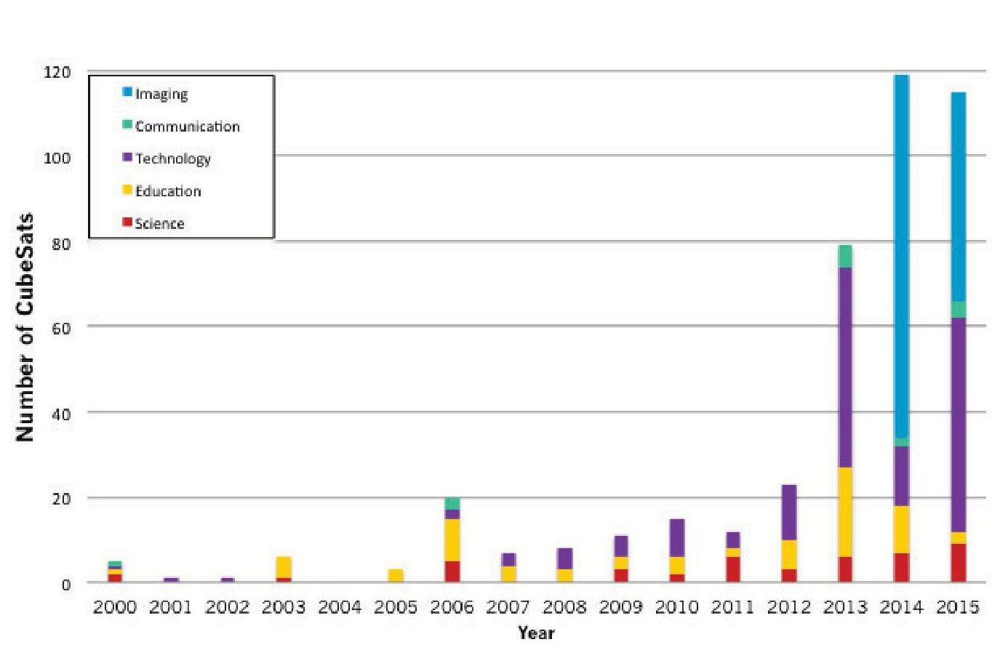

Figure 1: The number of CubeSats launched per year by mission type. Source: National Academies of Sciences, Engineering, and Medicine, 2016

or imaging applications. By the end of 2015 over 180 spacecraft were launched that were funded by commercial entities, as compared to 245 launched spacecraft funded by government or educational entities. During the same period less than 25 CubeSats were launched with primarily a scientific rationale. The CubeSat activities to date are also increasingly international in nature. From 1999 through 2015 approximately 80% of all CubeSats were developed in the US, but Japan has developed and launched 18 CubeSats, Germany has launched 10, Denmark 9, Italy, UK and South Korea have launched 4 each. Overall, approximately 35 different countries have launched at least one CubeSat during this time period and many more are reporting interest and active programmes in CubeSats. We note that the ongoing QB50 project has the promise to increase this number substantially.

The ISSI Forum focused on science applications of CubeSats, especially the appropriate science for which CubeSat has promise, as summarized in Section 2. Some of these applications are still not possible and enabling technology progress needs to occur, summarized in Section 3. During our meeting, we observed that there are often national and international approaches used that were substantially different from the approaches used for typical-scale science missions. This is discussed in Section 4. Finally, Section 5 discusses educational models and lessons learned from CubeSats. To support these sections, we provide six case studies of national and international engagement in the Appendices.

## 2. Appropriate Science

The science output of CubeSats has been rapidly increasing during the past few years, reflecting the number and types of CubeSats and their active mission dates. To date, over 40 refereed publications exist that report scientific data gathered on board CubeSats. Thus the question of whether CubeSats can deliver publishable data is already settled in the affirmative. The majority of science papers published so far are in the space physics field.

<!-- PDF_PAGE: 3 -->

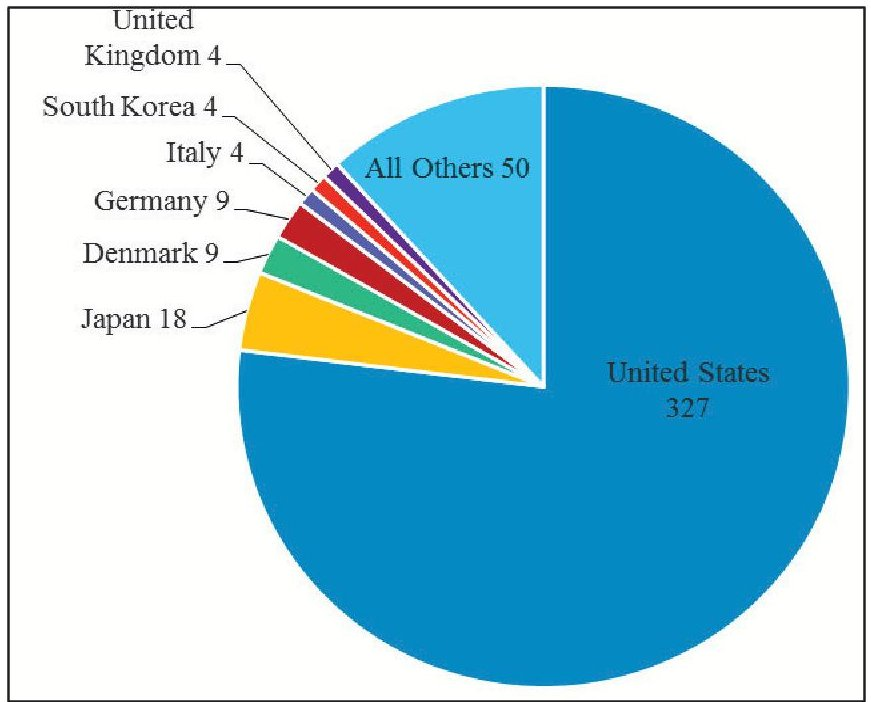

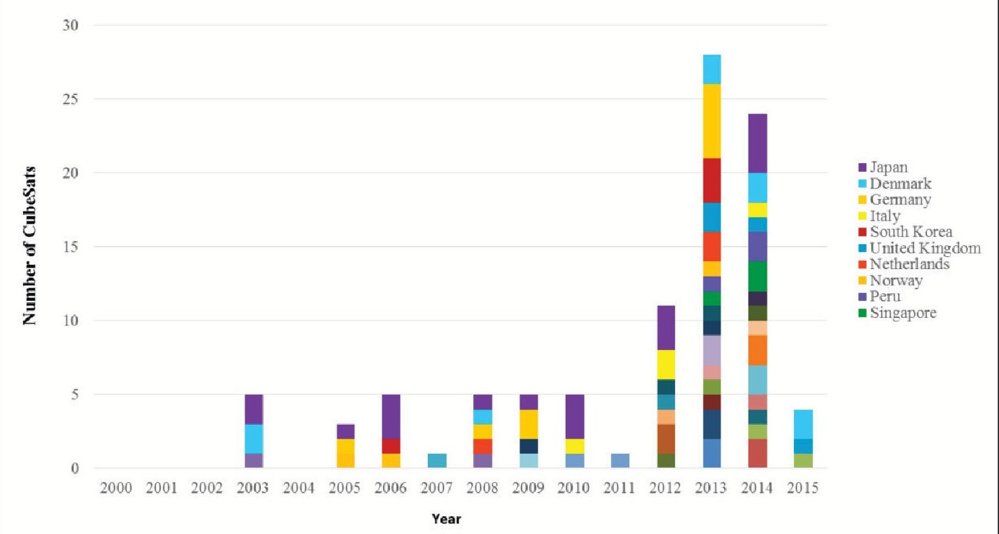

Figure 2: The increasingly international nature of CubeSats 2a) identifies the total number of spacecraft for the most engaged countries; 2b) identifies recent launches by country. Source: National Academies of Sciences, Engineering, and Medicine, 2016.

For example, the Colorado Student Space Weather Experiment (CSSWE) CubeSat has resulted in eight peerreviewed publications, which contribute to our understanding of radiation belt variability, complementing larger missions such as the Van Allen Probes (e.g. Baker et al. 2014; Blum et al. 2013). In the areas of planetary science and astrophysics, most publications so far are

focused on the description of new measurement techniques enabled by CubeSats. However, this is expected to change when missions currently under development are launched.

From these papers, and collection of contributions of participants during the meeting, we gleaned insights into the nature of

<!-- PDF_PAGE: 4 -->

scientific problems and applications for which CubeSats can provide high-quality science contributions in the future. First and foremost, it was clear to the forum attendees that CubeSats, or other small satellites based on CubeSat technologies, should not be thought of as a replacement or miniaturization of the traditional approaches, but as a potentially powerful tool to address specific science questions for which CubeSats are ideally suited due to their size, simplicity, acceptable riskposture etc., or to address science questions that cannot be well addressed by large missions by using new CubeSat-enabled missions or mission architectures. These scientific missions or applications tend to have one or several of four key characteristics:

1. Highly focused single platform investigation: Small platforms do not have the capability to carry comprehensive instruments or suites that can address a broad variety of scientific problems, but tend to focus on one science question with one instrument. Due to the overall constraints, resources need to be deployed toward collecting the right data for the right problem. The FIREBIRD project to study microbursts of electron precipitation from radiation belts is a nice example (e.g. Crew et al. 2016). See also Appendix A7. CubeSats also offer the possibility of a rapid modification and repetition of the experiment if necessary.

2. Involve high-risk or sacrificial orbits: Small spacecraft can be deployed into orbits that do not allow for long-time measurements and that are risky and/or lead to the demise of the spacecraft. The necessary volume of observational data might then be achieved by consecutive launches of multiple spacecraft with standard inexpensive instrumentation. Possible applications include studies of the low ionosphere below 300 km, studies of lunar magnetic anomalies, or impactors onto planetary bodies.

3. Secondary payloads or additional lines of sight: Small spacecraft can add value by providing additional viewpoints or complementary measurements as daughter spacecraft joining bigger missions. This can be important for planetary science studies where launch opportunities are few and far between. The ability to deploy daughter spacecraft to provide multi-point measurements to enhance the science return of these multibillion dollar missions, for a relatively modest cost increase.

4. Constellations or swarms of small spacecraft: Small spacecraft can be coordinated to combine viewpoints into investigations with higher time resolution and/or to gather spatially distributed data. Examples are multipoint observations of spatial structures in space plasmas, rapid revisit times for Earth science applications, and radio signal interferometry in astrophysics.

These four characteristics can be applied in a variety of ways that are likely to evolve over time as the community gains experience with more science missions. Some specific examples of existing or notional missions are highlighted in the Appendices.

In particular, Appendix A1 focuses on QB50, a mission consisting of 50 individual spacecraft. Similarly, Appendix A4 focuses on low-frequency astronomy through constellations of spacecraft, and Appendix A6 gives an in-depth account of constellation technology. Appendices A2 and A3 describe targeted missions in land-cover imaging, and a study of migrating birds, respectively. Appendix A5 describes technological developments done in concert with ESA's Asteroid Impact Mission. Finally, Appendix A7 gives an account of the FIREBIRD mission and its scientific results.

In order for CubeSats to meet their potential, some critical technology developments are required. These are discussed in Section 3 below.

<!-- PDF_PAGE: 5 -->

At the Forum, we discussed the need to make CubeSat-collected data public for the international community. Making data available is crucial to ensure reproducibility of the results gained, and also broadens the impact of the missions. So far, two projects have submitted data to a public archive: the Colorado Student Space Weather Experiment (CSSWE) to the CDAWeb, and the Focused Investigations of Relativistic Electron Burst Intensity, Range, and Dynamics (FIREBIRD, cf. Appendix A7) mission to the RBSP-ECT public data archive (www.rbsp-ect.lanl.gov/data_pub/FIREBIRD/). Publicly accessible

data in well-documented formats will increase the science output of CubeSats. This is particularly important for those CubeSats designed to augment larger missions or ground-based facilities.

## 3. Enabling Technology

The scientific potential of CubeSats relies on the technological capabilities available to them. These enabling technologies have been rapidly evolving over the past few years, and an active research effort continues to advance such technologies.

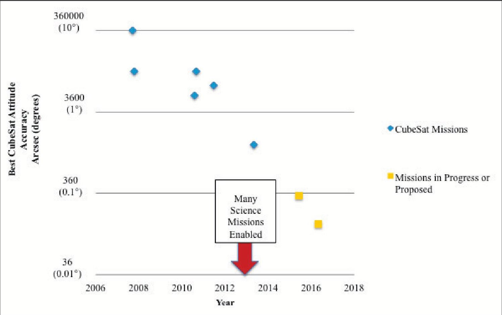

Figure 3: The technological capabilities of CubeSats are rapidly evolving. An example provided here is attitude control, which is rapidly evolving toward an accuracy of 1 arcsec, needed for high-resolution imaging applications. Source: National Academies of Sciences, Engineering, and Medicine, 2016.

During our ISSI Forum, we talked about a number of areas in which technological advances would have a major impact. Perhaps the most significant improvement has been in the ability to accurately control the orientation of a CubeSat in space, as shown in Figure 3.

Not only does this enable science but it also enables other on-board systems to advance,

such as power generation, allowing solar arrays to be pointed at the Sun, and communications, allowing directional antennas. The development of enhanced communication technologies is increasing the ability to transmit more of the generated science data back to the ground and, by allowing a better sampling of the measure-

<!-- PDF_PAGE: 6 -->

ment, is possibly improving the achievable accuracy in space and time.

It was mentioned during the Forum that for many current applications, only 5% of the total accumulated data is transmitted. Data transmission has also rapidly evolved during the past years, but there is a large need for novel technologies, either using different bands (i.e., X-band, Ka band, etc.), or new communication strategies (i.e., optical communications, relays satellites, etc.).

Similarly, research in propulsion technologies will have a range of important impacts, for example, allowing CubeSats to make use of new, scientifically valuable orbits for the first time, or allowing them to control their orbit relative to other platforms.

There are a large number of technology developments related to constellations and swarms of CubeSats (See Appendix 6 for details). Relative orbit control is one of the key enables of a future development that attracted lots of attention, and is related to our ability to develop and manipulate in space constellations and swarms of CubeSats (Appendix A6, for details). The development of tens and hundreds of science spacecraft for one integrated mission requires different approaches much more similar to traditional manufacturing techniques in which assembly and test are critical elements throughout design and construction. Similarly, constellations and swarms also require different risk-mitigation strategies than single platform payloads, perhaps using sparing strategies rather than increasing the reliability of any one platform. The analysis of data from large constellations (10-100 platforms) also requires new development. Data assimilation into large time-dependent simulation models may be a critical element for modern space physics applications.

## 4. International vs. National Approaches for CubeSat Science Missions

Space research is a highly international activity, which has benefited from a diversity of approaches and collaborations of research groups from multiple countries. There was a

consensus among Forum participants that such collaborations are equally valuable for CubeSats and their science. Yet there are a number of challenges with such collaborations that are worth addressing, as CubeSats mature into potent science tools.

First, the price of a low-cost CubeSat development is of the order US$1M, small enough for many state governments. There has therefore been an emergence of nationally funded CubeSats with strong national identities (e.g., SwissCube). Typically, such CubeSats are developed, in large part, by a single university group, which is excited about international collaborations. However, it is challenging to build and support such international partnerships for at least two reasons: the cost envelope at the scale of $0.1- 1M lies well below those normally funded by large agencies such as NASA or ESA and does not easily support international partners. Also, national funding agencies often do not have a lot of experience with international collaborations.

Second, due to the natural timescales of research and also cultural differences, the most successful research collaborations tend to extend over time periods of many years if not decades. Even though CubeSat developments extend over 1-3 years, their overall mission durations are short and tend to be underfunded, and it is difficult for international teams to develop the same kinds of collaborative spirit they are used to from big missions-for these small projects, even travel funding can be difficult to find.

Third, since CubeSats are treated by many governments like their big counterparts, the usual regulatory issues apply. However, shorter development cycles and the relative inexperience of some national funding agencies can turn the regulatory issues into major inhibiting obstacles-there is often just not enough time for the agency's procedures to operate between the identification of a CubeSat opportunity and that opportunity being lost. The forum participants discussed these challenges and also recognized that other types of collaborations are possible with small

<!-- PDF_PAGE: 7 -->

platforms that do not have analogies in the bigspacecraft world. For example, QB50 (Appendix A1) is a truly international mission focused on the investigation of the upper edge of the Earth's atmosphere through 50 missions that are individually developed.

The Forum participants also noted that lowcost space projects might become affordable for many countries and even motivated universities, thus drastically enlarging the number of players having access to space and space experiments. Thus this activity has an important role in increasing public awareness and in creating new space science communities. Through international collaborations on these small missions, knowledge from an experienced institution can be efficiently flowed to a newcomer, in a way that would be very difficult within a traditionalscale mission. However, new participants may have substantial difficulties in defining a scientific rationale for their missions, and getting access to technologies or relevant experience. Sizable international collaborations such as QB50 are important not only to collect resources of many teams toward a valuable science objective, but they can also provide a venue for international exchanges, such as the sharing of scientific instruments (coached by some leading scientific group), and/or the sharing of ground-based antennas to increase the amount of information returned from a single CubeSat. This creates a much more internationally distributed and efficient system, as nominally from a single station only several 5- to 10-minute intervals of downlink per day are possible from low Earth orbit.

## 5. Educational Strategies

Since the inception of CubeSats, their educational impact has been compelling and remains a key motivator for academic and other players to engage. A variety of models have been developed for formal and informal educational techniques to actively engage students and teach them about space systems. Forum participants exchanged their experiences with such educational benefits and also identified the potential to create an international summer school that allows students

from around the world to meet each other, and also keep up with the rapid development. Each of the two primary education models for student engagement, 1) inclusion in the formal curriculum and 2) informal extra-curricular, has benefits and drawbacks. Both are employed successfully, sometimes together, and both effectively engage students. National-level education customs and/or individual institutional preferences often dictate which path is followed.

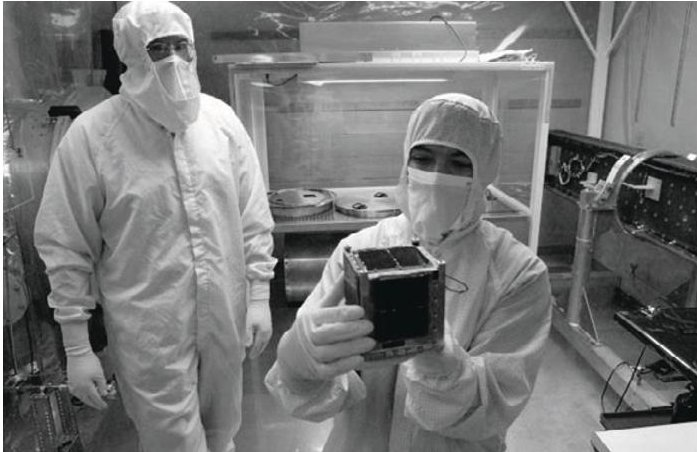

Figure 4: Students learn correct procedures and practices in handling spaceflight hardware (Image credit: Montana State University with the MEROPE CubeSat)

Engagement of undergraduate students through a one-or two-semester sequence of space systems development courses may lead to difficulties with project continuity. Students are accustomed to putting a course offering behind them upon its completion, turning attention to the next courses required for graduation. This limited involvement by individual students also takes a toll on the faculty member who then needs to spend an inordinate amount of time repeatedly bringing new students to a level of proficiency only to see them disappear. Owing to the complex nature of space systems development and its breadth across multiple sub-disciplines, students benefit most from multiple years of involvement. Over an extended period they achieve the level of proficiency truly needed, participating in a development project through all of its phases, and become a truly valuable entrant into the aerospace workforce.

Informal, perhaps extracurricular, involvement can result in individual student engagement

<!-- PDF_PAGE: 8 -->

through several years of undergraduate study, and even beyond, when the student enters into a graduate degree programme. In a previous volume of Space Research Today, one such informal experiential training programme, in place at Montana State University, was described (Klumpar 2012). Through long-term involvement, these students develop a high level of understanding of the space systems development process and contribute immensely to the successful development and flight of the hardware. The active learning process is enhanced if the student becomes frustrated by having encountered a technical challenge in the laboratory, without having the technical knowledge to address the problem. Later, when the underlying technical concept is presented in the classroom, the student immediately grasps its importance. This preconditioning for learning greatly enhances the student's intellectual advancement. Extracurricular programmes thus serve as an adjunct to traditional undergraduate education. Student involvement through multiyear extracurricular involvement on the other hand requires effort to retain students faced with other demands on their time-paying such students is one solution when financial resources permit.

A combination of formal and informal training has multiple advantages. Introductory space systems courses serve to whet the students' appetites and develop their budding interest in experimental space physics and also in aerospace as a profession. When individual students, excited about the prospect of a career in aerospace are able to proceed directly from such courses into a long-term project-oriented informal environment they are more likely to remain enthused and become committed to a career. Informal training may also be combined with the junior or senior-level capstone design curriculum.

In any case, the importance of professional mentoring, whether by the responsible faculty member or by professional staff, cannot be emphasized enough. Students must understand and practise certain fundamentally important processes and procedures necessary for the successful development of space systems.

Through proper mentoring students achieve a high level of competence in the practice of space flight hardware development. They have put their formal scientific or engineering education in practice to develop genuine, scientifically meaningful space flight hardware at the earliest possible point in their careers. The students learn systems engineering. They learn proper aerospace industry practice and discipline by direct participation.

It is clear to educators that significant and meaningful experiential involvement in the process, beginning with conception and ending in flight operations, is essential. This best includes hands-on participation in every facet of project development. The student should experience the entire development process, participating in the design, build, test, redesign, rebuild test cycle as many times as it takes to get the project flight qualified. Projects that end in a design and a document and or presentation without hardware are of little value to the student and their career.

Thus CubeSats are compelling, not only as tools for scientific discovery and as technological test beds, but, as well, for their educational impact.

## Acknowledgements

We acknowledge the support and hospitality of the team at the International Space Science Institute, which made this meeting seamless and exciting for all participants. The team benefited from active participation from several members of a study by the National Academies focused on the science value of CubeSats.

## Appendices

## Appendix A1: Observing the Atmospheric Boundary to Space through QB50

The QB50 project (Thoemel et al. 2014, see also www.qb50.eu) is perhaps the most ambitious CubeSat-based scientific mission to date, with the goal of flying nearly 50 spacecraft in the lower thermosphere (90-350 km). This is a region that is traditionally inaccessible to conventional spacecraft due to high drag limiting orbital lifetimes. With a

<!-- PDF_PAGE: 9 -->

fleet of low-cost CubeSats, it is possible to probe this region; the large number of spacecraft allows multipoint measurements, while also mitigating against spacecraft failures.

The project has a unique organizational and funding structure. It is led by the von Karman Institute, Belgium, with principal funding from the European Commission via a FP7 grant. However, the spacecraft are being developed by over 40 institutions worldwide, with many providing their first spacecraft ever. In order to be carried on a QB50 launch, each spacecraft must carry one of three scientific instruments (Langmuir probe; ion and neutral mass spectrometer; oxygen sensor) provided by the project and commit to downloading 2 Mbit/day of data from QB50 spacecraft for 60 days. An amateur radio network will be used to receive the data.

Beyond this, institutions can carry their own payloads in either 2U or 3U form factors; various technology demonstrations, such as reentry control, solar sails and tethers, will be also flown.

The large number of CubeSats being built often by groups with limited spacecraft heritage, means that a significant market rapidly developed for off-the-shelf subsystems that are compatible with the science payloads. An attitude control module is available from Surrey Space Centre and a new deployment module, the QuadPack, was developed by ISIS BV.

Two precursor spacecraft were launched in 2014 to allow debugging and verification of systems. Six are due to launch on a Dnepr into a 450-km sun-synchronous orbit in July 2016 followed by deployment of the bulk of the spacecraft from the International Space Station in late 2016 and early 2017.

## Appendix A2: Land-Cover Imaging

Science Background: Satellite remote sensing provides a unique opportunity to obtain up-to-date information on the land surface for global change science and natural resources management. Optical satellite sensors currently provide the primary data source to derive this

information. Recent advances in satellite monitoring provide a number of data sets contributing to the research and applications goals, such as:

- Coarse-to-moderate spatial resolution data (1 km - 100 m), e.g., NOAA- AVHRR, SPOT-Vegetation, Terra/ Aqua-MODIS and Proba-V, which provide up to daily observations;

- High spatial resolution data (10-30 m), e.g., Landsat-OLI, Sentinel-2 and ASTER, which provide observations every 10-15 days.

In general terms, we can distinguish specific focus areas from developing and applying remote-sensing technology to land cover imaging, such as land cover mapping, vegetation biophysical properties assessment, and forest and agricultural management.

A number of land cover data products of national and global coverage have been developed using mainly coarse-to-moderate resolution satellite data (Bartholome and Belward, 2005; Bartalev et al., 2016). However, for quantifying land cover and, in particular, for measuring land use related changes, high spatial resolution data is needed. Ongoing land cover mapping efforts are focused on the production of higher spatial resolution land cover datasets (Chen et al. 2014).

Development of improved land cover products should continue to exploit multispectral and multi-temporal data to provide direct classification and parameterization of vegetation types. This characterization should take into account life forms (e.g. trees, shrubs, grasses, mosses and lichens), leaf types (broadleaf and needleleaf) and phenological attributes (deciduous/evergreen). Vegetation is dynamic, experiencing changes in the phenological tempo, species composition, biophysical and structural characteristics that are driven by successional and anthropogenic processes as well as by variation in climatic regimes. The vegetation dynamics focus includes the study of rapid changes including extensive forest clear-cutting, conversion land abandonment following institutional changes, or short-term

<!-- PDF_PAGE: 10 -->

vegetation disturbances from drought, fire, or pests, as well as longer term trends in vegetation cover resulting from climate change.

Appropriate accounting of the land cover dynamics requires high observation frequencies, which for the time being are unachievable by existing satellite remote sensing systems of high spatial resolutions.

CubeSat Missions: A CubeSats-enabled approach could potentially help to overcome this limitation using a satellite constellation developed with a focus on providing remote sensing data of high enough both spatial (10- 20 m) and temporal (daily) resolutions. Considering existing experience of the successful Earth observation satellite missions, such as SPOT-Vegetation and Proba-V, the minimum requirements for the spectral channels for the land cover/vegetation monitoring could be recommended such as follows:

- Blue (447-493 nm) - Atmospheric correction;

- Red (610-690 nm) Discriminates vegetation;

- Near infrared (777-893 nm) Emphasizes biomass content;

- Short wave infrared (1570-1650 nm) Discriminates wetlands, burnt areas and damaged vegetation, snow.

Technical Challenges: In this context the potential availability of remote-sensing time-series data provided by CubeSat constellations may require consideration of the data georegistration accuracy (both absolute and intersatellites co-registration), data radiometric (including inter-satellites) calibration, as well as organization of globally distributed data receiving stations network.

## Appendix A3: Study of Migrating Birds

Mission Objectives: Migrating birds often travel vast distances (1,000s of km) along routes that are either unknown and/or difficult to access from the ground as they often cross oceans. The global coverage offered by a satellite in low Earth polar orbit is an ideal tool for the study of these birds (Thorup et al. 2007).

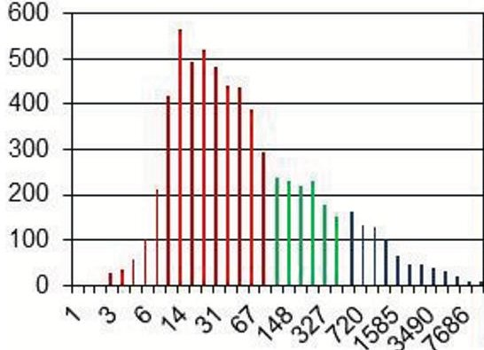

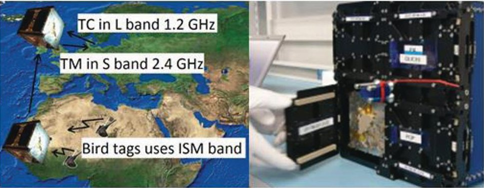

Figure 5. The histogram shows the distribution of bird species with respect to their body mass (Data from Blackburn and Gaston 1994). The middle figure shows the mission scenario, and the right hand picture is the last photo taken of DTUsat-2 in the integration lab at ISIS.

This is the science motivation behind DTUsat2, with a focus on a specific species, the European cuckoo. The investigation focused on a number of key science objectives, including an analysis of the navigational skills of the migrating birds.

For the European cuckoo this question is especially intriguing since the young chicks have never seen their parents and they migrate solitarily. This implies the question of how the information regarding migration route is relayed from generation to generation.

<!-- PDF_PAGE: 11 -->

Why is a CubeSat Appropriate? To study this important question, sufficient position information is needed so that migration routes of a bird or population of birds can be described. The data to be transmitted is comprised of a set of NMEA codes each with a size below 100 bytes. For redundancy each stored position is relayed three times. Along with the housekeeping data, the size of a complete data package to be transmitted during each pass is less than 1 kb, fitting well into the performance envelope of a CubeSat-based system.

Technical Details: The satellite system is comprised of three elements: a small RF transmitter fitted as a backpack on the tracked animals, a 1 U CubeSat in LEO Polar orbit and a single ground station. Essentially the satellite is an advanced radio relay with a store and forward capability with the major challenge of closing the link budget between the bird tag and the satellite within all constraints. For example, a cuckoo's carrying capacity is limited to 5 g and the 1 U CubeSat is limited to 1,333 g. Our final CubeSat design involved an omni-directional antenna capable of receiving 6 transmitters simultaneously relaying stored GPS positions, albeit at a relatively low bit rate of 30 bps (Fléron 2015).

Flight Plan or Experience: DTUsat-2 was launched into a 620-km Sun-synchronous low-Earth orbit on-board a Dnepr rocket from Yasny launch base on 19 June 2014. Despite a successful launch and immediate acquisition of beacons it was not possible to command the satellite and execute the mission, most likely due to a combination of issues with the ground-transmitter and on-board power system. Once the ground station was fully functional the battery had reached end of life due to a faulty charging system (Fléron 2016). The DTUsat team is exploring options for an improved re-flight.

## Appendix A4: Low Frequency Radio Astronomy

Mission Objectives: The DSL mission is aiming at opening a new astronomical window to the universe in the low-frequency radio band between 1 and 30 MHz, proposing a linear

array of 8 CubeSats in Lunar orbit. Multiple studies of prospective ultra-long-wavelength (ULW) facilities in space have been conducted in several countries over the past 50 years, but no space mission has been operational in this unique spectral domain. In addition, an observatory in Earth orbit is unfeasible because of strong human-made radio frequency interference (RFI). Therefore, radio observations from Earth, at frequencies below 25 MHz, are essentially non-existent due to the ionosphere cut-off, i.e., ground-based instruments are unable to see the cosmic radio emission in this frequency domain. Attractive locations for an ULW mission are the Sun-Earth Lagrangian point L2 or the Moon. The latter is especially efficient due to shielding the Earth-originated RFI.

This decametric or ultra-long-wavelength radio astronomy will make new science possible and answer important questions for understanding the early phase of the universe, in addition to numerous multidisciplinary applications in research fields, e.g., of galaxies, exo-galaxies, full sky continuum census of discrete sources, pulsars, or studies of planetary systems. However, among different science cases, the characteristics of the cosmological Dark Ages are at the top of the list of potential science applications of an ULW mission.

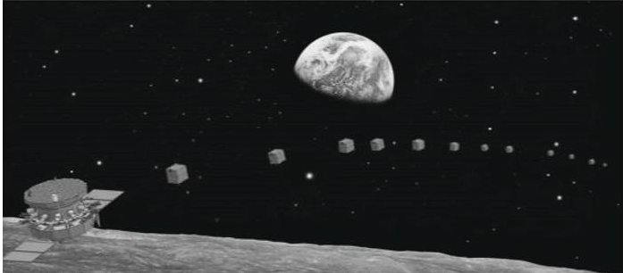

Figure 6. Concept of DSL (Discovering the Sky at Longest wavelength), an astrophysics-focused measurement array

Why CubeSats are Appropriate: Observations at ULW have been conducted several times in past decades. RAE-1 explorer was launched into Earth orbit by NASA, but was unable to deliver useful data due to RFI. RAE-2 was then launched orbiting the Moon. The latter demonstrated that the far side of the Moon is a favourable location where RFI from Earth is reduced to an acceptable level.

<!-- PDF_PAGE: 12 -->

The next challenge is the required angular reso-lution at ULW. Although some algorithms are developed to determine the Direction of Arrival (DOA) of the sources, the resolution is never better than $ 1^{\circ} $ , such that a single source has never been identified till now. Recent attempts are focused on satellite arrays or lunar surface arrays with a long baseline to create larger virtual apertures with a diameter of tens of kilometres. The proposed number of required element antennae goes from 8 to tens of thousands. CubeSats or similar very small spacecraft become mandatory because they are the only affordable solution when the number of satellites dramatically increases.

Technical Details: The DSL (Discovering the Sky at Longest wavelengths) concept was proposed as a joint CAS-ESA space mission in early 2015. Cooperative studies from the Chinese and European teams resulted in the DSL concept as a facility in lunar orbit. DSL is composed of a mother satellite as a service module, and a co-orbital array of 8 microsatellites (12 kg each) as telescope nodes. Instant snapshots of the near-linear array create a virtual "dish" that fills up the aperture UV-plane every half orbit. With the natural precession of the near-circular orbit, the "dishlike" sampling gradually evolves into a ballshape UV-sampling distribution over a precession cycle. A high gain communication antenna on-board the mother satellite looks at all the micro-satellites in the same direction along the orbit, providing a high-speed communication, high accuracy positioning and accurate clock synchronization with low power consumption. These project features ensure high-performance UV-sampling and highaccuracy baseline determination, thus ensuring the high quality of the reconstructed radio image of celestial radio sources. The processed data of the DSL mission include all-sky spectra and images at several frequencies in the ULW domain.

Pathfinder (DSL-P): A pathfinder of the DSL (DSL-P) experiment is approved by the Chinese Lunar Exploration and Space Program Center. The on-going Chang'E-4 mission offers an opportunity for piggybacking a pair of microsats sharing the launcher with the

relay satellite. In total, 50 kg are approved for demonstration of the interferometric techniques across satellites. The pathfinder is the minimum configuration of DSL and will be launched in mid-2018.

## Appendix A5: Planetary Example: CubeSat Opportunity Payloads (COPINS) on the Asteroid Impact Mission (AIM)

The Asteroid Impact Mission (AIM) is ESA's contribution to an international cooperation targeting the demonstration of deflection of a hazardous near-Earth asteroid as well as the first in-depth investigation of a binary asteroid (Michel et al. 2016). Currently in Phase B-1, AIM is preparing for approval in December 2016.

After launch in 2020, AIM will rendezvous with the binary near-Earth asteroid (65803) Didymos in 2022 and observe the system before, during, and after the impact of NASA's Double Asteroid Redirection Test (DART) spacecraft. Both AIM and DART are part of the Asteroid Impact and Deflection Assessment (AIDA) ESA-NASA cooperation. An overview of the AIM mission is given in Figure 7.

Two 3U CubeSats are part of AIM, the CubeSat Opportunity Payloads Inter-satellite Net-working System (COPINS). Their purpose is to demonstrate the technology needed to operate CubeSats in interplanetary space and to perform scientific measurements at the Didymos system. The main technology objective is to establish an inter-satellite link between the two CubeSats, the AIM spacecraft, and the MASCOT-2 lander carried by AIM.

There are further technological challenges: Due to the low escape velocity of Didymos (a few tens of cm/s for the system and less than 5 cm/s for the secondary) the CubeSats need to be released at low speed and/or carry a propulsion system. Finally, those CubeSat concepts involving remote-sensing observations require attitude control and the CubeSat needs to "know" its position relative to the asteroid. Eighteen proposals for CubeSats on AIM were received in response to the ESA call for ideas.

<!-- PDF_PAGE: 13 -->

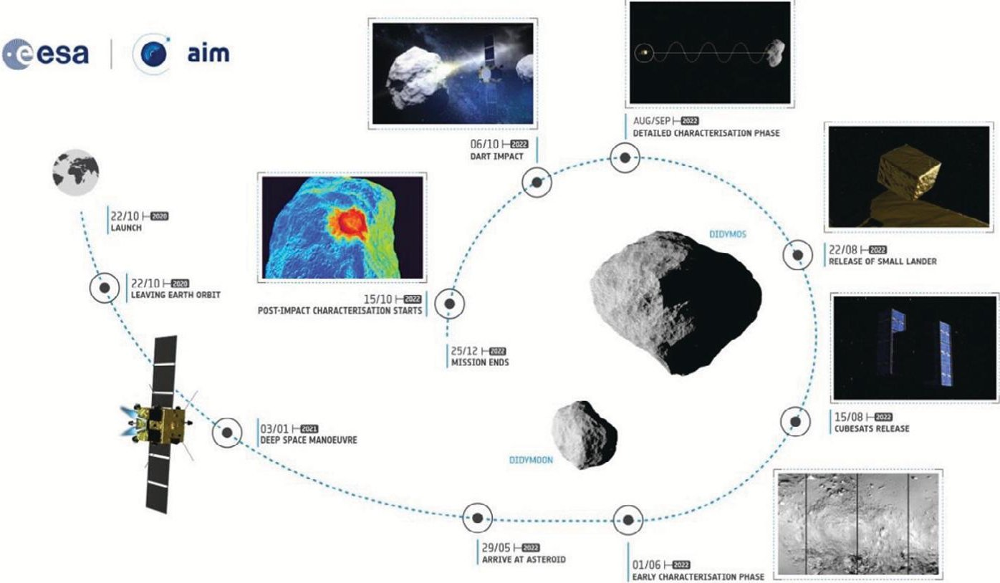

Figure 7: Schematic overview of the AIM mission baseline for a mission to rendezvous with an asteroid

The following five concepts were selected for the currently ongoing study:

- Asteroid SPECTral imaging (ASPECT): A visible to near-infrared imaging spectrometer led by VTT research centre (Finland). A similar CubeSat (Aalto-1) is already operating in low-Earth orbit. Other than the AIM spacecraft, the CubeSat is expected to stay close to Didymos at the time of the DART impact, allowing it to get high-resolution data of the impact event, the crater and possibly the ejecta cloud, not possible with the AIM spacecraft. Most importantly, it is a unique opportunity to observe a fresh asteroid surface, unmodified by space weather processes.

- Dustcube: Two nephelometers built by a consortium led by the Univ. of Vigo (Spain). The main objective is to measure properties of the dust ejected by the DART impact from within the impact cloud. Similar to ASPECT, the main benefit of using a CubeSat is the low distance to Didymos, which would

be too risky for the AIM spacecraft itself.

- CUBATA: Two CubeSats equipped with transponders, primarily used for acceleration measurements, resulting in a high-accuracy measurement of the gravity field of the two asteroids. The study is led by the GMV corporation (Spain). In addition to the gravity measurements, a camera is foreseen and, optionally, one of the CubeSats could land on the secondary asteroid, performing seismology.

- AGEX (Asteroid Geophysics Explorer): Study led by the Royal Observatory of Belgium consisting of one lander, measuring seismic waves on the surface of the secondary, and a large number of femtosatellites, designed to measure the gravity field of the system and in particular the secondary.

- PALS: Two CubeSats with a large miniaturized payload: A magnetometer, a volatile composition analyser, a camera, and an emission spectrometer. PALS is developed by the Swedish Institute for Space Physics.

<!-- PDF_PAGE: 14 -->

The instrumentation is complementary to the payload of the AIM spacecraft and would take data from very close to the asteroid. The goals are measuring the magnetization of both asteroids investigation of the presence of volatiles, and a high-resolution investigation of the impact and the plume.

The mission concepts under consideration for COPINS are assuming two key features for this type of mission: affording a higher level of risk to perform observations at a time when the AIM spacecraft cannot do it, and extending the science measurements by providing additional lines of sight and sensors.

The CubeSat concepts for AIM will be selected once the main AIM mission is approved, estimated in December 2016. They will be the first CubeSats performing measurements with scientific instruments as part of an interplanetary mission.

## Appendix A6: Constellation Technology

Technological Challenge: Cooperation of several distributed networked CubeSats can form a sensor network in orbit, and thus provides an approach to exceed the limited resources of each single CubeSat. Typically constellations are employed, where each satellite is individually controlled from the ground station, while recent technology progress even enables formations, where the satellites perform relative navigation in order to self-organize in orbit with respect to the intended measurements. The progress in miniaturization technologies enables realisation of the essential functionalities for

- sensors to characterize the vicinity,

- communication with the other sensor network nodes,

- processing on-board relevant information,

- coordination of control actions.

History and Successes: The University Wurzburg's Experimental satellite (UWE) programme over the last 10 years followed a roadmap to implement and test step by step the relevant technologies for formation flying at a

one unit CubeSat level. UWE-1 (launched in 2005 as the first German picosatellite) addressed Internet Protocol parameter optimization related to the space environment to provide the basis for the communication link in the distributed system. UWE-2 (launched 2009) placed emphasis on appropriate attitude and orbit determination by sensor data fusion, while UWE-3 (launched 2013) in addition provided attitude control. Currently, UWE-4 is in its final preparations stage for launch and will provide orbit control capabilities by an electric propulsion system. This prepared the basis for the NetSat mission to demonstrate formation-flying techniques by 4 CubeSats, which is in implantation stage thanks to an ERC advanced grant.

Future Plans: For implementation of future multi-satellite systems, a modular design was demonstrated with UWE-3, allowing quick flexible and reliable integration. In particular, an electric interface standard was tested, which is promoted by UNISEC Europe in order to allow exchanges of subsystems and components within the CubeSat community [http://unisec-europe.eu/standards/bus/]. With respect to operational lifetime, UWE-3 also demonstrated a very robust, power-efficient, redundant On-Board Data Handling system (OBDH), working without any interruption since launch in November 2013, as of today for more than 2.5 years (see Schilling 2014a, 2014b, and Busch 2015 for results). It is based on commercial off-the-shelf components in hot redundancy and an advanced fault detection, isolation and recovery (FDIR) software. Three-axis attitude control was based on 6 magnetotorquers integrated on each side panel and one miniature reaction wheel. In-orbit experiences from these preparation missions formed the basis for the NetSat formation flying mission.

The objectives of NetSat are realization of distributed, cooperating multi-satellite systems using autonomous formation control for optimization of observation periods. Four CubeSats are required to analyse topology analyses in a three-dimensional formation. The satellites will be separated in the beginning of the mission by relative distances between 50

<!-- PDF_PAGE: 15 -->

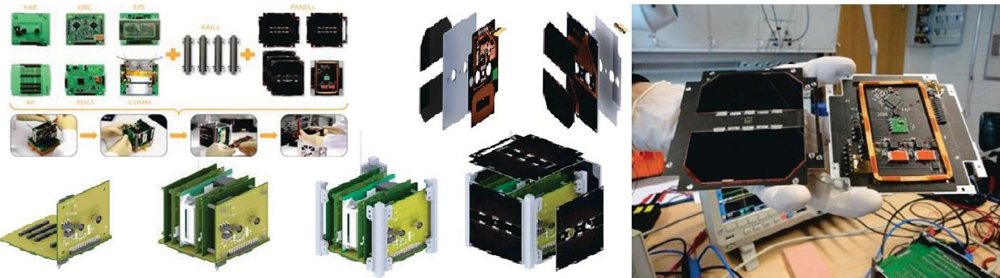

Figure 8: Left: Integrated magnetic torquer, sun sensor and magnetometer on the backside of each solar array panel. Right: Modular satellite design based on a backplane replacing the harness, enabling flexible and efficient integration.

and 10 km. The first objective is to maintain the formation configuration autonomously with the implemented actuators. At the end of the operational phase risky, near range formations will be realized with distances between 20 and 40 m. Technology challenges to be addressed by NetSat include:

- formation control

- model reference based adaptive control for attitude and orbit control by reaction wheels, magnetic torquers, electric propulsion

- Relative attitude and position determination within the formation, based on data exchange and data fusion

- autonomous, networked satellite control

- Reliable data exchange between the satellites by mobile DTNs and ad-hoc networks to adapt to changing communication topologies and interruptions

Networked control of the satellite formation, combination of supervisory control from ground with autonomous reactions

- small satellite in-orbit demonstration

- Implementation of a demonstrator mission based on 4 pico-satellites

navigation sensor system, in particular for relative distances & orientations

This technology-oriented mission will in addition carry cameras for Earth observation to use photogrammetric imaging supported by the

formation. Plans for future formation flying missions will address space weather and telecommunications experiments.

## Appendix A7: Focused Dual-Satellite Investigation of Terrestrial Radiation Belt Losses

The Focused Investigations of Relativistic Electron Burst Intensity, Range, and Dynamics (FIREBIRD-II) was launched into a near polar orbit on 31 January 2015. The mission was implemented through a pair of identical 1.5 U CubeSats carrying energetic electron detectors to measure the energy spectrum of electrons between approximately 200 keV and greater than 1 MeV. The mission design required two spacecraft in a near-polar orbit flying in tandem to perform two point measurements of the flux of electrons precipitating into the upper atmosphere with spatial separations ranging from 10 km to ~250 km to resolve the spatial scale size and energy dependence of electron microbursts from the Van Allen radiation belts.

The FIREBIRD mission is uniquely suited to be carried out through CubeSats, providing high scientific return at low cost through a focused and novel investigation of an unexplored yet important phenomenon in a region easily accessed by nanosatellites (Spence et al. 2012). The FIREBIRD mission embodies the three elements described in this report: appropriate science, enabling technology, and education.

Science: The relative importance of electron losses and the detailed nature of the loss mechanisms is a poorly understood aspect of

<!-- PDF_PAGE: 16 -->

radiation belt science. Electron microbursts are a manifestation of such losses and are thought to be a significant loss mechanism for relativistic electrons (O'Brien et al. 2004), however, direct measurements of the electron energy spectrum had not been performed. They appear as short durations of intense electron precipitation measured by particle detectors on low-altitude spacecraft, seen episodically when their orbits cross magnetic flux tubes that thread the outer radiation belt (Lorentzen 2001a, 2001b).

Previous spacecraft missions (e.g., SAMPEX) have quantified important aspects of microburst properties (e.g., occurrence probabilities); however, other crucial properties (e.g., spatial scale) remain elusive owing to the space-time ambiguity inherent to single-spacecraft missions. FIREBIRD's two point, focused observations at low altitudes address these shortcomings by answering three fundamental scientific questions: (1) What is the spatial scale size of an individual microburst? (2) What is the energy dependence of an individual micro-burst? (3) How much total electron loss from the radiation belts do microbursts produce globally?

Technology: The FIREBIRD mission was enabled by multiple recent developments (Klumpar, et al. 2015). Low-cost, mass produced, low-power commercial microelectronics were adapted for space flight. Payload components included devices developed for larger scientific missions including the silicon solid-state detectors, and a special very low noise and power consumption pulse processing chip (the DAPPER) developed for the FEEPS (Fly's Eye Energetic Particle Spectrometer) instrument on NASA's Magnetospheric Multiscale (MMS) mission. The DAPPER allowed each FIREBIRD satellite to carry two complementary detectors.

Other enabling technologies carried on the twin FIREBIRD-II CubeSats include high-efficiency body-mounted solar panels (from Vanguard Space Technologies, Inc.) affixed to the four 10x15 cm sidewalls of each 1.5 U CubeSat providing energy to a custom MSU-

designed-and-built electrical power system that includes two 2600 mAh Li-Ion cells with integrated battery protection circuitry. Each spacecraft carried GPS receivers enabling precise timing and position information necessary for science operations. Montana State's custom avionics and operations software (built upon L-3's In-Control package) enabled the same software used for mission development and testing to be used to monitor and control the spacecraft in orbit.

Education: From the beginning, students and young professionals at the University of New Hampshire and at Montana State University played key roles in the development of FIREBIRD. Opportunities for students to be involved in multiple aspects of the mission include payload design and implementation mission design including planning and implementing the concept of operations, spacecraft design, development, and testing participation in spacecraft on-orbit operations, and finally analysis of scientific and engineering data from the orbiting satellites. Thus students experience all phases of an active space mission from initial concept to final implementation and scientific analysis.

FIREBIRD-II has been operating in LEO since launch on 31 January 2015. The satellites autonomously turned on and commenced taking science data 60 minutes into the mission. Multiple microburst events were observed from the two spacecraft during the first weeks of operation at separations ranging to 200 km and beyond. Crew et al. (in press, 2016) explored the first measurements of simultaneous electron microbursts taken less than 40 hours after reaching orbit at an intersatellite separation of 11 km. See Figure 9.

These dual spacecraft observations for the first time both constrain the spatial scale size and provide spectral properties at medium energies of electron microbursts. Crew et al. suggest that the inter-satellite separations at this time (~11 km) might be at or just near the spatial decorrelation length of these bursts. Mapped to the equator, these coincident microburst events map to size scales >120 km. The

<!-- PDF_PAGE: 17 -->

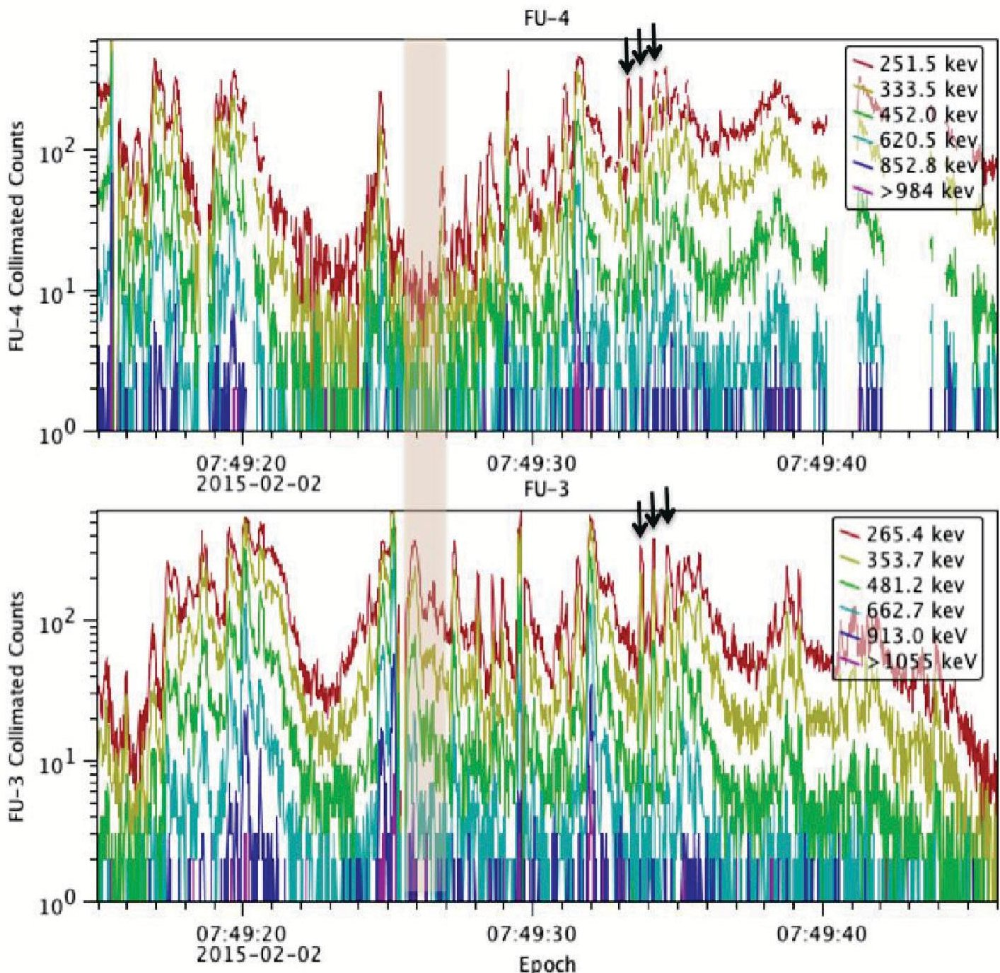

Figure 9: An example of a collection of microbursts seen simultaneously by FU-3 and FU-4 during a 31-second interval on 2 February 2015. The top panel shows the electron counts per 18.75-ms sample from the FU-4 collimated sensor; each coloured line corresponds to a different energy channel (the first five channels are differential and the final is the integral channel). Similarly, the bottom panel shows the equivalent data from FU-3. Due to the richness of microburst activity, an easy one-to-one comparison of the bursts on both spacecraft is difficult. Both spacecraft observe a similar broad structure with a large number of closely occurring bursts, which sometimes appear in grouped patterns. In particular, some appear to be highly coherent (such as the train of three prominent tightly spaced bursts seen by both FU-3 and FU-4 starting at 07:49:34), whereas others do not (such as the 1-second interval starting at 07:49:26 when FU-4 observes a marked lull with no bursts while FU-3 witnesses quite prominent activity) (Crew et al. 2016).

satellites have drifted apart over the intervening 16 months and are no longer targeted at resolving the space-time ambiguity of microbursts. Unexpected and puzzling new electron precipitation features, such as forward and reverse electron arrival time dispersion, sudden enhancements and dropouts of precipitating electrons, and standing

curtains of electron precipitation, have been measured and are under analysis.

New operating modes have been uploaded to the satellites to optimize conjunctive observations with particle and electromagnetic waves measurements from the Van Allen Probes deep in the Radiation Belts.

<!-- PDF_PAGE: 18 -->

Additional conjunctions as FIREBIRD overflies balloon-borne Bremsstrahlung X-ray detectors on the long duration balloon-borne soft gamma-ray (0.2-10 MeV) telescope Compton Spectrometer and Imager (COSI) and with field campaigns of the Balloon Array for RBSP Relativistic Electron Losses (BARREL) provide direct electron spectral measurements of the electron-producing X-rays.

## References

Achieving Science with CubeSats: Thinking Inside the Box, A report by the National Academies of Science, Engineering and Medicine, Washington DC, 2016.

Baker, D. N., A. N. Jaynes, V. C. Hoxie, R. M. Thorne, J. C. Foster, and X. Li, An impenetrable barrier to ultrarelativistic electrons in the Van Allen radiation belts, Nature 515, 7528, 2014.

Bartalev S. A., D. E. Plotnikov, E. A. Loupian, Mapping of arable land in Russia using multiyear time series of MODIS data and the LAGMA classification technique, Remote Sensing Letters 7 269, 2016.

Bartholome, E., and A. S. Belward, GLC2000: a new approach to global land cover mapping from Earth observation data, Int. J. Remote Sens. 26, 1959, 2005.

Blackburn, T. M. and K. J. Gaston, Animal body size distributions: Patterns, mechanisms and implications, ScienceDirect 9 (12), 471, 1994

Blum, L. W., Q. Schiller, X. Li, R. Millan, A. Halford, and L. Woodger, New conjunctive CubeSat and balloon measurements to quantify rapid energetic electron precipitation, Geophys. Res. Lett. 40, 5833, 2013.

Busch, S., P. Bangert, S. Dombrovski, and K. Schilling, UWE-3, in-orbit performance and lessons learned of a modular and flexible satellite bus for future pico-satellite formations, Acta Astronautica 117, 73, 2015.

Chen, J., B. Yifang, and L. Songnian, China: Open access to Earth land-cover map, Nature 514, 434, 2014.

Crew, A. B., et al., First multipoint in situ observations of electron microbursts: Initial results from the NSF FIREBIRD-II mission, J. Geophys. Res, Space Phys., in press, 2016.

Fléron, R. W., A satellite based low power low volume receiver system for tracking of migrating birds, Proceedings, 66th International Astronautical Congress Jerusalem, Israel, 2015.

Fléron, R. W., Doing forensic on DTUsat-2 using the Beacon Counter, Proceedings, 67th International Astronautical Congress, Guadalajara, Mexico, 2016.

Klumpar, D. M., Today's students tomorrow's engineers and scientists: Experiential training in space engineering and space science at Montana State University, Space Research Today Volume 183, 12, 2012.

Klumpar, D. M., et al., Flight system technologies enabling the twin-CubeSat FIREBIRD-II scientific mission, paper # SSC15-V-6, Proceedings of the 29th Annual AIAA/USU Conference on Small Satellites, August 2015.

Lorentzen, K. R., J. B. Blake, U. S. Inan, and J. Bortnik, Observations of relativistic electron microbursts in association with VLF chorus, J. Geophys. Res. 106(A4), 6017, 2001a.

Lorentzen, K. R., M. D. Looper, and J. B. Blake, Relativistic electron microbursts during the GEM storms, Geophys. Res. Lett. 28(13), 2573, 2001b.

Michel, P. et al., Science case of the Asteroid Impact Mission (AIM): A component of the Asteroid Impact & Deflection Assessment (AIDA) mission, Advances in Space Research 57, pp. 2529, 2016.

O'Brien, T. P., M. D. Looper, and J. B. Blake Quantification of relativistic electron microburst losses during the GEM storms, Geophys. Res. Lett. 31, L04802, 2004.

Schilling, K., Networked control of cooperating distributed pico-satellites, ID WeC19.6, Proceedings IFAC World Congress, Cape Town, 2014a.

<!-- PDF_PAGE: 19 -->

Schilling, K., Perspectives for miniaturized distributed, networked systems for space exploration, Proceedings New Research Frontiers for Intelligent Autonomous Systems IAS-NRF, Venice, 2014b.

Spence, H. E., et al., Focusing on size and energy dependence of electron microbursts from the Van Allen radiation belts, Space Weather, 10, S11004, 2012.

Thoemel, J., F. Singarayar, T. Scholz, D. Masutti, P. Testani, C. Asma, R. Reinhard and J. Muylaert, Status of the QB50 CubeSat constellation mission, 65th International Astronautical Congress, Toronto, Canada, IAC-14-B4.2.11, 2014.

Thorup, K., R. A. Holland, M. C. Wikelski, In pursuit of wild journeys: Tracking long distance bird migrants, Proceeding of the International Symposium on Migratory Birds, Seoul, Korea, 11 October 2007.

About the Authors

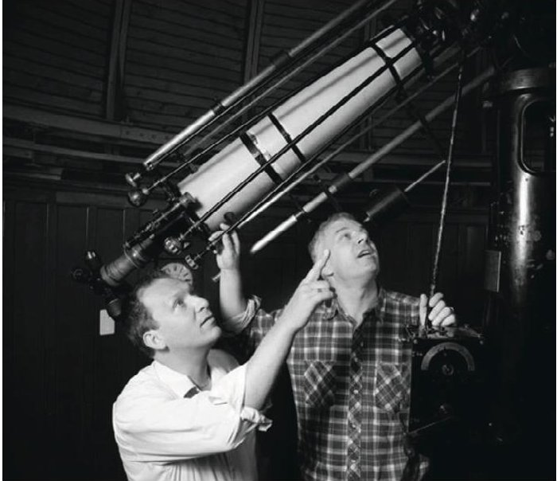

Thomas Zurbuchen (left) holds a PhD in astrophysics from the University of Bern Switzerland, and has received numerous awards, including the US Presidential Early Career Award. A specialist in the robotic exploration of space, he served as team leader for the development of NASA's Fast Imaging Plasma Spectrometer, an instrument that was part of the MESSENGER spacecraft

which orbited Mercury from 2011 to 2015. His team is actively involved in the development of a new space instrument, and is responsible for five such instruments currently in flight.

Zurbuchen is a professor of space science and aerospace engineering at the University of Michigan. From 2009 to 2015, he served as the UM Associate Dean of Entrepreneurial Programmes in the College of Engineering and from 2012 to 2015 he was Senior Counsellor for Entrepreneurial Education. He was the Founding Director of the University of Michigan Center for Entrepreneurship and serves on the boards of three small companies and non-profit organisations. He has been at the University of Michigan for over 20 years. He also has a long record of service as Chair and Member of committees advising NASA, NSF and the DOL. He served on several committees of the National Academies, mostly focused on Space Research and Innovation and has testified before congress on research topics, educational issues, and export control.

Rudolf von Steiger (right), born 1957, from Bern, Switzerland, holds an MSc in theoretical physics (1984), a PhD in experimental physics (1988), and a habilitation in extraterrestrial physics (1995) from the University of Bern. He was a coinvestigator of the Solar Wind Ion Composition Experiment (SWICS) on Ulysses and an associated scientist of the AMPTE and ACE missions. His relevant experience includes theoretical modelling of solar chromospheric processes, specifically of the FIP fractionation effect, as well as the analysis and interpretation of solar wind observations both in the Earth's magnetosheath and in interplanetary space. His research objectives encompass the origin of solar wind; chromospheric and coronal processes; solar wind elemental and charge state composition, kinetic properties, and evolution.

Between 1988 and 1995 he was a Research Associate at the University of Bern with an

<!-- PDF_PAGE: 20 -->

intervening year at the University of Maryland in 1990. In 1995 he joined the newly created International Space Science Institute (ISSI) in Bern as senior scientist. Currently he is a director at the ISSI and he also holds an associate professorship at the University of Bern, both since 1999.

He has received an early career award from the Swiss National Science Foundation and holds several achievement awards both from NASA and from ESA; he has served in many evaluation or expert committees for ESA, NASA, the European Commission, and the Swiss NSF. He chaired Commission D of COSPAR in 2004-2012 and serves as an editor for the Space Science Reviews and the Frontiers in Space Physics journals. He has published more than 200 scientific papers with over 4400 citations and an h-index of 34.