<!-- PDF_PAGE: 1 -->

<div align="center">

# EUROPA: A Platform for AI Planning, Scheduling, Constraint Programming, and Optimization

</div>

Javier Barreiro $ ^{*} $ , Matthew Boyce $ ^{*} $ , Minh Do $ ^{*} $ , Jeremy Frank $ ^{\dagger} $ , Michael Iatauro $ ^{*} $ Tatiana Kichkaylo $ ^{\ddagger} $ , Paul Morris $ ^{\dagger} $ , James Ong $ ^{+} $ , Emilio Remolina $ ^{+} $ , Tristan Smith $ ^{*} $ , David Smith $ ^{\dagger} $

* SGT Inc., NASA Ames Research Center, Mail Stop 269-3, Moffett Field, CA 94035

$ ^{\dagger} $ NASA Ames Research Center, Mail Stop 269-3, Moffett Field, CA 94035

$ ^{+} $ Stottler Henke Associates, Inc., 951 Mariners Island Blvd., Suite 360, San Mateo, CA 94404

$ ^{\ddagger} $ Decision Systems, USC Information Sciences Institute, 4676 Admiralty Way, Marina del Rey, CA 90292

## Abstract

EUROPA is a class library and tool set for building and analyzing planners within a Constraint-based Temporal Planning paradigm. This paradigm has been successfully applied in a wide range of practical planning problems and has a legacy of success in NASA applications. EUROPA offers capabilities in 3 key areas of problem solving: (1) Representation; (2) Reasoning; and (3) Search. EUROPA is a means to integrate advanced planning, scheduling and constraint reasoning into an end-user application and is designed to be open and extendable to accommodate diverse and highly specialized problem solving techniques within a common design framework and around a common technology core. In this paper, we will outline the core capabilities of this open-source planning & scheduling framework. While EUROPA is the complete planning and scheduling software suite, we will pay special attention to the aspects that are relevant to knowledge engineering: modeling support, embedding a planner into an end-user application, and plan visualization and analysis.

## 1 Introduction

EUROPA (Extensible Universal Remote Operations Planning Architecture) is a class library and tool set for building planners within a Constraint-based Temporal Planning paradigm [Frank and Jonsson, 2003]. Constraint-based Temporal Planning and Scheduling is a paradigm of planning based on an explicit notion of time and a deep commitment to a constraintbased formulation of planning problems. This paradigm has been successfully applied in a wide range of practical planning problems and has a legacy of success in NASA applications including:

- Observation scheduling for the Hubble Telescope [Muscettola et al., 1998]

- Autonomous control of DS-1 [Muscettola et al., 1997].

- Ground-based activity planning for MER [Ai-Chang et al., 2004].

- Autonomous control of EO-1 [Tran et al., 2004].

EUROPA is now at version 2.6 and is the successor of the original EUROPA which in turn was based upon HSTS [Muscettola et al., 1998]. It has been made available under an open-source license. The source code and extensive documents on EUROPA are available at: http://code.google.com/p/europapso/. EUROPA's major strengths as an embeddable planning toolkit are: (1) flexibility in integrating with client applications; (2) proven track record; (3) open-source software license; and (4) online document repository with detailed guidelines and a variety of examples in different domains. As a Planning & Scheduling Knowledge Engineering tool, it has components to support the modeling and plan analysis processes.

As a complete Planning & Scheduling platform, EUROPA offers capabilities in 3 key areas of problem solving:

1. Representation: EUROPA allows a rich representation for actions, states, resources and constraints that allows concise declarative descriptions of problem domains and powerful expressions of plan structure. This representation is supported with a high-level object-oriented modeling language for describing problem domains and data structures for instantiating and manipulating problem instances.

2. Reasoning & Inference: Algorithms are provided which exploit the formal structure of problem representation to enforce domain rules and propagate consequences as updates are made to the problem state. These algorithms are based on logical inference and constraint processing. Specialized techniques for reasoning about temporal constraints and resource included in EUROPA are particularly useful to deal with real-life problem domains.

3. Search: Problem solving in EUROPA requires search. Effective problem solving typically requires heuristics to make search tractable and to find good solutions. EUROPA provides a framework for integrating heuristics into a basic search algorithm and for developing new search algorithms.

One of EUROPA's key development goals is to streamline the process of integrating advanced planning, scheduling and constraint reasoning into an end-user application. EUROPA is not a specific planner or scheduler. Rather it is a framework for developing specific planners and schedulers. It is

<!-- PDF_PAGE: 2 -->

designed to be open and extendable to accommodate diverse and highly specialized problem solving techniques within a common design framework and around a common technology core.

EUROPA is unconventional in providing a separate Plan Database (i.e., set of base components to represent a partial or complete lifted partial order temporal plan) that can be integrated into a wide variety of applications. This reflects the common needs for representation and manipulation of plan data in different application contexts and different problem solving approaches. Possible approaches include:

- A batch planning application where an initial state is input and a final plan is output without any interaction with other actors.

- A mixed-initiative planning application where human users interact directly with a plan database but also employ an automated problem solver to work on parts of the planning problem in an interleaved fashion.

- An autonomous execution system where the plan database stores the plan data as it evolves in time, being updated from data in the environment, commitments from the executive, and the accompanying automated solver which plans ahead and fixes plans when they break.

While EUROPA is a large and complex planning & scheduling framework which provides many reasoning capabilities, in this paper we pay extra attention to knowledge engineering for planning aspects such as: modeling support, embedded planner invocation and configuration, and plan visualization and analysis. To emphasize its flexibility and robustness, we will include examples from different classes of problems such as resource scheduling, simple planning domains (BlocksWorld), realistic NASA applications (Planetary Rovers and Crew Planning), and CSP benchmarks (N-Queens). All those examples are included in the open-source distribution of EUROPA.

For the rest of this paper, we will first provide in Section 2 a brief background on EUROPA's architecture and its modeling and reasoning capabilities. We then provide a short guide in Section 3 on how to use EUROPA in the most effective way. Section 4 describes EUROPA's knowledge engineering tools and we illustrate its KE capabilities with a list of simple examples in Section 5. We then list the NASA and non-NASA projects that have used EUROPA. We finish the paper with a brief discussion of related work and discussion of our product roadmap for future releases of EUROPA.

## 2 Technical Background

In this section, we will start with an introduction to EUROPA's main modeling language with concentration on its modeling capabilities. We then follow with a brief description on EUROPA architecture and its key components. This will set the stage for subsequent sections on knowledge engineering tools that are provided as part of the EUROPA distribution to assist with both early (modeling assistant) and late (plan execution, visualization, and analysis) KE phases.

## 2.1 Modeling in NDDL

EUROPA's main input modeling language is the New Domain Definition Language (NDDL) (pronounced 'noodle'), a domain description language for constraint-based planning and scheduling problems. NDDL can describe a number of concepts based on Variables and Constraints $ ^{1} $ . The NDDL representation includes state and activity descriptions, as is common in planners using traditional modeling languages like the Planning Domain Definition Language (PDDL) [Gerevini et al., 2009; Hoffmann and Edelkamp, 2005]. However, unlike PDDL, NDDL uses a state variable-value formalism. EUROPA thus takes its heritage from planning formalisms like IxTeT [Ghallab and Laruelle, 1994] and SAS+ [Jonsson and Bäckström, 1998]. EUROPA state variables are called timelines, and the values of timelines are sequences of states. States are temporally extended predicates, and consist of a proposition and a list of parameters, which by default includes the start, end and duration times. Timelines are totally ordered sequences of states; hence, a timeline can be in only one state at any instant. The final component of a NDDL model is a set of domain rules (also known as compatibilities) that govern the legal arrangements of states on, and across, timelines. These domain rues are logical implications asserting that if a timeline is in a state, then other timelines must be in one of a set of compatible states. Domain rules can incorporate explicit constraints on the parameters of the states. EUROPA provides a library of such constraints, and this library can be extended if new constraints are needed.

There are several examples of NDDL for well known planning and CSP domains such as Blocksworld, 8-Queens, and RCPSP available at the EUROPA website.

The NDDL Transaction Language: NDDL includes procedural extensions, referred to as the NDDL Transaction Language, to operate on the partial plan and thus initialize or modify a partial plan. A design goal of the NDDL transaction language is to provide syntax and semantics closely related to the use of NDDL elsewhere for class, predicate and rule declaration. However, the NDDL transaction language pertains exclusively to run-time data (as opposed to the problem domain abstraction that is stated through other NDDL elements). It is referred to as a transaction language since a set of statements in this language form a procedurally executed sequence of atomic operations on the plan database, which stores an instance of a partial plan. Each statement of the language is thus directly translated into one or more operations available through EUROPA's client interface. The NDDL transaction language has many applications. The most common one is the construction of an initial partial plan as an input to a solver. A second important application is to log transactions on the plan database for later replay. This is useful for copying a database, and for reproducing a state

$ ^{1} $A complete NDDL Reference guide with examples is available at: http://code.google.com/p/europapso/wiki/NDDLReference and the NDDL grammar guide is available at: http://code.google.com/p/europapso/source/browse/PLASMA/trunk/src/PLASMA/NDDL/ base/antlr/NDDL3.g

<!-- PDF_PAGE: 3 -->

**class** *LightBulb* extends *Timeline*

{

    predicate On {}

    predicate Off {}

}

**class** *LightSwitch* extends *Timeline*

{

    LightBulb myBulb_;

    LightSwitch(LightBulb b)

    {

        myBulb_ = b;

    }

    action turnOn { duration=1; }

    action turnOff { duration=1; }

}

LightSwitch::turnOn

{

    // Bulb must be Off to be turned On

    met_by(condition object.myBulb_.Off);

    // Must be turned on through the switch

    meets(effect object.myBulb_.On);

}

LightSwitch::turnOff

{

    // Bulb must be On to be turned Off

    met_by(condition object.myBulb_.On);

    // Must be turned off through the switch

    meets(effect object.myBulb_.Off); }

}

<div align="center">

Figure 1: LightBulb example NDDL model file

</div>


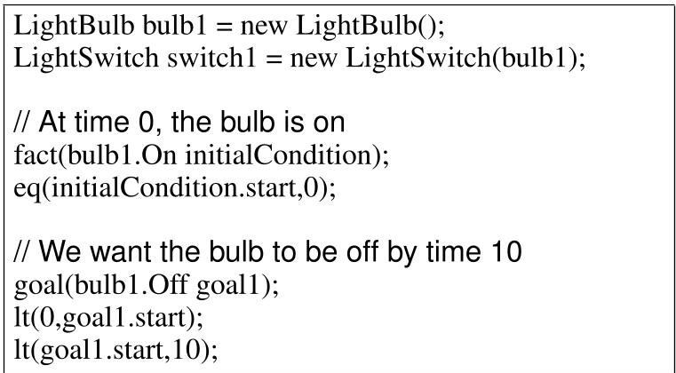


<div align="center">

Figure 2: LightBulb example NDDL problem instance: turning the light OFF

</div>


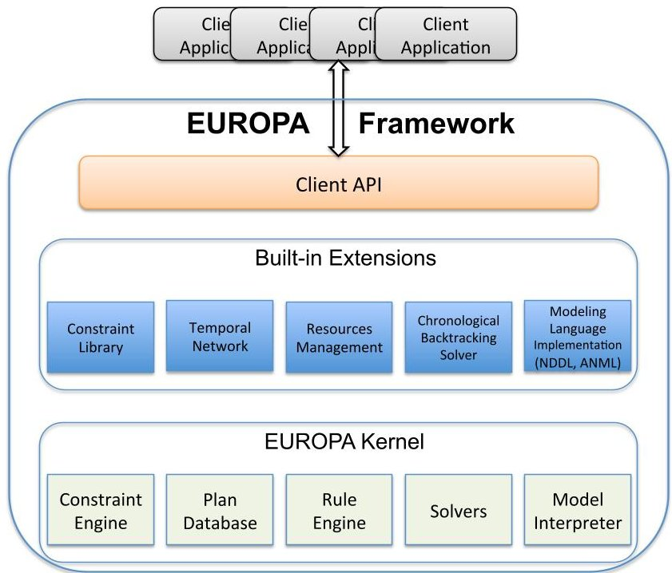


<div align="center">

Figure 3: EUROPA Architecture

</div>

found through planning in a direct manner without having to search. It is also a potentially very useful integration mechanism for pushing updates to the plan database from external systems.

## 2.2 EUROPA's Architectural Components

Figure 3 shows EUROPA's main architectural components. Keeping in mind that EUROPA is a framework, not an application, the components are arranged according to their relatively static structural role, which is determined by their responsibilities as explained below. The runtime relationships between this modules and how they interact in detail to assist problem solving is beyond the scope of this paper, [Rajan et al., 2012] covers these aspects in a good amount of detail

The deepest layer in Figure 3 depicts EUROPA's kernel, which offers fundamental representation, reasoning modeling and search capabilities that can be configured, extended and customized to create planning and scheduling applications.

Constraint Engine: is the nexus for consistency management. It provides a general-purpose component-based architecture for handling dynamic constraint networks. It deals in variables and constraints. It includes an open propagation architecture making it straightforward to integrate specialized forms of local and global constraint propagation.

Plan Database: adds higher levels of abstractions for tokens and objects and the interactions between them. This is the code embodiment of the EUROPA planning paradigm. It supports all services for creation, deletion, modification and inspection of partial plans. It maintains the dynamic constraint network underlying a partial plan by delegation to the Constraint Engine and leverages that propagation infras-

<!-- PDF_PAGE: 4 -->

structure to maintain relationships between tokens and objects.

Rules Engine: provides the implementation of domain rules described in a problem model. As described above, domain rules are relationships between predicates that represent actions and states in a EUROPA plan. For instance, in the Light model above, there are domain rules stated between a LightSwtich::turnOn action and its corresponding Light-Bulb::Off precondition and LightBulb::On effect. The Rules Engine component ensures that when a LightSwitch::turnOn action is added to the plan, a requirement is posted for the plan to contain its precondition and effect in a way that satisfies temporal and other constraints stated in the model.

Solvers module: provides abstractions to support search in line with the EUROPA planning approach. It includes a component-based architecture for Flaw Identification, Resolution and heuristics $ ^{2} $

Model Interpreter: provides an implementation so that the functionality in the other EUROPA kernel modules can be exercised through a run-time interpreter. This interpreter implementation can be used as a target for parsers of different modeling languages such as NDDL and ANML.

Temporal Network module: provides specialized algorithms and data structures to support efficient propagation of temporal constraints and detecting and maintaining temporal consistency.

The next layer in Figure 3 depicts important extension modules that have been found to be useful in dealing with real life domains and are therefore bundled with the EUROPA distribution. These modules were built using the exact same mechanisms that are available to all EUROPA users for building their own specialized modules on top of the EUROPA kernel. They are:

Resources Management module: provides specialized algorithms and data structures to support metric resources (e.g. battery, power bus, disk drive).

NDDL/ANML modules: provides parsers for the NDDL and ANML [Smith et al., 2008] languages. These modules define the mapping from the language to the data structures provided by the Model Interpreter module and through it interface to all of the modules in the EUROPA kernel (in the next section, we will discuss Eclipse modeling tools that support creating and debugging models using these languages).

Client API : The client API exposes the functionality of the EUROPA kernel and built-in modules in a concise and safe manner so that client applications can be easily built in C++

and Java.

From an application developers view-point, the components of the most interest are: Modeling Language Implementation (especially NDDL), Client API to the Solvers, and the UI & Eclipse tools (which we will explain shortly). These components address modeling, access to the problem solving mechanism and troubleshooting respectively. Other modules will be explored in the context of making customized extensions.

## 3 Using EUROPA

There are several different ways in which EUROPA can be used to support solving a planning & scheduling or CSP problem: (1) embed EUROPA within the client application; (2) using PSDesktop, a Java Swing UI Framework; and (3) utilizing the provided Eclipse plugins. For the rest of this section, we will outline those three different approaches and provide some examples.

Embed EUROPA in an Application: EUROPA provides a script called makeproject that will generate C++ and Java applications that embed EUROPA, along with a simple NDDL model and initial-state files that users can then modify for their own purposes. This allows the users to perform the full application cycle:

1. Initialize EUROPA

2. Load/Modify model and initial state descriptions

3. Invoke a solver

4. Extract plan results from the Plan Database

5. Repeat steps 2-4 as many times as needed

6. Shutdown EUROPA

The recommended way to use EUROPA in the steps described above is to utilize the PSEngine C++ or Java interface, which is the official interface for EUROPA clients. This interface is very straightforward and allows the user to run the entire application cycle described above. This abstraction layer will isolate a user's client code from most changes in the internals of the EUROPA implementation, it is also designed for easy mapping to other languages using SWIG.

While currently only C++ and Java bindings are bundled with the EUROPA distribution, we have plans to add Python and any other languages that are popular with the EUROPA user community.

JAVA Swing UI Framework: PSDesktop is a Java application that allows the user to drive EUROPA interactively and visualize the progress by utilizing the PSEngine client interface. It takes two arguments:

- Selection of either the Debug or Optimized version of EUROPA to run.

<!-- PDF_PAGE: 5 -->

```cpp

int main(int argc, const char ** argv)

{

    try {

        const char* nddlFile = argv[1];

        const char* plannerConfig = argv[2];

        // Instantiate EUROPA engine

        PSEengine* engine = PSEengine::makeInstance();

        engine->start();

        // Load nddl model and problem instance

        engine->executeScript("nddl",nddlFile,true);

        PSSolver* solver = engine->createSolver(plannerConfig);

        int startHorizon=0, endHorizon=100;

        solver->configure(startHorizon,endHorizon);

        //Create a plan

        int maxSteps=1000, maxDepth=1000;

        solver->solve(maxSteps,maxDepth);

        // Output resulting plan

        std::cout << engine->planDatabaseToString()

                << std::endl;

        delete solver;

        delete engine;

        return 0;

    }

    catch (Error& e) {

        std::cerr << "PSEengine failed:"

                << e.getMsg() << std::endl;

        return -1;

    }

}

```

<div align="center">

Figure 4: Example of embedding EUROPA in a C++ application by utilizing the API through extending the code template generated by the makeproject utility.

</div>

- bsh file (optional) : filename of the BeanShell file that is executed upon starting $ ^{3} $ .

Utilizing the BeanShell console window user can type in Java statements that allow driving EUROPA interactively through its Java API.

Eclipse Plugin (SWT) for EUROPA: The Eclipse plugin has two major components: (1) an editor and (2) an execution perspective. They provide the graphical interface to model, run, and analyze plans within the Eclipse development environment. The main capabilities are: NDDL Editor, Solver View, Statistics View, Open Decision View, Schema Browser View, Schema Browser View, Gantt View, Details View, and the Run NDDL model perspective that includes all of the above components. We will describe them in more detail in the next section dedicated to EUROPA's KE capabilities.

## 4 EUROPA's Knowledge Engineering Tools

In this section, we will outline the knowledge-engineering tools associated with the EUROPA framework. We will divide them into the following different categories: (1) modeling support; (2) result visualization and analysis; and (3) support for interactive planning process. As outlined in Section 3, there are different ways to use EUROPA and thus for each of the three categories, we will describe tools associated with either the: (1) Java Swing UI Framework; or (2) Eclipse Plugin.

## 4.1 Modeling Support through Eclipse Plugin

In this section, we will describe two different graphical model editing supports for NDDL and ANML through Eclipse plugins.

NDDL Graphical Model Editor: an Eclipse plugin registers a file type for ".nddl" and a default editor for it. The editor has syntax highlighting and an outline, which is updated every time the model file is saved. If the parser detects any errors, they are displayed as error markers in the editor. Figure 5 shows the GUI for editing and checking NDDL files.

ANML Graphical Model Editor: (this is an preliminary work-in-progress) Stottler Henke is currently under contract to develop an Eclipse-based tool called PM/IDE to add support for the ANML [Smith et al., 2008] language, a new modeling language that imports features from PDDL, IxTeT, AML, and NDDL. ANML models can then be translated directly into NDDL and EUROPA can be invoked within the tool to run on the translated model files. PM/IDE provides text-based and graphical visualization to help modelers analyze relationships between actions, fluents, and objects. The current main PM/IDE capabilities are:

- Text-based ANML Editor: an ANML text-based editor with syntax highlighting and associated outline and ob-

$ ^{3} $BeanShell is a small, free, embeddable Java source interpreter with object scripting language features, written in Java. BeanShell dynamically executes standard Java syntax and extends it with common scripting conveniences such as loose types, commands, and method closures like those in Perl and JavaScript.

<!-- PDF_PAGE: 6 -->


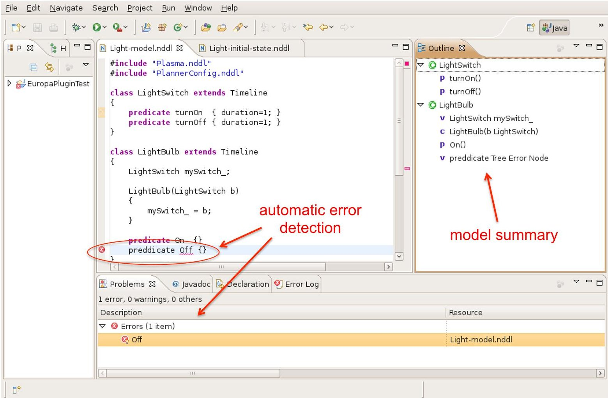


<div align="center">

Figure 5: NDDL Editor based on Eclipse Plugin

</div>


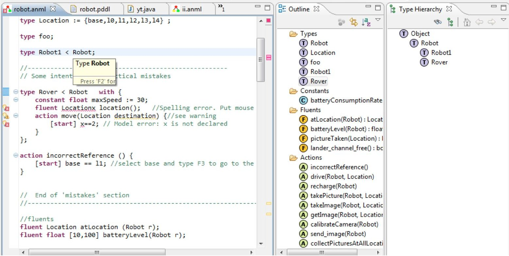


<div align="center">

Figure 6: PM/IDE's Text-based ANML Editor

</div>

<!-- PDF_PAGE: 7 -->


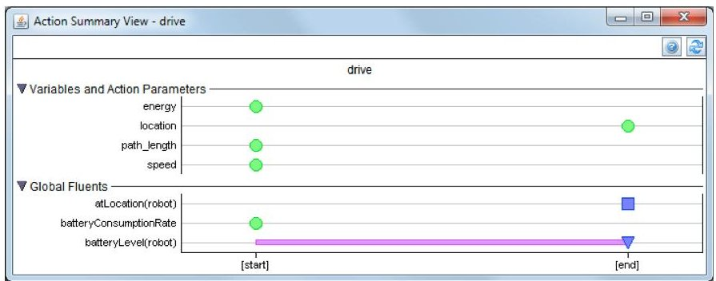


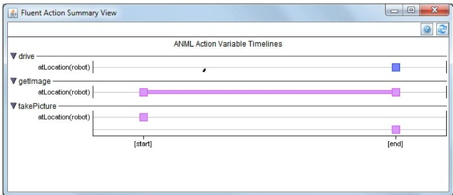


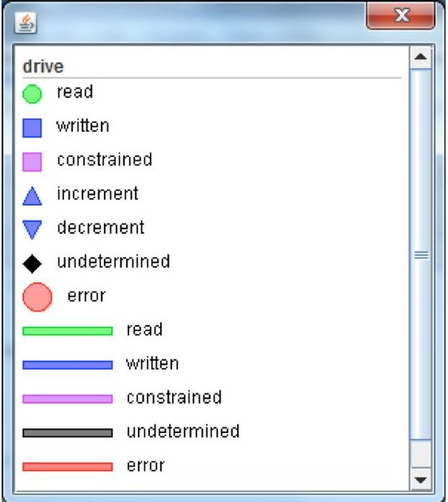


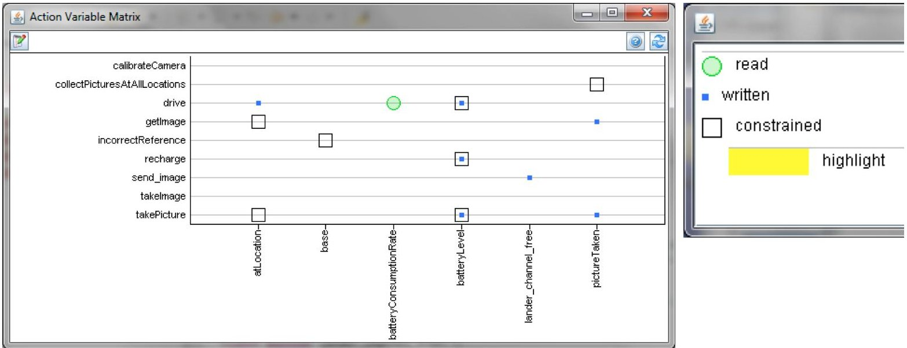


<div align="center">

Figure 7: PM/IDE's three views on: (1) Action Timeline Summary; (2) Fluent Actions Timeline Summary; and (3) Action Variable Matrix

</div>

<!-- PDF_PAGE: 8 -->

ject type hierarchy views. Figure 6 shows an example of this view.

- Action Timeline Summary: For an action, this view summarizes when the action reads or changes the value of a variable/fluent. Horizontal bars show when a variable is changed over a time period such as [all]. Mouse actions (e.g., right-click, double-click) on items in this view will automatically trigger highlight activities in the text-based ANML editor.

- Fluent Actions Timeline Summary: For a fluent, this view summarizes how actions in the model read or change the given fluent. Symbols and horizontal bars show when such actions read or change the fluent. This is similar to the Action Timeline Summary, but it shows all the actions related to the selected fluent rather than all variables/fluents affected by one particular action. Also similar to the Action Timeline Summary view, mouse actions in this view trigger highlights of the corresponding components in the text-based ANML editor.

- Action Variable Matrix: This matrix contains one row per action and one column per global variable/fluent. At each row-column position, up to three overlapping symbols are drawn to indicate whether the action reads, writes, and/or constrains the variable. This view lets modelers quickly scan columns to see the actions that read/write each fluent. Modelers can also scan rows to see the fluents that are read/written by each action. Moreover, there are additional capabilities associated with this view such as highlight, group, and filter to assist future model analysis. Figure 7 shows examples of the three non-text views.

Currently, PM/IDE also supports limited ANML to NDDL translation capability that can translate a subset of the ANML language into NDDL and also the NDDL browsing and editing features to PM/IDE. Thus, for a subset of ANML, modelers can:

1. Use ANML text-oriented views and visualizations to enter, edit, and review an ANML planning domain model and problem,

2. Invoke the ANML $ \to $ NDDL translator to translate the ANML model and problem into NDDL,

3. Use NDDL views to review and edit (if necessary) the automatically-generated NDDL,

PDDL: PDDL is the dominant modeling language used in the planning research community. While it's out of the scope of this paper to discuss PDDL's ability to model complex realworld applications, the capability to support PDDL is a useful feature of any KE tool or planning system. EUROPA currently does not come with any tool to support PDDL modeling directly. However, there is promising work showing that this can be done. Sara Bernardini and David Smith have developed technique based on variable/value model which allows translation of PDDL into either ANML or NDDL [Bernardini and Smith, 2011].

## 4.2 Result Analysis

Java Swing UI Framework: The PSUI package contains a number of components that make it easy to visualize the partial/complete plan and interact with EUROPA:

- PSGantt: shows the tokens on a timeline as a gantt chart

- PSChart : shows resource profiles as charts

- ActionDetails and ActionViolation: enable easy display of violation and detail information about actions in a plan as the user mouses over actions in other components (for instance a gantt chart)

Figure 8 shows an example of how different UI components within the PSUI package can be activated to assist the plan analysis. In the next section, we show additional examples of a diverse set of problems (all come with the EUROPA distribution).

Eclipse Plugin: the EUROPA package provides the following capabilities through Eclipse plugins

- Solver View: Start/stop the EUROPA engine, and configure and run a solver.

- Statistics View: Graphs of solver stats.

- Open Decision View: View of open decisions at each step of solving.

- Schema Browser View: View the schema for the active NDDL model.

- Gantt View: Once a solution is found, view the plan.

- Details View: Click on a token in the Gantt View to see it's details in this view.

Alternatively, for the plan generated through the PM/IDE Eclipse-plugin by first utilizing the ANML-to-NDDL translator and invoke EUROPA from within this tool on the resulting NDDL models, PM/IDE also provides capabilities to visualize the resulting plan (Figure 9).

## 4.3 Interacting with the Core Planning Engine

Java Swing UI Framework: In the BeanShell console, users have access to:

- PSEngine: provides access to the EUROPA engine, users can create a solver, query the plan database, execute NDDL scripts, and in general perform any task needed to drive EUROPA to load a model and create a plan. Users can also use this interface to create their own custom solvers.

- PSSolverDialog: allows the user to drive a solver interactively and see its status as it tries to achieve the goals specified for it

- PSDesktop: provides access to many utility methods to create new desktop windows, display tables of tokens, create a solver, etc.

Eclipse Plugin: Users can run EUROPA by directly invoking the Run As action for a given NDDL file. This action shows up both in the editor and in the Package Explorer pane. It creates a launch configuration and switches the perspective to NDDL model execution. The Run As action within the

<!-- PDF_PAGE: 9 -->


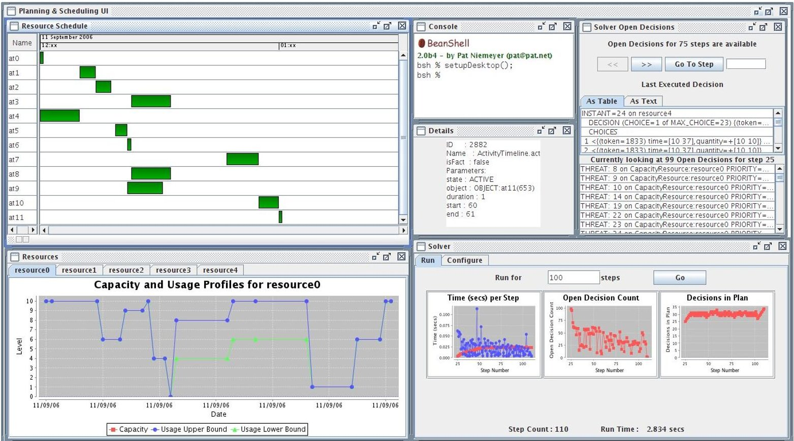


<div align="center">

Figure 8: PSUI components in the Resource Constrained Project Scheduling Problem (RCPSP)

</div>


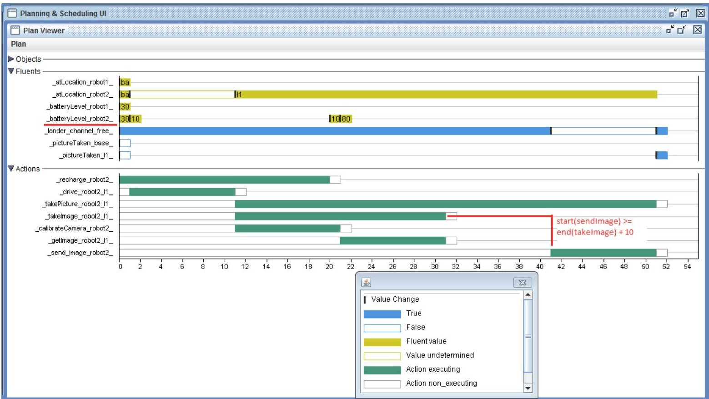


<div align="center">

Figure 9: PM/IDE's plan-analysis view

</div>

<!-- PDF_PAGE: 10 -->


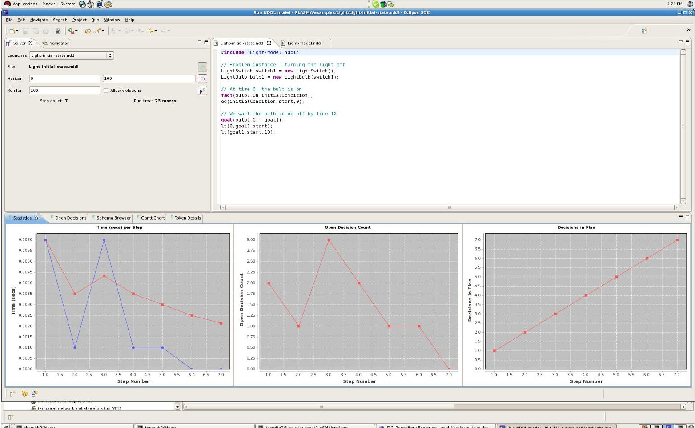


<div align="center">

Figure 10: Eclipse dedicated perspective on showing information about running EUROPA

</div>

NDDL model perspective is the Eclipse version of the JAVA Swing PSDesktop user interface. The plugin can run multiple NDDL sessions at the same time. Users can switch between them using the pulldown list. EUROPA sessions are also visible in the Debug perspective and can be killed or restarted from there. Figure 10 shows an example of this perspective where different aspects of modeling and execution can be visually displayed.

## 5 Examples

In this section, we show several examples that demonstrate the flexibility of EUROPA (both its core engine and its supporting knowledge engineering tools) when solving different types of planning, scheduling, and constraint satisfaction problems. All examples covered in this section are included in the EUROPA distribution and in this section they are illustrated through the PSDesktop interface.

Light: A simple domain for EUROPA that describes how a light switch can be used to control a light bulb. Figure 11 shows an example output analyzing the final plans. In this particular example, the intervals mean that the action or state change could happen at any point in the interval, so for instance, "lightSwitch1 is turned off at time [0,8]" means that lightSwitch1 could be turned off at time 0, or at time 1, ..., or at time 8. One can modify the model or EUROPA's configuration to generate grounded plans (where all the values are points, instead of

intervals), if that's what is desired for a particular application.

N-Queens: N-Queens is one of the CSP benchmark domains. Figure 12 shows how EUROPA supports modeling and solves this problem through PSDesktop. Users can click on a chess board to move the the queens around and see the constraint violations that EUROPA computes by moving the mouse over each queen. It also provides a simple Tabu Search solver which briefly illustrates how users can build their own solvers on top of EUROPA.

Resource Constrained Project Scheduling Problem (RCPSP): this is a well known problem in the OR community that consists of scheduling a set of activities with temporal and resource constraints. Typically, the goal is to minimize total project duration while respecting all constraints (Figure 8). Like the previous example, this example shows how users can build their own solvers on top of EUROPA for a specific problem.

Shopping: a simple example discussed in Russell and Norvig's AI textbook, first Edition, Chapter 11 (Figure 13).

Blocksworld: this is one of the most well-known planning domains. This version uses a robotic arm to build the stacks and Figure 14 shows a UI where one can look at the partial state of the arm and the stacks as the planner progresses towards the stated goal. The PSDesktop UI allows users

<!-- PDF_PAGE: 11 -->

to mouse over the green rectangles to see the actions over each timeline; for example, one can see the arm operator performing pick up and stack operations on the blocks. The "BlockWorld History" window shows the evolution of the stacks as the operator performs the actions from the plan, until it arrives at the stated goal.

Planetary Rover: this is a more complex planning domain that was inspired by NASA robotic missions and has also been translated to PDDL to be used in recent IPCs. Figure 15 shows the UI for this domain. In this figure, red and blue curves on the chart at the top-right corner bound the possible battery charge. The difference between the two is due to the flexibility in the plan regarding when navigation and sampling may take place. The red curve shows the charge when actions occur as soon as possible, and the blue curve shows charge when all battery consuming actions are delayed as long as possible. The bottom window displays a gantt chart for the Rover, Navigator and Instrument timelines in this problem. Hovering the mouse over any piece (green rectangle) of the gantt chart shows details displayed in the Details window. In this screenshot, the mouse was hovered over the large box on the Navigator timeline, which is an At predicate.

## 6 EUROPA-related Projects

- SACE Support for optimization of the International Space Station's solar arrays

EUROPA has been used for a variety of missions, missionoriented research, and demonstrations, including:

- DS1: RAX Remote Agent Experiment (original version of EUROPA technology) controlling the Deep Space One mission.

- Bedrest study at Johnson Space Center to minimize the changes that occur to the body during space flight and enable the return of normal body functions once back on Earth.

- MER Tactical Activity Planning: EUROPA is the core planning technology behind MAPGEN, a decision support tool for generating detailed activity plans on a daily basis for the MER robotic mission to Mars.

- MSL mission: Support for planning and scheduling for Mars Science Laboratory Science Operations

- Intelligent Distributed Execution Architecture (IDEA)

- On-board Planning and Plan Execution. EUROPA was the core planning technolgoy for deliberative and reactive planning on-board a variety of mobile robots. It has been fielded in the Atacama Desert and was the cornerstone of a 2005 milestone of human-robotic collaboration for the Collaborative Decision Systems program.

- Crew Planning Research project on Planning and Scheduling for space missions

- ATHLETE support for foot fall planning for a hexapod lunar robot

- Integrated with On-board Planning and Plan Execution: EUROPA was the core planning technolgoy for deliberative and reactive planning on-board a variety of mobile robots. It has been fielded in the Atacama Desert and was the cornerstone of a 2005 milestone of humanrobotic collaboration for the Collaborative Decision Systems program.

- Mission Simulation: EUROPA was used to simulate a prospective robotic mission (LORAX) to the Antarctic for the purposes of system design evaluation.

- Contingent Planning for ROVER operations (PiCO) for K9 research rover.

- Personal Satellite Assistant (PSA)

- Spoken Interface Prototype for PSA (RIALIST)

Outside of NASA, it has also beed used at MBARI to help control underwater autonomous vehicle [McGann et al., 2008] and at Willow Garage for autonomous robot navigation [McGann et al., 2009] $ ^{4} $

## 7 Conclusion and Future Work

In this paper, we described EUROPA with concentration on its modeling and plan analysis capabilities. The main strengths of EUROPA are: (1) expressive; (2) flexible framework; (3) strong support for integration with other applications; (4) open-source license; and (5) proven track record.

While EUROPA and its supporting tools have been going through a long period of development, we still have a long list of improvements that we want to make. The most important ones in our opinion are: significantly improve search (especially heuristic guidance) and inference capabilities, support the ANML and PDDL modeling languages, improve the visualization and debugging tools and allow EUROPA extensions to be written in other languages. Given that EUROPA is open-source software, we welcome contributions from planning and scheduling researchers and practitioners.

Acknowledgements: EUROPA is the result of many years of research, development and deployment of constraint-based planning technology.

- The precursor to EUROPA was HSTS, designed and developed by Nicola Muscettola. HSTS set out the initial domain description language and essentials of the planning paradigm that became the starting point for EUROPA.

- Ari Jonsson led the implementation of the first version of EUROPA. Ari's team included Jeremy Frank, Paul Morris and Will Edgington, who all made valuable contributions.

- Conor McGann led the implementation of EUROPA 2, which is a further evolution of this line of work, targeted mainly at making the technology easier to use, more

<!-- PDF_PAGE: 12 -->


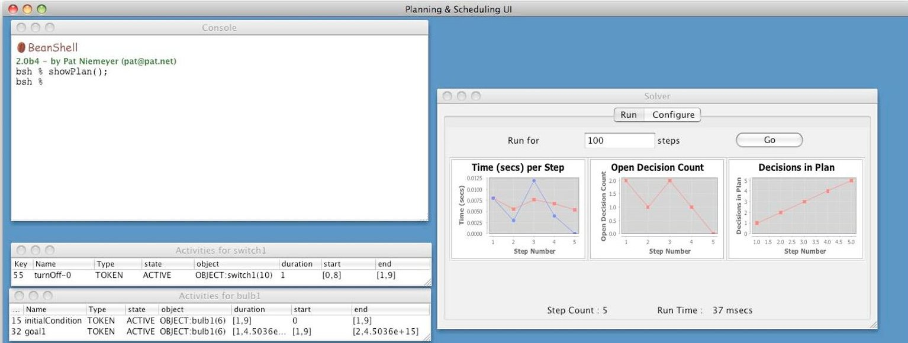


<div align="center">

Figure 11: UI example of the simple light-switch domain where the only action is to turn a light ON or OFF.

</div>


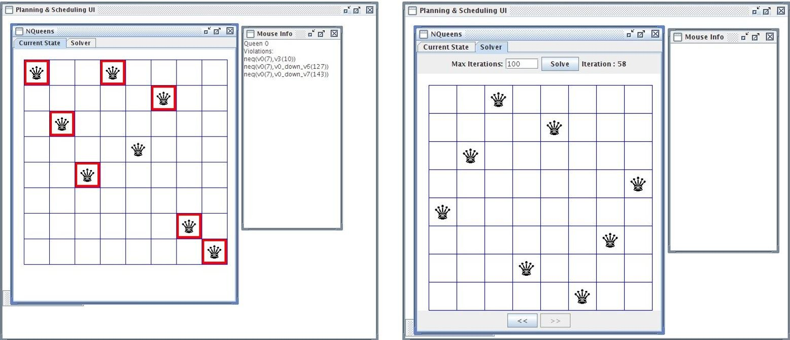


<div align="center">

Figure 12: UI example of the representative Constraint Programming domain: NQueens

</div>

<table class="table table-bordered"><thead><tr><th>Key</th><th>Name</th><th>ES</th><th>start</th><th>end</th><th>duration</th><th>product</th><th>loc</th><th>from</th><th>to</th></tr></thead><tbody><tr><td>94</td><td>AgentTimeline.At</td><td>0.0</td><td>[0,75]</td><td>[1,76]</td><td>[1,76]</td><td>--</td><td>OBJECT:Home(26)</td><td>--</td><td>--</td></tr><tr><td>209</td><td>AgentTimeline.Go</td><td>1.0</td><td>[1,76]</td><td>[2,77]</td><td>[1,76]</td><td>--</td><td>--</td><td>OBJECT:Home(26)</td><td>OBJECT:HardwareStore(38)</td></tr><tr><td>142</td><td>Agent.Buy</td><td>2.0</td><td>[2,77]</td><td>[12,87]</td><td>10</td><td>OBJECT:Drill(56)</td><td>--</td><td>--</td><td>--</td></tr><tr><td>308</td><td>AgentTimeline.At</td><td>2.0</td><td>[2,77]</td><td>[12,87]</td><td>[1,85]</td><td>--</td><td>OBJECT:HardwareStore(38)</td><td>--</td><td>--</td></tr><tr><td>434</td><td>AgentTimeline.Go</td><td>12.0</td><td>[12,87]</td><td>[13,88]</td><td>[1,76]</td><td>--</td><td>--</td><td>OBJECT:HardwareStore(38)</td><td>OBJECT:SuperMarket(32)</td></tr><tr><td>110</td><td>Agent.Buy</td><td>13.0</td><td>[13,88]</td><td>[23,98]</td><td>10</td><td>OBJECT:Milk(50)</td><td>--</td><td>--</td><td>--</td></tr><tr><td>126</td><td>Agent.Buy</td><td>13.0</td><td>[13,88]</td><td>[23,98]</td><td>10</td><td>OBJECT:Banana(44)</td><td>--</td><td>--</td><td>--</td></tr><tr><td>240</td><td>AgentTimeline.At</td><td>13.0</td><td>[13,88]</td><td>[23,98]</td><td>[1,85]</td><td>--</td><td>OBJECT:SuperMarket(32)</td><td>--</td><td>--</td></tr><tr><td>338</td><td>AgentTimeline.Go</td><td>23.0</td><td>[23,98]</td><td>[24,99]</td><td>[1,76]</td><td>--</td><td>--</td><td>OBJECT:SuperMarket(32)</td><td>OBJECT:Home(26)</td></tr><tr><td>158</td><td>AgentTimeline.At</td><td>24.0</td><td>[24,99]</td><td>[25,100]</td><td>[1,76]</td><td>--</td><td>OBJECT:Home(26)</td><td>--</td><td>--</td></tr></tbody></table>

<div align="center">

Figure 13: UI example of the text-book shopping planning example

</div>

<!-- PDF_PAGE: 13 -->


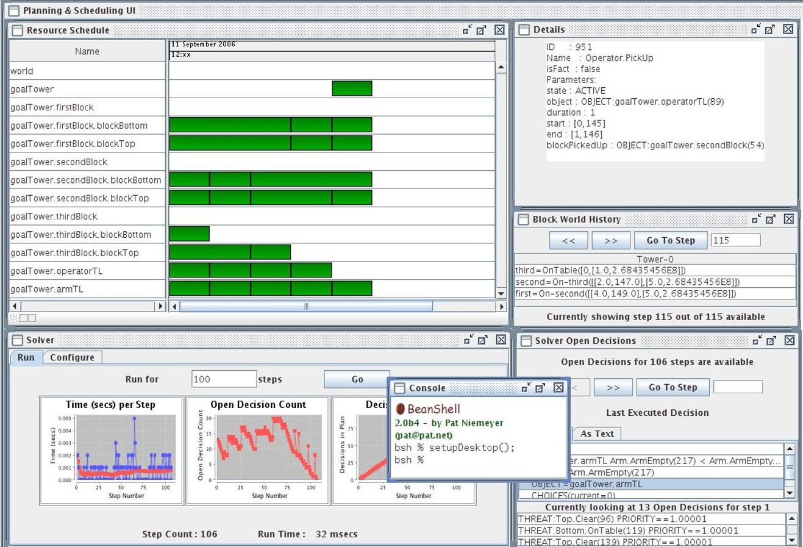


<div align="center">

Figure 14: UI example of the classical Blocksworld planning domain.

</div>


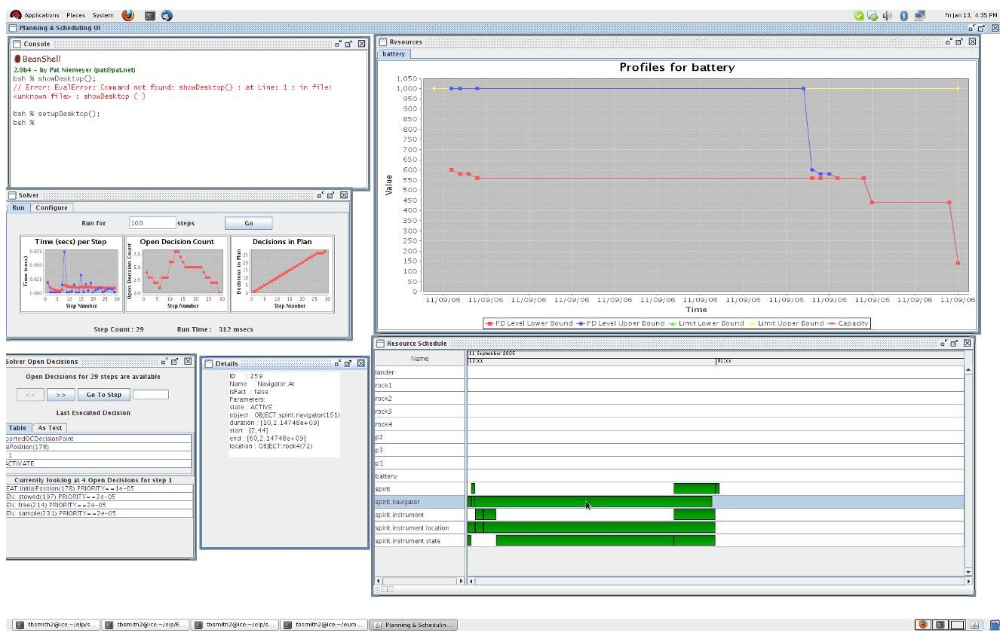


<div align="center">

Figure 15: UI example of the Rovers planning domain.

</div>

<!-- PDF_PAGE: 14 -->

efficient, easier to integrate and easier to extend. EUROPA 2's main contributors were Andrew Bachmann, Tania Bedrax-Weiss, Matthew Boyce, Patrick Daley, Will Edgington, Jeremy Frank, Michael Iatauro, Peter Jarvis, Ari Jonsson, Paul Morris, Sailesh Ramakrishnan and Will Taylor.

External contributors and collaborators include: Tatiana Kichkaylo, Mark Roberts, and Tony Pratkanis. Funding for this work has been provided by the NASA Intelligent Systems and Collaborative Decision Systems Programs.

- Javier Barreiro took over as the EUROPA team lead in the Fall of 2006 and has been working on it since then, reshaping EUROPA's architecture and improving its technology and packaging. Javier's main collaborators at NASA Ames are Matthew Boyce, Minh Do, Michael Iatauro, Paul Morris, Tristan Smith and David Smith.

## References

[Ai-Chang et al., 2004] M. Ai-Chang, J. Bresina, L. Charest, J. Hsu, A. K. Jonsson, B. Kanefsky, P. Maldague, P. Morris, K. Rajan, and J. Yglesias. Mapgen: Mixed-initiative activity planning for the mars exploration rover mission. In System Demo at ICAPS'04, 2004.

[Bernardini and Smith, 2011] Sara Bernardini and David Smith. Finding mutual exclusion invariants in temporal planning domains. In Proc. of 7th International Workshop on Planning and Scheduling for Space (IWPSS), 2011.

[Frank and Jonsson, 2003] Jeremy Frank and Ari K. Jonsson. Constraint-based attribute and interval planning. Journal of Constraints Special Issue on Constraints and Planning, 8(4), 2003.

[Gerevini et al., 2009] Alfonso Gerevini, Derek Long, Patrik Haslum, Alessandro Saetti, and Yannis Dimopoulos. Deterministic planning in the fifth international planning competition: Pddl3 and experimental evaluation of the planners. Artificial Intelligence, 173:619-668, 2009.

[Ghallab and Laruelle, 1994] Malik Ghallab and Hervé Laruelle. Representation and control in IxTeT, a temporal planner. In Proceedings of AIPS-94, pages 61-67, 1994.

[Hoffmann and Edelkamp, 2005] Jörg Hoffmann and Stefan Edelkamp. The deterministic part of ipc-4: An overview. Journal of Artificial Intelligence Research, 24:519-579, 2005.

[Jonsson and Bäckström, 1998] Peter Jonsson and Christer Bäckström. State-variable planning under structural restrictions: Algorithms and complexity. Artificial Intelligence, 100(1-2)(4):125-176, 1998.

[McGann et al., 2008] C. McGann, F. Py, K. Rajan, H. Thomas, R. Henthorn, and R. McEwen. A deliberative architecture for auv control. In Proc. of Intnl. Conf. on Robotics and Automation (ICRA), 2008.

[McGann et al., 2009] Conor McGann, Eric Berger, Jonathan Bohren, Sachin Chitta, Brian Gerkey, Stuart Glaser, Bhaskara Marthi, Wim Meeussen, Tony Pratkanis, Eitan Marder-Eppstein, and Melonee Wise. Model-based, hierarchical control of a mobile manipulation platform. In Proc. of ICAPS Workshop on Planning and Plan Execution for Real-World Systems, 2009.

[Muscettola et al., 1997] Nicola Muscettola, Ben Smith, Chuck Fry, Steve Chien, Kanna Rajan, Gregg Rabideau, and David Yan. On-board planning for new millenniumdeep space one autonomy. In Proc. of IEEE Aerospace Conference, 1997.

[Muscettola et al., 1998] Nicola Muscettola, Pandurang Nayak, Barney Pell, and Brian Williams. Remote agent: To boldly go where no ai system has gone before. Artificial Intelligence, 103:5-47, 1998.

[Rajan et al., 2012] Kanna Rajan, Frederic Py, and Javier Barreiro. Towards deliberative control in marine robotics. Book Chapter on Marine Robotic, 2012.

[Smith et al., 2008] David Smith, Jeremy Frank, and Will Cushing. The anml language. In Proceedings of ICAPS-08, 2008.

[Tran et al., 2004] D. Tran, S. Chien, R. Sherwood, R. Castao, B. Cichy, A. Davies, and G. Rabideau. The autonomous sciencecraft experiment onboard the eo-1 spacecraft. In AAAI, 2004.