<!-- PDF_PAGE: 1 -->

# Evaluating a Fractionated Spacecraft System: A Business Case Tool for DARPA's F6 Program

Steven Cornford

818-354-1701

Steven.cornford@jpl.nasa.gov

Bjorn Cole

(818)354-0804

Bjorn.Cole@jpl.nasa.gov

Robert Shishko

(818)354-1282

Robert.Shishko@jpl.nasa.gov

Greg Dubos

(818)354-0318

Gregory.F.Dubos@jpl.nasa.gov

Steven Jenkins (818)354-6055 J.S.Jenkins@jpl.nasa.gov

Stephen Wall

(818)354-7424

Stephen.D.Wall@jpl.nasa.gov

Tyler Ryan (703)406-5000 Tyler.Ryan@jpl.nasa.gov

Jet Propulsion Laboratory 4800 Oak Grove Dr. Pasadena, CA 91109

Nic Rouquette

(818)354-9600

Nicolas.F.Rouquette@jpl.nasa.gov

Bryce Durham

540.961.7215(x323)

bdurham@phoenix-int.com

Pezhman Zarifian

(818)354-1159

Pezhman.Zarifian@jpl.nasa.gov

Phoenix Integration 1715 Pratt Drive, Suite 2000 Blacksburg, VA 24060

Abstract The Defense Advanced Research Projects Agency (DARPA) has recently begun an effort to further refine its Fractionated Spacecraft vision. This vision (called the "F6" program) seeks to explore distributed spacecraft architectures capable of performing complex functions similar to current monolithic spacecrafts. However, the ability of fractionated systems to work separately would provide significant benefits not achievable by monolithic systems. The question of interest to this study was "Can these benefits be quantified and evaluated in a meaningful fashion in order to compare them to monolithic architectures?"

Rather than narrowing the approach to one or two concepts, the strategy was to expand the decision space in order to generate and evaluate a variety of alternatives under different scenarios and design choices. The stimuli were specifically selected to capture many issues not included in such studies such as technology obsolescence, funding profile changes, equipment failure scenarios, and even changes to mission objectives during the mission. Each stimulus has a variety of decision options or responses which a manager can exercise including delay, cancellation, acceleration of a development, or even new developments. It is argued that the very nature of fractionation will result in systems far more agile to external (and internal) stimuli, but this has never been shown explicitly. This study explores the use of Real Options in conjunction with traditional Net Present Value techniques to quantify the desirability of alternative candidate designs in terms of their adaptability 978-1-4577-0557-1/12/$26.00 $2012 IEEE

and survivability.

Our approach to evaluating the business case for each use case was to explicitly model both the implementation and operation phases for the life cycle of a fractionated cluster. The models were integrated into Phoenix Integration's ModelCenter $ ^{\circledR} $ framework and used to generate Implementation Value Metrics (IVMs) and Operational Value Metrics (OVMs) associated with the use cases under evaluation. A number of models were developed to support these evaluations using Excel, Matlab, and Arena $ ^{\circledR} $ (a commercial discrete-event simulation software product). The Model-Based Systems Engineering (MBSE) approach used in this study yielded transformations between highlevel frameworks (OWL and SysML) and the models used to generate the data we needed for the evaluation. This rule-based transformation process will be critical for exploring the large decision trade spaces in a reasonable amount of time.

This paper presents the results of the business case analyses; the underlying OVM's and IVM's, the approaches used to model the problem, explore the tradespace, refine the exploration, and generate results. We also discuss possible directions for future work. Specifically, it should be noted that while the approach described herein is being developed for, and funded by, DARPA, it has general applicability to a much wider variety of applications.

<!-- PDF_PAGE: 2 -->

1. INTRODUCTION ...2

2. OVERALL APPROACH ...2

3. MODEL DESCRIPTION ...7

4. RESULTS TO DATE ...9

5. DISCUSSION AND OBSERVATIONS ...11

ACKNOWLEDGEMENTS ...11

REFERENCES ...11

BIOGRAPHIES ...12

## 1. INTRODUCTION

One portion of the F6 Program from DARPA, and the focus of this study $ ^{1} $ , seeks to evaluate the business case for fractionation -- that is, under what conditions and constraints does a fractionated architecture make more business sense than a traditional monolithic spacecraft? The business case for fractionation is defined here as the union of requirements, a spacecraft model, a constraint set, and an economic evaluation of the costs and benefits of alternative architectures. Our team at the Jet Propulsion Laboratory and Phoenix Integration was one of five teams selected to build a tool capable of analyzing the business case for fractionation.

Figure 1 illustrates our multi-phase DARPA plan for analyzing the business case. During the Base Period phase of this task the principal goals were to develop the algorithms and infrastructure for the tool, prototype those algorithms and infrastructure, and generate end-to-end test cases.

After the Base Period phase, the business case tools are to be extended by developing actual data estimates for a candidate concept, a user-friendly GUI and a complete model representing all of the spacecraft functionality necessary to accurately model the business case. For each phase, the results will be documented, the models and data sets used to generate them will be published, and a comparison of early versus later results will be delivered Our team was one of two teams selected to continue on into Option Period 1 in which we will continue the development of the tool with a focus on transitioning from Notional Business Case Results to Realistic Business Case results We will continue our reliance on MBSE and model transformations will be developing techniques for reducing the size of the trade space under exploration as we increase the fidelity with which this reduced trade space is evaluated. We will also generate more complex compositions of stimuli and possible responses as we continue to implementation of Real Options Analysis in this new domain.

http://www.darpa.mil/Our_Work/TTO/Programs/System_F 6.aspx

<table border="1"><tr><td></td><td>Base Period</td><td>Option Period 1</td><td>Option Period 2</td></tr><tr><td>Business Case Metrics</td><td>Complete</td><td></td><td rowspan="5">Actionable</td></tr><tr><td>Business Case Results</td><td>Notional</td><td>Realistic</td></tr><tr><td>Model Breadth</td><td>Complete</td><td></td></tr><tr><td>Model Completeness</td><td>Notional</td><td>Completed</td></tr><tr><td>Model Data</td><td>Partial/Realistic</td><td>Realistic</td><td>Actual</td></tr><tr><td>GUI, easy to use</td><td>Notional</td><td>Completed</td><td></td></tr></table>

Figure 1-Illustration of the maturity and development phases of the design tool identified in the DARPA Broad Area Announcement.

## 2. OVERALL APPROACH

This section consists of four parts working from the Business case back through the supporting capabilities. The first part describes how we evaluated the business case. The second part presents how the IVM's and OVM's were generated, The third part shows how the models were integrated. The fourth part demonstrates end-to-end modeling is performed and variations are produced.

## 2.1 Evaluating the Business Case

Previous analyses of fractionated space architectures have not fully captured the value (or nature of) spacecraft adaptability resident in these architectures. Developments in valuing investments under uncertainty over the past 20 years suggest that the use of Net Present Value (NPV) or Discounted Cash Flow (DCF) alone underestimate, if not ignore, the inherent value in complex, multi-period projects of being able to adapt to changing market conditions. This adaptability, however, can be quantified and captured as the value of the project's embedded real options (EROs). Like a financial option, a real option allows a project to take an alternative path (for example, to change the architecture, a design, or timing of some operation), but does not obligate it to do so.

To evaluate the business case for fractionated space architectures, we compute what we define as the Present Strategic Value (PSV), given by Eq. (1). The expected value term in Eq. (1) includes the NPV of a nominal scenario taking into account all the internal (to the project) risks associated with a complex, technical project like F6.

$$
P S V = E _ {P} [ N P V ] + \text {V a l u e o f E m b e d d e d R e a l O p t i o n s} \tag {1}
$$

A considerable body of literature supports the notion of PSV, most notably in [1].

Valuing the Embedded Real Options—In our study, EROs arise in the context of both internal (to the project) risks, such as an on-orbit spacecraft failure, and external market risks, such as uncertain user demand, changes in funding, or

<!-- PDF_PAGE: 3 -->

technological obsolescence. Generically, a project's EROs fall into one of the following six categories: Defer, Accelerate, Expand, Contract, Switch, or Abandon. For the purposes of this study, 10 specific real options were defined and associated with one or more internal and external risks, as shown in Table 1. Note that these risks, or uncertainties, are sub-divided into those which affect the adaptability of the system and those which affect the survivability of the system. The various uncertainty types each have some possibilities for Embedded Options which are also shown in the table. For each real option, a decision tree was defined [2], which, when evaluated, resulted in an expression for the real option value. To illustrate this process, Figure 2 shows the 'Option to Switch Payloads' decision tree. See Appendix A for other real option decision tree examples.

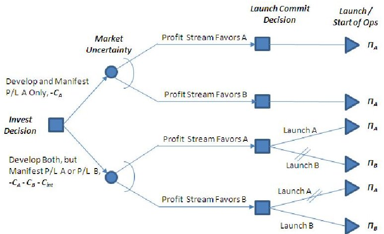

Figure 2 - Option to Switch Payloads Decision Tree

$$
v (t, T) = \mathrm {E} \left| \max \left(0, - C _ {p e n a l t y} (t) + \Delta \Pi (T)\right) \right|
$$

The option value for each of the 10 real options was computed as the maximum of the two branches of the tree less the "nominal" branch. In this way, the real option value would always be greater than or equal to zero and generally with the form:

In Eq. (2), t is the time at which the option is "purchased" (and resources are allocated) and T is the time when the option payoff, $ \Delta \Pi (T) $ , occurs, i.e., the strike date to use market terminology. To purchase the option, there may be a penalty cost involved, which others in [3] have called a "switching cost" but could also be thought of as a transaction cost.

Computing the Option PayoffThe exact mechanism for computing the option payoff relies on the discounted stream of profit that can be obtained from the data downlinked from the space systems, whether monolithic or fractionated. $ ^{2} $ Profit, in turn, is the difference between revenues (from the "sale" of data) and costs, which includes operations and launch costs, DDT&E, and production costs as needed in Eq. (2). The PSV calculation uses all four cost

types. The cost models and how they are integrated into the federation of models we employ are discussed in Section 3.

Table 1 Uncertainty Types and Associated Real Options

<table border="1"><tr><td>Adaptability Uncertainty Type</td><td>Embedded Real Options</td></tr><tr><td>Technology Development Risk</td><td>Option to Switch TechnologiesOption to Suspend/Slow Ancillary Developments</td></tr><tr><td>Supply Chain Delays</td><td>Option to Switch PayloadsOption to Switch TechnologiesOption to Suspend/Slow Ancillary Developments</td></tr><tr><td>Changes in User Needs</td><td>Option to Switch PayloadsOption to DiscontinueOption to AbandonOption to Accelerate DevelopmentOption to Switch Technologies</td></tr><tr><td>Program Funding Fluctuations</td><td>Option to Defer DevelopmentOption to Accelerate DevelopmentOption to Delay LaunchOption to Switch TechnologiesOption to Switch PayloadsOption to DiscontinueOption to Abandon</td></tr><tr><td>Technology Obsolescence</td><td>Option to AbandonOption to Switch TechnologiesOption to Delay LaunchOption to Accelerate DevelopmentOption to Switch Payloads</td></tr><tr><td>Survivability Uncertainty Type</td><td>Embedded Real Options</td></tr><tr><td>Launch Failure</td><td>Option to Accelerate DevelopmentOption to Not Replace</td></tr><tr><td>Operator Failure</td><td>Option to Accelerate DevelopmentOption to Not Replace</td></tr><tr><td>Component Failure</td><td>Option to Accelerate DevelopmentOption to Not Replace</td></tr><tr><td>Orbital Debris</td><td>Option to Accelerate DevelopmentOption to Not Replace</td></tr><tr><td>Collision</td><td>Option to Accelerate DevelopmentOption to Not Replace</td></tr></table>

Revenues are determined by multiplying the downlinked data quantity by its price. The quantity is calculated from a discrete event simulation (DES) using a commercially available tool, ARENA $ \circ $ . In this simulation, three types of data are currently modeled representing differing types of data (A, B, and C type), each of which has its own initial price and price process. The process for each type is based on geometric Brownian motion common to many financial models [4]. One significant difference in our business case implementation is that along with setting price drift and volatility parameters, the user can introduce price shocks or process parameter changes at any time according to the perceived likelihoods of risky events. The random character of the price process is captured using Monte Carlo simulation, which is also described later in Section 3.

<!-- PDF_PAGE: 4 -->

Integrating the Stimuli-In addition to establishing a consistent methodology for calculating the value of F6 real options, there is an important practical issue of how and where to embed them in a lengthy, complex project. A major barrier to exploration of the decision tradespace was the problem that over a multi-decade program, the number and timing of uncertainty events (stimuli) are difficult to predict, even though historically they occur in most programs of comparable complexity. To address this problem, an event profiler was constructed. The events are defined within a Profile of Planned "Surprises" or PPS file. For each uncertain event within a specific PPS, one or more real options associated with that stimulus are identified and a DES is run (for quantity) coupled with the Monte Carlo simulation (for price) to compute the associated real option value(s). Figure 3 illustrates a PPS with its associated ERO responses. Together they generate a Time-Expanded Decision Network, which has appeared as a methodology in other work on evolvable systems [3].

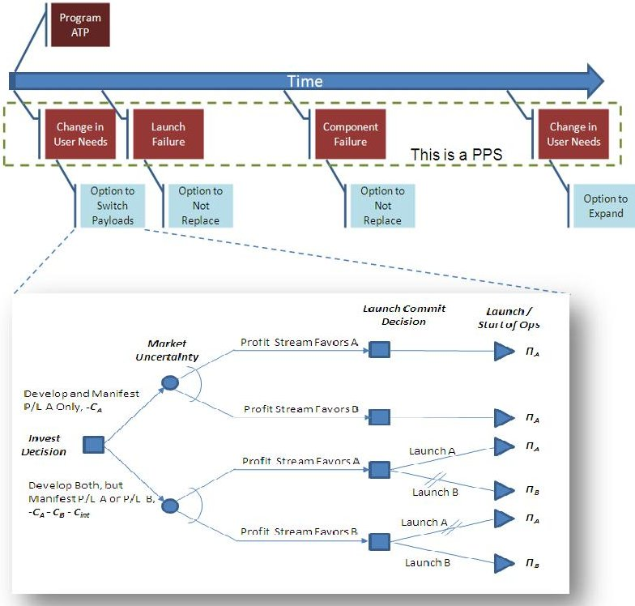

Figure 3 - Illustrative PPS and EROs

The distinguishing feature of the JPL approach is the rich set of real options that can be associated with recognized uncertainties (stimuli) facing a complex, long-term development project. While some of the options are always available, such as the Option to Abandon, others are applied only when a particular stimulus has occurred. Connecting stimuli and ERO responses for a given project while accounting for potential interactions among the options has plagued both theorists and practitioners alike. The PPS construct allows the user to design and control the number, type, and timing of the stimuli and the responses to them.

variants. To sort through these variants a Scenario-Based Decision Making (SBDM) approach was developed.

Within a PPS, many of the embedded real options may have zero value and hence do not contribute to PSV. However, there are many (possibly infinite) numbers of plausible PPS

Scenario-Based Decision Making-In SBDM, a computable metric is quantified, which in this study of the F6 business case is Present Strategic Value (PSV), for each of many potential fractionation architecture/strategies $ \left( \mathrm{S}_{i}, i=0,1,\dots, \right) $ and each of many PPS $ \left( \mathrm{PPS}_{j}, j=0,1,\dots, J\right) $ . This yields a matrix of values, from which we compute a percent-regret matrix. Each entry of the percent-regret matrix is given by Eq. (3):

$$
\% \text{regret} _ {i j} = \left(\max _ {i} \left(P S V _ {i j}\right) - P S V _ {i j}\right) / \max _ {i} \left(P S V _ {i j}\right)
$$

The results of this calculation can be displayed graphically (Figure 4). For each fractionation architecture/strategy, the percent-regret values are rank-ordered and the cumulative distributions of PPS regrets were identified. In SBDM, the regret criterion favors the fractionation architecture/strategy with the lowest percent regret based on all the PPS variants. SBDM selects the fractionation architecture/strategy that minimizes the maximum percent regret (minimax regret). SBDM is not a true optimization, but rather it seeks to pick out those fractionation architectures/strategies that perform well enough in a wide variety of futures.

Other decision criteria could be used. Some users might wish to weight certain PPS's more heavily, but that presumes some real information and insight about the future. By equally weighting the PPS's, they are equivalent with respect to their likelihood.

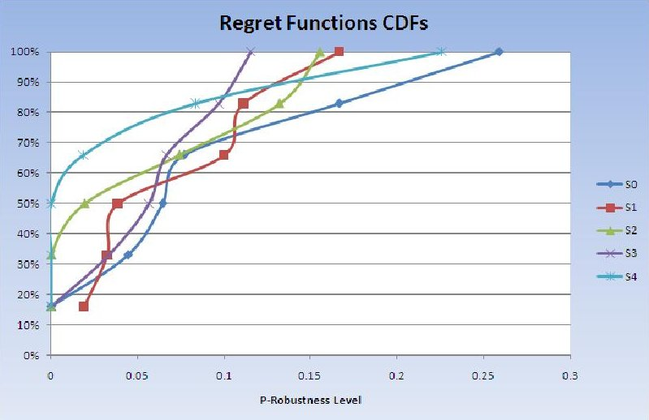

Figure 4 - Percent Regret Cumulative Distribution Functions for a Set of Architectures/Strategies. The regret function is defined in Equation (3). The p-robustness is a metric representing the degree to which a design is the best for all of the scenarios.

Multiple visualizations of the tradespace Pareto frontier are available from the F6 business case analysis. These include plots the PSV, regret function values, or percent-regret values for each alternative architecture/strategy against other parameters.

<!-- PDF_PAGE: 5 -->

## 2.2 Generating the Implementation and Operational Value Metrics (IVM's/OVM's)

In order to generate the necessary data for evaluating the business case PSV's, a variety of intermediate data called Implementation Value Metrics (IVMs) and Operational Value Metrics (OVMs) are required. Figure 5 schematically captures the primary IVM's and OVM's and shows the "threads of calculation," where they are generated, and their connections. Figure also shows the business case models implemented in Phoenix Integration's ModelCenter product [5]. Note that the some of the models broken out more explicitly in the schematic are collapsed into single model elements in the ModelCenter implementation.

and run from within ModelCenter (Figure 6). Next, the IVM's and OVM's are generated, recorded, and made available to downstream models. In the Base Period of this study, the time-tagged data (of several generic "types") transmitted to the ground over the lifecycle of the fractionated architecture constituted an essential OVM that fed the calculation of the Present Strategic Value for the particular scenario and configuration. The launch dates, build dates and durations, and spacecraft out of service dates are key IVM's that feed the PSV calculation. A variety of stochastic parameters can be activated in the ARENA model (e.g. anomaly/failure probabilities, operational, and implementation task durations) to model the dynamic uncertainties with Monte Carlo simulations.

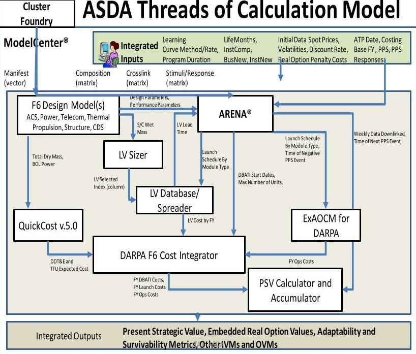

Figure 5- Threads of Calculation and ModelCenter Overview

The IVM's and OVM's can be further decomposed into static and dynamic VMs. The dynamic VMs required a time-based simulation to generate while the static ones can be generated by spreadsheets or other optimization tools. Our time-based simulations are performed using the ARENA software package available from Rockwell Automation, Inc. [6]. This software performs discrete event simulations on the F6 models created to represent both the cluster of (N) modules (and their functionalities), their topology $ ^{3} $ , their environment (i.e. orbital placeholder parameters, timing of sun windows, timing (location) of available ground stations), and the stimuli and responses discussed above.

For a given F6 cluster configuration obtained using SysML/ModelCenter transformations, a unique ARENA model is automatically created from a library of temporal processes (pre-defined for this F6 task), and then populated

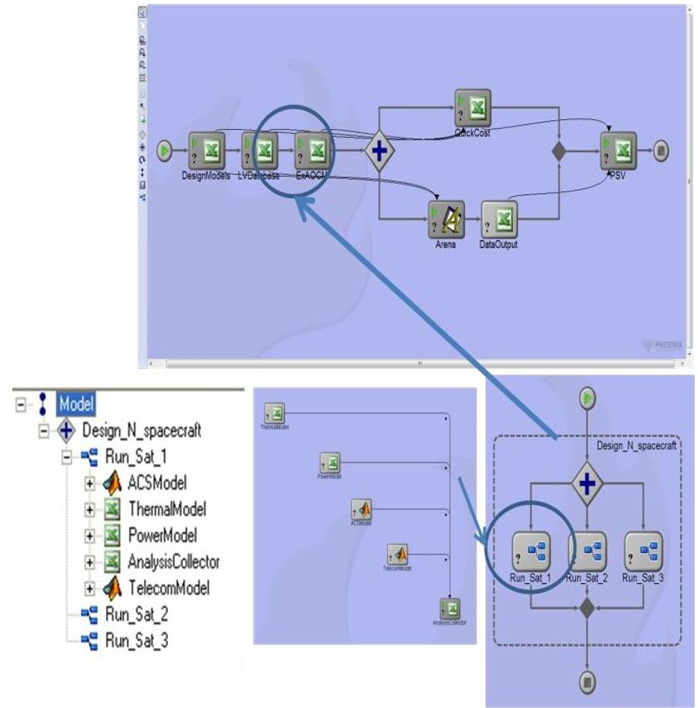

Figure 6- View of F6 Tradespace Evaluation Model (for N=3 spacecraft configuration) This figure includes expanded views which illustrate the explicit inclusion of three distinct spacecraft models and the subsystem models that parameterize them.

## 2.3 Model Integration

The ability to quantify the merits of one spacecraft fractionation configuration over a large number of alternatives relies on successfully analyzing a series of interrelated calculations, described previously. In practice these calculations may exist independently, be based in different third-party or COTS (commercial, off-the-shelf) tools, and may require heterogeneous computer platforms. Attempting to unify and consolidate algorithms or programmatic functionality into a single monolithic analysis would be costly, burdensome, time-consuming, and errorprone.

<!-- PDF_PAGE: 6 -->

Phoenix Integration's ModelCenter framework allows disparate tools to be integrated and controlled from a central location without the requirement of detailed coding, algorithm developments, or analysis consolidation. In this manner, the conversion from a descriptive model to an implementation model becomes a straightforward exercise to assemble the high-level constructs.

The integration framework makes it easy to propagate the parameter-values across the heterogeneous network of connected calculations. After completion of a single run, simulation, or analysis, the resultant data can be easily explored using Advanced Trade Space Visualization (ATSV) of which an example view is shown in Figure 7.

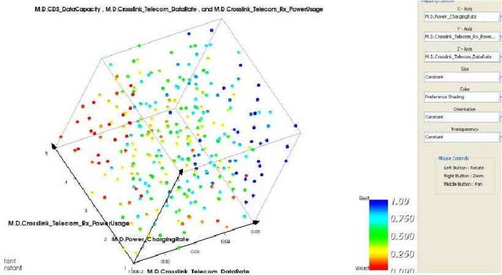

Figure 7 - Sample ATSV view of results for N=3 run

2. 4 End-to-End Modeling and Variation Generation

Model transformations play two essential roles in the analysis workflow. The first role is the generation of structural variant models to represent architectural or structural exploration of the design space. The second role is the generation of analysis specifications that configure external analysis tools for simulation or parametric exploration of a particular structural variant. We consider each case in turn.

Generation of Structural Variants-One of the first stages in the exploration of a design space is identification of architectural variants. By architectural, we mean variants that differ primarily in the types and/or numbers of major components and interconnection topologies. In many cases, a potentially large set of architectural variants could be specified in the form of a succinct pattern like the example in Figure 8.

Under SysML an F6 system consists of one or more motherships each in relation to one or more daughterships. Each spacecraft, whether a mothership or daughtership contains a spacecraft infrastructure, an F6 infrastructure and up to four payloads. Each payload can be composed of one of four specified types.

With the addition of constraints (e.g., upper bounds on the number of mother and daughter spacecraft), a software agent can systematically generate instances that conform to the architectural variant as illustrated below in Figure 8.

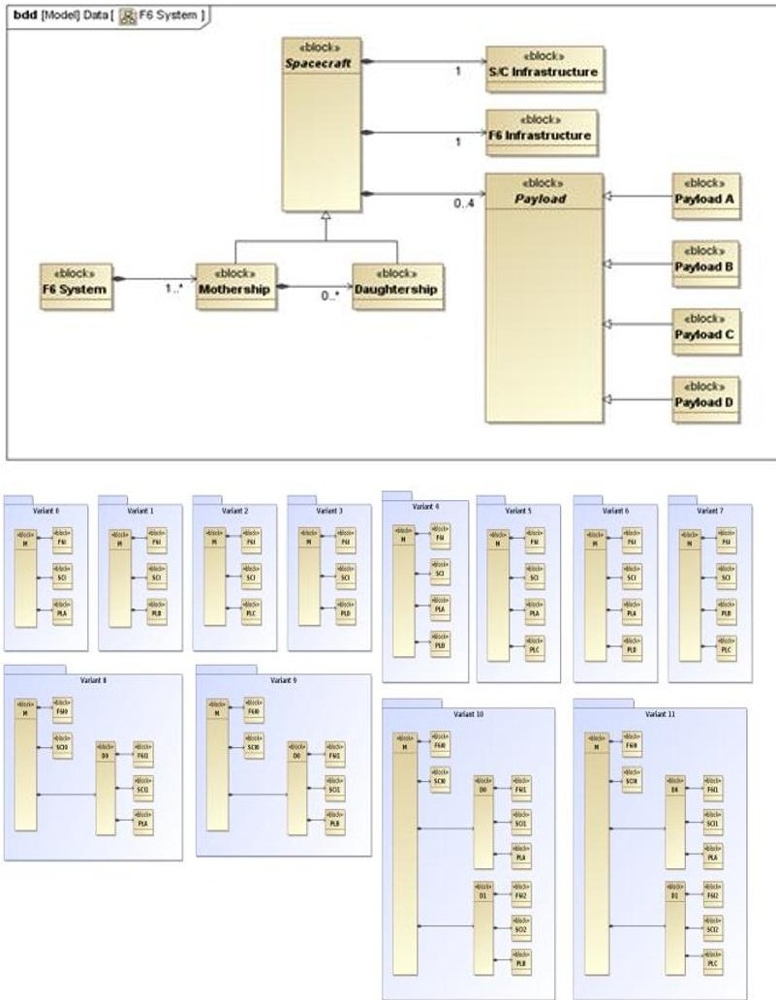

Figure 8 - Example of instances conforming to an architectural variant

The architectural variant, constraints, and generator algorithm can be tailored to sample a broad design space sparsely or to exhaust all options in a narrower space.

Generation of Analysis Specifications Carrying out a trade study requires a set of metrics by which design alternatives will be compared (e.g., the PSV). Maintaining consistentent calculations across architectural variants is often a challenge because structural differences between variants are reflected as differences in the algebraic structure of the analysis (model) equations.

As an analysis specification example, the computation of "data delivery capacity" for a single mothership would take into account a single space-to-ground communication link. On the other hand, the same metric calculated for a mothership/daughtership configuration would also need to account for the communication links between the mothership and daughterships. As a result, if the set of variants is large, an analysis must be constructed for each set. The effort involved can be considerable and more importantly, there is the risk of error or inconsistency that may corrupt the results of the study. To avoid these problems, analysis specifications can be constructed automatically by algorithms. We have developed and utilized these algorithms to construct cases for arbitrary N, instantiate the architectural variants in SysML, and create

<!-- PDF_PAGE: 7 -->

specific ModelCenter models corresponding to these patterns. This capability has enabled us to generate the PSV's for a variety of cases.

## 3. MODEL DESCRIPTION

## 3.1 Design Models

A variety of models are used to design and parameterize each module (free flying spacecraft) and their constituent elements. For this Base Period study, we have modeled the attitude control subsystem (ACS) and Telecommunication Subsystems using a MatLab sizing model with a test dataset. These subsystem models produce parameters used by other models, and in particular the Telecomm model is used to generate the parameters for the downlink (used by the mothership(s)) and the cross-link (used by all modules as the means by which daughterships communicate with motherships).

In addition, models have been defined for the computer data subsystem (CDS), Power, Propulsion, Structure and Thermal subsystems at varying levels of fidelity. The CDS, Power and Propulsion models generate parameters used by the discrete event simulation, and all of the models produce parameters used by other models. For example, the masses are used to select the appropriate launch vehicle, the costs and masses are used to generate the cost profiles for development, and the Beginning of Life (BOL) Power and total dry mass are used to generate overall module (spacecraft) costs.

Finally, a systems model aggregates and wraps parameters from the subsystem models while producing mission- and system-level parameters such as sun and downlink windows, mission orbital periods, minimum power levels, and minimum data levels before initiating cross-link operations.

## 3.2 Discrete Event Models

While one specific ARENA model can only correspond to one particular F6 cluster variant, a comprehensive F6 design tool ought to explore the entire fractionated spacecraft trade space. For a given ARENA model, many parametric variations can already be performed directly in ModelCenter and then passed on to the ARENA model (as described in the previous sections). However, structural differences between cluster combinations (both in terms of size and in terms of configuration) require the use of as many different ARENA models. This task, daunting if conducted manually, is easily tackled by our tool via the automatic generation of distinct ARENA models enabled by Visual Basic programming.

. This model generation is simplified by the use of custommade modeling blocks (such as user-defined ARENA templates) that already contain the basic elements, event flow and logic that are common across each business case of

F6. Three major submodels were formulated in ARENA using this approach:

- The Design, Build, Assembly, and Test (DBAT) submodel: it simulates the duration of design, build, assembly and testing phases of a sub-element of a cluster module (F6 infrastructure, Spacecraft infrastructure, Payload, Downlinker), ground station(s) and launch vehicles. Learning curves that compress cost and schedule are used to model learning effects associated with the development of multiple identical units. Finally, this submodel addresses funding profile fluctuations, supply chain delays and technology development risk, that result in a change in the development schedule.

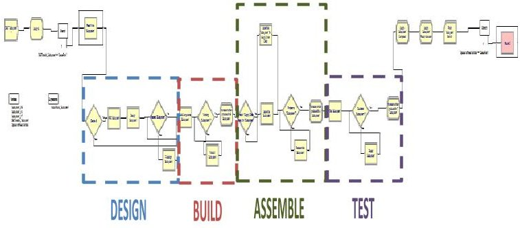

Figure 9 Modeling structure of the Design, Build, Assemble and Test (DBAT) template for each element produced (e.g. F6 infrastructure, Payload). The four development phases (Design, Build, Assembly and Test) are assumed to occur sequentially, and their respective nominal durations are user-specified input parameters that can differ for each production line (i.e., each subsystem being modeled).

The Integration and Launch submodel: it simulates the integration of the major subsystems into one module, the integration of the module into the launch vehicle, and the launch. It also addresses launch failures (either deterministically when using a PPS, or probabilistically using historical launch failure data)The Operations submodel (see Error! Reference source not found.): it explicitly simulates various operations that can be performed by cluster modules on orbit. These include: collecting energy, crosslinking data (for both motherships and daughterships), downlinking data to the Earth (for motherships), and taking data (for daughterships). In addition, the amount of propellant used for station keeping and orbital maneuvers is monitored over time and impacts the lifetime of the module cluster. The Operations submodel also addresses component failures and encounters with orbital debris.

<!-- PDF_PAGE: 8 -->

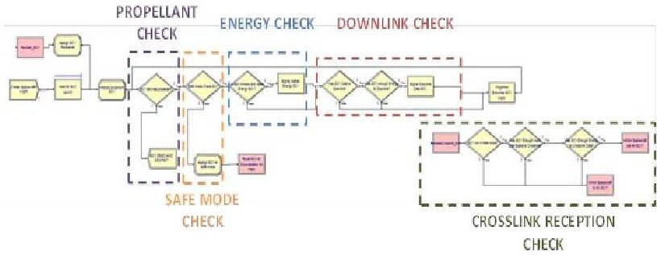

Figure 10 Excerpt of the ARENA Operations submodel (mothership case)

## 3.3 Cost Models

A number of cost models were needed to produce the real option values and the PSV's (and by extension the regret and percent regret values). These cost models also produced the IVM's that relate to costs. Table 2 shows each cost model and the IVM's it produces. Each model is summarized below and in Appendix B with screen views.

Table 2 F6 Cost Models Used and Their IVMs

<table border="1"><tr><td>Cost Model</td><td>Computed IVMs</td></tr><tr><td>QuickCost 5.0</td><td>Module DDT&amp;E Cost
Module TFU (Theoretical First Unit) Cost
Module Follow-On Unit Cost
FY DBATI Costs</td></tr><tr><td>LV Database</td><td>FY Launch Service Costs</td></tr><tr><td>Exploration
Architectures Operations
Cost Model (ExAOCM)
for DARPA</td><td>FY Operations Cost for
Deployed Architecture (Mission
Ops, Ground Ops, Sustaining
Engineering, Etc.)</td></tr></table>

QuickCost 5.0-This model is a statistically derived equation based on NASA Earth-orbiting spacecraft data. For the Base Period, this model was selected for its simplicity, license-free availability, and its superior performance compared to other, more complex NASA models. QuickCost 5.0 is implemented as an Excel $ \circ $ spreadsheet that also has the capability to apply user-provided learning rates, standard cost spreader parameters, and can allocate non-recurring and recurring costs to the appropriate fiscal years. Since QuickCost estimates costs for an entire module rather than separately for the constituent F6 components, it will be replaced in the future with constituent-specific models that are more suitable.

LV (Launch Vehicle) Database—This spreadsheet database derived from company websites and JPL experiences contains launch service costs, launch vehicle capability to low Earth orbit (LEO), and lead times by launch vehicle. The database is augmented with the capability to spread

launch services costs and allocate those costs to the appropriate fiscal years.

ExAOCM for DARPA-This model, built in Excel and Excel VBA, is a modified version of the operations cost model used to support NASA's human spaceflight program. ExAOCM is philosophically based on the DoD Architecture Framework (DoDAF) concepts of nodes, systems, operational functions, and milestones. This permits any architecture to be accurately represented and allows the user to estimate operations costs for alternative operations concepts and system evolution plans. The model produces fiscal year operations cost estimates against a user-specified operations work breakdown structure (WBS). In this Base Period version, the model contains simple algorithms based on what is largely the JPL operations concept for Earth orbiters. During the follow-on phase after the Base Period, the model will be modified to represent the evolving DARPA F6 operations concept.

## 3.4 PSV Model

The PSV model is a new construct in Excel and Excel VBA that calculates the expected nominal NPV and each real option value. The model requires cost outputs from the cost models above and simulation results from ARENA $ \circ $ in the form of data downlink quantities over time. As described earlier, the PSV model uses a Monte Carlo simulation to generate a large sample of NPV results, which are then averaged to produce the expected NPV in Eq. (1). For each real option value, the Monte Carlo simulation also generates the required stochastic terms in Eq. (2). The real option value, which by Eq. (2) is a constrained expected value, is established by averaging only the positive results and multiplying by the 'in-the-money" probability—that is, the probability of the real option value will exceed zero. Figure 11 presents the process for generating real option values from the geometric Brownian motion of the spot prices for down-linked data. Typically, the Monte Carlo simulation to set to run up to 10,000 trials depending on the time available and desired confidence levels.

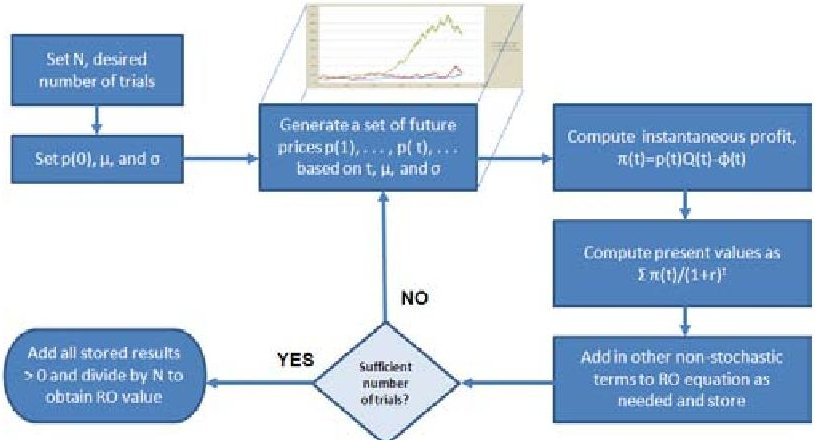

Figure 11 - Monte Carlo Simulation Process Used for Computing the Real Option Values and PSV's

<!-- PDF_PAGE: 9 -->

The real option values and PSV results are subsequently passed to the ATSV tradespace visualization tool, and can be fed forward to produce the regret and percent regret matrices. Example results are shown in Figures 12 and 13.

## 4. RESULTS TO DATE

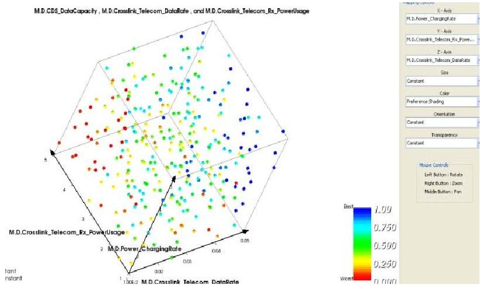

Figure 12 - Example tradespace generated for the N=3 case. Axes (x,y,z) are Cross-link Power Usage, Cross-link Data Rate, and Power provided by the solar array, respectively. The bluer the color the more preferable it is (preference determined by minimizing cost

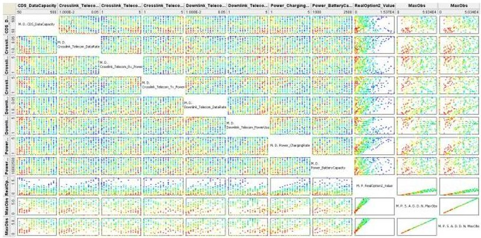

Figure 13 - Plot illustrating the correlations between various parameters. Note that some of those in the lower right illustrate strong correlations, some in the lower and right sides illustrate medium correlations, most of the rest resemble scatter plots and illustrate very little correlations

## 4.1 Model Data, Depth and Breadth Results

In the Base Period, models have been implemented for most of the key spacecraft functions. In particular, the functions required for interactions with other elements of the DARPA F6 Program have been incorporated first. These include capturing fuel usage for station keeping and scatter/re-gather maneuvers, and the de-orbiting of a module when its fuel is consumed. Launch manifesting for various module masses as determined by aggregating the contents of the modules was also implemented in this activity. We have accounted for a variety of mothership/ daughtership topologies and intercommunication modes including power usage and data storage. Numerous timing functions were included: sun windows and orbital period, several downlink stations, and

ground operations including durations for recovering from safe mode. Stochastic variables for each of the different development phases were developed to explicitly account for the times required to build, integrate and launch the modules.

The Business Case Tool also has stub models for many of the other traditional spacecraft elements (subsystems) which currently are used to help generate aggregate costs and masses. Design optimization models for both ACS and Telecomm were implemented so that the most influential requirements result in the selection of a subsystem which meets those requirements.

The primary goal of the Base Period F6 Program and this study was to provide comprehensive model definition for evaluation of alternative F6 architectures. At the same time, sufficient detail has been incorporated in order to notionally evaluate the F6 Business Case. The next phase of work will extend and complete the set of subsystem model stubs to extend the spacecraft configurations. Although the model data are notional, they are based on information from Spacecraft Design texts [7] and drawn from a variety cases utilized by JPL's Project Design Center.

In addition, we have defined the threads of calculation needed to produce the business case metrics and the intermediate IVM's and OVM's. We have also developed and demonstrated a federation of models capable of performing the calculations end-to-end. We have also produced a movie (available upon request) demonstrating the end-to-end process beginning with an abstract set of patterns and culminating in an executable ModelCenter model.

## 4.2 Business Case Results

The Business Case results encompass the entire process from architecture definition to spacecraft model creation, simulation, and evaluation of the Real Options. Recalling that Table 1 described candidate real options for a number of uncertain events, the results of one scenario were obtained using the uncertainty for user needs. In response to this uncertainty, the spacecraft clusters customers could place a value on the ability to switch payloads on a future launch. This value was computed by invoking the "switch payload" real option at the time the uncertainty arises within the simulation. This option allowed an alternative payload which produced Type A data, to be substituted for the original payload, which produced Type B data. Note that the option did not require that the substitution be made—it depends on the likelihoods of the event or pre-determination of the event occurrence. The scenario timeline is depicted graphically in Figure 14. At t=20 months, the real option is purchased, incurring some immediate costs, including the DBATI costs of the alternative payload. The first two launches (including a payload that produces Type C data) remain unaffected. The third launch, with either the original payload or the alternative, occurs at t=45 months.

<!-- PDF_PAGE: 10 -->

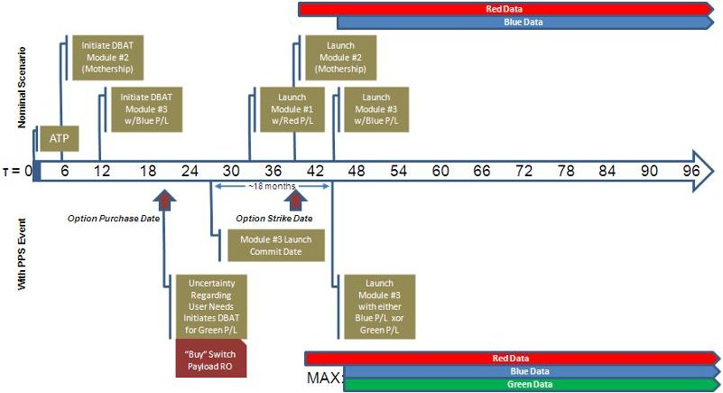

Figure 14 - Timeline of a Nominal PPS Event and Its Associated Embedded Real Option

Figure 12

The ARENA $ \circ $ discrete event simulation provided the quantity of downlinked data from the engineering characteristics of the spacecraft elements. The PSV model (see Appendix C) calculated the NPV of the nominal case. The nominal real option case was defined as launching the Type A and B data payloads, versus an alternative real option of an alternative launch of a Type A and C payload. The assumed market price attributes for this analysis scenario are shown in Table 3. Note that the data for the three different payload types were arbitrarily labeled Red, Blue and Green. These three types could represent wavelength types or differing classification levels.

Table 3 Assumed Market Attributes for Three Data Types

<table border="1"><tr><td></td><td>Red Data</td><td>Blue Date</td><td>Green Data</td></tr><tr><td>Initial Price ($FY11K/MB)</td><td>$100</td><td>$75</td><td>$50</td></tr><tr><td>Drift(per week)</td><td>0.0%</td><td>0.0%</td><td>0.1%</td></tr><tr><td>Volatility(weekly)</td><td>4.0%</td><td>3.0%</td><td>2.0%</td></tr></table>

In this 20-year scenario, a higher initial price and volatility was assumed for red data (reflective of high-priority data), and a small, but persistent, drift in the price of Type C data (indicating growth in value of that data over time). Figure 15 presents the results from the PSV model and although some of the Monte Carlo trials had negative nominal NPV's, over the large sample run, the expected value exceeded $108M (the bottom line). So here we see that the second launch, while expensive, actually yields an overall benefit due to the value of the additional red data gathered.

<table border="1"><tr><td>Scenario Parameter Name</td><td>Units</td><td>Value</td></tr><tr><td>Scenario ID</td><td></td><td>0</td></tr><tr><td>Simulation Duration</td><td>weeks</td><td>1040</td></tr><tr><td>Discount Rate</td><td>%/year</td><td>3.20%</td></tr><tr><td>Marginal Ops Cost (Nominal)</td><td>$FY11M/week</td><td>$1.45</td></tr><tr><td></td><td></td><td></td></tr><tr><td>Derived Parameter Name</td><td>Units</td><td>Value</td></tr><tr><td>ATP Date</td><td></td><td>10/1/2012</td></tr><tr><td>Payload launch occured here</td><td></td><td>7/6/2015</td></tr><tr><td>Mothership launch occured here</td><td></td><td>1/4/2016</td></tr><tr><td>Payload launch occured here</td><td></td><td>7/4/2016</td></tr><tr><td>Simulation End Date</td><td></td><td>9/6/2032</td></tr><tr><td>Operations Breakeven Week</td><td></td><td>525</td></tr><tr><td>PV_Nominal(Launch)</td><td>$FY11M</td><td>$(110.59)</td></tr><tr><td>PV_Nominal(DBATI)</td><td>$FY11M</td><td>$(286.16)</td></tr><tr><td>PV_Nominal(Operating Profit)</td><td>$FY11M</td><td>$18.97</td></tr><tr><td>NPV_Nominal</td><td>$FY11M</td><td>$(377.78)</td></tr><tr><td></td><td></td><td></td></tr><tr><td></td><td></td><td></td></tr><tr><td></td><td></td><td></td></tr><tr><td>Expected NPV_Nominal</td><td>$FY11M</td><td>$107.75</td></tr></table>

Figure 15 - Sample Results from the PSV Model Showing Expected NPV for the Nominal Case

Figure 13

The option value results are shown in Figure 16. With an option value over $62M,the PSV of this scenario (with just one uncertainty in the PPS) was over $170M. Note that the PSV model also computed the probability that the real option would actually pay off at only 16%. However, with only a modest investment, the potential improvement in NPV was still very high.

<table border="1"><tr><td>Scenario Parameter Name</td><td>Units</td><td>Value</td></tr><tr><td>Scenario ID</td><td></td><td>1</td></tr><tr><td>Option Penalty</td><td>$FY11M</td><td>$10.00</td></tr><tr><td>Ops Cost Multiplier</td><td></td><td>1.25</td></tr><tr><td>Derived Parameter Name</td><td>Units</td><td>Value</td></tr><tr><td>ATP Date</td><td></td><td>10/1/2012</td></tr><tr><td>Payload launch occured here</td><td></td><td>7/6/2015</td></tr><tr><td>Mothership launch occured here</td><td></td><td>1/4/2016</td></tr><tr><td>Payload launch occured here</td><td></td><td>7/4/2016</td></tr><tr><td>Option Purchase Date</td><td></td><td>6/2/2014</td></tr><tr><td>Option Strike Date</td><td></td><td>7/6/2015</td></tr><tr><td>Simulation End Date</td><td></td><td>9/6/2032</td></tr><tr><td>Operating Breakeven Week</td><td></td><td>619</td></tr><tr><td>Discount(Purchase-ATP)</td><td></td><td>0.948008528</td></tr><tr><td>PV_Option(Operating Profit)</td><td>$FY11M</td><td>$(110.79)</td></tr><tr><td>PV_Payload_Delta(DBATI)</td><td>$FY11M</td><td>$(25.00)</td></tr><tr><td>Option Breakeven Draw</td><td>$FY11M</td><td>$(164.24)</td></tr><tr><td></td><td></td><td></td></tr><tr><td></td><td></td><td></td></tr><tr><td></td><td></td><td></td></tr><tr><td>ERO Name</td><td>Units</td><td>Value</td></tr><tr><td>Option to Switch Payloads</td><td>$FY11M</td><td>$62.37</td></tr><tr><td>"In-the-Money" Probability</td><td></td><td>0.16</td></tr></table>

Figure 16 - Sample Results from the PSV Model Showing the Real Option Value for the "Switch Payload" Case

<!-- PDF_PAGE: 11 -->

## 5. DISCUSSION AND OBSERVATIONS

The results are illustrative, but demonstrate the analytic richness of our approach. The 20-year simulation to compute both the nominal NPV and real option value required roughly one second of run time per trial. While that is certainly tolerable at this phase, populating the tradespace to consider multiple cluster variants, multiple parameter sets, scenarios (PPS's) with multiple uncertainties, and thousands of Monte Carlo trials per real option, could require substantial computing power. Numerous opportunities for streamlining the end-to-end computation process were identified to anticipate how these additional computations would be performed efficiently. Nonetheless, the next phase following the Base Period should focus on completing additional spacecraft modules in tandem with collection of representative "study concept" data to calibrate the emerging F6 concepts.

During the course of the Base Period study a number of achievements have been made:

2. The important features necessary for evaluating the F6 Business Case have been developed in order to address:

1. A comprehensive tool for evaluating and comparing the Base Period Business Case architectures programmatically, technically, and economically.

a. Uncertain events during the development life-cycle (real options and PPS's)

b. Specification of architecture variants through the specification of IVR's and OVR's.

c. Automatic configuration of F6 spacecraft configurations via SysML and ModelCenter components.

d. Dynamic simulation of cluster module development and operations under uncertain events using discrete event simulation (DES) and automatic generation of appropriate ARENA models.

e. Metrics have been defined to compare architectural variants based on Project Strategic Value, PSV, that enables choices to be compared based on the Minimax regret criterion.

3. An end-to-end example has been demonstrated using the tools developed in this study for a typical real option. Additional options would be added in the next development phase.

complex scenarios from the primitive stimuli and response considered during this Base Period.

4. The stubs and hooks that would extend the PSV tool were incorporated during the development to facilitate the extension of the tool in the next phase of development. This includes composing more

5. The stubs and hooks that would enable more detailed subsystem models have been included and model elaboration will be driven by the trades identified as useful by the other F6 team members.

6. Finally the methodology for evaluating a collection of configurations, design choices and scenarios for the F6 Program is readily extensible to other use cases including specific mission design and trade studies and mission portfolio evaluations.

## ACKNOWLEDGEMENTS

The authors would like to acknowledge the many helpful discussions and guidance from Mr. Paul Eremenko and Dr. Owen Brown. We would also like to thank them for their vision in conceiving of a fractionated architecture and their persistence and determination in converting that vision into an executable DARPA Program. We would also like to thank Jeff H. Smith for invaluable editorial comments.

## REFERENCES

[1] Schwartz, E.S. and L. Trigeorgis, Eds. Real Options and Investment Under Uncertainty-Classical Readings and Recent Contributions, The MIT Press, Cambridge, MA 2001

[2] Clemons, R.T., Making Hard Decisions-An Introduction to Decision Analysis, Duxbury Press, Belmont, CA, 1990

[3] Silver, M.R. and O.L. deWeck, "Time-Expanded Decision Networks: A Framework for Designing Evolvable Complex Systems," Systems Engineering, Vol. 10, No. 2, 2007, pp. 167-186

[4] Hull, J.C., Options, Futures, and Other Derivatives, $ 3^{rd} $ Ed., Prentice-Hall Inc., Upper Saddle River, NJ, 1997

[5] see http://www.phoenix-int.com/

[6] See www.ArenaSimulation.com for more details

[7] e.g. Wertz, J.R. and W.J. Larson (eds.), Space Mission Analysis and Design, $ 3^{\mathrm{rd}} $ Edition, Springer, New York, NY, 1999

<!-- PDF_PAGE: 12 -->

## BIOGRAPHIES

Dr. Robert Shishko is currently a Principal Systems Engineer and Economist at the Jet Propulsion Laboratory (JPL), California Institute of Technology, and serves on the adjunct faculty of the International Space University (Strasbourg, FR). Dr. Shishko received two S.B. degrees from M.I.T., and his M.Phil. and Ph.D.

in economics from Yale University. He has been at JPL since 1983, and has worked on a variety of NASA programs and projects, including Constellation, International Space Station, Mars Pathfinder, and JPL's Project Design Center. Dr. Shishko served as task manager and principal contributor to the NASA Systems Engineering Handbook (SP-6105). He has contributed to several books in the Space Technology book series, including "Applied Space Systems Engineering," "Human Spaceflight Mission Analysis and Design." Prior to JPL, Dr. Shishko worked at the Rand Corporation on a variety of defense resource allocation and logistics issues.

Dr. Bjorn Cole is a systems engineer in the Mission Systems Concepts section of the Jet Propulsion Laboratory. His research interests are in the fields of design space exploration, visualization, multidisciplinary analysis and optimization, concept formulation, architectural design methods technology planning, and more

recently, model-based systems engineering. His most recent body of work concerns the infusion of systems modeling as a data structure into multidisciplinary analysis and architectural characterization. He earned his Ph.D. and M.S. degrees in Aerospace Engineering at the Georgia Institute of Technology and his B.S. in Aeronautics and Astronautics at the University of Washington.

Dr. Steven Cornford is a Senior Engineer in the System Modeling and Analysis Program Office and teaches Technology Infusion and Task Management. Since coming to JPL, Dr. Cornford has had delivery

responsibilities from system to component level spacecraft design, spanning the lifecycle from Pre- Formulation to Flight Operations. He has developed and implemented a Physics-of-Failure-based approach to

Reliability Engineering and Qualification Test design, established a Reliability Assurance Testing laboratory and developed a tool/process for implementing risk- and resource-based development of spacecraft and its components. He was the Flight Instrument System Engineer for ST-3 and has served in several line management functions. Current work includes implementing a process for systematically maturing technologies (TIMA), and development and prototyping of techniques for using risk-, and evidence-based design and model elaboration in a concurrent, collaborative environment. He has been awarded the NASA Exceptional Service Medal and received several JPL awards for "working across Division boundaries" and has authored numerous papers.

Dr. Greg Dubos is a Systems Engineer in the Mission Systems Concept Section at the Jet Propulsion Laboratory (JPL). Dr. Dubos received his B.S and M.S degrees in Aeronautics from SUPAERO, Toulouse, France, and his M.S and Ph.D. in Aerospace Engineering from the Georgia

Institute of Technology. Prior to JPL, he worked in the Mission Systems Engineering section at Ball Aerospace, in the Mission Design Center at NASA Ames, and in the Mission Analysis Office at the European Space Agency (ESA-ESOC). He has authored several journal publications on the topics of technology maturation, schedule risk and risk of obsolescence of space systems, and was a contributing author for the "Encyclopedia of Aerospace Engineering" (Wiley&Sons) and "Spacecraft Reliability and Multi-State Failures, A Statistical Approach" (Wiley&Sons).

Mr. Bryce Durham is an Application Engineer at Phoenix Integration. He has extensive experience in integrating and automating engineering analysis codes. He architects and implements custom solutions built on Phoenix Integration's Analysis

Server and ModelCenter products. Bryce has previous experience in aircraft concept design and configuration layout at Cessna Aircraft Company. He has a BS in Aerospace Engineering from The Pennsylvania State University (2005).

Dr. Steven Jenkins is a Principal Engineer in the Systems and Software Division at the Jet Propulsion Laboratory, currently supporting JPL's Integrated Model-Centric Engineering Initiative. His interests include application of semantic and modeling

<!-- PDF_PAGE: 13 -->

technologies to systems engineering. Dr. Jenkins holds a B.S. in Mathematics from Millsaps College, an M.S. In Applied Mathematics from Southern Methodist University, and a Ph.D. In Electrical Engineering (Control Systems) from UCLA.

Dr. Nicolas Rouquette is a principal member of the technical staff at the Jet Propulsion Laboratory of the California Institute of Technology in Pasadena, California. He holds an engineering diploma from ESIEE in Paris and a Ph.D. in Computer Science from the University of Southern California. He is a member of NASA's

Engineering Safety Center's Technical Discipline Team in software where he represents NASA's interests at the OMG on the development and definition of the UML specification. He is key a contributor to the "Executable UML" specification for the OMG. Nicolas is a member of the IEEE and of the Association for Symbolic Logic and a senior member of the ACM. At JPL, Nicolas was the lead software engineer for the fault protection software for the Deep Space 1 mission. Nicolas has been a key member of the Mission Data System project at JPL where he pioneered advanced component-oriented software development techniques and frameworks for flight software. In recent years, Nicolas' attention has focused on infusing lightweight formal specification techniques to improve systems and software engineering practices.

Mr. Tyler Ryan attended South Pasadena high school, graduated 2010. He is currently in the UCLA class of 2014, and is a 2nd year Physics major. He spent the summer of 2011 at JPL

working with Arena and JPL team. He is interested in computer modeling, discrete event simulation, physics applications and engineering.

Mr. Steve Wall is a Principal Engineer at JPL in the System Modeling and Analysis Program Office, and teaches System Engineering and Program Management In the past, Steve has led JPL's Center of Excellence for Space mission Architecture and Design, he created the Journal for Space Mission Architecture, co-

designed and led the Advanced Projects Design Team (Team X), managed programs in advanced design for the NRO and participated in seven NASA space missions.

Steve has published over 95 papers in the scientific and technical literature and in the popular press. He is a Senior Member of IEEE and has been awarded the NASA Exceptional Achievement Medal, Exceptional Service Medal and ten NASA Group Achievement Awards.

Mr. Pez Zarifian is a Deputy Systems Engineer in JPL's concurrent engineering Advanced Projects Design Team (Team X). He holds a B.S. in Aerospace Engineering and a M.S. in Astronautical Engineering from University of Southern California (USC). Prior to his involvement with formulation activities, Mr. Zarifian

was a member of the I&T team for JPL's PMD project and was awarded a Certificate of Achievement for Delivery of PMD flight hardware. Prior to JPL, Mr. Zarifian was actively involved in a number of projects at USC's Information Sciences Institute and participated in the structural design and fabrication of flight hardware for SmallSat and CubeSat missions.

<!-- PDF_PAGE: 14 -->

# APPENDIX A Decision Tree Representations of Embedded Real Option

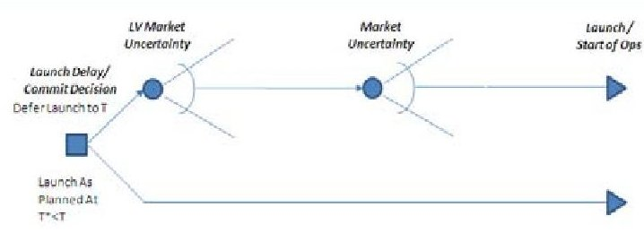

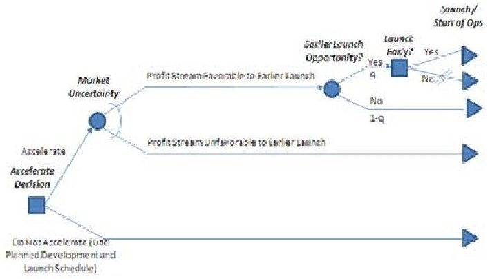

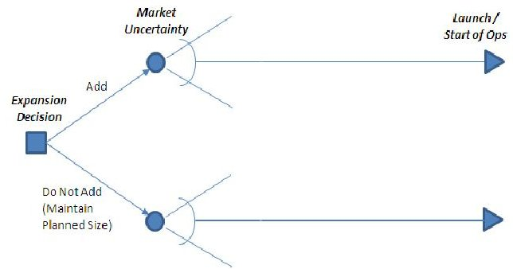

Option to Delay Launch w/LV Cost and Market Volatility (Supply Chain Delay)

Decision at time t to delay launch to time T based on the projected launch price at time T and discounted return beyond time T. The nominal launch time was $ T^{*}<T $ ; a launch delay penalty is (may be) incurred at time $ T^{*} $ .

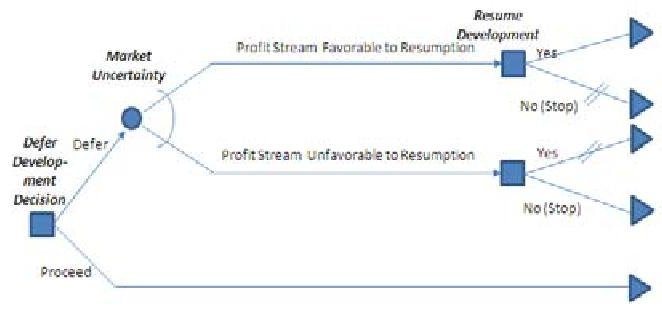

## Option to Accelerate Spacecraft Development Depending on Market Conditions (Change in User Needs or Funding)

Decision at time t to accelerate the development time allowing an earlier launch at time $ T_{\mathrm{early}} $ based on the projected discounted returns from $ T_{\mathrm{early}} $ to T.

An acceleration penalty is (may be) incurred at time t. To take advantage of this option, an earlier launch opportunity must be available; this occurs with probability q; a subsequent early launch premium is incurred at time $ T_{\mathrm{early}} $

Option to Expand Depending on Market Conditions (User Needs or Change in Funding)

Decision at time t to expand the program at time T (i.e., to add a spacecraft) based on a projected discounted return beyond time T.

An augmentation penalty is (may be) incurred at time T resulting from the expansion.

## Option to Defer Development Depending on Market Conditions (Change in User Needs or Funding)

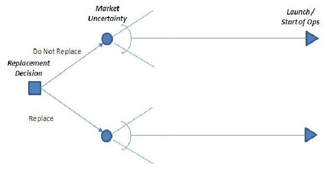

Decision at time t to defer development until $ T_{\mathrm{resume}} $ based on the projected discounted returns. The nominal launch time was time T and the deferred launch is at time $ \mathrm{T}+(\mathrm{T}_{\mathrm{resume}}-\mathrm{t}). $

Development costs are unchanged, but shifted in time. A defer penalty is (may be) incurred at time t; launch cost are unaffected, but the defer penalty could include launch postponement costs.

Option to Not Replace Following Loss of Spacecraft Decision at time t not to replace a lost spacecraft at time T.

A replacement penalty includes any new development, production, and launch costs less insurance.

<!-- PDF_PAGE: 15 -->

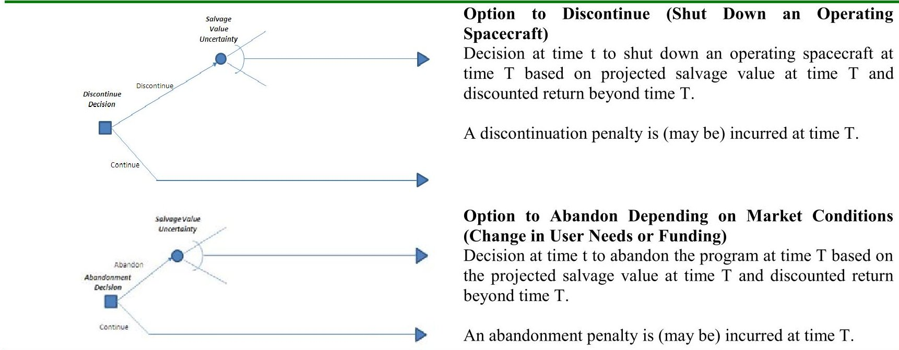

<!-- PDF_PAGE: 16 -->

# \Screen Shots of Cost Models

Exploration Architectures Operations Cost Model for DARPA

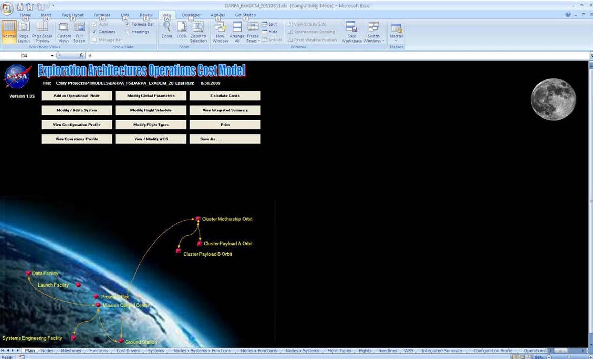

QuickCost v.5.0

<table class="table table-bordered"><thead><tr><th rowspan="2">Input Variable Name</th><th rowspan="2">Value</th><th rowspan="2">Units</th><th rowspan="2">Description for User</th><th colspan="6">QuickCost Database Statistics</th></tr><tr><th>Minimum</th><th>1st Quartile (25%)</th><th>Median</th><th>Mean</th><th>2nd Quartile (75%)</th><th>Maximum</th></tr></thead><tbody><tr><td>ATP Variable</td><td>52</td><td></td><td>Authority to Proceed date in 4 digit Calendar Year (20XX-1960)</td><td>Jan-61</td><td>Aug-73</td><td>Oct-90</td><td>Oct-90</td><td>May-97</td><td>Sep-06</td></tr><tr><td>LifeMonths</td><td>120 months</td><td></td><td>Advertised design life</td><td>4</td><td>24</td><td>36</td><td>43</td><td>60</td><td>180</td></tr><tr><td>InstComp</td><td>20%</td><td></td><td>Total instrument suite complexity in percent from 0% to 100%</td><td>0%</td><td>25%</td><td>50%</td><td>50%</td><td>75%</td><td>100%</td></tr><tr><td>TotalDryMass</td><td>300 kg</td><td></td><td>Total mass of total spacecraft bus and instruments</td><td>64.0</td><td>343.3</td><td>621.5</td><td>1149.0</td><td>1176.9</td><td>14475.4</td></tr><tr><td>Power_BOL</td><td>700 W</td><td></td><td>Total power generated in LEO equivalent at beginning of life</td><td>52</td><td>349</td><td>700</td><td>1179</td><td>1330</td><td>10000</td></tr><tr><td>BusNew</td><td>60%</td><td></td><td>Total bus new design in percent from 0% to 100%</td><td>20%</td><td>50%</td><td>60%</td><td>59%</td><td>70%</td><td>95%</td></tr><tr><td>InstNew</td><td>20%</td><td></td><td>Total instrument suite new design in percent from 0% to 100% (weighted average of all instruments using same scale as bus)</td><td>30%</td><td>70%</td><td>80%</td><td>77%</td><td>90%</td><td>100%</td></tr><tr><td>Output Variable Name</td><td>Value</td><td>Units</td><td>Description for User</td><td></td><td></td><td></td><td></td><td></td><td></td></tr><tr><td>Total_Cost</td><td>$254.60</td><td>SFY11M</td><td>Total expected DDT&amp;E and TFU production cost for spacecraft and payload</td><td></td><td></td><td></td><td></td><td></td><td></td></tr><tr><td>DDT_E_Cost</td><td>$190.95</td><td>SFY11M</td><td>Expected DDT&amp;E cost for spacecraft and payload</td><td></td><td></td><td></td><td></td><td></td><td></td></tr><tr><td>TFU_Cost</td><td>$63.65</td><td>SFY11M</td><td>Expected TFU production cost for spacecraft and payload</td><td></td><td></td><td></td><td></td><td></td><td></td></tr><tr><td>Intermediate Outputs</td><td>Value</td><td>Units</td><td>Description for User</td><td></td><td></td><td></td><td></td><td></td><td></td></tr><tr><td>Median_Total_Cost</td><td>$69.48</td><td>SFY04M</td><td>Results from QuickCost regression equation, which produces the expected value of ln(cost).</td><td></td><td></td><td></td><td></td><td></td><td></td></tr><tr><td>85th_Percentile_Cost</td><td>$305.57</td><td>SFY04M</td><td>Median + TINV((1-0.85)*2, regression dof)* SEE</td><td></td><td></td><td></td><td></td><td></td><td></td></tr><tr><td>Cost_Sigma</td><td>1.48</td><td></td><td>ln(85th_Percentile_Cost/Median_Total_Cost)</td><td></td><td></td><td></td><td></td><td></td><td></td></tr></tbody></table>

<!-- PDF_PAGE: 17 -->

<table class="table table-bordered"><thead><tr><th>LV ID</th><th>LED Payload Capability (kg)</th><th>Incubation (deg)</th><th>Load Time (mo)</th><th>Launch Vehicle Name</th><th>Price/Launch, $FY1M</th></tr></thead><tbody><tr><td>1</td><td>180</td><td>28.5</td><td>Falcon II</td><td>$22.0</td><td></td></tr><tr><td>2</td><td>10050</td><td>28.5</td><td>Falcon II</td><td>$18.0</td><td></td></tr><tr><td>3</td><td>405</td><td>28</td><td>Tigers</td><td>$36.0</td><td></td></tr><tr><td>4</td><td>544</td><td>20</td><td>Progus II-C Star 24C</td><td>$42.5</td><td></td></tr><tr><td>5</td><td>544</td><td>20</td><td>Progus II-C Star 27</td><td>$40.0</td><td></td></tr><tr><td>6</td><td>1620</td><td>28.5</td><td>Tigers</td><td>$28.0</td><td></td></tr><tr><td>7</td><td>1905</td><td>28.5</td><td>Tigers XL, Star 270FP</td><td>$90.2</td><td></td></tr><tr><td>8</td><td>1880</td><td>28.5</td><td>Tigers XL, Star 270FP</td><td>$90.0</td><td></td></tr></tbody></table>

# APPENDIX C Present Strategic Value Model

## Nominal Case Screen Shot

<table class="table table-bordered"><thead><tr><th>Scenario Events</th><th>Simulation Week</th><th>Simulation Time (Hours)</th><th>Fir Data Cumulative Data Downlinked [MB]</th><th>Blue Data Cumulative Data Downlinked [MB]</th><th>Green Data Cumulative Data Downlinked [MB]</th><th>Red Data Incremental Data Downlinked [MB]</th><th>Blue Data Incremental Data Downlinked [MB]</th><th>Green Data Incremental Data Downlinked [MB]</th><th>Red Data Price From GBM [UK/MI]</th><th>Red Data Adjusted Price [UK/MI]</th><th>Red Data Revenue [£M]</th><th>Blue Data Price From GBM [UK/MI]</th><th>Blue Data Adjusted Price [UK/MI]</th><th>Blue Data Revenue [£M]</th><th>Green Data Price From GBM [UK/MI]</th><th>Green Data Adjusted Price [UK/MI]</th><th>Green Data Revenue [£M]</th></tr></thead><tbody><tr><td>14.4 Pagoad launch incurred here</td><td>14</td><td>24092</td><td>0.0</td><td>0.0</td><td>0.0</td><td>0.0</td><td>0.0</td><td>0.0</td><td>76.66</td><td></td><td></td><td>84.56</td><td></td><td></td><td></td><td></td><td></td></tr><tr><td>14.5 Pagoad launch incurred here</td><td>14</td><td>24093</td><td>0.0</td><td>0.0</td><td>0.0</td><td>0.0</td><td>0.0</td><td>0.0</td><td>76.66</td><td></td><td></td><td>84.56</td><td></td><td></td><td></td><td></td><td></td></tr><tr><td>14.6 Pagoad launch incurred here</td><td>14</td><td>24094</td><td>0.0</td><td>0.0</td><td>0.0</td><td>0.0</td><td>0.0</td><td>0.0</td><td>76.66</td><td></td><td></td><td>84.56</td><td></td><td></td><td></td><td></td><td></td></tr><tr><td>14.7 Pagoad launch incurred here</td><td>14</td><td>24095</td><td>0.0</td><td>0.0</td><td>0.0</td><td>0.0</td><td>0.0</td><td>0.0</td><td>76.67</td><td></td><td></td><td>84.56</td><td></td><td></td><td></td><td></td><td></td></tr><tr><td>14.8 Pagoad launch incurred here</td><td>14</td><td>24096</td><td>0.0</td><td>0.0</td><td>0.0</td><td>0.0</td><td>0.0</td><td>0.0</td><td>76.67</td><td></td><td></td><td>84.56</td><td></td><td></td><td></td><td></td><td></td></tr><tr><td>14.9 Pagoad launch incurred here</td><td>14</td><td>24097</td><td>0.0</td><td>0.0</td><td>0.0</td><td>0.0</td><td>0.0</td><td>0.0</td><td>76.67</td><td></td><td></td><td>84.56</td><td></td><td></td><td></td><td></td><td></td></tr><tr><td>15.0 Pagoad launch incurred here</td><td>14</td><td>24098</td><td>0.0</td><td>0.0</td><td>0.0</td><td>0.0</td><td>0.0</td><td>0.0</td><td>76.67</td><td></td><td></td><td>84.56</td><td></td><td></td><td></td><td></td><td></td></tr><tr><td>15.1 Pagoad launch incurred here</td><td>14</td><td>24099</td><td>0.0</td><td>0.0</td><td>0.0</td><td>0.0</td><td>0.0</td><td>0.0</td><td>76.67</td><td></td><td></td><td>84.56</td><td></td><td></td><td></td><td></td><td></td></tr><tr><td>15.2 Pagoad launch incurred here</td><td>14</td><td>24099</td><td>0.0</td><td>0.0</td><td>0.0</td><td>0.0</td><td>0.0</td><td>0.0</td><td>76.67</td><td></td><td></td><td>84.56</td><td></td><td></td><td></td><td></td><td></td></tr><tr><td>15.3 Pagoad launch incurred here</td><td>14</td><td>24099</td><td>0.0</td><td>0.0</td><td>0.0</td><td>0.0</td><td>0.0</td><td>0.0</td><td>76.67</td><td></td><td></td><td>84.56</td><td></td><td></td><td></td><td></td><td></td></tr><tr><td>15.4 Pagoad launch incurred here</td><td>14</td><td>24099</td><td>0.0</td><td>0.0</td><td>0.0</td><td>0.0</td><td>0.0</td><td>0.0</td><td>76.67</td><td></td><td></td><td>84.56</td><td></td><td></td><td></td><td></td><td></td></tr><tr><td>15.5 Pagoad launch incurred here</td><td>14</td><td>24099</td><td>0.0</td><td>0.0</td><td>0.0</td><td>0.0</td><td>0.0</td><td>0.0</td><td>76.67</td><td></td><td></td><td>84.56</td><td></td><td></td><td></td><td></td><td></td></tr><tr><td>15.6 Pagoad launch incurred here</td><td>14</td><td>24099</td><td>0.0</td><td>0.0</td><td>0.0</td><td>0.0</td><td>0.0</td><td>0.0</td><td>76.67</td><td></td><td></td><td>84.56</td><td></td><td></td><td></td><td></td><td></td></tr><tr><td>15.7 Pagoad launch incurred here</td><td>14</td><td>24099</td><td>0.0</td><td>0.0</td><td>0.0</td><td>0.0</td><td>0.0</td><td>0.0</td><td>76.67</td><td></td><td></td><td>84.56</td><td></td><td></td><td></td><td></td><td></td></tr><tr><td>15.8 Pagoad launch incurred here</td><td>14</td><td>24099</td><td>0.0</td><td>0.0</td><td>0.0</td><td>0.0</td><td>0.0</td><td>0.0</td><td>76.67</td><td></td><td></td><td>84.56</td><td></td><td></td><td></td><td></td><td></td></tr><tr><td>15.9 Pagoad launch incurred here</td><td>14</td><td>24099</td><td>0.0</td><td>0.0</td><td>0.0</td><td>0.0</td><td>0.0</td><td>0.0</td><td>76.67</td><td></td><td></td><td>84.56</td><td></td><td></td><td></td><td></td><td></td></tr><tr><td>16.0 Pagoad launch incurred here</td><td>14</td><td>24099</td><td>0.0</td><td>0.0</td><td>0.0</td><td>0.0</td><td>0.0</td><td>0.0</td><td>76.67</td><td></td><td></td><td>84.56</td><td></td><td></td><td></td><td></td><td></td></tr><tr><td>16.1 Pagoad launch incurred here</td><td>14</td><td>24099</td><td>0.0</td><td>0.0</td><td>0.0</td><td>0.0</td><td>0.0</td><td>0.0</td><td>76.67</td><td></td><td></td><td>84.56</td><td></td><td></td><td></td><td></td><td></td></tr><tr><td>16.2 Pagoad launch incurred here</td><td>14</td><td>24099</td><td>0.0</td><td>0.0</td><td>0.0</td><td>0.0</td><td>0.0</td><td>0.0</td><td>76.67</td><td></td><td></td><td>84.56</td><td></td><td></td><td></td><td></td><td></td></tr><tr><td>16.3 Pagoad launch incurred here</td><td>14</td><td>24099</td><td>0.0</td><td>0.0</td><td>0.0</td><td>0.0</td><td>0.0</td><td>0.0</td><td>76.67</td><td></td><td></td><td>84.56</td><td></td><td></td><td></td><td></td><td></td></tr><tr><td>16.4 Pagoad launch incurred here</td><td>14</td><td>24099</td><td>0.0</td><td>0.0</td><td>0.0</td><td>0.0</td><td>0.0</td><td>0.0</td><td>76.67</td><td></td><td></td><td>84.56</td><td></td><td></td><td></td><td></td><td></td></tr><tr><td>16.5 Pagoad launch incurred here</td><td>14</td><td>24099</td><td>0.0</td><td>0.0</td><td>0.0</td><td>0.0</td><td>0.0</td><td>0.0</td><td>76.67</td><td></td><td></td><td>84.56</td><td></td><td></td><td></td><td></td><td></td></tr><tr><td>16.6 Pagoad launch incurred here</td><td>14</td><td>24099</td><td>0.0</td><td>0.0</td><td>0.0</td><td>0.0</td><td>0.0</td><td>0.0</td><td>76.67</td><td></td><td></td><td>84.56</td><td></td><td></td><td></td><td></td><td></td></tr><tr><td>16.7 Pagoad launch incurred here</td><td>14</td><td>24099</td><td>0.0</td><td>0.0</td><td>0.0</td><td>0.0</td><td>0.0</td><td>0.0</td><td>76.67</td><td></td><td></td><td>84.56</td><td></td><td></td><td></td><td></td><td></td></tr><tr><td>16.8 Pagoad launch incurred here</td><td>14</td><td>24099</td><td>0.0</td><td>0.0</td><td>0.0</td><td>0.0</td><td>0.0</td><td>0.0</td><td>76.67</td><td></td><td></td><td>84.56</td><td></td><td></td><td></td><td></td><td></td></tr><tr><td>16.9 Pagoad launch incurred here</td><td>14</td><td>24099</td><td>0.0</td><td>0.0</td><td>0.0</td><td>0.0</td><td>0.0</td><td>0.0</td><td>76.67</td><td></td><td></td><td>84.56</td><td></td><td></td><td></td><td></td><td></td></tr><tr><td>170 Pagoad launch incurred here</td><td>170</td><td>24099</td><td>0.0</td><td>0.0</td><td>0.0</td><td>0.0</td><td>0.0</td><td>0.0</td><td>76.67</td><td></td><td></td><td>84.56</td><td></td><td></td><td></td><td></td><td></td></tr><tr><td>171 Pagoad launch incurred here</td><td>170</td><td>24099</td><td>0.0</td><td>0.0</td><td>0.0</td><td>0.0</td><td>0.0</td><td>0.0</td><td>76.67</td><td></td><td></td><td>84.56</td><td></td><td></td><td></td><td></td><td></td></tr><tr><td>172 Pagoad launch incurred here</td><td>170</td><td>24099</td><td>0.0</td><td>0.0</td><td>0.0</td><td>0.0</td><td>0.0</td><td>0.0</td><td>76.67</td><td></td><td></td><td>84.56</td><td></td><td></td><td></td><td></td><td></td></tr><tr><td>173 Pagoad launch incurred here</td><td>170</td><td>24099</td><td>0.0</td><td>0.0</td><td>0.0</td><td>0.0</td><td>0.0</td><td>0.0</td><td>76.67</td><td></td><td></td><td>84.56</td><td></td><td></td><td></td><td></td><td></td></tr><tr><td>174 Pagoad launch incurred here</td><td>170</td><td>24099</td><td>0.0</td><td>0.0</td><td>0.0</td><td>0.0</td><td>0.0</td><td>0.0</td><td>76.67</td><td></td><td></td><td>84.56</td><td></td><td></td><td></td><td></td><td></td></tr><tr><td>175 Pagoad launch incurred here</td><td>170</td><td>24099</td><td>0.0</td><td>0.0</td><td>0.0</td><td>0.0</td><td>0.0</td><td>0.0</td><td>76.67</td><td></td><td></td><td>84.56</td><td></td><td></td><td></td><td></td><td></td></tr><tr><td>176 Pagoad launch incurred here</td><td>170</td><td>24099</td><td>0.0</td><td>0.0</td><td>0.0</td><td>0.0</td><td>0.0</td><td>0.0</td><td>76.67</td><td></td><td></td><td>84.56</td><td></td><td></td><td></td><td></td><td></td></tr><tr><td>177 Pagoad launch incurred here</td><td>170</td><td>24099</td><td>0.0</td><td>0.0</td><td>0.0</td><td>0.0</td><td>0.0</td><td>0.0</td><td>76.67</td><td></td><td></td><td>84.56</td><td></td><td></td><td></td><td></td><td></td></tr><tr><td>178 Pagoad launch incurred here</td><td>170</td><td>24099</td><td>0.0</td><td>0.0</td><td>0.0</td><td>0.0</td><td>0.0</td><td>0.0</td><td>76.67</td><td></td><td></td><td>84.56</td><td></td><td></td><td></td><td></td><td></td></tr><tr><td>179 Pagoad launch incurred here</td><td>170</td><td>24099</td><td>0.0</td><td>0.0</td><td>0.0</td><td>0.0</td><td>0.0</td><td>0.0</td><td>76.67</td><td></td><td></td><td>84.56</td><td></td><td></td><td></td><td></td><td></td></tr><tr><td>180 Pagoad launch incurred here</td><td>170</td><td>24099</td><td>0.0</td><td>0.0</td><td>0.0</td><td>0.0</td><td>0.0</td><td>0.0</td><td>76.67</td><td></td><td></td><td>84.56</td><td></td><td></td><td></td><td></td><td></td></tr><tr><td>181 Pagoad launch incurred here</td><td>170</td><td>24099</td><td>0.0</td><td>0.0</td><td>0.0</td><td>0.0</td><td>0.0</td><td>0.0</td><td>76.67</td><td></td><td></td><td>84.56</td><td></td><td></td><td></td><td></td><td></td></tr><tr><td>182 Pagoad launch incurred here</td><td>170</td><td>24099</td><td>0.0</td><td>0.0</td><td>0.0</td><td>0.0</td><td>0.0</td><td>0.0</td><td>76.67</td><td></td><td></td><td>84.56</td><td></td><td></td><td></td><td></td><td></td></tr><tr><td>183 Pagoad launch incurred here</td><td>170</td><td>24099</td><td>0.0</td><td>0.0</td><td>0.0</td><td>0.0</td><td>0.0</td><td>0.0</td><td>76.67</td><td></td><td></td><td>84.56</td><td></td><td></td><td></td><td></td><td></td></tr><tr><td>184 Pagoad launch incurred here</td><td>170</td><td>24099</td><td>0.0</td><td>0.0</td><td>0.0</td><td>0.0</td><td>0.0</td><td>0.0</td><td>76.67</td><td></td><td></td><td>84.56</td><td></td><td></td><td></td><td></td><td></td></tr><tr><td>185 Pagoad launch incurred here</td><td>170</td><td>24099</td><td>0.0</td><td>0.0</td><td>0.0</td><td>0.0</td><td>0.0</td><td>0.0</td><td>76.67</td><td></td><td></td><td>84.56</td><td></td><td></td><td></td><td></td><td></td></tr><tr><td>186 Pagoad launch incurred here</td><td>170</td><td>24099</td><td>0.0</td><td>0.0</td><td>0.0</td><td>0.0</td><td>0.0</td><td>0.0</td><td>76.67</td><td></td><td></td><td>84.56</td><td></td><td></td><td></td><td></td><td></td></tr><tr><td>187 Pagoad launch incurred here</td><td>170</td><td>24099</td><td>0.0</td><td>0.0</td><td>0.0</td><td>0.0</td><td>0.0</td><td>0.0</td><td>76.67</td><td></td><td></td><td>84.56</td><td></td><td></td><td></td><td></td><td></td></tr><tr><td>188 Pagoad launch incurred here</td><td>170</td><td>24099</td><td>0.0</td><td>0.0</td><td>0.0</td><td>0.0</td><td>0.0</td><td>0.0</td><td>76.67</td><td></td><td></td><td>84.56</td><td></td><td></td><td></td><td></td><td></td></tr><tr><td>189 Pagoad launch incurred here</td><td>170</td><td>24099</td><td>0.0</td><td>0.0</td><td>0.0</td><td>0.0</td><td>0.0</td><td>0.0</td><td>76.67</td><td></td><td></td><td>84.56</td><td></td><td></td><td></td><td></td><td></td></tr><tr><td>190 Pagoad launch incurred here</td><td>170</td><td>24099</td><td>0.0</td><td>0.0</td><td>0.0</td><td>0.0</td><td>0.0</td><td>0.0</td><td>76.67</td><td></td><td></td><td>84.56</td><td></td><td></td><td></td><td></td><td></td></tr><tr><td>191 Pagoad launch incurred here</td><td>170</td><td>24099</td><td>0.0</td><td>0.0</td><td>0.0</td><td>0.0</td><td>0.0</td><td>0.0</td><td>76.67</td><td></td><td></td><td>84.56</td><td></td><td></td><td></td><td></td><td></td></tr><tr><td>192 Pagoad launch incurred here</td><td>170</td><td>24099</td><td>0.0</td><td>0.0</td><td>0.0</td><td>0.0</td><td>0.0</td><td>0.0</td><td>76.67</td><td></td><td></td><td>84.56</td><td></td><td></td><td></td><td></td><td></td></tr><tr><td>193 Pagoad launch incurred here</td><td>170</td><td>24099</td><td>0.0</td><td>0.0</td><td>0.0</td><td>0.0</td><td>0.0</td><td>0.0</td><td>76.67</td><td></td><td></td><td>84.56</td><td></td><td></td><td></td><td></td><td></td></tr><tr><td>194 Pagoad launch incurred here</td><td>170</td><td>24099</td><td>0.0</td><td>0.0</td><td>0.0</td><td>0.0</td><td>0.0</td><td>0.0</td><td>76.67</td><td></td><td></td><td>84.56</td><td></td><td></td><td></td><td></td><td></td></tr><tr><td>195 Pagoad launch incurred here</td><td>170</td><td>24099</td><td>0.0</td><td>0.0</td><td>0.0</td><td>0.0</td><td>0.0</td><td>0.0</td><td>76.67</td><td></td><td></td><td>84.56</td><td></td><td></td><td></td><td></td><td></td></tr><tr><td>196 Pagoad launch incurred here</td><td>170</td><td>24099</td><td>0.0</td><td>0.0</td><td>0.0</td><td>0.0</td><td>0.0</td><td>0.0</td><td>76.67</td><td></td><td></td><td>84.56</td><td></td><td></td><td></td><td></td><td></td></tr><tr><td>197 Pagoad launch incurred here</td><td>170</td><td>24099</td><td>0.0</td><td>0.0</td><td>0.0</td><td>0.0</td><td>0.0</td><td>0.0</td><td>76.67</td><td></td><td></td><td>84.56</td><td></td><td></td><td></td><td></td><td></td></tr><tr><td>198 Pagoad launch incurred here</td><td>170</td><td>24099</td><td>0.0</td><td>0.0</td><td>0.0</td><td>0.0</td><td>0.0</td><td>0.0</td><td>76.67</td><td></td><td></td><td>84.56</td><td></td><td></td><td></td><td></td><td></td></tr><tr><td>199 Pagoad launch incurred here</td><td>170</td><td>24099</td><td>0.0</td><td>0.0</td><td>0.0</td><td>0.0</td><td>0.0</td><td>0.0</td><td>76.67</td><td></td><td></td><td>84.56</td><td></td><td></td><td></td><td></td><td></td></tr><tr><td>200 Pagoad launch incurred here</td><td>170</td><td>24099</td><td>0.0</td><td>0.0</td><td>0.0</td><td>0.0</td><td>0.0</td><td>0.0</td><td>76.67</td><td></td><td></td><td>84.56</td><td></td><td></td><td></td><td></td><td></td></tr><tr><td>201 Pagoad launch incurred here</td><td>170</td><td>24099</td><td>0.0</td><td>0.0</td><td>0.0</td><td>0.0</td><td>0.0</td><td>0.0</td><td>76.67</td><td></td><td></td><td>84.56</td><td></td><td></td><td></td><td></td><td></td></tr><tr><td>202 Pagoad launch incurred here</td><td>170</td><td>24099</td><td>0.0</td><td>0.0</td><td>0.0</td><td>0.0</td><td>0.0</td><td>0.0</td><td>76.67</td><td></td><td></td><td>84.56</td><td></td><td></td><td></td><td></td><td></td></tr><tr><td>203 Pagoad launch incurred here</td><td>170</td><td>24099</td><td>0.0</td><td>0.0</td><td>0.0</td><td>0.0</td><td>0.0</td><td>0.0</td><td>76.67</td><td></td><td></td><td>84.56</td><td></td><td></td><td></td><td></td><td></td></tr><tr><td>204 Pagoad launch

<!-- PDF_PAGE: 18 -->

# APPENDIX D Example ARENA model

ARENA is used to generate the dynamic FOMs. A screen shot of the ARENA GUI is contained below:

一 X

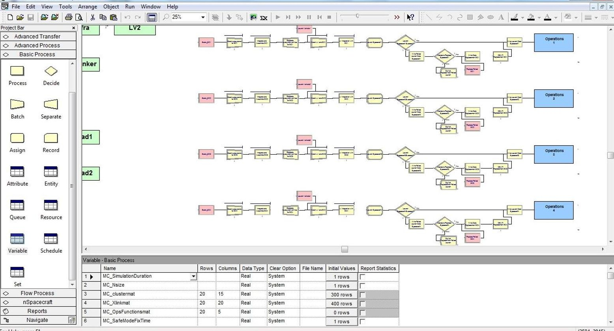

For Help, press F1

(2584,2045)

<!-- PDF_PAGE: 19 -->

## APPENDIX E

Example ModelCenter model created automatically from our transformation process.

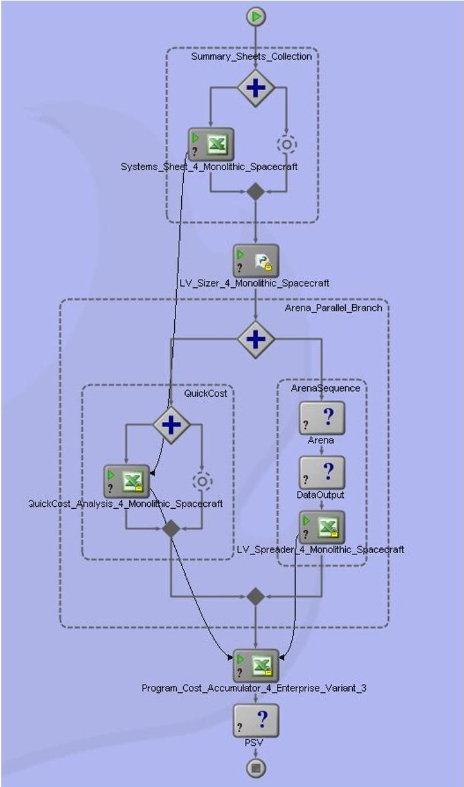

Figure 2 ModelCenter model (for N=0, i.e. monolth) generated by running our model transformation process.

<!-- PDF_PAGE: 20 -->

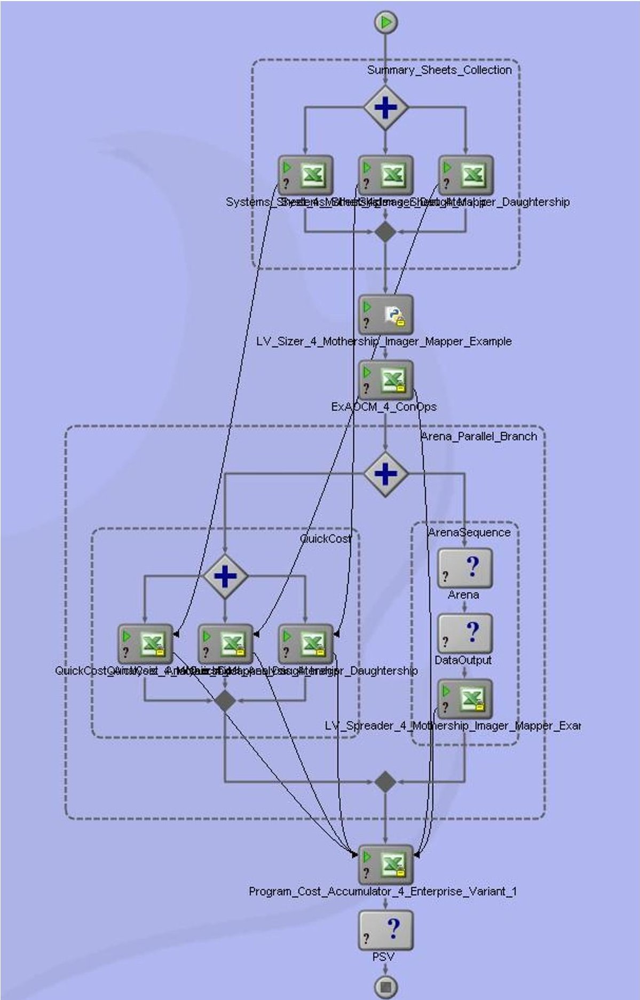

Figure 3 ModelCenter model (for N=3) generated by running our model transformation process.

