<!-- PDF_PAGE: 1 -->

# EVALUATING ARCADIA/CAPELLA VS. OOSEM/SYSML FOR SYSTEM

ARCHITECTURE DEVELOPMENT

A Thesis

Submitted to the Faculty

of

Purdue University

by Shashank P. Alai

# In Partial Fulfillment of the Requirements for the Degree

of

Master of Science in Mechanical Engineering

August 2019

Purdue University

Indianapolis, Indiana

<!-- PDF_PAGE: 2 -->

# THE PURDUE UNIVERSITY GRADUATE SCHOOL STATEMENT OF COMMITTEE APPROVAL

Dr. Hazim El-Mounayri, Chair Department of Mechanical and Energy Engineering

Dr. Zina Ben Miled Department of Electrical and Computer Engineering

Dr. Joerg Schreiber Department of Mechanical and Energy Engineering

Dr. Xiaoping Du Department of Mechanical and Energy Engineering

Approved by:

Dr. Sohel Anwar

Head of the Graduate Program

<!-- PDF_PAGE: 3 -->

<!-- PDF_PAGE: 4 -->

## ACKNOWLEDGMENTS

While researching in an area that has taken pace very recently, I realized the magnitude of the challenges one faces while grasping the fundamentals. I was fortunate to have a strong support of advisers from academia as well as industry. I would like to express my deepest gratitude to my advisor, Dr. Hazim El-Mounayri for his continuous motivation and guidance in exploring territories that had seldom been my strong suits. I could not have imagined a better advisor and mentor for my Master's thesis. I would also like to thank my committee members Dr. Zina Ben Miled, Dr. Joerg Schreiber and Dr. Xiaoping Du for their insightful comments and encouragements. Also, thanks to my advisor and the Mechanical and Energy Engineering department at IUPUI for supporting me financially. I would like to specially thank Ryan Wilkins from Siemens PLM Software and Dr. Michael Pfenning from Aras Corporation for being the coolest mentors and for engaging me into substantive conversations. I always benefited from their insightful references from industry on topics covering a broad spectrum of domains. Many thanks to Tony Komar and Jason Wickers for their insightful tutoring and many others from Siemens PLM Software (especially Tim Kinman and Jerry Sarfati) for providing me with opportunities to gain insights into topics that a graduate student could hardly expect. Thank you to Dr. Stephane Bonnet from Thales Group and Stephane Lacrampe (Obeo) for taking time out of their busy schedule to review the initial results of the study. I would also like to thank Kai Pankrath from XPLM for his invaluable guidance in my initial days of research. Thank you to my senior colleague Kalpak Kalvit for his help in developing architectures. To my friends, especially Akshay, Ashwin, Nikhil, Shantanu, Niraj, Atish and Vikhil, and to my lab colleagues, especially Hosein, Amey and Prasad, thanks for being there in my crucial times and supporting me throughout my journey. Finally, many thanks to my family for their continuous faith and support in me and my work.

<!-- PDF_PAGE: 5 -->

## TABLE OF CONTENTS

LIST OF TABLES . . . . .

<!-- PDF_PAGE: 6 -->

2.2.1 Operational Analysis 24

2.2.2 System Requirements Analysis 25

2.2.3 Logical Architecture Definition 26

2.2.4 Physical Architecture Definition 26

2.3 The ARCADIA Method 27

2.3.1 Polarsys Capella™ 29

2.4 Object-Oriented Systems Engineering Method (OOSEM) 29

2.4.1 No Magic Cameo Enterprise Architecture™ 31

2.5 Object-Process Methodology 31

3 CASE STUDY: DESCRIPTION 32

3.1 Adaptive Cruise Control Architecture 32

3.1.1 ACC Modeled Using Object-Process Methodology (OPM) 35

3.2 Evaluation Criteria 42

3.2.1 Representation of a ‘Good’ Architecture 42

3.2.2 Key Process Deliverables 44

3.2.3 Framework for the Evaluation of MBSE Methodologies for Practitioners (FEMMP) [40] 45

4 CASE STUDY: IMPLEMENTATION 48

4.1 Modeling ACC Using OOSEM/SysML 48

4.1.1 Operational Analysis 51

4.1.2 System Requirement Analysis 55

4.1.3 Logical Architecture Definition 65

4.1.4 Physical Architecture Definition 68

4.2 Modeling ACC Using ARCADIA/Capella 75

4.2.1 Operational Analysis 78

4.2.2 System Requirements Analysis 84

4.2.3 Logical Architecture Definition 91

4.2.4 Physical Architecture Definition 96

<!-- PDF_PAGE: 7 -->

5 RESULTS AND DISCUSSION 100

5.1 Evaluation 100

5.1.1 Representativeness of a ‘Good’ Architecture 100

5.1.2 Key Process Deliverables 102

5.1.3 Evaluation of Methodologies 107

5.1.4 Generalization of Results 109

5.2 Key Highlights and Differences 110

5.3 System Architecture Modeling and the Digital Thread 115

5.4 MBSE Practitioner Survey 118

6 CONCLUSION AND FUTURE SCOPE 120

6.1 Conclusions 120

6.2 Future Work 122

6.2.1 Limitations 122

6.2.2 Short-term 122

6.2.3 Long-term 123

REFERENCES 124

<!-- PDF_PAGE: 8 -->

## LIST OF TABLES

Table Page

3.1 ACC 'Stakeholder Needs' . 35

3.2 Architecture evaluation criteria . 43

3.3 Architecture development phases - deliverable artifacts . 45

3.4 FEMMP catalog [40] . 47

4.1 'PMTE' elements mapped to architecture development using OOSEM/SysML . 48

4.2 'PMTE' elements mapped to architecture development using ARCADIA/Capella75

5.1 ARCADIA/Capella and OOSEM/SysML vs. OPM architecture assessment . 101

5.2 Architecture deliverable artifacts after Operational Analysis . 103

5.3 Architecture deliverable artifacts after System Requirements Analysis . 104

5.4 Architecture deliverable artifacts after Logical Architecture Definition . 105

5.5 Architecture deliverable artifacts after Physical Architecture Definition . 106

5.6 Overview of evaluation of candidate methodologies using FEMMP . 108

<!-- PDF_PAGE: 9 -->

## LIST OF FIGURES

1.1 SEBoK's rendering of the system lifecycle processes defined by the ISO/IEC/IEEE 15288 Standard [11] ... 5

1.2 “PMTE” elements and effects of ‘Technology’ and ‘People’ [14] ... 8

2.1 Research methodology chart ... 20

2.2 System life cycle processes per ISO/IEC/IEEE 15288 characterized in process [3] ... 21

2.3 Generic architecture development workflow derived from ISO 15288 technical processes ... 24

2.4 Different phases/layers of the ARCADIA method [43] ... 28

2.5 OOSEM activities and modeling artifacts [3] ... 30

3.1 ACC-equipped vehicle external relationships [46] ... 33

3.2 ACC control structure [48] ... 33

3.3 ‘Providing ACC’ modeled as a OPM process ... 36

3.4 Top-level OPM System Diagram ... 37

3.5 Object-Process Language for SD ... 38

3.6 Object-Process Diagram for SD1: ‘Providing ACC’ in-zoomed ... 39

3.7 Object-Process Language for SD1: ‘Providing ACC’ in-zoomed ... 39

3.8 Object-Process Diagram for SD1.1: ‘Calculating relative parameters’ in-zoomed ... 40

3.9 Object-Process Language for SD1.1: ‘Calculating relative parameters’ in-zoomed ... 40

3.10 Object-Process Diagram for SD1.2: ‘Maintaining distance’ in-zoomed ... 41

3.11 Object-Process Language for SD1.2: ‘Maintaining distance’ in-zoomed ... 41

3.12 FEMMP evaluation metrics [40] ... 46

4.1 SysML Diagram Taxonomy ... 49

<!-- PDF_PAGE: 10 -->

Figure Page

4.2 ‘Specify and Design System’ activities in OOSEM 51

4.3 ‘Operational Domain’ bdd 53

4.4 SysML use case diagram (uc) for ACC System Use Cases 54

4.5 SysML requirement diagram (req) for ‘Stakeholder Requirements 55

4.6 SysML sequence diagram (sd) for ‘Turn ACC ON’ scenario 56

4.7 SysML activity diagram (act) scenario for ‘Provide ACC’ use case 58

4.8 ‘ACC Interface Definitions’ using bdd 59

4.9 ‘ACC System Context’ using ibd 61

4.10 ACC System Black Box Specification 62

4.11 SysML state machine diagram (stm) for ‘ACC System States’ 63

4.12 System requirements modeled in SysML requirement diagram (req) 64

4.13 SysML bdd for ‘ACC Logical Decomposition’ 66

4.14 SysML activity diagram (act) for ‘calculate relative parameters’ function 67

4.15 ‘ACC System Logical Architecture’ using SysML ibd 68

4.16 ‘ACC Logical Nodes’ bdd 69

4.17 ‘ACC Node Logical Architecture’ using ibd 71

4.18 ‘ACC Node Physical’ bdd 72

4.19 ‘ACC Node Physical Architecture’ using SysML ibd 73

4.20 Architecture development pyramid: OOSEM/SysML 74

4.21 ARCADIA/Capella Diagram Taxonomy 77

4.22 ‘ACC System’ Operational Entities Breakdown [OED] diagram 79

4.23 Capella operational capability using Operational Capability Blank [OCB] diagram 80

4.24 ‘Provide ACC’ operation modeled using Operational Activity Interaction Blank [OAIB] 81

4.25 ‘Vehicle Operational States’ using Mode State Machine [MSM] diagram 82

4.26 ‘Operational Architecture’ using ARCADIA Operational Architecture Blank [OAB] diagram 83

4.27 ACC System Context 85

<!-- PDF_PAGE: 11 -->

Figure Page

4.28 Capella mission and system capabilities using Missions Capabilities Blank diagram [MCB] 86

4.29 ‘Provide ACC’ functions modeled using System Data Flow Blank [SDFB] diagram 86

4.30 Operational to system level function decomposition 87

4.31 ‘ACC System Architecture’ using the System Architecture Blank [SAB] diagram 88

4.32 ‘Turn ACC ON’ exchange scenario using the Exchange Scenario [ES] diagram 89

4.33 ‘ACC System States’ using Mode State Machine [MSM] diagram 90

4.34 Functional allocation to logical components 92

4.35 Logical function decomposition 93

4.36 ‘ACC System Logical Architecture’ modeled in Logical Architecture Blank [LAB] diagram 95

4.37 ‘Physical Architecture’ using ARCADIA Physical Architecture Blank [PAB] diagram 98

4.38 Architecture development pyramid: ARCADIA/Capella 99

5.1 Functional transitions in Capella 110

5.2 Function decomposition in SysML and ARCADIA/Capella 111

5.3 Satisfy Requirement Matrix in Cameo Enterprise Architecture 113

5.4 Capella functional chain and scenario 115

5.5 What model-based systems engineering method/methodology do you follow in your projects? (can select multiple) 118

5.6 How well does your system architecture support the integration of behavior with structure? 119

5.7 How well does your system modeling activity support your functional analysis capability? 119

<!-- PDF_PAGE: 12 -->

## ABBREVIATIONS

<table border="1"><tr><td>MBSE</td><td>Model-Based Systems Engineering</td></tr><tr><td>SysML</td><td>Systems Modeling Language</td></tr><tr><td>ARCADIA</td><td>Architecture Analysis and Design Integrated Approach</td></tr><tr><td>OOSEM</td><td>Object-Oriented Systems Engineering Method</td></tr><tr><td>ACC</td><td>Adaptive Cruise Control</td></tr><tr><td>SE</td><td>Systems Engineering</td></tr><tr><td>INCOSE</td><td>International Council on Systems Engineering</td></tr><tr><td>ADAS</td><td>Advanced Driver Assistance Systems</td></tr><tr><td>NASA</td><td>National Aeronautics and Space Administration</td></tr><tr><td>DoD</td><td>Department of Defense</td></tr><tr><td>ISO</td><td>International Organization for Standardization</td></tr><tr><td>IEC</td><td>International Electrotechnical Commission</td></tr><tr><td>IEEE</td><td>The Institute of Electrical and Electronics Engineers</td></tr><tr><td>CAD</td><td>Computer-Aided Design</td></tr><tr><td>PMTE</td><td>Process, Methods, Tools, Environment</td></tr><tr><td>OMG</td><td>Object Management Group</td></tr><tr><td>V2</td><td>Version 2</td></tr><tr><td>RFP</td><td>Request for Proposal</td></tr><tr><td>UML</td><td>Unified Modeling Language</td></tr><tr><td>IBM</td><td>International Business Machines Corporation</td></tr><tr><td>PBSE</td><td>Pattern-Based Systems Engineering</td></tr><tr><td>SYSMOD</td><td>Systems Modeling Toolbox</td></tr><tr><td>VAMOS</td><td>Variant Modeling with SysML</td></tr><tr><td>FAS</td><td>Functional Architectures using SysML</td></tr></table>

<!-- PDF_PAGE: 13 -->

<table border="1"><tr><td>STRATA</td><td>Strategic Layers</td></tr><tr><td>JPL</td><td>Jet Propulsion Laboratory</td></tr><tr><td>OPM</td><td>Object-Process Methodology</td></tr><tr><td>SoS</td><td>System of Systems</td></tr><tr><td>MDDM</td><td>Model-Driven Development Methodology</td></tr><tr><td>TOGAF</td><td>The Open group Architecture Framework</td></tr><tr><td>DoDAF</td><td>Department of Defense Architecture Framework</td></tr><tr><td>NAF</td><td>NATO Architecture Frameowrk</td></tr><tr><td>NATO</td><td>The North Atlantic Treaty Organization</td></tr><tr><td>FA</td><td>Functional Analysis</td></tr><tr><td>OPD</td><td>Object-Process Diagram</td></tr><tr><td>SD</td><td>System Diagrams</td></tr><tr><td>OPL</td><td>Object-Process Language</td></tr><tr><td>FEMMP</td><td>Framework for the Evaluation of MBSE Methodologies for Practitioners</td></tr><tr><td>UI</td><td>User Interface</td></tr><tr><td>req</td><td>requirement diagram</td></tr><tr><td>API</td><td>Application Programming Interface</td></tr><tr><td>bdd</td><td>block definition diagram</td></tr><tr><td>uc</td><td>use case diagram</td></tr><tr><td>ibd</td><td>internal block diagram</td></tr><tr><td>sd</td><td>sequence diagram</td></tr><tr><td>act</td><td>activity diagram</td></tr><tr><td>stm</td><td>state machine diagram</td></tr><tr><td>OED</td><td>Operational Entity Breakdown</td></tr><tr><td>OCB</td><td>Operational Capability Blank</td></tr><tr><td>OAIB</td><td>Operational Activity Interaction Blank</td></tr><tr><td>MSM</td><td>Mode State Machine</td></tr><tr><td>OAB</td><td>Operational Architecture Blank</td></tr></table>

<!-- PDF_PAGE: 14 -->

SA System Analysis

CSA Contextual System Actors

MCB Missions Capabilities Blank

SDFB System Data Flow Blank

SAB System Architecture Blank

LA Logical Architecture

ES Exchange Scenario

LDFB Logical Data Flow Blank

LAB Logical Architecture Blank

PA Physical Architecture

PAB Physical Architecture Blank

PC Physical Component

EPBS End-Product Breakdown Structure

REC Replicable Element Collection

RPL Replica

PLM Product Lifecycle Management

XML eXtensible Markup Language

XMI XML Metadata Interchange

RVTM Requirements Verification Traceability Matrix

<!-- PDF_PAGE: 15 -->

## ABSTRACT

Alai, Shashank P. M.S.M.E., Purdue University, August 2019. Evaluating ARCA-DIA/Capella vs. OOSEM/SysML for System Architecture Development. Major Professor: Dr. Hazim El-Mounayri.

Systems Engineering is catching pace in many segments of product manufacturing industries. Model-Based Systems Engineering (MBSE) is the formalized application of modeling to perform systems engineering activities. In order to effectively utilize the complete potential of MBSE, a methodology consisting of appropriate processes, methods and tools is a key necessity. In the last decade, several MBSE projects have been implemented in industries varying from aerospace and defense to automotive, healthcare and transportation. The Systems Modeling Language (SysML) standard has been a key enabler of these projects at many companies. Although SysML is capable of providing a rich representation of any system through various viewpoints, the journey towards adopting SysML to realize the true potential of MBSE has been a challenge. Among all, one of the common roadblocks faced by systems engineers across industries has been the software engineering-based nature of SysML which leads to difficulties in grasping the modeling concepts for people that do not possess a software engineering background. As a consequence, developing a system (or a system of systems) architecture model using SysML has been a challenging task for many engineers even after a decade of its inception and multiple successive iterations of the language specification. Being a modeling language, SysML is method-agnostic, but its associated limitations outweigh the advantages. ARCADIA (Architecture Analysis and Design Integrated Approach) is a systems and software architecture engineering method based on architecture-centric and model-based engineering activities. If applied properly, ARCADIA allows for a very effective way to model the architecture

<!-- PDF_PAGE: 16 -->

of multi-domain systems, and overcome many of the limitations faced in traditional SysML implementation. This thesis evaluates the architecture development capabilities of ARCADIA/Capella versus SysML following the Object-Oriented Systems Engineering Method (OOSEM). The study focuses on the key equivalences and differences between the two MBSE solutions from a model development perspective and provides several criteria to evaluate their effectiveness for architecture development using a conceptual case of Adaptive Cruise Control (ACC). The evaluation is based on three perspectives namely, architecture quality, ability to support key process deliverables, and the overall methodology. Towards this end, an industry-wide survey of MBSE practitioners and thought leaders was conducted to identify several concerns in using models but also to validate the results of the study. The case study demonstrates how the ARCADIA/Capella approach addresses several challenges that are currently faced in SysML implementation. From a process point of view, ARCADIA/Capella and SysML equally support the provision of the key deliverable artifacts required in the systems engineering process. However, the candidate architectures developed using the two approaches show a considerable difference in various aspects such as the mapping of the form to function, creating functional architectures, etc. The ARCADIA/Capella approach allows to develop a 'good' system architecture representation efficiently and intuitively. The study also provides answers to several useful criteria pertaining to the overall candidate methodologies while serving as a practitioner's reference in selecting the most suitable approach.

<!-- PDF_PAGE: 17 -->

## 1. INTRODUCTION

"For of all things that have several parts and where the totality of them is not like a heap, but the whole is something beyond the parts, there is some cause of it, since even among bodies, in some cases contact is the cause of their being one, in others stickiness, or some other attribute of this sort. A definition, however, is an account that is one not by being bound together, like the Iliad, but by being of one thing."

Aristotle, Metaphysics

The fundamental underpinnings of systems engineering (SE) lie in the school of thought of system thinking, which is quite simply, thinking about a question, circumstance, or problem explicitly as a system. System thinking is not thinking systematically [1]. This leads us to the fundamental question, what is a 'system'? A system can be defined as a set of entities that interact or are interrelated. There is a lot of wisdom in this definition which has facilitated the development of a completely new mode of reasoning and eventually helping many problem solvers within domains like philosophy, science, engineering, management and even political science solve complex problems through a holistic, multi-disciplinary perspective. System thinking has provided us with the idea of emergence, stressing that "the system is a set of entities and their relationships, whose functionality is greater than the sum of the individual entities" [1], that is, "the properties of the whole cannot be solely explained by the principles of the constituent elements" [2]. The same idea can be applied to engineered systems and hence the discipline, systems engineering. In classical SE, every product that is being realized is considered as a system made up of various elements linked together, intended to perform a certain required function as a whole that is different than the functions of its individual elements. In such a system, the behavior of the system is greatly influenced by the structural and functional relationships between the system elements. Understanding the influence of a system's structure on its behavior is perhaps the greatest unsolved mystery in the systems domain.

<!-- PDF_PAGE: 18 -->

Systems engineering is becoming more and more popular among industries like automotive, transportation, medical devices, etc. The INCOSE SE Handbook defines SE as "an interdisciplinary approach and means to enable the realization of successful systems" [3]. As mentioned in the handbook, "SE deals with designing and managing systems over their lifecycle, starting from the system conceptualization phase till its disposal. It focuses on defining customer needs and required functionality early in the development cycle, documenting requirements, and then proceeding with design synthesis and system validation while considering the complete problem: operations, cost and schedule, performance, training and support, test, manufacturing, and disposal. SE integrates all the disciplines and specialty groups into a team effort forming a structured development process that proceeds from concept to production to operation. SE considers both the business and the technical needs of all customers with the goal of providing a quality product that meets the user needs" [3]. One of the primary artifacts that is expected at an early stage of this methodical paradigm is an architecture of the system under development that describes its structural and behavioral aspects in an integrated context. The INCOSE 'Systems Engineering Vision 2025' manual mentions system architecture as a crucial discipline for successful SE in the future [4]. Until recently, SE was practiced with the help of physical documents to manage and pass system information across stakeholders in various system lifecycle phases. Although the document-based approach to SE could be successfully realized with proven benefits, it had some fundamental limitations [5] [6]. Moreover, increasingly complex systems demand a more formalized approach to carry out SE activities. Model-based approach is becoming the industry standard in SE. Having roots in software engineering, the formalization of SE is called model-based systems engineering (MBSE). MBSE provides means to design architectures of complex systems of systems (hereafter inclusively referred to as 'system(s)') using computerized models as opposed to physical documents. MBSE provides several advantages over traditional document-based SE such as end-to-end requirements traceability, improved communication, increased ability to manage system complexity, etc. [3].

In this era of digitalization, manufacturing companies are witnessing a shift from documentbased SE to MBSE in order to catch up with the technological needs of Industry 4.0 [7], thereby facing tremendous challenges in the transition. One of the major challenges is to select the right set of processes, methods and tools required to implement a company's

<!-- PDF_PAGE: 19 -->

MBSE strategy. Specifically, selecting an appropriate architecture modeling tool is a huge talking point among systems engineers within an organization and there seems to be a lack of consensus within the MBSE community as well. An architecture tool is the most crucial element of the MBSE toolchain as the system architecture significantly influences the decision making in the downstream engineering and management processes. Currently, there are various architecture modeling methodologies, frameworks and enabling tools/languages available that satisfy the architecture modeling purposes. Unfortunately, very few of these are efficient and semantically rich enough to provide a shared understanding among various stakeholders. The Systems Modeling Language (SysML) applied with a particular methodology, and the ARCADIA method-integrated Capella tool are among the few widely used architecture modeling solutions, each having its own advantages and limitations. SysML is a tool-neutral, general purpose modeling language that supports the analysis, specification, design, verification, and validation of complex systems [8]. Architecture Analysis & Design Integrated Approach (ARCADIA) is an architecture engineering method, based on architecture-centric and model-driven engineering activities [9]. Capella is a modeling software that supports the ARCADIA method through an integrated process guidance [10]. A primary distinction between SysML and ARCADIA/Capella is that the former is a method-agnostic language that provides syntax and semantics to model complex architectures, whereas, the latter is a combination of a SE method and a supporting tool that together provide the required syntax and semantics, and the latter is actually inspired by the SysML concepts to simplify, enhance and enrich the SysML metamodel thereby enhancing a modeler's experience. There is a strong need to evaluate the two architecture modeling solutions using various criteria in order to provide a preliminary basis for an enterprise to effectively transition to model-based architecting. This thesis will investigate the two solutions and evaluate them on their ability to support system architecture development. The study will be performed using a case study of an Adaptive Cruise Control (ACC) feature, which is a part of the Advanced Driver Assistance Systems (ADAS). This chapter provides the background, motivation, literature review, objectives and assumptions of this research.

<!-- PDF_PAGE: 20 -->

## 1.1 Background

This section provides background on SE lifecycle, SysML, and the challenges in adopting MBSE. The SE process is a holistic approach to engineering the system over its life cycle. Hence it is crucial to set a premise by describing the system's life cycle and its stages and then focus on the important aspects of architecture development.

## 1.1.1 Systems Engineering Lifecycle

Systems engineering life cycle is a term used in SE to describe the process of the evolution of a system through different phases, starting from its conception and ending with its disposal. The INCOSE SE Handbook defines a life cycle as "the series of stages through which something (a system or a manufactured product) passes." "Every man-made system has a life cycle. The life cycle of any system must encompass not only the development, production, utilization and support stages but also provide early focus on the retirement stage when the decommissioning and disposal of the system occurs" [3].

The primary purpose of SE is to manage the system at every stage of its life cycle. Various lifecycle development models have been defined to provide a framework to ensure that the system meets its desired goals throughout its life. The life cycle models differ from industry to industry and product to product. Several life cycle models have been defined by key players like The National Aeronautics and Space Administration (NASA), the US Department of Defense (DoD) and others. These lifecycle models may differ in terms of the processes and the methods involved in the different life cycle stages, however, a generic life cycle model can be deduced such that it encompasses all the processes involved in the different generic stages while satisfying the purposes of each of those stages. One such generalization has been done by the ISO/IEC/IEEE 15288:2015 standard as shown in Figure 1.1 [3].

It consists of mainly 6 stages: The Concept Stage deals with a wide range of creative activities like the definition of the problem space that involves exploratory research activities, identifying stakeholders' needs and defining solution characteristics, exploring new ideas and technologies, need refinement, exploring feasible concepts and viable solutions and finally, concept selection. The Development Stage focuses on developing the system such

<!-- PDF_PAGE: 21 -->

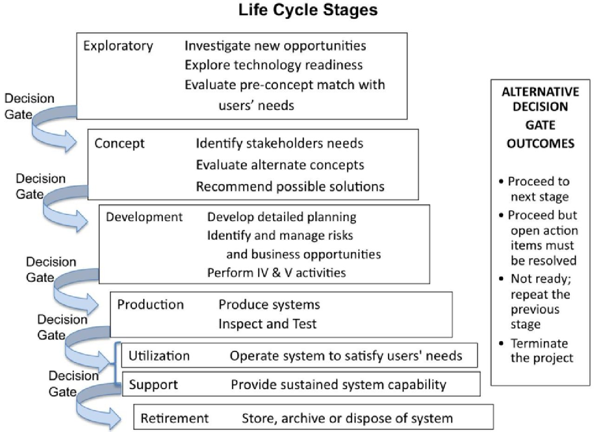

Figure 1.1.: SEBoK's rendering of the system lifecycle processes defined by the ISO/IEC/IEEE 15288 Standard [11]

that it meets the stakeholder requirements. A key purpose of this stage is to define system requirements, create solution description, implement and integrate the initial systems and verify and validate systems such that they can be produced. The Production Stage focuses on the production and manufacturing of the systems along with their inspection and verification. The Utilization Stage occurs when the system is operated by the end user, where main purpose is to deliver the services expected of the system by the end user. The Support Stage occurs when the system is provided the required support for its continued operation. Finally, The Retirement Stage occurs when the system is disintegrated and is retired from its operations. Based on the type of the retirement desired, the system is either stored, archived or disposed.

As the system proceeds through its lifecycle phases, it has to meet specific project decision gates based on which, the system either moves on to the next phase with or without action items, continues in its current stage, moves back or even results in project termina-

<!-- PDF_PAGE: 22 -->

tion. The lifecycle models have been mapped to various graphical illustrations that describe sequential flow of system's lifecycle. The most widely accepted illustration is the SE 'Vee' model in which time and system maturity proceeds from left to the right across the V-shaped workflow [3].

## 1.1.2 Challenges in Implementing Model-Based Systems Engineering

The 'INCOSE SE Vision 2020' document aptly defines MBSE as the formalized application of modeling to support SE activities throughout the lifecycle phases [12]. For a successful implementation of an MBSE approach, it is imperative that the modeling activities support the SE processes that occur in the lifecycle stages described in the previous subsection. In order to achieve such implementation, a robust modeling methodology consisting of various 'processes', 'methods' and 'tools' is essential such that it could support SE in a model-based context. The usage of the abovementioned terminologies has not been precise for a long time and these semantic discrepancies have implications on the enablement of any technology in an engineering environment. A survey study showed that 'term' understanding among systems engineers in academia and industry is still very heterogeneous [13]. Although the study did not survey the usage of the abovementioned terms, it is critical to define these terms beforehand to avoid ambiguity.

In [6], Estefan, J.A. uses the following definitions from [14] to distinguish these key terminologies:

- "A Process (P) can be defined as a logical sequence of tasks performed to achieve a particular objective. It defines 'WHAT' is to be done, without specifying 'HOW' each task is performed" [6]. SE process can be seen as a process model that defines the primary activities to be accomplished to implement SE. The ISO/IEC/IEEE 15288 standard provides one such process model of processes required for SE.

- "A Method (M) involves techniques for performing a particular task. It defines the 'HOW' of each task. At any given level, process tasks are performed using methods. However, every method is also a process in itself which includes a sequence of tasks to be performed for that particular method. In other words, the 'HOW' at one level of

<!-- PDF_PAGE: 23 -->

abstraction can become the 'WHAT' at the next lower level" [6]. For example, system architecture development can be executed using a particular method that includes a series of tasks like functional analysis, logical and physical architecture definition, etc.

- "A Tool (T) can be defined as an instrument that, when applied to a particular method, can enhance the efficiency of the task, provided it is applied properly and by somebody with proper skills and training. The purpose of a tool is to facilitate the accomplishment of the 'HOWs'" [6]. The most common example of a tool is Computer Aided Design (CAD). However, a tool need not necessarily be computer-supported and can also be something like a theoretical problem-solving instrument.

A Methodology is a combination of processes, methods and tools that are applied to a class of common problems. The supporting environment is also associated with these definitions. An Environment (E) consists of the surroundings, the external objects, conditions or factors that influence the actions of an object, individual person or group. The environment enables the 'WHAT' and 'HOW' [6]. Several environmental factors such as social, cultural, political or economic have significant implications on the adoption of any technology. Similar challenges also apply for successful adoption of MBSE [15].

The PMTE diagram in Figure 1.2 shows the relationship between the process, methods, tools and environment ('PMTE' elements) and the effects of technology and people on those elements [14]. In any SE development project, the capabilities and limitations of technology must be taken into consideration. Moreover, the knowledge, skills and abilities of the people using the technology must be taken into consideration and employee enhancement initiatives must be undertaken. This argument can also be extended to MBSE.

The main purpose of an MBSE environment is to be able to integrate the tools and methods used on a project. Various environmental factors will impact the adoption of new MBSE tools. In order to make a smooth transition to MBSE, management and tool deployment cultural roadblocks should be overcome along with overcoming the existing engineering challenges [16]. In [15], M.E. Sampson points out the management roadblocks that usually hinder SE tool adoption. One of the main challenges is to get the organization management and customer on board with a commitment to allow the systems engineers to successfully use the tools along with proper tool support, maintenance and training.

<!-- PDF_PAGE: 24 -->

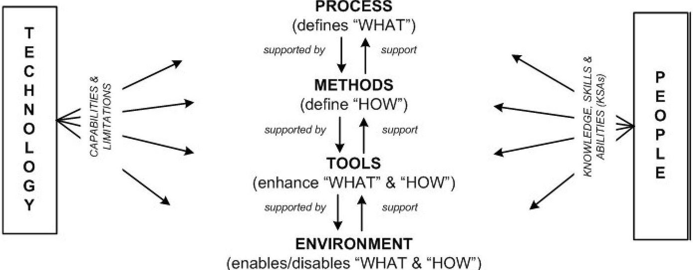

Figure 1.2.: "PMTE" elements and effects of 'Technology' and 'People' [14]

Also, timely application of the tools during the processes impacts hugely on its evaluation. Not only the management roadblocks, but several cultural roadblocks can hamper the tool adoption process. Systems engineers have a strong predisposition to "rolling their own" tool [15]. This makes it even harder to convince the current SE practitioners to adopt a model-based approach. Moreover, the ergonomics of using the tool contribute to the human factors that can prevent MBSE adoption. Last but not the least, systems engineers show a significant resistance to change in using new SE tools. A similar pattern can be assumed for the MBSE tools. Especially in the case of SysML, where systems engineers have been using it for several years now, it is going to be critical to make sure that the advantages of newer tools outweigh the consequences that might result from moving away from a standard like SysML. Respecting the fact that significant efforts have been taken to adopt SysML on large scale projects, the effective means for a smoother transition to alternative tools, if needed, should be carefully pondered upon.

## 1.1.3 The Systems Modeling Language (SysML)

SysML is an object-oriented, semi-formal, graphical language used to model architectures of complex systems. SysML was introduced as a modeling language in the year 2006 by the Object Management Group (OMG) [8] as a formal specification and later published as a standard by the International Organization of Standardization (ISO) [17]. The advent

<!-- PDF_PAGE: 25 -->

of SysML sparked a revolution in the SE paradigm as the language could be used for representing the various aspects of a system architecture through various viewpoints within an integrated model. SysML promised to fulfill the 'T' of the 'PMTE' elements by serving as the metaphorical 'Tool', which when applied using an appropriate 'Method(s)' to support a well-defined 'Process' model incorporated within a suitable 'Environment' could yield potentially significant benefits to systems architecting [18]. SysML is able to describe the following key aspects of systems, components, and other entities using nine different types of diagrams [18] :

- Composition, interconnection, and classification of structure;

- Behavior based on functional flows, messages and states;

- Constraints on physical design and performance properties;

- Allocations between structure, behavior, and constraints; and

- Requirements traceability between the model elements.

The adoption of SysML as the standard system architecting tool was a significant leap from document-based SE to MBSE [16]. After nearly 12 years of a multitude of large-scale implementations across industries, several potential improvements have been identified by experts and practitioners using SysML across the globe. These are stated as the requirements in the SysML V2 RFP submitted by the OMG to develop next-generation SysML [19]. A brief overview of the SysML language diagrams and concepts is provided in Chapter 4.

## 1.2 Motivation

The thesis work is hugely motivated by the challenges put forward by the fourth industrial revolution (also termed as 'Industry 4.0'), the current drawbacks of SysML standard and the potential benefits of having a methodological guidance within modeling tools.

## 1.2.1 Industry 4.0 Challenges

The complexity of modern products is growing rapidly across industries. Managing the complexity of these products has been a daunting task as companies strive to create

<!-- PDF_PAGE: 26 -->

better products in an increasingly shorter time-to-market. Almost every new product is an evolution of the previous versions with increasing numbers of disciplines involved [20]. The impact of new technology comes with a dramatic increase in safety concerns as we move towards handling control over to intelligent machines. Such growing complexity coupled with global competitiveness demands that cutting-edge development approaches be incorporated within industries. SE has become necessary to manage complex systems over their life cycles [21]. With the imminence of the so-called 'Fourth Industrial Revolution' or 'Industry 4.0', MBSE has been identified as a key enabler of engineering complex systems [7]. Although many industries have started to realize the benefits of MBSE, the tools and techniques used for its implementation need to be evaluated and evolved quickly to prevent another isolation among the development teams.

## 1.2.2 Drawbacks of the SysML Standard/Tooling Challenges

The SysML specification aims at providing a modeling solution to practicing systems engineers to transition from document-based SE to MBSE. Although SysML has proven to be effective in articulating system lifecycle data using models, it comes with some inherent drawbacks that prevent from realizing the complete potential of systems architecting in MBSE [16] [13] [22]. SysML being a semi-formal language, is an extension of the Unified Modeling Language (UML) which is a general-purpose modeling language used for software systems development. SysML is developed to support engineering of a broader range of systems. However, being based on UML, it inherits many software engineering concepts that make it unintuitive to engineers who do not possess a software engineering background [16]. Also, SysML does not allow a proper integration between the structural and behavioral elements, as stated as one of the requirements in the SysML V2 RFP [19]. Moreover, SysML does not provide modeling guidance or impose a particular method (fairly intuitive templates and plug-ins are provided by some tool vendors) which tends to create ambiguity in the modeling approach. A modeling environment must allow a system designer to invest most of the time in designing systems rather than in learning complex tools and techniques to model systems.

<!-- PDF_PAGE: 27 -->

## 1.2.3 Benefits of Methodological Guidance Within Tools

Designing a SE method is in itself a challenge. Adopting an MBSE solution that caters to the needs of a specific method is tricky especially when the solution is not developed keeping in mind the particular method to be applied. Hence, one of the major challenges systems engineers face during the modeling of system architectures is to properly follow a well-structured modeling approach that enables precise modeling while ensuring the integrity of the semantics. A modeling solution must be developed to provide a strong foundation to the method that is meant to be implemented, which itself must be able to be customized to specific needs. Moreover, the tool developed must provide guiding principles of the method to enhance the modeler's daily modeling tasks [23]. Providing a methodological guidance allows a user to ensure that a correct approach is being followed that conforms to the rules laid out by the method. Including a method-based approach provides several benefits, mainly:

- Shorter Time-to-Model: Having a methodical guidance coupled with continuous model checking abilities spares the modeler the time to think about the modeling strategies and model accuracy. Also, such approach prevents the time and cost investment that has to be done in defining new modeling methods.

- Model Consistency: A tool augmented with a guided method can significantly increase the consistency of models. Following a consistent approach in modeling leads to consistent representation of data thereby leading to a shared understanding among stakeholders [24]. After all, to be able to effectively communicate is supposed to be one of the major benefits of MBSE.

- Increased Reusability: One of the most unexplored territories within MBSE is the concept of model reusability across projects. With increasingly vast number of product configurations being offered in consumer product industries, managing the design information of legacy products across projects can be facilitated by model reuse [25]. Reusability among models can significantly help to share system design data among models.

<!-- PDF_PAGE: 28 -->

## 1.3 Literature Review

This section reviews the literature on the various existing MBSE methodologies, and previous works concerning evaluation of model-based methods and techniques. The section concludes by identifying the gap that this thesis will help to address.

## 1.3.1 Existing Model-Based Systems Engineering Methodologies

MBSE has caught significant pace in the last decade. Companies across various industries have started to realize the importance of incorporating a model-based approach to modern product development. Currently, there are several examples of MBSE implementations across a wide spectrum of product manufacturing industries, each trying to adopt either a standardized SE lifecycle model as that of the ISO/IEC/IEEE 15288:2015 standard or develop a customized version of their own. Regardless, a significant element in influencing these MBSE implementations is the modeling methodology that is being followed to implement the MBSE strategy. Several MBSE methodologies have been defined by various tool vendors, companies and independent thought leaders alike. Some of the popular methodologies are briefly reviewed in this subsection.

## IBM Harmony for SE

IBM Harmony-SE was developed by I-Logix Inc. that eventually became IBM Corporation. IBM Harmony for SE is a subset of the IBM Harmony methodology for software engineering [26]. Harmony for SE is a top-down approach to development that supports modeling architectures through three top-level processes namely,

- Requirements Analysis

- System-level Functional Analysis

- Design Synthesis [26]

The methodology uses a service request-driven approach using SysML artifacts and emphasizes on identifying and allocating a required functionality and state-based behavior

<!-- PDF_PAGE: 29 -->

rather than detailing its functional behavior. The methodology was developed to be vendorneutral but the elements of the methodology are usually applied using by IBM Rhapsody.

## Pattern-Based Systems Engineering (Systematica $ ^{\mathrm{TM}} $ Methodology)

Pattern-Based Systems Engineering (PBSE), as described in [27], is an MBSE methodology that can address "ten times more complex systems with a ten fold reduction in the modeling effort, using people from a ten times larger community than the "systems expert" group, producing more consistent and complete models sooner". PBSE promotes the use of systematic patterns that could provide a "learning curve jump start" from the already existing patterns and its users, rapidly utilizing its content, and improving the pattern with the knowledge gained so as to assist future users of the pattern. Systematica $ ^{\mathrm{TM}} $ Methodology uses the S $ ^{*} $ Metamodel which is a relational/object information model that is used to describe requirements, designs and other information in S $ ^{*} $ models such as verification, failure analysis, etc. An S $ ^{*} $ Pattern is a reusable, configurable S $ ^{*} $ Model of a family of systems forming a pattern. PBSE provides a holistic and compact data model and a framework for MBSE that is well-suited to address the challenges in designing cyber-physical systems. PBSE can be implemented using any system modeling language or tool-set.

## The Systems Modeling Toolbox (SYSMOD+)

Weilkiens' Systems Modeling Toolbox (SYSMOD) [28] is a user-oriented approach for requirements engineering and development of system architectures. SYSMOD methodology is applied using SysML as the preferred language and can be used with any modeling tool. SYSMOD follows a top-down development approach and comprises of three main artifacts: (1) Methods, that dictate best-practices for creating a 'product', (2) Products, that are the crucial artifacts for system development like requirements or architecture descriptions, and (3) Roles, that are work descriptions of a person or an operator. In addition to SYSMOD, Weilkiens also provides a method for Variant Modeling (VAMOS) and creating Functional Architectures using SysML (FAS) that supplement SYSMOD but can be applied independently to projects as well [29].

<!-- PDF_PAGE: 30 -->

## Vitech MBSE Methodology (STRATA)

The STRATA MBSE methodology was initially developed at Vitech Corp. by Long et al [30]. STRATA is based on the underlying central principle of Strategic Layers. The method is built around analyzing and solving systems design problems in layers of increasing granularity. Beginning at the most abstract level, the problem statement is analyzed and translated into functional behaviors that the system must perform to fulfill requirements. These behaviors are allocated to physical components that provide the means for performance. The developed architecture is then tested to see that its performance answers the requirements, providing end-to-end traceability. The STRATA methodology can be implemented using a suite of tools developed by Vitech Corporation Inc.

## NASA JPL State Analysis Methodology

State Analysis is a MBSE methodology developed by NASA Jet Propulsion Laboratory (JPL). By leveraging a state-based control architecture, JPL State Analysis aims to produce requirements on system and software design as explicit models of system behavior, and by defining a state-based architecture for the control system [31]. State Analysis provides a unique framework to modeling systems in that (a) it is based on the principle that control includes all aspects of system operation considering a clear distinction between the control system and the system under control, (b) that models of the system under control must be explicitly identified and used to achieve consensus among systems engineers, (c) understanding system states is the fundamental aspect to successful modeling and (d) the behavior specification and behavior design of the system increases to resemble with growing complexity. State Analysis provides a methodical, rigorous approach for the three primary activities namely, state-based behavior modeling, state-based software design and goal-directed operations engineering [6].

Chapter 3 of the thesis will discuss three other popular MBSE methodologies that include the Object-Process Methodology (OPM) [32], and the two candidate methodologies of this study.

<!-- PDF_PAGE: 31 -->

## 1.3.2 Methodology-Specific Implementations

Over the past decade, several MBSE implementations have been done in industries varying from aerospace and defense to automotive and healthcare. Carroll and Malins [33] provide a detailed systematic literature review of various MBSE implementations and try to identify how MBSE is justified. In their systematic literature review, they provide a number of prerequisites for any enterprise to employ an MBSE approach, representing investments by the enterprise in its staff and processes along with a commitment to employ an MBSE approach in a well-defined manner. Various methodology specific implementations were also reviewed for this study. Friedenthal et al. implemented the Object-Oriented Systems Engineering Method (OOSEM) at Lockheed Martin to develop Next Gen Long Range Strike for System of Systems (SoS) level architecture modeling using i-Logix Rhapsody tool [34]. In their preliminary results, they were able to model the enterprise architecture and obtained an executable architecture to support behavior analysis and simulation. The analysis and simulation served as a means to allow the overall project to validate customer and mission requirements and develop and demonstrate SoS architecture solutions. In another study, Quoc and Cook (2012) [35] applied OOSEM for ground-based air missile defense system and identified key research challenges to implementing MBSE i.e. model-based requirement engineering, MBSE design and analysis, model integration and integrated tool environment development. A similar implementation using ARCADIA was done at Thales Alenia Space using the Capella tool by Calio et al. [36]. They concluded by outlining the benefits of a functional analysis based approach using the Capella tool. The abovementioned studies on MBSE implementations indicate the increasing application of model-based development to real life systems.

## 1.3.3 Previous Comparison Studies

Along with this literature, previous literature based on comparison of MBSE methodologies was also reviewed. Estefan, J. A. (2008) [6] provides a comprehensive review of popular MBSE methodologies which served as a good starting point to understand the specificities, commonalities and differences between the various methods. Armstrong, J. R. (1993) [37] compared classical SE used for functional analysis and provided several insights into parts of

<!-- PDF_PAGE: 32 -->

SE methods realizing that the scope was limited to functional analysis. Garcia, R. A. [38] performed an evaluation study of MBSE processes for integration into rapid acquisition programs using a case study. In this study, a set of evaluation criteria was identified to evaluate the processes. Grobshtein et. al. [39] did a one-to-one comparison of OPM and SysML and provided similarities and differences in the two, along with potential developments in the alignment of both the approaches. Finally, Weilkiens et. al. [40] provide an evaluation criteria to evaluate MBSE methodologies at large and provide the comparison of SYSMOD and MDDM methodologies as a case study.

## 1.4 Literature Gap

There are mainly two gaps in the literature. Firstly, the literature provided several reviews of MBSE methodologies. A comprehensive review is available for the popular methodologies reviewed in Section 1.3. However, there is a lack of rigorous evaluation studies that assesses the candidate methodologies based on any well-defined criteria. In order to serve the needs of industry 4.0, industries must have a reference in order to choose the right set of tools suitable to their environments. Hence, there is a need for a catalog of evaluation criteria in order to clearly assess the different approaches at various granularity levels. Secondly, ARCADIA/Capella and OOSEM/SysML are relatively new modeling approaches when compared to traditional SE implementations. There is no literature found on a comparison between ARCADIA/Capella and OOSEM/SysML. This thesis will contribute to both the literature gaps.

## 1.5 Thesis Objectives

The thesis aims to evaluate two system architecture modeling approaches, the analysis of which could serve as a decision making template for system architects to decide on the appropriate tool suitable for their system architecture definition/development activity. The evaluation is carried using a conceptual case study of ACC. The system is modeled by implementing two SE methodologies namely, OOSEM coupled with SysML and, ARCADIA using the Capella $ ^{\mathrm{TM}} $ tool. A general set of stakeholder needs are identified and fed into

<!-- PDF_PAGE: 33 -->

the architecture modeling workflow. An initial concept architecture is modeled using the Object-Process Methodology which then serves two purposes; a) providing a syntactic reference to modeling the candidate architectures, and b) serving as a baseline to evaluate the quality of the candidate architectures. The system architectures are then evaluated based on three perspectives, namely, the representativeness (quality) of architectures, metamodel concepts supporting the process deliverables and the overall candidate methodologies.

## 1.6 Thesis Assumptions

The study is performed based on some assumptions that are necessary to be clarified before the evaluation. Firstly, the study excludes the parameterization of the architecture model. It is assumed that parametric simulation of architecture model is not a real need of the industry as more specialized tools are available for such simulations. Also, ARCADIA/Capella do not provide parametric analysis because of its scope. Secondly, it is assumed that the application domain of the example used does not affect the quality of the evaluation. Thirdly, it is assumed that the complexity of the architecture does not have a significant effect on the evaluation and the results obtained through this study could be generalized to highly complex systems.

## 1.7 Thesis Organization

The thesis is organized into six chapters. Chapter 1 is the thesis introduction, including background, motivation, literature review, thesis objectives and assumptions. The methodology used to accomplish the thesis objectives, along with the modeling methodologies are explained in Chapter 2. Chapter 3 describes the conceptual model of the Adaptive Cruise Control feature modeled using Object-Process Methodology which serves as the reference architecture for modeling the system-of-interest using the two candidate methodologies in Chapter 4. Chapter 5 includes the results of the evaluation of the ARCADIA/Capella and OOSEM/SysML approaches. It also describes key highlights and differences between the two architectures and discusses the significance of MBSE in the overall product lifecycle.

<!-- PDF_PAGE: 34 -->

Finally, Chapter 6 concludes with the thesis summary and identifies future research areas that can substantially augment the findings of this study.

<!-- PDF_PAGE: 35 -->

## 2. METHODOLOGY

"I paint from the top down. From the sky, then the mountains, then the hills, then the houses, then the cattle, and then the people."

Grandma Moses

This chapter describes the methodological approach followed in this thesis. The evaluation of the two modeling approaches is done using a 3-step methodology:

1. Deriving a generic workflow of system architecture development from a standard SE process model

2. Generating a conceptual architecture of an example system-of-interest and identification of the evaluation criteria

3. Modeling the architectures for the case study using the candidate methodologies and evaluating the approaches against the predefined criteria

After implementing the case study and evaluation, a survey of MBSE practitioners was conducted to understand the real needs of MBSE practitioners, the results of which are used to support the thesis findings. The following sections in this chapter provide an overview of standard SE processes mapped to a generic architecture development workflow and a description of the SE methodologies used in the case study. The following chapter is dedicated to introducing the reference architecture using the Object-Process Methodology (OPM) along with detailing the evaluation criteria. Figure 2.1 shows a chart that depicts the methodology followed for the thesis.

<!-- PDF_PAGE: 36 -->

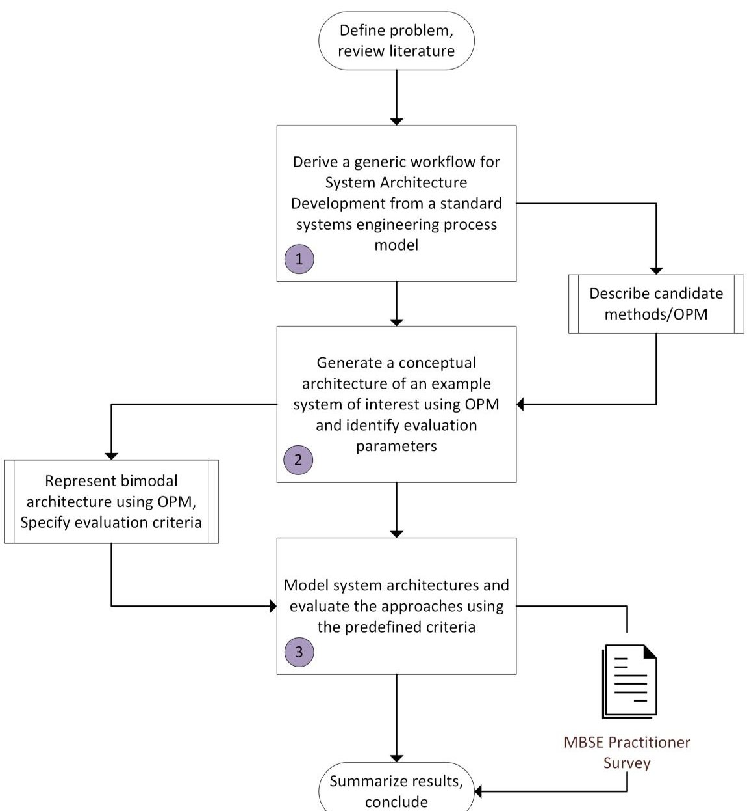

Figure 2.1.: Research methodology chart

## 2.1 Systems Engineering Technical Processes

The ISO/IEC/IEEE 15288 standard identifies four process groups to support SE. These include the technical processes, technical management processes, agreement processes and organizational project-enabling processes. The technical processes shown in Figure 2.2 are used to engineer the system from defining requirements to its disposal by enabling systems engineers to coordination between engineering specialists, other specialists, system stakeholders, operators and manufacturing thereby addressing conformance with the expectations and requirements of the society. [3]

<!-- PDF_PAGE: 37 -->

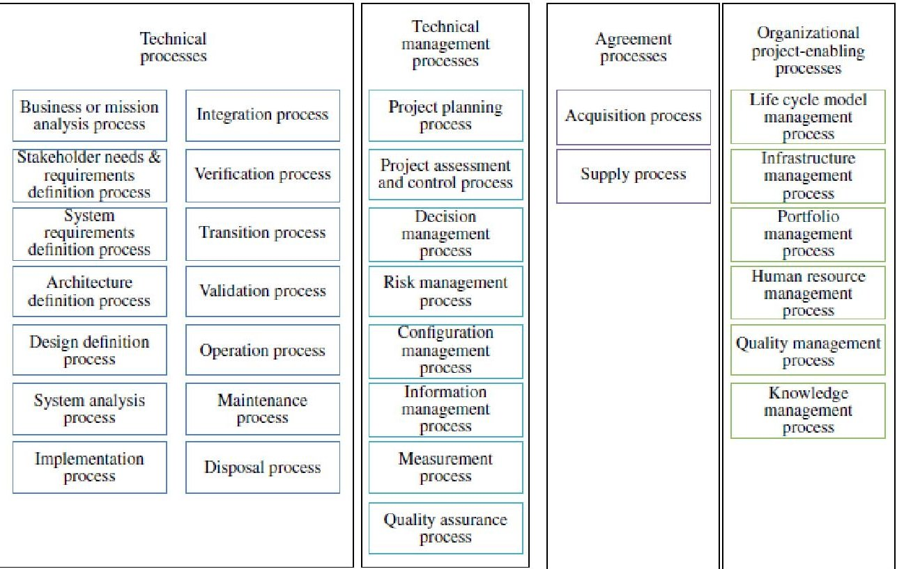

Figure 2.2.: System life cycle processes per ISO/IEC/IEEE 15288 characterized in process [3]

Among the 14 technical processes, the first four processes deal directly or indirectly with the system architecture development activity. Arguably, the requirements definition processes may or may not be considered a part of the system architecture development activity. The requirements and use case analyses are not part of the system architect's activities [29]. Requirements definition form a subset of the requirements engineering activities that are concerned with discovering, developing, tracing, analyzing, qualifying, communicating and managing requirements that help in defining the system at various levels of abstraction [41]. An important aspect of requirements engineering is the verification of system requirements using traceability. In order to achieve this traceability in a model-based context, a requirement must be associated with the architecture artifacts that satisfy or verify the requirement. Furthermore, functional requirements drive the development of a system's functional architecture based on which a system's technical architecture is developed. Performing requirements definition and analysis in isolation from architecture development would lead to unnecessary hindrance in the consistency of the process. Hence, it becomes logical to include the requirements definition processes as a part of the overall architecture develop-

<!-- PDF_PAGE: 38 -->

ment activity. A typical SE implementation begins with the project context, considering the system and its environment so as to better assess the user needs along with identifying potential threats to the system. In this stage, the system is considered as a black-box entity which is the highest level of abstraction for the system, and its operational environment is identified. This allows us to identify 'What' the user needs from the system to be developed and then 'What' the system needs to accomplish to meet the user needs. The term 'user' can be extended to a 'stakeholder' and is favorably done so in majority of the projects. The 'What' in the SE processes are characterized as the 'problem space'. Successively, the system is considered as a white-box and detailed into lower levels of abstraction to achieve a final system architecture that can be used to develop further detailed design specification and analyses. This comprises of the 'How' of the SE processes, characterized as the 'solution space'. The first four technical processes as described in the INCOSE SE Handbook are briefly discussed below:

- Business or Mission Analysis process: The business or mission analysis process deals with generating the business requirements specification. This is a business, organizational or enterprise level process that begins with the business vision, concept of operations and organizational and strategic goals and objectives from which business/mission needs can be defined.

- Stakeholder Needs and Requirements Definition Process: This process is concerned with eliciting the stakeholder needs that are usually abstract, highlevel needs. The requirements engineers then translate the stakeholder needs into formal stakeholder requirements that are elicited in a stakeholder requirements specification document.

- System Requirements Definition Process: The stakeholder requirements define what the stakeholders of the system want to achieve from the system. These requirements are translated into system requirements that state what the system needs to achieve to satisfy stakeholder requirements. A system requirements specification document is thus created in this phase that drives the system architecture design activities.

<!-- PDF_PAGE: 39 -->

- Architecture Definition Process: Based on the system requirements, the system architecture is defined, starting from the system as a black-box entity down to the desired level of detail and decomposition. A system architecture once defined allows to specify the design specification to develop detailed design of the various components, define system verification and validation plans at an early stage, etc.

The most important goal of MBSE must be to support the development of the required system architecture through the abovementioned 4 processes. This, by no means emphasize that MBSE is constrained to these four processes. Although most of the architecture modeling activity is applied in these phases, the developed system architecture shall be able to facilitate in extracting information through various viewpoints concerned with the downstream domain requirements. For instance, a verification engineer shall be able to define system verification plans based on the operational and system scenarios defined in the model, or a mechanical design engineer shall be able to design the CAD geometry of a component based on the design information extracted from the model artifacts. The extent to which this type of information can be extracted and the means to do so is an interesting topic in itself that will be discussed briefly later in this thesis.

## 2.2 Architecture Development Workflow

As mentioned in the previous section, the main purpose of MBSE is to support SE through modeling for the processes stated in the technical processes of the ISO/IEC/IEEE 15288:2015 standard. The initial processes from the technical process group of the standard are referred to derive generic system architecture modeling workflow to facilitate consistent and, at times, agile system modeling. This generic workflow complies with the ISO 15288 standard and has been created by analyzing the documentation in [3], [11] and [14]. The definition of the term system architecture has been somewhat ambiguous across engineering domains and is interpreted differently by engineers from those domains. For the context of this thesis, we will consider the following definition of the terms: "Architecture is an abstract description of the entities of a system and the relationship between those entities." [1].

<!-- PDF_PAGE: 40 -->

"System Architecture is the embodiment of concept, the allocation of physical/informational function to the element of form, and the definition of relationships among the elements and with the surrounding context." [1]. System architecture may consist of a functional architecture describing a view of its behavior, logical architecture or physical architecture depending on the level of abstraction and the contextual elements. These terms are defined in the following section.

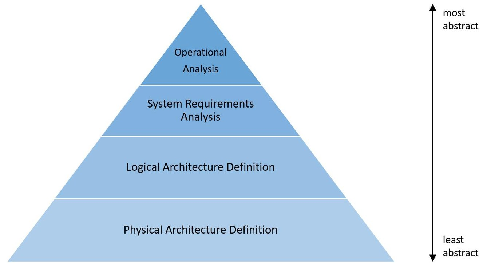

Figure 2.3.: Generic architecture development workflow derived from ISO 15288 technical processes

## 2.2.1 Operational Analysis

The operational analysis phase focuses on analyzing the stakeholder needs/concerns and translating them into stakeholder requirements specification. Before eliciting stakeholder requirements, the business or mission level needs are defined by the management that are based on the business vision of the organization or an enterprise, the concept of operations and organization strategic goals and objectives. Using these as a guidance, the stakeholder needs are elicited, either using models or textual databases, and later translated into stakeholder requirements that can be linked to the system model artifacts within a modeling environment. Based on the stakeholder needs, high-level goals of the business or mission

<!-- PDF_PAGE: 41 -->

are identified and are modeled with specific artifacts to create the most abstract formulation of the requirements, called use cases, and in some contexts, capabilities The actors and entities that interact with the system-of-interest are linked to the respective capability thus identifying external beneficiaries of the system. An operational context is identified along with various external actors and entities interacting with the system during its operation. SE dictates that every system is meant to provide a primary, externally delivered value-related function to its intended users. The function is later decomposed into internal functions that the system must perform to achieve the primary functions. The functionality of a system is the sum of its external and internal functions that the system provides or consists of. The system functionality is described by its use case or capability in terms of how it is used to achieve the goals of its various users or provide a specific capability. The identification of a high-level system functionality is done in this phase. Operational Needs Analysis is highly promoted by architecture frameworks such as TOGAF, DoDAF, and NAF [42].

## 2.2.2 System Requirements Analysis

The stakeholder requirements are used to derive the system functional and non-functional requirements. The system functional requirements are used to identify the internal functions that the system needs to perform. A functional architecture is the description of the system in functional terms independent of its technology. The functional architecture is meant to show the functional interactions of the system components without identifying the actual components. A system capability can be elaborated by a set of behavioral representations such as functional flow block diagrams, data flow, and sequence of activities or the system's state-based behavior. There is no rule on what kinds of behavioral representations need to be done for functional analysis and one may choose to model these in a certain way based on a certain methodology being followed in the appropriate context. In this phase, it is ensured that all the functional requirements are represented by the capabilities and the functional requirements can be refined or new requirements can be defined if needed. At times referred to as system functional analysis, this a key step in defining the functional requirements. Functional analysis (FA) is one of the most important techniques in SE and

<!-- PDF_PAGE: 42 -->

is a distinct phase in many SE methodologies. Although system level functional analysis is an important phase, functional analysis should not be constrained to a system level and therefore it is sometimes misleading to include FA as a distinct phase.

## 2.2.3 Logical Architecture Definition

The main output of the requirements analysis phase is to identify the functional architecture of the system. The logical architecture definition phase is where the modeling shifts from the 'problem space' to the 'solution space'. "The logical architecture of a system is composed of a set of related technical concepts and principles that support the logical operation of the system" [11]. A logical architecture is an abstract representation of the system components, independent of their technical solutions, in a way that every function of the system can be performed by a corresponding logical component. Logical-level function decomposition (subsystem/component functions) can be the necessary next step to identify sub-functions that must be performed to satisfy higher level functions. Based on this decomposition, a system can be decomposed into its elements in a way that every function or sub-function must be performed by a certain element (form), which might be a subsystem or a component. The identified elements, called as logical elements, define the system logical architecture that implements the system functional architecture. During the course of defining the logical architecture, more logical functions can be identified leading to creation of corresponding logical elements. Based on the logical architecture, various logical component and interface requirements are developed and refined that must be properly documented.

## 2.2.4 Physical Architecture Definition

The next phase deals with defining the system's physical architecture. "A physical architecture is an arrangement of physical elements (system elements and physical interfaces) which provides the design solution for a product, service, or enterprise, and is intended to satisfy logical architecture elements and system requirements" [11]. It is implementable through technologies. The purpose of a physical architecture is to develop a technical so-

<!-- PDF_PAGE: 43 -->

lution to the logical architecture. In this phase, the logical components are attributed to physical system components that will actually perform the internal functions. A system function can be performed by one logical component, but can be executed by one or many physical components that are represented in the physical architecture. Based on the physical architecture, component requirements are developed, refined and documented. In an architecture development process, alternative physical architectures can be synthesized using various techniques to select the best possible solution that satisfies system requirements.

A good system modeling tool should be able to satisfy all the modeling needs that might occur in the aforementioned phases. This is a very generic workflow and might vary across industries and application domains, which is why a SE methodology must be domainagnostic that can be tailored to the specific needs of a project if required. This brings us to a key distinction between ARCADIA and SysML. ARCADIA [9] is a modeling method that also provides modeling concepts which, when applied with an authoring tool like Capella, provides methodological guidance to systems engineers to design the architectures of their systems. On the other hand, SysML is a modeling language that is independent of a modeling method and provides the required syntax and semantics to develop diagrammatic representations of the system through modeling tools that implement SysML. From a modeler's perspective, ARCADIA/Capella is a Method First, Language Second approach whereas as SysML is a Language First, Method Second approach. (However, ARCADIA provides core modeling concepts that are unique to the method and thus the statement should not be generalized for the overall methodology.) Various MBSE methodologies have been developed to provide guidance for modeling using SysML as discussed in Section 1.3.1. However, being different in the methodological approach, most of these methodologies comply with the fundamentals of the architecture development phases.

## 2.3 The ARCADIA Method

Architecture Analysis & Design Integrated Approach (ARCADIA) is a structured architecture engineering method for defining and validating multi-domain systems, based on architecture-centric and model-driven engineering activities [9]. ARCADIA is a method based on functional analysis and focuses on developing the system by starting from needs

<!-- PDF_PAGE: 44 -->

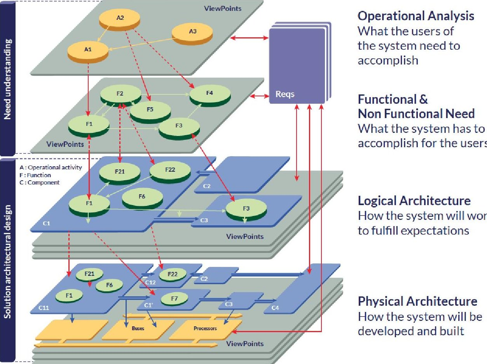

Figure 2.4.: Different phases/layers of the ARCADIA method [43]

analysis and solution development up to integrated verification and validation. ARCA-DIA is very flexible and can be implemented using a top-down, bottom-up or a middle-out development approach as desired. The key phases of the ARCADIA method are:

- Customer Operational Needs Analysis, which defines the needs of the system users to be accomplished,

- System Needs Analysis, which defines what the system needs to accomplish for its users,

- Logical Architecture Design, which defines how the system will satisfy the system needs, and,

- Physical Architecture Design, which defines how the system will be built and developed.

<!-- PDF_PAGE: 45 -->

These phases as implemented in the Capella modeling tool are discussed in detail during the implementation in Chapter 4. The methodological guidance of ARCADIA is executed using a number of diagrams with interlinked model elements that define the structure and behavior of the system. In addition to a method, ARCADIA provides metamodel concepts to support its methodical approach.

## 2.3.1 Polarsys Capella $ ^{\mathrm{TM}} $

Capella is an open source software solution for MBSE which provides a process and supporting tool for modeling multi-domain system architectures, in compliance with the ARCADIA method [44]. It is a hybrid modeling tool that provides notations for the ARCADIA metamodel concepts (ARCADIA ML) and is highly inspired by SysML. Capella is developed as an initiative of the Polarsys group, on of the several Eclipse Foundation working groups [10]. It is essential to highlight that Capella is the only tool that supports modeling using the ARCADIA method. Capella supports the ARCADIA method by providing seven characterized types of diagrams that are: data flow diagrams, scenario diagrams, architecture diagrams, mode and state diagrams, breakdown diagrams, class diagrams and capability diagrams. These diagrams are provided in all the ARCADIA perspectives with specific distinctions between the diagram elements at each level.

## 2.4 Object-Oriented Systems Engineering Method (OOSEM)

Object-Oriented Systems Engineering Method is an MBSE method that integrates topdown, object-oriented concepts with traditional SE methods for architecting multi-domain systems that are flexible and extensible to accommodate developing technologies and requirements. OOSEM supports the traditional SE activities and can enable integration with object-oriented software development, hardware development, and verification and validation methods [3]. OOSEM supports the system development process by the following activities:

- Stakeholder Needs Analysis, to specify the mission needs to reflect customer and other stakeholder needs

<!-- PDF_PAGE: 46 -->

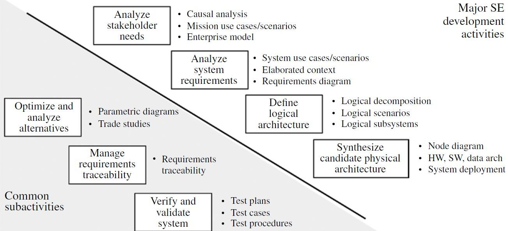

Figure 2.5.: OOSEM activities and modeling artifacts [3]

- System Requirements Analysis, to analyze and specify the system requirements to support the stakeholder requirements

- Logical Architecture Definition, to decompose and partition the system into logical elements

- Synthesis of Candidate Physical Architectures, to describe the relationships among the physical elements of the system

- Optimizing and Evaluating Alternatives, to optimize the architecture alternatives and enable trade-offs

- Requirements Traceability Management, to ensure traceability between model elements throughout the other OOSEM activities

- System Verification and Validation, to verify that the system design meets the requirements and to validate that those requirements meet the stakeholder needs

These activities are aligned with a typical SE 'Vee' process and can be applied recursively and iteratively at each level of the system hierarchy. A detailed implementation of these activities is done in Chapter 4.

<!-- PDF_PAGE: 47 -->

## 2.4.1 No Magic Cameo Enterprise Architecture $ ^{\mathrm{TM}} $

Cameo Enterprise Architecture $ ^{\mathrm{TM}} $ is an MBSE tool developed by No Magic Inc. Cameo EA provides modeling support to SysML 1.4 specification [45]. Cameo Enterprise Architecture is a specialized architecture modeling tool that provides support to SysML modeling along with architecture frameworks such as Unified Architecture Framework (UAF), Department of Defense Architecture Framework (DoDAF), etc. The tool implements the pure SysML standard as specified by the OMG. Cameo Enterprise Architecture uses the SysML extension mechanisms to provide domain-specific customization through third-party vendors. It supports all the 9 SysML diagrams along with UML diagrams.

## 2.5 Object-Process Methodology

Object-Process Methodology (OPM) is a MBSE methodology invented by Dr. Dov Dori at the Massachusetts Institute of Technology [32]. OPM is defined on the premise that everything in the universe is ultimately either an object or a process. Hence, any system in this universe can be conceptually represented in an object-process paradigm through various types of relationships between the objects and the processes. "An object is thing that exists or might exist physically or informatically. A process is a thing that transforms an object by generating, consuming or affecting it. Objects and processes are collectively referred to as things" [32]. OPM also considers the stateful nature of objects meaning that objects possess various states and a process can transform an object from one state to another. In OPM, a system can be modeled using a single type of diagram called the Object-Process Diagram (OPD). The top-level OPD consists of the extreme primary process (function) that the system needs to perform along with the object (form) that is the system itself which can be further decomposed to lower levels using the lower-level OPDs. Some of the OPM concepts are briefly discussed in the following chapter.

<!-- PDF_PAGE: 48 -->

# 3. CASE STUDY: DESCRIPTION

"Use a picture. It's worth a thousand words." Arthur Brisbane (1911)

This chapter introduces the example system for the study using OPM. The case study used to compare the modeling approaches is an ACC feature. The purpose of the comparison is to focus on the modeling artifacts that can be used to develop the system architecture and other modeling capabilities in both the tools. A certain system architecture developed by a 'vehicle architect' will differ significantly from the architecture developed by an 'ACC architect', because of the system context being different in each case. This model has been developed by considering an ACC system as the system-of-interest and the vehicle's actuating systems and other subsystems as the environmental actors that will interact with the system. The accuracy and the logic of the system architecture is not of primary concern in this study. The second section of this chapter describes the evaluation perspectives, criteria and the metrics used for the study.

## 3.1 Adaptive Cruise Control Architecture

An ACC system is a type of a collision avoidance system developed for the enhancement of driver and passenger safety features in modern automotive. Conventional cruise control systems have been around for several decades and adaptive cruise control systems have become the trend in past couple decades. ACC systems differ from the conventional cruise control systems in that the conventional systems, when in operation, may include a control function to minimize the gap between the actual speed of the vehicle and the desired speed set by the driver whereas the adaptive cruise control adapts the conventional control to the subject vehicle's external environment by mitigating the effects of targets on such vehicle that are within a particular distance of the vehicle and in the path of the vehicle [47]. The ACC system consists of sensors attached to the front of the vehicle, typically radar and

<!-- PDF_PAGE: 49 -->

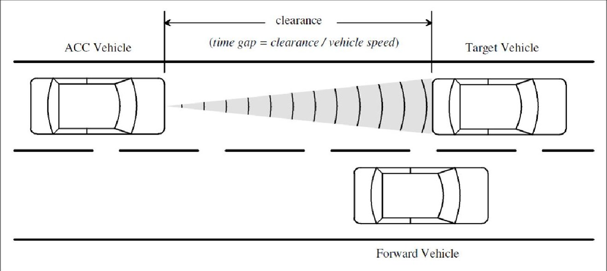

Figure 3.1.: ACC-equipped vehicle external relationships [46]

camera vision, and more recently, lidar sensors, which are used to detect the target vehicles. If a slow moving vehicle is detected in the vehicle's path, the ACC system slows the vehicle down and controls the clearance, or time gap, between the subject vehicle and target vehicle. Figure 3.1 shows the relationships of an ACC feature with its external environment entities, mainly the target vehicle and the forward vehicle.

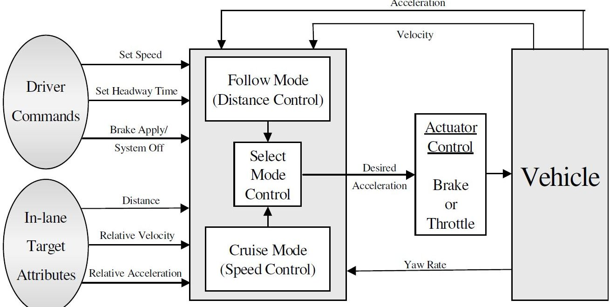

Figure 3.2.: ACC control structure [48]

<!-- PDF_PAGE: 50 -->

The ACC control structure is shown in Figure 3.2. It consists of two modes of operation, namely, 'speed control' and 'distance control'. In the absence of a target, the ACC control will provide the speed control based on the desired speed set by the driver. In the presence of a target vehicle, the ACC-control will provide 'distance control' to adjust the subject vehicle speed in order to maintain the desired gap behind the target vehicle. Once the desired speed and the desired gap is specified by the driver, the ACC control will switch smoothly between the two modes based upon the traffic situation. The front sensors provide the target vehicle data to the controller which then sends actuation signals to the various actuation subsystems of the vehicle to perform the necessary functions. A system architecture can be developed for an ACC system considering the actuating systems as part of the system's elements. However, for the purposes of this study, only the ACC controller is modeled.

## ACC Stakeholder Needs

Before starting the modeling process, a set of stakeholder needs were identified that would serve as the basis for the modeling process. ACC stakeholder needs are shown in Table 3.1.

<!-- PDF_PAGE: 51 -->

Table 3.1.: ACC 'Stakeholder Needs'

<table border="1"><tr><td>Name</td><td>Description</td></tr><tr><td>Highway driving assistance</td><td>Enhance driving by providing automated driving assistance while driving the vehicle on highways.</td></tr><tr><td>Turn ON/OFF</td><td>The user should be able to securely turn the system ON/OFF while driving.</td></tr><tr><td>Speed control</td><td>The user must be able to maintain the speed of the vehicle autonomously when a lead vehicle is detected.</td></tr><tr><td>Distance control</td><td>The user must be able to maintain the speed of the vehicle autonomously.</td></tr><tr><td>ON status</td><td>The system shall display ON status when the feature is enabled by the driver.</td></tr><tr><td>Emergency deactivation</td><td>In the case of emergency, the user shall be able to deactivate the feature by pressing the brake pedal.</td></tr><tr><td>Emergency activation prevention</td><td>After emergency deactivation, the feature shall not enable itself automatically unless indicated by the driver.</td></tr></table>

## 3.1.1 ACC Modeled Using Object-Process Methodology (OPM)

'The Function-as-a-Seed Principle' is one of the basic principles of OPM which states that "modeling a system starts by defining, naming, and depicting the function of the system, which is also its top-level process". The modeling process in OPM starts by identifying the top-most function that the system performs which is the value that the system delivers to its beneficiaries, which, in our case would be, 'Providing ACC'. The Object-Process Diagram is called System Diagrams (SD) at all the levels of abstraction. The object and the process represents the system's form and function respectively [32]. OPM was chosen as the reference architecture modeling method mainly for two reasons:

- "OPM is fundamentally simple, both to build complex system architecture and to reason through the system" [32], and,

<!-- PDF_PAGE: 52 -->

- "OPM allows a clear representation of the many important features of a system: its topological connections; its decomposition into elements and sub-elements; the interfaces among elements and the emergence of function from elements" [32].

Comparing the candidate architectures against the OPM architecture would provide a clear context for the evaluation of architecture representativeness. This aspect is discussed later in this section.

The modeling started by creating the primary function of the system using the OPD. Figure 3.3 shows 'Providing ACC' modeled as the top-level process.

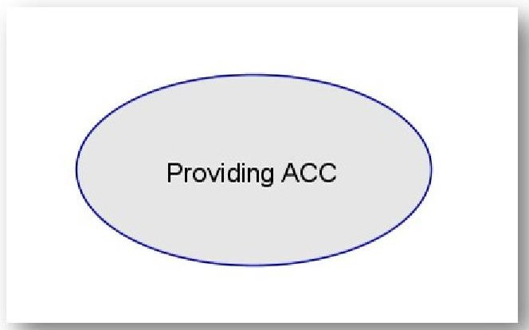

Figure 3.3.: 'Providing ACC' modeled as a OPM process

After modeling the first process in OPM, various beneficiaries of the system were identified along with the objects required to support the process. This created the first mapping of form and function in the architecture. One of the several advantages of using OPM is that it is bimodal. It supports modeling of a system architecture through a graphical as well as a textual model. Object-Process Language (OPL) is the textual modality of OPM that complements its graphical representation through OPD [32]. An astonishing fact about OPL is that it uses natural language to describe and create the model. Conversely, an OPM model diagram automatically generates OPL sentences that are easily interpretable. Hence, instead of describing the ACC architecture using descriptive text, the various OPM system diagrams are complemented with the OPL sentences that were generated automatically. However, before reading the OPDs and the OPL, following terms should be known:

- Objects are rectangular (green), processes are elliptical (blue)

<!-- PDF_PAGE: 53 -->

- Rounded rectangles are states of the object

- Things can be environmental or systemic

- Things can be classified by their essence attribute as either physical or informatical

## ACC System OPM Diagrams

Figure 3.4 describes the top-level System Diagram in OPM, named SD, that includes the top-level function as the process, the object, and the environmental processes which excite the main process, whereas Figure 3.5 describes the corresponding OPL generated from the SD.

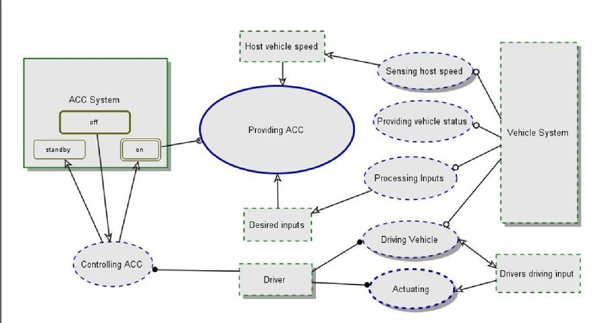

Figure 3.4.: Top-level OPM System Diagram

<!-- PDF_PAGE: 54 -->

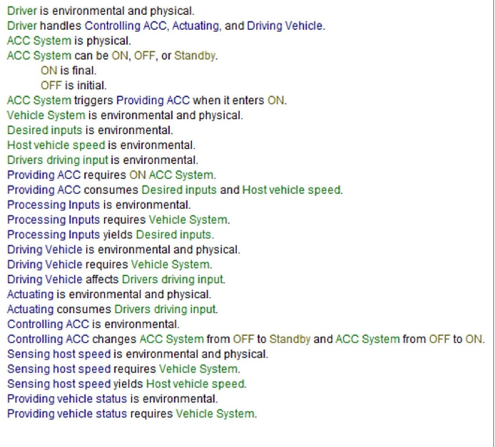

Figure 3.5.: Object-Process Language for SD

After the first OPD, the process and the objects are decomposed in the next system diagram, also called as 'in-zoomed' diagram along with any other non-idealities identified. Figure 3.6 shows the next level of abstraction of our system in the SD1 diagram along with the corresponding OPL1 in Figure 3.7. Similarly, the system diagrams for lower level of abstraction (sub processes) are shown in Figure 3.8 and Figure 3.10 along with their corresponding OPLs in Figure 3.9 and Figure 3.11 respectively.

<!-- PDF_PAGE: 55 -->

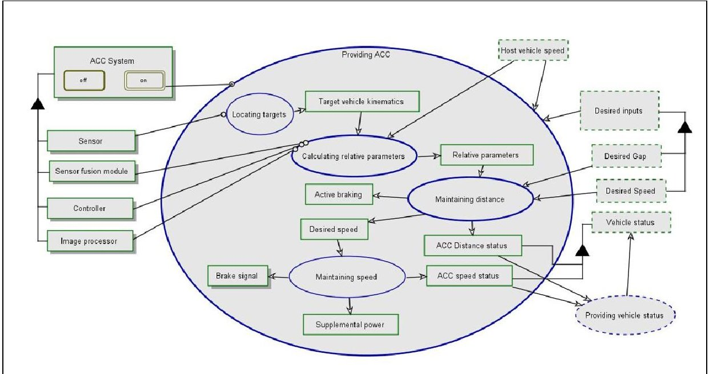

Figure 3.6.: Object-Process Diagram for SD1: 'Providing ACC' in-zoomed

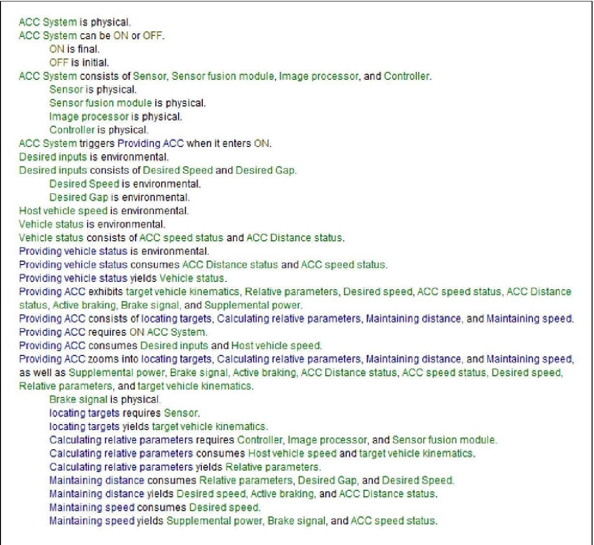

Figure 3.7.: Object-Process Language for SD1: 'Providing ACC' in-zoomed

<!-- PDF_PAGE: 56 -->

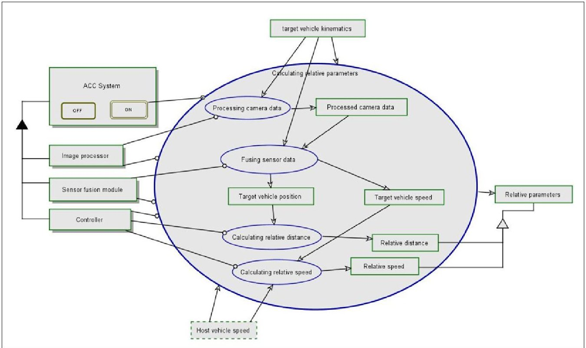

Figure 3.8.: Object-Process Diagram for SD1.1: 'Calculating relative parameters'in-zoomed

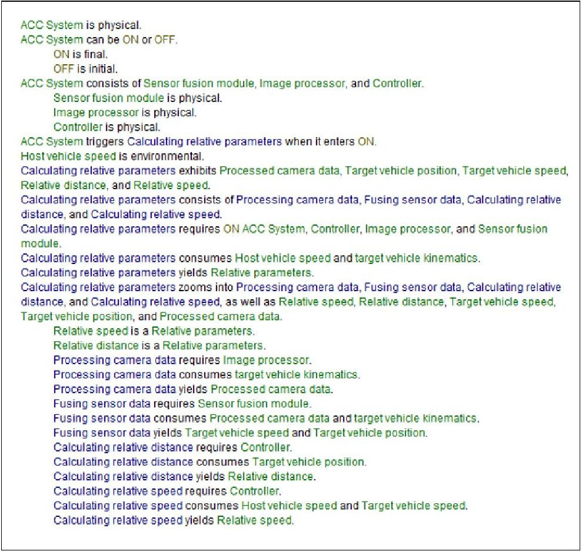

Figure 3.9.: Object-Process Language for SD1.1: 'Calculating relative parameters'in-zoomed

<!-- PDF_PAGE: 57 -->

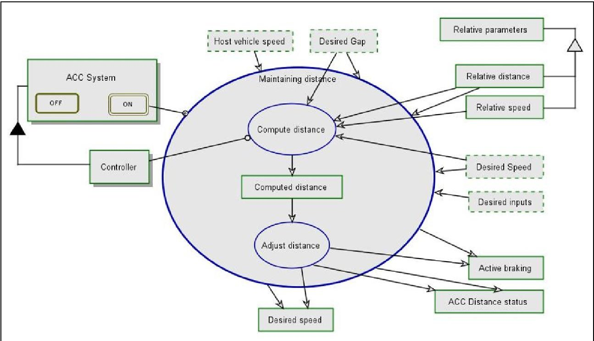

Figure 3.10.: Object-Process Diagram for SD1.2: 'Maintaining distance' in-zoomed

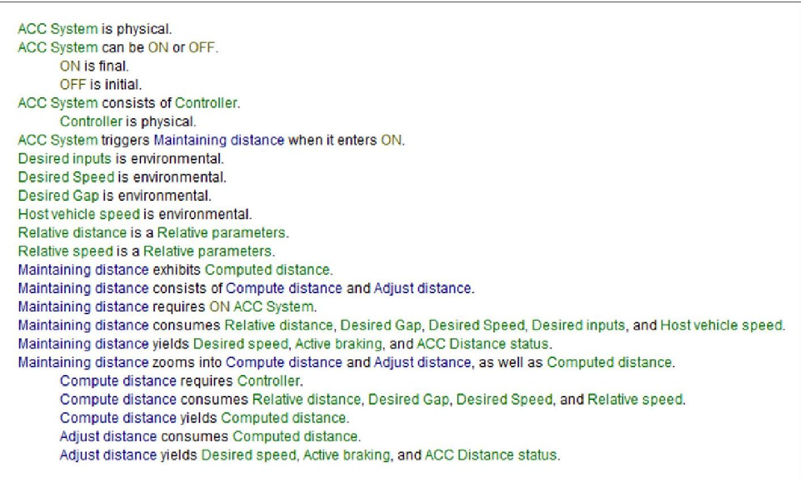

Figure 3.11.: Object-Process Language for SD1.2: 'Maintaining distance' in-zoomed

<!-- PDF_PAGE: 58 -->

## 3.2 Evaluation Criteria

The evaluation of the two approaches is based on 3 parameters. This section describes the evaluation parameters and the criteria partly developed for the study by referring to several sources.

## 3.2.1 Representation of a 'Good' Architecture

The first step in evaluating architecture development approaches is to assess the quality of the developed architecture itself. Modern systems are more likely to be successful if we are careful about identifying and making architecture decisions early in the life cycle. Recalling the definition of architecture, "a system architecture is the embodiment of concept, the allocation of physical/informational function to the elements of form, and the definition of relationships among the elements and with the surrounding context" [1]. From the abovementioned definition, it can be deduced that the most important characteristics of a system architecture are: form, function, and internal and external elemental relationships. It is of utmost importance to understand the synthesis of form and functions that results in the architecture. The mapping between the form and function of a system is what makes its architecture unique. For instance, two systems with exactly similar components and a similar external function can possess entirely different architectures because of their form-function mapping. Additionally, a system architecture should be able to manage the complexity of the system. This complexity can be elaborated and understood by mechanisms such as system decomposition and hierarchy, of both, form and function, as well as the logical relationships between the elements and specific tools to reason through the system. Crawley et al. [1] provide a set of questions to defining an architecture. It is therefore logical to evaluate the architecture quality by trying to answer these questions. However, an architecture must also be assessed on its ability to manage complexity. Hence, based on the questions, a simplified and enriched questionnaire is created with 4 additional questions to assess complexity management. Table 3.2 describes the questionnaire to defining a good architecture.

<!-- PDF_PAGE: 59 -->

Table 3.2.: Architecture evaluation criteria

<table border="1"><tr><td>Id</td><td>Baseline</td><td>Question</td></tr><tr><td>SA-1</td><td rowspan="10">Object Process Methodology System Diagram</td><td>How well does the architecture support the mapping of the components (form) to the internal functions? How well does the formal structure support the functional architecture?</td></tr><tr><td>SA-2</td><td>How well does the system architecture support modeling non-idealities?</td></tr><tr><td>SA-3</td><td>How well does the system architecture represent external and internal structural interfaces?</td></tr><tr><td>SA-4</td><td>How well does the system architecture represent external and internal functional interfaces?</td></tr><tr><td>SA-5</td><td>How well does the system architecture represent the sequential execution of activities?</td></tr><tr><td>SA-6</td><td>How well does the system architecture represent parallel threads or strings of functions that execute as well?</td></tr><tr><td>SA-7</td><td>How well does the system architecture represent the various layers of abstraction?</td></tr><tr><td>SA-8</td><td>How well does the architecture represent decomposition of form and function?</td></tr><tr><td>SA-9</td><td>How well does the architecture represent hierarchy and hierarchic decomposition?</td></tr><tr><td>SA-10</td><td>How well are the elemental relationships represented in the architecture?</td></tr></table>

Several qualitative metrics were defined to weigh the criteria. A simplified approach was adopted to quantify the metrics wherein each metric is assigned a grade of 1 to 4, 4 being the highest. An overall evaluation of the questionnaire would allow us to grade the architectures out of a score of 40 in total. The evaluation is based on the following qualitative metrics:

- Better (4): The desired functionality is better than the OPM representation

- Comparable (3): The desired functionality is comparable to the OPM representation

- Supported (2): The desired functionality is supported but cannot be justified for the quality when compared to the OPM representation

- Sub-par (1): The desired functionality is qualitatively deficient than the OPM representation

<!-- PDF_PAGE: 60 -->

## 3.2.2 Key Process Deliverables

According to the INCOSE SE Handbook, the SE technical processes lead to generating a formal set of requirements and system solutions to those requirements conforming to the various constraints such as environmental, external interfaces, performance and design. [3]. In order to enable these interactions between the stakeholders in these processes, a welldefined set of engineering artifacts must be defined to standardize the overall workflow. The handbook provides a list of process inputs, activities and outputs to each of the SE processes as stated in the ISO 15288 standard. A good SE implementation ensures that the processes consume most of the inputs (sources of information), perform all the relevant activities and generate the required process outputs (results) at every process. Similarly, in a model-based context, a good implementation would mean that the system modeling activity provides the required results during each phase of the modeling workflow defined in Section 2.2. These results are often characterized as deliverables, defined as the quantifiable artifacts that must be provided at the end of each phase. To evaluate the modeling approaches, a list of key deliverables for each of the four phases in Section 2.2 is identified by reviewing the resources [3] and [11] as well as consultation with industry personnel. The metamodel concepts of the candidate tools are mapped against the deliverable artifacts to assess the supportability of the tool in each phase of architecture modeling. The list of deliverable artifacts expected out of each phase is shown in Table 3.3.

In each of the candidate modeling tools, the syntax provides a clear distinction between the model elements and diagram elements. A diagram element is merely an instance of the model element that is stored in the model repository. Hence, the scope of the deliverables sufficiently includes the model elements and diagrams of the candidate tools.

<!-- PDF_PAGE: 61 -->

Table 3.3.: Architecture development phases - deliverable artifacts

<table border="1"><tr><td>Modeling Phase</td><td>Key Deliverable Artifact</td></tr><tr><td rowspan="4">Operational Analysis</td><td>Stakeholder Requirements Specification</td></tr><tr><td>Requirements Justification Document(requirements traceability)</td></tr><tr><td>Input for Draft Verification and Validation Plans</td></tr><tr><td>Operational Concepts(OpsCon)</td></tr><tr><td rowspan="5">System Requirements Analysis</td><td>System Requirements Specification</td></tr><tr><td>System Function Definition</td></tr><tr><td>System Requirements Justification Document(requirements traceability)</td></tr><tr><td>Context Diagram</td></tr><tr><td>External Interface Definition</td></tr><tr><td rowspan="4">Logical Architecture Definition</td><td>Internal Behavior Definition</td></tr><tr><td>System Architecture Description</td></tr><tr><td>Subsystem Requirements Justification Document</td></tr><tr><td>Internal Interface Definition</td></tr><tr><td rowspan="5">Physical Architecture Definition</td><td>Component Requirements Specification</td></tr><tr><td>Physical Behavior Description</td></tr><tr><td>Physical Architecture Description</td></tr><tr><td>Component Requirements Justification Document</td></tr><tr><td>Physical Interface Definition</td></tr></table>

## 3.2.3 Framework for the Evaluation of MBSE Methodologies for Practitioners (FEMMP) [40]

The two aforementioned perspectives focused on the evaluation of the system architectures and the supporting metamodel concepts. However, the system architecture development process greatly influences the overall MBSE methodology. Inversely, the overall MBSE methodology must be well-suited to incorporate the developed architectures into the model-based paradigm. For a practical evaluation of the two architecture modeling approaches, it is essential to evaluate the methodologies at large. "A methodology is defined as the combination of processes, tools and people" [3]. Weilkiens et al. [40] have developed the FEMMP to support MBSE end users to evaluate various methodologies available and identify the best possible solution meeting their specific needs. The FEMMP defines a catalog of criteria against which the methodologies are assessed. They are grouped by areas and allow the independent evaluation of the process, the quality of the model, its practical implementation in a tool, and how well it can be applied to a standard case study. It is key

<!-- PDF_PAGE: 62 -->

to distinguish the system model from the system architecture. A system model incorporates a wealth of information that is beyond the scope of a system architecture. The FEMMP assesses the quality of the model in general, whereas Section 3.2.2 aims to assess the quality of the architecture in particular. The evaluation criteria of FEMMP has been grouped by various aspects such as Essentials, Practicality, Efficiency, Usability/Experience, and Support. The criteria, indicating their scope (applicable to the whole methodology, process, language, tool) are weighted on relevance between '1' to '3', with '3' being the most relevant to be focused on first.

After defining the criteria, the framework provides four major types of metrics to assess the criteria as described in Figure 3.12:

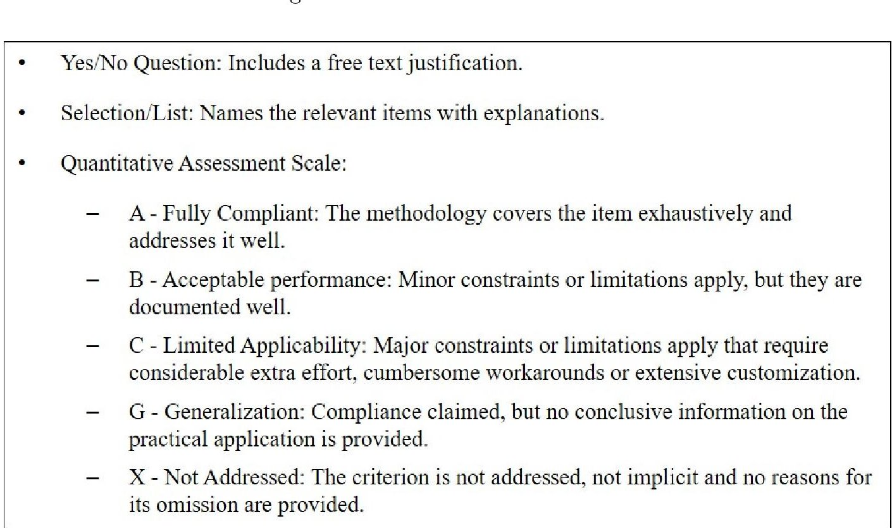

Figure 3.12.: FEMMP evaluation metrics [40]

The FEMMP catalog describing the criteria from all the groups is described in Table 3.4.

<!-- PDF_PAGE: 63 -->

Table 3.4.: FEMMP catalog [40]

<table border="1"><tr><td>ID</td><td>Area</td><td>Category</td><td>Title</td><td>Description</td><td>Type</td><td>Wt</td></tr><tr><td>A-00-P</td><td>Essentials</td><td>Process</td><td>ISO Standard</td><td>What process steps of ISO 15288 are covered?</td><td>List</td><td>3</td></tr><tr><td>A-01-P</td><td>Essentials</td><td>Process</td><td>Framework</td><td>What views from the reference framework are used?(MODAF, DODAF...)</td><td>List</td><td>3</td></tr><tr><td>A-02-L</td><td>Essentials</td><td>Language</td><td>Philosophy</td><td>Are Model Elements clearly distinguished from Diagram Elements?(separation of content from representation)</td><td>Y/N</td><td>3</td></tr><tr><td>A-03-T</td><td>Essentials</td><td>Tool</td><td>Precision</td><td>How precise does the tool implement process semantics and sequence?(Is the process well enforced, can&quot;wildcard&quot;elements be used e.g. an&quot;association relationship&quot;, are constrained clearly communicated and controlled, are&quot;work arounds&quot;allowed that reduce the model quality)</td><td>Scale</td><td>3</td></tr><tr><td>B-00-L</td><td>Practicality</td><td>Language</td><td>Language</td><td>What Modelling Language is used?(If NOT SysML:How well does it define the real-world semantics of the engineering, are elements strictly typed, is their meaning unambiguous, do they have a defined purpose etc.)</td><td>List</td><td>3</td></tr><tr><td>B-01-M</td><td>Practicality</td><td>Methodology</td><td>Scalability</td><td>How well does the model scale?(suitable for large projects,&quot;grows&quot;with time without becoming cumbersome, does it require partitioning e.g. in a tree)</td><td>Scale</td><td>3</td></tr><tr><td>B-02-M</td><td>Practicality</td><td>Methodology</td><td>Scope</td><td>For what engineering purpose is the methodology suited(innovation, improved products, refactoring, reverse engineering,...)?</td><td>List</td><td>2</td></tr><tr><td>B-03-M</td><td>Practicality</td><td>Methodology</td><td>Tailoring</td><td>How easy is it to tailor the methodology?(add, delete or change processes or process steps, object definitions or toggle tool features on and off)</td><td>Scale</td><td>3</td></tr><tr><td>B-04-P</td><td>Practicality</td><td>Process</td><td>Consistency</td><td>Is the process self-contained?(are in./outputs to all steps connected)</td><td>Y/N</td><td>3</td></tr><tr><td>B-05-M</td><td>Practicality</td><td>Methodology</td><td>Variants</td><td>How well does the methodology support the variant management?</td><td>Scale</td><td>3</td></tr><tr><td>B-06-M</td><td>Practicality</td><td>Methodology</td><td>Complexity</td><td>How often is the methodology&quot;interrupted&quot;(by external processes and/or non-integrated tools)</td><td>Scale</td><td>2</td></tr><tr><td>B-07-T</td><td>Practicality</td><td>Tool</td><td>Connectivity</td><td>How easily can the information be exchanged with other tools?(What standard API are provided by the tool, what API can be added, Is import and export based on open protocols, is it guided, e.g. by a wizard, can it be rolled-back, what the quality control mechanism etc.)</td><td>Scale</td><td>3</td></tr><tr><td>B-08-L</td><td>Practicality</td><td>Language</td><td>Integration</td><td>How well can the model be integrated with specialty engineering models?(CAD, PNID, Project Management, Document Management)</td><td>Scale</td><td>1</td></tr><tr><td>B-09-M</td><td>Practicality</td><td>Methodology</td><td>Simulation</td><td>How well does the methodology provide for an integrated simulation?</td><td>Scale</td><td>2</td></tr><tr><td>B-10-M</td><td>Practicality</td><td>Methodology</td><td>Redundancy</td><td>How well does the methodology prevent duplication?(of work, model elements, artefacts, communications and reports)</td><td>Scale</td><td>2</td></tr><tr><td>C-00-T</td><td>Efficiency</td><td>Tool</td><td>Perspectives</td><td>To what level is the creation of experts&#x27; perspectives automated?(can views be defined on the model or do they require manual re-work)</td><td>Scale</td><td>1</td></tr><tr><td>C-01-T</td><td>Efficiency</td><td>Tool</td><td>Checking</td><td>Does the tool support consistency checking of the model?(Automated detection of wrong content and/or formats, flagging of, &quot;loose ends&quot; etc.)</td><td>Y/N</td><td>2</td></tr><tr><td>C-02-T</td><td>Efficiency</td><td>Tool</td><td>Reporting</td><td>How quickly are standard/custom reports, is design documentation created?(select templates or views, filter reports, re-use of settings, define aggregation, required level of experience, potential level of automation)</td><td>Scale</td><td>1</td></tr><tr><td>C-03-T</td><td>Efficiency</td><td>Tool</td><td>Admin</td><td>How well does the tool help to minimise work that isn&#x27;t creating any value?(low admin, auto versioning and back-up)</td><td>Scale</td><td>1</td></tr><tr><td>C-04-T</td><td>Practicality</td><td>Tool</td><td>Reuseability</td><td>Does the tool allow to reuse any type of Modelling Element across projects?(sharing the same object with the same lifecylce in any project)</td><td>Y/N</td><td>2</td></tr><tr><td>D-00-T</td><td>Experience</td><td>Tool</td><td>Navigation</td><td>How easy is it to find the correct model element?(are elements links, users&quot;guided&quot;在the process, information well aggregated, need to&quot;jump&quot; screens)</td><td>Scale</td><td>2</td></tr><tr><td>D-01-T</td><td>Experience</td><td>Tool</td><td>Intuition</td><td>How intuitive is the tool to work with?(compliance with UX conventions, standard tool reactions e.g. tool tips, double/right click, drag&amp;drop, delete, Keyboard shortcuts, spell check, familiar operations e.g. as MS-Office)</td><td>Scale</td><td>2</td></tr><tr><td>D-02-T</td><td>Experience</td><td>Tool</td><td>View</td><td>How easy is it to configure the UX dynamically?(define a matrix with sorting &amp; filtering of columns and rows, store customised view, annotation, comment)</td><td>Scale</td><td>1</td></tr><tr><td>D-03-T</td><td>Experience</td><td>Tool</td><td>UI</td><td>How readable is the UI?(Good use of screen estate and colour, zoom, can fonts and sizes be changed, is information well presented...)</td><td>Scale</td><td>1</td></tr><tr><td>E-00-M</td><td>Help</td><td>Methodology</td><td>Documentation</td><td>How well is the methodology supported?(books, manuals, case studies, online help, community, websites, interactive support, user feedback etc.)</td><td>Scale</td><td>3</td></tr><tr><td>E-01-M</td><td>Help</td><td>Methodology</td><td>Training</td><td>How well is training supported?(availability, consultants, coaches, e-training, background knowledge required)</td><td>Scale</td><td>1</td></tr><tr><td>E-02-T</td><td>Help</td><td>Tool</td><td>Support</td><td>How well is the tool supported?(vendor response times, 24/7 helpline etc.)</td><td>Scale</td><td>1</td></tr></table>

<!-- PDF_PAGE: 64 -->

## 4. CASE STUDY: IMPLEMENTATION

"Since all models are wrong, the scientist cannot obtain a 'correct' one by excessive elaboration."

George E.P. Box (1976)

This chapter describes the implementation of the Adaptive Cruise Control case study using OOSEM/SysML and ARCADIA/Capella. Section 4.1 describes the SysML approach to modeling using OOSEM. Section 4.2 discusses the ARCADIA/Capella approach to modeling the case study. Both the approaches are unique in their own ways while serving a similar purpose at the same time. The architecture development workflow developed in Chapter 2 is used as a template to maintain consistency throughout this chapter.

## 4.1 Modeling ACC Using OOSEM/SysML

Table 4.1.: 'PMTE' elements mapped to architecture development using OOSEM/SysML

<table border="1"><tr><td>Process</td><td>ISO/IEC/IEEE 15288 Standard Process Model
(System Architecture Development)</td></tr><tr><td>Method</td><td>OOSEM</td></tr><tr><td>Tool</td><td>Cameo Enterprise Architecture</td></tr><tr><td>Environment</td><td>University Research Infrastructure</td></tr></table>

Before starting the implementation, the following section will provide an overview of the SysML diagram types.

<!-- PDF_PAGE: 65 -->

## SysML Diagram Taxonomy

Figure 4.1 shows the diagram taxonomy of SysML. SysML diagrams are characterized into three types: structure diagram, behavior diagram, and requirement diagram. In total, SysML provides 9 diagrams. Each of these diagrams are briefly described below:

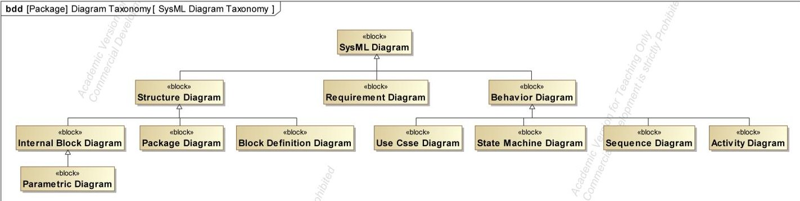

Figure 4.1.: SysML Diagram Taxonomy

## Structure

1. Block definition diagram (bdd): A block definition diagram is used to model the structural elements, called block and their composition and classification. These diagrams are used to define the structure and behavior aspects.

2. Internal block diagram (ibd): An internal block diagram is used to model the internal structure of the blocks which includes their properties, connections and the interfaces.

3. Parametric diagram (par): A parametric diagram is used to model the constraints on the properties of the system and their relationships to support parametric analysis.

4. Package diagram (pkg): A package diagram is used to organize the system model using elements called 'packages' that contain other model elements.

## Requirements

5. Requirement diagram (req): A requirement diagram is used to model text-based requirements and their relationships with other requirements and model elements.

<!-- PDF_PAGE: 66 -->

## Behavior

6. Use case diagram (uc): A use case diagram is used to model the functionality of a system in terms of it is used by external actors to achieve a given set of goals.

7. Activity diagram (act): An activity diagram is used to model the system's functional interactions by specifying the order of execution of actions.

8. Sequence diagram (sd): A sequence diagram is used to model message-based behavior of the system and its components.

9. State machine diagrams (stm): A state machine diagram is used to model the behavior of an entity based on its state-based transitions triggered by events.

## Implementing OOSEM

Before starting the system architecture design, an important part of any SysML methodology is to set up the model by establishing the modeling conventions and standards, and organizing the model using the package structure in SysML [18]. The modeling project needs to be organized in packages in order to achieve consistency in modeling, make the model readable and to control the model baseline. Figure 4.2 is a high-level description of the 'OOSEM Specify and Design System' process applied in this case study.

<!-- PDF_PAGE: 67 -->

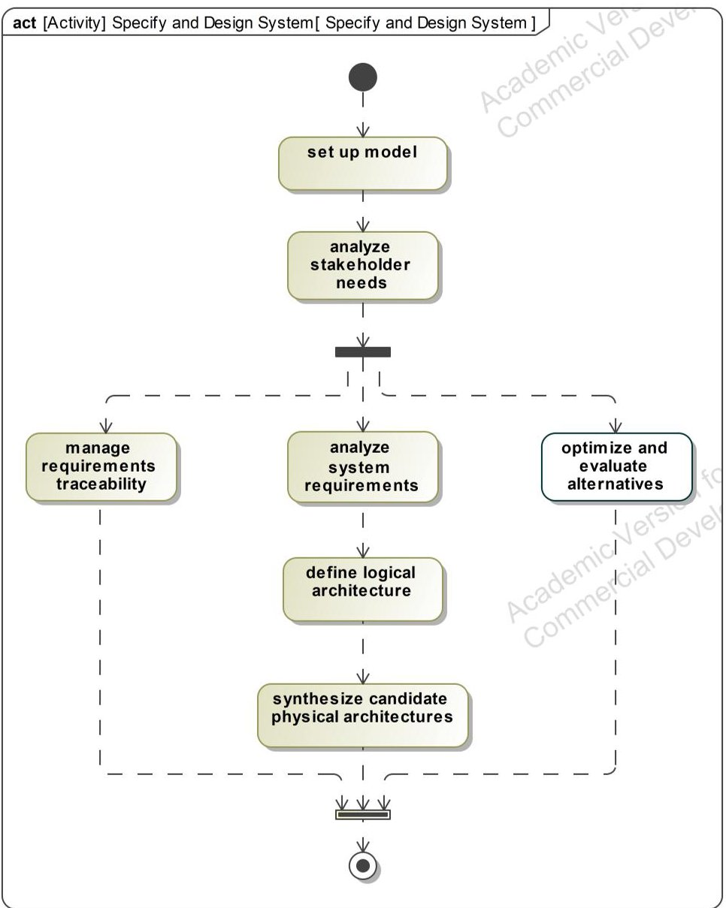

Figure 4.2.: 'Specify and Design System' activities in OOSEM

## 4.1.1 Operational Analysis

Modeling using SysML is widely thought of as a requirements-based approach to architecting systems. Hence, a requirement is considered as a key artifact of the SysML specification. SysML provides a dedicated diagram called requirement diagram (req) to model requirements and their relationships. Some SysML tool vendors provide requirements importing options to import requirements from external requirements database tools and spreadsheets. These requirements are transformed into requirement objects in SysML and can be used in the desired diagram. It is important to note that SysML usability is affected by the tool used by the user. Many tools from different vendors vary in the func-

<!-- PDF_PAGE: 68 -->

tionality offered based on their own customization to the language, APIs, and not all of the tools provide the requirements importing feature. While SysML tools are meant to serve the purpose of modeling, many solutions end up being mere diagramming tools as opposed to being modeling tools. The requirement object is a newly created artifact in SysML that is not inherited from UML, and can be linked to other model elements in SysML such that a traceability can be realized in the SysML model across diagrams. The main steps in the operational analysis phase in OOSEM are:

- Define operational domain

- Define mission/system use cases

- Specify stakeholder requirements

## Define Operational Domain

Based on the set of stakeholder needs, the operational domain for the system is identified using a block definition diagram (bdd). The operational domain allows to establish the scope for the to-be system. This diagram helps to define the system boundary to distinguish the system-of-interest from the external systems and users. The diagram presents the hierarchy of blocks with the 'Operational Domain' block as the top-level block. Figure 4.3 shows the 'Operational Domain' block diagram for ACC, where various operational actors that might interact with the system throughout its life cycle are modeled as blocks.

<!-- PDF_PAGE: 69 -->

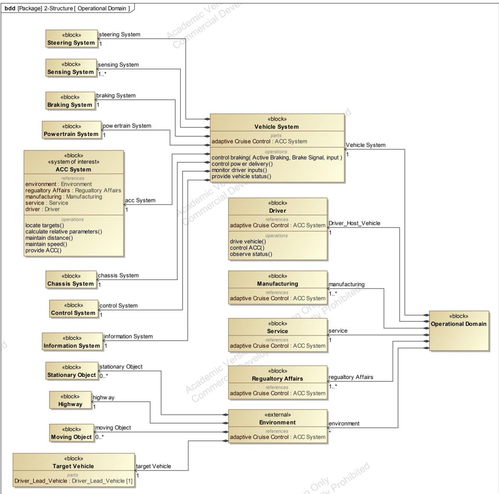

Figure 4.3.: 'Operational Domain' bdd

## Define System Use Cases

A SysML operational level use case can be defined to identify the external actors that are associated with the system. In our example of the ACC, we have defined the system use cases for our system to refine the stakeholder needs. These use cases are described using the use case diagram.

Figure 4.4 shows the ACC system use cases. In product development context, use cases can be used to define the high-level capabilities provided by the system or a mission that refine the stakeholder and system requirements. While performing operational analysis in SysML, an operational context for a system is usually defined in SysML while considering

<!-- PDF_PAGE: 70 -->

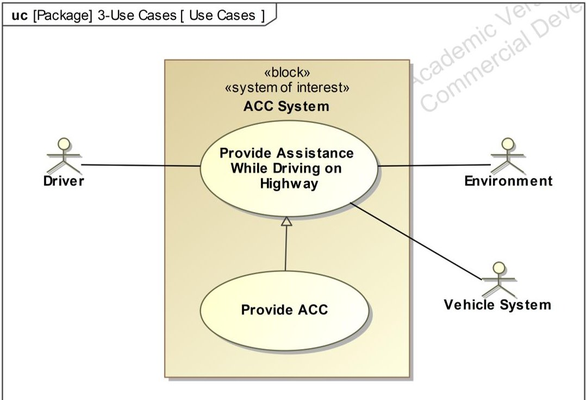

Figure 4.4.: SysML use case diagram (uc) for ACC System Use Cases

the 'system-of-interest' as a black-box entity such that a system boundary can be achieved already.

## Specify Stakeholder Requirements

The operational analysis phase results in the elicitation of stakeholder requirements that are used to further derive system requirements. The system requirements which will be derived in the next phase serve as the basis to modeling the white-box architecture of the system. Figure 4.5 shows the requirement diagram that elicits the ACC stakeholder requirements modeled in SysML that were translated from the stakeholder needs.

<!-- PDF_PAGE: 71 -->

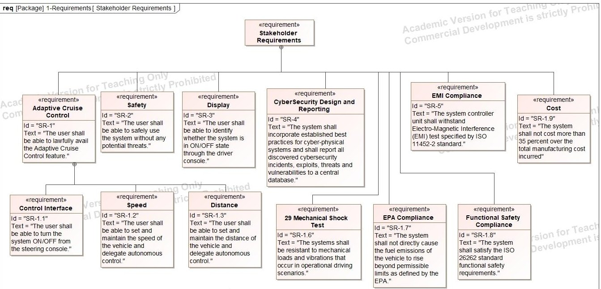

Figure 4.5.: SysML requirement diagram (req) for 'Stakeholder Requirements

## 4.1.2 System Requirement Analysis

The system requirements analysis phase is performed to analyze the system inputs previously collected and move from a problem statement to an abstract solution [49]. This phase deals with specifying the requirements for the system in terms of its behavior and other externally observable characteristics. For this purpose, system scenarios are modeled to define the system's interaction with external actors using either activity diagrams or sequence diagrams followed by a system context diagram modeled using an internal block diagram of the operational domain to define the external interfaces of the system. System requirements in terms of its functions, performance and interfaces are specified by identifying the critical properties that will impact the measures of effectiveness. System states are defined to specify the state-based behavior depending on the actions from all of the scenarios [18]. The main steps in this phase include:

Define mission/system scenarios

- Define system context using internal block diagram

- Specify system functional and interface requirements

- Identify and define system level states

<!-- PDF_PAGE: 72 -->

## Define Mission/System Scenarios

In this step, one or more scenarios are defined that describe the message-based interaction of use cases to initiate the behavioral requirements specification. Figure 4.6 shows a scenario description for 'Turn ACC ON' scenario using a SysML sequence diagram (sd).

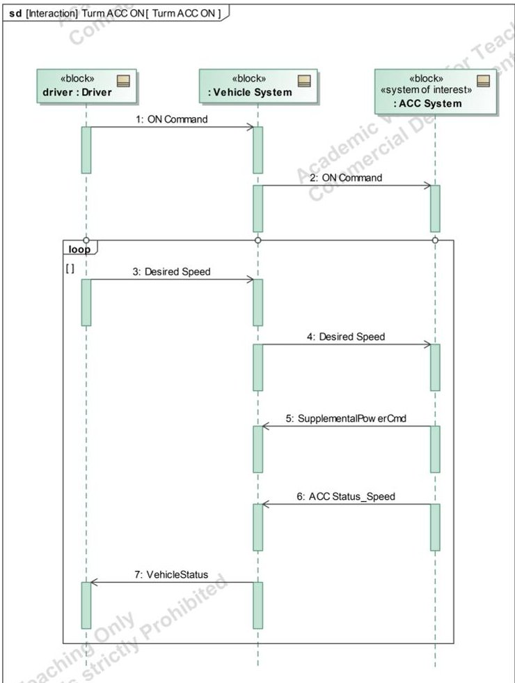

Figure 4.6.: SysML sequence diagram (sd) for 'Turn ACC ON' scenario

## Activity Scenarios

SysML activity diagram (act) is used to define flow-based behavior of the system using actions and activities. Activity exchanges can be defined by two types: object flows that enable passage of tokens between output and input pins action, and control flows that dictate sequential execution of activities by providing additional constraints on those activities. Figure 4.7 shows the activity swim lanes representing the actors （'driver'，'subject vehicle' and 'target vehicle') and the system and the functions performed by them are shown by

<!-- PDF_PAGE: 73 -->

actions in the swim lanes. This is one way of linking the structure and behavior in SysML (i.e. allocating the actions to the actors and the system in swim lanes). Alternatively, system functions can also be represented using blocks that can have operations which can be called by a call operation action or allocated actions that can be called by a call behavior action. Once the system level actions are defined, functional analysis is done to identify and define new actions and system actors if needed. Although not included as a part of OOSEM, a functional tree diagram can be captured in SysML as a hierarchy of blocks in bdd.

<!-- PDF_PAGE: 74 -->

act [Activity] Provide ACC[ Provide ACC ]

<table border="1"><tr><td>Driver</td><td>Vehicle System</td><td>ACC System</td><td>Target Vehicle</td></tr><tr><td>: drive vehicleAcceleration/DecelerationApply Brake</td><td>: sense host vehicle speed</td><td>: locate targetsTarget vehicle PositionTarget vehicle Speed</td><td>: provide target vehicle kinematics</td></tr><tr><td>: control ACCON CommandOFF CommandDesired GapDesired Speed</td><td>: monitor driver inputsON CommandOFF CommandDesired GapDesired Speed</td><td>: calculate relative parameters</td><td>: maintain distanceACC Status_Distance</td></tr><tr><td>: control brakingApply Brake</td><td>: active brakingBrake Signal</td><td>: active braking</td><td>: desired speedBrake Signal</td></tr><tr><td>: control power deliveryAcceleration/Deceleration</td><td>: supplemental powerSupplemental Power</td><td>: desired speedON CommandOFF Command</td><td>: maintain speed</td></tr><tr><td>: observe statusStatus</td><td>: provide vehicle statusOutput</td><td>: ACC Status_SpeedACC Status_Distance</td><td></td></tr></table>

Figure 4.7.: SysML activity diagram (act) scenario for 'Provide ACC' use case

<!-- PDF_PAGE: 75 -->

At this point, various data items that are exchanged between the functions are defined using the SysML block definition diagram (bdd). The interface definitions are created to define the data that will be exchanged through the functional interfaces in the activity diagrams. Figure 4.8 shows the input-output definitions for the data that is exchanged through the activity I/O pins. The data types are defined at every level of abstraction throughout the system development as new interfaces are being defined and the model can be organized accordingly. For this case, we used a single diagram to define the evolving data types. SysML 'signals' were created to define the data exchanges modeled as 'flow properties' to the interfaces (blocks).

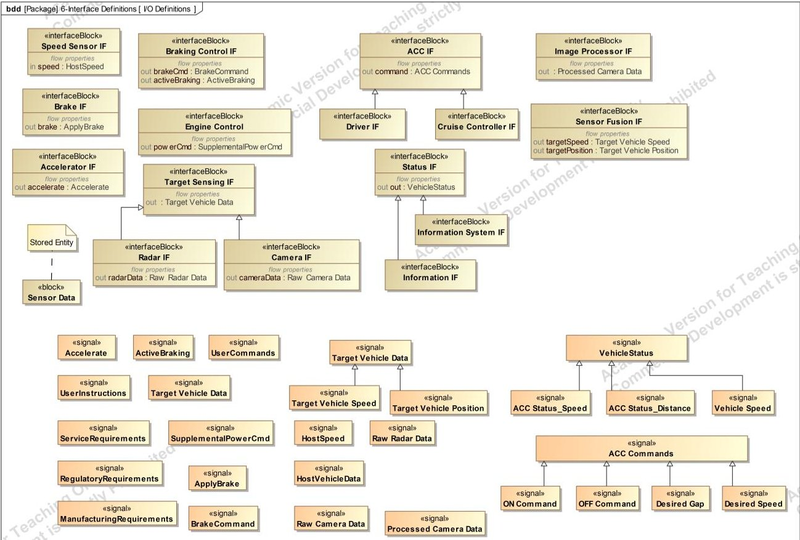

Figure 4.8.: 'ACC Interface Definitions' using bdd

## Define System Context

The ACC system context is shown in Figure 4.9 in an internal block diagram (ibd), with the interfaces modeled using the SysML 'proxy port'. A key point to notice from this level is that in SysML, the diagrams used to model the structure of the system are the block definition diagram and the internal block diagram, at every level of abstraction. The

<!-- PDF_PAGE: 76 -->

differentiation in the system architecture elements of various levels of abstractions is done with the help of SysML extension mechanisms like custom 'profiles' and 'stereotypes'. The system actor 'vehicle system' can be particularly decomposed into its subsystems at this stage itself, if not already defined in the operational domain, as the vehicle subsystems would act as actors to the system too. The interface definitions for the ports are detailed by defining the behavior of the ports or by typing the ports with interface blocks that describe the exchange information between the ports. Critical performance requirements and design constraints can be defined as value properties of the system or the flow items in the interfaces.

<!-- PDF_PAGE: 77 -->

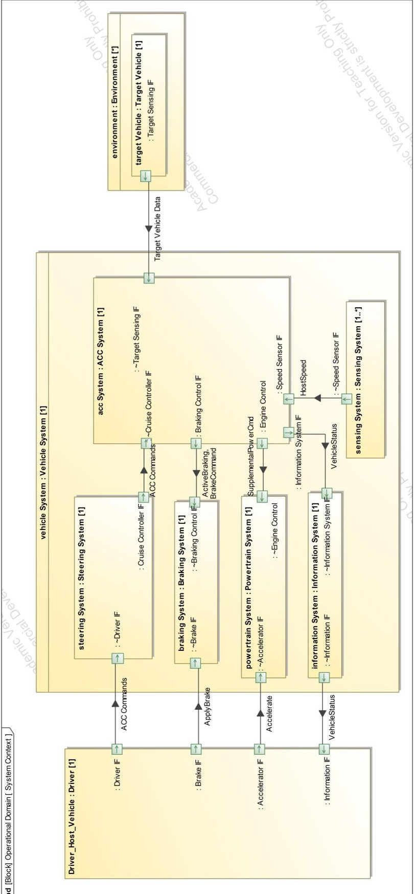

Figure 4.9: 'ACC System Context' using ibd

<!-- PDF_PAGE: 78 -->

## Specify Black-box System Requirements

The system requirements analysis phase in OOSEM results in the black-box specification of the system. The specification of a black-box was expressed as a block with the following features:

- The required functions that the system must perform with their inputs and outputs.

- The required external interfaces.

- The required items that the system must store such as data, energy, and mass, modeled as reference properties. The OOSEM stereotype <<store>> was applied to these properties.

Figure 4.10 shows the ACC Black-Box Specification bdd for ACC. System requirements were linked to the 'ACC System' block. The black-box specification also includes required physical, performance and quality characteristics specified as value properties along with parametric constraints to these value properties, and the required control to determine when functions are performed [18]. These features are left unexplored as the goal of the study does not include parametric evaluation of the architectures.

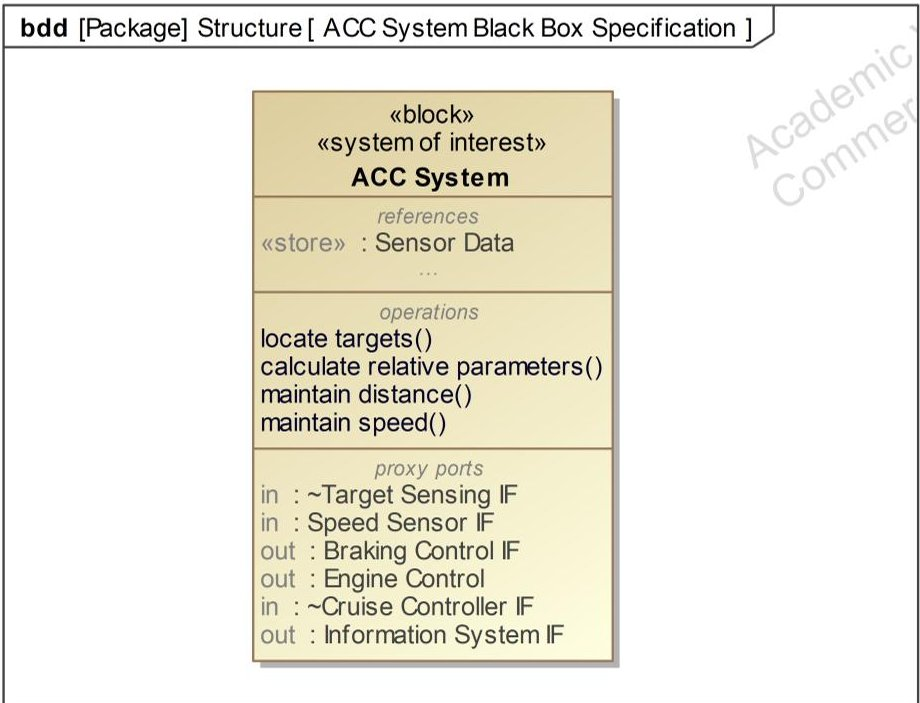

Figure 4.10.: ACC System Black Box Specification

<!-- PDF_PAGE: 79 -->

## Define System States

The expected states are modeled using a state machine diagram (stm). A state machine diagram is used to specify control requirements such that the system transitions to different states based on input events in the current state and the executes the specified actions. SysML mechanisms also allow these transitions to be reflected in activity diagrams[8]. Figure 4.11 shows the system states of ACC while in operation.

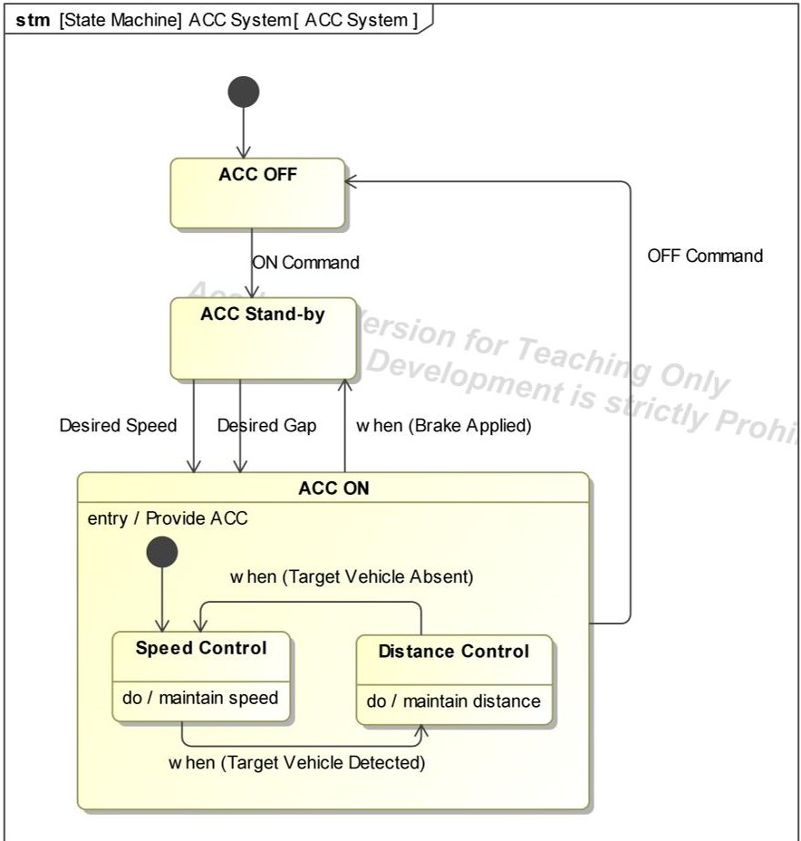

Figure 4.11.: SysML state machine diagram (stm) for 'ACC System States'

## Visualization of Requirements

The requirements after analysis were visualized using a requirement diagram (req). Various relationships between the requirements can be modeled among the requirements. Alternatively, a tabular display of the requirements could be obtain using a requirement table in Cameo. Figure 4.12 shows the system requirements obtained after requirements analysis.

<!-- PDF_PAGE: 80 -->

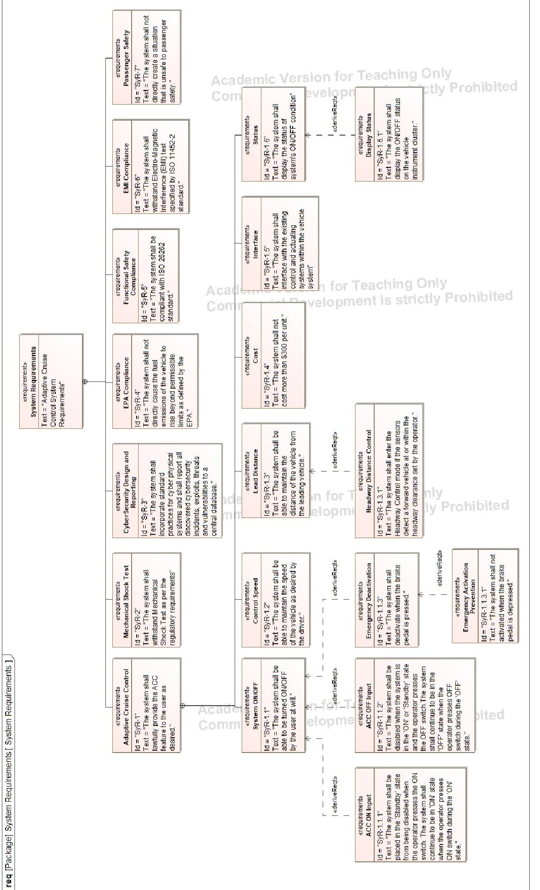

Figure 4.12.: System requirements modeled in SysML requirement diagram (req)

<!-- PDF_PAGE: 81 -->

## 4.1.3 Logical Architecture Definition

The logical architecture definition phase in OOSEM includes decomposing the system into abstract components called logical components using the structure diagrams. Logical components perform the necessary function without providing technological solutions. Logical scenarios are created using the sequence diagram (sd) to describe the logical components interactions to realize each operation of the system block. The internal block diagrams describe the interconnection between the logical components. The logical components are then decomposed further to sub-components and the parent component can again be specified as a black box as described in the previous phase. The main steps of this phase are:

- Define logical decomposition

- Define logical component interactions using activities

- Decompose the activities to be performed

- Define logical interfaces between components

## Define Logical Decomposition

In SysML, logical component identification is done in the block definition diagram (bdd) before defining interfaces using the internal block diagram (ibd). Alternatively, new internal components can be added to the internal block diagrams. SysML bdd automatically inherits the decomposition. In OOSEM, the system block has logical as well as physical decomposition. Hence, a separate subclass of the system block was created for the logical and physical decomposition of the system. The 'ACC Logical' block was modeled as a subclass of the 'ACC System' block such that it inherited all the features of the 'ACC System' block. The 'ACC Logical' block was then decomposed into logical components that are identified such that all the system functions can be performed. Figure 4.13 shows the ACC logical decomposition where the system logical components are designated by the stereotype <<logical>>.

<!-- PDF_PAGE: 82 -->

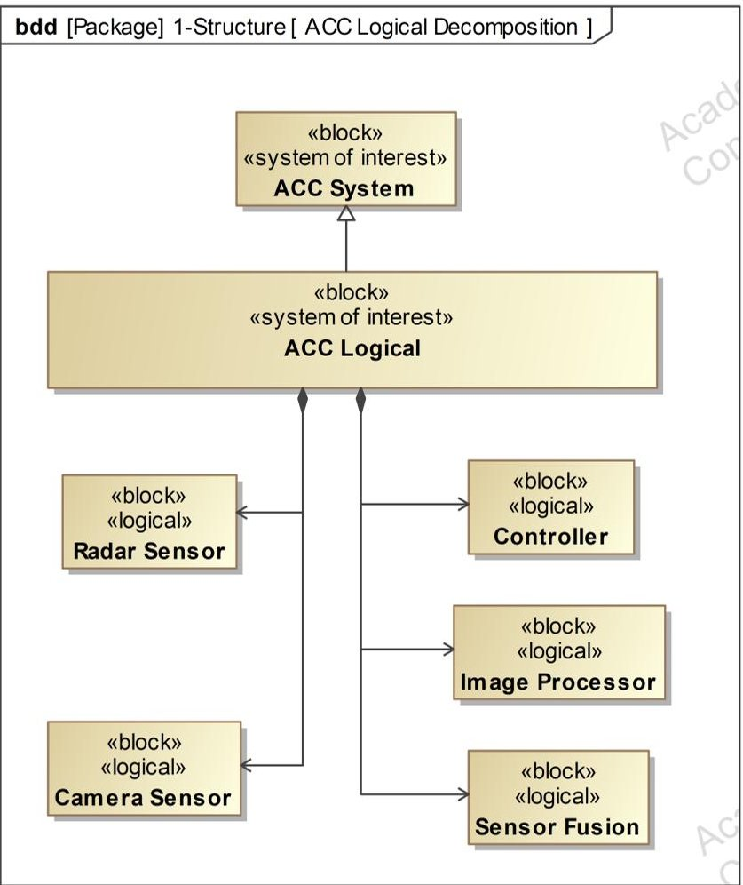

Figure 4.13.: SysML bdd for 'ACC Logical Decomposition'

## Define Logical Component Interactions

SysML does not provide an option to show component functional interactions using the same structure diagram, unless the unconventional mapping of functions to blocks is done. The 'ACC Logical' block inherits the operations of the 'ACC System' block. A separate scenario using the activity diagram is created to show function allocation to the logical components. Figure 4.14 shows the activity diagram of the logical component interactions that realizes the 'calculate relative parameters' operation. The input and output flows of the activity 'calculate relative parameters' match the pins to the same action from the 'Provide ACC' scenario.

<!-- PDF_PAGE: 83 -->

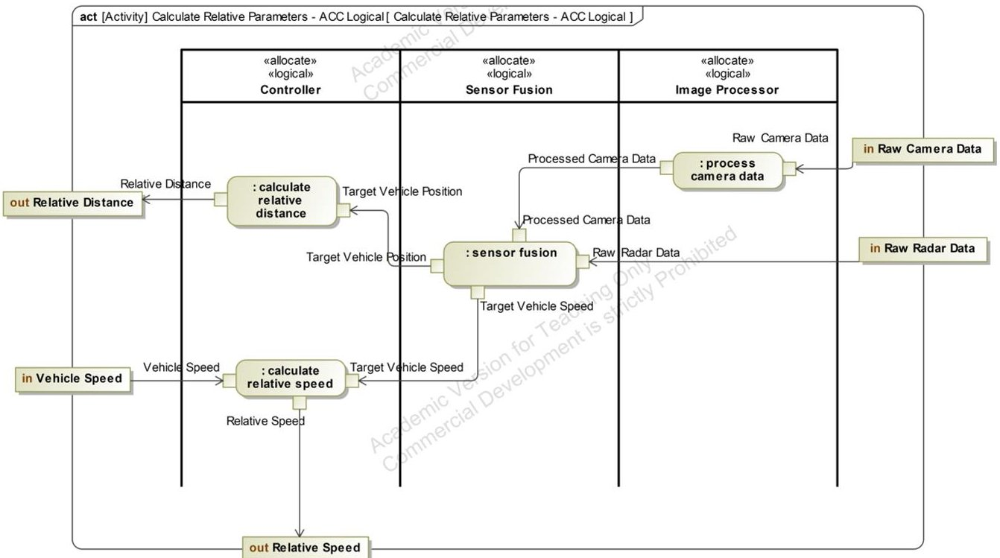

Figure 4.14.: SysML activity diagram (act) for 'calculate relative parameters' function

## Define Logical Interfaces between Components

Finally, the system's internal components can be displayed using an ibd to show the interconnections. Figure 4.15 shows the interconnections of the components of the 'ACC Logical' block that are typed by the logical components from the bdd. Similar to the system black box level, system internal interfaces are defined leading to new interface requirements specification. Information flows between SysML activity diagrams can be mapped to the internal block diagrams. Interface management can become tricky while modeling hundreds of interfaces for a particular system. After the logical architecture definition, each logical component is specified similarly to the system requirements specification done at black box level. Logical component state machines are created to define state-based behavior.

<!-- PDF_PAGE: 84 -->

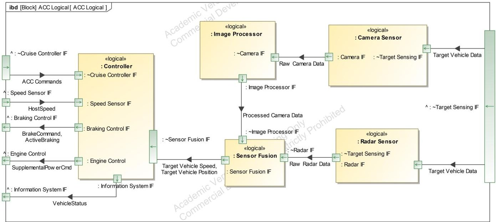

Figure 4.15.: 'ACC System Logical Architecture' using SysML ibd

## 4.1.4 Physical Architecture Definition

The physical architecture definition phase in SysML defines the system in terms of the physical components with their relationships and their distribution across system nodes. Again, the main objective of this phase is to obtain a physical architecture containing parts or components that will satisfy the internal functions defined in the logical architecture using technology-specific choices made for the components. The physical components of the system may include hardware, software or firmware. The main steps of the physical architecture definition phase are:

- Define partitioning criteria

- Define node logical architecture

- Define node physical architecture

- Allocate logical components to physical components

## Define Partitioning Criteria

System partitioning is a fundamental aspect of system architecting. Distributed systems require system architecture to be designed such that the components among subsystems, nodes, and layers of the architecture are partitioned based on various criteria. This helps

<!-- PDF_PAGE: 85 -->

to partition the functionality, persistent data and control among the logical and physical components with an aim to maximize cohesion and minimize coupling thereby reducing interface complexity [18]. The ACC system was partitioned such that the common functionality were refactored into shared components. Several other partitioning criteria could be considered while designing distributed systems primarily depending on the complexity of the systems and the project requirements.

## Define Node Logical Architecture

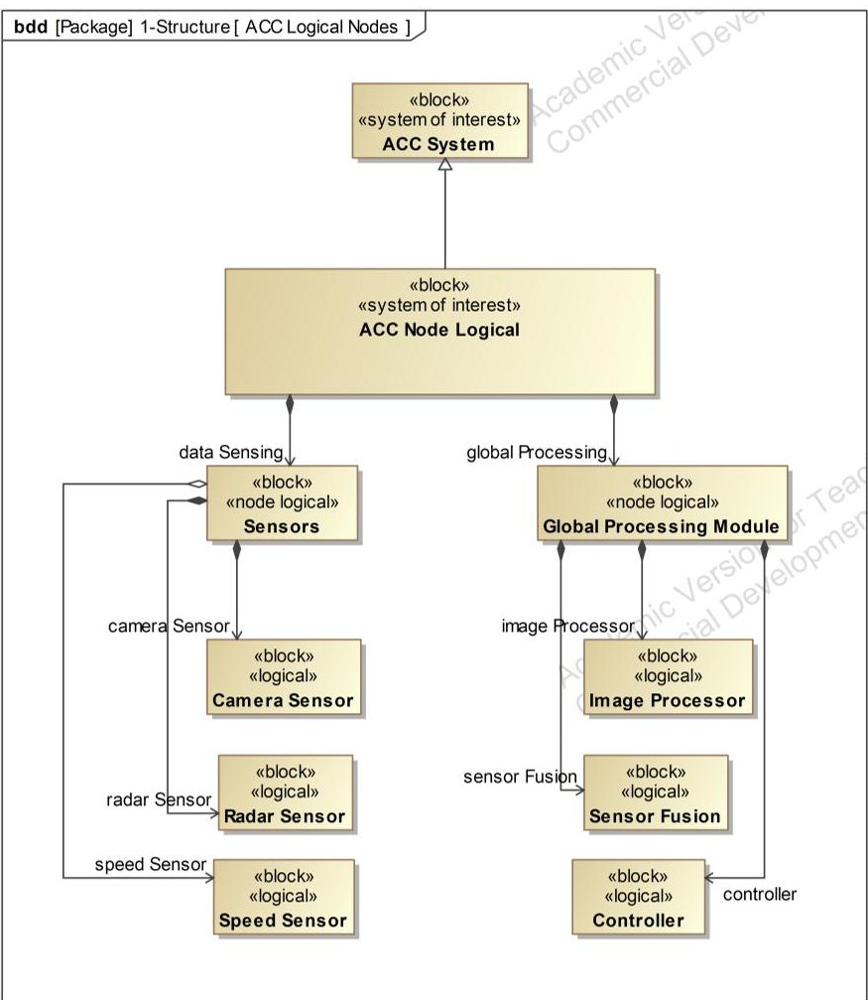

Figure 4.16.: 'ACC Logical Nodes' bdd

A node represents the partitions of components and associated functionality. "In OOSEM, a logical node represents an aggregation of logical components at a particular location and a physical node represents an aggregation of physical components at a particular location" [18]. The 'ACC Logical Nodes' bdd shown in Figure 4.16 shows the 'ACC Node

<!-- PDF_PAGE: 86 -->

Logical' block as another subclass of the 'ACC System' block and inherits all of its features. The 'ACC Node Logical' block is decomposed into the 'Sensors' and 'Global Processing Module' nodes based on the location of the sensing and the processing subsystems. The logical nodes are stereotyped as <<node logical>> and are further decomposed into their logical components. The speed sensor is not a part of the ACC system since the host vehicle system already employs that to sense host vehicle speed. However, the speed sensor provides the measured value to the ACC processor to calculate the necessary parameters. Therefore, the speed sensor is linked to the 'Sensors' node using a SysML association relationship.

An activity diagram can be used to represent the activity interactions between components at each node. Since the number of components is small, the interaction between the components across nodes did not change significantly, and the activity scenarios were therefore chosen not to be modeled. After the decomposition, the 'ACC Node Logical' components are connected with the components in the same nodes along with interfaces to connect across nodes as shown in Figure 4.17.

<!-- PDF_PAGE: 87 -->

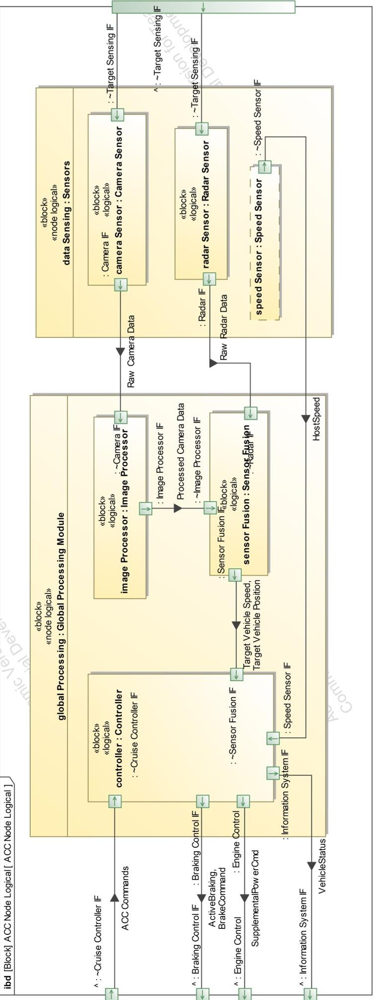

Figure 4.17: 'ACC Node Logical Architecture' using ibd

<!-- PDF_PAGE: 88 -->

## Define Node Physical Architecture

Similar to the node logical architecture, the node physical architecture was obtained and the logical components at each node were allocated to the physical component at each node. The 'ACC Node Physical' bdd is shown in Figure 4.18. Since 'ACC Node Physical' is also a subclass of ACC System, it inherited all the properties of ACC System. The system hardware and software components were identified and the logical components were allocated to the physical components respectively.

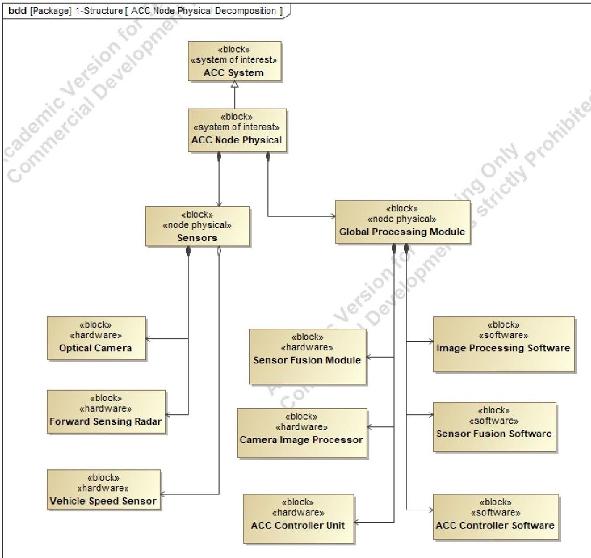

Figure 4.18.: 'ACC Node Physical' bdd

<!-- PDF_PAGE: 89 -->

## Define Physical Interfaces between Components

The interfaces between the software and the hardware components of the system were modeled using the ibd as shown in Figure 4.19. The software components were nested within the hardware components to which they were allocated.

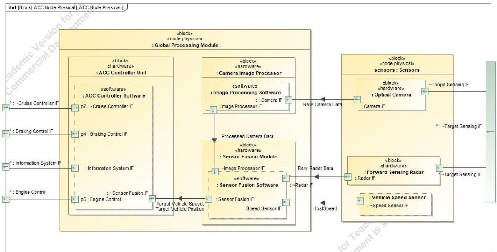

Figure 4.19.: 'ACC Node Physical Architecture' using SysML ibd

The ACC node physical architecture enables the integration of the hardware components to the software components and to the operators of the system. The main outcome of systems architecting is obtaining the physical architecture of the system that represents the technological choices to be made to integrate all the components based on the functional interactions between them. At this point, the system architecture of the ACC feature is complete. OOSEM recommends creating various views of the physical architecture specialized for the software, hardware and data that would only include the applicable components. These views demand additional partitioning based on implementation-specific concerns. The requirements can be then specified and traced to the system requirements for each physical component. For this study, the scope was limited to creating a concise synthesized physical architecture view for comparison purposes. Figure 4.20 shows the System Architecture Development Pyramid representing the SysML architecture diagrams created at various levels of abstraction.

<!-- PDF_PAGE: 90 -->

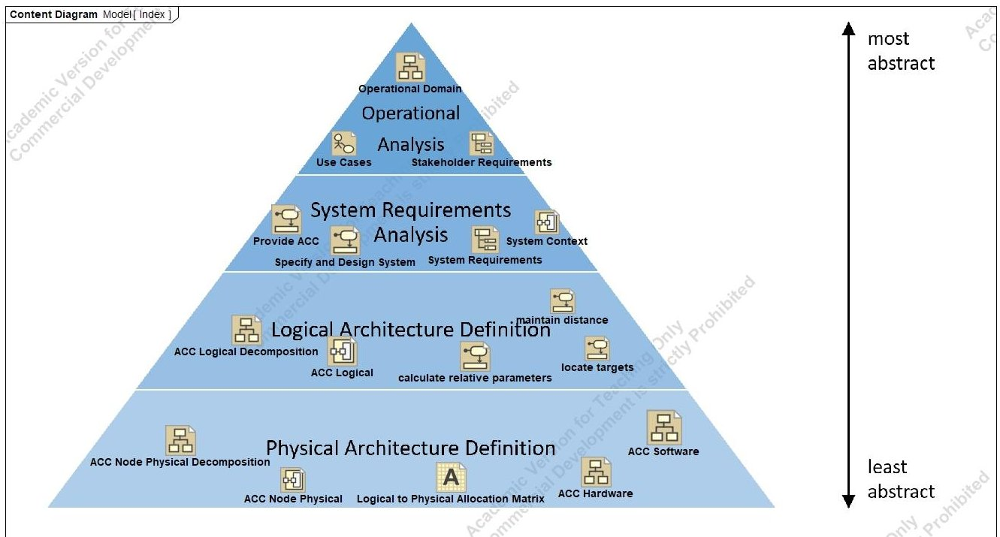

Figure 4.20.: Architecture development pyramid: OOSEM/SysML

<!-- PDF_PAGE: 91 -->

## 4.2 Modeling ACC Using ARCADIA/Capella

Table 4.2.: 'PMTE' elements mapped to architecture development using ARCADIA/Capella

<table border="1"><tr><td>Process</td><td>ISO/IEC/IEEE 15288 Standard Process Model (System Architecture Development)</td></tr><tr><td>Method</td><td>ARCADIA</td></tr><tr><td>Tool</td><td>Polarsys Capella</td></tr><tr><td>Environment</td><td>University Research Infrastructure</td></tr></table>

## ARCADIA/Capella Diagram Taxonomy

This section provides an overview of the ARCADIA Capella diagram types. Figure 4.21 shows the diagram taxonomy of ARCADIA/Capella. ARCADIA modeling language characterizes the diagrams into seven different types. Each diagram type includes diagrams that are either named differently for the different ARCADIA levels or possess the same name at all the levels. A brief explanation of all the diagram types is given below:

1. Data Flow diagrams: The data Flow diagrams are provided at all the levels (phases) in ARCADIA. Data flow diagrams are used to represent the information dependency network between functions.

2. Architecture diagrams: The architecture diagrams are provided at all the levels in ARCADIA. These diagrams are mainly show the allocation of functions to the components.

3. Scenario diagrams: The scenario diagrams describe the the sequential flow of messages passed between various elements (functions, components, states, etc.) represented through vertical lifelines.

4. Mode and State diagrams: The mode and state diagrams are used to model the mode and state machines at various levels of abstractions. Modes or states can be modeled for system and its components and are actually inspired by SysML state machine diagram.

<!-- PDF_PAGE: 92 -->

5. Breakdown diagrams: The breakdown diagrams are provided at all ARCADIA levels. They are used to represent functional and component hierarchies.

6. Class diagrams: The class diagrams are used to model data structures at all levels of ARCADIA. They are used to define various types of exchanges between the model elements.

7. Capability diagrams: The capability diagrams are used to define capabilities and their relations with the actors and entities. Capability diagrams are mainly used during operational and system analysis phases.

8. Interface diagrams: The interface diagrams are define the internal and external contextual interfaces of the system and its components.

<!-- PDF_PAGE: 93 -->

<table border="1"><tr><td>Data Flow Diagrams</td><td>Architecture Diagrams</td><td>Scenario Diagrams</td><td>Mode and State Diagrams</td><td>Breakdown Diagrams</td><td>Class Diagrams</td><td>Capability Diagrams</td><td>Interface Diagrams</td></tr><tr><td>Operational Activity Interaction diagram [OAIB]</td><td>Operational Architecture diagram [OAB]</td><td>Operational Activity Scenario diagram [OAS]</td><td>Mode State Machine diagram [MSM]</td><td>Operational Entity Breakdown diagram [OEBD]</td><td>Class diagram [CDB]</td><td>Operational Capabilities diagram [OCB]</td><td>Contextual Detailed Interfaces diagram on the System [CDI]</td></tr><tr><td>System Functional Data Flow diagram [SDFB]</td><td>System Architecture diagram [SAB]</td><td>Operational Entity Scenario diagram [OAS]</td><td></td><td>Operational Activity Breakdown diagram [OABD]</td><td></td><td>System Mission and/or Capability diagram [MCB]</td><td>Contextual External Interface diagram on the System [CEI]</td></tr><tr><td>Logical Functional Data Flow diagram [LDFB]</td><td>Logical Architecture diagram [LAB]</td><td>Functional Scenario diagram [FS]</td><td></td><td>System Functional Breakdown diagram [SFBD]</td><td></td><td></td><td>Contextual External Interface diagram on the Logical System Component [CII]</td></tr><tr><td>Physical Functional Data Flow diagram [PDFB]</td><td>Physical Architecture diagram [PDFB]</td><td>Exchange Scenario diagram [ES]</td><td></td><td>Logical Functional Breakdown diagram [LFBD]</td><td></td><td></td><td>Contextual External Interface diagram on the Physical System [CII]</td></tr><tr><td></td><td></td><td>Interface Scenario diagram [IS]</td><td></td><td>Physical Functional Breakdown diagram [PFBD]</td><td></td><td></td><td></td></tr></table>

Figure 4.21.: ARCADIA/Capella Diagram Taxonomy

<!-- PDF_PAGE: 94 -->

## 4.2.1 Operational Analysis

One of the primary distinctions between the approaches of using ARCADIA and SysML is that the ARCADIA method focuses on function-driven modeling as opposed to requirementsdriven modeling usually employed in SysML. Because of a function-driven modeling approach, ARCADIA focuses on modeling functions and their interfaces and linking functional requirements to the functions. Capella metamodel allows the creation of requirement elements and link them to the artifacts in any Capella diagram. Alternatively, requirements can be imported from an external requirements management database in ReqIF (Requirements Interchange Format) standard or even PLM requirements through a modeling workbench like System Modeling Workbench for Teamcenter $ ^{\mathrm{TM}} $ [50].

## ARCADIA Operational Analysis (OA)

Among the four levels (layers) of abstraction of the ARCADIA method, the first level is Operational Analysis (OA). "Operational analysis is a means to capture what the system users must achieve as part of their work or mission, and the associated conditions, regardless of any solution and particularly of systems that they will be able to use for this purpose" [9]. The end user's expectations, the context of their work, conditions and constraints are often not expressed sufficiently by the stakeholder requirements. Thus, operational analysis is performed before or in conjunction with system functional analysis. ARCADIA Operational Analysis is different than the conventional operational analysis done using other model-based and document-based approaches. ARCADIA OA allows the system architect to model the required high-level operational capabilities of the mission and perform a better operational needs analysis without even defining the system-of-interest in the first place. This helps to really understand what the user wants and then decide what the optimum system might be, to identify the challenges of the stakeholders and better understand how the system can support them or provide solutions. Contrastingly, most of the other architecture modeling methodologies related to SysML start with considering the system as a black-box. ARCADIA, thus, provides an additional optional level of abstraction that allows to find alternatives to defining what the system-of-interest might actually be. This is an added benefit especially during new product development. Capella metamodel

<!-- PDF_PAGE: 95 -->

also distinguishes between an operational capability and a system capability. One or more system capabilities contribute to an operational capability, which are two different elements in Capella. A similar differentiation is done for the structural and behavioral elements in all levels in Capella. Finally, stakeholder requirements are defined and refined and linked to the necessary model artifacts to ensure the traceability between the levels. The main steps in this phase are:

- Define operational actors and entities

- Identify operational capabilities

- Describe operational activities and scenarios for capabilities

- Define operational modes and states

- Allocate activities to operational actors and entities

## Define Operational Actors and Entities

The abovementioned steps do not mandate a specific order of activities to be done. In fact, ARCADIA is quite flexible in terms of the modeling workflow. Over its lifecycle, the system will interact with various actors and entities during its operation. Hence, all the operational entities and actors that might interact with the system must be identified to better understand the problems as well as identify system operational requirements. The Operational Entity Breakdown [OED] diagram, that lists all the actors and entities interacting with the ACC system, is shown in Figure 4.22.

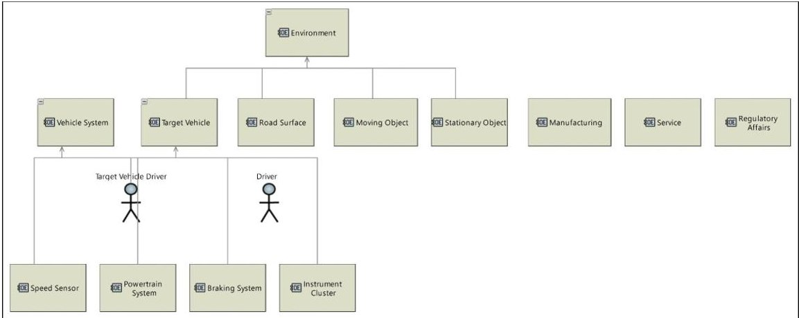

Figure 4.22.: 'ACC System' Operational Entities Breakdown [OED] diagram

<!-- PDF_PAGE: 96 -->

## Identify Operational Capabilities

In Capella, operational level capabilities can be defined using the operational capability model element. The operational entities are expected to provide an ability, termed as an operational capability, that provides a service to fulfilling one or more system missions. An operational level capability refines the operational needs and can be described by several operational activities that are performed by an operational actor or an operational entity. Operational level scenarios represent the sequence of flow of activities between the actors and entities in a timely manner to describe a particular capability scenario. Figure 4.23 shows the Operational Capabilities Blank [OCB] diagram in Capella, which considers a high-level capability such as 'Provide assistance while driving on highway'.

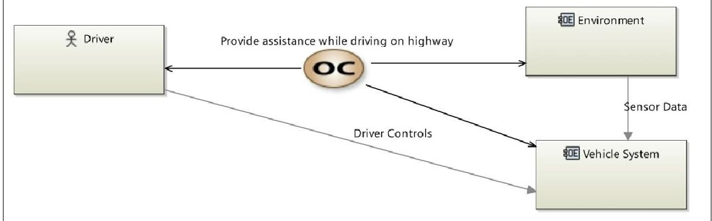

Figure 4.23.: Capella operational capability using Operational Capability Blank [OCB] diagram

## Describe Operational Activities and Scenarios for Capabilities

An operational capability can be described by multiple behavioral scenarios. Operational scenarios are used to define the activities and the sequence of their interactions to be performed by each actor and entity during the scenario. Alternatively, a capability can be described by an Operational Activity Interaction Blank [OAIB] diagram to represent the activity interactions for a particular capability, without considering its allocation to the actors and entities. Figure 4.24 shows the [OAIB] for the 'Provide ACC' capability, which is included in the top-level capability.

<!-- PDF_PAGE: 97 -->

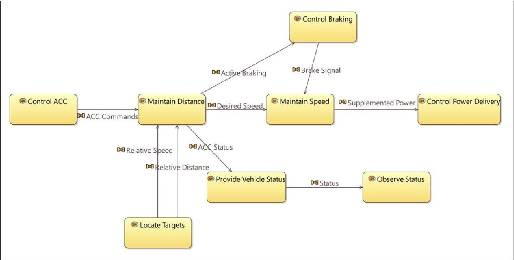

Figure 4.24.: 'Provide ACC' operation modeled using Operational Activity Interaction Blank [OAIB]

## Define Operational Modes and States

An operational entity or an operational actor can have various states and modes of operation that can be described by a Mode State Machine [MSM diagram]. Figure 4.25 shows a [MSM] diagram for the 'Vehicle System' states. Capella provides distinct model elements mode and state to model modes and states respectively, whereas in SysML, a state or mode can be modeled using a state element only. "A mode is a behavior expected of the system, a component or also an actor or operational entity, in some chosen conditions." [9], whereas, "state is a behavior undergone by the system, a component, an actor or an operational entity, in some conditions imposed by the environment." [9].

The Vehicle System acts as an actor to the ACC system, as it would consider the 'actuation' and the 'human-machine interface' functions whereas the 'sensing' and the 'decisionmaking' functions would be performed by the ACC system. However, this would be the case when the system architect is confined to the role of an ACC architect. On the other hand, a vehicle architect might be responsible to develop the system architecture for the complete vehicle and its subsystems that are responsible for performing the ACC operation.

<!-- PDF_PAGE: 98 -->

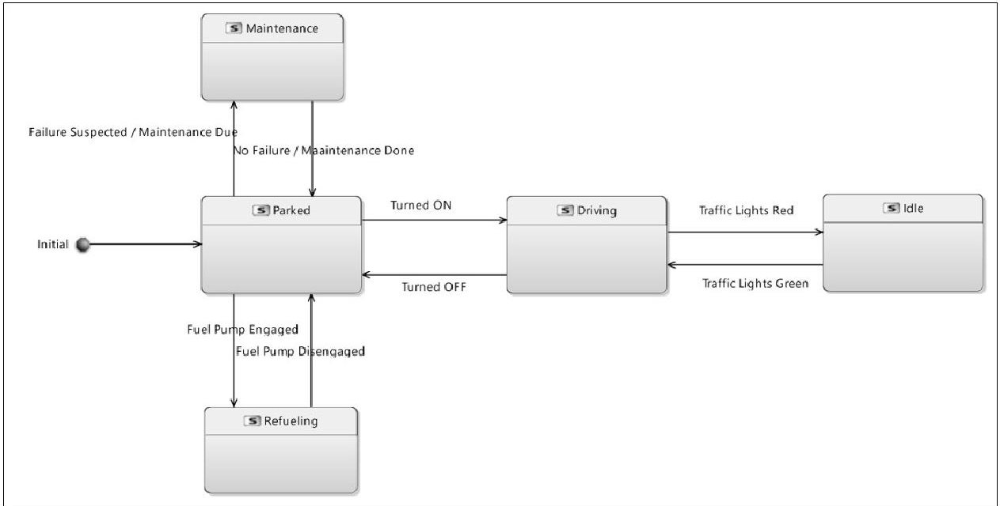

Figure 4.25.: 'Vehicle Operational States' using Mode State Machine [MSM] diagram

## Allocate Activities to Operational Actors and Entities

One of the main outputs of the Operational Analysis phase is an Operational Architecture Blank Diagram [OAB] that describes the operational architecture of the expected system. In Figure 4.26, the driver, vehicle system and its entities and the environment that includes the primary actors and entities that would interact with each other to achieve a desired objective are modeled and their respective operational activities are defined and allocated. An operational analysis serves the purpose of understanding the user needs from a user perspective. User needs are converted into requirements that are verified by a team of requirements engineers/systems engineers, specific targets are defined and new requirements are identified during the analysis process. Previously documented requirements are updated in the database. Likewise, newly identified requirements are created to proceed to the next phase of requirements analysis.

<!-- PDF_PAGE: 99 -->

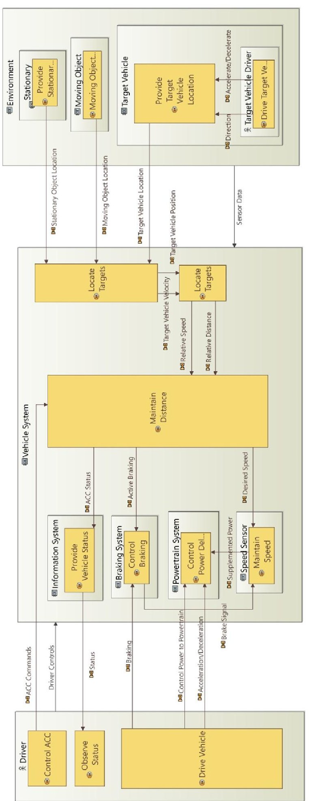

Figure 4.26: 'Operational Architecture' using ARCADIA Operational Architecture Blank [OAB] diagram

<!-- PDF_PAGE: 100 -->

## 4.2.2 System Requirements Analysis

As described previously, the system requirements analysis phase deals with analyzing and refining the system requirements.

## ARCADIA System Analysis (SA)

The purpose of system needs analysis is "to define the contribution expected of the system to users' needs, as they are described in the previous operational analysis phase and/or in the form of requirements expressed by the client" [9]. The SA phase aims at defining 'What' the system must accomplish to meet the user needs. The system is introduced as a black-box in this phase. After the OA, the better understood user needs help to identify the system-of-interest. System needs analysis is the next lower level of abstraction/perspective that helps to identify system context, behavior, black-box structure to define external system interfaces and their interactions. The main steps in SA are:

- Identify system context

- Define system capabilities and refine behavior using functions

- Allocate functions to system and actors

- Define system level operating modes or states

- Define system scenarios and update requirements

## Identify System Context

At this point, a system context diagram can be created to understand the system boundary and the external actors interacting with the system. This provides the basic information needed to determine the services requested from the system when embedded in its environment (system capabilities) without providing the technical details of these services. Identifying various system actors can lead to very fruitful discussions between the different stakeholders of the system. Figure 4.27 shows a Contextual System Actors [CSA] diagram that represents the system operational context.

<!-- PDF_PAGE: 101 -->

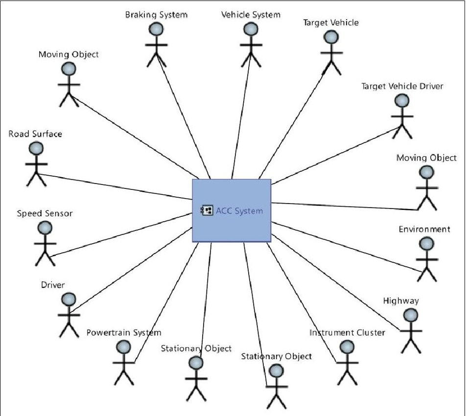

Figure 4.27.: ACC System Context

## Define System Capabilities and Functions

Figure 4.28 shows the system capabilities for the ACC system. The system mission 'Provide Assistance While Driving on Highway' (realizing the operational capability) exploits the system capability of 'Provide ACC'. In Capella, the system capability is elaborated by a system data-flow diagram that describes the system functions and their exchanges required to provide the capability.

On identifying system capabilities, system-level function data-flow can be described for these system capabilities. Capella provides various model accelerators that support the modeler to reduce the modeling time by providing automated transition of model elements. One such accelerator is the operational activity to system function transition. Because of such transition, a capability can be defined by an existing set of functions with data-flows that have inherited the relations from the operational activities and their interactions. Exchange items of different types can be easily allocated to functional exchanges and function ports by creating exchange items and data types in the Capella Class diagrams. Also, the operational actors and entities can be transitioned into system actor elements. At this point,

<!-- PDF_PAGE: 102 -->

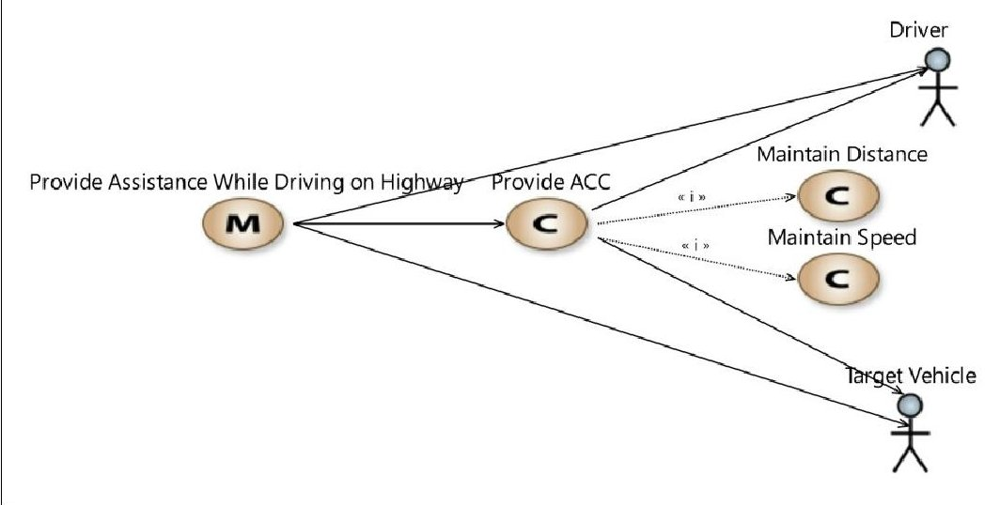

Figure 4.28.: Capella mission and system capabilities using Missions Capabilities Blank diagram [MCB]

a system function (realizing the operational activity) can be decomposed and allocated to the newly created system and its actors. If required, new actors can be identified based on the system function decomposition.

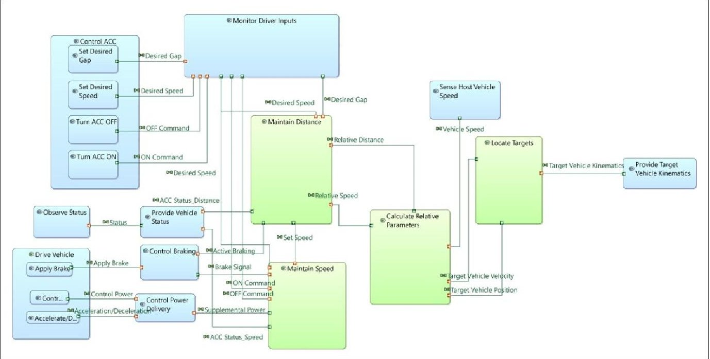

Figure 4.29.: 'Provide ACC' functions modeled using System Data Flow Blank [SDFB] diagram

<!-- PDF_PAGE: 103 -->

Figure 4.29 shows the global functions required to perform the 'Provide ACC' capability. The system level-functions are categorized as actor functions (blue) that are to be performed by the external actors and system functions (green). In the System Data Flow Blank [SDFB] diagram, system functions have to be decomposed because of their partial allocation to the system. For instance, in Figure 4.30 (a), the operational activity 'Control ACC' performed by the operational actor 'Driver' interacts with the 'Maintain Distance' activity performed by the 'Vehicle System'. However, in system analysis phase, an ACC system is introduced, which will inherit the 'Maintain Distance' function. Ideally, there will be no interaction between the 'Driver' and the 'ACC System' as the as the driver-vehicle interface will take the driver inputs and send command to the ACC System. Hence, in Figure 4.30 (b), the 'Control ACC' function will be decomposed into two functions namely, 'Control ACC' and 'Monitor Driver Inputs', both realizing the same operational activity (Control ACC). The outputs from the 'Control ACC' function will now be moved from 'Maintain Distance' to 'Monitor Driver Inputs' which is now allocated to the 'Steering Control' actor, and outputs from 'Monitor Driver Inputs' will flow to 'Maintain Distance'. Also, the 'Control ACC' function is decomposed into several leaf functions with ports allocated directly to the leaf functions. The reason is discussed in detail later in the results.

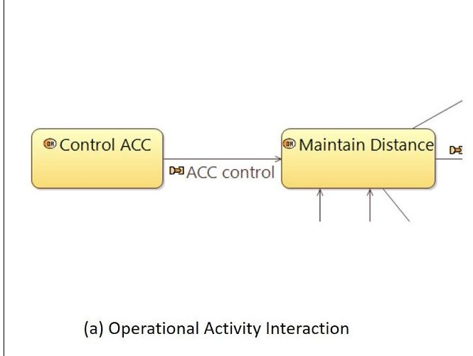

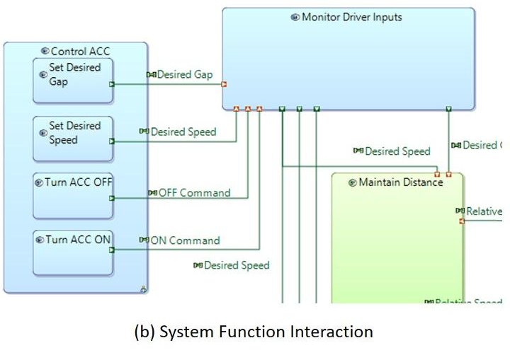

Figure 4.30.: Operational to system level function decomposition

<!-- PDF_PAGE: 104 -->

## Allocate Functions to System and Actors

Once all the system level functions are identified, these functions are allocated to the system and to the external actors to generate a diagram view of the system architecture with allocated functions. A system architect might prefer modeling the system-level states and functional scenarios to better understand system behavior before creating the System Architecture Blank [SAB] diagram. Figure 4.31 shows the System Architecture Blank [SAB] diagram for the ACC system.

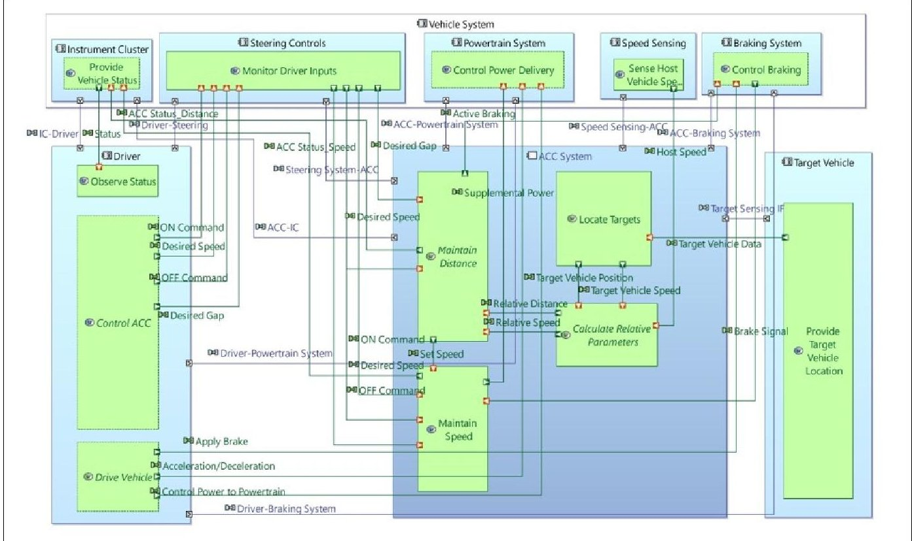

Figure 4.31.: 'ACC System Architecture' using the System Architecture Blank [SAB] diagram

In the Capella System Architecture Blank [SAB] diagram, system functions can be allocated to system actors and the system through the diagram palette. Functional exchanges occur automatically after the allocation of functions to the actors. Capella provides features to generate simplified and contextual views of the diagram as well as diagram cloning features. Functions can be hidden to obtain a 'components only' view of the architecture for simplicity. Also, if desired, the leaf functions can be hidden to represent only the parent functions like the 'Control ACC' parent function shown in the [SAB]. Capella also provides

<!-- PDF_PAGE: 105 -->

an ability to create functional chains by grouping a list of functions to represent a set path in the global data-flow, which will be discussed later in the paper. The system architecture diagram is considered one of the main deliverables of the SA phase as it provides complete information of the system including it's functions, external actors and their required functions for the operation.

## Define System Scenarios

Figure 4.32 shows the 'Turn ACC ON' scenario showing exchanges between the system and the actors. A scenario can call upon "sub scenarios" that are defined in different diagrams using a reference inserted between successive exchanges along the time axis. Intermediate modes and states can be shown in these diagrams as well.

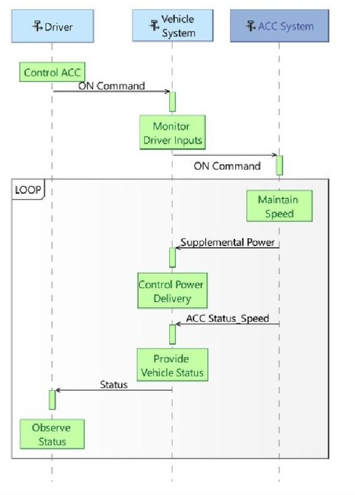

Figure 4.32.: 'Turn ACC ON' exchange scenario using the Exchange Scenario [ES] diagram

<!-- PDF_PAGE: 106 -->

Figure 4.33.: 'ACC System States' using Mode State Machine [MSM] diagram

Similar to operational states, the expected behavior of the system can be modeled using a modes and states machine diagram, particularly if the system is supposed to react to external input events. ARCADIA proposes two concepts: state and mode. The usage of these elements is a methodological choice in the context of the MBSE implementation. Figure 4.33 shows various states exhibited by the ACC system. Establishing system states is an iterative process and is often coupled with scenarios to describe complex system scenarios.

<!-- PDF_PAGE: 107 -->

## 4.2.3 Logical Architecture Definition

The logical architecture definition phase aims to capture the main architectural drivers of the solution, identifying the high-level constituents and their expected functionality, providing a vision of how the system works, without diving too much into the technical details.

## ARCADIA Logical Architecture (LA)

ARCADIA Logical Architecture Design phase allows to find 'How' the system will perform its functions defined in the SA phase. LA phase includes important activities such as defining the factors that impact the architecture and analysis viewpoints, defining the principles underlying the system behavior, building component-based architecture alternatives and selecting the best architecture among the candidates [5]. The main steps of this phase are:

- Identifying logical components

- Logical function decomposition

- Defining logical components scenarios and states

- Allocate logical functions to components

## Identifying Logical Components

The logical components for the system are identified based on the functions allocated to the system. The approach towards obtaining a final logical architecture can be taken in various ways like:

1. Refining the system functions into solution functions and then grouping these functions into components such that automatic traceability is maintained

2. Defining a solutions-oriented breakdown of logical functions based on which manual traceability is created between system and logical functions

3. Allocating system functions to logical components and then refining the functions down to solution functions

<!-- PDF_PAGE: 108 -->

The system functions identified in the System Data-Flow Blank [SDFB] diagram must be allocated to various logical components that would satisfy the realization of logical functions from system functions along with realization of the functional exchanges. The transitions are accelerators that are developed to ease the modeler's tasks. However, the modeler always has the option to create manual traceability and rely on model validation to check the completeness of the traceability. Similar to system functional analysis, the logical functional analysis deals with identifying various logical level functions of the system using Logical Data Flow Blank [LDFB] diagram. A logical architecture is defined based on the logical functions and then the functional allocation is done. For example, in Figure 4.34, the 'Maintain Distance' and 'Maintain Speed' functions are allocated to the system component 'ACC Controller' and the function 'Locate Targets' is allocated to 'Sensor'. In this way, all the system logical functions are allocated to all identified logical components.

(a) ACC Controller

(b) Sensor

Figure 4.34.: Functional allocation to logical components

<!-- PDF_PAGE: 109 -->

## Logical Function Decomposition

Once, the logical functions are identified, functional decomposition can be done to identify internal component functions. The functional decomposition usually leads to multiple sub-functions that can be performed. For instance, the function 'Locate Targets' can be broken down to two functions namely, 'Locate Camera Objects' and 'Locate Radar Objects' as multiple sensors can be used to locate targets. Based on this, two new logical components can be identified namely, 'Camera' and 'Radar'. Figure 4.35 shows the functional decomposition done in Capella.

Figure 4.35.: Logical function decomposition

## Identify Logical Component Scenarios and States

Based on the system scenarios, logical scenarios can be modeled to show the sequential exchanges between functions and logical components. Again, the three types of scenarios mainly functional, exchange and interface, can be modeled in the logical level. The purpose of the scenarios was to mainly refine the scenarios created in the SA perspective and understand the behavior. The system states and modes mainly remain unchanged, however, the functional allocation to the states and modes and the conditions of transition are of key interest.

<!-- PDF_PAGE: 110 -->

## Allocate Logical Functions to Components

Capella logical architecture provides a diagram view to show functional allocations to components using the Logical Architecture Blank [LAB]. Moreover, the allocation features can be executed using simple drag-and-drop command. The exchanges between functions can be easily allocated to the component exchanges that define the interfaces. The allows to display the functional exchanges and component exchanges simultaneously in the same diagram, the allocation between function and component ports, etc. enabling the justification of component interfaces based on functional content. Also, simplified and contextual view of components and functions are shown using various diagrams in Capella. Figure 4.36 shows the Logical Architecture Blank [LAB] diagram for ACC modeled in Capella showing the logical components with allocated logical functions. Some of the elements are hidden using the Capella features to only highlight the logical architecture components of the system. Generating simplified views of contextual elements from the architecture is an important aspect of architecture development. Capella provides the feature to generate contextual elements using a number of diagrams. However, because of lower level of complexity of the system architecture of this study, only a single architecture view of the logical architecture is shown.

<!-- PDF_PAGE: 111 -->

Figure 4.36: 'ACC System Logical Architecture' modeled in Logical Architecture Blank [LAB] diagram

<!-- PDF_PAGE: 112 -->

## 4.2.4 Physical Architecture Definition

The purpose of the physical architecture definition phase is to develop an architecture consisting of technology-dependent physical components or parts required to fulfill the functions of the logical components.

## ARCADIA Physical Architecture (PA)

The modeling flow followed in the PA phase is again arbitrary, similar to OA, SA and LA. Similar to the LA phase, the physical components of the system are identified based on the logical functions allocated to the system components. Capella notation provides the concepts of physical components by using two elements: behavior components, which perform the functions devolved to the system, and hosting (node) physical components, which host the behavioral components and provide them with the necessary resources to function. A behavior or a node component can be a hardware or a software. The node components are linked using a physical link, to specify communication means between two components to support behavioral exchanges. The main steps of this phase, not necessarily in the same order, are:

- Define node physical components to support behavior components

- Allocate the behavior physical components to node components

- Allocate the behavior components to node components and define physical interfaces

- Allocate physical/create functions to behavior components and identify subfunctions if necessary

## Node Physical Components (Node PC) Definition

The focus of this step is to define the node PCs to define multiple solutions reflecting the structuring principles. Node PCs are created in the Physical Architecture Blank [PAB] diagram. Node PCs are connected by physical links that provide the medium for channeling exchanges between the behavioral components (e.g. a cabled network or a satellite link).

<!-- PDF_PAGE: 113 -->

Component exchanges are then allocated to the respective physical links between the components. As a result, the functional exchanges that are allocated to the components are thereby reflected in the physical exchanges.

## Behavior Physical Components (Behavior PC) Allocation

Capella transitions automatically realize behavior PCs from the logical components. The behavior PCs are defined on the basis of logical components. Behavior PCs can be identified in a way analogous to that implemented for finding the logical components. A Node PC might contain one or more behavior PC, however, by default, a behavior component can only be allocated to one node component. The user can disable this preference. This is useful, for example, when the user wants to model several deployments in the same model. Before finalizing the behavior, allocation of dynamic behavior using scenarios, states and modes, etc. is done with a possibility of refining requirements and their allocation to the components involved. The component exchanges between the behavior components are defined or realized from SA and functional exchanges are allocated to them.

## Physical Functions Allocation

Finally, physical functions were allocated to the behavior components. Architecture evaluation can be done in ARCADIA by adding constraints to model elements and performing specialty viewpoints analysis. This concept is beyond the scope of this thesis. Figure 4.37 shows the ACC physical architecture diagram where a behavior component for 'ACC Controller' is shown with functional, component and physical exchanges hidden. 'ACC Controller Unit' node component consists of 'ACC Controller Software' behavior component that implements three physical functions.

<!-- PDF_PAGE: 114 -->

Figure 4.37: 'Physical Architecture' using ARCADIA Physical Architecture Blank [PAB] diagram

<!-- PDF_PAGE: 115 -->

## ARCADIA End-Product Breakdown Structure (EPBS)

ARCADIA provides an additional layer of EPBS that helps to define "What is expected out of the provider of each component". This level is much lower than the OA, SA, LA and PA, in terms of the modeling activities, concepts and diagrams as the focus to detail the product breakdown structure. This phase was beyond the scope of the study. Figure 4.38 shows the System Architecture Development Pyramid representing the ARCADIA/Capella architecture diagrams created at the various levels of abstraction.

Figure 4.38.: Architecture development pyramid: ARCADIA/Capella

<!-- PDF_PAGE: 116 -->

## 5. RESULTS AND DISCUSSION

The study examined how the architecture development activity can be executed through a top-down development approach using OOSEM/SysML and ARCADIA/Capella. Based on the evaluation criteria described in Chapter 3, the assessment of the two approaches was done to benchmark the two methods and the corresponding tools supporting the methods, and the overall methodology at large. The following sections focus on summarizing the evaluation. The second section highlights the key equivalences and differences between the two approaches. The third section provides the analysis of a recent survey of MBSE practitioners and thought leaders from various industries which was conducted as a part of this research. Finally, the closing part of this chapter focuses on key observations and propose a vision for system digitalization by achieving a digital thread across the complete system lifecycle.

## 5.1 Evaluation

## 5.1.1 Representativeness of a 'Good' Architecture

Obtaining a 'good' architecture representation is the quintessential outcome of architecture development. The developed system architectures obtained after the case study were assessed against a baseline achieved by the OPM-based system architecture developed in Chapter 3. Based on the subjective analysis, ARCADIA/Capella enables better architecture quality as compared to SysML as evident by the total score in Table 5.1, which gives an overview of the architecture evaluation.

<!-- PDF_PAGE: 117 -->

Table 5.1.: ARCADIA/Capella and OOSEM/SysML vs. OPM architecture

assessment

<table border="1"><tr><td>Id</td><td>Question</td><td>Baseline</td><td colspan="2">ARCADIA/Capella</td><td colspan="2">OOSEM/SysML</td></tr><tr><td>SA-1</td><td>How well does the architecture support the mapping of the components(form) to the internal functions? How well does the formal structure support the functional architecture?</td><td rowspan="11">Object-Process Methodology System Diagram</td><td>Better, richer mapping form and function</td><td>4</td><td>Supported, richer mapping, less favorable than ARCADIA. Workaround needed to map form to function</td><td>2</td></tr><tr><td>SA-2</td><td>How well does the system architecture support modeling non-idealities?</td><td>Better, can be modeled using structural constructs</td><td>4</td><td>Better, can be modeled using structural constructs</td><td>4</td></tr><tr><td>SA-3</td><td>How well does the system architecture represent external and internal structural interfaces?</td><td>Better, formal interfaces can be represented using ports, exchange items can be defined using dedicated notation</td><td>4</td><td>Better, formal interfaces can be represented using ports, can be defined using dedicated notation</td><td>4</td></tr><tr><td>SA-4</td><td>How well does the system architecture represent external and internal functional interfaces?</td><td>Better, functional interfaces can be modeled using functional ports. Exchange items can be defined using dedicated notation.</td><td>4</td><td>Better, functional interfaces can be modeled using activity parameter nodes. Exchanged data can be defined using dedicated notation.</td><td>4</td></tr><tr><td>SA-5</td><td>How well does the system architecture represent the sequential execution of functions?</td><td>Supported, provides functional chains</td><td>2</td><td>Better. provides control-flow between functions</td><td>4</td></tr><tr><td>SA-6</td><td>How well does the system architecture represent parallel threads or strings of functions that execute as well?</td><td>Better, dedicated views to represent parallel threads</td><td>4</td><td>Comparable, dedicated views to represent parallel threads</td><td>3</td></tr><tr><td>SA-7</td><td>How well does the system architecture represent the various layers of abstraction?</td><td>Better, provides clearer distinction between metamodel concepts</td><td>4</td><td>Comparable, use of same metaclass with customized stereotypes, less effective than ARCADIA</td><td>3</td></tr><tr><td>SA-8</td><td>How well does the system architecture represent decomposition of form and function?</td><td>Better, decomposition done with better interface management</td><td>4</td><td>Comparable, less effective than ARCADIA/Capella</td><td>3</td></tr><tr><td>SA-9</td><td>How well does the system architecture represent hierarchy and hierarchic decomposition?</td><td>Comparable, better than SysML</td><td>3</td><td>Comparable, less efficient</td><td>3</td></tr><tr><td>SA-10</td><td>How well are the elemental relationships represented in the system architecture?</td><td>Better, several types of relationships can be defined</td><td>4</td><td>Better, several types of relationships can be defined</td><td>4</td></tr><tr><td colspan="5">Total</td><td></td><td>34</td></tr></table>

<!-- PDF_PAGE: 118 -->

## 5.1.2 Key Process Deliverables

In addition to the architecture quality, it is essential for the model to provide the key deliverables expected from the model during the development phases to facilitate further development of the architecture. The developed architectures were assessed against the deliverable checklist developed in Chapter 3 and artifacts from both the tools were identified that would in some way enable provision of the deliverables. Both the solutions provide more or less similar metamodel concepts to support architecture development deliverables artifacts. Tables 5.2-5.5 show the list of deliverables and model artifacts that support in providing those deliverables. This is not an exhaustive list and is not intended to cover all the deliverables required in the system engineering process. However, based on a consensus among the reviewed sources, [3] and [11], the list can be considered as sufficient to evaluate the usefulness of the system architecture data in provision of the deliverables.

<!-- PDF_PAGE: 119 -->

Table 5.2.: Architecture deliverable artifacts after Operational Analysis

<table border="1"><tr><td rowspan="2">Phase</td><td rowspan="2">Deliverable</td><td colspan="2">ARCADIA/Capella</td><td colspan="2">SysML/Cameo</td></tr><tr><td>Element Scope</td><td>Diagram Scope</td><td>Element Scope</td><td>Diagram Scope</td></tr><tr><td>Operational Analysis
Objectives:
- To identify all the relevant stakeholders
- To accurately represent their needs
- Integrate needs into a consistent set of stakeholder requirements
- Validate the set across stakeholders
- To define operational concepts
Purpose:
- Enhance the understanding of the mission and stakeholder requirements</td><td>Stakeholder Requirements Specification</td><td>Requirement</td><td>N/A</td><td>Requirement</td><td>Requirement
Traceability Matrix
SysML Refine Requirement Matrix
SysML Allocation Matrix
Derived Requirements Matrix</td></tr><tr><td rowspan="2"></td><td>Requirements Justification Document (requirements traceability)</td><td>Requirement
Requirement Link</td><td>Operational Architecture Blank
Operational Activity Interaction Blank
Operational Capability Blank
Operational Activity Breakdown
Semantic Browser</td><td>Requirement
Derive Link
Extend Link</td><td>Requirements
Traceability Matrix
SysML Refine Requirement Matrix
SysML Allocation Matrix
Derived Requirements Matrix</td></tr><tr><td>Input for draft verification and validation plans</td><td>Operational Activity
Operational Entity
Operational Actor
Activity Interaction
Communication Mean</td><td>Operational Activity Scenario
Functional Chain
Operational Entity Scenario
Operational Architecture Blank
Operation Activity interaction Blank
Operational process</td><td>Activity
Object Flow
Control Flow
Call behavior Action
Accept Event Action
Swim Lane
Verify Link
Requirement</td><td>Activity diagram
sequence diagram
Verify Requirements Matrix
Requirements Table requirement diagram</td></tr><tr><td></td><td>Operational Concepts
OpsCon</td><td>Operational Capability
Operational Actor
Operational Entity
Involvement Link</td><td>Operational Architecture Blank
Operational Capability Blank</td><td>Use Case
Actor
Block
Association</td><td>use case diagram
block definition diagram
activity diagram
sequence diagram</td></tr></table>

<!-- PDF_PAGE: 120 -->

Table 5.3.: Architecture deliverable artifacts after System Requirements Analysis

<table border="1"><tr><td rowspan="2">Phase</td><td rowspan="2">Deliverable</td><td colspan="2">ARCADIA/Capella</td><td colspan="2">SysML/Cameo</td></tr><tr><td>Element Scope</td><td>Diagram Scope</td><td>Element Scope</td><td>Diagram Scope</td></tr><tr><td rowspan="5">System Requirements Analysis
Objectives:
- To translate mission and stakeholder requirements into high-quality set of system requirements
Purpose:
- Transform the stakeholder, user-oriented view of desired capabilities into a technical view of a solution that meets the operational needs of the user.</td><td>System Requirements Specification</td><td>Requirement</td><td>N/A</td><td>Requirement</td><td>Requirement diagram
Requirements Table</td></tr><tr><td>System Function Definition
(Functional Architecture)</td><td>System Function
Functional Exchange</td><td>System Data-Flow
Diagram
Functional Breakdown
Functional Process
System Architecture Blank</td><td>Activity/Action
Block
Operation, Method
Object Flow
Control Flow</td><td>Activity diagram
block definition diagram</td></tr><tr><td>System Requirements Justification
Document (requirements traceability)</td><td>Requirement
Requirement Link</td><td>System Data Flow
Blank
System Architecture Blank
System Functional Breakdown
System Capabilities Blank
Semantic Browser</td><td>Requirement
Derive Link
Extend Link</td><td>Requirements Traceability Matrix
SysML Refine Requirement Matrix
SysML Allocation Matrix
Derived Requirements Matrix</td></tr><tr><td>Context Diagram</td><td>System
System Actor
Component Port
Component Exchange</td><td>Contextual External Interface Diagram
Contextual System Actor Diagram
Contextual Detailed Interfaces Diagram</td><td>Blocks
Part property
Association
Connector
Information Flow</td><td>block definition diagram
internal block diagram</td></tr><tr><td>External Interface Documents</td><td>Component Port
Component Exchange
Class
Property</td><td>Contextual External Interface Diagram
Class Diagram</td><td>Port
Part property
Connector
Interface block / block
Flow property</td><td>Custom Generic Tables
block definition diagram
internal block diagram
activity diagram</td></tr></table>

<!-- PDF_PAGE: 121 -->

Table 5.4.: Architecture deliverable artifacts after Logical Architecture Definition

<table border="1"><tr><td rowspan="2">Phase</td><td rowspan="2">Artifacts/Deliverables</td><td colspan="2">ARCADIA/Capella</td><td colspan="2">SysML/Cameo</td></tr><tr><td>Element Scope</td><td>Diagram Scope</td><td>Element Scope</td><td>Diagram Scope</td></tr><tr><td>Logical Architecture Definition</td><td>Subsystem Requirements Specification</td><td>Requirement</td><td>N/A</td><td>Requirement</td><td>Requirement diagram requirements table</td></tr><tr><td>Objectives:To translate mission and stakeholder requirements into high-quality set of system requirements</td><td>Internal Behavior Description</td><td>Logical FunctionState and ModeLogical ExchangesFunctional Chain Scenario</td><td>Logical Data FlowBlankLogical Architecture BlankLogical FunctionBreakdownExchange Scenarios</td><td>Activity/ActionBlockOperation, MethodStateObject FlowControl Flow</td><td>Activity diagramblock definition diagramstate machine diagramsequence diagramAllocation MatrixDependency Matrix</td></tr><tr><td>Purpose:To obtain a solution-neutral architecture of the system that would satisfy the requirements</td><td>System Architecture Description(Logical Architecture)</td><td>Logical ComponentLogical ActorLogical FunctionLogical exchangeFunctional exchange</td><td>Logical Architecture BlankContextual Internal Interfaces</td><td>BlockPat propertyAssociationCompositionGeneralization</td><td>block definition diagraminternal block diagramAllocation Matrix</td></tr><tr><td></td><td>Subsystem Requirements Justification Documents</td><td>RequirementRequirement Link</td><td>Logical Data FlowBlankLogical Architecture BlankSemantic Browser</td><td>RequirementDerive LinkExtend Link</td><td>Requirements TraceabilityMatrixSysML Refine Requirement MatrixSysML Allocation MatrixDerived Requirements Matrix</td></tr><tr><td></td><td>Internal Interface Description</td><td>Component PortComponent ExchangeClassProperty</td><td>Contextual Internal Interface DiagramClass Diagram</td><td>PortPart propertyConnectorInterface block / blockFlow property</td><td>Custom Generic Tablesblock definition diagraminternal block diagramactivity diagram</td></tr></table>

<!-- PDF_PAGE: 122 -->

Table 5.5.: Architecture deliverable artifacts after Physical Architecture Definition

<table border="1"><tr><td rowspan="2">Process</td><td rowspan="2">Deliverable</td><td colspan="2">ARCADIA/Capella</td><td colspan="2">SysML/Cameo</td></tr><tr><td>Element Scope</td><td>Diagram Scope</td><td>Element Scope</td><td>Diagram Scope</td></tr><tr><td>Physical Architecture Definition</td><td>Component Requirements Specification</td><td>Requirement</td><td>N/A</td><td>Requirement</td><td>Requirement diagram requirements table</td></tr><tr><td>Objectives: to develop an architecture consisting of technology-dependent physical components or parts required to fulfill the functions of the logical components</td><td>Physical Behavior Description</td><td>Physical Function State and Mode Functional Exchange Functional Chain Scenario</td><td>Physical Data Flow Blank Physical Function Breakdown Physical Architecture Blank States and Modes Machine Exchange Scenarios</td><td>Activity/Action Block Operation, Method State Control Flow Object Flow</td><td>Activity diagram block definition diagram state machine diagram sequence diagram Allocation Matrix Dependency Matrix</td></tr><tr><td>Purpose: To define structuring principles of architecture and behavior</td><td>Physical Architecture Description</td><td>Physical Node Component Behavior Component Physical function Component exchange Functional exchange</td><td>Physical Architecture Blank Contextual Internal Interface Diagram</td><td>Block Part property Association Composition Generalization</td><td>block definition diagram internal block diagram Allocation Matrix</td></tr><tr><td></td><td>Component Requirements Justification</td><td>Requirement Requirement Link</td><td>Physical Data Flow Blank Physical Function Breakdown Physical Architecture Blank Semantic Browser</td><td>Requirement Derive Link Extend Link</td><td>Requirements Traceability Matrix SysML Refine Requirement Matrix SysML Allocation Matrix Derived Requirements Matrix</td></tr><tr><td></td><td>Physical Interfaces</td><td>Component Port Function port Physical Port Component Exchange Physical Link Property</td><td>Contextual Internal Interface Diagram Class Diagram</td><td>Port Part property Connector Interface block / block Flow property</td><td>Custom Generic Table block definition diagram internal block diagram activity diagram</td></tr></table>

<!-- PDF_PAGE: 123 -->

## 5.1.3 Evaluation of Methodologies

Finally, the evaluation of overall methodologies is done using the FEMMP catalog. Table 5.6 shows an overview of the methodology evaluation. Some of the criteria of the framework were left unaddressed either because of the limited scope of the study or unavailability of necessary resources and expertise.

<!-- PDF_PAGE: 124 -->

Table 5.6.: Overview of evaluation of candidate methodologies using FEMMP

<table border="1"><tr><td>ID</td><td>Title</td><td colspan="3">ARCADIA/Capella</td><td>OOSEM/SysML</td></tr><tr><td>A-00-P</td><td>ISO Standard</td><td colspan="3">Technical processes: stakeholder needs and requirements definition, architecture and design definition</td><td>Technical processes: business or mission analysis, stakeholder needs and requirements definition, architecture and design definition</td></tr><tr><td>A-01-P</td><td>Framework</td><td></td><td>Not evaluated</td><td></td><td>Not evaluated</td></tr><tr><td>A-02-L</td><td>Philosophy</td><td>Y</td><td>The Capella model elements are clearly separated from their diagram representation</td><td>Y</td><td>The SysML model elements are clearly separated from their diagram representation</td></tr><tr><td>A-03-L</td><td>Precision</td><td>A</td><td>The Capella tool has been purpose built to support the ARCADIA method. The language has strongly defined semantics and the tool has built-in methodological guidance that prevents any workarounds. Domain-specific customization and additional viewpoints analysis can be done using Capella Studio.</td><td>B</td><td>The tool supports the SysML standard and methodology specific language extensions are available. Tool supports SysML specifications up to version 1.4. The tool also supports UML. OOSEM method semantics are not built-in but can be added using a UML profile.</td></tr><tr><td>B-00-L</td><td>Language</td><td></td><td>The ARCADIA Modeling Language is supplemented with additional Capella concepts. The language is defined by the concepts used in the methodology. Standard language elements are provided comprising diagrams and elements, custom controls to display more complicated information</td><td></td><td>The methodology was developed to be used with SysML. However, the methodology can be mapped with other languages.</td></tr><tr><td>B-01-M</td><td>Scalability</td><td>A</td><td>It can be used for small and extremely large cyber-physical system. Open-source plugins allow to manage subsystem models independently by maintaining model integrity which eases the task of managing complex systems.</td><td>A</td><td>It can be used to model small and extremely large cyber-physical systems. Subsystems can be managed using the concept of model libraries.</td></tr><tr><td>B-02-M</td><td>Scope</td><td></td><td>Innovation, re-engineering, reverse engineering. Engineer new products/parts or new versions.</td><td></td><td>Innovation, improvement, reverse engineering, trade-studies. Engineer new products/parts or new versions.</td></tr><tr><td>B-03-M</td><td>Tailoring</td><td>B</td><td>It provides method as a fixed process with optional order of activities to be performed in each phase of abstraction.</td><td>A</td><td>It provides method as a customizable profile and not a fixed process.</td></tr><tr><td>B-04-P</td><td>Consistency</td><td>Y</td><td>Process is self-contained. Different levels have well-defined semantics for items associated with the process. I/O are connected.</td><td>Y</td><td>For all work products, it is described how they will be used in the next process. Multi-level abstraction modeling is confusing. I/O are connected.</td></tr><tr><td>B-05-M</td><td>Variants</td><td>B</td><td>Provides guidelines for basing the approach to building a product line. Variant Management can be executed using third-party integrations. Capability not evaluated.</td><td>B</td><td>Variants and product lines are not included in the method. Variant Management can be executed using third-party integrations. Capability not evaluated.</td></tr><tr><td>B-06-M</td><td>Complexity</td><td>A</td><td>Model is the central artifact. The tools interfaces can be developed by open APIs provided to integrate external integrations.</td><td>B</td><td>Model is the central artifact. Several interchange formats are available to integrate other tools.</td></tr><tr><td>B-07-T</td><td>Connectivity</td><td></td><td>Not evaluated</td><td></td><td>Not evaluated</td></tr><tr><td>B-08-L</td><td>Integration</td><td>C</td><td>Capella promises to support integration with specialty engineering. But no large-scale implementation has been done yet.</td><td>C</td><td>SysML supports user-defined extensions. Placeholders for other engineering models could be added to develop various types of integrations with specialty engineering models.</td></tr><tr><td>B-09-M</td><td>Simulation</td><td></td><td>Not evaluated</td><td></td><td>Not evaluated</td></tr><tr><td>B-10-M</td><td>Redundancy</td><td>A</td><td>Redundancy is effectively managed. Capella provides concepts of REC and RPL to reuse model elements. Duplication is not possible. Diagrams can be cloned.</td><td>B</td><td>Duplication can be done but should not be done. Element can be shown in many diagrams and customized views can be developed for various stakeholders.</td></tr><tr><td>C-00-T</td><td>Perspectives</td><td>A</td><td>Capella provides a variety of diagrams to provide different perspectives. There is clear distinction between the diagrams of different levels of abstraction. Simplified views can be generated by a variety of filters to generate automated views.</td><td>B</td><td>SysML supports the notion of generated views. The tools supports creating automatic layouts of the diagrams in various styles.</td></tr><tr><td>C-01-T</td><td>Checking</td><td>Y</td><td>Capella provides checking through model validation. A large number of validation rules can be chosen to validate model. Model checking is not continuous and requires click command.</td><td>Y</td><td>Continuous model checking is done and notifications are provided by the tool for inconsistencies. Constraints for validation can be developed using Object Constraint Language.</td></tr><tr><td>C-02-T</td><td>Reporting</td><td></td><td>Not evaluated</td><td></td><td>Not evaluated</td></tr><tr><td>C-03-T</td><td>Admin</td><td></td><td>Not evaluated</td><td></td><td>Not evaluated</td></tr><tr><td>C-04-T</td><td>Reusability</td><td>Y</td><td>Concepts of REC and RPL.</td><td>Y</td><td>Provides Model Library concept.</td></tr><tr><td>D-00-T</td><td>Navigation</td><td>A</td><td>Navigation between perspectives is easy. Semantic browser shows realization traceability without the need to open a separate dialog. Diagram viewer provides list of diagrams created in each perspective using the Diagram Viewer.</td><td>B</td><td>Model browser provides navigation though model structure. Diagrams are organized by types in the diagram tree and structure provides element-only navigation too.</td></tr><tr><td>D-01-T</td><td>Intuition</td><td>A</td><td>Methodological guidance is user-intuitive. Instance-driven modeling eases the learning curve. Automated transitions help automate the creation of realizing elements in the next level of abstraction. The tool provides standard user interactions. Keyboard shortcuts, spell check, etc. comply with the standard conventions.</td><td>B</td><td>The tool provides standard user interactions. Browser-based model publishing is possible. Keyboard shortcuts, spell check, etc. comply with the standard conventions. Overall method intuitiveness is less favorable</td></tr><tr><td>D-02-T</td><td>View</td><td>A</td><td>Various relational matrices can be generated automatically. Diagram provides various filter to generate various types of simplified views.</td><td>B</td><td>Several types of matrices can be created and dynamically edited. Elements can be customized with numerous options.</td></tr><tr><td>D-03-T</td><td>UI</td><td>A</td><td>Workbench has easily dockable windows. Multiple projects (models) can be viewed simultaneously. Diagram elements are differentiated using colors to ease model readability. Multitude of options to customize fonts and sizes, etc.</td><td>A</td><td>The UI has features to open dockable windows. Multiple models cannot be opened in the same instance. Navigation speed appears to be faster.</td></tr><tr><td>E-00-M</td><td>Documentation</td><td>A</td><td>Two specialized books are available that explain the tool and the method in great detail. Help documentation within the tool is articulate to some extent.</td><td>B</td><td>There are various books available for SysML concepts in general. However, fewer books describe OOSEM.</td></tr><tr><td>E-01-M</td><td>Training</td><td></td><td>Not evaluated.</td><td></td><td>Not evaluated</td></tr><tr><td>E-02-M</td><td>Support</td><td>A</td><td>Tool runs on Windows OS, Mac OS, Linux. Active online forum responds to the questions relatively quickly.</td><td>A</td><td>Cameo runs on Windows OS, Mac OS, Unix. Active online forum responds to the questions relatively quickly.</td></tr></table>

<!-- PDF_PAGE: 125 -->

## 5.1.4 Generalization of Results

The study showed a thorough evaluation of the two candidate methodologies based on several critical parameters. The methodology followed in this study is not exclusive and can be applied to any candidate MBSE methodologies using a suitable case study. Although the study was carried out while considering the domain of the example system of interest as inconsequential to the results of the study, a more specialized example could be used to evaluate the methods, tools and processes that are designed for specific domains and application. For instance, a methodology employing SysML customized to support the SE development of an internal combustion engine could possibly yield different results when compared with ARCADIA/Capella as opposed to the results of this study. However, the criteria developed for the study try to serve a domain-agnostic approach to evaluating the candidate methodologies.

<!-- PDF_PAGE: 126 -->

## 5.2 Key Highlights and Differences

This section describes some of the most notable highlights and differences between the candidate approaches.

## Automated Transitions Between Perspectives in Capella

Figure 5.1.: Functional transitions in Capella

Capella provides its capabilities using four different modeling perspectives with different objectives to guide end-users. One of the main features of Capella that makes it more user-friendly is the automated transitions between elements of different perspectives. For instance, an operational activity can be transitioned as a system function in the SA which can then be realized as a logical function in LA and subsequently as a physical function in PA. This creates automatic realization links between these components thereby creating automatic traceability between various levels of abstraction. Elements such as capabilities, components, actors and entities, or states, exchange items and data types, etc. can also be transitioned. Figure 5.1 shows the transitions applied to the 'Maintain Distance' operational activity up to the physical function.

## Function Decomposition

Function decomposition is one of the main differences between ARCADIA/Capella and SysML. Although Capella and SysML are meant to support various systems modeling tech-

<!-- PDF_PAGE: 127 -->

niques, it is a general consensus among MBSE practitioners that SysML constructs do not allow efficient functional analysis. As mentioned in Chapter, functions can be modeled as actions/activities using SysML activity diagrams, or as a hierarchy of blocks with data-flow being represented using internal block diagrams or activity diagrams. Functions are modeled in Capella using functions only. Function decomposition is fundamentally different in Capella and SysML. In Capella, leaf functions could be shown as a containment in their owning function in the same view whereas in SysML, activity decomposition is done using a separate activity diagram such that leaf functions between two levels can only communicate through ports delegated through their owning blocks. For example, in Figure 5.2 (a), the function 'Maintain Distance' is decomposed into two leaf functions in a separate activity diagram, with data-flows managed through the delegated ports, whereas Figure 5.2 (b) shows the function decomposition done in Capella. Capella only allows functional data-flows through leaf functions.

(a) Functional decomposition in SysML

(b) Functional decomposition in Capella

Figure 5.2.: Function decomposition in SysML and ARCADIA/Capella

<!-- PDF_PAGE: 128 -->

## Integrated Behavioral and Structural Representation

The integration of system structure and behavior is perhaps the most crucial challenge of SE. Understanding the effect of structure on the behavior has perplexed system designers since the advent of system science. A system architecture must be able to provide successful integration of the structure and behavior. As observed, ARCADIA/Capella and SysML both provide the capability to integrate the system's structure and behavior. Capella allows the functional allocation to components by simply dragging the function elements to the components in the Architecture Blank diagrams. Along with functional allocations, the functional interactions need to be mapped to the component interactions to achieve completeness of the architecture. Capella allows to allocate functional interactions to the component interactions in an intuitive way. Also, functional breakdown diagram can be created to represent functional hierarchy using the same functional elements and hence the data exchange is already mapped to the structure. In SysML, functions can be allocated to the structure using SysML activity diagram (act) as shown in Figure 4.7. A functional hierarchy cannot be shown using activity diagrams in SysML and an alternative approach is required that involves using system blocks to represent functions and the data-flow is represented using an internal block diagram, which means, a manual mapping of functional exchanges to component exchanges must be done. Throughout the modeling process, it was observed that ARCADIA/ Capella supports tighter and easier integration of structure and behavior as compared to SysML applied with OOSEM thereby support functional analysis. A more specialized approach to functional analysis could be followed using SysML methods designed for modeling functional architectures.

## Requirements Traceability

Requirements traceability is one of the most important aspects of MBSE to performing verification and validation activities and is usually initiated at the architecture development phases. ARCADIA/Capella and SysML both provide capabilities for requirement traceability. In SysML provides requirements diagram for requirements modeling. The requirements can be linked to various model elements for traceability management. Cameo Systems Modeler provides various types of matrices that help create relationships between the re-

<!-- PDF_PAGE: 129 -->

quirements and other model objects that satisfy/verify the requirements. It also provides derived requirements matrices that allow to create relationships between various types of requirements. On the other hand, Capella allows to create custom requirement links with its model elements. However, no capability similar to the requirement traceability matrices was observed in the Capella tool. Figure 5.3 shows the Satisfy Requirements Matrix created in Cameo Enterprise Architect $ ^{\mathrm{T M}} $ . A requirement traceability matrix eases the task of traceability management and is also identified as an important artifact by the INCOSE SE Handbook for verification activities [3].

Figure 5.3.: Satisfy Requirement Matrix in Cameo Enterprise Architecture

<!-- PDF_PAGE: 130 -->

## Instance-Driven Modeling vs. Type-Driven Modeling

One of the main differences between Capella and SysML modeling is the nature of instance-driven modeling in Capella as opposed to type-driven modeling in SysML. SysML internal block diagrams used the concept of part property to model the internal parts and interfaces of the system. However, these parts have to be typed by the block definitions created in the block definition diagram. The blocks that define the component are the 'types' and the parts that instantiate the type are its 'instance' or 'usage'. Capella follows instance-based modeling where every part created is a new instance of the component. If a part has to be reused, which is an important aspect in modeling, Capella provides the concepts of Replicable Element Collection (REC) and Replicas (RPL). For example, consider a system that has two camera components with different pixel ratings. The SysML approach to model this would be to create a block in SysML and type the parts in the internal block diagram by the 'Camera' block. The Capella approach to model this would be to create two Camera components in the first place, and Capella creates the parts automatically which are hidden from the user. In case a model element or a group of elements need to be reused, an REC can be created which can be instantiated as an RPL in a given context. The concept of types and instances in SysML becomes too complex when typing different elements like functions, ports, etc. This has been an identified issue in SysML and is one of the requirements of the SysML V2 RFP [19].

## Sequential Execution of Functions

Capella provides an ability to create functional chains by grouping a list of functions to represent a set path in the global data-flow. Functional chains are particularly used for contextual representation of the expected behavior of the system, and therefore for initiating verification and validation plans. Functional chains can be represented in the data flow diagram as well as architectures in all the perspectives. A similar feature not discussed in the OA section is the concept of operational process that describes a series of contextual activities and interactions that contribute to providing an operational capability. A functional chain can also be described using a functional scenario diagram to show the sequential interactions between functions using lifelines. Figure 5.4 (a) shows a func-

<!-- PDF_PAGE: 131 -->

tional chain (highlighted in blue) and Figure 5.4 (b) shows functional scenario diagram for functional exchanges performed for the 'Turn ACC ON' process. In SysML, the concept of control-flow between activities is provided. A control-flow is more refined approach to defining sequential execution of functions (actions). A control-flow is modeled in SysML using control tokens that can control the sequencing of actions in SysML activity diagrams. Control-flow between actions of activities is irrelevant for functional architecture and is only needed in requirements analysis [51]. Control-flow modeling was however not the focus of the study.

(a) Functional chain in system data-flow (Turn ACC ON)

(b) Functional exchange scenario (Turn ACC ON)

Figure 5.4.: Capella functional chain and scenario

## 5.3 System Architecture Modeling and the Digital Thread

The thesis investigated the modeling approaches that are followed using two popular MBSE solutions to develop a system architecture model along with key highlights and differences. Authoring an architecture, however, is merely the first step. In order to weave the digital fabric, MBSE must be managed in the context of Product Lifecycle Management (PLM) such that a digital trace of the product data (digital thread) can be created right from the beginning of the development process. The following text highlights the importance of managing MBSE in the PLM context, thereby identifying promising areas of future research.

<!-- PDF_PAGE: 132 -->

## Requirements Management

Multi-domain requirement traceability is at the heart of MBSE. The digital thread is the only means to achieve this traceability to ensure that the 'right' product is being delivered to the end user. Capturing the stakeholder and system requirements should not be constrained by the modeling environment. Requirements can and should be allowed to be authored in specialized tools since the goal of MBSE is not to take over the specialized tools but to provide them with a collaboration framework to utilize their specialties to the fullest. Stakeholder requirements must be captured in a PLM database or external databases that have the ability to export the requirements in the Requirements Interchange Format (ReqIF) standard. These requirements can be easily linked to the model artifacts within an architecture tool like Capella or a SysML tool, thereby ensuring continuous verification.

## Enterprise Model Management

A system architecture should not be restricted to be developed by a single user. Multi-user collaboration should be a key facet of any architecture tool. It would be quite ironic for a SE tool to restrict collaborative development of architectures. It must be possible to share system models across teams through a multi-domain data orchestration platform like a PLM platform. System models must be shared across the product lifecycle for continuous big-picture collaboration and decision making. With more complex products, and decentralized product development, it is critical to have enterprise management of the architecture models. Moreover, model reusability is enhanced when sharing of models as reusable assets across the enterprise is done.

## Change and Configuration Management

Because of an integrated architecture, product change can be easily managed to the highest level of product description. The impact of change can be assessed right up to the customer requirements and the system functions. For instance, the end product breakdown structure from Capella can be used to manage product variability through PLM configurations. Several SysML tool vendors also provide the capability to model variants using

<!-- PDF_PAGE: 133 -->

SysML architectures. Product configurations can also be controlled using a configuration management platform to ensure the impact of new and evolving product features on the requirements, product definitions and manufacturing processes.

## Model Interoperability

Finally, changing the architecture tool of choice is imminent with increasing availability of architecture modeling tool options. In that case, legacy systems that are already modeled using either of the two tools must be interoperable so as to allow customers to smoothly migrate their data. Model-to-model transformations are a key enabler of MBSE interoperability and several implementations have already been done. Several data-interchange standards exist, however the XML Metadata Interchange (XMI) standard seems to be the most promising one. The ARCADIA language is highly inspired by SysML and the concepts mapping between ARCADIA/Capella and SysML can be done. Current studies are being carried out to develop a unidirectional bridge from Capella to SysML using model transformation [52]. However, a bidirectional transformation between the two solutions could be an interesting avenue for research in the short term.

<!-- PDF_PAGE: 134 -->

## 5.4 MBSE Practitioner Survey

After the comparison study, a survey was conducted among industry professionals who are currently MBSE practitioners or thought leaders. The survey aimed at understanding the needs of SE practitioners in using models to perform SE activities. So far, 39 responders from various industries have responded to the survey. 52.94 percent of the responders chose architecture definition as their primary area of expertise. The survey was intended to find general demands and preferences of system architects. Some of the questions of the survey directly relate to a certain criterion of evaluation for architecture development in this study. For instance, when asked about which MBSE method do the responders follow, OOSEM took the top spot while ARCADIA and IBM Harmony-SE were tied for second. OOSEM was also the most popular method among the SysML user subset of the responders. Figure 5.5 shows the chart with the preferences for MBSE methodologies of choice among practitioners. This helps justify the need to select these two methods for the evaluation.

Figure 5.5.: What model-based systems engineering method/methodology do you follow in your projects? (can select multiple)

<!-- PDF_PAGE: 135 -->

Along with the popular methodologies, the responders were asked about how well their architectures could represent integrated structure and behavior of the system and rate between 1-5, 5 being the most satisfactory. The average rating was 3.37 (Figure 5.6). Similarly, when asked about their tool's supportability to functional analysis, the average score was 3.63 (Figure 5.7). Both of these ratings point to a significant deficiency in the architecture effectiveness. Moreover, 60 percent of the responders said they don't use SysML parametric diagram for simulation, which strengthens our reasoning to exclude parametric diagram for comparison. When asked about a standard process, 55.88 percent of the responders follow the ISO 15288 standard for SE.

Figure 5.6.: How well does your system architecture support the integration of behavior with structure?

Figure 5.7.: How well does your system modeling activity support your functional analysis capability?

<!-- PDF_PAGE: 136 -->

## 6. CONCLUSION AND FUTURE SCOPE

## 6.1 Conclusions

The thesis investigated the architecture development approaches for the ARCADIA method using the Capella tool versus SysML with OOSEM using Cameo Enterprise Architect. The modeling approach was presented to support the four phases of architecture development; operational analysis, system requirements analysis, logical architecture definition and physical architecture definition that would comply with the architecture development processes as defined by the ISO/IEC/IEEE 15288:2015 standard. A multi-perspective evaluation was implemented to compare the two MBSE methodologies, which included architecture quality, ability to support key processes deliverables, and the overall methodology.

Capella provides promising features through the ARCADIA method-integrated modeling workflow. SysML does not impose any specific method to modeling and is meant to support various methods by providing the syntax and the semantics. However, a methodagnostic approach often leads to ambiguity among modelers and practitioners as evident in the need to customizing the language concepts while adapting the language to support a particular method.

ARCADIA is a functional analysis-based method which is focused on defining and justifying the architecture. Functional analysis has been one of the most important techniques used in SE and it is imperative for any MBSE solution to support it. SysML on the other hand, provides capabilities for functional analysis but with lacking semantics because of its UML inheritance. Most notably, in SysML, functions have to be modeled using activities or blocks which is semantically confusing and ineffective.

SysML currently lacks in its ability to provide constructs that support a tight integration of a system's structural and behavioral aspects. ARCADIA/Capella include features that effectively address this challenge.

From a usability perspective, Capella stands out because of several user intuitive features like the automated transitions, functional chains and the model checking capabilities. The

<!-- PDF_PAGE: 137 -->

efficiency in modeling was also an important consideration in the evaluation. SysML relies on type-based modeling, whereas Capella provides instance- based modeling which simplifies the task of creating redundant parts within models. One of the greater challenges in system architecting is scalability management. Although the example used in the system was a simple feature model with easily manageable number of components, it was observed that both approaches could support modeling of extremely large system architectures. Moreover, both software tools provide assistance to modeling complex architectures through various external plugins and third-party integration.

Currently, Capella does not provide the ability to generate requirement traceability matrices. Cameo Enterprise Architect, a standard SysML tool for System modeling, provides the capability for generating Requirements Verification Traceability Matrix (RVTM) for requirements verification. RVTM has become a convenient tool for SE practitioners to manage verification and validation activities. On the other hand requirement traceability is supported in Capella alternatively by the 'semantic browser' tab. Both tools provide considerable features for dependency matrices, another important consideration in MBSE tool choices. In addition, unlike SysML, Capella does not support control-flow between functions which is also an important consideration in behavior modeling. ARCADIA/Capella does not incorporate parametric analysis like SysML either. However, Capella provides an ability for constraint modeling and customized specialty viewpoints creation through open-sourced plugins.

In summary, it must be realized that the scope of ARCADIA/Capella is centered on engineering and architecture definition activities, not architecture exploration, whereas, the scope of SysML extends beyond architecture definition. Capella is a relatively newer approach to modeling system architectures. It was found that Capella addresses several challenges that were previously identified by SysML practitioners in traditional SysML implementation. ARCADIA/Capella complements standard SysML. An optimum way to move forward is to achieve an alignment between the two approaches for a harmonized industrial adoption of model-based architecting.

<!-- PDF_PAGE: 138 -->

## 6.2 Future Work

In addition to the evaluation, we also identified few limitations and challenges.

## 6.2.1 Limitations

One of the main limitations is the nature of the comparison. As described previously, ARCADIA/Capella is a combination of a method and a tool whereas SysML is a methodagnostic language which makes it impossible to perform a one-to-one comparison. Secondly, OOSEM does not explicitly include functional analysis. OOSEM is usually applied together with a specialized functional analysis method, which was not incorporated in this study. On the other hand, functional analysis is a key facet of ARCADIA/Capella. Thus, this study does not cover complete functional analysis capabilities of both approaches. Section 5.3 highlighted the importance of MBSE in the context of PLM. The following subsections describe future prospects of augmenting this research study in the short and long term.

## 6.2.2 Short-term

1. Evaluating Functional Analysis: The study did not explicitly evaluate functional analysis capabilities in both approaches. OOSEM does not explicitly support functional analysis as mentioned in the limitations of the study. A more focused evaluation must complement OOSEM with specialized functional analysis methods.

2. Alternate Case Study: Although the ACC feature illustrates a multi-domain system, the results of the study can be augmented using an example from a more specialized application domain because of the possibility of yielding different results on changing the application domain.

3. Multi-Use Case Modeling: The architecture models were developed for a single feature of ADAS, primarily the 'Provide ACC' use case. Additional features must be modeled to identify the effect of modeling duplicate/redundant functions and components on the architecture integrity.

<!-- PDF_PAGE: 139 -->

4. 1:1 Comparison: The Capella ecosystem provides the necessary aspects to systems architecting i.e. a method, a modeling language and a supporting tool. In order to perform a one-to-one comparison, SysML must be complemented with additional capabilities provided by a tool like Cameo Enterprise Architect along with a method like OOSEM to match the features of Capella. Although, some features of the Cameo tool were exploited for the comparison, a more focused study could demonstrate several added benefits of using a specialized tool.

## 6.2.3 Long-term

1. Multi-Domain Architecture Integration: MBSE is a framework, not a discipline. Successful MBSE requires that models from various domains must be integrated to perform integrated model-based engineering. A significant addition to the MBSE literature is identifying the potential of the two candidate architectures of this study for integration with downstream domain-specific architectures. For instance, previous works have shown the ability of SysML models to integrate with simulation tools like Simulink and Modelica. Similar work around the Capella architectures could provide interesting results.

2. System Architecting in PLM Context: PLM is the lifecycle management collaboration platform used by many product manufacturing companies. MBSE and PLM align on various aspects. Yet these are seen as two different approaches to product development. Next-generation PLM must incorporate a model-based approach. Looking at the prospects, a detailed research study must be performed to identify the commonalities between the candidate metamodels and a generic PLM metamodel to identify MBSE-PLM architecture alignment possibilities.

<!-- PDF_PAGE: 140 -->

REFERENCES

<!-- PDF_PAGE: 141 -->

[1] E. Crawley, B. Cameron, and D. Selva, System architecture: strategy and product development for complex systems. Prentice Hall Press, 2015.

[2] A. Kossiakoff, W. N. Sweet et al., Systems engineering: Principles and practices. Wiley Online Library, 2003.

[3] T. M. Shortell, INCOSE Systems Engineering Handbook: A Guide for System Life Cycle Processes and Activities. John Wiley & Sons, 2015.

[4] A. INCOSE, "A world in motion: systems engineering vision 2025," in International Council on Systems Engineering, 2014.

[5] M. Adedjouma, T. Thomas, C. Mraidha, S. Gerard, and G. Zeller, "From documentbased to model-based system and software engineering." Models, 2016.

[6] J. A. Estefan et al., "Survey of model-based systems engineering (mbse) methodologies," Incose MBSE Focus Group, vol. 25, no. 8, pp. 1-12, 2007.

[7] A. Wortmann, B. Combemale, and O. Barais, "A systematic mapping study on modeling for industry 4.0," in 2017 ACM/IEEE 20th International Conference on Model Driven Engineering Languages and Systems (MODELS). IEEE, 2017, pp. 281-291.

[8] Object Management Group (OMG), "OMG Systems Modeling Language (OMG SysML) Specification V1.4," OMG Document Number formal/15-06-03 (https://www.omg.org/spec/SysML/1.4/About-SysML/), 2015.

[9] J.-L. Voirin, Model-based System and Architecture Engineering with the Arcadia Method. Elsevier, 2017.

[10] "Open source solution for model-based systems engineering," https://www.polarsys. org/capella/, accessed: 2019-04-09.

[11] A. Pyster, D. Olwell, N. Hutchison, S. Enck, J. Anthony, D. Henry, and A. Squires, "Guide to the systems engineering body of knowledge (sebok) version 1.0," Hoboken, NJ: The Trustees of the Stevens Institute of Technology, vol. 852, 2012.

[12] T. INCOSE, "Systems engineering vision 2020," INCOSE, San Diego, CA, accessed Jan, vol. 26, p. 2019, 2007.

[13] A. Albers and C. Zingel, "Challenges of model-based systems engineering: A study towards unified term understanding and the state of usage of sysml," in Smart Product Engineering. Springer, 2013, pp. 83-92.

[14] J. N. Martin, Systems engineering guidebook: A process for developing systems and products. CRC press, 1996, vol. 10.

<!-- PDF_PAGE: 142 -->

[15] M. Sampson, "Guiding principals for systems engineering tool deployment," in IN- COSE International Symposium, vol. 11, no. 1. Wiley Online Library, 2001, pp. 308-315.

[16] M. Bone and R. Cloutier, "The current state of model based systems engineering: Results from the omg $ ^{\mathrm{TM}} $ sysml request for information 2009," in Proceedings of the 8th conference on systems engineering research, 2010.

[17] "Information technology - Object management group systems modeling language (OMG SysML)," International Organization for Standardization, Geneva, CH, Standard, Mar. 2017.

[18] S. Friedenthal, A. Moore, and R. Steiner, A practical guide to SysML: the systems modeling language. Morgan Kaufmann, 2014.

[19] Object Management Group (OMG), "Systems modeling language (sysml) v2 rfp," OMG Document Number ad/17-12-02 (https://www.omg.org/cgibin/doc.cgi?ad/2017-12-2), Dec. 2017, version 1.

[20] "Systems-driven product development-managing the development of complex automotive products through a systems-driven process," Siemens PLM Software, Tech. Rep., 2011.

[21] D. C. Schmidt, "Model-driven engineering," IEEE Computer, vol. 39, no. 2, February 2006. [Online]. Available: http://www.truststc.org/pubs/30.html

[22] S. Bonnet, J.-L. Voirin, D. Exertier, and V. Normand, "Not (strictly) relying on sysml for mbse: Language, tooling and development perspectives: The arcadia/capella rationale," in 2016 Annual IEEE Systems Conference (SysCon). IEEE, 2016, pp. 1-6.

[23] M. Rashid, M. W. Anwar, and A. M. Khan, "Toward the tools selection in model based system engineering for embedded systems—a systematic literature review," Journal of Systems and Software, vol. 106, pp. 150-163, 2015.

[24] A. Reichwein and C. Paredis, "Overview of architecture frameworks and modeling languages for model-based systems engineering," in Proc. ASME, 2011, pp. 1-9.

[25] D. Cook and W. D. Schindel, "Utilizing mbse patterns to accelerate system verification," Insight, vol. 20, no. 1, pp. 32-41, 2017.

[26] H.-P. Hoffmann, "Systems engineering best practices with the rational solution for systems and software engineering," IBM Software Group, vol. 4, no. 2, 2011.

[27] T. Peterson and W. D. Schindel, "Model-based system patterns for automated ground vehicle platforms," in INCOSE international symposium, vol. 25, no. 1. Wiley Online Library, 2015, pp. 388-403.

[28] T. Weilkiens, SYSMOD-The Systems Modeling Toolbox-Pragmatic MBSE with SysML. Lulu. com, 2016.

[29] T. Weilkiens, J. G. Lamm, S. Roth, and M. Walker, Model-based system architecture. John Wiley & Sons, 2015.

[30] D. Long and Z. Scott, A primer for model-based systems engineering. Lulu. com, 2011.

<!-- PDF_PAGE: 143 -->

[31] M. D. Ingham, R. D. Rasmussen, M. B. Bennett, and A. C. Moncada, "Engineering complex embedded systems with state analysis and the mission data system," Journal of Aerospace Computing, Information, and Communication, vol. 2, no. 12, pp. 507-536, 2005.

[32] D. Dori and E. F. Crawley, Model-based systems engineering with OPM and SysML. Springer, 2016.

[33] E. Carroll and R. Malins, "Systematic literature review: How is model-based systems engineering justified," Sandia National Laboratories, 2016.

[34] S. Friedenthal, A. Meilich, and L. Izumi, "Object-oriented systems engineering method (oosem) applied to joint force projection (jfp), a lockheed martin integrating concept (lmic)," in Proc 17th Int Symp INCOSE, 2007.

[35] Q. Do and S. Cook, "10.5.1 an mbse case study and research challenges," in INCOSE International Symposium, vol. 22, no. 1. Wiley Online Library, 2012, pp. 1531-1543.

[36] E. Calio, F. Di Giorgio, and M. Pasquinelli, "Deploying model-based systems engineering in thales alenia space italia." in CIISE, 2016, pp. 112-118.

[37] J. R. Armstrong, "Systems engineering methods compared," INCOSE International Symposium, vol. 3, no. 1, pp. 181-187, 1993. [Online]. Available: https://onlinelibrary.wiley.com/doi/abs/10.1002/j.2334-5837.1993.tb01576.x

[38] R. A. García, "Evaluation of model based systems engineering processes for integration into rapid acquisition programs," Naval Postgraduate School Monterey United States, Tech. Rep., 2016.

[39] Y. Grobshtein, V. Perelman, E. Safra, and D. Dori, "Systems modeling languages: Opm versus sysml," in 2007 International Conference on Systems Engineering and Modeling. IEEE, 2007, pp. 102-109.

[40] T. Weilkiens, A. Scheithauer, M. Di Maio, and N. Klusmann, "Evaluating and comparing mbse methodologies for practitioners," in 2016 IEEE International Symposium on Systems Engineering (ISSE). IEEE, 2016, pp. 1-8.

[41] J. Dick, E. Hull, and K. Jackson, Requirements engineering. Springer, 2017.

[42] J.-L. Voirin, "Modelling languages for functional analysis put to the test of real life," in Complex Systems Design & Management. Springer, 2013, pp. 139-150.

[43] "Arcadia method at a glance!" https://www.polarsys.org/capella/arcadia.html.

[44] P. Roques, Systems Architecture Modeling with the Arcadia Method: A Practical Guide to Capella. Elsevier, 2017.

[45] "Cameo enterprise architecture software," https://www.nomagic.com/products/ cameo-enterprise-architecture, accessed: 2019-04-09.

[46] "Adpative cruise control system overview," 5th Meeting of the U.S. Software System Safety Working Group, Available at http://sunnyday.mit.edu/safety-club/workshop5/Adaptive $ _{Cruise_{Control}Sys_{Overview}} $ pdf (April12th 14th2005@Anaheim, CaliforniaUSA).

[47] I. Masaki, "Adaptive motor vehicle cruise control," Jan. 22 1991, uS Patent 4,987,357.

<!-- PDF_PAGE: 144 -->

[48] G. R. Widmann, M. K. Daniels, L. Hamilton, L. Humm, B. Riley, J. K. Schiffmann, D. E. Schnelker, and W. H. Wishon, "Comparison of lidar-based and radar-based adaptive cruise control systems," SAE Technical Paper, Tech. Rep., 2000.

[49] E. Andrianarison and J.-D. Piques, "Sysml for embedded automotive systems: a practical approach," in Conference on Embedded Real Time Software and Systems. IEEE, 2010.

[50] "System modeling workbench for teamcenter," https://www.obeo.fr/images/products/misc/Siemens-PLM-System-Modeling-Workbench-for-Teamcenter-fs-5244-A8.pdf, accessed: 2019-06-09.

[51] J. G. Lamm and T. Weilkiens, "Functional architectures in sysml," Proceedings of the Tag des Systems Engineering (TdSE'10). Munich, Germany, 2010.

[52] N. Badache and P. Roques, "Capella to sysml bridge: A tooled-up methodology for mbse interoperability," in 9th European Congress on Embedded Real Time Software and Systems (ERTS 2018), 2018.