<!-- PDF_PAGE: 1 -->

NASA/TM-2019-220301

# Evaluation Methodologies for Early Conceptual Design Using Virtual Reality and Physical Test Environments

Harry L. Litaker, Jr., MAS Leidos

Ronald D. Archer, MAS Leidos

Carolyn E. Newton, BS GeoLogic, Inc.

Robert L. Howard, Jr., Ph.D.

Kriss J. Kennedy, MS-Arch, RA

Canaan S. Martin, MS MEI Technologies

Brett D. Montoya, MS MEI Technologies

National Aeronautics and

Space Administration

Johnson Space Center

Houston, Texas 77058

<!-- PDF_PAGE: 2 -->

# NASA STI Program Office ... in Profile

Since its founding, NASA has been dedicated to the advancement of aeronautics and space science. The NASA scientific and technical information (STI) program plays a key part in helping NASA maintain this important role.

The NASA STI program operates under the auspices of the Agency Chief Information Officer. It collects, organizes, provides for archiving, and disseminates NASA's STI. The NASA STI program provides access to the NTRS Registered and its public interface, the NASA Technical Report Server, thus providing one of the largest collections of aeronautical and space science STI in the world. Results are published in both non-NASA channels and by NASA in the NASA STI Report Series, which includes the following report types:

- TECHNICAL PUBLICATION. Reports of completed research or a major significant phase of research that present the results of NASA Programs and include extensive data or theoretical analysis. Includes compilations of significant scientific and technical data and information deemed to be of continuing reference value. NASA counter-part of peer-reviewed formal professional papers but has less stringent limitations on manuscript length and extent of graphic presentations.

- TECHNICAL MEMORANDUM. Scientific and technical findings that are preliminary or of specialized interest, e.g., quick release reports, working papers, and bibliographies that contain minimal annotation. Does not contain extensive analysis.

- CONTRACTOR REPORT. Scientific and technical findings by NASA-sponsored contractors and grantees.

- CONFERENCE PUBLICATION. Collected papers from scientific and technical conferences, symposia, seminars, or other meetings sponsored or co-sponsored by NASA.

- SPECIAL PUBLICATION. Scientific, technical, or historical information from NASA programs, projects, and missions, often concerned with subjects having substantial public interest.

- TECHNICAL TRANSLATION. English-language translations of foreign scientific and technical material pertinent to NASA's mission.

Specialized services also include organizing and publishing research results, distributing specialized research announcements and feeds providing information desk and personal search support, and enabling data exchange services.

For more information about the NASA STI program, see the following:

- Access the NASA STI program home page at http://www.sti.nasa.gov

- E-mail your question to help@sti.nasa.gov

- Phone the NASA STI Information Desk at 757-864-9658

- Write to:

NASA STI Information Desk

Mail Stop 148

NASA Langley Research Center

Hampton, VA 23681-2199

<!-- PDF_PAGE: 3 -->

NASA/TM-2019-000000

# Evaluation Methodologies for Early Conceptual Design Using Virtual Reality and Physical Test Environments

Harry L. Litaker, Jr., MAS Leidos

Ronald D. Archer, MAS Leidos

Carolyn E. Newton, BS GeoLogic, Inc.

Robert L. Howard, Jr., Ph.D.

Kriss J. Kennedy, MS-Arch, RA

Canaan S. Martin, MS MEI Technologies

Brett D. Montoya, MS MEI Technologies

National Aeronautics and

Space Administration

Johnson Space Center

Houston, Texas 77058

<!-- PDF_PAGE: 4 -->

Available from:

NASA STI Program Mail Stop 148 NASA Langley Research Center Hampton, VA 23681-2199

National Technical Information Service 5285 Port Royal Road Springfield, VA 22161

This report is also available in electronic form at http://www.sti.nasa.gov/ and http://ntrs.nasa.

<!-- PDF_PAGE: 5 -->

## CONTENTS

1.0 Introduction...1

2.0 Architectual Perspective...1

3.0 Objectives...2

4.0 Evaluation Results and Discussion...3

4.1 Vehicle Configuration and Fidelity...3

5.0 Evaluation Design...6

5.1 Participants...6

5.2 Test Environment...6

5.3 Evaluation Scenarios and Task Timelines...7

5.4 Evaluation Methodology...10

6.0 Results and Discussion...12

6.1 Demographic Analysis...12

6.2 Comparison Analysis...12

6.3 Cost Analysis...15

7.0 Conclusions...19

8.0 Reference List...20

Appendix A. Demographic Questionnaire...21

Appendix B. Volumetric Questionnaire...22

Appendix C. Acceptability and Design Maturity Scales...24

Appendix D. Post Comaprison Questionnaire...25

Appendix E. LFH test Environments Pros and Limitations...28

<!-- PDF_PAGE: 6 -->

## LIST OF TABLES

Table 1 Architectural Perspectives and Descriptions 1

Table 2 Functionality of LFH Configuration 8

Table 3 Human Factors Data Collection Measures 11

Table 4 Demographics Classification for the Physical vs. VR Study 12

Table 5 Correlation Table for the Eight Habitat Areas Under Test 13

Table 6 Cost Analysis for the Physical Environment 16

Table 7 Cost Analysis for the Virtual Reality Environment 17

Table E1 Pros and Limitation of Each Test Environment 28

## LIST OF FIGURES

Figure 1 Node 1 of the International Space Station. 3

Figure 2 Screen shots of the habitat VR low-fidelity environment. 3

Figure 3 Photo of the low-fidelity habitat physical mock-up. 4

Figure 4 Photo of the Low-fidelity habitat VR environment. 4

Figure 5 Illustrations of the Low Fidelity Habitat (LFH) compared to the ISS Node 1 Module. 5

Figure 6 Photo of the LFH physical mock-up. 6

Figure 7 Photo of the VR environment in Building 9 South at JSC with the VR simulation. 7

Figure 8 Photo of the LFH physical mock-up in Building 9 South. 7

Figure 9 The photo on the left shows a SME in the VR simulation while the photo on the right shows a SME in the physical mock-up. 10

Figure 10 The Design Concept Acceptability Scale. 11

Figure 11 The Design Mature Scale. 11

Figure 12 SMEs indicated the feel of the volume was equal in both environments. 15

Figure 13 A flow chart of the physical environment development process over an 11-week period. 16

Figure 14 A flow chart of the virtual reality environment development process over an 11-week period. 17

<!-- PDF_PAGE: 7 -->

## ACRONYMS

1-g Earth Gravity

3-D Three Dimensional

cm centimeter

CTB Cargo Transfer Bag

F Female

ft foot

HERA Human Exploration Research Analog

HTC High Tech Computer

Hz Hertz

ISS International Space Station

JSC Johnson Space Center

K Thousand

LED Light-Emitting Diode

LFH Low Fidelity Habitat

TBD To Be Determined

M Male

M Mean

m meter

MDL Mid-Deck Locker

mm millimeter

NASA National Aeronautics and Space Administration

NEEMO NASA Extreme Environment Mission Operation

NR No Rating

ROM Rough Order of Magnitude

$ r_{s} $ Spearman Correlation Coefficient

SME Subject Matter Expert

VR Virtual Reality

WCS Waste Containment System

<!-- PDF_PAGE: 8 -->

## ABSTRACT

In this study, human factor design engineers wanted to know, by using subject matter experts (SMEs), if there would be any differences in testing low-fidelity conceptual designs in a physical environment compared to a digital/virtual one. Results indicated that when testing a design concept at this early stage, a high correlation between the two environments exists, meaning SMEs found little to no difference when evaluating a design in either a physical or a digital/virtual environment. There are advantages and limitations to both environments. The virtual world gave the experts a better sense of the microgravity space environment and the relationships of space and human presence that are difficult to simulate in a 1-g physical environment. However, the interaction between human and mechanics is better enhanced in the physical world compared to the virtual world. These advantages and limitations of each environment are important; however, cost is also an important consideration when early design concepts are being used. With the cost analysis of materials, hardware, and labor conducting for this study, virtual reality showed a 68% decrease in cost over the physical mock-up build. Thus, taking all aspects of the study into consideration, at this early design life cycle phase, virtual reality shows great promise as an evaluation environment for testing early design concepts that will cost less, give more options, and increase designer's time to design.

<!-- PDF_PAGE: 9 -->

## 1.0 INTRODUCTION

Recent studies have shown that human-scale immersive virtual environments are being considered as a useful verification and evaluation tool for early design concepts (Ryu, Hashimoto, Sato, Soeda and Ohno, 2007; Kalay, 2004; Maing,2012, and Johansson, 2012). The modern architectural community has profited from this technology due to virtual reality's (VR's) ability to highly visualize difficult-to-realize, real-world objects. In fact, research conducted by Pontonnier, Dumont, Samani, Madelein and Badawi (2013) indicated that virtual prototyping, which is the act of evaluating a product by simulating its behavior and its interactions with humans and/or other components, had become increasing relevant. However, VR has its limits. In providing tangible objects for a participant to touch and interact with, and sight lines in regard to special orientation, the physical environment is more successful than the VR environment (Maldovan, Messner, Faddoul, Mera and Pe, 2006). With this in mind, human factors engineers wanted to investigate if any differences existed among subject matter experts' (SMEs') feedback on an early habitat design conceptual layout when tested in a virtual environment compared to a physical environment.

## 2.0 ARCHITECTUAL PERSPECTIVE

The following strategic architectural perspectives were based off four main areas: feel, access, system strategy/configuration/allocation, and flow/layout. Table 1 shows each perspective and a description of that perspective for evaluators to keep in mind when developing test questions.

Table 1. Architectural Perspectives and Descriptions

<table border="1"><tr><td>Architectural Perspective</td><td>Description of the Perspective</td></tr><tr><td>Feel</td><td>Architectural feel should strive to move us, to make us feel a particular way much like a piece of music. Architecture has the ability to influence mood and trigger emotions. Just look at how designed memorials can trigger emotions like pride, sadness, or gratitude. Emotion in architecture can often be linked to how well an architecture exudes a“sense of place.” Often,“sense of place” can help an architecture take on a type of personality. This personality can serve to trigger emotion in its occupants because it connects with them. Using architectural qualities like materiality, light, and sound can push and pull at different human emotions and perception of the design. These associations have a strong effect of the emotional character of its spaces.</td></tr></table>

<!-- PDF_PAGE: 10 -->

Table 1. Architectural Perspectives and Descriptions

<table border="1"><tr><td>Architectural Perspective</td><td>Description of the Perspective</td></tr><tr><td>Access (Sustainability)</td><td>Architectural sustainability plays a significant role in reconciling current and future human needs. The basic human needs to be taken into account come from the words Vitruvius-“Firmness, commodity, and delight.” Firmness includes strength, stability and longevity. Commodity is the use of appropriate materials and a concept of‘fitness for purpose.’ Delight is the‘satisfaction and aesthetic pleasure’are the most apt. Some structures are purposely designed to house equipment with no access to the public and access for a limited number of people servicing or operating the housed equipment; however, most are built environments with a significant human focus. Sustainability also takes into account the principle of dignity of individuals in their use of spaces within the habitat or building. When implemented correctly, design for accessibility allows people to be where they need to be independently, efficiently, and with dignity, and in doing so frees their own and others’time resource. The design should also provide the means for people to be able to enter and move freely in and around their premises.</td></tr><tr><td>System Strategy/Configuration/Allocation</td><td>Architectural system strategy is a conceptual model that defines the structure, behavior, and views of the system. The system should be organized in a way that supports reasoning about the structures and behaviors of that system(s). This strategy can comprise system components that will work together to implement the overall system(e.g. Environmental Controlled Life Support System, Power, Thermal). The strategy should include a mapping of the functionality of components and human interaction with these components. System architecture conveys the informational content of the elements comprising a system,the relationships among those elements,the internal interfaces between the system and its external environment,especially the user.</td></tr><tr><td>Flow/Layout</td><td>Architectural flow refers to the way people move through and interact with a habitat.In buildings,flow or circulation is of high importance(e.g. elevators, escalators,and staircases are circulation elements)and flow elements are positioned and designed to optimize the flow of people through a building.For spacecraft,translations paths and hatches would be considered flow elements.</td></tr></table>

## 3.0 OBJECTIVES

The test team configured both a physical low-fidelity mock-up and digital-VR simulation to mature and validate methodologies, processes, and evaluation criteria for future spacecraft testing. The evaluation objectives included:

1. Compare the methodology of VR evaluation vs. low-fidelity physical mock-up evaluation

2. Determine which design criteria can be tested at this fidelity and document the process used to select the appropriate evaluation criteria

<!-- PDF_PAGE: 11 -->

## 4.0 EVALUATION RESULTS AND DISCUSSION

## 4.1 Vehicle Configuration and Fidelity

For the purposes of this study, the vehicle configuration concept is a generic habitable volume, roughly comparable in size to the International Space Station's (ISS's) Node 1 module (Figure 1).

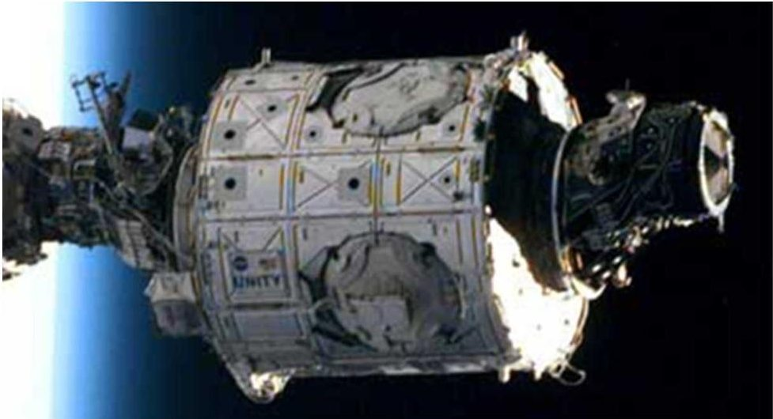

Figure 1. Node 1 of the ISS. (Photo courtesy NASA)

As for the fidelity of both, the virtual and physical mock-ups, the test and design teams were able to match the fidelity of each environment as close as possible to each other. Volumetric representations of subsystems and devices were accomplished either digitally or by using materials such as foam core and decals. There was no system functionality in the mock-up; however, system representation was available and close out panels were used. Finally, mannequins were used to illustrate task volumes in both mock-ups and did not interact with the SME during the evaluation (Figures 2-3).

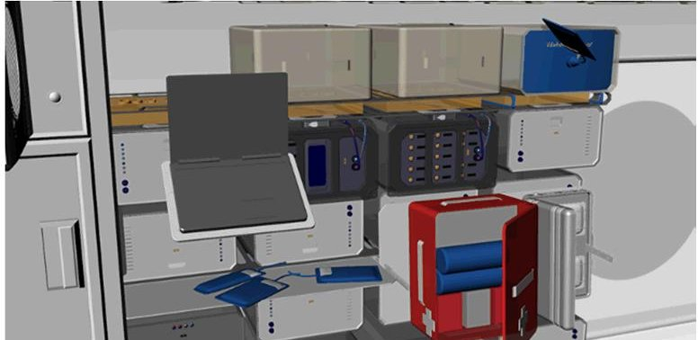

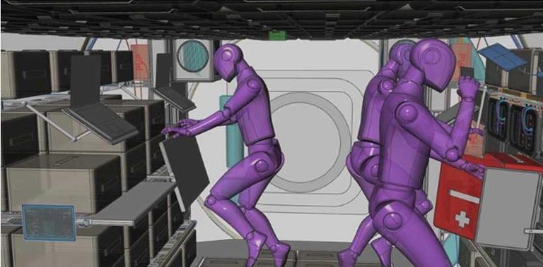

Figure 2. Screen shots of the habitat VR low-fidelity environment.

<!-- PDF_PAGE: 12 -->

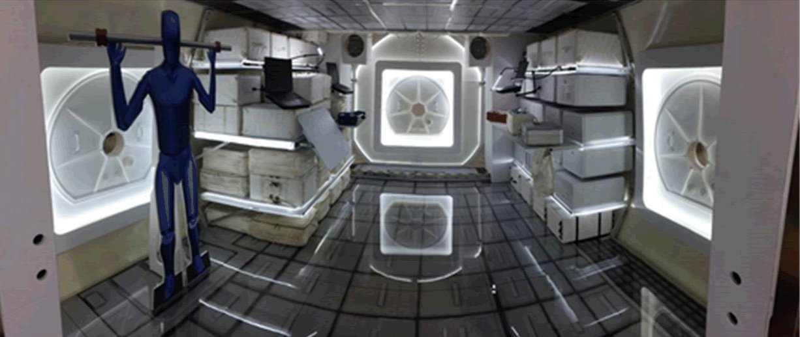

Figure 3. Photo of the low-fidelity habitat physical environment.

For visualization rendering, the team used the High Tech Computer (HTC) Vive. The HTC Vive is a VR headset developed by HTC and Valve Corporation. The headset uses "room scale" tracking technology, allowing the user to move in three-dimensional (3-D) space and use motion-tracked handheld controllers to interact with the environment with precision. The Vive has a refresh rate of 90 Hz, a field of view of 110 degrees, and includes a plug to connect headphones. The device uses two screens, one per eye, each having a display resolution of 1080 x 1200. The tracking system used is the lighthouse tracking system and is integrated into the Vive Headset and controllers. Lighthouse can operate up to a 15-by-15-ft (4.6-by-4.6-m) tracking space if used with both "Lighthouse" base stations that track the user's movement with sub-millimeter precision. The Lighthouse system uses simple photo sensors on any object that needs to be captured; to avoid occlusion problems. To render the scene, the team used a Micro-Star International (MSI) VR one backpack computer that has an NVIDIA 1070 Pascal graphics card. This allows for real-time rendering of the scene (90 frames per second) with minimal lag, which reduces the VR-induced nausea that can accompany some VR systems that have a large amount of latency and slower than 90 frames per second screen refresh rate (Figure 4).

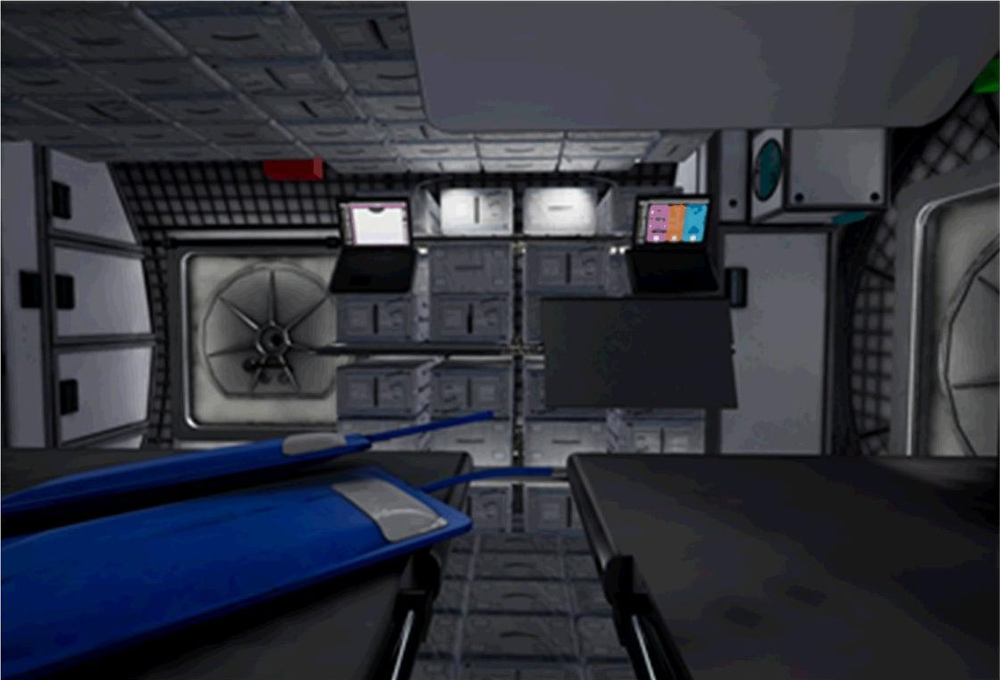

Figure 4. Photo of the low-fidelity habitat VR environment.

<!-- PDF_PAGE: 13 -->

The Low Fidelity Habitat (LFH) was 16.7 ft (5.1 m) in length, which included the end cones and 13.8 ft (4.2 m) in diameter. Hatch size for the module was 31.5 in. (800 mm) in diameter (Figure 5). The outer shell of the physical mock-up was constructed of fiberglass with the internal secondary structure made of 80/20 aluminum. The floor was a $ 3/4 $ -in. thick plywood base with a steel supporting structure and high-resolution decals. Hatches in the mock-up were made of foam. Notional science payloads were made from excess Space Shuttle Mid-Deck Lockers (MDLs) with foam milled control panels. Cargo Transfer Bags (CTBs) were used in conjunction with the MDL and printed decals. Light-emitting diodes (LEDs) were used around the hatches and shelves to illuminate the mock-up along with several task lighting fixtures. Other foam core items include sub-system close-out panels, laptops, drink bags, a food warmer, an exercise device, and sub-system devices (Figures 5 and 6).

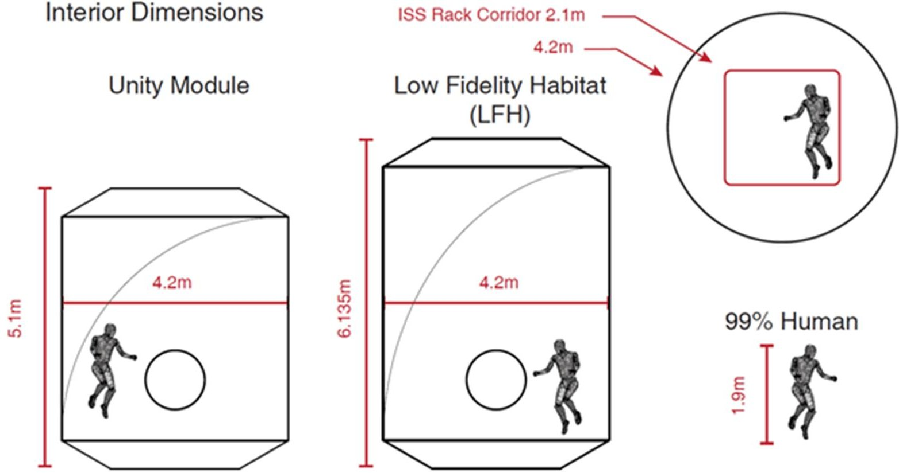

Figure 5. Illustration of the LFH compared to the ISS Node 1 Module.

<!-- PDF_PAGE: 14 -->

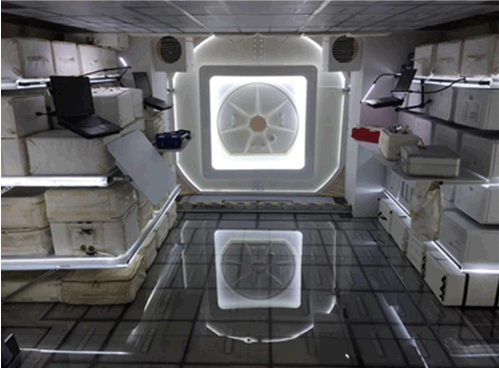

Figure 6. Photo of the LFH physical mock-up.

## 5.0 EVALUATION DESIGN

## 5.1 Participants

Eight SMEs, of varying backgrounds, evaluated all the internal systems of the vehicle. Each SME went through a VR test session and a physical mock-up test session. In addition, all SMEs had familiarization training on the functions of the VR system. Prior to testing, all SMEs signed consent forms and were briefed as to the nature of the evaluation and tasks expected of them. With all of these tasks combined, each data collection session lasted a total of 3 hours.

## 5.2 Test Environment

The evaluation took place in Building 9 South on the campus of Johnson Space Center (JSC) in Houston, Texas. The two mock-ups for SMEs to evaluate included: 1) a VR low-fidelity digital environment (Figure 7) and 2) a low-fidelity physical environment (Figure 8).

<!-- PDF_PAGE: 15 -->

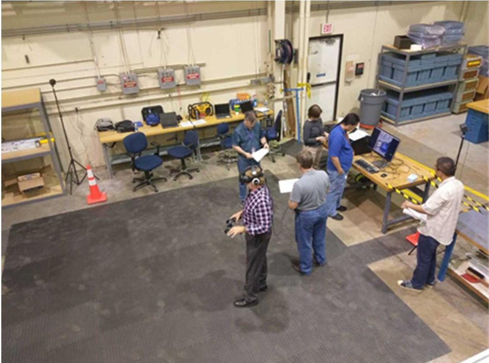

Figure 7. Photo of the VR environment in Building 9 South at JSC with the VR simulation.

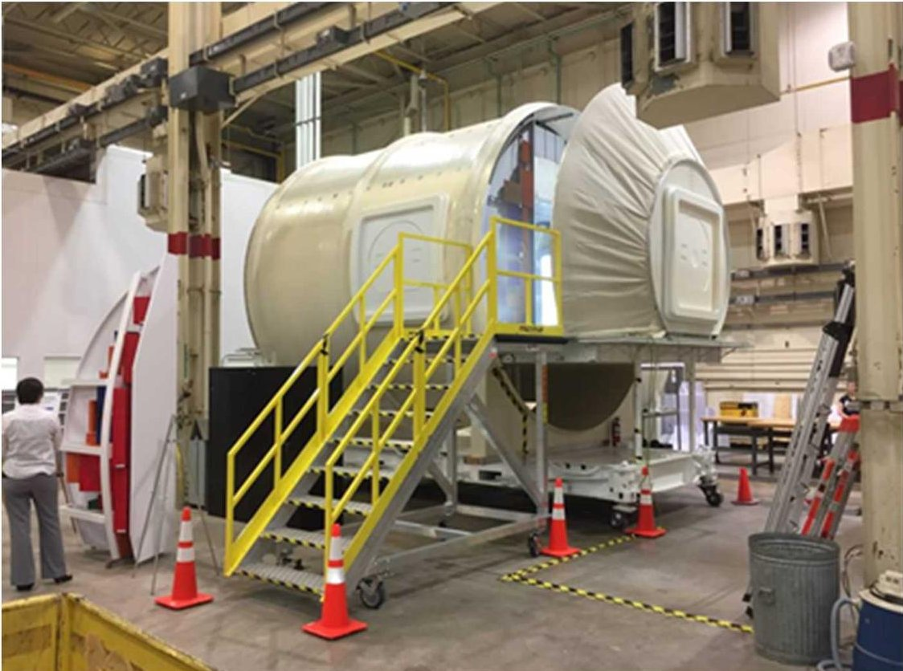

Figure 8. Photo of the LFH physical mock-up in Building 9 South.

## 5.3 Evaluation Scenarios and Task Timelines

Fifteen areas of functionality were depicted within the habitat module. Table 2 shows the functionality that was agreed upon by the project management for testing. Not all of the functions shown in Table 2 were tested. SMEs only tested 8 functional areas during this study. Both test environments were considered low-fidelity and none of these functional areas were actually operational, only visually depicted. Thus, a walk-through type human-in-the-loop evaluation was performed to conduct visual inspection of certain functional areas.

<!-- PDF_PAGE: 16 -->

Table 2. Functionality of LFH Configuration

<table border="1"><tr><td>Function</td><td>Equipment</td><td>Quantity</td><td>Notes</td></tr><tr><td rowspan="2">Science/Research</td><td>Science Workstation</td><td>1</td><td>Powered Units will show power, data, and thermal fluid lines. Next to Multi-Functional Area on Port side of vehicle</td></tr><tr><td>“Powered Units”[MDL equivalents]</td><td>16</td><td></td></tr><tr><td>Exercise</td><td>ATLAS Device</td><td>1</td><td>Need to confirm operational volume. Located on the Port side of the vehicle in hatchway</td></tr><tr><td>Medical</td><td>CTB Kit</td><td>1</td><td>Using a deployable surface in Multi-Functional Area</td></tr><tr><td>Stowage</td><td>CTBs</td><td></td><td>Everywhere in Vehicle</td></tr><tr><td rowspan="4">Food Prep</td><td>Food Warmer</td><td>1</td><td rowspan="4">Using a deployable surface in Multi-Functional Area. Food warmer will be transferred over from Orion to the habitat</td></tr><tr><td>Mock-up Food Packets</td><td>2</td></tr><tr><td>Water Dispenser</td><td>1</td></tr><tr><td>Water Bags</td><td>1</td></tr><tr><td>Command and Control</td><td>Command and Control Workstation</td><td>1</td><td>These two workstations are together on the Starboard side of the vehicle</td></tr><tr><td>Robotic Arm and Lunar Surface Tele-Ops</td><td>Robotic Arm and Lunar Surface Tele-Ops Workstation</td><td>1</td><td></td></tr><tr><td>Sleep</td><td>Sleeping Bags with Restraints</td><td>4</td><td>(2) In Hab Module,(2) in Orion</td></tr><tr><td rowspan="4">Multi-Functional Area</td><td>Multi-Functional Work Surface</td><td>1</td><td>Located on Port side of vehicle</td></tr><tr><td>Food Prep</td><td></td><td></td></tr><tr><td>Manitenance Surface</td><td></td><td></td></tr><tr><td>Medical Support</td><td></td><td></td></tr><tr><td>Subsystems</td><td>Pallet, Various Subsystems</td><td>All were represented</td><td>All sub-systems design and in mock-up according to Master Equipment List Pallet design Sub-System distribution strategy</td></tr></table>

<!-- PDF_PAGE: 17 -->

Table 2. Functionality of LFH Configuration

<table border="1"><tr><td>Function</td><td>Equipment</td><td>Quantity</td><td>Notes</td></tr><tr><td rowspan="2">Hygiene</td><td rowspan="2">Personnal Hygiene Kit Wipes</td><td>1</td><td>Crew will go to personnal hygiene area</td></tr><tr><td>To Be Determined (TBD)</td><td></td></tr><tr><td>Radiation Protection</td><td></td><td>TBD</td><td>Crew will go to Orion</td></tr><tr><td rowspan="5">Waste Collection</td><td rowspan="5">WCS Hardware in Orion WCS Canisters Stowed Wipes</td><td>1</td><td>Canisters may be stowed in Habitat</td></tr><tr><td>TBD</td><td></td></tr><tr><td>TBD</td><td></td></tr><tr><td>TBD</td><td></td></tr><tr><td>TBD</td><td>Local at each workstation in Habitat Long term to be stowed</td></tr><tr><td>Lighting</td><td></td><td>TBD</td><td>All modules</td></tr><tr><td>Housekeeping</td><td></td><td>TBD</td><td>Habitat</td></tr></table>

Vehicle Configuration: LFH with a crew of 4 for a 30-day mission

Procedures for the test were as follows. The test director gave a pre-test brief to the SME explaining the tasks at hand, facility safety, and VR safety. Each SME was given a pre-test demographic questionnaire. For the VR environment, each SME was given a 15- to 20-minute familiarization session on how to move around and use the evaluation tool in virtual space. Once the participants felt comfortable with their virtual surroundings, they were requested to log into the evaluation portion of the test.

SMEs then walked through the habitat, scoring 30 questions on 8 different functional areas of the early conceptual design. The questionnaire used a 5-point Acceptability Scale where "1" was "Totally Acceptable with no improvements necessary" to "5" which was "Totally Unacceptable with major improvements required." Participants could also use a "No Rating" (NR) score (Appendix C). If this score was used, the evaluation tool directed them to the 5-point Design Maturity Rating Scale where "A" was "Not Applicable", "B" indicated the "Design was too Immature", "C" noted "Information was not present at the Review", "D" indicated "It is not my area of Expertise", and "E" was "Other", in which an explanation was needed by the SME if chosen. All scoring was accomplished through the VR headset using a custom-built evaluation tool user interface. With scoring complete, the SME was asked to complete a User Interface Questionnaire on the VR Evaluation Tool.

<!-- PDF_PAGE: 18 -->

After a short 5-minute break, the SME was then escorted to the physical mock-up and given a 10-minute familiarization session about the mock-up. Next, the SME was given an iPad and, using another customized survey software (which matched closely with the VR Evaluation Tool), the participant answered the same 30 questions covering the same 8 functional areas within the habitat. When the SME indicated they were finished, the test team directed them to complete a comparison questionnaire on the two test environments. The test session ended when the SME completed the comparison questionnaire and a short debrief session (Figure 9).

To counterbalance the evaluation, half of the participants used the aforementioned process. For the other half, the order of the procedures was reversed with the following participant. Thus, they would start with the physical environment first and then go into the VR environment.

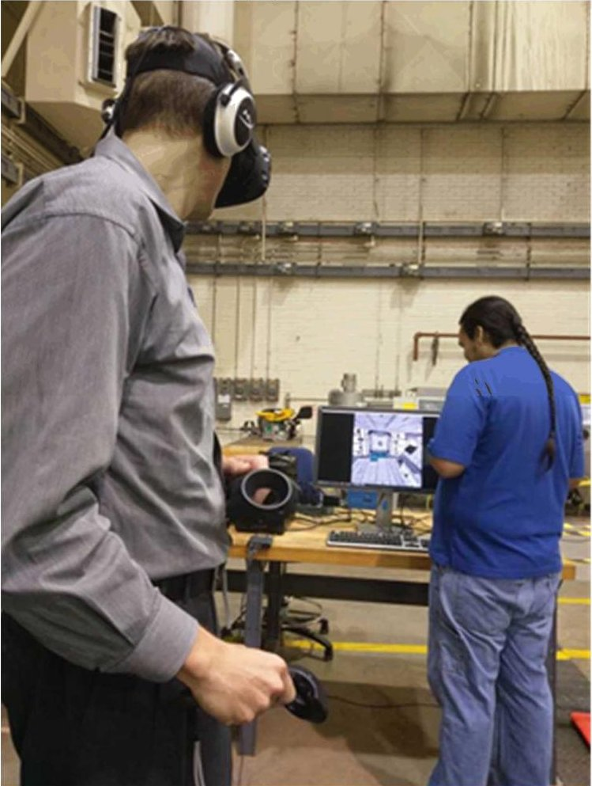

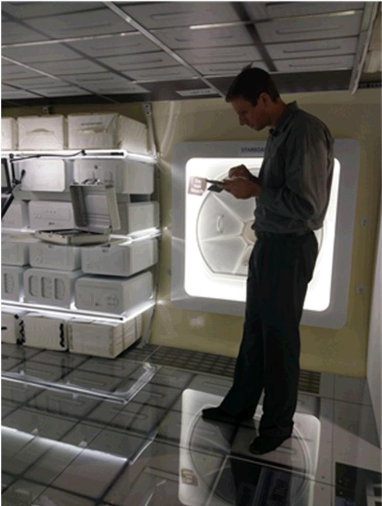

Figure 9. The photo of the left shows a SME in the VR simulation while the photo on the right shows a SME in the physical mock-up.

## 5.4 Evaluation Methodology

Due to the population sample size, this study has no inferential hypotheses involved. The test team gained insight on the experimental protocol, and how the methodologies of each tested environment differed or enhanced the SME's experience of a design during its' earliest stages. The team planned for a sample size of n=8 to accomplish these goals and believe this sample size was a good starting point for this type of study. Table 3 is a summary of data collections techniques that were employed during this study.

<!-- PDF_PAGE: 19 -->

Table 3. Human Factors Data Collection Measures

<table border="1"><tr><td>Test Metric</td><td>Measures for Data Collections</td><td>Frequency</td></tr><tr><td>Demographics Questionnaire</td><td>Subjective information on the participant</td><td>Pre-Test</td></tr><tr><td>30 Question Volumetric Questionnaire</td><td>Subjective assessment of the methodology and design through the use of questionnaires(1-5 Designed Concept Acceptability Scale and an A-E Design Maturity Scale)</td><td>During Test</td></tr><tr><td>VR and Physical Environment Comparison Questionnaire</td><td>Subjective comparison on both test environments</td><td>Post-Test</td></tr><tr><td>Programmatic Cost Analysis</td><td>Programmatic analysis of cost overhead for each method(e.g.time to develop,time to build,labor cost,material cost,etc.)</td><td>Post-Test Analysis</td></tr></table>

This study used a series of measures, in both the virtual as well as the physical settings, to extract possible quantitative relationships between the subject's preferences of testing environments and vehicle design to clarify what factors influenced their choices. Two test sessions took place within these environments. The first test session was designed where no other crew members were present (either real or virtual). The subject was asked to walk around the environments and evaluate the overall interior design and vehicle system design using specific subjective questionnaires, which were employed using two scales: The Design Concept Acceptability Scale (a 6-point scale) and the Design Maturity Scale (a 5-point scale). The Design Concept Acceptability Scale is a 1-5 scale with a no rating option, where 1 is "Totally Acceptable" where no improvements are necessary, 2 is "Acceptable", 3 "Warrants Improvements", 4 is "Unacceptable", and 5 is "Totally Unacceptable" where major improvements are required (Figure 10). If an NR is given, then the subject was prompted to go to the Design Maturity Scale (Figure 11).

<table border="1"><tr><td>Totally Acceptable</td><td>Acceptable</td><td>Borderline</td><td>Unacceptable</td><td>Totally Unacceptable</td><td>No Rating</td></tr><tr><td>No improvements necessary</td><td>Minor improvements desired</td><td>Improvements warranted</td><td>Improvements required</td><td>Major improvements required</td><td>Unable to assess. Go to Design Maturity Scale</td></tr><tr><td>1</td><td>2</td><td>3</td><td>4</td><td>5</td><td>NR</td></tr></table>

Figure 10. The Design Concept Acceptability Scale.

<table border="1"><tr><td colspan="5">Design Maturity Rating(A-E)
(for Design Concept Rating of NR)</td></tr><tr><td>Not Applicable</td><td>Design too Immature</td><td>Information not present at review</td><td>It is not my area of expertise</td><td>Other</td></tr><tr><td>A</td><td>B</td><td>C</td><td>D</td><td>E</td></tr></table>

Figure 11. The Design Maturity Scale.

<!-- PDF_PAGE: 20 -->

Using these scales assisted the investigators in understanding why the SME could not give a score for that particular system or area of the vehicle. The validity of both the virtual and physical environments was evaluated by comparing the ratings made by each SME from the volumetric questionnaire.

## 6.0 RESULTS AND DISCUSSION

A demographic analysis was employed to illustrate the extensive experience the SMEs had in both operational spaceflight and spacecraft design.

A correlation coefficient between the two environments using the data obtained by the SMEs was employed to compare the spatial preferences between the virtual and physical spaces. If a high correlation exists between the testing environments, then SMEs responded similarly regardless of the environment. However, if there are low correlations, then the participants responded to one or the other test environment differently.

A cost analysis was employed to further understand any differences between a virtual environment and a physical environment. The cost of infrastructure, outfitting, development, and labor were considered.

## 6.1 Demographic Analysis

Investigators were able to obtain eight highly qualified SMEs for the study: five males and three females with an average work experience of 22 years (M=22.14,min 7,max 32). Table 4 illustrates the demographics classification.

Table 4. Demographics Classification for the Physical vs VR Study

<table border="1"><tr><td>Gender</td><td>Design Criteria Category</td><td>Years of Experience(in years)</td><td>VR Experience(in hours)</td></tr><tr><td>M</td><td>Human System Integration</td><td>7</td><td>2</td></tr><tr><td>M</td><td>Programmatic</td><td>29</td><td>5</td></tr><tr><td>M</td><td>Engineering</td><td>28</td><td>2</td></tr><tr><td>M</td><td>Manufacturing/Assembly</td><td>32</td><td>2</td></tr><tr><td>M</td><td>Human System Integration</td><td>8</td><td>3</td></tr><tr><td>F</td><td>Engineering</td><td>16</td><td>0</td></tr><tr><td>F</td><td>Training/Operations</td><td>17</td><td>1</td></tr><tr><td>F</td><td>Human System Integration</td><td>25</td><td>0</td></tr></table>

## 6.2 Comparison Analysis

For the comparison results of the assessment, both the scoring from the volume questionnaires as well as the data collected from the comparison questionnaire were used. Due to the population size for this study, the non-parametric Spearman's correlation coefficient $ \left(r_{s}\right) $ was employed. This correlation is a statistical measure of the strength of a relationship between paired data

<!-- PDF_PAGE: 21 -->

(Shavelson, 1996; Sanders & McComick, 1993). The closer $ r_{s} $ is to +/-1, the stronger the relationship. Since correlation is an effect size measure, the strength of the correlation relationship can be described as follows (Weir, 2011):

<table border="1"><tr><td>.00- .19</td><td>“very weak”</td></tr><tr><td>.20- .39</td><td>“weak”</td></tr><tr><td>.40- .59</td><td>“moderate”</td></tr><tr><td>.60- .79</td><td>“strong”</td></tr><tr><td>.80-1.0</td><td>“very strong”</td></tr></table>

As stated earlier, the participants scored eight different functional areas within the habitat for each environment. Through comparison of the volumetric preferences for habitable functions between the virtual and physical space, the validity of using visual simulation of the design is supported by the similar results obtained from SMEs on each of the eight functional areas. A Spearman's correlation was run to determine the relationship between the two test environments. Table 5 illustrates the correlation coefficients between the virtual and physical environments' habitat areas. All but two functional areas indicated a strong to very strong relationship between the two environments. The areas of stowage and hygiene showed a weak to moderate correlation coefficient among SMEs. The hygiene area was not defined in either the physical or virtual worlds. For the investigators, this area was more exploratory as the vehicle designers were asking assistance from the SMEs. SMEs tended to put the theoretical hygiene location in the same area of the habitat regardless of test environment. However, SMEs tended to like the virtual world more for this particular functional area due to the early design phase.

Table 5. Correlation Table for the Eight Habitat Areas Under Test

<table border="1"><tr><td>Habitat Areas of Concern</td><td>Correlation $ [r_s] $</td><td>p</td><td>Correlation Relationship</td></tr><tr><td>General Layout</td><td>0.634</td><td>&lt;0.001</td><td>strong</td></tr><tr><td>Multi-Functional Areas</td><td>0.633</td><td>&lt;0.001</td><td>strong</td></tr><tr><td>Galley</td><td>0.857</td><td>&lt;0.001</td><td>very strong</td></tr><tr><td>Hygiene</td><td>0.405</td><td>0.319</td><td>moderate</td></tr><tr><td>Exercise</td><td>0.815</td><td>&lt;0.001</td><td>very strong</td></tr><tr><td>Medical</td><td>0.649</td><td>&lt;0.001</td><td>strong</td></tr><tr><td>Stowage</td><td>0.355</td><td>0.177</td><td>weak</td></tr><tr><td>Sub-Systems</td><td>0.628</td><td>&lt;0.001</td><td>strong</td></tr><tr><td>Average</td><td>0.622</td><td></td><td></td></tr></table>

As for the stowage, SMEs preferred physically touching and moving the stowage bags and could not get this type of interaction in the virtual world. However, it must be noted that the fidelity of the stowage was not designed for this level of interaction in either environment. SMEs indicated they liked the ability to fly around over the stowage in the virtual mock-up because it gave them a real feel for the stowage volume; however, the SMEs felt interaction with the stowage, even at this low level of physical fidelity, was key. Nevertheless, overall results indicated that there is a

<!-- PDF_PAGE: 22 -->

high correlational relationship among the SMEs scores of these functional areas in the two test environments with an average value of 0.622 across all areas.

A similar study conducted by Ryu, Hashimoto, Sato, Soeda, and Ohno (2007) had the same result. They were examining an urban environmental design for public spaces such as plazas, streets, and parks. The study was conducted to survey people's seat preferences in a public plaza in both the real and virtual world to see if there was a difference between the environments that would influence the distribution of the surroundings and to extract quantitative relationships between subjects' seat preferences and to clarify what factors influence seat choice (Ryu, Hashimoto, Sato, Soeda, and Ohno, 2006; Ryu et al. 2007). Nineteen subjects were asked to walk about and to evaluate each of three predesignated positions to sit there and 1) have a brief rest, 2) read a book, and 3) eat food (Ryu et al. 2007). The subjects were asked to rate the seats assuming no other people were present. Subjects conducted the same set of tasks in both the real-world environment and the virtual environment. Results indicated a high correlation between the three tasks, in both the real and virtual spaces, with averages for resting at 0.71, reading 0.74, and eating 0.71, respectively. Another study conducted by Pontonnier, Dumont, Samani, Madeleine and Badawi (2013) on evaluating the design of a workstation in both the real and virtual environment, concurs with these findings. The researchers used ten subjects doing a parts task with the workstation. Again, results indicated no difference between the real-world and virtual environments.

SMEs were asked to describe how the LFH volume felt in each environment. Half of the participants thought the volume in both environments felt the same. They reported how surprisingly close the virtual volume felt to the physical one. The virtual environment gave that feeling of being constrained much like the real environment. Several of the participants noted the virtual volume gave them a better sense of realism, a natural sense of space, was easy to maintain situational awareness, was clean and modern looking, and was a better way to image the microgravity environment. Additionally, they reported having both audio head phones and virtual goggles made the virtual world extremely immersive and isolated, which made it easier to imagine one was in a real space. As for the physical environment, some participants reported feeling the volume in the mock-up as static and not as interactive (Figure 12). They perceived a different feeling, but they could not put their finger on it as to why they felt this way. Material choices could have been one factor for this feeling. SMEs noted materials, such as wood or foam, had less flight-like qualities than the materials simulated in VR. The mannequins used in the physical environment were made out of foam core, giving the SMEs a more 2-dimensional feel with much less fidelity than the mannequins in the VR environment. However, there were both exceptions and limitations to each of the environments tested. Appendix E shows the subjective trends from the SMEs on each environment.

<!-- PDF_PAGE: 23 -->

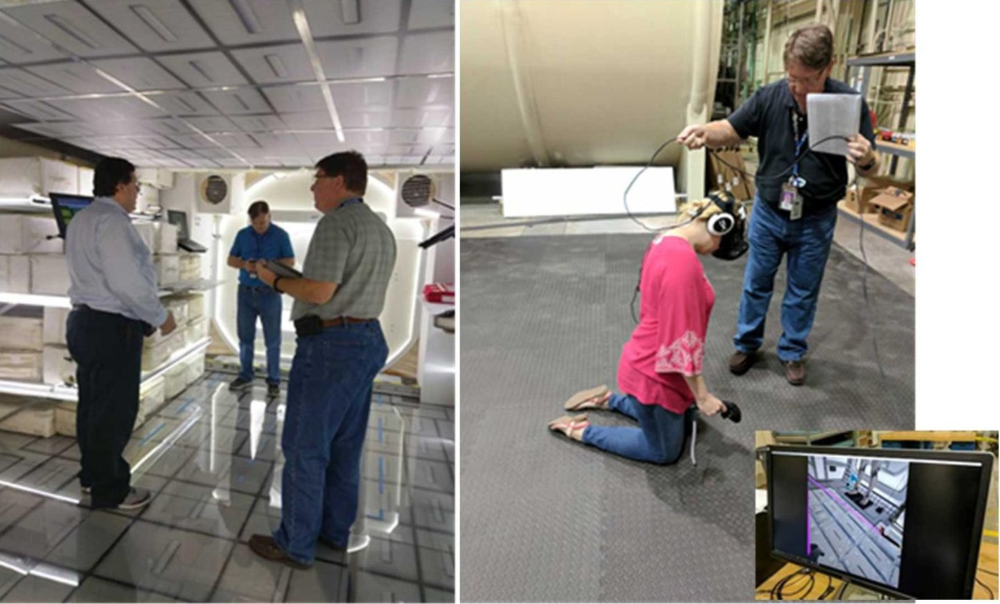

Figure 12. SMEs indicated the feel of the volume was equal in both environments.

SMEs ultimately had to make a decision about which of the environments they would choose that best fit an evaluation of a design concept early in the design cycle. Seven out of eight SMEs deemed virtual reality the best test environment for evaluating early conceptual designs. They found the virtual reality environment to be somewhat superior to the real environment due in part to the higher level of fidelity presented in the virtual world that incorporated a number of areas. The virtual world gave them the ability to choose different filters and to remove or add different levels, within the design to get a deeper understanding of systems that would otherwise only be seen in computer-aided drawings. This gave the virtual world a significant advantage. Movement in the virtual world gave the SMEs opportunities to get into spaces that would only be available to them in a microgravity environment and not in a physical, 1-g environment. Lastly, though the SMEs for this study did not have a lot of previous time in VR, they reported feeling quite comfortable in the virtual space without a lot of coaching, confusion, nausea, or any of the negative side effects that might be perceived as part of the virtual world.

## 6.3 Cost Analysis

To fully evaluate the validity of the two test environments, the investigators inquired about cost of each environment from a labor, build, and materials standpoint. Design development was not considered in this cost analysis and both test environments used the same design. Development of both the physical and virtual reality environments were done in parallel, and took approximately 11 weeks to complete. It should be noted that the timetable was the primary driver in the development of both test environments and it is unclear if this constraint may have forced selection of more-expensive materials or processes to meet deadlines. In particular, Computer Numerical Code foam milling was used for several mock-up components that in prior habitat studies had been hand built from wood or simple foam core at lower cost but slower production speeds. It is also worth noting that the shell, cradle, and floor of the physical mock-up were

<!-- PDF_PAGE: 24 -->

selected in anticipation of ultimately building a medium to high fidelity habitat. Thus, those higher dollar purchases would not have been made for a mock-up initially intended to serve a low fidelity walk-through evaluation.

The physical environment analysis starts with the first delivery of hardware for the physical mock-up (Figure 16). This included modular structures such as a cradle to move the mock-up around. The outer shell was constructed of fiberglass with an internal supporting structure made of 80/20 aluminum. The floor of the mock-up was $ \frac{3}{4} $ inch (1.91cm) plywood with a steel supporting structure. Shell integration included mounting the fiberglass shell onto the shipping cradle, installing the end cones, and integrating the floor with the fiberglass shell. With the integrations of all major structural pieces completed, the structure measured 16.7 ft (5.1 m) in length (which includes the end cones) with a 13.8 ft (4.2 m) diameter. Hatch size for the module is 31.5 in. (800 mm) in diameter. Other items integrated included foam milling the science payload faceplates and high-resolution graphics development and integration. Next came the internal outfitting, where finishing touches and installations of the science payloads, work stations, actual stowage (using CTBs), equipment pallets, lighting (LEDs), power, air flow devices, safety devices and several part task training demonstrators (located outside the mock-up). Breakdowns of the cost for the physical mock-up for materials, hardware, and integration was $ 257.2K and labor was costed at $ 60K for a total cost of $ 317.2K (Table 6). As was indicated earlier, the materials/build cost was 81% of the physical environment cost with labor cost accounting for 19% (Figure 13).

Physical Environment Development

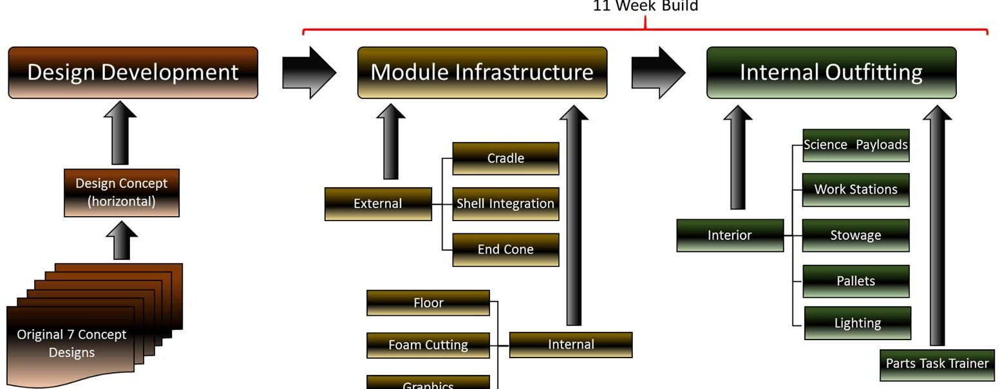

Figure 13. A flow chart of the physical environment development process over an 11-week period.

<!-- PDF_PAGE: 25 -->

Table 6. Cost Analysis for the Physical Environment

<table border="1"><tr><td>Physical Environment: Design and Build of the Habitat Mock-up</td><td>Material/Build$k</td><td>Labor$k</td><td>Total(ROM)$k</td></tr><tr><td>CMC module infrastructure(cradle(flat-bed),shell integration,end cones,floor,foam,and graphics)</td><td>$200</td><td>$5</td><td>$205</td></tr><tr><td>HDC Internal Outfitting and end-cone pallet part task mock-up</td><td>$57.2</td><td>$55</td><td>$112.2</td></tr><tr><td>Total</td><td>$257.2</td><td>$60</td><td>$317.2</td></tr></table>

NOTE: Cost was provided by NASA on 27 September 2017

With the virtual reality environment, investigators used the same cost breakdown as with the physical environment (Figure 14). The development process started with purchasing hardware and building the computer infrastructure. Hardware included the HTC Vive headset and controllers from the HTC and Valve Corporation, motion tracking photo sensor technology from "Lighthouse," and an MSI VR computer with NVIDIA 1070 Pascal graphics card for visual presentation. With the hardware infrastructure in place, a modeling processing was developed between several NASA modeling offices, which included both the exterior and interior models. Exterior models included the overall stack integration configuration, power and propulsion bus, habitat module, the Orion capsule, and a logistics module. Interior models consisted of an interior layout configuration, sub-system configuration, and stowage. Finally, an evaluation tool user interface was developed, which included filters, tools, a questionnaire insertion tool, and a log-in screen. Additionally, a full database was developed to collect and archive the evaluation data for analysis by investigators. Cost breakdowns for the virtual reality environment for materials, hardware, and integration was $40K (27%) with labor costed at $110K (73%) for a total cost of $150K (Table 7).

Virtual Reality Environment Development

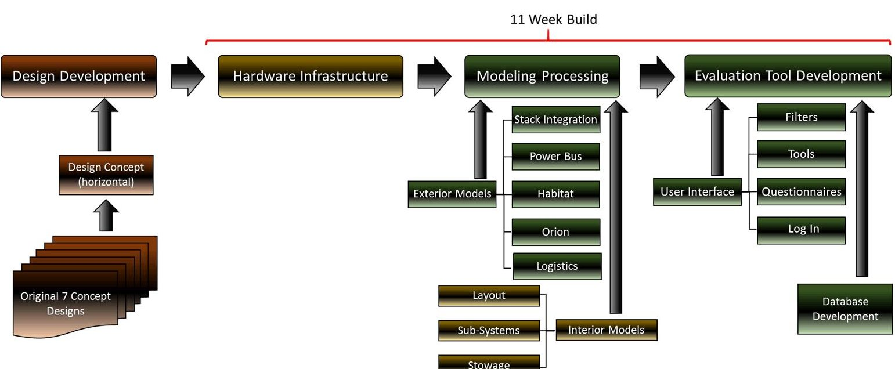

Figure 14. A flow chart of the virtual reality environment development process over an 11-week period.

<!-- PDF_PAGE: 26 -->

Table 7. Cost Analysis for the Virtual Reality Environment

<table border="1"><tr><td>Virtual Reality(VR) Environment: Infrastructure and Labor to develop and operate the VR-Hab Internal Architecture Evaluation tool</td><td>Material/Build</td><td>Labor</td><td>Total(ROM)</td></tr><tr><td></td><td>$k</td><td>$k</td><td>$k</td></tr><tr><td>VR System Hardware Infrastructure(HDC just bought a VR set-up for 2 stations)</td><td>$40</td><td></td><td>$40</td></tr><tr><td>VR Hab Evaluation Tool development(ER)</td><td></td><td>$75</td><td>$75</td></tr><tr><td>VR HDC/UTAF Evaluation team labor(SF3)</td><td></td><td>$35</td><td>$35</td></tr><tr><td>Total</td><td>$40</td><td>$110</td><td>$150</td></tr></table>

NOTE: Cost was provided by NASA on 27 September 2017

Given the physical environment cost total of $317K. and the virtual reality environment cost a total of $150K, this shows that the virtual reality environment for this early stage of design could save a program manager as much as approximately 32% even though the labor costs for virtual reality development is approximately 65% higher than the labor cost for a physical environment. However, with technical advancements in the virtual reality computer equipment, this offsets the labor significantly. However, this must be qualified by the fact that the intended fidelity level of this mock-up changed during its development and physical item purchases were made to support a higher fidelity mock-up that was ultimately built. The cost savings, however, do seem to be in concurrence with studies where the cost for using the virtual reality world in early design phases was significantly lower than with physical mock-up costs (M. Maing, 2012; J. Johansson, 2012; Maldovan, K.D., Messner, J.I. & Faddoul, M., 2006). For example, in the Johanson (2012) study of a California-based hospital patient room design, they examined both physical and virtual mock-ups from four main areas: 1) Effectiveness for testing; 2) Time commitment; 3) Cost to create; and 4) Construction issue detection. In all four areas, the virtual mock-up showed decreases in time, cost, and construction issues over the life of the build. Effectiveness for test indicated the virtual world stayed flat over the life of the build, while the physical improved as fidelity improved. The Maldovan (2012) study concluded the same results for looking at courtroom mock-ups. The study reported "If the main [design] categories that are reviewed during the physical mockup review can be replicated in a non-traditional (virtual) setting at a lesser cost, and lesser time, and more design options, ...why then should virtual mockups not be implemented as an alternative to the traditional design review."

<!-- PDF_PAGE: 27 -->

## 7.0 CONCLUSIONS

With longer duration human exploration missions on the horizon, spacecraft habitability design has become increasingly important in the way design and configuration can affect a crew's physical and psychological outlook for everyday life onboard a space vehicle in a hostile environment. Spacecraft designers traditionally use physical mock-ups to examine design configuration and volume allocations. However, with advancements in digital VR technology, a virtual mock-up for early design phases could prove to be more beneficial than a physical mock-up, particularly where the only test participant feedback needed can be obtained from visual inspection and does not require direct interaction with the habitable environment.

This study has not shown this level of low-fidelity walk-through evaluation (in either physical or virtual environments) as sufficient to enable the design team to answer performance questions such as whether the habitable volume is sufficient, or accommodations of required anthropometric ranges, or operator effectiveness and efficiency with workstation tasks. However, it does enable a design team to make key preliminary design trades, such as refinement of initial architectural layouts as a precursor input to higher fidelity testing to answer the aforementioned performance questions.

It is difficult to judge the value of presenting a mocked-up space virtually or physically. In this study, results indicated that when testing an early design concept, there was a high correlation between the two environments, meaning SMEs found little to no difference when evaluating a design in either a physical or virtual environment. This correlation was strongest when test participants had no intention to physically interact with the environment. There are advantages and limitations to both environments. The virtual world gave the experts a better sense of the microgravity space environment and the relationships of space and human presence that are difficult to simulate in a 1-g physical environment. Being non-static in nature, the virtual environment allows designers and evaluators a method that offers a consistency in transfer of knowledge between experts. However, the interaction between human and mechanics is better enhanced in the physical world compared to the virtual world. Additionally, a physical environment becomes more readily available for touring management who may have an interest in the project. These advantages and limitations of each environment are important; however, cost is also an important consideration when early design concepts are being used. With the cost analysis of materials, hardware, and labor conducting for this study, virtual reality showed a 68% decrease in cost over the physical mock-up build.

Thus, taking all aspects of the study into consideration, at this early design life cycle phase, virtual reality shows great promise to support walk-through evaluations for testing early design concepts that will cost less, give more options, and increase designer's time to design, moving a program more swiftly to the point of being able to address key performance questions with an effective habitat design.

<!-- PDF_PAGE: 28 -->

## 8.0 REFERENCE LIST

Agarwal, R. and Karahanna, E. (2000). "Time flies when you're having fun: Cognitive absorption and beliefs about information technology usage," MIS Quarterly, Vol.24, No 4. (Dec 2000), pp. 665-694.

Johansson, J. (2012). "Patient rooms of a California based hospital: Benefits of physical mockups vs. benefits of virtual mock-ups," retrieved on-line at http://vr.design.umn.edu/portfolio/documents/VRReport_JJohansson.pdf.

Kalay, Y.E. (2004). "Architecture's New Media."

Maing, M. (2012). "Physical or virtual?: Effectiveness of virtual mock-ups of building envelope systems," BEST3 Conference, 2012.

Maldovan, K.D., Messner, J.I. and Faddoul, M. (2006). "Framework for reviewing mock-ups in an immersive environment," retrieved on-line at https://www.researchgate.net/publication/228399774.

D Maldovan, Kurt & Messner, John & Faddoul, Mera &, Pe. (2006). "Framework for Reviewing Mock-ups in an Immersive Environment," CONVR 2006: 6th International Conference on Construction Applications of Virtual Reality.

Pontonnier, C., Dumont, G., Samani, A., Madeleine, P., and Badawi, M. (2013). "Designing and evaluating a workstation in real and virtual environment: Toward virtual reality based ergonomic design sessions." Journal on Multimodal User Interfaces, Springer, 2013, pp. 1-10.

Ryu, J., Hashimoto, N., Sato, M., Soeda, M., and Ohno, R. (2006). "A game engine based architectural simulator on multi-projectors displays," Computer Aided Architectural Design Research in Asia (CAADRIA) 2006, pp. 613-616.

Ryu, J., Hashimoto, N., Sato, M., Soeda, M., and Ohno, R. (2007). "Application of human-scale immersive VR system for environmental design assessment-A proposal for an architectural design evaluation tool." Journal of Asian Architecture and Building Engineering, Vol. 6, No.1, May 2007.

Sanders, M.S, and McCormick, E.J. (1993). Human Factors in Engineering and Design (7th ed.). McGraw-Hill, Inc, New York, New York.

Shavelson, R.J. (1996). Statistical Reasoning for the Behavioral Sciences (3rd ed.), Simon & Schuster Company, Heedham Heights, MA.

Weir, I. (2011). "Spearman's correlation," December 2011, retrieved on-line at www.statstutor.ac.uk/resources/uploaded/spearmans.pdf

<!-- PDF_PAGE: 29 -->

## APPENDIX A. DEMOGRAPHIC QUESTIONNAIRE

<table border="1"><tr><td colspan="3">Demographics Questionnaire</td></tr><tr><td></td><td>Subject Number:</td><td></td></tr><tr><td>1</td><td>What is your Gender?</td><td></td></tr><tr><td>2</td><td>What is your current Job Title?</td><td></td></tr><tr><td>3</td><td>How many years of Job Experience do you have?</td><td></td></tr><tr><td>4</td><td>How much experience do you have with Virtual Reality/Head Mounted Displays/Heads Up Displays?</td><td></td></tr><tr><td>5</td><td>How much experience do you have working/living in habitat mock-ups or in analog environments(e.g.HERA,NEEMO,etc.)?</td><td></td></tr></table>

<!-- PDF_PAGE: 30 -->

APPENDIX B. VOLUMETRIC QUESTIONNAIRE

<table border="1"><tr><td>Element Cluster</td><td>Question Number</td><td>Question</td><td>Architectural Perspective</td></tr><tr><td rowspan="7">general layout</td><td>1</td><td>Do you feel the volume of this habitat design gives you the perception of spaciousness?</td><td>feel</td></tr><tr><td>2</td><td>Does the habitat design provide enough space for co-located activities(i.e. science, exercise, etc.)?</td><td>flow</td></tr><tr><td>3</td><td>Does the habitat design separate noisy areas from quite areas adequately?</td><td>flow</td></tr><tr><td>4</td><td>Does the habitat design adequately manage the risk for limiting cross-contamination(i.e. food, waste/hygiene)?</td><td>flow</td></tr><tr><td>5</td><td>Does the habitat design provide adequate volume for an emergency situation with an injured crewmember?</td><td>flow</td></tr><tr><td>6</td><td>Does the habitat&#x27;s design give you the immediate accessibility to emergency equipment and systems?</td><td>access</td></tr><tr><td>7</td><td>Do the translation paths maximize traffic efficiency and flow?</td><td>flow</td></tr><tr><td rowspan="5">general workstations</td><td>8</td><td>Is the accessibility of the multi-functional areas(e.g. command and control, robotics, medical/science, galley) adequate?</td><td>access</td></tr><tr><td>9</td><td>Does the habitat&#x27;s multi-functional areas provide adequate space between crewmembers to conduct simultaneous tasks?</td><td>flow</td></tr><tr><td>10</td><td>Is the multi-functional area adequate to accommodate crewmembers working?</td><td>feel</td></tr><tr><td>11</td><td>Is the area adequate to accommodate two crewmembers doing the task together(e.g. robotic operations/procedures)?</td><td>flow</td></tr><tr><td>12</td><td>Does the multi-functional area design provide ease of access and reconfigurability to the horizontal work surfaces?</td><td>access</td></tr><tr><td rowspan="3">galley</td><td>13</td><td>Does the habitat&#x27;s multi-functional area provide adequate space to prepare a meal?</td><td>flow</td></tr><tr><td>14</td><td>Does the habitat&#x27;s multi-functional area provide easy access to the water dispenser?</td><td>access</td></tr><tr><td>15</td><td>Do you feel the habitat&#x27;s design provides enough space for a group meal without feeling too restricted?</td><td>flow</td></tr><tr><td>hygiene</td><td>16</td><td>Does the habitat&#x27;s design provide separation for a private hygiene area?</td><td>flow</td></tr><tr><td rowspan="3">exercise</td><td>17</td><td>Does the habitat design provide adequate space for crew to perform aerobic and resistive exercise?</td><td>flow</td></tr><tr><td>18</td><td>Does the exercise area, when in use, provide adequate space for a non-exercising crew member to translate?</td><td>flow</td></tr><tr><td>19</td><td>Does the exercise area, when not in use, provide adequate space to translate?</td><td>flow</td></tr><tr><td rowspan="3">medical</td><td>20</td><td>Does the multi-functional area provide adequate space for nominal exams?</td><td>flow</td></tr><tr><td>21</td><td>Does the multi-functional area provide adequate space for off-nominal exams?</td><td>flow</td></tr><tr><td>22</td><td>Does the habitat&#x27;s design provide separation for a Private Medical Conference?</td><td>flow</td></tr></table>

<!-- PDF_PAGE: 31 -->

<table border="1"><tr><td>Element Cluster</td><td>Question Number</td><td>Question</td><td>Architectural Perspective</td></tr><tr><td></td><td>23</td><td>Does the multi-functional area for medical operations provide adequate volume for setting up and stowing equipment?</td><td>flow</td></tr><tr><td rowspan="2">stowage</td><td>24</td><td>Does the habitat&#x27;s design give you easy access to all stowage compartments?</td><td>access</td></tr><tr><td>25</td><td>Does the stowage strategy design provide for efficient reconfigurability?</td><td>system strategy</td></tr><tr><td rowspan="5">sub-system/maintenance</td><td>26</td><td>Does the habitat&#x27;s sub-system design provide ease access to all maintenance access panels?</td><td>access</td></tr><tr><td>27</td><td>Does the habitat&#x27;s sub-system design provide ease access to all common filter replacement units?</td><td>access</td></tr><tr><td>28</td><td>Does the sub-system strategy design seem logically place on the pallet?</td><td>system strategy</td></tr><tr><td>29</td><td>Does the habitat&#x27;s sub-system design provide adequate volume for you to inspect and repair a subsystem?</td><td>flow</td></tr><tr><td>30</td><td>Does the habitat design provide ease access and reconfigurability to work surfaces?</td><td>access</td></tr></table>

<!-- PDF_PAGE: 32 -->

APPENDIX C. ACCEPTABILITY AND DESIGN MATURITY SCALES Acceptability Scale

<table border="1"><tr><td>Totally Acceptable</td><td>Acceptable</td><td>Borderline</td><td>Unacceptable</td><td>Totally Unacceptable</td><td>No Rating</td></tr><tr><td>No improvements necessary</td><td>Minor improvements desired</td><td>Improvements warranted</td><td>Improvements required</td><td>Major improvements required</td><td>Unable to assess. Go to Design Maturity Scale</td></tr><tr><td>1</td><td>2</td><td>3</td><td>4</td><td>5</td><td>NR</td></tr></table>

Design Maturity Rating (A-E) (for Design Concept Rating of NR)

<table border="1"><tr><td>Not Applicable</td><td>Design too Immature</td><td>Information not present at review</td><td>It is not my area of expertise</td><td>Other</td></tr><tr><td>A</td><td>B</td><td>C</td><td>D</td><td>E</td></tr></table>

<!-- PDF_PAGE: 33 -->

# APPENDIX D. POST COMAPRISON QUESTIONNAIRE

## Test Environment Comparison Questionnaire

The purpose of this questionnaire is to determine which test environment was the most appropriate for the habitat design at this early stage. Your comments are important so please take the time to describe your feedback in detail. Give this questionnaire your full attention and do not hesitate to ask if you are not certain what is being asked in any of the questions. Please answer every question and do not leave any blanks. Thank you for your time and effort.

Q1. Mark with an X, the best test environment for evaluating the design element listed on the left side of each row.

<table border="1"><tr><td rowspan="2">Design Elements</td><td colspan="5">Test Environment</td></tr><tr><td>Virtual Reality</td><td>Physical</td><td>Both</td><td>Neither</td><td>Comments</td></tr><tr><td>Habitat Volume</td><td></td><td></td><td></td><td></td><td></td></tr><tr><td>Work Stations</td><td></td><td></td><td></td><td></td><td></td></tr><tr><td>Stowage</td><td></td><td></td><td></td><td></td><td></td></tr><tr><td>Subsystems</td><td></td><td></td><td></td><td></td><td></td></tr><tr><td>Pallets</td><td></td><td></td><td></td><td></td><td></td></tr><tr><td>Hatches</td><td></td><td></td><td></td><td></td><td></td></tr><tr><td>Translation Paths</td><td></td><td></td><td></td><td></td><td></td></tr><tr><td>Human Presence</td><td></td><td></td><td></td><td></td><td></td></tr><tr><td>Access to Subsystems</td><td></td><td></td><td></td><td></td><td></td></tr><tr><td>Lighting</td><td></td><td></td><td></td><td></td><td></td></tr><tr><td>Science Payloads</td><td></td><td></td><td></td><td></td><td></td></tr><tr><td>Haptic Feedback</td><td></td><td></td><td></td><td></td><td></td></tr><tr><td>Ability to interact with elements</td><td></td><td></td><td></td><td></td><td></td></tr><tr><td>Reconfigurability</td><td></td><td></td><td></td><td></td><td></td></tr></table>

## THE VIRTUAL ENVIRONMENT

Q2. Please describe how the habitat's volume felt:

---

Q3. In your opinion, what are the advantages of using virtual reality as a test environment in an early design concept?

<!-- PDF_PAGE: 34 -->

Q4. In your opinion, what are the disadvantages of using virtual reality as a test environment in an early design concept?

Q5. What do you feel would be the limiting factor(s) in evaluating a virtual reality habitat configuration at this early stage of design?

## THE PHYSICAL ENVIRONMENT

Q6. Please describe how the habitat's volume felt:

Q7. In your opinion, what are the advantages of using a physical mock-up as a test environment in an early design concept?

Q8. In your opinion, what are the disadvantages of using a physical mock-up as a test environment in an early design concept?

Q9. What do you feel would be the limiting factor(s) in evaluating a physical habitat configuration at this early stage of design?

<!-- PDF_PAGE: 35 -->

Q10. After evaluating both horizontal habitat test environments, which test environment would you chose that was the best environment for evaluating a design concept early in the design cycle (Circle one). Explain your answer.

<table border="1"><tr><td>Virtual Reality(VR)</td><td>Physical</td></tr><tr><td></td><td></td></tr><tr><td></td><td></td></tr><tr><td></td><td></td></tr><tr><td></td><td></td></tr></table>

Q11. Please provide any additional comments you have about the test environments.

---

<!-- PDF_PAGE: 36 -->

APPENDIX E. LFH TEST ENVIRONMENTS PROS AND LIMITATIONS

Table E1. Pros and Limitations of Each Test Environment

<table border="1"><tr><td colspan="2">Virtual Reality Test Environment</td><td colspan="2">Physical Test Environment</td></tr><tr><td>Pros</td><td>Limitations</td><td>Pros</td><td>Limitations</td></tr><tr><td>Multiple system designs or configurations of a systems to be evaluated at one time</td><td>VR does not allow physical interactions with mechanisms or forces of the highly dynamic environment of spaceflight</td><td>Superior for doing multiple subjects in a work space and interfacing with mechanisms</td><td>Have to stop design and move onto fabrication phase</td></tr><tr><td>Allows more time to be spent on design and much less time spent on creating the evaluation environment</td><td>Could give a false sense of space or task simplicity</td><td>Long term training</td><td>Could give a false sense of space or task simplicity if fidelity is not incorporated</td></tr><tr><td>Can change design conceptualization quickly and at a higher fidelity and lower cost</td><td>Maintenance tasks that require tactile aspects associated with a physical mock-up</td><td>Can live in a physical mock-up for multiple days if the functionality is high enough</td><td>Higher potential test safety perspective not found in VR</td></tr><tr><td>Good for early design concept to locate systems at all levels and allocating task volumes</td><td>Can make only gross judgments about living in space</td><td>Can get hardware/software off of benchtops and into working interfaces and functional operations</td><td>Spends months building a physical mock-up</td></tr><tr><td>Allows more collaboration from more people due to its efficiency to change models quickly</td><td>Deceptively clean and uncluttered</td><td>Crew will not be flying a virtual space station but one with mass and volume</td><td>Cannot make a lot of design changes in the early design phases</td></tr><tr><td>VR requires programming as opposed to touch labor and physical fabrication which could reduce cost</td><td></td><td>You can touch hardware and do crew oriented task activities</td><td>Expensive to change things</td></tr><tr><td>VR allows one to do all your trades and get consensus so you can fabricating as little hardware is minimal</td><td></td><td>Maintenance tasks that require tactile aspects can be simulated</td><td>Constrained by structure and safety devices not found in space vehicles</td></tr><tr><td>Good for evaluating a microgravity environment because you can go into locations that cannot be accessed in a 1-g environment</td><td></td><td>Can draw on all of the five human senses</td><td>Feels more one dimensional than VR</td></tr><tr><td>From a human factors and habitat designers perspective, the design in the digital space can be quickly ported into the VR test space, which is a good use of time</td><td></td><td></td><td></td></tr><tr><td>Filters to remove or add different levels of the design</td><td></td><td></td><td></td></tr></table>