<!-- PDF_PAGE: 1 -->

# Expanding Space Design Options Using COTS

September 6, 2023

Steven L. Hogan Digital & Integrated Circuit Electronics Department Electronics Engineering Subdivision

Prepared for:

General Manager, Corporate Chief Engineer's Office

Authorized by: Corporate Chief Engineer's Office

For Public Release

<!-- PDF_PAGE: 2 -->

# MSIW Teams Two MSIW teams contributed to this report. Both provided significant contributions to this report.

The Best Practices Team

Dr. R. Rairigh (Lockheed Martin), Co-lead

S. Hogan (Aerospace Corp), Co-lead

R. DeLeon (Boeing)

S. Duffy (Aerospace Corp)

L. Harzstark (Aerospace Corp)

J. Long (Raytheon)

A. Para (Northrop Grumman)

J. Ranaudo (Aerospace Corp)

A. Sens (Boeing)

Dr. B. Tabbert (Raytheon)

A. Touw (Boeing)

T. Wunderlich (Ball Aerospace)

The Workflow Team

M. Porter (NASA JPL), Co-lead

S. Hogan (Aerospace Corp), Co-lead

L. Harzstark (Aerospace Corp)

Dr. J. Leitner (NASA GSFC)

E. Minson (Maxar)

A. Para (Northrop Grumman)

J. Piacentine (Blue Canyon)

Dr. R. Rairigh (Lockheed Martin)

B. Tabbert (Raytheon)

J. Walker (Maxar)

T. Wunderlich (Ball Aerospace)

A big thanks to Brian Kosinski and Steve Lau for managing all the teams that contributed to this effort.

<!-- PDF_PAGE: 3 -->

## Abstract

The usage of Commercial Off the Shelf (COTS) components can provide impactful benefits to space programs. Space programs can benefit by accessing the latest performance technology and shorten procurement times for faster pace programs. This ATR (Aerospace Technical Report) provides guidance for determining the risk (cost, schedule, technical) of inserting COTS components or units on space vehicles as well as potential best practices and mitigations for many known COTS component or unit concerns.

<!-- PDF_PAGE: 4 -->

## Contents

MSIW Teams...i

Abstract...ii

1. Executive Summary...1

    1.1 Overview...1

2. Discussion...5

    2.1 Acquisition Considerations...7

3. Informed Risk Flow...9

4. Best Practices...16

    4.1 General COTS best Practices...16

    4.2 COTS Best Practices by Component...21

5. COTS Mitigations...27

    5.1 COTS Mitigation Questions for Flow Section B...31

        5.1.1 Radiation Questions...31

        5.1.2 Useful Life Questions...33

        5.1.3 Manufacturing Questions...36

        5.1.4 Trust Questions...40

        5.1.5 Environment Questions...40

    5.2 COTS Mitigations for Flow Section E...40

        5.2.1 Radiation...41

            5.2.1.1 Total Dose...43

            5.2.1.1.1 Local Shielding (1a)...43

            5.2.1.1.2 Power Strobing (1b)...43

            5.2.1.1.3 Increased Redundancy (1c)...43

            5.2.1.1.4 N for M Redundancy (1d)...43

            5.2.1.1.5 Multiple Images (1e)...43

            5.2.1.1.6 Multiple Components in Parallel (1f)...44

            5.2.1.2 Single Event Upsets...44

            5.2.1.2.1 Periodic Refresh (1g)...44

            5.2.1.2.2 Error Detection and Correction (1h)...44

            5.2.1.2.3 Triple Modular Redundancy (1j)...44

            5.2.1.2.4 FPGA-based Scrubbing (1k)...45

            5.2.1.2.5 Zener Diodes Clamps and Filters (1l)...45

            5.2.1.2.6 Software Rollback (1m)...45

            5.2.1.3 Single Event Functional Interrupt...45

            5.2.1.3.1 Local Refresh (1n)...45

            5.2.1.3.2 Component Reset (1o)...46

            5.2.1.3.3 Power Cycle (1p)...46

            5.2.1.3.4 CONOPs or System Action (1q)...46

            5.2.1.4 Latchup...46

            5.2.1.4.1 Current Limiting (1r)...46

            5.2.1.4.2 Swap or Power Cycle by Fault Protection (1s)...46

            5.2.1.4.3 Auto Power Cycle by the Hardware (1t)...46

            5.2.1.5 Single Event Gate Rupture...47

            5.2.1.5.1 Conservative Derating (1u)...47

5.2.2 Useful Life...47

    5.2.2.1 High Temperature Operational Life Temperature ...49

<!-- PDF_PAGE: 5 -->

5.2.2.1.1 Accelerated Life Test for Temperature (2a) ...49

5.2.2.2 High Temperature Operational Life Voltage ...49

5.2.2.2.1 5.2.2.2.1 Life Test at Usage Voltage (2b) ...49

5.2.2.3 High Temperature Operational Life Frequency ...49

5.2.2.3.1 Life test at Usage Frequency (2c) ...49

5.2.2.4 No HTOL or Reliability Data ...49

5.2.2.4.1 Extensive Accelerated Testing, EM or Unit Testing (2d) ...49

5.2.2.4.2 Focused Accelerated testing of the COTS Component (2e) ...49

5.2.2.4.3 Focused Testing of Like Process Structures (2f) ...49

5.2.2.4.4 Effects on System Reliability (2g) ...50

Manufacturing ...50

5.2.3.1 Plastic Package ...54

5.2.3.1.1 Plastic Package encapsulation (3a) ...54

5.2.3.1.2 Package Hermeticity (3b) ...54

5.2.3.1.3 Repackage Component (3c) ...54

5.2.3.2 Reworkability ...54

5.2.3.2.1 Risk Reduction Activity (3d) ...54

5.2.3.2.2 Daughtercard Implementation (3e) ...54

5.2.3.2.3 Easy to Replace Design (3f) ...55

5.2.3.3 Electrical Testing ...55

5.2.3.3.1 Enhanced Component Testing (3g) ...55

5.2.3.3.2 Early Risk Reduction Circuit (3h) ...55

5.2.3.3.3 Board Level Test (3j) ...55

5.2.3.3.4 Unit Level Test (3k) ...55

5.2.3.3.5 Lack of Component Level Burn-in Data (3l) ...56

5.2.3.4 Pure Tin Leads ...56

5.2.3.4.1 Double Layer of Conformal Coat (3m) ...56

5.2.3.4.2 Re-Tin Leads or Repackage (3n) ...56

5.2.3.4.3 Solder Wicking (3o) ...56

5.2.3.4.4 Fusing (3p) ...56

5.2.3.4.5 Annealing (3q) ...57

5.2.3.4.6 Matte Tin Plating (3r) ...57

5.2.3.5 Package RGA ...59

5.2.3.5.1 Test the Component (3s) ...59

5.2.3.6 Particle Impact Noise Detection ...59

5.2.3.6.1 Test the Component (3t) ...59

5.2.3.7 Bondpull ...59

5.2.3.7.1 Bondpull Test the Component (3u) ...59

5.2.3.8 Shock ...59

5.2.3.8.1 Shock Test the Component (3v) ...59

5.2.3.9 Vibration ...62

5.2.3.9.1 Vibration Test the Component (3w) ...62

5.2.3.10 Burn-in ...62

5.2.3.11 Lot Travelers ...63

5.2.3.11.1 On-Site Inspection (3y) ...63

5.2.3.11.2 Early Non-Destructive and Destructive Tests (3z) ...63

5.2.3.12 Electro-Static Discharge ...63

5.2.3.12.1 ESD Sensitivity Testing (3aa) ...63

5.2.3.13 Barometric Pressure ...65

5.2.3.13.1 Pressure Test the Component (3ab) ...65

5.2.3.14 Solderability ...65

<!-- PDF_PAGE: 6 -->

5.2.3.14.1 Test the Component for Solderability(3ac) ...65

5.2.3.15 Lid Seal ...65

5.2.3.15.1 Test the Component for Lid Seal(3ad) ...65

5.2.3.16 Radiography ...65

5.2.3.16.1 Radiographically Test the Component (3ae) ...65

5.2.3.17 Resistance to Solvents ...67

5.2.3.17.1 Test the Component for Resistance to Solvents(3af) ...67

5.2.3.18 Scanning Acoustic Microscopy ...67

5.2.3.18.1 SAM Test the Component (3ag) ...67

5.2.3.19 Moisture ...67

5.2.3.19.1 Moisture Test the Component (3ah) ...67

5.2.3.20 Lead Finish ...68

5.2.3.20.1 Test the Component for Lead Finish (3aj) ...68

5.2.3.21 Die Shear ...70

5.2.3.21.1 Die Shear Test the Component (3ak) ...70

5.2.3.22 Lid Torque ...70

5.2.3.22.1 Lid Torque Test the Component (3al) ...70

5.2.3.23 Lead Adhesion ...70

5.2.3.23.1 Test the Component for Lead Adhesion(3am) ...70

5.2.3.24 Column Pull ...70

5.2.3.24.1 Pull Test the Component (3an) ...71

5.2.3.25 External Visual ...73

5.2.3.25.1 On-Site Inspection or Observation (3ao) ...73

5.2.3.25.2 External Visual post Component Receipt (3ap) ...73

5.2.3.26 Pre-Cap Inspection ...73

5.2.3.26.1 On-Site Inspection or Observation (3aq) ...73

5.2.3.27 Internal Visual ...73

5.2.3.27.1 On-Site Inspection or Observation (3ar) ...73

5.2.3.27.2 De-Lid and Inspect Component (3as) ...73

5.2.3.28 Scanning Electron Microscopy ...73

5.2.3.28.1 SEM Test the Component (3at) ...74

5.2.3.29 Contamination ...75

5.2.3.29.1 Existing Mitigations (3au) ...75

5.2.3.30 Hazardous materials ...75

5.2.3.30.1 Existing Mitigations (3av) ...75

5.2.3.30.2 Handling (aw) ...75

5.2.3.31 Corrosive Materials ...75

5.2.3.31.1 Separation of Functions/Containment (3ax) ...75

Trust...75

5.2.4.1 Foreign Sourced ...78

5.2.4.1.1 Review of component (4a) ...78

5.2.4.1.2 Alternate Design (4b) ...78

5.2.4.1.3 Limit Usage in System Design (4c) ...78

5.2.4.1.4 Blind Trusted Agent Buy (4d) ...78

5.2.4.1.5 Independent Verification and Validation for Critical Functions (4e)78

5.2.4.2 Heritage ...78

5.2.4.2.1 Counterfeit Components (4f) ...78

Environmental Considerations...79

5.2.5.1 Aging ...81

5.2.5.1.1 Multiple Components in Parallel (5a) ...81

5.2.5.1.2 Conservative De-rating (5b) ...81

<!-- PDF_PAGE: 7 -->

5.2.5.1.3 Conservative Thermal Environment (5c) ...81

5.2.5.1.4 Dynamic Reliability Management (5d) ...81

5.2.5.1.5 Adaptive/Static Voltage Scaling (5e) ...81

5.2.5.2 Temperature ...82

5.2.5.2.1 Local Heatpipes (5f) ...82

5.2.5.2.2 Lower Supply Voltages (5g) ...82

5.2.5.2.3 Decreased Frequency (5h) ...82

5.2.5.3 Vacuum ...82

5.2.5.3.1 Conservative Derating (5j) ...82

5.2.5.3.2 Increased Physical Spacing (5k) ...82

5.2.5.3.3 No “Golden” Nodes (5l) ...83

5.2.5.3.4 Encapsulation (5m) ...83

5.2.5.3.5 Deployable Covers for Optics (5n) ...83

5.2.5.3.6 Unit Thermal Vacuum Test (5o) ...83

5.2.5.4 EMC/EMI ...83

5.2.5.4.1 Shielding (5p) ...83

5.2.5.4.2 Grounding (5q) ...83

5.2.5.4.3 Power Strobing - Filtering (5r) ...83

Examples ...84

S Example 1 On Board Computer Controller (OBCC) ~1988 ...84

S Example 2 Various programs – EEPROM usage ~2003 ...86

S Example 3 Computer and Data Electronics (CDE) ...88

...91

...93

<!-- PDF_PAGE: 8 -->

## Figures

Figure 1. Informed risk flow (A to E). ...11

Figure 2. Informed risk flow – Determine COTS risk tolerance (A to B). ...12

Figure 3. Informed risk flow – COTS mitigation scope (B to C). ...13

Figure 4. Informed risk flow – Scoping risk mitigation (C to D). ...14

Figure 5. Informed risk flow – Selecting the design solution (D to E). ...15

Figure 6. Component selection, identification and mitigation flow. ...29

Figure 7. Useful life with radiation. ...34

Figure 8. Useful life FIT rate including radiation. ...35

Figure 9. Radiation mitigations flow. ...42

Figure 10. Useful life mitigations flow. ...48

Figure 11. Manufacturing mitigation flow (1 of 8). ...53

Figure 12. Manufacturing mitigation flow (2 of 8). ...58

Figure 13. Manufacturing mitigation flow (3 of 8). ...61

Figure 14. Manufacturing mitigation flow (4 of 8). ...64

Figure 15. Manufacturing mitigation flow (5 of 8). ...66

Figure 16. Manufacturing mitigation flow (6 of 8). ...69

Figure 17. Manufacturing mitigation flow (7 of 8). ...72

Figure 18. Manufacturing mitigation flow (8 of 8). ...74

Figure 19. Trust mitigations flow. ...77

Figure 20. Environmental mitigations flow. ...80

Figure 21. OBCC processor SEU mitigation example. ...85

Figure 22. EEPROM mitigation example. ...87

Figure 23. Example 3 flow example (1 of 2). ...89

Figure 24. Example 3 flow example (2 of 2). ...90

<!-- PDF_PAGE: 9 -->

## Tables

Table 1. Supplier Best Practices ... 16

Table 2. General Best Practices for the Component User ... 17

Table 2. General Best Practices for the Component User (cont) ... 18

Table 2. General Best Practices for the Component User (cont) ... 19

Table 2. General Best Practices for the Component User (cont) ... 20

Table 3. COTS Resistor User Best Practices ... 21

Table 4. COTS Capacitor User Best Practices ... 21

Table 5. COTS Connector User Best Practices ... 22

Table 6. COTS Diode User Best Practices ... 22

Table 7. COTS Inductor User Best Practices ... 22

Table 8. COTS Bipolar Junction Transistor (BJT) User Best Practices ... 22

Table 9. COTS Field Effect Transistor (FET) User Best Practices ... 23

Table 10. COTS Power Transistor User Best Practices ... 23

Table 11. COTS Radio Frequency (RF) Transistor User Best Practices ... 23

Table 12. COTS OP-Amp/Comparator User Best Practices ... 23

Table 13. COTS Pulse Width Modulators User Best Practices ... 23

Table 14. COTS Relay User Best Practices ... 24

Table 15. COTS Printed Wiring Board User Best Practices ... 24

Table 16. COTS Fuse User Best Practices ... 24

Table 17. COTS Wire User Best Practices ... 24

Table 18. COTS Integrated Circuit/Hybrid User Best Practices ... 25

Table 18. COTS Integrated Circuit/Hybrid User Best Practices (cont) ... 26

Table 19. LM139A SMD Comparison ... 27

Table 20. Potential Radiation Mitigations ... 41

Table 21. Potential Useful Life Mitigations ... 47

Table 22. Potential Manufacturing Mitigations ... 51

Table 22. Potential Manufacturing Mitigations (cont) ... 52

Table 23. Potential Trust Mitigations ... 76

Table 24. Potential Environmental Considerations Mitigations ... 79

<!-- PDF_PAGE: 10 -->

## 1. Executive Summary

The space industry is being challenged by a heightened focus on their customer's desire/mandate to dramatically shorten the time from contract award to launch and the need for using the leading-edge/cutting-edge technology offered by commercially available electronic components. $ ^{1} $ This juncture marks a conscious decision to reduce one's traditional reliance of military component offerings and to implement the use of Alternate Grade Parts (AGP) also known as Commercial Off The Shelf (COTS) components that better align with these current program's technical and schedule restraints. In this ATR, COTS is defined as "A cataloged Electric, Electronic, and Electromechanical (EEE) component for which the US Government or its contractors does not control the specification. The item manufacturer, or nongovernment bodies (such as the Automotive Electronics Council), solely establishes and controls the specifications for performance, configuration, and reliability (including design, materials, processes, and testing) without additional requirements imposed by users". This ATR provides a sound, prudent, and time proven approach for leveraging the benefits of COTS components, while ensuring that the EEE COTS components chosen will satisfy all contract and mission parameters.

This paper provides a holistic approach that does not focus solely on the EEE components needed to build the hardware. The contract language, mission category, risk tolerance, and design mitigations (at the unit, system, and constellation levels) are integral parts that contribute to the determination of the EEE components chosen. It is imperative for the team members within the management, contract, design, and component selection organizations to agree upon the acceptable risk level for the mission category at hand. Once these factors have been made known and incorporated into the program's design and performance baseline, the components selection organization will be able to determine the quality and reliability level for the needed EEE components.

This ATR provides a series of questions whose answers will determine the ability of the EEE components chosen to satisfy all mission requirements. These questions have evolved from those asked when space flight first became a reality in the 1960s and house the knowledge the industry has learned from its mistakes. These questions need to be asked and answered regardless of the genre of components used (Mil-Spec or Commercial Off the Shelf) or the category of mission at stake (Class A, B, C or D). The answers will vary according to the mission category and risk profile acceptable for a given contract. To illustrate this point, the EEE components chosen for a Class A mission will have more stringent component history, qualification, and build knowledge requirements than those for a Class D mission. It is incumbent for the components selection organization to determine if the available data is sufficient to make an informed risk decision as to the component's ability to satisfy all contractual and mission requirements or if additional mitigations are necessary to bridge the gaps needed to make that decision.

To achieve the performance, cost, and schedule goals of these new proliferated space systems, the systems will need to be architected with more than Mil-Spec components in mind and may require use of COTS buses, systems, and components. This ATR provides guidance for increasing the trade space of possible solutions with regards to availability in contested space (informed risk of using COTS in space) with a holistic, reliable, and repeatable approach.

## 1.1 Overview

The focus and products of this ATR is to enable the United States Government (USG) and its contractors to adapt to a changing landscape where the traditional approach to component selection, unit design and test, and system design and test will not meet performance, cost or schedule needs to achieve the mission. $ ^{1} $ Specifically, it lays out a framework that addresses this changing landscape by providing guidance on how EEE COTS components may be inserted in the technical baseline with a risk-informed

<!-- PDF_PAGE: 11 -->

approach to directly address mission needs. This ATR is taking the NEXT STEP after the recent work performed by the NASA Engineering and Safety Council (NESC) on recommendations for COTS use in NASA missions which introduces the terminology of Industry Leading Part Manufacturers (ILPM) from established manufacturers that are already producing high quality, high volume, state-of-the-art, feature rich COTS components, and established COTS. $ ^{2} $ The methodology outlined in this ATR is relevant to all missions and mission classes.

Traditional component selection approaches to inserting COTS into a design focus on taking the as-designed /as-built component from the supplier and subjecting it to tests and screens (up-screening) that attempt to demonstrate the component is compliant to the relevant requirements in an existing components assurance or control document (e.g. TOR-2006(8583)-5236, EEE-INST-002). Generally, these controls define a standard baseline that specifies usage of military specification components (MIL-PRF-38535 for microcircuits, MIL-STD-19500 for Semiconductors, and MIL-PRF-123 for ceramic capacitors to name a few examples) and the relevant test requirements from those specifications to demonstrate the compliance of the component to the pertinent set of quality requirements. This traditional approach presents risks in the context of the changing landscape for the following reasons:

a) Up-screening introduces significant schedule considerations ( > 24-52 weeks) [Schedule Risk]

b) Mil-Spec Up-screening subjects COTS components to test levels that they may not have been designed to meet and are not directly derived from the relevant design application resulting in risk of component failure by exceeding the data sheet limits-[Cost or Schedule Risk (potential failure in ground testing) and Technical Risk (potential failure or performance degradation on-orbit)]

c) Historically, these risks would not have been recognized (captured in a program risk register) as they are part of the technical baseline under the traditional approach. However, under the changing landscape, particularly the reduced time between Authorization to Proceed (ATP) and launch, they must be recognized as risks in the context of executing the mission. This is because the component-level hardware risks can lead to impacts to unit or system-level assembly and test aimed at verification of mission requirements. This, in turn, can introduce programmatic risk (delays to capability or mission availability) or technical risk from escapes due to an accelerated or abbreviated system verification campaign that results in failure or performance degradation on-orbit.

An overarching theme of the changing landscape is the need to establish an informed mission risk profile that addresses the acceptable risk of failure for given conditions. Failure, in this context includes the traditional notions of hardware failure in operations, but also failure to achieve the required mission availability due to schedule delay. The ability to select components (not just COTS) for the mission will directly result from this informed mission risk profile.

This ATR is broken into six sections and is designed for use by multiple organizations responsible for mission execution:

a) Section 1 (Executive Summary), Section 2 (Discussion), and Section 3 (Informed Risk) are intended for USG and contractor program management and systems engineering for setting the stage and guidance to determine the informed risk and provide background for the best practices and mitigations.

b) Section 4 (Best Practices) and Section 5 (Mitigations) are intended for systems engineering, design engineering, radiation/survivability engineering, components engineering and materials and process engineering organizations to determine the impact of using COTS in the application

<!-- PDF_PAGE: 12 -->

with many suggestions for system mitigations that don't require the traditional approaches, such as expensive and time-consuming component up-screening. $ ^{2} $

c) Section 6 (Flow Usage Examples) provides examples on using the mitigation flows.

There are several major points that are manifest across the document and summarized, as follows:

a) Most potential component-level risks are addressed by selecting a COTS supplier that implements the prescribed best practices in Section 4. Component selection is the key, working within the chosen component's datasheet limits. Most of Section 5 content is provided for when no component can meet the conditions in the relevant application.

b) Applying risk mitigation in Section 5, stemming from uncertainty in a supplier's component assurance or limitations in component design, testing, or application should occur across design elements and lifecycle in a manner that optimizes cost, technical, and schedule impacts for the mission and should not be restricted to the component level. Examples:

- Implement board-level test programs to address risk from lack of burn-in or 100% electrical test in a COTS component.

- Using a robust tin whisker mitigation manufacturing program (lead-solder reflow in circuit card assembly manufacturing, applying conformal coating) to address risk from lead-free components.

c) Automotive Electronic Council (AEC) passive (AEC-Q200) and discrete (AEC-Q101) components procured from suppliers that share Level 3 Production Part Approval Process (PPAP) data (Best Practice by supplier) represent a low-risk COTS solution for most missions when used within their datasheet parameters and with appropriate derating for the application.

d) Complex components (field programmable gate arrays (FPGA), System on a Chip (SoC), multicore processors, etc.) are a major focus for best practices in Section 4 and risk mitigation in Section 5 because they largely represent the performance enablers required to meet mission needs under the changing landscape.

The solutions are not component centric, but are holistic, combining component best practices with board, unit, and system mitigations to arrive at a total solution. This holistic approach includes recommendations on how the contract needs to be structured to embrace this new approach. These recommendations are identified in Acquisition Considerations to Expand Space Design Options using COTS Electrical, Electronic, and Mechanical (EEE) Parts and Units (ATR-2023-01981). This expanding space design options ATR is organized to provide a general overview of the usage of COTS for space, followed by a discussion and then a suggested flow for determining the component risk associated with a component that does not have sufficient basis for reliability in the application, followed by supplier and user best practices, both general and component specific. Following the best practices section, the mitigations section contains detailed risk assessment questions and associated component risk mitigations. The mitigations section also includes several examples of usage of non Mil-Spec components before Mil-Spec components existed to meet a specific need and how they were used successfully. When the design solution does not include components that fully meet component assurance need for the mission then other best practices and mitigations may be employed to sufficiently lower the mission risk. These are covered in Section 4 and 5. Section 6 provides the same non Mil-Spec examples using the flow charts from Section 5 to guide the reader on how to use the Section 5 flow to determine the necessary mitigations for the chosen component.

Besides the value of using COTS components for quick-turnaround, short duration missions where components with unknown life performance are acceptable, there are COTS components that can benefit

<!-- PDF_PAGE: 13 -->

any class of mission. Complex components with significant leverage are Systems On a Chip (SOC), multicore processors, Application Specific Integrated Circuits (ASICs), Field Programmable Gate Arrays (FPGA), memory (SDRAM, FLASH), Standard Interfaces (i.e. Ethernet), Charge Coupled Devices (CCD) Analog to Digital Converters (ADC) and high speed and precision amplifiers. Components used in large quantities, both active and discrete, such as interface components, amplifiers, resistors, capacitors, transistors, and diodes are also good candidates for COTS space usage.

<!-- PDF_PAGE: 14 -->

## 2. Discussion

EEE component assurance for space hardware has historically been focused on ensuring the quality of each lot of components through a series of screening and qualification tests, such as radiation hardness, including single event effects (SEEs), accelerated life testing, shock and vibration, temperature cycling and more. Ensuring component quality through these lot specific tests has been the standard method to eliminate infant mortality and to claim long term component reliability but are expensive and time-consuming both to the component supplier and the user.

As a result, complex components and subsystems for space usage have lagged those adopted for commercial use which largely do not follow the same Mil-Spec methods for establishing quality and demonstrating reliability. For microcontrollers, field programmable gate arrays (FPGAs), and systems on a chip (SOCs) for example, the space-approved components are two to three technology generations behind the current state-of-the art (SOTA) commercially available components. Market share analysis reported in multiple sources consistently shows that military and space components make up an ever-diminishing percentage of the market and are currently estimated to be 0.1% of the total component world market and 1% of the semiconductor market. It is imperative to use COTS to expand the components available to missions due to the shrinking Mil-Spec component market share and lagging capability.

For short development span programs (< 3 years ATP to launch), the emphasis will be on units that are already designed and are largely build-to-print or are already built and available in inventory. Using build-to-print units with COTS components doesn't fully address the changing landscape where we need to deliver higher performing systems under shorter development timelines that leverage commercial technologies, so developments using the SOTA components is vital $ ^{1} $ . It should be noted that while short development span programs may use COTS units, the buyer of the COTS units should ask the questions in Section 5.1 to fully understand if any unacceptable risk surfaces. The developers of the COTS units, when doing their developments, are encouraged to use this ATR to surface and be fully informed in their risk mitigation decisions.

This ATR endeavors to help address this conundrum by introducing and expanding on the concept that component selection is a broad trade space that must be factored into system design and test, and the mission's risk profile. Fundamentally, it is an incorrect assumption that all military or space-grade components (passives, discretes, actives, etc.) will show better reliability performance than COTS. Also, it is an incorrect assumption that a COTS component will always deliver better technical performance than a military or space-grade component in the required application. To paraphrase Thomas Jefferson, not all components are created equal. Under our definition of COTS lay a spectrum of components that range from unsuitable for many space applications to those that have demonstrated reliability and performance on par with or exceeding traditional military or space-grade components. By applying the guidelines laid out in this ATR and adhering to the component datasheet, a user will learn methods, best practices and mitigations that will help them better exploit the current landscape of components in their designs and enable future missions that will meet the needs under the changing landscape.

Components that can operate in the space environment are important to support US strategic interests. Flying components in space often requires many attributes, to include:

- Strict quality requirements

- Radiation effects knowledge for susceptible components

- Operation over large thermal swings

- Survival from shock and vibration

- Operation in vacuum

<!-- PDF_PAGE: 15 -->

- Acoustic pressure

- EMC/EMI effects

- Long powered-on service life

- Component build knowledge

Many of these attributes are tied to the space environment which is difficult and unforgiving, including radiation, shock, vibration, and temperature extremes. This is exacerbated by the inability to maintain (replace) the vast majority of space hardware once on orbit. Currently, a great deal of effort is expended in component-level testing and verification that these needs are properly met. Because this assurance testing is time consuming and expensive, the components ultimately approved for satellite usage are behind the curve as compared with the current state of the art. As a result, the current baseline of space- grade components that meet the attributes above also have the following negative attributes including, lagging the industry state of the art, limited selection of qualified devices and uneven supply chain availability.

COTS spans an unbounded trade space of capabilities, performance levels, quality, inherent reliability, and environmental ranges. As such the burden is on the user to understand the limitations and promises of the datasheet combined with knowledge of the manufacturer to select components that meet mission requirements. COTS components can also provide some very tangible benefits to space programs. Besides the potential performance increase and shorter acquisition times, the components are much lower cost since appropriate components for selection are designed and manufactured for reliability, safety, capability, cost, and delivery time, unlike the premise of the Mil-Spec system, which has little consideration for anything outside of safety, quality, and reliability.

Modern manufacturing, technology, and statistical process controls today in many cases provide more robust COTS components to tolerate these challenging regimes, thus providing much greater performance and reliability, at lower cost. This has been particularly true for components designed and manufactured for the automotive and medical industries which have established controls and process qualification to achieve high quality (AEC-Q004, Automotive Zero Defects Framework) and demonstrated reliability for applications across diverse thermal, electrical, and mechanical environments that align with or encompass those seen for space applications $ ^{3} $ . The one clear difference is demonstrated radiation performance. However, a large majority of components used in space hardware designs do not exhibit radiation susceptibility and therefore it is not a consideration for those components (based on a survey of several space unit designs, a typical bill of materials for an electronic unit has > 75% passives and discretes that are not radiation susceptible). All complex components (FPGAs, SoC, multi-core processors, etc.) that do exhibit radiation susceptibility must be characterized as part of the component selection and design process, with particular emphasis on understanding SEE. Additional considerations need to be made for other potential knowledge gaps associated with COTS component packaging, internal build process and materials, and expected reliability if there is limited or no heritage performance to assess. These gaps need to be identified as early as possible as part of component selection by consulting the datasheet and supplier product information so that they can be addressed, and any risks mitigated, as part of the design trade space.

One feature of component selection that needs to be emphasized with COTS components, although it is true with all components, is that it is critical to identify the "right components from the right suppliers". As discussed above, certain types of industries levy controls but not all suppliers follow or fully implement those controls. Also broadly true is that it is critical to utilize all components within their datasheet limits with appropriate considerations for part selection and derating to meet required design and operational margins. For example, many military components such as capacitors are rated to Vr and designed to 2Vr (where Vr is the operational voltage) whereas many COTS capacitors are rated and designed to Vr. Therefore, to get the same design margin the user would need to select a part rated at 2Vr

<!-- PDF_PAGE: 16 -->

for their application. For complex components, these considerations extend to many additional critical parameters besides voltage rating or current carrying capacity and cannot be ignored by the user. This discussion feeds into the broader fact that properly informed judgments about how to select components as part of the trade space are necessary, and the information to develop and support such judgments is provided in Sections 3, 4, and 5. Furthermore, in many cases, there will be no component available, COTS, military or space-grade, to meet all the necessary criteria, and thus mitigations will be needed in circuit, system design, and testing.

In some cases, no components will be available that satisfy all the necessary criteria combining resource and time constraints with long-term reliability in space, so several mitigations provided in Section 5 leverage the lower cost and shorter acquisition time to allow programs to assess the COTS insertion and development risk earlier. A typical design with Mil-Spec components goes through an engineering model (EM) to flight unit development period. Typically, the EM components are cheaper than their flight versions, using abbreviated test versions of the flight components (since the flight components have long serial testing as part of their schedule), but are still expensive relative to COTS. COTS components can be purchased early and more of them procured, which allows component risk reduction testing to be performed in parallel, leveraging an advantage of COTS. COTS components provide an opportunity to use alternate approaches (mitigations) with a wider array of components to realize a viable system leveraging component quality through high volume, automated manufacturing lines with strict statistical process control of a qualified process instead of low volume, semi-automated manufacturing lines with screening and lot-specific qualification.

## 2.1 Acquisition Considerations

It must be recognized that as the acquisition process proceeds, additional mitigations or the scope of known mitigations may change. For example, during the proposal phase, a mitigation to reset a component periodically may be identified as required due to SEE performance. As the design progresses (Section E of the flow, Figure 6) it may become necessary to change the system timing and Flight Software (FSW) to fully incorporate the desired reset function. The overall architecture needs to be considered as an integral part of the system solution. For new non Mil-Spec or non-RHA (Radiation Hardness Assurance) components, the system acquisition process may be as long as the Mil-Spec process with its known qualities (highly dependent on program schedule and cost constraints, component chosen and potential mitigations). While the usage of COTS components and units, if selected wisely, promises gains in performance and cost, that gain comes with some loss of knowledge about the component. There is an implicit trade between the COTS component and its required mitigations (if any) vs the cost and schedule of the Mil-Spec component. There needs to be a recognition that the acquisition process needs to change to use COTS components and units for program spectrum that span three years from ATP to launch to the long duration class A national asset type. The acquisition strategy for the range of programs that incorporate COTS components is documented in Acquisition Considerations to Expand Space Design Options using COTS Electrical, Electronic, and Mechanical (EEE) Parts and Units (ATR-2023-01981).

It is up to programs to decide what best practices, questions, and mitigations are consistent with their program constraints. It should also be recognized that a COTS component "qualified" for a particular application may not be equivalent to qualification of a Mil-Spec component as the COTS component "qualification" may be application dependent.

The holistic approach dictates that changes to space system architectures also may need to be revised when considering the use of COTS components. The following lists several changes that should be considered.

<!-- PDF_PAGE: 17 -->

a) Redundancy: To increase the reliability of the system, designers would need to incorporate redundancy in the design of the constellation architecture. This could include using multiple spacecraft in each orbital plane or using multiple orbital planes. This would be of consideration when one is confined to using COTS that are not established as reliable or that are used outside of their datasheet limits.

b) Fault-tolerance: The architecture would need to be designed to be more fault-tolerant, so that it can continue to function even if one or more functions fail. This could involve using redundant items or designing the architecture to automatically switch to a backup mode in the event of a failure. This would be of consideration when one is confined to using COTS that are not established as reliable or that are used outside of their datasheet limits.

c) Scalability: The architecture should be scalable, so that new spacecraft or subsystems can be easily added or removed as needed or as increased performance technology becomes available. This would allow for the system to be expanded or contracted as required.

d) Distributed architectures: The constellation could be designed in a distributed architecture, where each spacecraft is able to operate independently, and the system can continue to function even if one or more spacecraft fails.

e) Continuous monitoring: The architecture and systems should include a continuous monitoring function that would allow the system to detect any signs of degradation or failure in the select EEE components (first time use). This would be of consideration when one is confined to using components that are not established as reliable or that are used outside of their datasheet limits where the program risk profile cannot accommodate TD or SEE testing.

f) Changes to satellite designs may also be considered. Satellite integrators should consider designing their system in a modular, scalable fashion. Satellites should be designed to allow plug and play architectures such that different configurations of satellite box elements can be combined depending on mission requirements.

Satellite unit providers (such as Star Trackers, Reaction Wheels, etc.) should produce modular scalable performance boxes in a somewhat continuous fashion. Standard off the shelf units could be redesigned on a planned periodic basis to roll technology improvements into new generations of units.

For long term constellations, a Diminishing Manufacturing Sources and Material Shortages (DMSMS) program will need to be established as COTS EEE components often have relatively short life cycles compared to military and space EEE parts. A good DMSMS program requires periodic re-design to replace or improve functions, not just EEE components. Strategic characterization of COTS parts technologies that factors in how certain component types evolve with technology, supply chain evolution, or material availability can strongly contribute to such a program.

<!-- PDF_PAGE: 18 -->

## 3. Informed Risk Flow

The key word in this process is "informed". The flowcharts in this section are intended to provide guidance to understand and define the insertion and development risk the program is willing to tolerate when considering COTS components in the design solution. The flow is laid out to first determine what the insertion risk level for the program will be. This is intended to be a joint customer and contractor conversation. Figure 1 shows the overarching informed risk flow. Figures 2-5 provide the detailed steps and decision points embedded in the informed risk flow that culminate in execution of the accepted design solution by the program.

The informed risk flow in Figure 1 is broken up into nodes, identified as A-E, with each node representing a waypoint that needs to be reached prior to moving on to the next phase of the flow. Node A represents the start or inception of the program or associated effort. This could be as early as a pre- Request for Proposal (RFP) phase or as part of the Authorization to Proceed (ATP) for the effort. Node B represents achieving a definitized program risk posture regarding usage of COTs to achieve necessary cost, schedule, and technical performance requirements. Node C represents determination of the potential risk mitigations that can be applied to meet the program risk posture. Node D represents arriving at a scoped risk mitigation plan that incorporates all relevant best practices for addressing a candidate COTs design. Node E represents transition to program execution of the accepted solution which may be COTs, MIL-Spec or a combined design, and then implementation of the design and associated features.

The intention of this ATR is to provide information for any mission class so that the program may determine the best course of action for their COTS insertion risk tolerance, including potential risk mitigations, after deciding the insertion and development risk posture for the program. Once the risk posture has been jointly decided, the assessment of any COTS components as part of the proposal can be done. Figure 2 (nodes A to B) shows the actions to determine the program COTS insertion risk tolerance and if needed, cost and schedule decision points. It also illustrates that the CONOPs for the mission should be incorporated as part of the initial assessment effort.

Figure 3 (nodes B to C) shows the actions to be taken to assess the COTS component insertion and development risk. It is intended that the risk assessment questions in Section 5.1 (mitigation questions) are considered during this part of the flow as well as the commensurate mitigations to determine the mitigation scope early. The questions in Section 5.1 correspond to the detailed mitigation flows for easy correlation. Once the component insertion risk and mitigation scope has been determined, it is recommended that the best practices list be considered as they may alleviate some of the mitigation scope. Figure 4 (nodes C to D) shows the informed risk determination after consulting the best practices list found in Section 4 of this ATR. The best practices are broken into two main sections: the desired supplier best practices (4.1) and the user best practices (4.2).

The desired supplier best practices are based on the best practices of suppliers when providing Mil-Spec components. It is not expected that COTS component suppliers will provide the best practice information found in Table 1. Since it is expected that some of the information in Table 1 will not be available, the best practices list by the user was developed to augment the lack of information from the supplier. These suggested user best practices were compiled to avoid employing the mitigations found in Section 5. Table 2 shows general user best practices for components. Table 3 through Table 18 are user best practices by components for quick reference.

<!-- PDF_PAGE: 19 -->

For the informed Risk Flow in Figure 5 (nodes D to E), the left side of the flow is for the occasion where the usage of COTS is known during the proposal phase. The right side is the proposal to use COTS components that occurs after the proposal and uses the same data to assess the COTS insertion risk. Exiting point E is the start of program execution. This represents the second pass through Section 5.2 to execute the selected mitigations. The flow in Figure 6 is essentially in parallel with the informed risk flow from flow Sections B to D for searching the Standard Military Cross Reference Matrix (SMCR) as an aid before concluding only a COTS component can meet the requirement, the questions, and scope, while the mitigation details are employed at flow Section E. It is recognized that for a short duration, short procurement mission that the usage of some Mil-Spec components or units may not be feasible due to their procurement lead time and that some of the steps outlined below may be skipped (for example, developing and trading off a Mil-Spec solution). The essence of COTS usage is a multivariable trade of cost, schedule, weight, and power of the Mil-Spec component solution vs the unknowns of the COTS solution (which promises substantial performance and SWAP advantage with potential mitigation impacts). Being informed about the advantages and disadvantages of both is the key to a good decision for the program.

<!-- PDF_PAGE: 20 -->

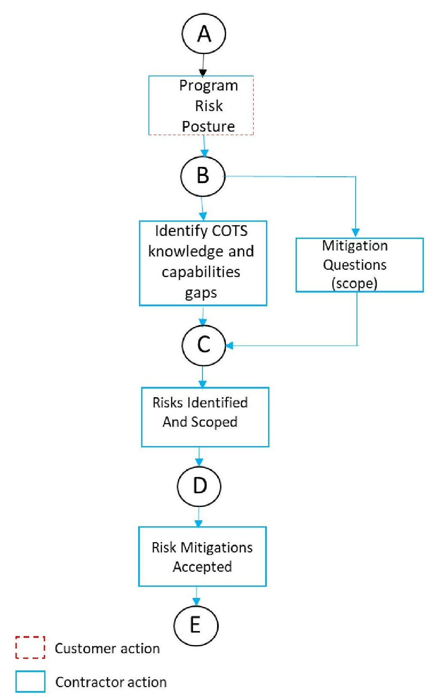

Figure 1. Informed risk flow (A to E).

<!-- PDF_PAGE: 21 -->

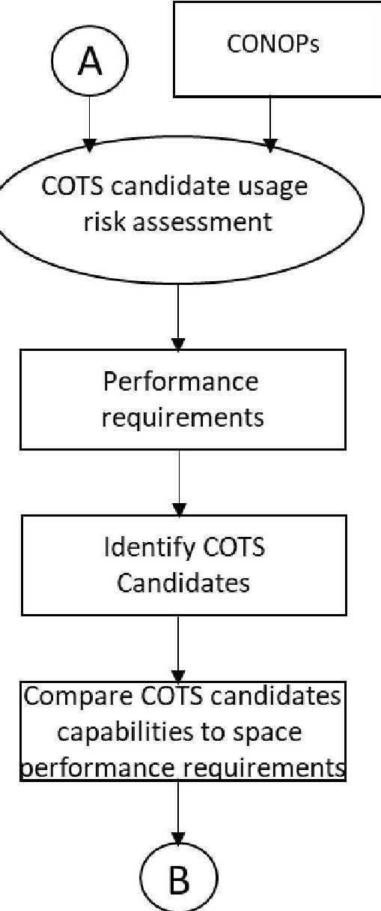

Figure 2. Informed risk flow - Determine COTS risk tolerance (A to B).

<!-- PDF_PAGE: 22 -->

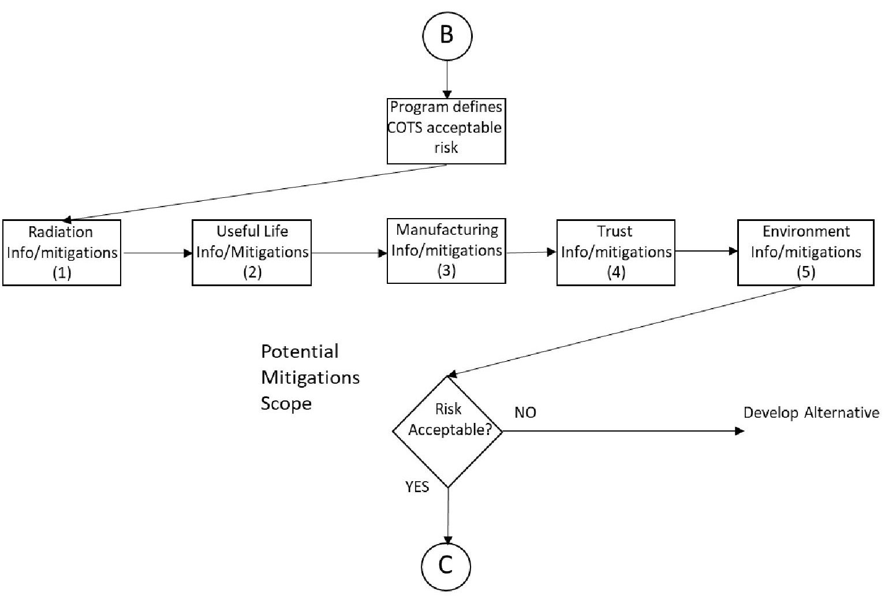

Figure 3. Informed risk flow-COTS mitigation scope (B to C).

<!-- PDF_PAGE: 23 -->

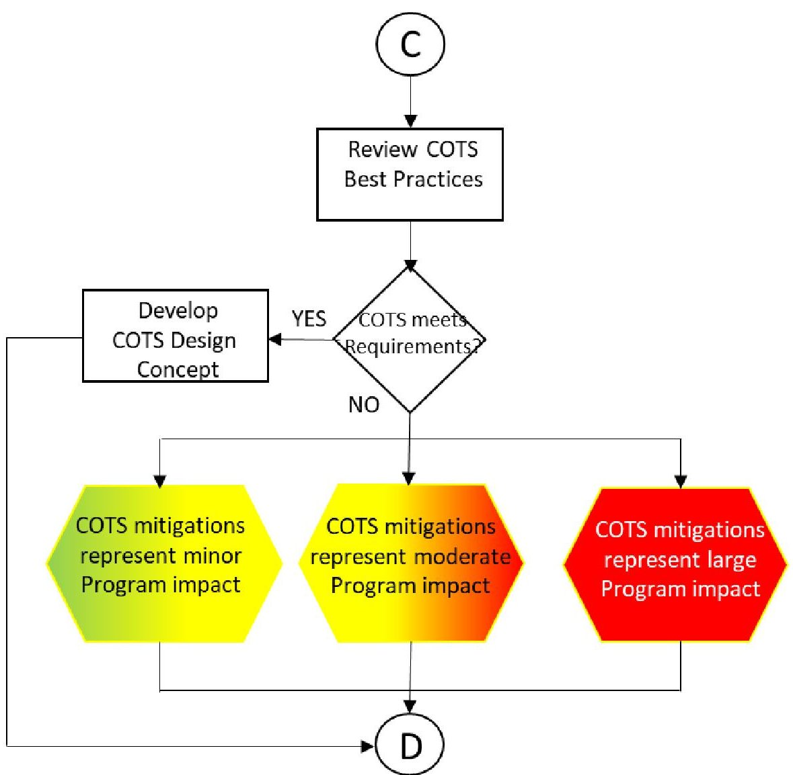

Figure 4. Informed risk flow - Scoping risk mitigation (C to D).

<!-- PDF_PAGE: 24 -->

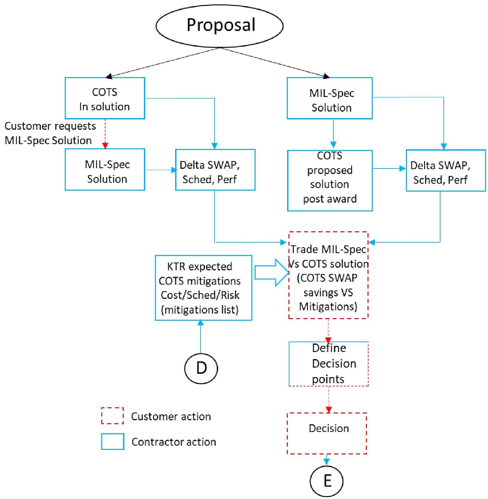

Figure 5. Informed risk flow - Selecting the design solution (D to E).

<!-- PDF_PAGE: 25 -->

## 4. Best Practices

The best practices are broken into two groups, general best practices for COTS components and COTS best practices by component.

The general best practices are broken down to best practices by the supplier and by the component user. It is desired that the supplier performs the best practices found in Table 1, to choose a component from a supplier with known quality. Refer to NESC-RP-19-01490 Recommendations on Use of COTS Guidance for NASA Missions Phase II (11-10-22 NRB) RP FINAL Section 7.1.3.1 for the definitions of the terminology and success criteria. $ ^{2} $ If the supplier does not perform these best practices or is unwilling to supply supporting information of their process, it may be necessary for the component user to use some of the best practices found later in Section 4.1 and perform some of the mitigations in Section 5.

Table 1. Supplier Best Practices

<table border="1"><tr><td>Best Practices for COTS Components(Supplier)</td></tr><tr><td>Process stability for at least one year2</td></tr><tr><td>Product produced in high volume2</td></tr><tr><td>100% electrical test2</td></tr><tr><td>Multi-lot characterization2</td></tr><tr><td>Fully automated line2</td></tr><tr><td>Undergoes in-process testing2</td></tr><tr><td>Maintains consistent yield2</td></tr></table>

## 4.1 General COTS best Practices

The general best practices for COTS components, shown in Table 2, are generic and may also apply to Mil-Spec components, but were compiled to apply to COTS components. These best practices are from the MSIW (Mission Success Information Workshop) sub-team for COTS best practices and is intended to be considered when developing the program informed risk flow (Section C).

<!-- PDF_PAGE: 26 -->

Table 2. General Best Practices for the Component User

<table border="1"><tr><td>Number</td><td>Best Practices for COTS component (user)</td></tr><tr><td>1</td><td>For a given COTS, once the program has defined the necessary best practices and mitigations, develop a plan to deal with the higher cost and schedule risk items first3</td></tr><tr><td>2</td><td>Consider not having the COTS in a critical timing/mission path(although it is recognized that COTS is likely a part of the critical path for performance reasons)2,5,12,16</td></tr><tr><td>3</td><td>Consider the fault management implications(fault/degradation mechanisms)4,5,12,16,23</td></tr><tr><td>4</td><td>Consider on orbit monitoring of key performance parameters for trending COTS performance particularly for supplier non tested parameters)12</td></tr><tr><td>5</td><td>Conduct COTS component level FMEA(not functional level)to understand the systems effects of the COTS faults and potential propagation effects2,4,5,12,16,23</td></tr><tr><td>6</td><td>Consider the component failure rate and number of times used for critical applications as an element of the program risk assessment16</td></tr><tr><td>7</td><td>Upon failure of a COTS component,the program/project should initiate a failure analysis,and all efforts within available resources should be made to determine root cause.The first steps to root cause determination should be to verify that the component's datasheet was not violated in processing,testing,or usage2</td></tr><tr><td>8</td><td>Pay particular attention to COTS absolute and recommended ratings(different from Mil-Spec components).Scrutinize the datasheet carefully4,16,20</td></tr><tr><td>9</td><td>Bring in senior peer reviewers early to consider the impacts of the COTS(s)in the design/board/unit/system12,16,23</td></tr><tr><td>10</td><td>Consider large design margins for poorly analyzed/tested COTS parameters-verify through test2,8,9,16,23</td></tr><tr><td>11</td><td>Reserve extra connector pins for test points early with the expectation that a key parameter will need to be monitored at unit level(particularly for COTS with no burn-in testing)4,12</td></tr><tr><td>12</td><td>Consider standard interfaces over proprietary/unique interfaces23</td></tr><tr><td>13</td><td>Consider the obsolescence aspect of the component chosen.Obsolete in a year may mean no supplier support at the end of the program2,3,5,16</td></tr><tr><td>14</td><td>Make as much usage as possible of supplier toolkits,simulation models,and development aids.Perform a careful review of the development tool parameters vs the FLT parameters(for example,a processor development kit may run full clock speed and use faster memory than the flight application,so the FLT processor throughput will be less than that of the development kit)2,10,16,23</td></tr><tr><td>15</td><td>For interface components,VERIFY that the components are truly capable of cold sparing and do not act as a sneak path(example,Honeywell HX422R and HX422D are NOT cold spare capable,so cannot be used for a cross strap application with a powered component connected.Many commercial components do not need to operate in a cross strap(redundancy)configuration</td></tr><tr><td>16</td><td>Reserve a greater than standard SWAP reserve for the assemblies with COTSs to absorb the mitigation impacts3,4,23</td></tr></table>

<!-- PDF_PAGE: 27 -->

Table 2. General Best Practices for the Component User (cont)

<table border="1"><tr><td>Number</td><td>Best Practices for COTS component (user)</td></tr><tr><td>17</td><td>Review historical usage and any alerts on the COTS component $ ^{2,3,4,5,11,16,20} $</td></tr><tr><td>18</td><td>Consider using one size up case size $ ^{23} $</td></tr><tr><td>19</td><td>Avoid high aspect ratios (&gt;3:1) on ceramic substrates $ ^{23} $</td></tr><tr><td>20</td><td>Use conservative derating $ ^{2,9,23} $</td></tr><tr><td>21</td><td>For chip case components, avoid areas of the PWB with high flexure $ ^{23} $</td></tr><tr><td>22</td><td>For a COTS that the contractor has no experience, contact the supplier for recommended handling, assembly, installation and test instructions $ ^{16} $</td></tr><tr><td>23</td><td>For a new COTS component, consider the deratings carefully (mil-spec deratings may not be enough) $ ^{2} $ Apply deratings that do not push the component outside of its datasheet limits $ ^{16} $</td></tr><tr><td>24</td><td>Make use of the community knowledge of the COTS component (PMPedia), components working groups $ ^{11,23} $</td></tr><tr><td>25</td><td>For total dose (TD) considerations, COTS components fabricated in the newer complementary metal oxide semiconductor/bipolar complementary metal oxide semiconductor (CMOS/BiCMOS) technology nodes are preferred over those from older technologies $ ^{16} $</td></tr><tr><td>26</td><td>Select widely used COTS components manufactured by major semiconductor on-chip monitors (OCMs) and always select the highest grade available $ ^{16} $</td></tr><tr><td>27</td><td>Be aware that Mil-Spec components generally have more built-in margins per the datasheet limits (e.g., rated voltage, temperature, or frequency of operation) than COTS components, therefore operating COTS components beyond their datasheet limits can be more problematic than doing so with Mil-Spec components $ ^{2} $</td></tr><tr><td>28</td><td>Know WHY a COTS component is being selected for use. Selecting COTS components in lieu of standard Mil-Spec components solely on the expectation to save cost rarely succeeds, particularly under strict adherence to current Agency guidelines for Class A-C missions. In most cases, COTS are chosen to provide performance, availability or, in some cases, reliability advantages $ ^{2} $</td></tr><tr><td>29</td><td>Consider standard or dual footprints to allow drop-in replacements (alternates) $ ^{16,23} $</td></tr><tr><td>30</td><td>Consider avoiding components that push other aspects of the design for manufacturability and rework (PWB microvias, number of layers, internal/external PWB geometries, local heatpipes, mounting) that may be difficult to procure $ ^{10,20} $</td></tr><tr><td>31</td><td>Vary the power supplies from minimum to maximum to assure components/boards provide correct signals in light of the variations in COTS tolerances (full range insitu testing) $ ^{4,10,16,2,25} $</td></tr><tr><td>32</td><td>Perform a continuous test over temperature (not just the plateaus) as an element of the "test like you fly" or "day in the life" testing $ ^{2,4,5,9,16,21} $</td></tr><tr><td>33</td><td>Strongly consider "test like you fly" tests where COTS performance is involved. The tests need to be perceptive $ ^{4,12,16} $</td></tr></table>

<!-- PDF_PAGE: 28 -->

Table 2. General Best Practices for the Component User (cont)

<table border="1"><tr><td>Number</td><td>Best Practices for COTS component (user)</td></tr><tr><td>34</td><td>Verify all non-tested and "typical" parameters of the COTS/compare to a nominal BOL analysis, consider trending during the EM test phase2,9,16,21</td></tr><tr><td>35</td><td>Verify all timing and signal integrity of the COTS/compare to nominal beginning of life(BOL) analysis, consider trending key parameters during the EM test phase2,4,16,21</td></tr><tr><td>36</td><td>Perform early(as soon as component is baselined) destructive parts analysis(DPA) to understand supplier/component quality2,3,4,20,21</td></tr><tr><td>37</td><td>Consider board/unit level test points to evaluate supplier non-tested parameters. Consider parametric performance criteria for COTS vs pass/fail criteria4,5,23</td></tr><tr><td>38</td><td>For shorter mission(&lt;3 yrs) consider Board Level Screening(BLS) of thermal, electrical and dynamics(TED) to provide confidence of function over the entire test range(refer to COTS Card Unit Level Char Guidance).For longer duration programs,consider HALT/HAST(Highly Accelerated Life Test/Highly Accelerated Stress Test) testing11,20,25</td></tr><tr><td>39</td><td>Develop a good testplan around the COTS to fully test all of the functions required for the application8,10</td></tr><tr><td>40</td><td>For boards that are using COTS components that have not seen burn-in,consider building extra boards(relatively easy to do when in sequence) or life test2,11,16</td></tr><tr><td>41</td><td>Use accelerated testing not just to find if component will survive,but to find weaknesses that may need mitigation16</td></tr><tr><td>42</td><td>Make an effort to get enough run-time hours at board and unit level16</td></tr><tr><td>43</td><td>Thermal vacuum test units with vacuum sensitive COTS components21If additional component-level testing or screening need to be performed,always consult datasheets to ensure specified operational limits are not exceeded.</td></tr><tr><td>44</td><td>Exceeding specification limits can result in latent damage in components that can lead to failures in flight2</td></tr><tr><td>45</td><td>Shock sensitive,review the conditions the supplier uses for testing chatter and transfer(the MIL-Spec allows the coils to be energized during the shock event for the transfer test(NOT consistent with how it will be used))</td></tr><tr><td>46</td><td>Consider higher than Mil-Spec order quantities(EM,FLT(flight))to allow for fallout for components that have not gone through burn-in or for component obsolescence(commercial component obsolescence or unannounced changes occurs much more often than mil-spec components)4,16</td></tr><tr><td>47</td><td>Ensure components used for FLT are from the same line as those used for DPAs, radiation testing,reliability testing,and EMs.Commercial designs change rapidly and maybe without notice2,3,16,21</td></tr><tr><td>48</td><td>Consider purchasing extra components and printed wiring boards(PWBs) of the FLT lot for sacrificial DPAs,coupon testing2,4,16</td></tr></table>

<!-- PDF_PAGE: 29 -->

Table 2. General Best Practices for the Component User (cont)

<table border="1"><tr><td>Number</td><td>Best Practices for COTS component (user)</td></tr><tr><td>49</td><td>Contact the manufacturer and request reliability monitor data, product change notices,field return data and any other information available2,3,4,5,10,16,21,23</td></tr><tr><td>50</td><td>Require LDC/CoC(lot date code/certificate of compliance) information when purchasing(BB(breadboard),EM,FLT)1,8,14,22</td></tr><tr><td>51</td><td>Procure only from authorized suppliers2,5,10,16</td></tr><tr><td>52</td><td>Monitor KPP relative to cost/schedule4</td></tr><tr><td>53</td><td>If a COTS used in the past changes the process or suppliers,the component may need a complete re-evaluation3,5,21</td></tr><tr><td>54</td><td>"Heritage" with COTS will not mean the same as heritage with mil-spec components.COTS"qualification"will be highly application specific2,9</td></tr><tr><td>55</td><td>Consider planning in the effort to make the engineering model(EM)form,fit,and function(FFF)with the FLT units.A common practice to preserve schedule is to use the EM on the vehicle(in place of FLT)to perform rework.This also pays dividends later should the FLT unit have issues(testing can be done on the EM over temp,vacuum,dynamics,and EMI,whatever was the condition the FLT unit showed an anomaly.A FFF EM also has the benefit for long duration programs of a ground asset for anomaly testing and resolution(highly unit function dependent)16</td></tr><tr><td>56</td><td>Ask the supplier if they scrap lots with unusual fallout or yield(example:multi-layer ceramic caps(MLCC)Pre-termination Confocal Scanning Acoustic Microscopy(CSAM)inspection)2</td></tr><tr><td>57</td><td>Ask the supplier how they establish production limits2</td></tr><tr><td>58</td><td>Consider minimizing manual(hand)assembly in favor of automated assembly.Hand soldering ceramic caps requires special care2,8,9,23</td></tr><tr><td>59</td><td>Avoid hand soldering COTS ceramic caps2,8</td></tr><tr><td>60</td><td>For PWBs the coupons MUST have the most aggressive features used on the PWB(microvias,spacing,smallest hole size,blind vias).Early coupon DPA is recommended20</td></tr><tr><td>61</td><td>For PWBs with prime and redundant circuits,the Institute of Printed Circuits(IPC)standard is not sufficient.The IPC isolation guidelines do not recognize the single point failure implications26</td></tr></table>

<!-- PDF_PAGE: 30 -->

## 4.2 COTS Best Practices by Component

The best practices found in the Tables 3 through 18 were compiled from many sources: The Aerospace Corporation, contractors, and multiple white papers on the usage of COTS for space. The best practices were broken down by component to allow quick reference for a particular component.

Table 1. COTS Resistor User Best Practices

<table border="1"><tr><td>Number</td><td>Resistors-Mil-Prf-55342</td></tr><tr><td>1</td><td>Consider using one size up case size25</td></tr><tr><td>2</td><td>Avoid high aspect ratios(&gt;3:1) on ceramic substrates25</td></tr><tr><td>3</td><td>Use conservative derating(power)10,11,25</td></tr><tr><td>4</td><td>For chip case components,avoid areas of the PWB with high flexure25</td></tr><tr><td>5</td><td>Consider standard or dual footprints to allow drop-in replacements(alternates)18,25</td></tr><tr><td>6</td><td>For COTS components with pure tin leads,consider the mitigation techniquesearly28,29</td></tr></table>

Table 2. COTS Capacitor User Best Practices

<table border="1"><tr><td>Number</td><td>Capacitors-Mil-Prf-123</td></tr><tr><td>1</td><td>Consider using one size up case size23</td></tr><tr><td>2</td><td>Use conservative derating(voltage,power)11,23</td></tr><tr><td>3</td><td>Ceramic caps are generally preferred if available in size&amp;rating23</td></tr><tr><td>4</td><td>Tantalum caps should be conservatively derated(&gt;50%)23</td></tr><tr><td>5</td><td>Avoid Aluminum electrolytics:they are not sealed,with higher equivalent series resistance(ESR)</td></tr><tr><td>6</td><td>Caps in high ripple circuits may have internal heating issues23</td></tr><tr><td>7</td><td>Consider placing two small caps in series can preclude failure with same function23</td></tr><tr><td>8</td><td>Consider inrush currents vs tantalum ESR9</td></tr><tr><td>9</td><td>Consider vacuum effects on PTCs(anomalous transients)-derate conservatively25</td></tr><tr><td>10</td><td>Consider standard/dual footprints to allow drop-in replacements(alternates)23</td></tr><tr><td>11</td><td>Avoid hand solderingCOTS ceramic caps2,8,9,23</td></tr><tr><td>12</td><td>Consider reflow temp based on solder material</td></tr><tr><td>13</td><td>For COTS components with pure tin leads,consider the mitigation techniques early27,28</td></tr></table>

<!-- PDF_PAGE: 31 -->

Table 5. COTS Connector User Best Practices

<table border="1"><tr><td>Number</td><td>Connectors-Mil-Dtl-38999,55302;Mil-Prf-24682,83518</td></tr><tr><td>1</td><td>Connector"qualification"is application unique:misalignment can result in pin fretting under dynamic conditions</td></tr><tr><td>2</td><td>Strongly consider a thorough tolerance analysis for connector engagement and alignment</td></tr><tr><td>3</td><td>Consider controlled(limited)force when installing press-fit connectors</td></tr><tr><td>4</td><td>Verify connector spice model and signal integrity for fast edge rate(&lt;1ns) signals with test data.Check signal end to end.</td></tr><tr><td>5</td><td>DPA connector early to verify plating and under-strike materials</td></tr><tr><td>6</td><td>Avoid"flip-drilling"on PWBs using press-fit connectors</td></tr><tr><td>7</td><td>Consider early DPA of PWB coupons for via quality if press-fit connectors are used</td></tr><tr><td>8</td><td>For COTS components with pure tin leads,consider the mitigation techniques early $ ^{26,27} $</td></tr></table>

Table 6. COTS Diode User Best Practices

<table border="1"><tr><td>Number</td><td>Diodes-Mil-Prf-19500</td></tr><tr><td>1</td><td>Consider conservative thermal condition for schottkey diodes:High operating temps yield lower Vf and~10x higher reverse leakage23</td></tr><tr><td>2</td><td>Consider verifying breakdown voltage, reverse leakage current,and forward on-current(maximum)</td></tr><tr><td>3</td><td>Consider Max forward current,Junction temperature,and power deratings</td></tr><tr><td>4</td><td>Consider transient thermal impedance with pulse duration(operation)</td></tr></table>

Table 7. COTS Inductor User Best Practices

<table border="1"><tr><td>Number</td><td>Inductors Mil-Prf-27</td></tr><tr><td>1</td><td>Inductors in switching power supplies will dissipate power23</td></tr><tr><td>2</td><td>Inductors are the heaviest of parts, so care must be taken in mounting23</td></tr><tr><td>3</td><td>For Mil-Std-1553 transformers, ensure the leakage inductance is balanced and less than 6uH</td></tr></table>

Table 8. COTS Bipolar Junction Transistor (BJT) User Best Practices

<table border="1"><tr><td>Number</td><td>Transistor(BJT)-Mil-Prf-19500</td></tr><tr><td>1</td><td>Consider loss of gain asTDincreases23</td></tr><tr><td>2</td><td>Consider enhanced low-dose rate sensitivity(ELDRS)for radiation assessment</td></tr><tr><td>3</td><td>Consider junction temperature and power derating</td></tr></table>

<!-- PDF_PAGE: 32 -->

Table 9. COTS Field Effect Transistor (FET) User Best Practices

<table border="1"><tr><td>Number</td><td>Transistor(FET)Mil-Prf-19500</td></tr><tr><td>1</td><td>Consider increase gate leakage current with increasedTID23</td></tr><tr><td>2</td><td>Ensuring sufficient gate drive and conservative(Drain voltage and power) derating result in reliable operation23</td></tr><tr><td>3</td><td>Consider junction temperature and power derating</td></tr></table>

Table 10. COTS Power Transistor User Best Practices

<table border="1"><tr><td>Number</td><td>Transistor(Power-Si,SiC,GaN)</td></tr><tr><td>1</td><td>Consider different technologies and power consumption requirements</td></tr><tr><td>2</td><td>Consider derating(SOA,Package level derating)based on total power consumption and on-time duration.</td></tr><tr><td>3</td><td>Consider thermal runaway,heat dissipation,Rdson,and dislocation defects in device construction</td></tr></table>

Table 11. COTS Radio Frequency (RF) Transistor User Best Practices

<table border="1"><tr><td>Number</td><td>Transistor(RF-Si,HEMT)</td></tr><tr><td>1</td><td>Consider technology node and power consumption requirements</td></tr><tr><td>2</td><td>Consider package forH-poisoning for high electron mobility transistors(HEMT)</td></tr><tr><td>3</td><td>Consider passivation material for topology and humidity reduction</td></tr></table>

Table 12. COTS OP-Amp/Comparator User Best Practices

<table border="1"><tr><td>Number</td><td>Op Amp/Comparators-Mil-Prf-38535</td></tr><tr><td>1</td><td>Avoid relying on tight leakage currents and offsets without testing23</td></tr><tr><td>2</td><td>Comparators may momentarily flip their outputs under SEE(function of input differential voltage-smaller voltage is more susceptible)23</td></tr><tr><td>3</td><td>Read the datasheets carefully. Specifications for the same part number have different capabilities(different suppliers)-Example LM139A</td></tr><tr><td>4</td><td>For COTS components with pure tin leads,consider the mitigation techniques early27,28</td></tr></table>

Table 13. COTS Pulse Width Modulators User Best Practices

<table border="1"><tr><td>Number</td><td>PWMs-Mil-Prf-38535,38534</td></tr><tr><td>1</td><td>Can exhibit function degradation with TID,design accordingly23</td></tr><tr><td>2</td><td>SEE can cause momentary output upsets,so accommodate in design23</td></tr></table>

<!-- PDF_PAGE: 33 -->

Table 14. COTS Relay User Best Practices

<table border="1"><tr><td>Number</td><td>Relays-Mil-Prf-28750,28776,83536</td></tr><tr><td>1</td><td>Relays are shock sensitive,review the conditions the supplier uses for testing chatter and transfer(the MIL-Spec allows the coils to be energized during the shock event for the transfer test(NOT consistent with how it will be used))</td></tr><tr><td>2</td><td>For relays that SHARE current through two or more contacts,consider the failure implications of loss of a contact path</td></tr></table>

Table 15. COTS Printed Wiring Board User Best Practices

<table border="1"><tr><td>Number</td><td>PWBs-IPC-2221,2222</td></tr><tr><td>1</td><td>For PWBs with prime and redundant circuits,the IPC standard is not sufficient.The IPC isolation guidelines do not recognize the single point failure implications26</td></tr><tr><td>2</td><td>Consider purchasing extra components and PWBs(FLT lot) for sacrificial DPAs,coupon testing2,4,16</td></tr><tr><td>3</td><td>For PWBs the coupons MUST have the most aggressive features used on the PWB(microvias,spacing,smallest hole size,blind vias)Early coupon DPA is recommended20</td></tr><tr><td>4</td><td>Consider avoiding components that push other aspects of the design for manufacturability and rework(PWB microvias,number of layers,internal/externalPWB geometries,local heatpipes,mounting)that may be difficult to procure10,20</td></tr><tr><td>5</td><td>Consider early DPA of PWB coupons for via quality if press-fit connectors are used</td></tr></table>

Table 16. COTS Fuse User Best Practices

<table border="1"><tr><td>Number</td><td>Fuses-Mil-Prf-24319</td></tr><tr><td>1</td><td>Fuses should be in an easily accessible location, able to change without removing other components (particularly ceramic caps)</td></tr><tr><td>2</td><td>Analyze power on conditions to ensure the inrush current does not open the fuse</td></tr></table>

Table 17. COTS Wire User Best Practices

<table border="1"><tr><td>Number</td><td>Wire-Mil-Dtl-3432</td></tr><tr><td>1</td><td>Avoid cutting into the shield braid when stripping shielded wire</td></tr></table>

<!-- PDF_PAGE: 34 -->

Table 18. COTS Integrated Circuit/Hybrid User Best Practices

<table border="1"><tr><td>Number</td><td>ICs/Hybrids-Mil-Prf-38535,Mil-Prf-38534</td></tr><tr><td>1</td><td>Vary the power supplies from minimum to maximum to assure parts/boards provide correct signals in light of the variations in alternate grade parts tolerances4,10,25</td></tr><tr><td>2</td><td>Perform a continuous test over temperature(not just the plateaus)as part of the "test like you fly"or"day in the life"testing4,5,9</td></tr><tr><td>3</td><td>Verify all non-tested and"typical"parameters of the COTS/compare to a nominal BOL analysis,consider trending during the EM test phase9</td></tr><tr><td>4</td><td>Verify all timing and signal integrity of the COTS/compare to nominal BOL analysis,consider trending key parameters during the EM test phase4</td></tr><tr><td>5</td><td>Pay particular attention to COTS absolute and recommended ratings(different from Mil-Spec parts).Scrutinize the datasheet carefully4</td></tr><tr><td>6</td><td>Perform early(as soon as part is baselined)DPA to understand supplier/part quality3,4</td></tr><tr><td>7</td><td>Consider higher than Mil-Spec order quantities(EM,FLT)to allow for fallout for components that have not gone through burn-in or for component obsolescence(commercial component obsolescence or unannounced changes occurs much more often than mil-spec components)4</td></tr><tr><td>8</td><td>Contact the manufacturer and request reliability monitor data,product change notices,field return data and any other information available3,4,5,10,16,21,23</td></tr><tr><td>9</td><td>Require LDC/CoC information when purchasing(BB,EM,FLT)3,10,16</td></tr><tr><td>10</td><td>Procure only from authorized suppliers5,10,16</td></tr><tr><td>11</td><td>Monitor KPP relative to cost/schedule4</td></tr><tr><td>12</td><td>Consider board/unit level test points to evaluate supplier non-tested parameters. Consider parametric performance criteria for COTS vs pass/fail criteria4,5,23</td></tr><tr><td>13</td><td>Consider large design margins for poorly analyzed/tested COTS parameters-verify through test8,9,16,23</td></tr></table>

<!-- PDF_PAGE: 35 -->

Table 18. COTS Integrated Circuit/Hybrid User Best Practices (cont)

<table border="1"><tr><td>Number</td><td>ICs/Hybrids-Mil-Prf-38535,Mil-Prf-38534</td></tr><tr><td>14</td><td>Strongly consider"test like you fly" tests where COTS performance is involved.The tests need to be perceptive $ ^{4,12,16} $</td></tr><tr><td>15</td><td>Bring in senior peer reviewers early to consider the impacts of the COTS(s) in the design/board/unit/system $ ^{12,16,23} $</td></tr><tr><td>16</td><td>Consider the fault management implications(fault/degradation mechanisms) $ ^{4,5,12,16,23} $</td></tr><tr><td>17</td><td>Consider on orbit monitoring of key performance parameters for trending COTS performance(particularly for supplier non tested parameters) $ ^{12} $</td></tr><tr><td>18</td><td>Reserve a greater than standard SWAP reserve for the assemblies with COTS to absorb the mitigation impacts $ ^{3,4,23} $</td></tr><tr><td>19</td><td>Reserve extra connector pins for test points early with the expectation that a key parameter will need to be monitored at unit level(particularly for COTSs with no burn-in testing) $ ^{4,12} $</td></tr><tr><td>20</td><td>Conduct COTS Part level FMECA(not functional level) to understand the system effects of the COTS faults and potential propagation effects $ ^{4,5,12,16,23} $</td></tr><tr><td>21</td><td>Consider minimizing manual(hand)assembly in favor of automated assembly.Hand soldering Ceramics caps requires special care $ ^{2,8,9,23} $</td></tr><tr><td>22</td><td>Avoid pure tin components inside hybrids</td></tr><tr><td>23</td><td>For DDR Memory,Consider various technology nodes for Tr and Caps for optimum solution</td></tr><tr><td>24</td><td>For Flash memories,Consider stress-induced leakage current(SILC),Crosstalk and Program/Erase cycles(retention) $ ^{29} $</td></tr><tr><td>25</td><td>For flash memories,Limit operational temperature based on technology node</td></tr><tr><td>26</td><td>For flash memories,Consider optimum selection for Single-level cell(SLC),Multi-level cell(MLC),Triple-level cell(TLC),and Quad-level-cell(QLC)(Reliability vs Capacity) $ ^{29} $</td></tr><tr><td>27</td><td>For COTS components with pure tin leads,consider the mitigation techniques early $ ^{27,28} $</td></tr><tr><td>28</td><td>Request what tests suppliers perform and activation energies for various failure mechanisms</td></tr></table>

<!-- PDF_PAGE: 36 -->

## 5. COTS Mitigations

Commercial components have been used in space designs before, however, in these prior efforts, commercial suppliers allowed the buyers to review the process data (many of these items found in the manufacturing section of this document) that documented the process and component quality. At that time, many components were being designed for the military, not consumer electronics. An example is the venerable LM139A. Before the Standard Military Drawing (SMD) for the LM139A, suppliers, like National Semiconductor and Analog Devices, produced components to the best standards, but were not designed for a radiation environment. Buyers would procure lots of LM139A and radiation test them to find an acceptable lot. For the modern commercial processes, proprietary information has resulted in suppliers being unwilling to share the component build details, resulting in the inability for buyers to verify the build quality. With the SMD, suppliers changed their process to incorporate radiation tolerance. RHA is now a standard property for the LM139A. However, along with the RHA came a change of VCC (Voltage Common Collector) or VDD (Voltage Drain) the component required to operate. Table 19 shows the different flavors of the LM139A in the SMD catalog. What isn't shown in the table, although all four components have an RHA rating, is the SEE performance of the component as the RHA for these components does not address SEE. The first three components listed can be sensitive to SEE, while the last one is nearly immune. The message here is the details are important, even for the same "generic" component. While the SMD has simplified the selection of components for space use, the usage of modern COTS components without the US military as a large customer, results in questions that should be asked to implement the appropriate mitigations addressed by this ATR.

Table 19. LM139A SMD Comparison

<table border="1"><tr><td colspan="3">LM139A Comparison</td></tr><tr><td>SMD</td><td>RHA</td><td>Minimum supply voltage</td></tr><tr><td>96738</td><td>100K</td><td>2V</td></tr><tr><td>98613</td><td>100-300K</td><td>5V</td></tr><tr><td>87739</td><td>100K</td><td>5V</td></tr><tr><td>01510</td><td>50-300K</td><td>9V</td></tr></table>

The flow shown in Figure 6 is a more detailed companion flow to the flows in Section 3. This flow is meant for the Systems Engineering, Design Engineering, Radiation, and Parts Materials and Process organizations to ask the right questions and apply mitigations. Note the mitigations are not component level solutions, but actions, changes in architecture, CONOPS, design, and usage of the COTS component to use it as-is (not up-screening), as seen from the LM139A example. The suggested mitigations are work-arounds to make the program successful, while being informed about the insertion and development risk of using a COTS component.

The flow in Figure 6 starts with assessing if there is a Mil-Spec component that will meet the requirements. A Mil-Spec solution, perhaps requiring more components, more SWAP, or long lead procurement may be unappealing, but should be considered so that there can be an honest trade of the different solutions (as the COTS component mitigations may be onerous too). The link to the SMCR is included in the acronyms list to aid in the component selection effort. If no solution is found there potential high-quality suppliers (established COTS) can be engaged for the desired component, hopefully

<!-- PDF_PAGE: 37 -->

using supplier best practices from Section 4. If the supplier is unwilling or unable to supply the ideal list of information, a supplier that the user has history with coupled with the best practices for users can be used to adjust to the different environment of the COTS component documentation to address the COTS component knowledge risk. It may still be necessary to consider the mitigations to fully determine the COTS component's shortcomings and what actions may be needed to fully adjust. Failing to find an established COTS component, the flow then proceeds to the questions and mitigations to work with the candidate COTS component to achieve a solution.

<!-- PDF_PAGE: 38 -->

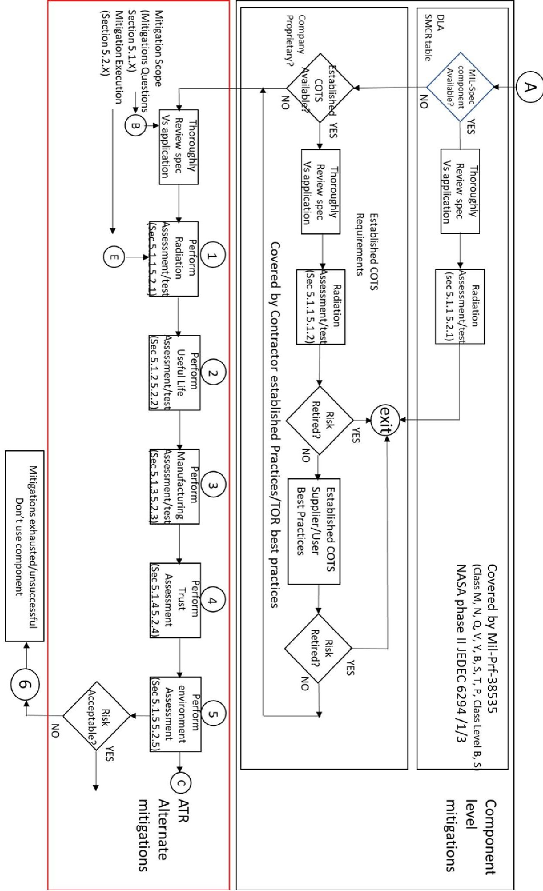

Figure 6. Component selection, identification and mitigation flow.

<!-- PDF_PAGE: 39 -->

Below are several examples of where COTS components were successfully used for Class A space vehicles (design life >10 years), explaining the vulnerability discovered and what mitigations were used to meet the mission need.

## COTS Example 1: On Board Computer Controller (OBCC) ~1988.

The LSI Logic L65400 1750A processor was chosen over the McDonnell Douglas 281 1750A processor due to throughput requirements. The LSI Logic process was not radiation hardened (it was a commercial process). Radiation testing determined that the process TD performance was adequate, but the SEU performance was poor. To compensate for the poor SEU performance, the board and system design was modified to "build-in" a quiet period for the OBCC during the first 500 $ \mu s $ of the processing period. The first 500 us of the processing period was then used to check if any of the interfaces had not completed their transfers (the OBCC was a router between the On-Board Computers (OBCs) and the rest of the spacecraft). If an interface transfer was not complete, this was flagged as an error and on-board fault protection was notified. The quiet period also allowed for the OBCC design to use the leading edge of the processing cycle pulse to perform a processor restart via the non-maskable, level 0 interrupt (NMI). The NMI was used to force the processor to restart, executing the NMI interrupt service routine to re-initialize all the processor registers, reset all of the peripheral serial interfaces (via register resets), initialize the serial interfaces, and refresh the triple voted discretes. This effectively restart the OBCC every processing period (except for a key portion of SRAM that was reserved for memory load processing that could span the processing cycle). The mitigations to do this affected the OBCC hardware design, the OBCC firmware design, another unit that interfaces with the OBCC to NOT send commands to telemetry requests during the quiet period, and the flight software (the on-board fault protection). These techniques have been on orbit for 28 years (as of 2023) with no known upsets attributed to the processor. The techniques used can be found in the mitigation Sections 1g, n, and o. Refer to Section 6.1 for this example's flow exercise.

## COTS Example 2: Various programs - EEPROM usage ~2003.

Many programs use the EEPROM that use the Hitachi die. The TD performance of the EEPROM depends on the application. The components are good to about 25Krad (Si) when powered on, significantly better when powered off. Additional circuitry is needed if powering off the EEPROM is required to meet the application's TD requirement need (mitigation 1b). In addition, the EEPROM RES pin is sensitive to noise (and potential data corruption from inadvertent writes). The power ON/OFF circuit to the EEPROM must also control the RES input during power ON/OFF to less than 0.25V. Reset circuits need to accommodate this constraint. Since this component is non-volatile, there is a data retention period to observe. At the time, little was known about the fabrication details from Hitachi (Hitachi sold the die, then stopped supporting the die). This component was also new to the space design world, and as a result, as more was gradually discovered about the component, additional design practices were developed. Given the 20-year stated datasheet retention, with no process details, many contractors were conservative with specifying a period to perform an on-orbit refresh, anywhere from 5 to 10 years, depending on the application (mitigation 1g). Anomalies with the component began to surface: One was byte writes could lead to corrupted data within that page, so full page writes were required (an impact to the SW governing the refresh). Another was weak bits (slow outputs due to weak cells that resulted in the output sense amps taking longer to output the correct value. This was screened out using at-speed testing. One supplier was using a DATAIO programmer to verify the packaged die speed, but the DATAIO waited microseconds (vs the 150 ns EEPROM read requirement), allowing EEPROMS with weak bits to pass the screening test. Other examples of mitigations for the EEPROM are at the board/Flight SoftWare (FSW) level by programming multiple images into the EEPROM, so that if one was corrupted, another image (the same content) could be used (mitigation 1e). One program architected the unit to be able to load the EEPROM

<!-- PDF_PAGE: 40 -->

from another assembly. The boot code in the single board computer (SBC) with the EEPROM, which was a slave on the backplane bus, allowed access to the EEPROM and SRAM from an external source. The master could receive ground command and control the path to the EEPROM and SRAM, via the backplane interface, without the SBC processor running application code. Finally, the On-Board Fault Protection (OBFP) was designed to enable (but not yet swap) a swap of the SBC for EEPROM read errors. The SBC had Error Detection and Correction (EDAC), so a single bit error was corrected when read by the processor, but not in EEPROM. A swap was initiated if multiple locations showed Single Bit Errors (SBEs). This is mitigation 1s. Refer to Section 6.2 for an example flow exercise.

## COTS Example 3: Computer and Data Electronics (CDE) ~2004.

The CDE had several Power On reset requirements that required both the 3.3V and 5V rails to be monitored. During power up, the POR circuit was required to provide a delay to allow the oscillator to be guaranteed to be oscillating (10 ms following voltage stability), hold off the reset until all voltage were stable, and provide a very low output reset signal to the EEPROM RES input. The POR circuit needed to be able to function at voltage where the IO components may start to conduct (due to a requirement for the unit to not be able to glitch the command output signals or potentially send a false command to the vehicle). A low voltage LM139A was chosen. The datasheet from National Semiconductor stated that their LM139A was designed to work down to 2V VCC. This feature was not tested by National Semiconductor (tested VCC minimum was +5V). The supplier was not willing to test the component at 2V VCC. The program chose to purchase components and test in house for VCC performance. Components from this lot were selected and installed into an evaluation board to characterize the component's performance. The board design was modified to provide a test point at board level to assess the POR performance during board testing (engineering model and flight). The success of this effort was attention to detail and obtaining the data needed to implement the appropriate mitigations. These techniques have been on orbit for many years with no known issues attributed to the reset circuit. The techniques used can be found in the mitigation Sections 1a, 3h, j, and k. Refer to Section 6.3 for this example's flow exercise.

## 5.1 COTS Mitigation Questions for Flow Section B

This section is intended to support the informed risk posture for the program, providing guidance to ask questions during the proposal effort or after a COTS component has been selected to aid in identifying the potential mitigations that may be required for a given program's risk tolerance level.

These questions are aimed at being considered during Section B (Figures 2 and 4) of the informed risk flow to determine the appropriate mitigation scope. The mitigation execution comes later (flow Section E, Figure 5) after the system technical, cost, schedule, and mitigation risks have been identified. It is recognized that not all the questions and mitigations will be needed for a given program. It is up to the program to determine which questions affect their risk profile and what associated mitigations are required. It is imperative to recognize that the Mil-Spec methods referenced in this ATR are for guidance and that a test method, if used, may need to be altered to stay within the COTS component datasheet limits. Some of the methods referenced may not be appropriate for a given technology.

## 5.1.1 Radiation Questions

Radiation is unique to space equipment and in recognition of what may be a difficult and time-consuming effort to determine a COTS component reaction to radiation. The radiation section covers Total Dose (TD), Single Event upsets (SEUs), Single Event Functional Interrupts (SEFI), Latchup, and Single Event Gate Rupture (SEGR) which also encompasses Single Event Burnout (SEB). They represent some of the

<!-- PDF_PAGE: 41 -->

highest schedule and technical risks should a non-RHA component not have available radiation lot data (which is likely since the usage of non-RHA components usually requires lot specific test data and there are many choices, not radiation tested, that may be chosen).

TD is the cumulative long-term damaging effects of total dose of radiation due to protons and electrons. The effects of TD on a component can range from simple parametric shifts (input leakage current, offset voltages, or increased active or quiescent currents) to more catastrophic effect of functional failure. The amount of TD a component can handle translates to the amount of time for a given orbit the component can be expected to remain within its specifications. SEUs are a different phenomenon that is a change of state (usually as flip-flop or memory storage cell) caused by a high energy particle such as ion, electrons, or protons. SEFI is similar to an SEU, although different in that the SEFI changes the operation of the component. For example, A SEFI to a microprocessor may cause the internal state-machine to go to an illegal state or result in running code that is not intended for the current activity. Different components will have different vulnerabilities. For example, total dose radiation testing on COTS advanced CMOS components has been favorable, but SEFI testing has shown a vulnerability. SEFI may represent the largest single cost, schedule, and technical risk for a program inserting an advanced CMOS COTS component. This is due to the small geometries of the latest commercial components, the lack of designing for changes in internal state machines, the cost and schedule to perform a SEFI test, and the implications and mitigations required to handle SEFI. Related to SEFI is SET (Single Event Transient) which is typically associated with analog circuits. SETs usually originate from sensitive analog circuits, such as high gain op-amps or comparators. The issue with SETs is that unless properly accounted for, the "glitch" from the SET can propagate and confuse the control algorithm using the data. An excellent example is the OP467 op-amp. While there is TD radiation data for the component, there is no SET data, yet the on-orbit performance clearly shows SET effects, as do other op-amps from the same technology. Latchup is a condition caused by high energy particles that causes an unintended low impedance path in a component. The latchup event looks like an activated parasitic path in a transistor structure that will remain until power is removed, affecting the functionality of the component. The latchup event typically draws more current than the component is rated for and may result in component damage. SEGR is a damaging effect of a CMOS transistor gate from a high energy particle. SEGR is a function of the voltage stress on the component, increased voltage relative to the component capability equates to a more likely SEGR event.

Understanding the intent of the radiation testing and its effect on components is key to assessing the impact.

The following radiation questions are intended to surface the radiation related performance of a COTS component potential radiation impacts to the program:

a) Does the component Total Dose (TD) capability data exist? If not, is it programmatically feasible to test for the data?

b) Does the component have parametric shifts in the data? Are the shifts something that can be compensated for in the circuit design? Are system design compensations possible?

c) Does the component SEU capability data exist? If not, is it programmatically feasible to test for the data?

d) Does the component have an acceptable upset rate in the data (usually driven by the operational availability requirement or ground intervention requirement)? Are the SEU impacts within the allocation? How often must scrubbing or some mitigation be used to meet the mission need? Is the SEU performance something that can be compensated for in the circuit design? Are system design compensations possible?

<!-- PDF_PAGE: 42 -->

e) Does the component SEFI capability data exist? If not, is it programmatically feasible to test for the data?

f) Does the component have an acceptable upset rate in the data? Are the SEFI impacts within the allocation (ground intervention)? How often must scrubbing or some mitigation be used to meet the mission need? Is the SEFI performance something that can be compensated for in the circuit design? Are system design compensations possible?

g) Does the component latchup capability data exist? If not, is it programmatically feasible to test for the data?

h) Does the component latchup? If so, is the latchup performance something that can be compensated for in the circuit design? Are system design compensations possible?

i) Does the component SEGR capability data exist? If not, is it programmatically feasible to test for the data?

j) Does the component have SEGR potential? Are the SEGR impacts within the allocation? Is the SEGR performance something that can be compensated for in the circuit design? Are system design compensations possible? Since SEGR can be damaging, can the component be de-rated appropriately without affecting component performance?

## 5.1.2 Useful Life Questions

Useful life is not unique to space components. The challenge is COTS suppliers typically use Statistical Process Control (SPC) to optimize the component yield and consistency. It may be difficult to obtain independent verification of the useful life for the COTS component. Many COTS components are not tested for radiation tolerance, and this may affect useful life. Figure 7 shows the typical reliability "bathtub" curve. For any component (not just COTS) subjected to radiation, the useful life is the relevant item to consider. It should be noted that radiation increases the component wear-out mechanisms (dielectric breakdown). It should also be noted that for COTS components that have not gone through burn-in testing that the components may show infant mortality later in the integration cycle as compared to Mil-Spec components).

<!-- PDF_PAGE: 43 -->

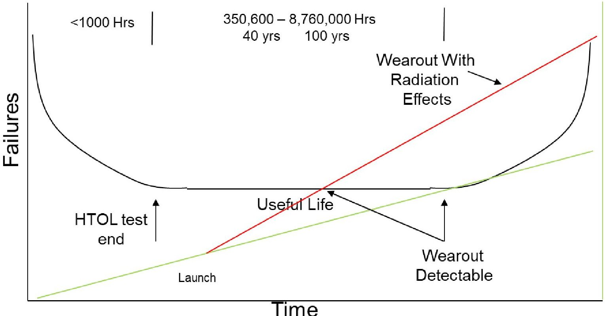

Wearout

Figure 7. Useful life with radiation.

For Mil-Spec components, High Temperature Operational Life (HTOL) testing has been used as a predictor of reliability, typically the test data is gathered as part of the component lot burn-in testing. There are drawbacks to this testing. Component failure during HTOL testing is not indicative of the wearout mechanisms for Time Dependent Dielectric Breakdown (TDDB), Bias Temperature Instability (BTI), or for Electromigration (from Hot Carrier Injection (HCI)). A component failure during burn-in is typically from a manufacturing defect, not a true dielectric breakdown or metal migration failure. For TDDB, the basic accelerators are temperature and voltage. For COTS components, a typical maximum junction temperature limit is 105 Deg C. This greatly limits the ability to test a COTS component at a high enough temperature to get accelerated failure data. For BTI, the accelerators are temperature and voltage. The same constraints for accelerated BTI testing are the same as for TDDB. For HCI, voltage and frequency are the accelerators. The typical HTOL test runs between 1 to 10 Mhz. Much, much less than the operating frequency of the COTS component in its' application (often greater than 1 Ghz). Therefore, the HTOL testing is greatly underestimating life/reliability effects due to HCI (and its effect on metal migration and junction temperature). It is for these reasons there are experiments ongoing to determine other methods of finding the useful life of COTS components. $ ^{24} $ The single largest message here is to pay close attention to the datasheet limits. Mil-Spec components used to be designed to operate at junction temperatures of 125 Deg C for over 20 years (the sizing of the metal interconnects, the thickness of the dielectric). That cannot be said of all components. Texas Instruments publishes in some of their COTS component datasheets Power on Hours (POH). The range of POH is between 100,000 and 200,000 hours (11 to 23 years). For a typical RHA Mil-Spec component, the average useful life (with radiation) is between 40-100 years, as the metallization and dielectric were designed for 20 years @ 125 deg C and maximum frequency. Derated operating conditions extend the life past the 20-year design life. Typically, for every 10 Degrees Celsius reduction in junction temperature, the useful life doubles. Reliability (vs. useful life) calculations based on HTOL testing arrive at Failure in Time (FIT) values that do not recognize the lack of acceleration (from frequency, voltage, and temperature) from testing and do not represent useful life (how long with the component function in the circuit).

<!-- PDF_PAGE: 44 -->

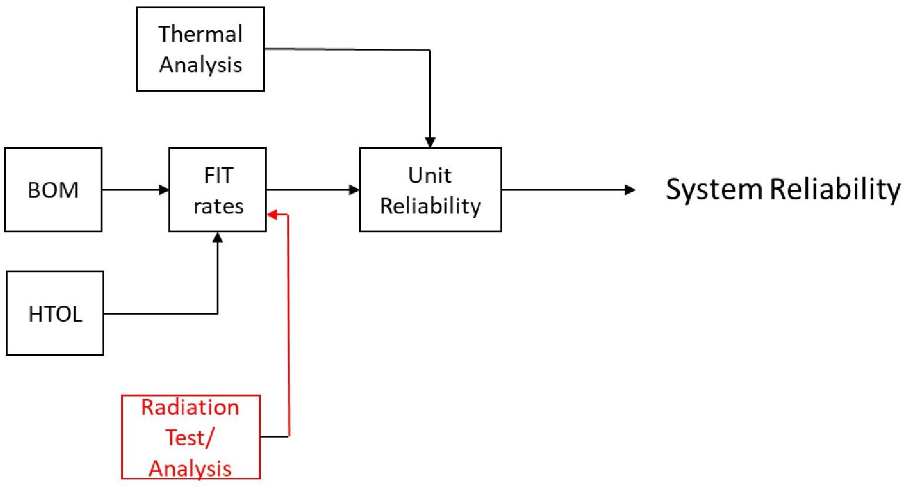

Figure 8. Useful life FIT rate including radiation.

Seldom does a program use the useful life from radiation life limitations to form an equivalent FIT rate for the environment but ignores the useful life effects of radiation and instead only uses the non-radiation FIT rate. For example, a 50K RHA comparator may only be good for 10 years at 5Krad (Si) per year. The effective FIT rate for the environment for a 10-year mission is 11,400, not 37. This was determined by setting the mean time to failure (component ceases to function in the circuit) to 10 years and backing out the associated effective FIT rate.

The resulting useful life of a component (COTS or Mil-Spec) should consider the useful life limitations of the radiation environment, shown in Figure 8. The space community needs to carefully consider how to use components that COTS suppliers designed to last 11 years at reduced thermal conditions (105 Deg C) from typical Mil-Spec environments (125 Deg C) when radiation is considered.

When assessing a COTS component potential useful life impact to the program, the useful life questions to ask are:

a) What is the required lifetime of the component vs the as designed component?

b) What is the expected usage temperature of the component vs the datasheet maximum?

c) What is the expected voltage(s) of the component vs the datasheet maximum and minimum?

d) What is the expected frequency of the component vs the datasheet limit?

e) If HTOL test data was used to develop the component FIT rate, what was the frequency, voltage, and temperature used for the test vs the expected application frequency, voltage, and temperature?

f) How will deratings for frequency, temperature and voltage affect the applications?

g) Does the component supplier perform burn-in testing?

<!-- PDF_PAGE: 45 -->

h) Does the supplier have other components (simpler structures) that can be tested to show the process useful life?

i) What is the component FIT rate and the rationale?

j) Is the supplier willing to share their design life targets, SPC data, or life test data? This may require a Non-Disclosure Agreement (NDA).

k) Does the program development plan (schedule, cost) allow for independent component testing or extended EM or FLT unit testing?

## 5.1.3 Manufacturing Questions

The COTS challenge for manufacturing is multi-faceted. The COTS components in use today use manufacturing processes and tolerances that are not approved for space use (by requirements). Space equipment has unique requirements, such a reworkability, no tin coatings, electrical testing, plastic package handling, knowledge of the source processing and reliability to name a few to ensure as few component escapes as possible. The Mil-Spec process consists of many tests and inspections that are not performed for COTS components. This section uses the Mil-Spec processes as a guide to foster asking the appropriate questions. For COTS components, some of these Mil-Spec processes won't apply, but are included not knowing what component the designer will choose or its application. Many of the Mil-Spec tests are done to prevent a discrepant component from being installed, as the penalty for a latent failure can be large (cost and schedule). Below is a list and short description of each type of evaluation or feature to use for guidance. It should be recognized that applying Mil-Spec type testing to COTS may require modifying the limits of the test in accordance with the component datasheet limits.

a) Plastic packages create a new set of manufacturing process requirements when being used for the space environment that are generally not standard for the space industry. Several of the tests listed below do not apply to plastic package (such as RGA, PIND, Hermeticity). Plastic packages have been used in space and there is a JEDEC standard to apply (refer to JEDEC 6294/1/3).

b) Component reworkability is the ability to be able to replace any component in an assembly without damaging other areas of the assembly. Using a component that cannot be reworked may lead to scrapping of an entire board should that component have anomalies. While the cell phone industry can throw away a non-conforming board (due to volume), the space industry builds a very small number of boards, with very expensive components and invested time.

c) It is important to understand if a component is 100% electrically tested from the supplier. Most Mil-Spec components are 100% electrically tested. If a COTS component is not 100% electrically tested, do the items that are not tested matter to the circuit? If the COTS component is not 100% electrically tested, it is likely that it has not been burn-in tested, which is effective at removing infant mortal components. The untested, but guaranteed, parameter may be timing related or a drive voltage or leakage current that may be relevant to the in-circuit use $ ^{30} $

d) It is expected that most COTS component are Reduction of Hazardous Substances (RoHS) compliant, they will have no lead in the solder, instead using pure tin. For a long duration program, this can be a significant life issue due to tin whisker growth. How the tin is deposited and where is very important for the potential mitigations to be effective. The failure mode from pure tin does not need to be a short from one component to another. Pure tin on component leads that cannot be conformally coated present a shorting potential to other leads on the same component.

e) The purpose of the RGA test is to determine if impurities or contamination is present. Impurities or contamination (like $ \mathrm{H_{2}O} $ ) can lead to degraded useful life due to internal package corrosion.

<!-- PDF_PAGE: 46 -->

f) PIND testing is used for determining if there are any Foreign Object Debris (FOD) in the package cavity. The presence of FOD may lead to premature component failure as the FOD may move under vibration or no gravity conditions.

g) Bondpull testing is used to show that the wirebonds from the die to the internal package pads or hybrid substrate are done correctly. The bondpull test (both destructive and non-destructive) test the bondpull strength to assess if the bond has any contamination which could compromise the bond or pad adhesion physically or electrically. A weak bond may be an indication of contamination or inadequate bonding time. Both can lead to premature component failure. Failure of a bondpull test after burn-in or temperature testing should be cause for concern as it is likely there is contamination (Bromine, Fluorine) that will, over time, result in bond failure. Components that use dissimilar metals (bond pad and wire) are more likely to suffer from poor bond quality.

h) Another indicator of component quality is the component's ability to survive shock testing. Shock is a short duration mechanical pulse that can cause deflection (bending) or movement within a component. It is important to understand if the COTS component will be powered on and operational in its application, as this affects the type of shock testing performed. Relays, crystal oscillators, large chip capacitors and resistors, and hybrids are sensitive to shock events. Shock sensitivity is an item where analysis is a poor predictor of performance. The shock spectra at the component may be very different from the shock spectra at the baseplate of the unit, so it is necessary to test in the application in like flying conditions to understand the component susceptibility.

i) Related to shock sensitivity is vibration sensitivity. Vibration is a longer dynamic event, basically shaking the unit. Relays, crystal oscillators, large chip capacitors and resistors, and hybrids are sensitive to vibration events.

j) Burn-in testing by the supplier is an effective method of removing infant mortal components. If the supplier does not do burn-in testing, higher than Mil-Spec fallout should be expected $ ^{30} $

k) Documentation is a key component to assess a components quality. Inspection of the lot travelers allows the quality of the component to be assessed independently by the program. Without this data, it becomes a lot harder to assess the COTS component quality.

I) Many of the COTS components today use very small geometries to increase function while using less space. These small geometries may also result in components that are more sensitive to Electro-Static Discharge (ESD). Knowing the ESD sensitivity is important for not only how to handle the component during manufacturing and assembly, but also the components sensitivity in the application from apace discharge events (which can be minimized, but not eliminated).

m) Pressure testing of components indicates that the materials used will not fail due to dielectric breakdown failures from voltage.

n) Another measure of a component's quality is its solderability. Solderability is a measure of the ease with which a soldered joint can be made to the lead material (the solder's wetting properties). This affects the manufacturability of the component with the board. The better the solderability, the less time and heat required to adequately solder the component to the board the first time. Poor solderability can be an indication of substandard materials or contamination.

0) Lid seal is a measure of the component's hermeticity and is done by placing the component in a vacuum and measuring the leak rate of any expelled gas (similar to the RGA test).

p) Hermeticity is important to ensure that contaminants can't get into the package over time and compromise the component's useful life.

q) Another useful test for components bound for space is radiography. Radiography is a nondestructive inspection of the internals for defects of a packaged component that would otherwise

<!-- PDF_PAGE: 47 -->

not be visible post lid seal. This allows a qualitative assessment of the package internal quality after the component has completed processing.

r) A component's ability to resist solvents is important as many solvents are used in the processing of electronic PWBs. The resistance to solvents test shows that solvents do not cause anomalous behavior, mechanical damage, or deteriorate the finishes (such as the markings) of the component. Reaction to solvents is an indication of potential sub-standard materials or a counterfeit component.

s) Scanning Acoustic Microscopy (SAM) is a test that uses sound waves to detect internal delamination, internal voids, or non-homogeneous material density. Anomalies found during a SAM test may be signs of poor workmanship, substandard materials, or counterfeit components.

t) Moisture testing determines the effect of moisture on the component. Moisture testing indicates if the moisture environment (humidity) affects the component in a negative way. Negative effects may be corrosion, organic growth, and package absorbed moisture (which may affect manufacturability, such as "pop-corning").

u) Package lead testing is important to determine the lead finish and integrity. This test measures the resistance of the lead to metal fatigue, and the peel strength of solder pads. Poor performance in the lead testing may be an indication of substandard materials, poor bonding (soldering) of the lead to the package, contamination, poor pad adhesion to the package or counterfeit components.

v) Another of a myriad of quality informing tests is the die shear test. The die shear test measures the amount of force required to force the die from its mounting. A poor die shear test result may be an indication of substandard materials, poor die bonding (epoxy, eutectic, solder), contamination during the assembly, or a counterfeit component.

w) The Lid Torque test is similar to the die shear test, but this time the shear strength of the lid seal to the package is the focus. A poor lid torque test result may indicate substandard materials, poor lid seal (seam or solder), contamination during the assembly, or a counterfeit component.

x) The column pull test is specific to column grid and ball grid array packages. The column pull test measures the pull strength of the column or ball attached to the package. Poor performance in this test may indicate substandard materials, poor column or ball bonding (column, ball, or pad failure), contamination during the assembly, or a counterfeit component.

y) Mil-Spec component assembly at the supplier typically has on-site inspection as a condition for providing Mil-Spec components. An on-site external visual inspection is typical for a Mil-Spec component that is not expected for COTS components. Buyers of COTS components (and their customers) need to understand that such intrusive inspections on a COTS line may not be possible.

z) Similar to the external visual inspection is the pre-cap inspection. Per-cap inspection is an inprocess inspection prior to placing and sealing the lid on the component or soldering on the edge cap (particularly important for complex microelectronics, hybrids, optical components, MultiLayer Ceramic Capacitors (MLCC), and large resistors) in a manner easy to pick out obvious assembly defects. The pre-cap inspection can protect against used, cloned and counterfeit components as well as reject obviously defective components.

aa) Internal visual inspection is another in-process step performed on site (like external visual and pre-cap) to gain knowledge of the component quality during its processing and assembly and provides an opportunity for rejection of obviously defective, used, cloned and counterfeit components.

ab) Finally for the manufacturing tests and methods, Scanning Electron Microscopy (SEM) is used to determine interconnect metallization. This test is a low-level indication of the process quality after wafer fab.

<!-- PDF_PAGE: 48 -->

The intent of the manufacturing questions is to surface issues that COTS components present to the space manufacturing capabilities and ruggedness requirements. When assessing a COTS component potential manufacturing impacts to the program, the manufacturing questions to ask are:

a) Is the component in a plastic package?

b) Is the component package hermetically sealed?

c) Is the component such that reworkability may not be possible?

d) Is the component 100% electrically tested?

e) Is the component burn-in tested?

g) Does the component have pure tin leads?

h) Does the component have a Residual Gas Analysis (RGA) report or data?

i) Does the component have a Particle Impact Noise Detection (PIND) report or data?

j) Does the component have a bondpull report or data?

k) Is the component shock tested? To what level and is there test data?

I) Is the component vibration tested? To what level and is there test data?

m) Are lot travelers for the component available for review?

n) Is there Electro-Static Discharge (ESD) data available for the component?

o) Is there barometric pressure data available for the component?

p) Is there solderability data available for the component?

q) Is there package lid seal data available for the component?

r) Is there radiography data available for the component?

s) Is there resistance to solvent data available for the component?

t) Is there Scanning Acoustic Microscopy (SAM) data available for the component?

u) Is there moisture resistance data available for the component?

v) Is there lead finish data available for the component?

w) Is there die shear data available for the component?

x) Is there package column pull data available for the component?

y) Is there an external visual inspection step in the processing or data available for the component?

z) Is there pre-cap (soldering of the lid) inspection step in the processing or data available for the component?

aa) Is there an internal visual inspection step in the processing or data available for the component?

ab) Is there Scanning Electro Microscopy data available for the component?

ac) Does the component (or unit) contain grease, plastic, bonding material or loctite, polyvinylchloride (PVC), or natural rubber that can outgas?

ad) Does the component (or unit) contain zinc, or cadmium or any other material that sublimates?

ae) Does the component (or unit) contain split, star, or tooth type lockwashers that may generate metallic FOD?

af) Does the component or unit contain hazardous materials (magnesium, beryllium, mercury, or selenium).

ag) Does the component (or unit) contain solder fluxes other than ROL0 or ROL1 type?

ah) Does the component (or unit) contain titanium where chlorinated solvents, chlorinated cutting fluids, anhydrous methyl alcohol, or fluoridated hydrocarbons were used in the production of the component (or unit)?

aj) Does the component have any formable or flexible leads that use electroless nickel plating?

<!-- PDF_PAGE: 49 -->

## 5.1.4 Trust Questions

The COTS challenge when it comes to trust is about information or experience. The first usages of COTS with little information from suppliers will require a new level of focus and care not experienced with MilSpec components. Repeated positive experience may be needed to "trust" the supplier on their unshared proprietary information and their handling of components with potential US security implications.

The intent of the trust questions is to surface issues that COTS components present to the space trust in quality knowledge and technology transfer to foreign entities. When assessing a COTS component potential trust impacts to the program, the trust questions to ask are:

a) Is the component foreign sourced, this could include being a foreign owned company, foreign manufacture, foreign package, assembly and test, or foreign sourced IP for critical functions?

b) Are foreign nationals operating the manufacturing line?

c) Does association with the component present risk of transferring knowledge of the system or its intent (personnel)?

d) Is there risk of transferring the technical details of the component (FPGA, ASIC) to a foreign entity or transferring knowledge of the system and its intent (personnel)?

e) Does the component have heritage in other applications other than spacecraft?

f) Are the other applications for a heritage component relevant to the space application?

g) What is the level of confidence that the component will do what is specified - and nothing else? What is this confidence based on?

## 5.1.5 Environment Questions

The environmental questions for using COTS in space is complex as there are multiple environmental pressures (aging while under radiation, thermal, vacuum, EMC/EMI) where the long-term data for the COTS component is non-existent, proprietary (making access difficult), or only partially available, producing gaps in information.

The intent of the environmental questions is to surface issues that COTS components present to their usage to allow informed decisions where there may be incomplete information. When assessing a COTS component's potential environment impacts to the program, the environment questions to ask are:

a) Is there data for the component to show how the component ages under radiation?

b) Is there data to show the aging effects of the component?

c) Is there data to show the effects of temperature on the performance of the component?

d) Is there data to show that the component is compatible with a vacuum environment?

e) Is the component vacuum sensitive? If so, what is the effect?

f) Are there unique storage or handling requirements for the component?

g) Is the component sensitive to EMC/EMI?

## 5.2 COTS Mitigations for Flow Section E

The following mitigations are not meant to be an all-encompassing set, but a good set of mitigations gathered for vulnerabilities for a COTS component. Other mitigations in other topic areas may apply. Since the capabilities of COTS components changes rapidly, it is expected other mitigations will be recognized for new technologies as they become available. This section is organized in the same order as the scope questions, radiation (1), useful life (2), manufacturing (3), trust (4) and environment (5). For quick reference, Tables 5.2.1-1 through 5.2.5-1 provide the mitigation identifier " (numberletter) " for each

<!-- PDF_PAGE: 50 -->

mitigation topic, for example, local shielding (1a). When considering the potential mitigations, duplication of tests on components should be avoided to prevent component overstress (burn-in, for example).

## 5.2.1 Radiation

The intent of the radiation flow is to understand the scope of the radiation parameters of the COTS (or any non-RHA) component that may need mitigation. The radiation section covers Total Dose (TD), Single Event upsets (SEUs), Single Event Functional Interrupts (SEFI), Latchup, and Single Event Gate Rupture (SEGR) which also encompasses Single Event Burnout (SEB). Figure 9 shows the radiation mitigations flow. For example, potential mitigations for TD can be found in but are not limited to mitigations 1a-f, which are each described with the corresponding identifier in the section title. Table 20 shows the potential radiation mitigations.

Table 20. Potential Radiation Mitigations

<table border="1"><tr><td>Mitigation</td><td>Radiation</td></tr><tr><td colspan="2">Total Dose Radiation</td></tr><tr><td>1a</td><td>Local Shielding</td></tr><tr><td>1b</td><td>Power Strobing</td></tr><tr><td>1c</td><td>Increased Redundancy</td></tr><tr><td>1d</td><td>N for M redundancy</td></tr><tr><td>1e</td><td>Multiple Images</td></tr><tr><td>1f</td><td>Multiple components in parallel</td></tr><tr><td colspan="2">Single Event Upsets (SEU)</td></tr><tr><td>1g</td><td>Periodic Refresh Period</td></tr><tr><td>1h</td><td>Error Detection And Correction (EDAC)</td></tr><tr><td>1j</td><td>Triple Modular Redundancy (TMR)</td></tr><tr><td>1k</td><td>FPGA based scrubbing</td></tr><tr><td>1l</td><td>Zener Diodes/clamps/Filters</td></tr><tr><td>1m</td><td>Software Rollback</td></tr><tr><td colspan="2">Single Event Functional Interrupt (SEFI)</td></tr><tr><td>1n</td><td>Local Refresh</td></tr><tr><td>1o</td><td>Component Reset</td></tr><tr><td>1p</td><td>Power Cycle</td></tr><tr><td>1q</td><td>CONOPS/System</td></tr><tr><td colspan="2">Latchup</td></tr><tr><td>1r</td><td>Current limiting</td></tr><tr><td>1s</td><td>Swap/Power Cycle (OBFM)</td></tr><tr><td>1t</td><td>Auto Power Cycle (hardware)</td></tr><tr><td colspan="2">Single Event Gate Rupture</td></tr><tr><td>1u</td><td>Conservative Derating</td></tr></table>

<!-- PDF_PAGE: 51 -->

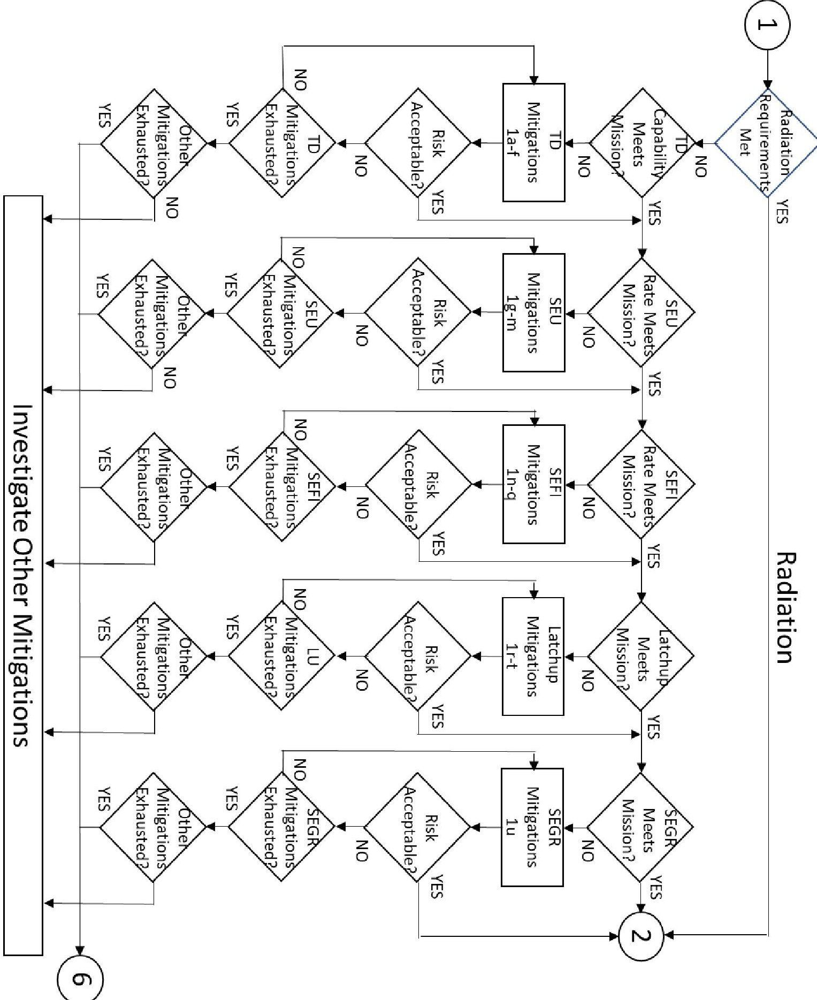

Figure 9. Radiation mitigations flow.

<!-- PDF_PAGE: 52 -->

## 5.2.1.1 Total Dose

There are multiple potential mitigations identified for COTS component TD shortfalls. These can be found in mitigations 1a through 1f (below).

## 5.2.1.1.1 Local Shielding (1a)

For components with a radiation total dose (TD) vulnerability, local physical shielding (aluminum or tantalum) may be used to reduce the effective mission dose. When physical shielding alone is insufficient or is not even feasible, architectural mitigations may be considered to limit total dose effects. Lot testing can be very helpful to determine how much shielding is required for a given lot. $ ^{2,5,21,24} $

## 5.2.1.1.2 Power Strobing (1b)

Power strobing can be used for circuits that need to be active for a short time duration (valve driver transistors, EEPROMs, or FLASH (NAND or NOR) memory during system boot-up). Implementing the power strobe function requires additional circuitry but may allow the use of a component that is vulnerable to radiation when under bias and where removing that bias extends the radiation tolerance. Power strobing can also be used for minimizing the power used in a system by turning circuits off that are not needed for the particular mission function or phase. $ ^{2,24} $

## 5.2.1.1.3 Increased Redundancy (1c)

To address useful life concerns, some programs have flown down redundancy requirements. To address the redundancy requirements, it is necessary to implement redundancy at the various element levels of a design. For example, it is common for PWBs to have both primary and redundant circuits. It is also common for redundancy to exist at the unit or sub-system level. For example, a Navy satellite has three on board computers, so redundancy at the unit level, hot, warm, and cold. Also, at the component level, Triple Modular Redundancy (TMR) is implemented in FPGAs to mitigate the effects of latch-up.

With increased redundancy, where one element is used, but multiple (unbiased or powered off) copies are used, physical isolation is key to prevent propagation of failure modes that would impact the redundant element. For PWBs with prime and redundant circuits, the IPC (2221) standard is not sufficient. The IPC isolation guidelines do not recognize the single point failure implications and increased separation that is required to protect the circuits from single random defects. This concept can be extended from circuit boards to units too. For circuits and assemblies that utilize redundancy, semiconductors and relays provide physical isolation that will prevent the propagation of a failure mode. $ ^{12,24,26} $

## 5.2.1.1.4 N for M Redundancy (1d)

This is a method for increasing the reliability (radiation or useful life limitations) of an element by using additional active or stand-by (powered or un-powered) elements. For example, three identical elements are in place where two elements are active with remaining element in a stand-by (un-powered) state. $ ^{12,24} $

## 5.2.1.1.5 Multiple Images (1e)

For non-volatile storage components, multiple images protected with error detection and correction (EDAC) and a program code checksum, with SW logic that selects the intact image. For non-volatile storage it is recommended that periodic refresh (rewriting the entire contents) be performed from every 3

<!-- PDF_PAGE: 53 -->

to 10 years, depending on the technology used. It should also be recognized that some NAND or NOR FLASH technologies may not be suitable even with the above-mentioned mitigations. $ ^{3,24} $

## 5.2.1.1.6 Multiple Components in Parallel (1f)

This approach uses multiple components in circuit, one powered and active, others power off and inactive. When the active component fails (radiation for example) the next un-powered component can be used to resume the function. A potential mitigation for the usage of COTS ADC components is to architect the board to use multiple ADCs, buffered from one another. When one has degraded to the point of no longer being acceptable, a new one can be switched in without the overhead of an entire board. For example, put three ADCs in parallel, each buffered (input and output) and on a separate power switch, with each feeding the common digital interface. FSW may be used to select the next component in the string to minimize impact to the mission. $ ^{2,3,8,24} $

## 5.2.1.2 Single Event Upsets

There are several mitigations available to lessen the effects and propagation of SEUs, detailed in mitigations 1g through 1m. Most of the techniques have potential significant board, unit, subsystem, on board fault protection, and system impacts. Software rollback can be used for existing COTS units.

## 5.2.1.2.1 Periodic Refresh (1g)

The scheduling of a periodic reset period or refreshing of control registers has been in use for decades. Most processing designs have a basic processing cycle. The resetting of the unit can be external, if there is a reset input, or internal, provided there is a defined time in the processing period that can accommodate the downtime. Setting up a dedicated time in the processing cycle to refresh addresses and control registers of susceptible components may result in reducing the vulnerable period-of-time for multiple errors to occur to an acceptable level. This technique has implications for the hardware, traffic schedule, FSW, and the on-board fault protection. The refresh period can also be used to detect any processing overrun conditions from the previous processing cycle as well as resetting key interfaces (which can be monitored using data wrap tests). This technique has been used successfully on Class A national asset vehicles. $ ^{12} $

## 5.2.1.2.2 Error Detection and Correction (1h)

For memory, EDAC helps, but may not be a full-scope solution depending on the expected error rate. The robustness of EDAC can be increased by using byte or nibble EDAC. Additional error scrubbing can be achieved if control registers are refreshed when a single bit error is detected (update the control register and write the corrected word back to memory) during that processing cycle. EDAC is a board and FPGA level technique. It is important to consider protection for the memory used in FPGA IP (Intellectual Property) functions. Many IP functions have an EDAC option that can be enabled during configuration. EDAC is HIGHLY recommended for FLASH memories. $ ^{2, 7, 11, 21, 24. 29} $

## 5.2.1.2.3 Triple Modular Redundancy (1j)

Another technique is to use triple modular redundancy (TMR) at either the component or functional level, with the voter (two of three) determining the correct output(s). It is important that the voter function not create a single point of failure. The functions being voted must be synchronized to avoid glitchy outputs from the voters or the stage that receives the signals from the voters must be tolerant to glitches (not edge sensitive). Since the TMR approach "masks out" a function with an error, it is important to provide a

<!-- PDF_PAGE: 54 -->

method to verify the hardware has no latent defects, i.e., it must be shown that all three voter functions and voters are not defective. It is also recommended to have feedback from the voters to allow periodic refresh of the functions feeding the voters. The feedback mechanism should be designed so as not to defeat the TMR intent (no SPFs). While effective, this technique impacts size, weight, power, and cost (SWaPC) of the circuit. TMR is a unit level design choice and is only realistically feasible for 5yr+ missions due to development time. This technique has been used successfully on many class A programs. $ ^{2,7,11,12,21,24} $

## 5.2.1.2.4 FPGA-based Scrubbing (1k)

A more invasive technique is to use an FPGA with internal EDAC to scrub the memory independent of the processor (shares the memory bus). This technique is a board level technique and may reduce the effective processor throughput. This technique may also be used when the FPGA is the memory controller (scrub is done without the processor's knowledge) $ ^{24} $

## 5.2.1.2.5 Zener Diodes Clamps and Filters (1l)

For simpler analog components, the use of zener diodes has been used to clamp the output of an analog circuit to prevent overvoltage damage downstream induced by an SEU. Zener clamping is a board level technique for analog type components. Op-amps also suffer from high energy particle effects, so to protect downstream circuits, adding zener diodes or RC (resistor/capacitor) filter may be a mitigation against railing the output (both positive and negative). Depending on the frequency sensitivity of the circuit, bandwidth limiting filtering may follow an op-amp to further mitigate the impact of Single Event Transients (SETs). Other techniques that can be implemented at the subsystem or system level is digital filtering. The analog circuit may really require high gain or bandwidth for its function, so digital filtering (application of thresholds or sanity checks) by either the downstream hardware or software can filter out readings beyond possible by the hardware sample-to-sample time to prevent large SET caused sensor excursions from reaching the control algorithm. $ ^{21,24} $

## 5.2.1.2.6 Software Rollback (1m)

Radiation hardened by software (RHBSW) techniques such as the implementation of periodic checkpoints and restart techniques for the processor to roll-back to previous saved state in the event of fault. These checkpoints can be written to on-board storage and consist of the processor's critical configuration, registers, and memory content, as well as current state of the application(s) that help with successful recovery of the processor to its previous state. RHBSW is for new or existing COTS units, but can be impactful on memory, throughput, and processing timeline. $ ^{24} $

## 5.2.1.3 Single Event Functional Interrupt

The SEFI mitigations, 1n through 1q, are a mixture of component and unit mitigations Reset can be either a component or unit mitigation but may have processing timeline impacts Power cycle mitigation has potential impacts to the processing timeline and fault management. These mitigations at the component level may introduce sneak paths that need to be managed. CONOPs mitigations are best done at unit level but has scheduling and fault management impacts.

## 5.2.1.3.1 Local Refresh (1n)

The component can be locally refreshed to clear the SEFI as discussed above for SEUs, with a periodic refresh. $ ^{12,24} $

<!-- PDF_PAGE: 55 -->

## 5.2.1.3.2 Component Reset (10)

A reset to the component is the best way to ensure the effects of the SEFI are removed as internal registers may have changed, followed by re-initialization. A component level reset can be designed in if the register that is vulnerable is not accessible. A watchdog timer or wraparound test can provide the necessary monitor of off-nominal performance. $ ^{2,11,12,23,24} $

## 5.2.1.3.3 Power Cycle (1p)

A local power switch to the component can be used, which may need to be followed by a reset, or the assembly (or sub-circuit) may be designed to swap autonomously. Consider the usage of a watchdog timer on the COTS or provide a path to the COTS for a wraparound test. $ ^{2,11,12,16,23,24} $

## 5.2.1.3.4 CONOPs or System Action (1q)

CONOPS can be used to disable or turnoff sensitive (generally payload) equipment during vulnerable time periods in the orbit (like over the South Atlantic Anomaly, SAA). Resiliency for COTSs may also occur at the system level (multiple vehicles to spread the system risk) $ ^{2,7,8} $

## 5.2.1.4 Latchup

Latch up is more severe than SEFI or SEU as it can lead to irreversible damage, so mitigations tend to be quick reaction (hardware) mechanisms. Mitigations 1r through 1t discuss three options to prevent latchup from turning into permanent damage, which redundancy will not solve.

## 5.2.1.4.1 Current Limiting (1r)

The simplest form of current limiting circuit (using a series resistor on the supply pins) and the ability to power cycle the assembly. Other techniques use an active current limiting circuit that can notify the fault protection of a current limit trip. $ ^{2,16,23,24} $

## 5.2.1.4.2 Swap or Power Cycle by Fault Protection (1s)

An architectural mitigation is to have the current limiting circuit feed the On-Board Fault Protection (OBFP) system the current status and for the OBFP (hardware or software, depending on the time requirements for a swap) turn off the latch-up assembly and enable the backup assembly. $ ^{2,12,16,23,24} $

## 5.2.1.4.3 Auto Power Cycle by the Hardware (1t)

Another technique is to design in auto power cycle with a hot-backup, active-redundant, swap architecture at the Circuit Card Assembly (CCA) level (N for M active redundancy). Designing the power supplies to support this kind of functionality from the start will widen the choice of processors (or other sub assemblies that are SEL sensitive) while limiting mission downtime. The swap process should accommodate all combinations automatically so that the processor can switch to the desired backup processor without ground intervention. $ ^{12,23,24} $

<!-- PDF_PAGE: 56 -->

## 5.2.1.5 Single Event Gate Rupture

For components susceptible to SEGR, the only real solution, discussed in mitigation 1u, is conservative component usage, with conservative deratings. A COTS unit with a component vulnerable to SEGR may not be mitigatable except by shortened life expectations or N for M redundancy.

## 5.2.1.5.1 Conservative Derating (1u)

For components that have a SEGR vulnerability, the typical mitigation is a very conservative derating of the drain to source voltage parameter, typically for discrete MOSFETs. For example, MOSFET transistors can experience gate rupture that is dependent on the drain to source voltage. Limiting the applied drain to source voltage (Vds) to 40% or less results in effective mitigation, therefore the architectural mitigation is to limit the Vds applied in the design. FLASH memory technologies may be vulnerable to SEGR during programming operations which must be considered in the mission operation and life requirement. It should also be recognized that some NAND or NOR FLASH technologies may not be suitable even with the above-mentioned mitigations due to internal programming voltages that may exceed SEGR limits. $ ^{8,9,11,21,23,24} $

## 5.2.2 Useful Life

The intent of the useful life flow is to understand the scope of the knowledge needed to assess useful life of the COTS component that may need mitigation. The useful life section covers HTOL temperature, HTOL voltage, HTOL frequency and SPC data. Figure 10 shows the useful life mitigations flow. Table 21 shows the potential useful life mitigations.

Table 21. Potential Useful Life Mitigations

<table border="1"><tr><td>Mitigation</td><td>Useful Life</td></tr><tr><td></td><td>HTOL T~usage(Acquire test data for guidance)</td></tr><tr><td>2a</td><td>Life test at usage temp</td></tr><tr><td></td><td>HTOL V~usage(Acquire test data for guidance)</td></tr><tr><td>2b</td><td>Life test at usage voltage</td></tr><tr><td></td><td>HTOL F~usage(Acquire test data for guidance)</td></tr><tr><td>2c</td><td>HCI or EM:Life test at usage frequency</td></tr><tr><td></td><td>No HTOL or reliability data</td></tr><tr><td>2d</td><td>Extensive accelerated testing, extensive EM or FLT unit testing</td></tr><tr><td>2e</td><td>Focused accelerated testing of the COTS</td></tr><tr><td>2f</td><td>Focused testing of simpler structure from the same process</td></tr><tr><td>2g</td><td>Effects on system reliability</td></tr></table>

<!-- PDF_PAGE: 57 -->

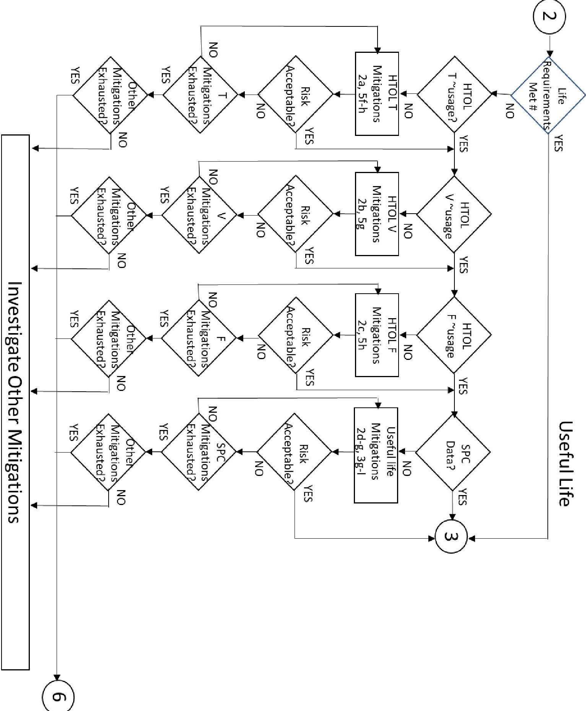

Figure 10. Useful life mitigations flow.

<!-- PDF_PAGE: 58 -->

## 5.2.2.1 High Temperature Operational Life Temperature

There are several mitigations available to aid in determining the useful life of a component, detailed in mitigation 2a through 2g. Most of the techniques are component level testing techniques, but mitigations 2d through 2f can be done at the board or unit level to test the components in question past the burn-in period to attempt to limit infant mortality failures occurring during vehicle integration. $ ^{30} $

## 5.2.2.1.1 Accelerated Life Test for Temperature (2a)

Perform post purchase HTOL test at temperature that allows for limited life acceleration relative to usage temperature (junction). $ ^{5,21,24,25} $

## 5.2.2.2 High Temperature Operational Life Voltage

## 5.2.2.2.1 5.2.2.2.1 Life Test at Usage Voltage (2b)

Perform post purchase HTOL test at voltage that allows for limited life acceleration relative to usage voltage. $ ^{5,21,24,25} $

## 5.2.2.3 High Temperature Operational Life Frequency

## 5.2.2.3.1 Life test at Usage Frequency (2c)

Perform post purchase HTOL test at frequency that is the same as the application. $ ^{5,21,24,25,30} $

## 5.2.2.4 No HTOL or Reliability Data

## 5.2.2.4.1 Extensive Accelerated Testing, EM or Unit Testing (2d)

Many commercial suppliers do not do burn-in testing to weed out the infant mortal components. A potential method used in the past is to perform the infant mortality testing at the board or unit level through increased unit and board test time, depending on the program schedule, to put many operational hours on the components. Consider trending key parameters of the COTS (component or unit) vs a nominal analysis. Consider using BOL limits for unit test limits. $ ^{11,16,21,25,30} $

## 5.2.2.4.2 Focused Accelerated testing of the COTS Component (2e)

Many commercial components are not HTOL tested. Statistical process control is used, which is about component consistency and less about useful life. Consider the focused testing of the COTS to include increased temperature, voltage and frequency to determine useful life. Consider conducting a component level life test (MIL-STD-883, Method 1005), thermal cycle testing, or step stress testing. Parameters to consider include timing, leakage current, output drive, slew rate, supply current, quiescent current, and input threshold sensitivity. Consider trending key parameters of the COTS vs a nominal analysis. Consider using BOL limits for unit test limits. $ ^{4,11,16,21,23,25} $

## 5.2.2.4.3 Focused Testing of Like Process Structures (2f)

Many commercial components are not HTOL tested. Statistical process control is used, which is about component consistency and less about useful life. Consider the focused testing of a simpler component from the same process to include increased temperature, voltage, and frequency to determine useful life.

<!-- PDF_PAGE: 59 -->

Parameters to consider include timing, leakage current, output drive slew rate, supply current, quiescent current, and input threshold sensitivity. Consider trending key parameters of the COTS vs a nominal analysis. Consider a non-disclosure agreement to obtain the process life data. $ ^{18} $

## 5.2.2.4.4 Effects on System Reliability (2g)

When a COTS component is used, a functional FMECA may not surface failure modes that the system needs to be aware of. Consider a part level FMECA of the COTS component and those connected to the COTS component for a complete understanding for the system fault implications. The component FIT rate is used to support the system reliability analysis. What FIT rate is used and why (supporting data)? COTS suppliers will supply a FIT rate, but not the supporting data used to derive that FIT rate, so caution is appropriate. N for M redundancy is another way to augment the system reliability for components. $ ^{4,5,11} $ 12,16,21,23

## 5.2.3 Manufacturing

The intent of the manufacturing flow is to understand the potential mitigations that may be needed to address manufacturing aspects of the COTS component. The manufacturing section covers plastic packaging, reworkability, electrical testing, pure tin, package RGA, PIND, bondpull, shock, vibrations, burn-in, lot travelers, ESD, barometric pressure, solderability, lid seal, radiography, resistance to solvents, SAM, moisture, lead finish, die shear, lid torque, lead adhesion, column pull, external visual, pre-cap, internal visual, SEM, contamination, hazardous materials, and corrosive materials. Figures 11 through 18 show the manufacturing mitigation flows. Table 22 shows the potential manufacturing mitigations. Most of these mitigations are user implemented. Some mitigations mentioned, like in-process inspections, may not be possible, but the buyer can always ask.

<!-- PDF_PAGE: 60 -->

Table 22. Potential Manufacturing Mitigations

<table border="1"><tr><td>Mitigation</td><td>Manufacturing</td></tr><tr><td colspan="2">Plastic package</td></tr><tr><td>3a</td><td>Plastic package encapsulation</td></tr><tr><td>3b</td><td>Package hermeticity</td></tr><tr><td>3c</td><td>Repackage component</td></tr><tr><td colspan="2">Reworkability(Demonstration required)</td></tr><tr><td>3d</td><td>Risk reduction activity</td></tr><tr><td>3e</td><td>Put component on daughtercard</td></tr><tr><td>3f</td><td>Design as easy to replace</td></tr><tr><td colspan="2">Electrical Testing</td></tr><tr><td>3g</td><td>Enhanced part testing(test house)</td></tr><tr><td>3h</td><td>Early risk reduction circuits</td></tr><tr><td>3j</td><td>Board level test(application specific)</td></tr><tr><td>3k</td><td>Unit level test(application specific)</td></tr><tr><td>3l</td><td>No component level burn-in testing</td></tr><tr><td colspan="2">Pure tin leads</td></tr><tr><td>3m</td><td>Double layer of conformal coat</td></tr><tr><td>3n</td><td>Re-tin leads or replace package grid array leads</td></tr><tr><td>3o</td><td>Solder Wicking</td></tr><tr><td>3p</td><td>Fusing</td></tr><tr><td>3q</td><td>Annealing</td></tr><tr><td>3r</td><td>Matte Sn plating</td></tr><tr><td colspan="2">Package RGA</td></tr><tr><td>3s</td><td>Test component</td></tr><tr><td colspan="2">PIND</td></tr><tr><td>3t</td><td>PIND test the component</td></tr><tr><td colspan="2">Bondpull</td></tr><tr><td>3u</td><td>Bondpull test the component</td></tr><tr><td colspan="2">Shock</td></tr><tr><td>3v</td><td>Shock test the component</td></tr><tr><td colspan="2">Vibe</td></tr><tr><td>3w</td><td>Vibration test the component</td></tr><tr><td colspan="2">Burn-in</td></tr><tr><td>3x</td><td>Perform infant mortality testing</td></tr><tr><td colspan="2">Lot travelers</td></tr><tr><td>3y</td><td>On-site inspection/observation</td></tr><tr><td>3z</td><td>Early Destructive and non-destructive testing</td></tr><tr><td colspan="2">ESD</td></tr><tr><td>3aa</td><td>ESD sensitivity testing</td></tr><tr><td colspan="2">Barometric Pressure</td></tr><tr><td>3ab</td><td>Pressure test the component</td></tr><tr><td colspan="2">Solderability</td></tr><tr><td>3ac</td><td>Test the component for solderability</td></tr></table>

<!-- PDF_PAGE: 61 -->

Table 22. Potential Manufacturing Mitigations (cont)

<table border="1"><tr><td></td><td>Lid Seal</td></tr><tr><td>3ad</td><td>Test the component for lid seal</td></tr><tr><td></td><td>Radiography</td></tr><tr><td>3ae</td><td>Radiographically test the component</td></tr><tr><td></td><td>Resistance to Solvents</td></tr><tr><td>3af</td><td>Test the component for resistance to solvents</td></tr><tr><td></td><td>Scanning Acoustic Microscopy</td></tr><tr><td>3ag</td><td>SAM test the component</td></tr><tr><td></td><td>Moisture</td></tr><tr><td>3ah</td><td>Moisture test component</td></tr><tr><td></td><td>Lead Finish</td></tr><tr><td>3aj</td><td>Test the component for lead finish</td></tr><tr><td></td><td>Die Shear</td></tr><tr><td>3ak</td><td>Die shear test the component</td></tr><tr><td></td><td>Lid Torque</td></tr><tr><td>3al</td><td>Lid torque test the component</td></tr><tr><td></td><td>Lead Adhesion</td></tr><tr><td>3am</td><td>Test the component for lead adhesion</td></tr><tr><td></td><td>Column Pull</td></tr><tr><td>3an</td><td>Pull test the component</td></tr><tr><td></td><td>External Visual</td></tr><tr><td>3ao</td><td>On-site inspection/observation</td></tr><tr><td>3ap</td><td>External visual post component receipt</td></tr><tr><td></td><td>Pre-Cap</td></tr><tr><td>3aq</td><td>On-site inspection/observation</td></tr><tr><td></td><td>Internal Visual</td></tr><tr><td>3ar</td><td>On-site inspection/observation</td></tr><tr><td>3as</td><td>De-lid, inspect component internally</td></tr><tr><td></td><td>Scanning Electron Microscopy</td></tr><tr><td>3at</td><td>SEM test the component</td></tr><tr><td></td><td>Contamination</td></tr><tr><td>3au</td><td>Mitigations 3a, 3c, 3m, 5n</td></tr><tr><td></td><td>Hazardous Materials</td></tr><tr><td>3av</td><td>Mitigations 3c, 5au</td></tr><tr><td>3aw</td><td>Handling</td></tr><tr><td></td><td>Corrosive Materials</td></tr><tr><td>3ax</td><td>Separation of functions/containment</td></tr></table>

<!-- PDF_PAGE: 62 -->

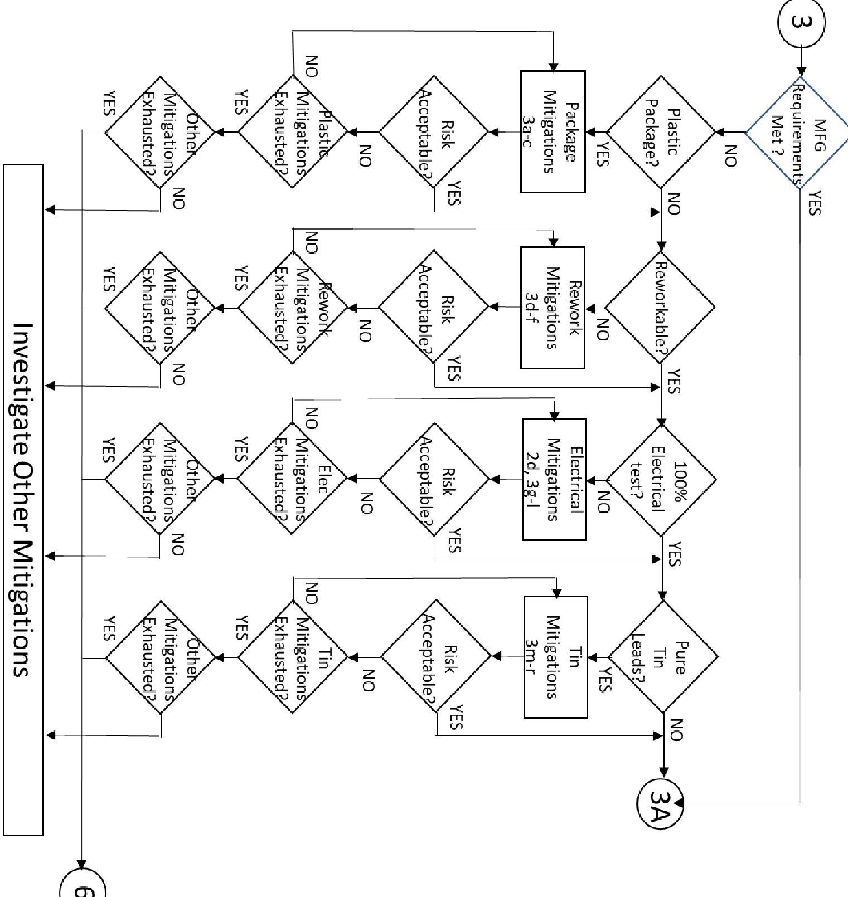

Figure 11. Manufacturing mitigation flow (1 of 8).

Figure 11 captures the manufacturing mitigations flow for plastic package, reworkability, electrical testing, and pure tin leads.

<!-- PDF_PAGE: 63 -->

## 5.2.3.1 Plastic Package

Plastic packages present issues for manufacturing and vehicle cleanliness. There are established methods for handling plastic package components in manufacturing. This ATR refers to the established methods and describes systems-oriented mitigations to avoid contamination from outgassing to vehicle optics, described in mitigations 3a-c.

## 5.2.3.1.1 Plastic Package encapsulation (3a)

JEDEC 6294/1/3 provides guidance for using plastic parts. A potential mitigation at the system level is deployable covers for any sensitive optics (Star-trackers, telescopes) to be opened after the plastics have outgassed (days to weeks). Refer to mitigation 5n. $ ^{24} $

## 5.2.3.1.2 Package Hermeticity (3b)

If the package is non-hermetic, does it matter for the program application? For programs that vacuum sensitivity may be a concern (any voltage in the non-hermetic package above 12V, high current applications, or for performance of the functions that is affected by vacuum (RF)). Potential solutions are encapsulant (verified coverage), conformal coat (verified coverage), or internal unit positive pressure. In the cases of conformal coat or encapsulant, longer than normal bakeout may be required. $ ^{24} $

## 5.2.3.1.3 Repackage Component (3c)

Consider having the supplier provide a hermetic package. Another option is to procure the die and have a second party package the die. This has been done for programs to put the candidate die in a ceramic hermetic package.

## 5.2.3.2 Reworkability

Reworkability allows re-use of a board (or unit) by reworking (repair or changing) a discrepant component. The increased usage of BGA/CGA packages has made reworking assemblies more difficult (particularly when tin leads are used). It is expected that COTS with high density packages will become more widely used (like flipchips). Mitigations 3d-f describe methods to address COTS reworkability.

## 5.2.3.2.1 Risk Reduction Activity (3d)

Consider a mock-up of the component in a condition like the application early and subject it to the stresses (mechanical, electrical, radiation) consistent with the program and then dis-assemble or perform a destructive parts analysis to determine if the stresses had an adverse effect. Another thing to consider for difficult to rework/replace components is a test article to practice the removal/replacement before the action is required on a flight board.

## 5.2.3.2.2 Daughtercard Implementation (3e)

Some components, like high density (small lead pitch) FPGAs or ASICS, flipchip packages, 3D packages, or plastic packaged components may be difficult to impossible to rework. Consider packaging these kinds of components on a daughtercard to mitigate the difficulty reworking or replacing the component and damaging an entire board. This is an acknowledgement that many commercial components are not burn-in tested so infant mortality is a non-trivial consideration for a difficult to rework component. $ ^{30} $

<!-- PDF_PAGE: 64 -->

## 5.2.3.2.3 Easy to Replace Design (3f)

Some components, like high density FPGAs or ASICS, or plastic package components may be difficult to rework. The ability to rework the component should be a consideration for COTS. Another thing to consider for difficult to rework/replace components is a test article to practice the removal/replacement before the action is required on a flight board.

## 5.2.3.3 Electrical Testing

Electrical testing is an option to determine the actual performance of a COTS component or for testing long enough to trend a parameter or to achieve some burn-in time prior to installation. Mitigations 3g-I discuss options for augmenting electrical parameter knowledge.

## 5.2.3.3.1 Enhanced Component Testing (3g)

Many commercial components are not 100% electrically tested. Depending on the application, contracting with a component test company may be wise to characterize and pick the components appropriate for the application. $ ^{2,11} $

## 5.2.3.3.2 Early Risk Reduction Circuit (3h)

In some cases, it may be easier to setup a simple test board for the component of interest to characterize its' parameters that the commercial supplier does not test. It is recommended that the tested parameters that are important and not tested by the supplier are compared with the circuit analysis (both beginning of life and end of life worst case). Consider trending key parameters of the COTS vs a nominal analysis. Look for off-nominal behavior, not just pass/fail. Consider using BOL limits for unit test limits. $ ^{2,16,24} $

## 5.2.3.3.3 Board Level Test (3j)

A technique used in the past is to test and measure the parameters of concern in the application circuit (at board level) and compare those measurements against the analysis. It is recommended that the tested parameters that are important and not tested by the supplier are compared with the circuit analysis (both beginning of life and end of life worst case). Additional test time may be required to pass the infant mortality period. Consider the use of JTAG (Joint Test Action Group) methods to verify solder joints for small lead pitch components (BGA, CGA, flipchip, 3D packages). Consider trending key parameters of the COTS vs a nominal analysis. Consider using BOL limits for unit test limits. 2,3,4,5,9,12,16,20,23,25

## 5.2.3.3.4 Unit Level Test (3k)

A technique used in the past is to test and measure the parameters of concern in the application circuit (at unit level) and compare those measurements against the analysis (may require external test points be designed in). It is recommended that the tested parameters that are important and not tested by the supplier are compared with the circuit analysis (both beginning of life and end of life worst case) and appropriate BOL test limits are set (not EOL). Consider testing over the entire temperature range, not just the plateaus, to fully test the COTS in the application. Monitor for parametric shifts (trending), not just pass/fail. Additional test time may be required to pass the infant mortality period. Also consider performance testing throughout the entire temperature range (on the EM) to weed out surprise parameter performance (advisable for new developments). Consider trending key parameters of the COTS vs a nominal analysis. Consider using BOL limits for unit test limits. For flight units, 500+ test hours may be needed to weed out infant mortals. For shorter mission (<3 years) consider Board Level Screening (BLS) of thermal, electrical and dynamics (TED) to provide confidence of function over the entire test range

<!-- PDF_PAGE: 65 -->

(refer to COTS Card Unit Level Char Guidance). For longer duration programs, consider HALT/HAST (Highly Accelerated Life Test/Highly Accelerated Stress Test) testing. Implementation of perceptive "test like you fly" is key to ensuring the COTS component is performing as expected. $ ^{2,5,9,11,12,16,20,23,25,30} $

## 5.2.3.3.5 Lack of Component Level Burn-in Data (3l)

For components from commercial suppliers that do not perform burn-in testing, the risk of an early component failure must be weighed against the impact of reworking the failed component. For shorter mission (<3 years) consider Board Level Screening (BLS) of thermal, electrical and dynamics (TED) to provide confidence of function over the entire test range (refer to COTS Card Unit Level Char Guidance). For longer duration programs, consider HALT/HAST (Highly Accelerated Life Test/Highly Accelerated Stress Test) testing. Consider testing over the entire temperature range (trending), not just the plateaus to fully test the COTS in the application. Monitor for parametric shifts, not just pass/fail. Also consider the number of hours of testing before there is confidence of passing the infant mortality period, which will be dependent on the component junction temperature in the application (vs the standard acceleration junction temperature) Some acceleration can be achieved at the board or unit level. Consider a key test point to allow monitoring of a key parameter (board or unit level) that may shift during the infant mortality period to allow trending. Consider building spare tested boards to preserve schedule should an infant mortality failure occur. 2,5,9,12,16,20,23,25,30

## 5.2.3.4 Pure Tin Leads

The use of pure tin will be a fact of life using COTS components (due to RoHS compliance). For space usage, the space community will have to learn how to mitigate components that have pure tin. There are multiple options for tin, discussed in mitigations 3m-r.

## 5.2.3.4.1 Double Layer of Conformal Coat (3m)

Attempt to minimize whisker growth. Conformal coat helps but is not 100% effective (the underside of the package still poses a risk of shorting). Two layers of conformal coat, one with a tracer to help with verification of coverage may help. Vapor deposition may be an option for packages with leads under the package. $ ^{2,27} $

## 5.2.3.4.2 Re-Tin Leads or Repackage (3n)

Remove the tin by re-tinning the leads of the component (commonly done) with tin-lead solder or in the case of BGA/CGA, rework the package to replace the pure tin leads with lead/solder balls/columns. $ ^{2,27} $

## 5.2.3.4.3 Solder Wicking (30)

The normal reflow process can reduce the amount of pure tin locally, but reflow may only be partially effective, depending on the amount of tin present on the lead. Reflow is not a viable technique for ball grid, column grid arrays, flip chip packages and components with large tin coated leads. $ ^{27} $

## 5.2.3.4.4 Fusing (3p)

Fusing is subjecting the component or structure to 230 Deg C for 1 minute. This technique may not be viable for many COTS components (exceeds maximum allowable case temperature) $ ^{27,42} $

<!-- PDF_PAGE: 66 -->

## 5.2.3.4.5 Annealing (3q)

Annealing is subjecting the component or structure to just below critical temperatures for a specified amount of time. The temperatures and time duration depends on the type of material. Recommended annealing for tin is subjecting the component or structure to 150 Deg C for 1 hour. This technique may not be viable for many COTS components (exceeds maximum allowable case temperature) $ ^{27} $

## 5.2.3.4.6 Matte Tin Plating (3r)

Matte tin plating has shown substantially less growth than bright tin finishes. Some suppliers do supply tin coated components with matte tin finishes to be RoHS compliant and limit tin whisker growth. The usage of matte finishes provides a reasonable solution to COTS with tin. $ ^{28} $

<!-- PDF_PAGE: 67 -->

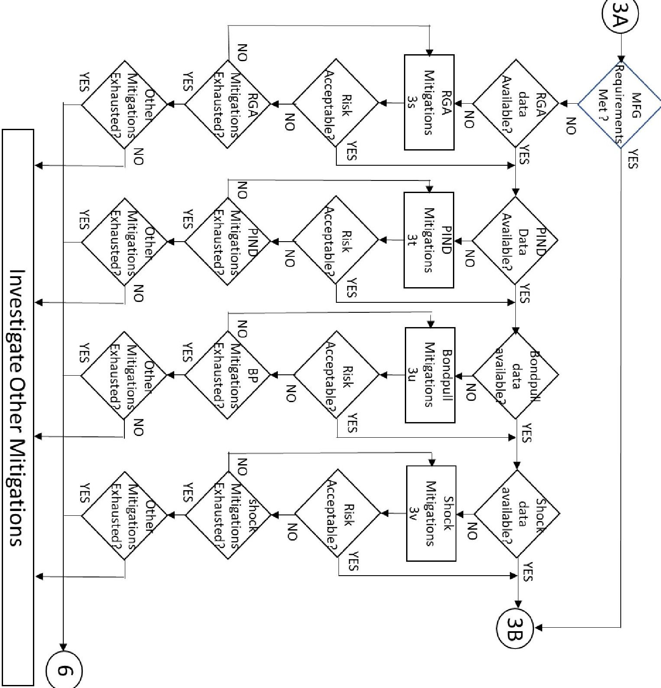

Figure 12. Manufacturing mitigation flow (2 of 8).

Figure 12 captures the manufacturing mitigations flow for Residual Gas Analysis (RGA), Particle Impact Noise Detection (PIND), bondpull, and shock.

<!-- PDF_PAGE: 68 -->

## 5.2.3.5 Package RGA

RGA is expected to be reserved only for the long term, class A type missions. It is acknowledged that RGA has limited benefit for many COTS components but is included here for completeness. Mitigation 3s discusses RGA.

## 5.2.3.5.1 Test the Component (3s)

Consider procuring the components early (pre-EM) and test. Determine pass/fail limit, MIL-STD-883, method 1018. Consider ordering extra FLT components and test each lot if suspect. If RGA is used and the component fails, the program will have a risk decision moving forward as is (depending on the RGA findings), procuring another lot that may (or may not) be better, or find a substitute component. $ ^{23} $

## 5.2.3.6 Particle Impact Noise Detection

Particle Impact Noise Detection (PIND) is a test to determine if there are Foreign Object Debris (FOD) in the package cavity that may cause damage or shorts. Mitigation 3t discusses PIND.

## 5.2.3.6.1 Test the Component (3t)

Consider early PIND testing (procure component early (Pre-EM) and test. If FOD is present, determine if it is conductive or non-conductive, then assess internal component shorting risk to circuit function. Determine the Pass/fail criteria. Consider ordering extra FLT components and test each lot if suspect. MIL-STD-883, method 2020. It is acknowledged that PIND may not be applicable to many programs and is included here for completeness.

## 5.2.3.7 Bondpull

Bondpull tests the wire bond to pad strength to determine if there is good adhesion of the wire bond and pad. Poor bondpull results may indicate contamination which may affect reliability. Mitigation 3u discusses bondpull options.

## 5.2.3.7.1 Bondpull Test the Component (3u)

Consider early bondpull testing (procure component early (Pre-EM) and test. If bondpull fails, does it matter to the program at the limit at which it failed? Determine Pass/fail criteria. Is the root cause contamination? Consider ordering extra FLT components and test each lot if suspect. MIL-STD-883 method 2011 and 2023.

## 5.2.3.8 Shock

Shock is typically experienced when a space vehicle is launched and separated from the launch vehicle. Shock may also be experienced during vehicle deployments. Shock mitigation 3v discusses options for COTS components with no history of shock testing.

## 5.2.3.8.1 Shock Test the Component (3v)

Consider early shock testing (procure component early (Pre-EM) and test. sensitivity to shock is highly application dependent and difficult to accurately analyze. Consider whether the component is powered or unpowered during shock events. Review the conditions the supplier uses for testing chatter and transfer (the Mil-Spec allows the coils to be energized during the shock event for the transfer test which is NOT

<!-- PDF_PAGE: 69 -->

consistent with how it will be used). If the component is powered during the shock event, it is recommended that the component be tested while powered and operating (and monitored). Component level shock can be VERY different from unit level shock input (depends on packaging). If component fails required shock limits, does it matter to the program at the limit at which it failed? Determine the pass/fail criteria before testing. Consider ordering extra FLT components and test each lot if suspect. Components to consider are relays (chatter and transfer), oscillators (frequency shift or failure), large ceramic caps (on flexible surface), hybrids (stiff substrate), large connectors without support (solder joints), leadless chip carriers (on flexible surface), multi-layer chip capacitor (MLCC), and integrated circuits with large die. Potential solutions include conformal coat or other dampening under the component, softer board mounting, a more or less stiff board, change of unit or board orientation on the panel, relocation on the panel or vehicle for less baseplate shock input, or different separation devices, with test as the verification.

<!-- PDF_PAGE: 70 -->

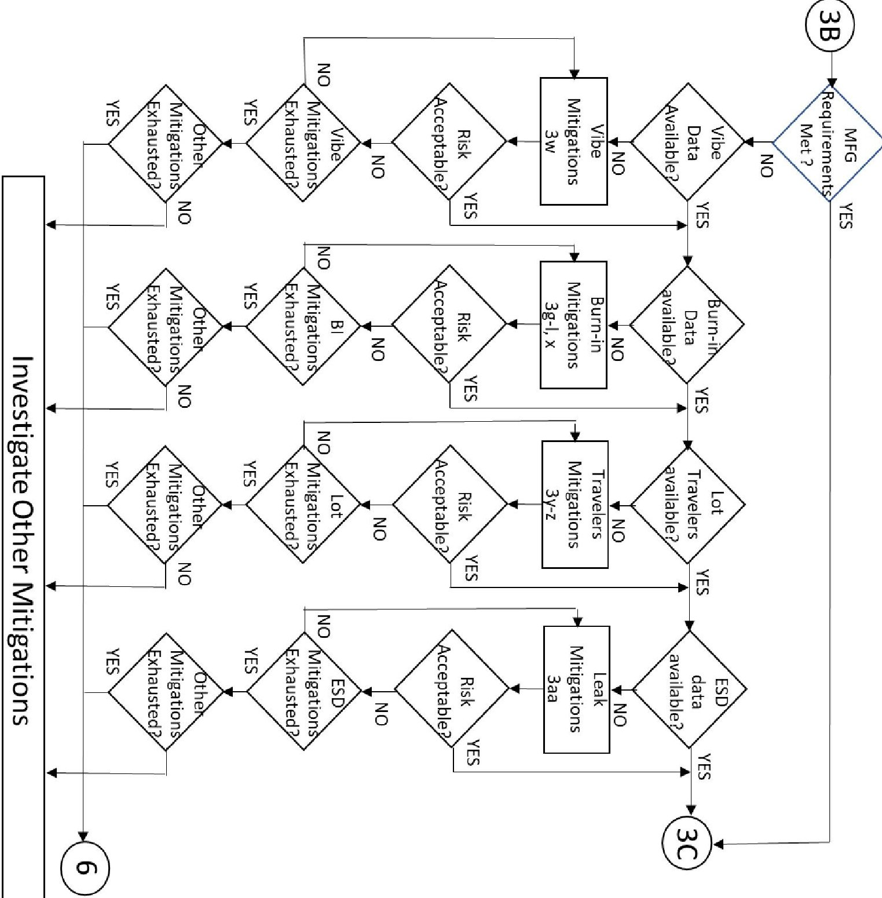

Figure 13. Manufacturing mitigation flow (3 of 8).

Figure 13 captures the manufacturing mitigations flow for vibration, Burn-in, lot traveler, and Electrostatic Discharge (ESD).

<!-- PDF_PAGE: 71 -->

## 5.2.3.9 Vibration

Vibration is experienced by a space vehicle during launch and ascent. Mitigation 3w discusses options for COTS components with no history of vibration testing.

## 5.2.3.9.1 Vibration Test the Component (3w)

Consider early vibration testing (procure component early (Pre-EM) and test. sensitivity to vibration is highly application dependent. Consider whether the component is powered or unpowered during vibration events. If the component is powered during the vibration event, it is recommended that the component be tested while powered and operating (and monitored). Component level vibration can be VERY different from unit level vibration input (depends on packaging). If component fails required vibration limits, does it matter to the program at the limit at which it failed? Determine the Pass/fail criteria before testing. Consider ordering extra FLT components and test each lot if suspect. Components to consider are relays (chatter and transfer), oscillators (frequency shift or failure), large ceramic caps (on flexible surface), hybrids (stiff substrate), large connectors without support (solder joints), leadless chip carriers (on flexible surface), BGA and CGA packages, and integrated circuits with large die. Potential solutions include conformal coat or other dampening under the component, softer board mounting, a more or less stiff board, change of unit or board orientation on the panel (change the input energy direction vs the component's sensitive axis), relocation on the panel, vehicle for less baseplate vibration input, or powering off the unit.

## 5.2.3.10 Burn-in

Many COTS components are not burn-in tested like Mil-Spec components. Burn-in typically weeds out infant mortal components. Burn-in testing is done to avoid installing, and then removing later and replacing, usually with schedule impact, a component. Mitigation 3x offers options for reducing the infant mortality failure risk that results in an integration return. $ ^{30} $

## 5.2.3.10.1.1 Perform Infant Mortality Testing (3x)

Accelerated testing (240 hours) at the component level is best as this greatly reduces the chances of installing a component that may fail during the integration cycle. Potential solutions include post procurement testing (probably static, although dynamic is better), board, or unit level test. Board and unit level testing may not be capable of accelerating the infant mortality fallout, so more hours at the board and unit level may be required prior to or including vehicle integration. 500+ hours is a good target, but much depends on the application junction temperatures. Consider trending key parameters of the COTS vs a nominal analysis. Consider using BOL limits for unit test limits. For shorter mission (<3 years) consider Board Level Screening (BLS) of thermal, electrical and dynamics (TED) to provide confidence of function over the entire test range (refer to COTS Card Unit Level Characterization Guidance). For longer duration programs, consider HALT/HAST (Highly Accelerated Life Test/Highly Accelerated Stress Test) testing. Also consider the number of hours of testing before there is confidence of passing the infant mortality period, which will be dependent on the component junction temperature in the application (vs the standard acceleration junction temperature) Some acceleration can be achieved at the board or unit level. Consider a key test point to allow monitoring of a key parameter (board or unit level) that may shift during the infant mortality period to allow trending. 11,12,16,20,21,25,30

<!-- PDF_PAGE: 72 -->

## 5.2.3.11 Lot Travelers

It is not expected that COTS component suppliers will allow Mil-Spec type inspection of the lot travelers. The lot travelers provide insight into the component build process and may be helpful for anomaly resolution. Mitigations 3y-z discuss options for obtaining lot traveler type information.

## 5.2.3.11.1 On-Site Inspection (3y)

Consider an on-site inspector or observer for the lot(s) procured (inspect as it is built). It can't hurt to ask and put an NDA inplace. $ ^{5} $

## 5.2.3.11.2 Early Non-Destructive and Destructive Tests (3z)

Consider performing early (as soon as part is baselined) destructive and non-destructive testing to understand supplier/part quality (consistent with program risk profile). Procuring additional components from the same source as intended for flight allows early testing and leverages the lower cost of COTS components. Refer to the relevant Mil-Spec for references on testing specifics for consideration. $ ^{2,3,16,21} $

## 5.2.3.12 Electro-Static Discharge

Components that are sensitive to ESD may fail prematurely due to damage (walking wounded) that is not immediately observable. If the ESD sensitivity is not known, mitigation 3aa discusses options for finding out a component's ESD sensitivity.

## 5.2.3.12.1 ESD Sensitivity Testing (3aa)

Consider investigating the ESD sensitivity of the chosen component. If it is very sensitive, does it require special handling? Will an ESD control plan be needed for the component? Consider ordering components early and testing or obtaining the supplier ESD assessment. ESD TM 3015 or ANSI/ESDA/JEDEC JS- 001 and ANSI/ESDA/JEDEC JS-002. Consider obtaining data for the same process as is used for the component chosen. Note that ESD damage can occur anywhere in the handling of the component (die level, component level during electrical test, shipping, and installation/assembly).

<!-- PDF_PAGE: 73 -->

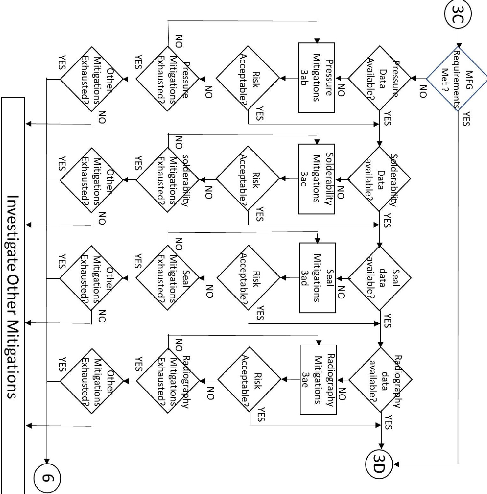

Figure 14. Manufacturing mitigation flow (4 of 8).

Figure 14 captures the manufacturing mitigations flow for barometric pressure, solderability, lid seal, and radiography.

<!-- PDF_PAGE: 74 -->

## 5.2.3.13 Barometric Pressure

Barometric pressure is either a high or low pressure applied to the component package. Typically, space components are subject to lower pressures (vacuum) but can also experience higher than atmospheric pressure during testing (positive air or dry nitrogen flow in thermal cycle or thermal vacuum testing). This test is typically not done by a supplier.

## 5.2.3.13.1 Pressure Test the Component (3ab)

This is a test of the component's ability to withstand low or high pressure. The test is best done at the component level. MIL-STD-202 or MIL-STD-883 method 1014.12 or 1001.

## 5.2.3.14 Solderability

Solderability is the ease of soldering the component to ensure the solder surface is not contaminated. It is expected tin will be the finish found for COTS components. Mitigation 3ac discusses solderability.

## 5.2.3.14.1 Test the Component for Solderability(3ac)

This test can best be done at the component level, post procurement, MIL-STD-883, method 2003. Negative results may require cleaning and re-tinning of the leads or other mitigations found in the pure tin mitigations section, 5.2.3.4, depending on the test findings.

## 5.2.3.15 Lid Seal

Lid seal is useful for large cavity components (hybrids, DC-DC converters) and is an indication of workmanship. Mitigation 3ad discusses options for components not tested for lid seal.

## 5.2.3.15.1 Test the Component for Lid Seal(3ad)

This test can be done at the component level, post procurement, DPA to determine the lid seal integrity. MIL-STD-883 method 1014. If the seal allows leakage, vacuum inside the package may allow small geometry features with bus voltage to become susceptible to arcing. Should a component fail lid seal, the potential options are to purchase multiple lots (and test for yield), encapsulate (conformal coat for fine leaks), or find a substitute component.

## 5.2.3.16 Radiography

Radiography is a non-destructive test used to detect cracks, de-lamination, or other flaws in workmanship in components. Mitigation 3ae discusses options for radiographic testing.

## 5.2.3.16.1 Radiographically Test the Component (3ae)

This inspection should be done at the component level, post procurement, but can be done at the board level. NDPA to determine the die attach and interconnect integrity. MIL-STD-883 method 2012. Options include purchasing early component and performing the inspection, procure multiple lots to achieve the required yield, or if the workmanship issues are pervasive, will the flaws compromise the mission, in which case a substitute component should be found. $ ^{30} $

<!-- PDF_PAGE: 75 -->

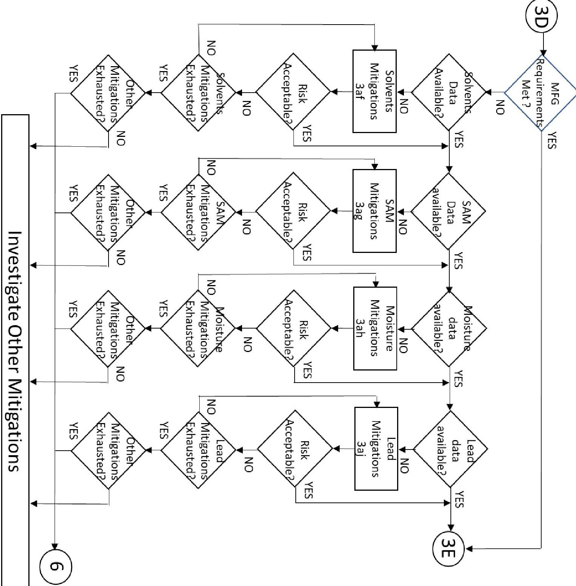

Figure 15. Manufacturing mitigation flow (5 of 8).

Figure 15 captures the manufacturing mitigations flow for resistance to solvents, Scanning Acoustic Microscopy (SAM), moisture resistance, and lead finish.

<!-- PDF_PAGE: 76 -->

## 5.2.3.17 Resistance to Solvents

Solvents are used during component installation and cleaning of the assemblies on which they reside. Resistance to solvents is necessary for the component to survive the board assembly process without affecting the function or appearance of the component. Failure of this test may indicate a counterfeit component. Mitigation 3af offers options for COTS components that have unknown resistance to solvents.

## 5.2.3.17.1 Test the Component for Resistance to Solvents(3af)

This test is best done at the component level, post procurement, but can be done on the board. Early NDPA is advised for components with no certification or history to determine if solvents will affect the component marking or function, using MIL-STD-883 Method 2015. Should a COTS component fail the resistance to solvents test, the options are to repackage the component, develop a manufacturing process to not use the solvent to which the component is sensitive, or find a substitute component.

## 5.2.3.18 Scanning Acoustic Microscopy

SAM testing is intended to detect and identify internal delamination, voids, material density changes, defects and many other anomalies within devices, assemblies and materials that may indicate defective material or workmanship issues. SAM testing is used for flipchips at the package level and should be considered for board level testing (solder joint integrity) for flipchips or WLCSP components. This test/inspection is advised for components with no traceability of the materials used in the component and failure of this test may indicate substandard materials, substandard workmanship or counterfeit components.

## 5.2.3.18.1 SAM Test the Component (3ag)

This test is best done at the component level, post procurement, with an early NDPA to determine the material and workmanship integrity, such as die attach, using MIL-STD-883 method 2030. Should a COTS component fail this test/inspection, multiple lots may be required to achieve the desired number of components, determine if there is inappropriate material used, determine if contamination present, and if the shortcomings will meet the mission need. If not, a substitute component is suggested.

## 5.2.3.19 Moisture

Moisture testing is intended to determine if the component is affected by moisture (humidity). This is important for the classic ceramic package but even more so for the plastic package components. Mitigation 3ah discussions options for components that may be sensitive to moisture.

## 5.2.3.19.1 Moisture Test the Component (3ah)

This test should be done at the component level, post procurement, DPA to determine resistance to moisture exposure, using MIL-STD-883 method 1004. Depending on how the component is sensitive to moisture, there are several options for mitigation. For ceramic packages, conformal coating may be sufficient for the mission. Other options are very carefully controlled environment (package level, kit level, board level) to limit exposure to moisture. Multiple bakeouts may be required. For plastic packages, refer to JEDEC 6294/1/3 for guidance.

<!-- PDF_PAGE: 77 -->

## 5.2.3.20 Lead Finish

Lead finish is helpful to understand the lead material to withstand the vibration fatigue and if any areas of the lead are susceptible to flaking or corrosion. This test is suggested for components without lead finish information or vibration testing when soldered to a board. Poor lead finish test results may indicate substandard materials, poor workmanship, contamination, or counterfeit components. Mitigation 3aj discussion potential options for components that fail lead finish testing.

## 5.2.3.20.1 Test the Component for Lead Finish (3aj)

This test is best done at the component level, post procurement, DPA to determine the lead integrity, using MIL-STD-883 method 2004. For components that have poor lead finish test performance, options are to soften the vibration or thermal cycling environment for the component, add component staking, add dampening under the component, or find a substitute component. For components that have electroless nickel underplated leads that may be required to be formed, bent or vibrate, consider a substitute package or component.

<!-- PDF_PAGE: 78 -->

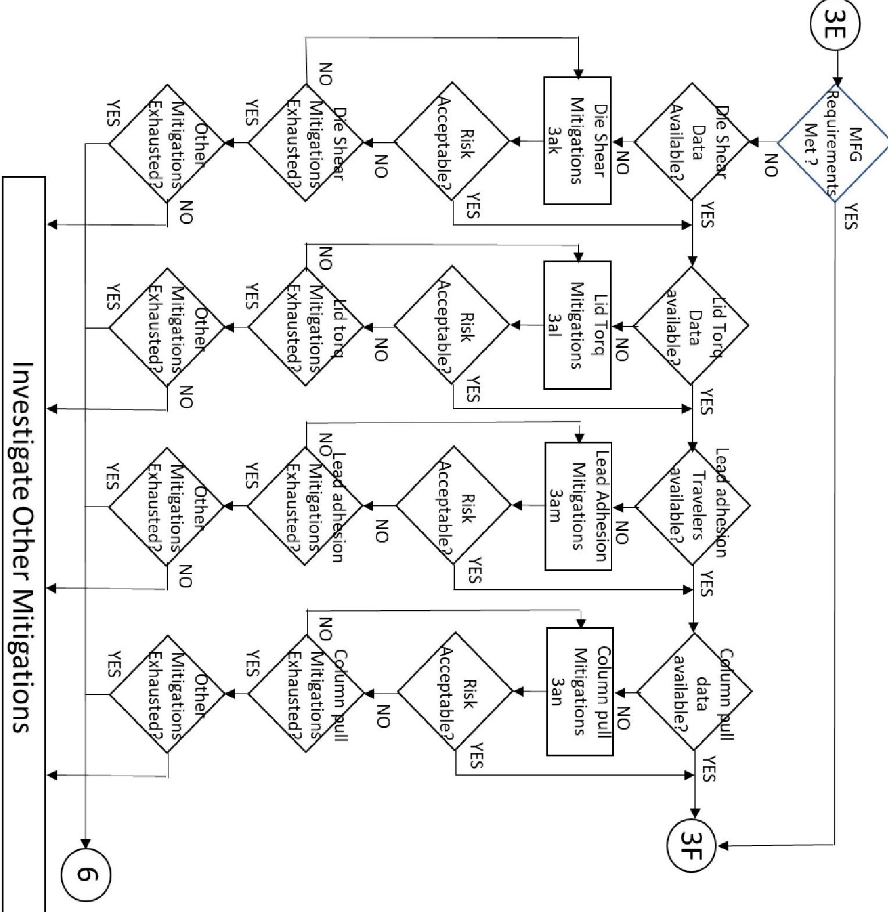

Figure 16. Manufacturing mitigation flow (6 of 8).

Figure 16 captures the manufacturing mitigations flow for die shear, lid torque, lead adhesion, and column pull.

<!-- PDF_PAGE: 79 -->

## 5.2.3.21 Die Shear

Die shear testing is used to determine the integrity of the die adhesion for a semiconductor or for surface mounted passive elements. It is helpful to understand the workmanship quality and materials used. Failure of the die shear test may indicate poor workmanship, poor materials, poor process control, or counterfeit components. Mitigation 3ak discussion potential options for components that fail die shear testing.

## 5.2.3.21.1 Die Shear Test the Component (3ak)

This test is best done at the component level, post procurement, DPA to determine the die attach and interconnect integrity. It is suggested that if this test is desired, to perform it early, using MIL-STD-883 method 2019. Should a component fail die shear testing, are the materials suitable for them mission? Was there voiding? Consider designing a more benign vibration or shock environment for the component, having the die packaged by a different supplier, or find a substitute component.

## 5.2.3.22 Lid Torque

Lid torque testing is used to determine the integrity of the lid adhesion for a semiconductor. It is helpful to understand the workmanship quality and materials used. Failure of the lid torque test may indicate poor workmanship, poor materials, poor process control, or counterfeit components. Mitigation 3al discussion potential options for components that fail lid torque testing.

## 5.2.3.22.1 Lid Torque Test the Component (3al)

This test is best done at the component level, post procurement, DPA to determine the lid adhesion to the package. It is suggested that if this test is desired, to perform it early, using MIL-STD-883 method 2024. Should a component fail lid torque testing, are the materials suitable for them mission? Was there voiding? Consider having the die packaged by a different supplier or find a substitute component.

## 5.2.3.23 Lead Adhesion

The lead adhesion test is used to determine the quality of the lead materials This test is suggested for components without lead adhesion information. Poor lead adhesion test results may indicate substandard materials, poor workmanship, contamination, or counterfeit components. Mitigation 3am discussion potential options for components that fail lead finish testing.

## 5.2.3.23.1 Test the Component for Lead Adhesion(3am)

This test is best done at the component level, post procurement, DPA to determine the lead finish adhesion. It is suggested that if this test is desired, to perform it early, using MIL-STD-883 method 2025. For components that have poor lead adhesion test performance, options are to repackage the die in another package, perhaps with a different supplier, or find a substitute component.

## 5.2.3.24 Column Pull

Column pull is similar to bondpull test, but for CGA and BGA packages. The column pull tests the column bond to package pad strength to determine if there is good adhesion of the column bond and pad. Poor column pull results may indicate contamination which may affect reliability. There is also a test for flipchip packages, which is a pull-off test. Mitigation 3an discusses column pull options.

<!-- PDF_PAGE: 80 -->

## 5.2.3.24.1 Pull Test the Component (3an)

This test can only be done at the component level, post procurement. Consider early column pull testing (procure component early (Pre-EM)) and DPA to determine the column strength using MIL-STD-883 method 2038. If the column pull test fails, does it matter to the program at the limit at which it failed? Determine the pass/fail criteria. For flipchip packages, the purpose of the test is to test the strength of the internal bonds between the die and the substrate using MIL-STD-883 method 2031.1 Consider ordering extra flight components and test each lot if suspect. Consider packaging the die in a package from a different source.

<!-- PDF_PAGE: 81 -->

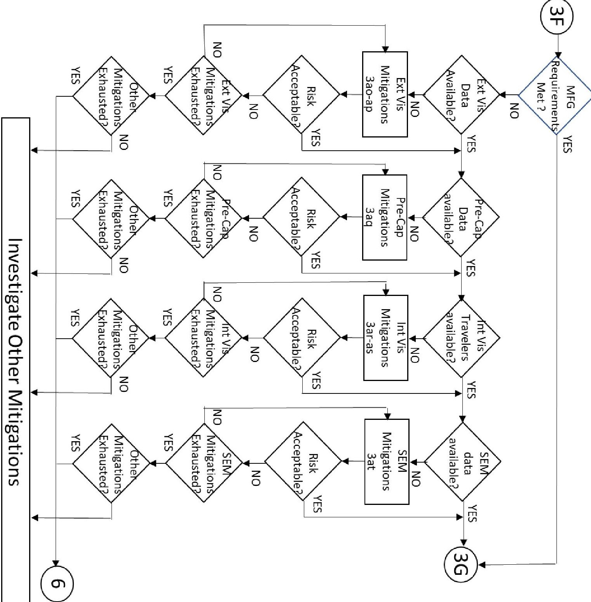

Figure 17. Manufacturing mitigation flow (7 of 8).

Figure 17 captures the manufacturing mitigations flow for external visual, pre-cap inspection, internal visual, and Scanning Electron Microscopy (SEM).

<!-- PDF_PAGE: 82 -->

## 5.2.3.25 External Visual

External visual is gross assessment of the packaged component. Failure of the external visual inspection may indicate substandard material, defects, poor handling, or counterfeit components.

## 5.2.3.25.1 On-Site Inspection or Observation (3ao)

If the supplier will allow it, consider an on-site inspector or observer for the lot(s) procured (inspect as it is built). $ ^{5} $ The supplier may have evidence of automated optical or graphical inspection that may suffice.

## 5.2.3.25.2 External Visual post Component Receipt (3ap)

This test can be done at the component level, post procurement or the board level. NDPA to inspect the component externally using MIL-STD-883 method 2009. Should a component fail external visual, it greatly depends on what was discrepant and impact to the program, which may be to procure another lot or find a substitute component.

## 5.2.3.26 Pre-Cap Inspection

Pre-Cap inspection is a visual check for component workmanship and cleanliness prior to lid seal. It is expected this inspection may be asked of new suppliers of commercial components and be turned down.

## 5.2.3.26.1 On-Site Inspection or Observation (3aq)

If the supplier will allow it, consider an on-site inspector or observer for the lot(s) procured (inspect as it is built). $ ^{5} $ The supplier may have evidence of automated graphical inspection that may suffice. If the supplier will not allow on-site inspection or observation, consider de-lid and internal inspection, post procurement (refer to 5.2.3.27.2).

## 5.2.3.27 Internal Visual

Internal visual is an assessment of the packaged component. Failure of the internal visual inspection may indicate substandard material, defects, poor handling, or counterfeit components.

## 5.2.3.27.1 On-Site Inspection or Observation (3ar)

If the supplier will allow it, consider an on-site inspector or observer for the lot(s) procured (inspect as it is built). $ ^{5} $ The supplier may have evidence of automated optical or graphical inspection that may suffice.

## 5.2.3.27.2 De-Lid and Inspect Component (3as)

Consider de-lidding the component and inspecting visually, using MIL-STD-883 method 2010. Should a component fail internal visual, it greatly depends on what was discrepant and impact to the program, which may be to procure another lot or find a substitute component.

## 5.2.3.28 Scanning Electron Microscopy

SEM is used for detecting defects in material, either on the surface or within the material. Failure of the SEM analysis may indicate poor workmanship, defective material, or counterfeit components. Mitigations for SEM component negative results are shown in mitigation 3at.

<!-- PDF_PAGE: 83 -->

## 5.2.3.28.1 SEM Test the Component (3at)

This test is best done at the component level, post procurement. It is recommended to perform this DPA SEM analysis of the component early using MIL-STD-883 method 2018. Should a component fail the SEM analysis, the options are to use another lot, use material from a different source, or find a substitute component or supplier.

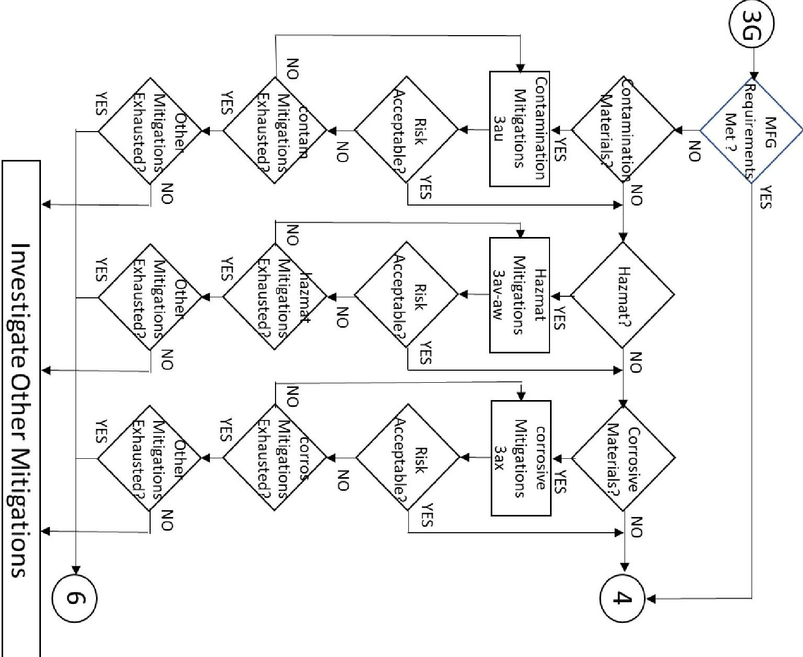

Figure 18. Manufacturing mitigation flow (8 of 8).

Figure 18 captures the manufacturing mitigations flow for contamination, hazardous materials, and corrosive materials.

<!-- PDF_PAGE: 84 -->

## 5.2.3.29 Contamination

Contamination is any unwanted or unintended substance on or in the component. Contamination can come from many sources, with the usual mitigation to be removal of the contamination source. This ATR assumes the contamination source is the COTs component itself and how mitigate the effects. Mitigation 3au describes the options when the contamination source is the introduced COTs component.

## 5.2.3.29.1 Existing Mitigations (3au)

Consider mitigations already mentioned in this ATR. Mitigation 3a is plastic packaging encapsulation. The idea here is simple encapsulation may be enough, depending on the mission needs. Mitigation 3c is repackaging the component. This could also apply to a unit to contain the contaminating material. Mitigation 3m is the simplest form of encapsulation: a double layer of conformal coat. Mitigation 5n is a vehicle or subsystem level mitigation where a shield is used to protect sensitive surfaces (covered to provide time for the contamination to outgas and disperse).

## 5.2.3.30 Hazardous materials

Hazardous materials are substances that may harm humans. Mitigations 3av-aw discuss options for working with COTS components that contain hazardous materials.

## 5.2.3.30.1 Existing Mitigations (3av)

Consider mitigations already mentioned in this ATR. Mitigation 3c is repackaging the component. This could also apply to a unit to contain the contaminating material. Mitigation 5au (see above).

## 5.2.3.30.2 Handling (aw)

Special handling may be required to use a component (or unit) that contains hazardous materials.

## 5.2.3.31 Corrosive Materials

## 5.2.3.31.1 Separation of Functions/Containment (3ax)

Corrosive materials the substances that may react with other materials, including human tissue.

It is not recommended for a component (or unit) on a space vehicle to contain corrosive materials. If the program must use components with corrosive materials, consider separating that function physically from any health and safety related equipment (vehicle bus functions). One way to do this is to contain the unit is a separate enclosure, away from other units. The component with corrosive material should also not be in an electrical path for vehicle health and safety.

## 5.2.4 Trust

The intent of the trust flow is to understand the scope of the knowledge needed to assess the trust aspects of the COTS component that may need mitigation. The trust section covers foreign sourced, foreign national processed and heritage usage. The KEY aspect of the trust section is to prevent technology transfer to a foreign entity, either through the component itself (added functions) or through knowledge transfer via the processing personnel, and to establish confidence that the component will do what it is supposed to do and nothing else. Figure 19 shows the trust mitigations flow. Table 23 shows the potential trust mitigations.

<!-- PDF_PAGE: 85 -->

Table 23. Potential Trust Mitigations

<table border="1"><tr><td>Mitigation</td><td>Trust</td></tr><tr><td></td><td>Foreign Sourced</td></tr><tr><td>4a</td><td>Review for unexpected internal structures, do not use if found</td></tr><tr><td>4b</td><td>Redundant design with alternate component</td></tr><tr><td>4c</td><td>Limit usage in S/C health and safety, link, and security functions</td></tr><tr><td>4d</td><td>Consider using a blind trusted agent for component purchase</td></tr><tr><td>4e</td><td>Perform independent verification and validation for critical functions</td></tr><tr><td></td><td>Heritage</td></tr><tr><td>4f</td><td>Counterfeit components</td></tr></table>

<!-- PDF_PAGE: 86 -->

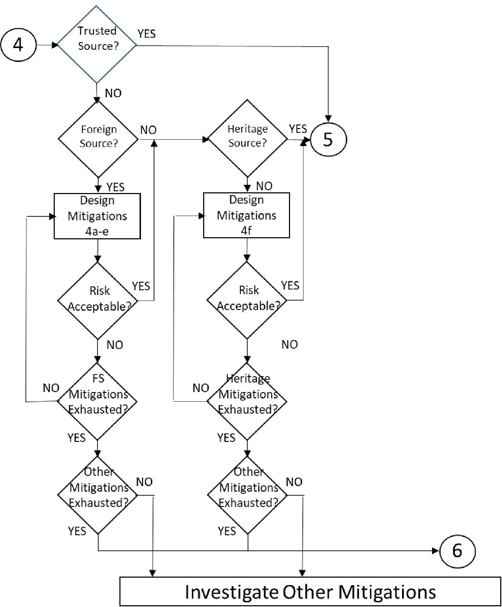

Figure 19. Trust mitigations flow.

<!-- PDF_PAGE: 87 -->

## 5.2.4.1 Foreign Sourced

Foreign sourced components should have extra scrutiny if used for US military space usage. If a program selects a foreign sourced component, there are several mitigations found in mitigations 4a-e.

## 5.2.4.1.1 Review of component (4a)

If a visual analysis is performed, are there any structures that are non-standard or odd in their placement? Potential supply chain issue. $ ^{21} $

## 5.2.4.1.2 Alternate Design (4b)

Consider a design that uses a Mil-Spec component as a backup or an alternate COTS if the first selection is high risk (many mitigations required, time prohibitive mitigations required, costly mitigations required, or foreign national personnel involved in processing the component) $ ^{5} $

## 5.2.4.1.3 Limit Usage in System Design (4c)

If the COTS component is used in a mission critical application or one that may be a single point of failure (single string) consider additional mitigations such as very conservative derating, derated voltage, conservative junction temperature, derated clock speed, or a backup alternate path in the design $ ^{5,21} $

## 5.2.4.1.4 Blind Trusted Agent Buy (4d)

For components that may result in information transfer, such as intent of the product by the user, operational security concerns raised by the purchasing the component, or identification of personnel, consider the use of a blind, trusted agent to make the purchase.

## 5.2.4.1.5 Independent Verification and Validation for Critical Functions (4e)

For components that are in critical functions, consider an independent verification and validation program to provide evidence that the component does what it is supposed to - and nothing else.

## 5.2.4.2 Heritage

Usage of COTS components from known sources will limit the exposure to counterfeit components. Mitigation 4f provides an option for components that lack heritage with the space community.

## 5.2.4.2.1 Counterfeit Components (4f)

Procure only from authorized sources or require adherence to AS5553. Inspect carefully if procured from a third-party broker. $ ^{5,16,21} $

<!-- PDF_PAGE: 88 -->

## 5.2.5 Environmental Considerations

The intent of the environmental considerations flow is to understand the scope of the knowledge needed to assess the environmental aspects of the COTS component that may need mitigation. The environmental section covers aging, temperature, and vacuum. Figure 20 shows the environmental mitigations flow. Table 24 shows the potential environmental mitigations.

Table 24. Potential Environmental Considerations Mitigations

<table border="1"><tr><td>Mitigation</td><td>Environmental</td></tr><tr><td colspan="2">Aging</td></tr><tr><td>5a</td><td>Multiple components in parallel</td></tr><tr><td>5b</td><td>Conservative Derating</td></tr><tr><td>5c</td><td>Conservative Thermal Environment</td></tr><tr><td>5d</td><td>Dynamic Reliability Management</td></tr><tr><td>5e</td><td>Adaptive/Static Voltage Scaling</td></tr><tr><td colspan="2">Temperature</td></tr><tr><td>5f</td><td>Local Heatpipes</td></tr><tr><td>5g</td><td>Lower Supply Voltages</td></tr><tr><td>5h</td><td>Decreased frequency</td></tr><tr><td colspan="2">Vacuum</td></tr><tr><td>5j</td><td>Conservative Derating</td></tr><tr><td>5k</td><td>Increased physical spacing</td></tr><tr><td>5l</td><td>No "golden nodes"</td></tr><tr><td>5m</td><td>Encapsulation</td></tr><tr><td>5n</td><td>Deployable covers for optics</td></tr><tr><td>5o</td><td>Unit Thermal Vacuum test</td></tr><tr><td colspan="2">EMC/EMI</td></tr><tr><td>5p</td><td>Shielding</td></tr><tr><td>5q</td><td>Grounding</td></tr><tr><td>5r</td><td>Power strobing</td></tr></table>

<!-- PDF_PAGE: 89 -->

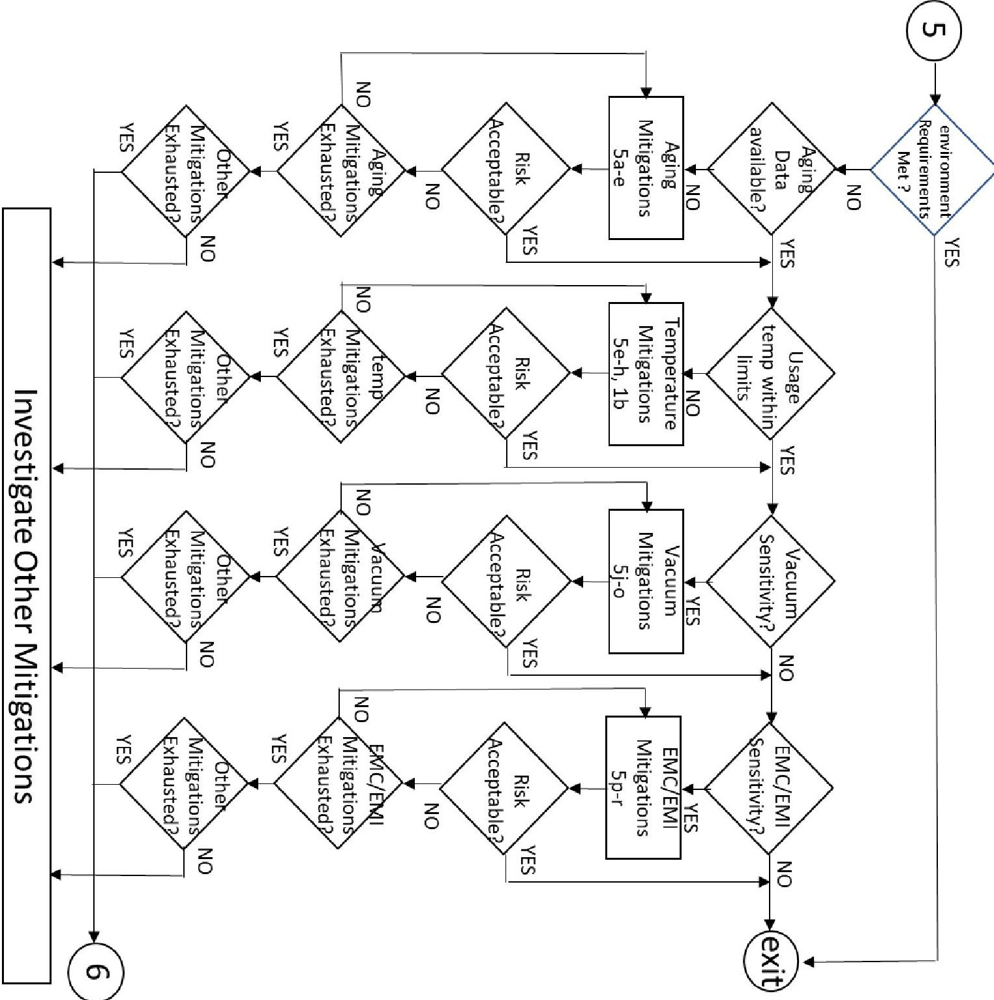

Figure 20. Environmental mitigations flow.

<!-- PDF_PAGE: 90 -->

## 5.2.5.1 Aging

Aging, which is the effects of time in an environment (including radiation) may reduce the useful life of a component in the application. There are multiple mitigations, found in mitigations 5a-e, that discuss potential solutions. The key is knowing what and by how much the aging affects the component. Testing may be required.

## 5.2.5.1.1 Multiple Components in Parallel (5a)

This approach uses multiple components in circuit, one powered and active, others powered off and inactive. When the active component fails (radiation for example) the next unpowered component can be used to resume the function. A potential mitigation for the usage of COTS ADC components is to architect the board to use multiple ADCs, buffered from one another. When one has degraded to the point of no longer being acceptable, a new one can be switched in without the overhead of an entire board. For example, put three ADCs in parallel, each buffered (input and output) and on a separate power switch, with each feeding the common digital interface. FSW may be used to select the next component in the string to minimize impact to the mission. $ ^{2,3,8,24} $

## 5.2.5.1.2 Conservative De-rating (5b)

COTS processors and memory components can benefit from conservative frequency and voltage application relative to their rated limits to control the junction temperature (lower junction temperature = more useful life). A relatively new component also sensitive to vacuum is the polymer tantalum capacitor (PTC). Mitigation for the PTC is the conservative application of applied voltage relative to its voltage rating. $ ^{3,4,5,9,23} $

## 5.2.5.1.3 Conservative Thermal Environment (5c)

The ability to maintain junction temperatures within specification is KEY to component reliability, useful life, and performance. Thermal design assumptions based on worst case power dissipations will not always prove enough margin (since many COTS components have reduced (from Mil-Spec) maximum junction temperature requirements). Some components have internal temperature controls (processors). Consider a conservative thermal limit to allow usage consistent with the program need or more thermal sensors for more precise thermal knowledge and control. $ ^{1,9} $

## 5.2.5.1.4 Dynamic Reliability Management (5d)

Modern day Personal Computers (PCs) use dynamic reliability management (lowers frequency to reduce junction temperature). For a PC with non-realtime processing requirements, that is acceptable. For space REALTIME computing, not only would an upper limit need to be set (to limit the component's junction temperature, but also a LOWER limit to not break the processing cycle demands. Not completing tasks for a real-time system can mean loss of the system (a design issue). Consider dynamic management of the frequency (junction temperature -> reliability/useful life) very carefully. Some components may not allow setting a higher limit if the junction temperature exceeds its programmed limit (not user controlled). It is NOT recommended to use "overclocking" for high reliability or real-time applications. $ ^{13,18,19} $

## 5.2.5.1.5 Adaptive/Static Voltage Scaling (5e)

It may be necessary to limit the supply voltage to the component to limit the power dissipation. For CMOS, typically, the higher the voltage, the higher the power dissipation. The supply voltage can be limited through the design of the supply (fixed), through adaptive voltage management (circuit to sense

<!-- PDF_PAGE: 91 -->

the component rising temperature feeds back to the supply to decrease the voltage, or increasing voltage as the component ages) $ ^{13,14,15,18,19,20,24} $

## 5.2.5.2 Temperature

The effect of temperature affects both useful life of the component, but also its' parametric performance. Mitigations 5f-h discuss options for temperature effects.

## 5.2.5.2.1 Local Heatpipes (5f)

Local heatpipes (heatpipes connected to the COTS package) to remove heat are effective but difficult to install and more importantly, difficult to rework, for components like FPGAs, ASICs, processors, microcontrollers, or any high-density integrated circuit to manage the junction temperature. Typically, a local heatpipe will more efficiently transfer the component heat to the internal rail of the unit instead of heat transfer through the PWB to the internal rail. $ ^{24} $

## 5.2.5.2.2 Lower Supply Voltages (5g)

It may be necessary to limit the supply voltage to the component to limit the power dissipation. For CMOS, typically, the higher the voltage, the higher the power dissipation. The supply voltage can be limited through the design of the supply. $ ^{14,19,24} $

## 5.2.5.2.3 Decreased Frequency (5h)

Decreasing the operational frequency for CMOS components will reduce the power dissipation. Usage of decreased frequency must be used with great care: processors in space vehicles are performing real-time tasks and anything that slows down processing that violates the processing period can result in loss of data, loss of vehicle function (temporary), or in the case of the space craft control computer, loss of vehicle. $ ^{24} $

## 5.2.5.3 Vacuum

The effect of vacuum affects both useful life of the component, but also its parametric performance. Mitigations 5j-o discuss options for vacuum effects.

## 5.2.5.3.1 Conservative Derating (5j)

Conservative derating can be used to use COTS components that are sensitive to vacuum (RF components). A relatively new component also sensitive to vacuum is the polymer tantalum capacitor (PTC). Mitigation for the PTC is the conservative application of applied voltage relative to its voltage rating. $ ^{24} $

## 5.2.5.3.2 Increased Physical Spacing (5k)

Usage of COTS components in a vacuum may require additional spacing due to voltage gradients and non-traditional packaging that may poorly inhibit arcing (voltages above 12V) Another potentially vacuum-sensitive feature is physical separation (often applicable for power supplies). Small separation distances in a circuit that are acceptable at ambient pressure may be vulnerable in a vacuum due to plasma arcing (tin whiskers from COTS components). Separation of prime and redundant assemblies (physical barrier) may also apply. $ ^{24} $

<!-- PDF_PAGE: 92 -->

## 5.2.5.3.3 No "Golden" Nodes (5l)

It is recommended that a COTS component NOT be part of any "golden nodes" (nodes where there is no redundancy) due to non-hermeticity of the high voltage package (like a non-hermetically sealed FLASH memory, depending on the internal programming voltage) or a single signal trace. $ ^{24,26} $

## 5.2.5.3.4 Encapsulation (5m)

Due to the packaging type used for the COTS component, it may be necessary to encapsulate the component to mitigate vacuum effects. Plastic components are known to outgas contaminants from the plastic. While this may not be an issue for the component itself, the contaminants may coat the surfaces of the vehicle's optics (telescopes, star-trackers, and laser communication interfaces). Encapsulation is a component level mitigation. $ ^{24} $

## 5.2.5.3.5 Deployable Covers for Optics (5n)

An architectural mitigation is to have deployable covers for all sensitive optics that are opened well after the contaminants have dispersed away from the vehicle, which may take some time (days to weeks) and adds complexity to the overall vehicle (more equipment, fault management, and CONOPS). $ ^{24} $

## 5.2.5.3.6 Unit Thermal Vacuum Test (50)

An effective way to ensure the COTS component will function as intended is to perform a unit level thermal vacuum test for units that have vacuum sensitive COTS components or small thermal margins. $ ^{21} $

## 5.2.5.4 EMC/EMI

Usage of COTS components in an electromagnetic environment may affect their function or their useful life. Components such as MRAMs may be affected by EMC/EMI. Mitigations 5p-r discuss options for sensitive components.

## 5.2.5.4.1 Shielding (5p)

One way to protect a component or unit is to provide an external shield (a Faraday cage) to prevent electromagnetic charge buildup near the component.

## 5.2.5.4.2 Grounding (5q)

Another way to protect a component or unit is to provide a good ground to the package or the unit enclosure.

## 5.2.5.4.3 Power Strobing - Filtering (5r)

A way to minimize the effects of EMI on a component is to leave it powered off except when used. In the case of memories (like MRAM, EEPROM, FLASH), program refresh should be done in light electromagnetic activity. Filtering may be an option for components (or units) that have bus power inputs to operate with typical space vehicle bus transients.

<!-- PDF_PAGE: 93 -->

## 6. Flow Usage Examples

Three examples of how to use the mitigation flows for real world COTS component issues are detailed below. These are intended as an aid for navigating the mitigation flow and detailed mitigations, using the examples discussed early in Section 5.

## 6.1 COTS Example 1 On Board Computer Controller (OBCC) ~1988

Using the flow in Figure 6, the L65400 1750A processor required SEU mitigations. Referring to Figure 21, this shows the mitigations in the flow that were used to completely mitigate the poor SEU performance. The first pass was to implement the 1g mitigation (periodic refresh period). This by itself was insufficient, as the internal registers of the processor may contain incorrect values. A second pass through the logic used additional mitigations. The additional mitigations that were investigated were SEFI mitigations and two of the mitigations were implemented, 1n (local refresh) and 1o (component reset) to fully address the processor SEU performance and its potential implications on the system. These three mitigations were not enough as the state machines that govern activity on the bus and internal pipeline operations are not reset. To monitor those functions, a watchdog timer (WDT) was used (10). It was required that the OBC send a command through the OBCC to another unit to reset the WDT. If the WDT was not reset, the monitoring unit would swap the OBCC. As a result of these mitigations, there were impacts to other subsystems (FSW, telemetry formats) on the vehicle to implement the mitigations. These impacts to other subsystems should be investigated early to fully capture the scope of the COTS component mitigations. In addition to the mitigations shown, multiple best practices from Table 2 were also considered: numbers 3, 31, 32, 33, 35, 43, and 55.

<!-- PDF_PAGE: 94 -->

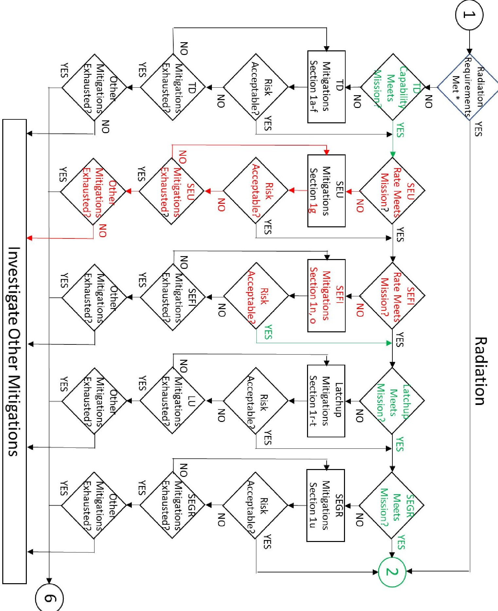

Figure 21. OBCC processor SEU mitigation example.

<!-- PDF_PAGE: 95 -->

## 6.2 COTS Example 2 Various programs - EEPROM usage ~2003

Using the flow in Figure 6, the EEPROM required multiple mitigations. Referring to Figure 22, this figure shows the mitigations in the flow that were used to completely mitigate the multiple EEPROM issues. While there was a total dose issue with the EEPROM, the use of shielding was marginal (height of the component limited the shielding thickness), so power strobing was used (mitigation 1b) to increase the TD performance, the EEPROM when powered OFF was much more TD tolerant. The power ON/OFF circuit to the EEPROM must also control the RES input during power ON/OFF to less than 0.25V. Most reset circuits needed to be modified to accommodate this constraint. Since this component is non-volatile, there is a data retention period to observe. Little is known about the fabrication details from Hitachi (Hitachi sold the die, then stopped supporting the die). Given the 20-year stated datasheet retention, with no process details, many contractors were conservative with specifying a period to perform an on-orbit refresh, anywhere from 5 to 10 years, depending on the application (mitigation 1g). Another mitigation used for the EEPROM was at the board/Flight SoftWare (FSW) level by programming multiple images into the EEPROM, so that if one was corrupted, another image (the same content) could be used (mitigation 1e). The SBC had Error Detection and Correction (EDAC), so a single bit error was corrected when read by the processor, but not in EEPROM. A swap was initiated if multiple locations showed Single Bit Errors (SBEs). This is mitigation 1s. In addition to the mitigations shown, multiple best practices from Table 2 were also considered: numbers 3, 8, 10, 20, 31, 32, 33, and 55.

<!-- PDF_PAGE: 96 -->

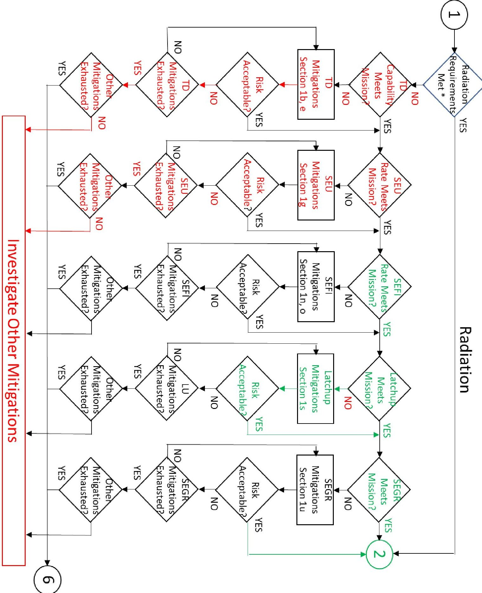

Figure 22. EEPROM mitigation example.

<!-- PDF_PAGE: 97 -->

## 6.3 COTS Example 3 Computer and Data Electronics (CDE)

The CDE had several Power On reset requirements that required both the 3.3V and 5V rails to be monitored. During power up, the POR circuit was required to provide a delay to allow the oscillator to guaranteed to be oscillating (10 ms following voltage stability), Hold off the reset until all voltage were stable, and provide a very low output reset signal to the EEPROM RES input, and be able to function at voltage where the IO components may start to conduct (due to a requirement for the unit to not be able to glitch the command output signals or potentially send a false command to the vehicle. A low voltage LM139A was chosen. The datasheet from National Semiconductor stated that their LM139A was designed to work down to 2V VCC. This feature was not tested by National Semiconductor, but the datasheet stated VCC minimum was 2V. The tested VCC minimum was +5V. Components were purchased and tested in house for VCC performance. Radiation testing showed the LM139A to be sensitive to TD radiation (failed the program's 2X radiation requirement). The was the path to mitigation 1a, shown in Figure 23. Components from this lot were selected and installed into an evaluation board to characterize the component's performance. This was the path to mitigation 3h shown in Figure 24. More iterations through the flowchart were required to satisfy the engineer of the component's performance in the application. The board design was modified to provide a test point at board level to assess the POR performance during board testing (engineering model and flight). This was the 3j path through the flow. The final mitigation to ensure the design was not degrading through both EM and flight unit testing was mitigation 3k. In addition to the mitigations shown, multiple best practices from Table 2 were also considered: numbers 3, 8, 10, 20, 31, 32, 33, 34, 37, and 55. Component specific best practices were also considered from Table 12, numbers 2 and 3.

<!-- PDF_PAGE: 98 -->

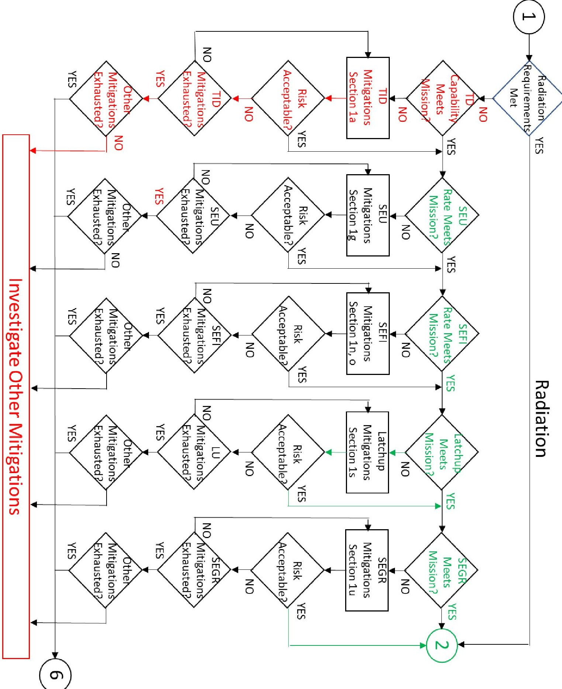

Figure 23. Example 3 flow example (1 of 2).

<!-- PDF_PAGE: 99 -->

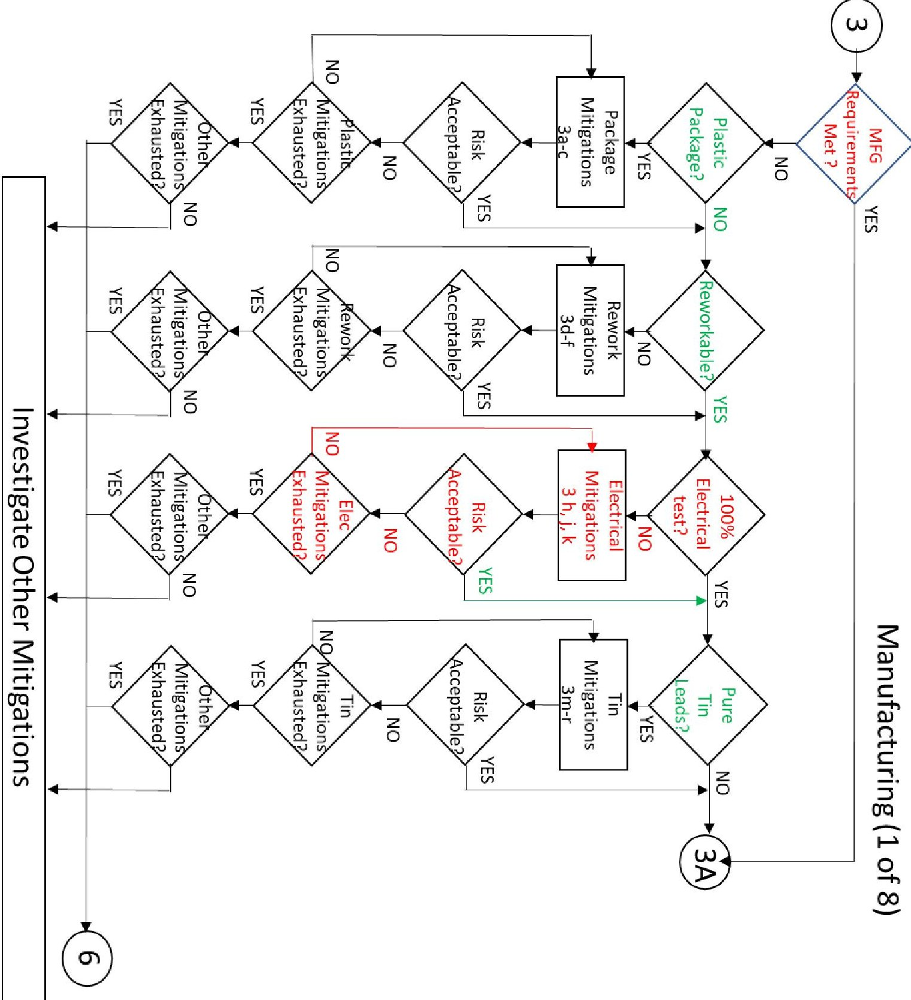

Figure 24. Example 3 flow example (2 of 2).

<!-- PDF_PAGE: 100 -->

## 7. References

1. Calvelli, F, Three Years or less From Contract Start to Launch - A Simple Formula to go Fast in Space Acquisition, April 2023

2. NESC-RP-19-01490 Recommendations on Use of COTS Guidance for NASA Missions Phase II (11-10-22 NRB) RP FINAL (002)

3. Yarbrough, A., "Got Reliability? Off the Shelf Parts for Resilient Space," OTR-2019-00058, The Aerospace Corporation, April 2019

4. OTR-2019-01255-A-Quick-Reference-Sheet-for-Risk-Tolerant-Space-Missions-Using-Alternate Grade-Electronics

5. OTR-2017-00845 - Key Questions to Ask When Considering Alternate-Grade EEE (Electrical, Electronic and Electromechanical) Parts for Small Satellite Missions

6. Braun, B., "A Class Agnostic Mission Assurance Approach," TOR-2021-00133, The Aerospace Corporation, January 2021

7. Yarbrough, A., "E.P.I.C. (Enterprise, Partnerships, Innovation, Culture) Speed Electronics: A Pre-RFP Application Guide for Alternate-Grade Electronics in Small Satellites and Resilient Systems," TOR-2020-01447, The Aerospace Corporation, September 2020

8. Leitner, J., "Some not-so-intuitive lessons from key on-orbit failures and anomalies since 2005," NASA, May 2021

9. Leitner, J., "Assurance of electronic parts for aerospace system reliability: Past, present, and future," Quality Engineering, DOI: 10.1080/08982112.2021.2021423, January 2022

10. Yarbrough, A., "Alternate Grade Electronics-Based Card, Slice and Unit Level Characterization Considerations -Decision Flow Concept," OTR-2022-00670, The Aerospace Corporation, April 2022.

11. Yarbrough, A., "PMPedia: A Crowd-Sourced Alternate-Grade Electronics Space Radiation Knowledge Repository," OTR-2020-00038, The Aerospace Corporation, November 2019, https://pmpedia.space/

12. Hogan, S., "Effective Fault Management Guidelines," TOR-2009(8591)-14, The Aerospace Corporation, June 2009.

13. K. Boughton, "The Truth About Processor "Degradation," Anandtech Online Journal. March 5, 2008, https://www.anandtech.com/show/2468/6

14. Jyothi B. Velamala, "Statistical Aging under Dynamic Voltage Scaling," Proceedings of the IEEE 2012 Custom Integrated Circuits Conference, 2012

15. "Prediction of NBTI Degradation in Dynamic," IEEE TRANSACTIONS ON DEVICE AND MATERIALS RELIABILITY, 2016.

16. NASA recommendation on the use of COTS NASA-TM-20205011579

17. Managing Commercial-Off-the-Shelf (COTS) - Based Space Hardware Risk (Aerospace Corp OTR 2023-00559)

18. M. Chen, "Aging sensors for workload centric guardbanding in dynamic voltage scaling applications," 2013 IEEE International Reliability Physics Symposium IRPS, pp. pp. 4A.2.1- 4A.2.5, 2013

19. D. Roberts, "Error analysis for the support of robust voltage scaling," Sixth international symposium on quality electronic design, pp. 65-70, 2005

20. A. Yarborough, "COTS Card Unit Level Characterization Guidance" 2023

21. TOR-2021-02290_FAQs when Considering COTS

22. Y. Masuda, "MTTF-aware design methodology for adaptive voltage scaling," 2018 China Semiconductor Technology International Conference (CSTIC), pp. 1-4, 2018

23. OTR-2023-00627 - Design Integrity Guidelines (DIG) for Alternate Grade Parts (AGP) in Space Power Electronics

<!-- PDF_PAGE: 101 -->

24. ATM-2023-02205 COTS in Space

25. HALT-Test-For-New-Reliability-Approach-In-New-Space

26. TOR-2018-00616 - Separation and Isolation Guidelines for Printed Wiring Boards Intended for Space Use

27. Tin Whisker Mitigation Methods

28. P. Lavery, Strategies to mitigate the tin whisker phenomenon, Vicor

29. Dakai Chen, "Radiation Qualification of Flash Memories" NEPP Electronic Technology Workshop, June 11-12, 2013

30. J. Ranaudo, OTR-2021-01017 - Traditional Parts Policy as it Relates to the Selection of EEEE Parts for Space, August 2021

## Uncited Useful References

SAE J3168 - Reliability Physics Analysis of Electrical, Electronic, and Electromechanical Equipment, Modules and Components

SAE J2816 Guide for Reliability Analysis Using the Physics-of-Failure Process

SAE J2940 Use of Model Verification and Validation in Product Reliability and Confidence Assessments

ARP6338 Process for Assessment and Mitigation of Early Wearout of Life-Limited Microcircuits

JEDEC JESD94 Application Specific Qualification Using Knowledge Based Test Methodology

JEDEC JESD91 Method for Developing Acceleration Models for Electronic Component Failure Mechanisms

T. Katz, "Evaluation of COTS Hardware Assemblies for use in Risk Averse, Cost Constrained Spacebased Systems" 2019.

<!-- PDF_PAGE: 102 -->

## 8. Acronyms

ADC Analog to Digital Converter

AEC Automotive Electronic Council

AGP Alternate Grade Part

ASIC Application Specific Integrated Circuit

ATP Authorization To Proceed

ATR Aerospace Technical Report

BGA Ball Grid Array

BiCMOS Bipolar Complementary Metal Oxide Semiconductor

BJT Bipolar Junction Transistor

BLS Board Level Screening

BOL Beginning OF Life

CCA Circuit Card Assembly

CCD Charge Coupled Devices

CGA Column Grid Array

CMOS Complementary Metal Oxide Semiconductor

COTS Commercial Off the Shelf

CRC Cyclic Redundancy Check

CSAM Confocal Scanning Acoustic Microscopy

DMSMS Diminishing Manufacturing Sources and Material Shortages

DPA Destructive Parts Analysis

EEE Electric, Electronic, and Electromechanical

EEPROM Electrically Erasable Programmable Read Only Memory

EDAC Error Detection and Correction

ELDRS Enhanced Low-Dose Rate Sensitivity

EM Engineering Model

EMC Electromagnetic Compatibility

EMI Electromagnetic Interference

EOL End of Life

ESD Electro-Static Discharge

FFF Form, Fit, Function

FIT Failure in Time

FLT Flight

FMECA Failure Modes and Effect Criticality Analysis

FOD Foreign Object Debris

FPGA Field Programmable Gate Array

FSW Flight SoftWare

HALT Highly Accelerated Life Testing

HAST Highly Accelerated Stress Testing

HCI Hot Carrier Injection

HEMT High Electron Mobility Transistor

HTOL High Temperature Operational Life

IP Intellectual Property

IPC Institute of Printed Circuits

ILPM Industry Leading Part Manufacturers

JTAG Joint Test Action Group

KPP Key Performance Parameters

LDC Lot Date Code

<!-- PDF_PAGE: 103 -->

LU Latchup

MLCC Multi-Layer Ceramic Capacitor

MOSFET Metal Oxide Semiconductor Field Effect Transistor

MRAM Magneto-resistive Random-Access Memory

MSIW Mission Success Information Workshop

NASA National Aeronautics and Space Administration

NDA Non-Disclosure Agreement

NDPA Non-Destructive Parts Analysis

NESC NASA Engineering and Safety Council

NMI Non-Maskable Interrupt

OBC On-Board Computer

OBCC Onn-Board Computer Controller

OBFP On-Board Fault Protection

PIND Particle Noise Impact Detection

POH Power On Hours

POR Power On Reset

PPAP Production Part Approval Process

PTC Polymer Tantalum Capacitor

PWB Printed Wiring Board

RC Resistor/Capacitor

RF Radio Frequency

RGA Residual Gas Analysis

RHA Radiation Hardness Assurance

RHBSW Radiation Hardened by SoftWare

RoHS Restriction of Hazardous Substances

SAA South Atlantic Anomaly

SAM Scanning Acoustic Microscopy

SBC Single Board Computer

SBE Single Bit Error

SEB Single Event Burnout

SEE Single Event Effect

SEM Scanning Electron Microscopy

SEFI Single Event Functional Interrupt

SEGR Single Event Gate Rupture

SET Single Event Transient

SEU Single Event Upset

SMCR Standard Military Cross Reference Matrix (found at https://landandmaritimeapps.dla.mil/Programs/Smcr/lookup.aspx)

SMD Surface Mount Device

SOA Safe Operating Area

SOC System on a Chip

SOTA State of The Art

SPC Statistical Process Control

SPF Single Point Failure

SDRAM Synchronous Dynamic Random Access Memory

SRAM Static Random Access Memory

SWAP Size, Weight, And Power

TED Thermal, Electrical, Dynamics

TD Total Dose

TDDB Time Independent Dielectric Breakdown

TLYF Test Like You Fly

<!-- PDF_PAGE: 104 -->

TMR Triple Modular Redundancy

USG United States Government

VCC Voltage Common Collector

VDD Voltage Drain

Vf Forward Voltage

Vr Rated Voltage

WDT Watch Dog Timer

WLCSP Wafer Level Chip Scale Packaging

<!-- PDF_PAGE: 105 -->

AEROSPACE REPORT NO. ATR-2023-01935

# Expanding Space Design Options Using COTS

Cognizant Program Manager Approval:

Barbara M. Braun, PRINCIPAL DIRECTOR CORPORATE CHIEF ENGINEERS OFFICE OFFICE OF EVP

Aerospace Corporate Officer Approval:

Mark J. Silverman, CHIEF ENGINEER/GENERAL MANAGER OFFICE OF EVP

Content Concurrence Provided Electronically by:

Steven L. Hogan, SENIOR PROJECT LEADER DIGITAL & INTEGRATED CIRCUIT ELECT DEPT ELECTRONICS ENGINEERING SUBDIVISION ENGINEERING & TECHNOLOGY GROUP

Office of General Counsel Approval Granted Electronically by:

Kien T. Le, ASSISTANT GENERAL COUNSEL OFFICE OF THE GENERAL COUNSEL OFFICE OF GENERAL COUNSEL & SECRETARY

$ \textcircled{c} $ The Aerospace Corporation, 2023.

All trademarks, service marks, and trade names are the property of their respective owners. SH0071

<!-- PDF_PAGE: 106 -->

# Expanding Space Design Options Using COTS

Export Control Office Approval Granted Electronically by:

Angela M. Farmer, SECURITY SUPERVISOR GOVERNMENT SECURITY SECURITY OPERATIONS OFFICE OF THE CHIEF INFORMATION OFFICER