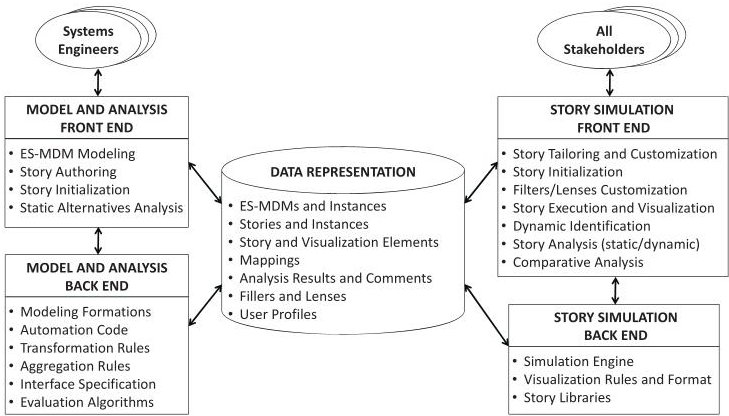
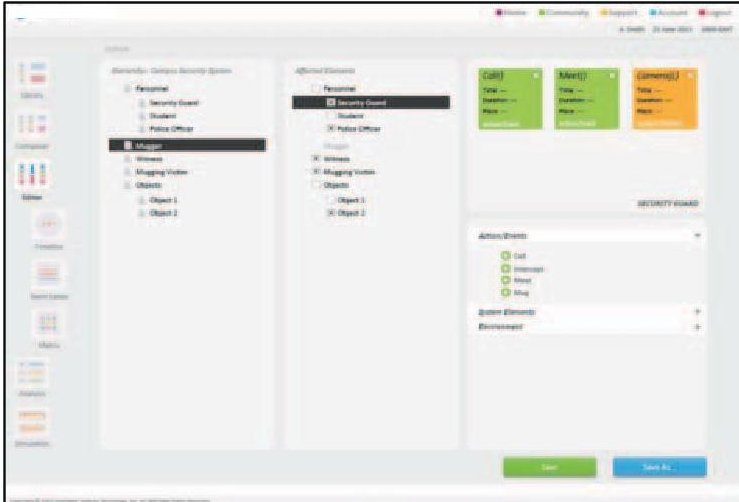
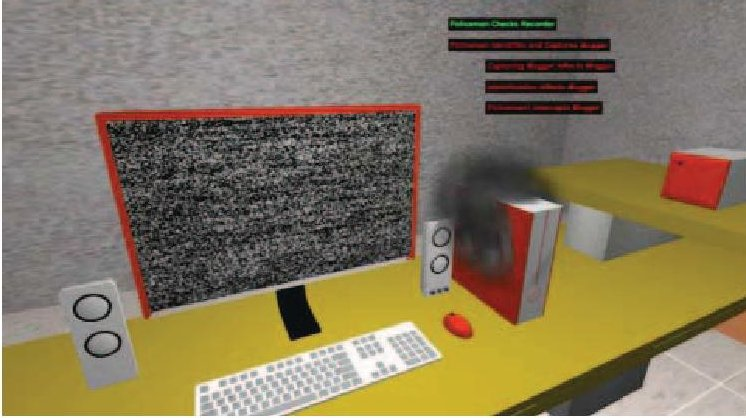

<!-- PDF_PAGE: 1 -->

# Exploring and Assessing Complex Systems' Behavior through Model-Driven Storytelling

Azad M. Madni, IEEE Life Fellow Intelligent Systems Technology, Inc. Los Angeles, California, USA amadni@intelsystech.com

Marc Spraragen

Intelligent Systems Technology, Inc. Los Angeles, California, USA mspraragen@intelsystech.com

Carla C. Madni, IEEE Member Intelligent Systems Technology, Inc. Los Angeles, California, USA cmadni@intelsystech.com

Abstract - Complex systems are difficult to analyze because of unknown interactions and dependencies among system components, and between the system and the environment. These interactions and dependencies tend to produce unpredictable behaviors that can often lead to detrimental outcomes. Traditional systems engineering that relies on reductive approaches are not suitable for the analysis and design of complex systems. This recognition has led to the development of new paradigms, methods, and tools that better enable: exploration of a complex system's behavior and tradespace; detection, diagnosis, and visualization of component/subsystem dependencies and interactions; and identification, alerting, and circumvention of potentially undesirable interactions. This paper presents a system model-driven interactive storytelling approach for analyzing interactions and dependencies within complex systems, and between complex systems and the environment. An exemplar complex system is used to convey key elements of the approach. The methodology is applicable for a variety of complex systems such as global supply chains, power and energy management, transportation networks, aerospace and aviation enterprises, and defense systems.

Keywords — model based systems engineering, complex systems, interactive storytelling, dependency modeling, change propagation

## I. INTRODUCTION

A key goal of complex systems engineering is to maximize the utility of and extract maximum value from a complex system for the investment made. For DoD, the value proposition has to be across a range of potential missions and alternative futures. To achieve this goal, requires technical advances on multiple fronts including the ability to: a) design, analyze, and assess alternative system designs to acquire an in depth understanding of system interactions (within and without) at multiple levels of abstraction; b) supplement customizable qualitative visualization with quantitative data to provide comprehensive insights; c) reduce data flows subject to time and cost constraints; d) acquire and incorporate live updates on changes in subsystems/component interactions; e) assure executability of

workflows spanning multiple heterogeneous tools and data bases; f) mediate workflow element outputs and inputs of successor elements to ensure compatibility and smooth flow; and g) develop metrics to calculate and manage structural complexity [1].

Complex systems are difficult to analyze because of unknown interactions and dependencies among system components, and between the system and the environment. These interactions and dependencies often produce unpredictable behaviors that can potentially lead to detrimental outcomes. Traditional systems engineering approaches and tools based on reductive methods are not suitable for the analysis and design of complex systems. This recognition has spurred interest in the development of new paradigms, methods, and tools to: better explore the behavior and design tradespace of complex systems; detect, diagnose, and visualize component/subsystem interactions; and identify, alert, and circumvent potentially undesirable interactions. In light of the foregoing, what is needed is a methodological framework for modeling, visualizing, analyzing, managing, and exploring the behaviors of complex systems subject to various types of changes including internal malfunctions and external disruptors.

This paper presents a system model-driven interactive storytelling approach and framework for complex system engineering. The approach combines matrix methods such as ES-MDM [2], [3], Change Propagation Methods [4], [5], contextual filtering [6], and gamebased simulation [6], to create a capability that enables exploration and shaping of complex system behavior. Existing matrix products on the market today (e.g., Lattix Software, Cambridge Advanced Modeller, NDepend, Phoenix from 4DiXplorer AG) are primarily focused on engineering management, project management, and software development. Some matrix-based tools support static analysis only and require "hand-stitching" of matrices. In sharp contrast, the methodology and tool presented in this paper employ dynamic data representations and analysis techniques which are realized through the integration of formal matrix representation methods with interactive story simulation in virtual worlds [6], [7], [8].

<!-- PDF_PAGE: 2 -->

The rest of the paper is organized as follows. Section II presents a complex system analysis and design methodology based on multi-domain modeling, change propagation, contextual filtering, and storytelling approaches. Section III presents an illustrative scenario for highlighting the key aspects of the methodology. Section IV presents the tool system concept and design. Section V presents the implementation architecture of the tool. Section VI presents the conclusions of the R&D, summarizes the paper, and discusses future outlook.

## II. MODEL-DRIVEN STORYTELLING METHODOLOGY

The model-driven storytelling methodology combines four complementary techniques: multi-domain modeling, change propagation analysis, contextual filtering, and story-driven simulation in virtual worlds. The underlying approach enables all system stakeholders to explore the complex system design tradespace and influence system behavior.

Engineering System Multiple Domain Matrix (ESMDM). This method is a form of entity-relationship (ER) model. However, it extends the Domain Structure Matrix (DSM) model to include multiple domains, multiple relations, and changes over time [2]. The ES-MDM was developed to overcome the limitations of existing frameworks in representing environmental interactions and influence of time on the system, and thereby to create a more holistic representation of the system. The ES-MDM methodology reaches beyond the physical, social, and process domains to include system drivers, node attributes, and system evolution. The ES-MDM includes six domains: System Drivers, Stakeholders, Objectives Functions, Objects, and Activities [2].

Change Propagation Methods (CPM) These methods attributed to Clarkson, Simons, and Eckert [4], offer a framework for analyzing the propagation of change within and throughout a system. Change propagates, for example, when the tolerance margins of parameters associated with individual subsystems are exceeded. Tolerance margins may take the form of design buffers or contingency margins [5], [6]. The latter are specified based on a rough assessment of future uncertainties. Thus, an appropriate first step is to identify change scenarios that take into account future uncertainties and then examine how change propagates within the system. Change scenarios typically pose the question, "If component A needs to change in light of an uncertainty being resolved, then what other components also need to change?" In this instance, component A is where the change is introduced. The answer to the question is based on an assessment of the perceived magnitude of change required in comparison to the contingency margin of the component in question. When the margin is exceeded, change propagates. If the margin is not exceeded, then the change is absorbed. It is important to note that change can be introduced at multiple points in

a change scenario, or introduced simultaneously into multiple components.

Since change tends to become increasingly more costly with greater levels of integration, it is imperative to develop an understanding of how the system is likely to respond to future change, and where possible, create a resilient design, i.e., a design that can accommodate or adapt to change [9], [10]. Eckert, Clarkson, and Zanker [11] discovered that when change is introduced into one or more components within a highly connected system, the ripple effect of the change can propagate upstream (e.g., to reset previous assumptions) and downstream throughout the system. These researchers also discovered that the network of connections could be parsimoniously represented as a change matrix, similar to a Design Structure Matrix (DSM). However, unlike a DSM in which the relationships are not necessarily quantified, the relationships in a change matrix can be measured by a combination of change likelihood and change impact.

A key question with the analysis of any complex system is determining the likely direction of change propagation. Answering this question requires knowledge of contingency margins associated with each subsystem or component within the system. The propagation of change is highly dependent on these margins being exceeded. It is prohibitively difficult for a subject matter expert (SME) to answer this question because the SME would need knowledge of all contingency margins in all elements of the complex system, and, moreover, all the margins' interdependencies.

Contextual Filtering. In the process of contextual filtering, the context is typically provided by a change scenario. An ES-MDM typically includes a large set of entities as well as their dependencies and/or interactions. Contextual filtering allows simplification of the ES-MDM, to include only those types of relationships affected by the change scenarios [6]. It is worth recalling that a ES-MDM represents a directed graph, and that changes can propagate both upstream and downstream from the point where the change is introduced into the system. Therefore, the ES-MDM must first be transformed into an undirected graph. Given a particular change scenario, the identified change locations, and the relationship types affected by the change, the filtering algorithm searches the ES-MDM for all defined connections between nodes matching the relationship types. The result is an undirected graph that includes only the nodes within the new filtered network for each affected relationship type. This simplification helps reduce overall problem complexity, making it more manageable.

Story Simulation in Virtual Worlds. Tying systems engineering matrices to time-based simulations, and especially story-driven simulations, enables "what-if" exploration of system behavior [6], [12] from multiple perspectives, including those of non-engineer stakeholders. The findings from this analysis (e.g., newly discov-

<!-- PDF_PAGE: 3 -->

ered interactions) can be used to update the initial matrices. The resulting, iterative feedback loop essentially transforms static matrices into dynamic matrices.

## III. EXEMPLAR COMPLEX SYSTEM

Table 1 presents the criteria used for complex system selection.

Table 1. Complex Systems Selection Criteria

1. Known interactions and outcomes

2. Multiple interactions/dependencies among system elements

3. Multiple potential interactions between the system and the external environment

4. Humans are part of the system and interact frequently with other system elements

5. Multiple possible change initiators (e.g., human inputs/errors; equipment malfunction)

6. Multiple potential paths for change propagation with likelihood for "event cascades" and unintended consequences

7. Complex system and environment models exist, or can be created from available sources

A Campus Security System (CSS), that monitors a campus environment and issues alerts, notifications, and reports was selected to demonstrate the approach. This system is a sociotechnical system comprising electromechanical components/equipment (e.g., cameras/sensors, computers, wireless routers, phone network), and security personnel (guards, operators). The sensors/cameras send wireless data feeds that are stored and played back on CSS computers. The campus environment consists of buildings, walkways, roads, and pedestrian traffic (i.e., student, faculty, staff, and potential muggers). CSS operation can be disrupted by internal malfunction or external changes. Change initiators include: human error, equipment malfunction, and environment stressors (e.g., road closures, increased traffic, fire, natural disasters). A sociotechnical system is characterized by substantial uncertainty and high likelihood of surprise because of the presence of humans. The model-augmented interactive storytelling methodology helps identify and model known interactions and outcomes as well as uncover previously unknown interactions through story execution in virtual worlds [9,17]. During story generation, potential interactions based on user-supplied initial conditions are entered into the master matrix. The actual outcomes (e.g., critical parameters, interactions, and cascades) are identified through story simulation. Known interactions can be made to occur with different probabilities in a story. Unknown/unpredicted interactions can be uncovered during goal-based story execution with different assumptions and conditions. The goal-based story approach also contributes to the ability to capture and evaluate com

plex system behavior. Highlighting and weighting the paths and interactions based on their relative contribution to the story goals allow the user to evaluate the system's strengths and weaknesses.

## IV. TOOL CONCEPT AND DESIGN

The specific questions that were answered when designing the tool included: a) determining how best to combine ES-MDM, CPM, contextual filtering, and simulation/story engine to develop a dynamic representation of the complex system; b) developing an end useroriented front-end for formal modeling, designing, visualization, and analysis, story authoring, and viewing/editing of story simulations to bring out specific behaviors; c) determining how best to visualize the system from multiple perspectives to facilitate collaborative use of the front-end; d) determining what data is needed to exercise the models and demonstrate the approach. Using the foregoing criteria, we developed the tool usage concept and design.

## A. Dynamic Representations

Dynamic representation implies that each entry in the ES-MDM can have a time-varying state. The tool offers capabilities for both static and dynamic ES-MDM representation [2], including the ability to capture and visually depict matrices and graphs for each domain. Since ES-MDM is a multi-level, multi-perspective, graph representation (Figure 1), it means that each node (e.g., diagonal matrix entry) and each arc (e.g., off-diagonal matrix entry) can have more than one attribute or relationship.

Fig. 1. Dynamic ES-MDM representation (based on [2])

<table border="1"><tr><td></td><td>System Drivers</td><td>Interactions</td><td>Objectives</td><td>Functions</td><td>Objects</td><td>Activities</td></tr><tr><td>System Drivers</td><td>Emw X Emw</td><td>S X Emw</td><td>V X Emw</td><td>F X Emw</td><td>O X Emw</td><td>A X Emw</td></tr><tr><td>Interactions</td><td>Emw X S</td><td>S X S</td><td>V X S</td><td>F X S</td><td>O X S</td><td>A X S</td></tr><tr><td>Objectives</td><td>Emw X V</td><td>S X V</td><td>V X V</td><td>F X V</td><td>O X V</td><td>A X V</td></tr><tr><td>Functions</td><td>Emw X F</td><td>S X F</td><td>V X F</td><td>F X F</td><td>O X F</td><td>A X F</td></tr><tr><td>Objects</td><td>Emw X O</td><td>S X O</td><td>V X O</td><td>F X O</td><td>O X O</td><td>A X O</td></tr><tr><td>Activities</td><td>Emw X A</td><td>S X A</td><td>V X A</td><td>F X A</td><td>O X A</td><td>A X A</td></tr><tr><td colspan="7">Row is Influenced by Column</td></tr></table>

The architecture of the prototype tool is shown in Figure 2. As shown in the figure, there are five main components: a) model and analysis front end; b) model and analysis back-end; c) story simulation front-end; d) story simulation back-end; and e) data representation that supports all interfaces and functions of the tool.

<!-- PDF_PAGE: 4 -->

## Figure 3 shows prototype tool front end to specify ESMDM

Fig. 2. Prototype tool architecture

Fig. 3. Define ES-MDM entity and interaction cell

The tool can exploit formal data representations and methods through matrix-based and graph-based views, which are further enriched through visualization metaphors and color to illuminate certain key aspects of the complex system. The specific data representations employed by the tool include:

- multiple matrices (with entries allowing for multiple attributes and relationships and temporal changes);

- multiple graphs (with nodes of multiple/varying types and edges of multiple/varying types) with the ability to capture switch costs, if a node is changed;

- color and other visual differentiation (e.g., font, highlight, movement, focus).

A key discriminator of the approach is the capability to design and analyze systems as dynamic representations that result from uncovering integrations during dynamic execution of stories. Each story, in turn, is based on a domain, and both story and domain are inextricably linked to the formal data representation. The three main data representation components supporting this capability are:

evaluation functions for each cell/submatrix. These functions employ input and output parameters which are sent from one cell to another instantaneously or over time, via the change relationships. The cascade of relationships forms the basis of story flow, and is used to initialize the story hyper matrix.

- ES-MDM-Plus: A modified dynamic ES-MDM represents potential story actors and potential events for a particular domain. The modification includes

- Story Instance: A time-ordered set of matrices representing a single narrative. At time = 0, the Story Instance is initialized using a full or partial ESMDM. The remaining matrices in the story instance are associated with particular events or time slices within the overall narrative.

Visualization Mapping: This is the mapping between ES-MDM representation and the story simulation that all stakeholders can interact with. For example, the mapping can include specific physical laws and AI agent-based rules, as well as 3D graphic model URLs, or animation scripts. In the formal representation, the mapping appears as attribute values of generic or specific matrix entities, or within the evaluation functions or other attributes of interaction cells, or as part of parameters that define relationships between cells. In the tool's visualization engine, each matrix element to be mapped references a corresponding file asset, data structure, or code fragment associated with the story. Since the data volume precludes manual data population for most domains, the methodology employs automated techniques to populate very large, complex ES-MDMs. Known, reusable component/subsystem types can be added to the matrix, with relationships being automatically generated between added entities and rest of the system.

Results from "what-if" explorations conducted in the story-based simulation are used to update the story matrix and/or the ES-MDM, as necessary. The combined representation reflects the "living model" of the complex system. Figure 6 shows the tool's visualization corresponding to a freeze frame of the exemplar CSS story during execution. Figure 7 shows a story outcome corresponding to an assailant (i.e., mugger) not being identified due to computer failure.

## B. Analysis and Visualization Capabilities

Three types of visualization-supported analysis are possible: static structural analysis; dynamic analysis; and comparative analysis of alternatives. Each analysis type is discussed next.

- Structural analysis (static) comprises techniques associated with matrix and graph manipulation and calculations. Some of the more common forms of analysis are active sum and passive sum (i.e., quantity of outgoing and incoming edges), clustering (i.e., subset containing a large number of internal edges compared to external ones) and feedback loops (i.e., subset with circularly arranged edges).

<!-- PDF_PAGE: 5 -->

Fig. 6. Story visualization during execution

Fig. 7. Story outcome visualization: assailant gets away due to CSS computer failure

Active sum and passive sum pertain to components that provide or receive multiple impacts to and from farther out components. With respect to ES-MDM representation, standard matrix and graph manipulation techniques apply. In a similar vein, the story and its elements can be structurally analyzed.

- Dynamic analysis is concerned with developing an understanding of how change scenarios (or stories) are likely to cause changes to a subsystem or component within the system and how those changes are likely to propagate through the system and ultimately result in desired or undesirable outcomes. Change propagation analysis (CPA) is concerned with making such assessments. This approach works well with ES-MDM in which different parts become active for different change scenarios. Centrality metrics can be computed and propagation paths can be weighted with probabilities to compute outcomes corresponding to different change scenarios. The second aspect of dynamic analysis is identification of critical nodes within the system for monitoring and/or intervention. Coldspots are system elements that are insensitive to change. Hotspots are system elements that are sensitive to change [13]. Flexible design opportunity analysis can also be included as "advanced" dynamic analysis capabilities [14]. These capabilities can build upon change propagation analysis, with appropriate visualizations and guidance for "intervention"

points in the design to propose alternative systems for evaluation. Critical nodes are nodes with high cost of change, high probability of change, and those that act as flow bottlenecks, and/or serve as key contributors to system effectiveness. Analyses techniques can be employed to identify one or more different types of hotspots, which can vary based on story scenario context and user interests. Visualization of hotspots can reduce perceived complexity while directing the user's attention to key aspects of the system under development or investigation. Finally, identification of hotspots provides targets for enhancing resilience. Using the ES-MDM representation, bottlenecks are cells that lie on the only path or one of a few paths between two subsets or subsystems. The more critical the path, the more a bottleneck qualifies as a hotspot. From a dynamic analysis point of view, the tool generates a "progression" of ES-MDMs (i.e., time-stamped ES-MDMs). Visualization employing color and orientation is used to depict the temporal progression of ES-MDM, with one or more matrices (or graphs) in view at one time, and with changes indicated both instantaneously and cumulatively. Time progression of ES-MDMs is accomplished through one of three means: a) user specifies ES-MDMs with timestamps; b) events determine next time-stamped ES-MDM with entries determined by the story and accepted by the user; and c) simulation-based progression that generates new time-stamped ES-MDMs based on algorithms (e.g., performance simulation that alters system element state and calculates system performance; ES-MDM generated triggers can include disturbance events, such as system element degradation/ removal).

- Comparison of Alternatives. Comparative analysis of alternatives begins with creating "system models" within the ES-MDM construct using manual, inherited or assisted means. Then stories are created for evaluation of system within stories. Then stories are assigned to systems. Subsequently, systems are evaluated within stories, and analyzed without stories. A variety of comparisons can be conducted ranging from comparison of systems, comparison of technical stories, comparison of systems within stories, and comparison of static analysis results. Various visualizations for each comparison can be employed including tables, side-by-side simulation runs, difference trees, scatter plots, bar charts, pie charts and parallel coordinates [9].

## V. SUMMARY

Complex systems pose a modeling and analysis challenge for systems engineers. In large part, the problem stems from the fact that not all interactions and dependencies among system elements and between the system

<!-- PDF_PAGE: 6 -->

and the environment are known a priori. Matrix methods such as ES-MDM are suitable for capturing interactions and dependencies in a compact and useful form. However, additional methods are needed to uncover the remaining dependencies and interactions and to propagate changes within the system and to the external environment. In this paper, we have presented an integrated modeling and storytelling approach that offers a closed loop process to propagate changes, identify change cascades, and assess outcomes. Using the tool, a complex system may be explored from a variety of perspectives, using formal representations, or visualized within story simulations. The system is modeled using ES-MDM modeling construct. The ES-MDM model is integrated with a story simulation that employs a COTS game engine for story simulation and visualization. The overall approach is intended to allow all stakeholders to contribute to complex system design. The benefits of the overall approach are several. Tying storytelling to formal system models gives bi-directional traceability. Uncovering previously unknown interactions and dependencies helps populate the system models more completely leading to more accurate dynamic analysis. Allowing all stakeholders to interact with the system model in virtual worlds and observe results of various interventions helps secure stakeholders' buy-in. Providing different lenses into system behavior reduces cognitive complexity, and focuses the tool's responses for the different stakeholders. Collectively, these capabilities facilitate complex system analysis while allowing stakeholders to have a say in system design and influence and shape system behavior. In the future, powerful visualization schemes can be added to enhance understanding and present system responses in actionable format.

## ACKNOWLEDGMENT

This R&D was partially conducted under a Phase I Army Research Laboratory Small Business Innovation Research.

## REFERENCES

[1] Lindemann, U., Maurer, M., and Braun, T., Structural Complexity Management: An Approach for the Field of Product Design, Berlin: Springer-Verlag, 2009.

[2] Bartolomei, J.E., Qualitative Knowledge Construction for Engineering Systems: Extending Design Structure Matrix Methodology in Scope and Procedure, Doctor of Philosophy Dissertation, Engineering Systems Division, MIT, June 2007.

[3] Eppinger, S.D. and Browning, T.R. Design Structure Matrix Methods and Applications, MIT Press, 2012.

[4] Clarkson, J.P., Simons, C., and Eckert, C. "Predicting Change Propagation in Complex Design." Technical Proceedings of the ASME 2001 Design Engineering Technical Conferences (Pittsburgh, PA, Sep 9-21, 2001), DETC2001/DTM-21698.

[5] Giffin, M., de Weck, O., Bounova, G., Keller, R., Eckert, C., and Clarkson, P.J., "Change Propagation Analysis in Complex Technical Systems," Journal of Mechanical Design, Vol. 131 No. 8, August 2009, pp. 1-14.

[6] Madni, A.M., Spraragen, M., Madni, C.C., and Ross, A. "VisualAnalytix $ ^{\mathrm{TM}} $ : Identification and Visualization of Interactions & Their Consequences within Complex Systems," Intelligent Systems Technology, Inc. Phase I Final Report, Contract # W911QX-13-C-0082, January 16, 2014.

[7] Bainbridge, W.S. "The scientific research potential of virtual worlds," Science, 317 (5837), 472-476, 2007.

[8] Madni, A.M., and Madni, C.C. "Intelligent Agents as Synthetic Role Players in Scenario-Based Training," Journal of Integrated Design and Process Science, Vol. 12, No. 1, Mar 2008, pp. 41-56.

[9] Madni, A.M., and Jackson, S. "Towards a Conceptual Framework for Resilience Engineering," IEEE Systems Journal, Special issue on Resilience Engineering, Paper No. 132, 2009.

[10] Neches, R. and Madni, A.M. "Towards Affordably Adaptable and Effective Systems," Systems Engineering, Vol. 15, No. 1, 2012.

[11] Eckert, C., Clarkson, J.P., and Zanker, W., "Change and Customisation in Complex Engineering Domains," Research in Engineering Design, 15(1):1-21, 2004.

[12] Madni, A.M. Expanding Stakeholder Participation in Upfront Systems Engineering Through Storytelling in Virtual Worlds; accepted for publication in Systems Engineering, 2014.

[13] Hansen, K.L. and Rush, H. "Hotspots in Complex Product Systems: emerging issues in innovation management," Technovation 18, no. 8, 555-590, 1998.

[14] Madni A. "Adaptable Platform-Based Engineering: Key Enablers and Outlook for the Future," Systems Engineering, Vol. 15, No. 1, 2012.